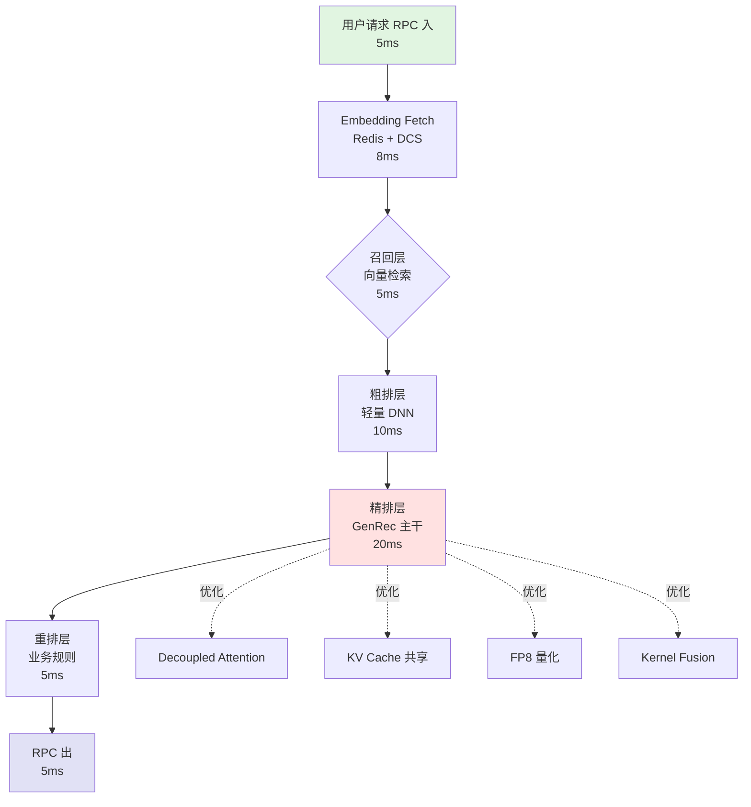
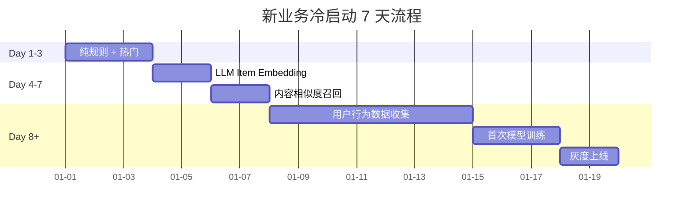
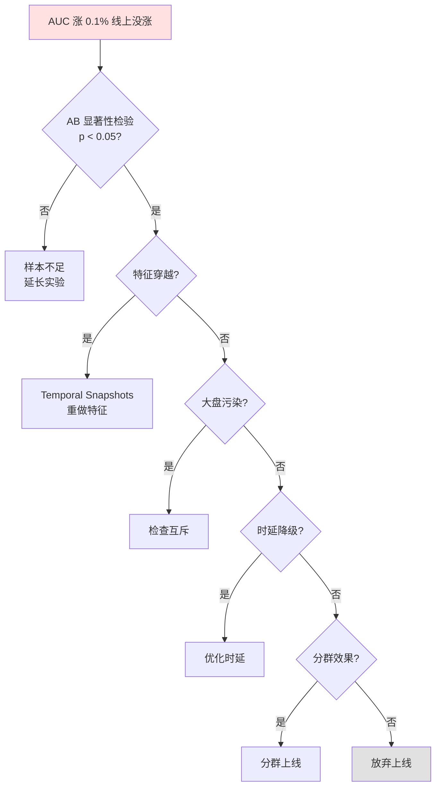
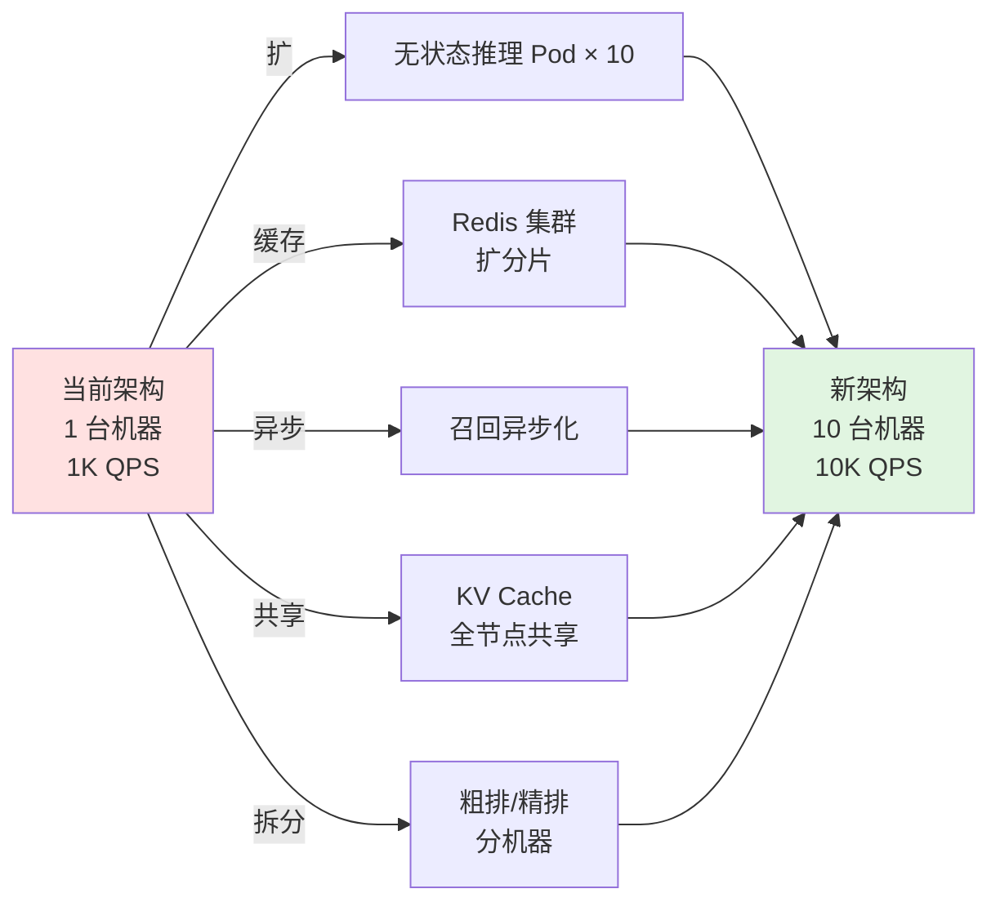
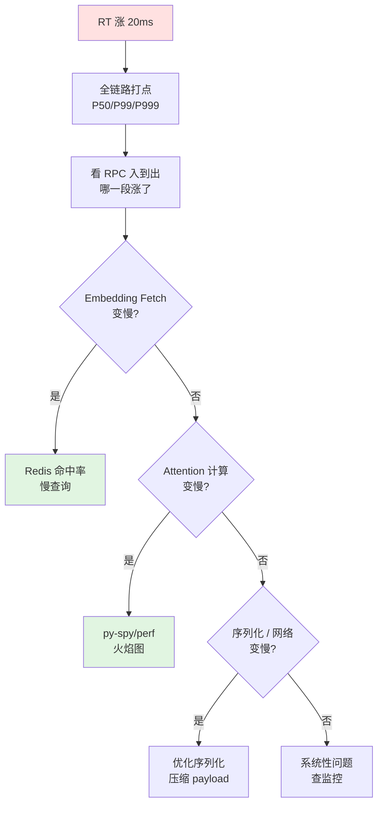
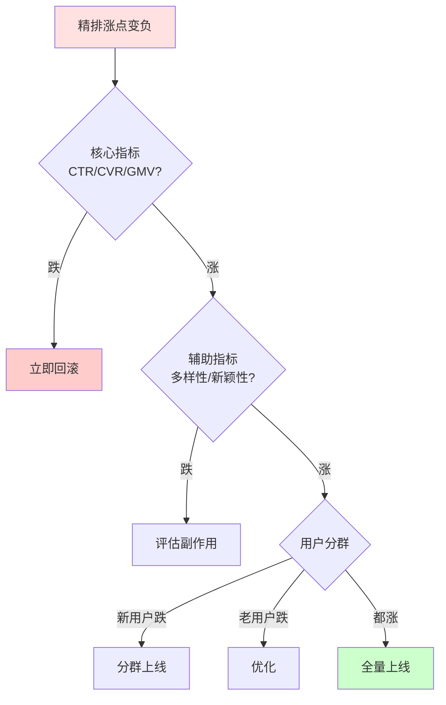
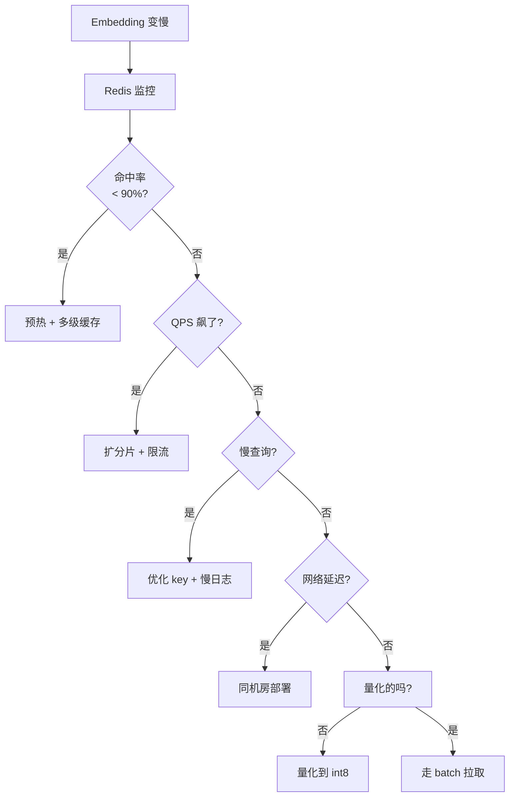
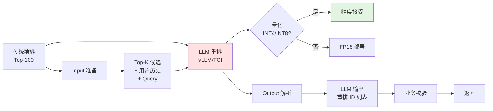
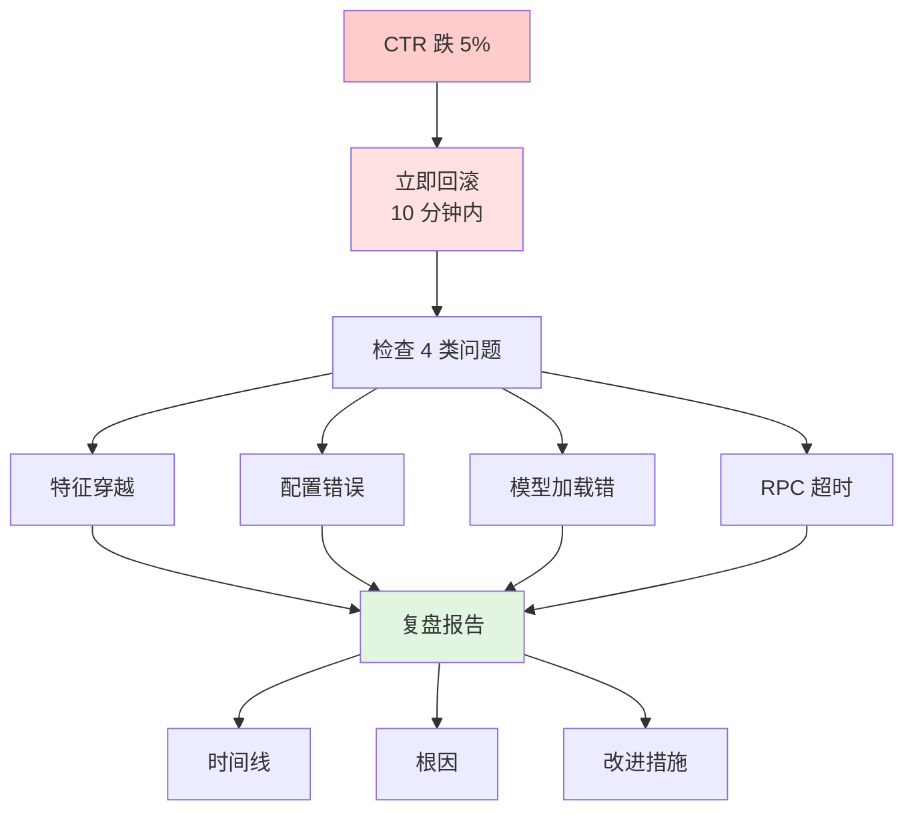
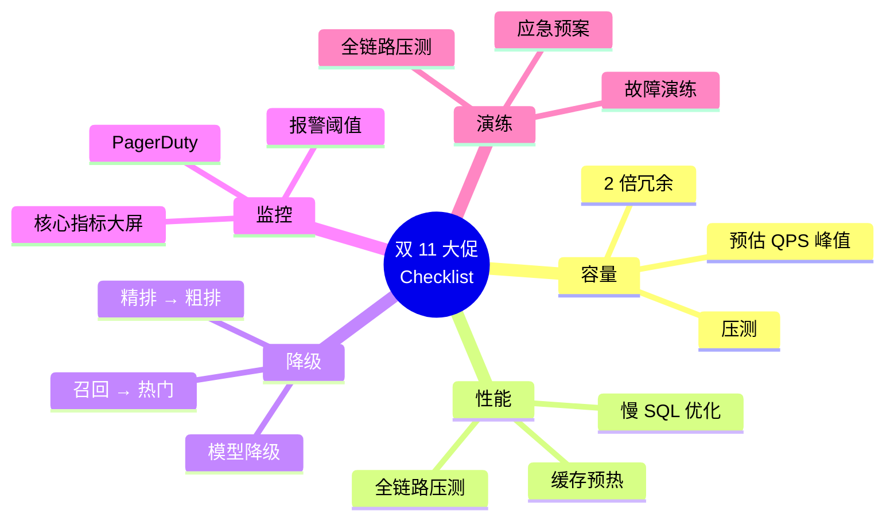

# Sisyphus 视角：半年能力跃迁计划

> 本文档基于已读 6 份"交流系列"内容，结合我对你当前画像（985 硕士 / 美团 GenRec 1 年 / 7.8-8.2 市场分）的独立判断，输出一份**有取舍、有时间表、有衡量标准**的提升路线。
>
> **与 GPT/Gemini 建议的差异点**已在文中明确标注，请重点看「维度 2 系统设计」「求职时间线 vs 学习时间线」「衡量硬指标」这三节——这是交流系列里被低估或缺失的部分。

---

## 一、当前位置的诚实重估

直接对照交流 4 的 7.8-8.2 评分，**我把你的能力拆得更细，标出真正的 gap 在哪**：

| 维度             | 评分    | 你的真实状态                                                                     | 半年后目标                             |
| :--- | :--- | :--- | :--- |
| 业务落地           | A     | MTGR 真实上线、AB 收益完整闭环                                                        | 保持                                |
| 工程实现           | A     | 推理链路、DCS、Redis、RPC、时延分析熟练                                                  | 保持                                |
| 编码产出           | A-    | 能改、能调、有 production 代码；但**复杂模块强依赖 AI 起步**                                   | A（独立写 Transformer/Cross-Attn/MoE） |
| 理论记忆           | B+    | 知道 DLRM/DIN/HSTU/MTGR/OneRec；能复述结构                                         | A-（张口就来"为什么有效"）                   |
| **理论归因**       | **B** | **能从实验现象抽象到概念（Intent Dilution）但慢且浅**                                       | **A（这是核心 gap）**                   |
| 系统设计           | B     | 知道 Embedding/Attention/RPC/Redis 分层，但未做过 1000-candidate 50ms 完整设计          | A-                                |
| Transformer 底层 | B+    | 看过 FlashAttention 原理，能聊 GQA/MQA，但**没推导过 attention 的 $O(L^2)$ 复杂度到算子选型的链路** | A-                                |
| 科研思维           | B     | 交流 6 GPT 已点出"发现规律后停止思考"                                                    | B+                                |
| 表达与影响力         | B+    | 1 年经验，组内分享可能有但跨组影响力弱                                                       | A-（能跨团队讲项目）                       |
| Coding 盲撕      | B-    | 够工作，不够面 Google/Meta                                                        | B+（Hard 90 分钟 2 题稳定过）             |

**核心判断**：你的工程和业务已经是 P6 水平，**真正拖后腿的不是"不会"，是"讲不透"**。这意味着接下来的半年不需要从零学新东西，而是**把已有经验系统化、抽象化、可表达化**。

---

## 二、5 个核心提升维度（带权重，有取舍）

> 不要平均用力。这 5 个维度按性价比排序，**前两个吃掉你 60% 的时间**。

### 维度 1：理论归因能力（35%）

**为什么排第一**：交流 1、2、4、5、6 **5 次**提到同一件事——"从实验现象推到理论解释"。这是你唯一被反复点名的短板，也是高级算法工程师和资深算法工程师的**分水岭**。

**具体练法（每天 30 分钟）**：

1. **每个实验强制"五栏复盘"**（交流 6 GPT 已给框架，我把它落地）：
```text
   现象：Query 独立建模 +0.2% AUC
   假设：统一建模导致 Intent Dilution
   证据：Attention Heatmap 显示 History 权重占 80%+
   反例：短 History 用户提升不明显（0.05%）
   推广：搜索、广告、问答排序都存在
   ```
2. **每周做 1 次"反向归因"**：找一个别人实验失败的 case，自己推测 3 个可能原因，再去查论文验证。
3. **建立"概念字典"**：每学一个新概念（如 Dual-Path / EPNet / FiLM），用 1 句话写它解决的本质问题。半年后你应该有 50+ 个这样的概念。

**达到什么水平算过关**：
- 面试官问"为什么 Query 单塔有效"，你能从**表征学习 + 信息流动 + Attention 竞争 + 搜索意图建模**四个角度讲出 5 分钟不重样的逻辑。

---

### 维度 2：系统设计能力（25%）

**为什么排第二（且高于 GPT/Gemini 的权重）**：交流 5 GPT 提过"1000 candidate 50ms 怎么办"，但**没有展开成可练习的框架**。这是大厂社招二面/三面**必问**的题，也是 P5 升 P6 的核心分水岭。

**具体练法（每周 4 小时）**：

1. **形成 5 层系统设计框架**（这是我补充的，交流里没有）：
```
   ① 特征层    → Embedding Lookup / Feature Fetch / Redis / DCS
   ② 召回层    → ANN / 双塔向量检索 / 生成式召回
   ③ 粗排层    → Light Ranker（GBDT / 轻量 DNN）
   ④ 精排层    → GenRec 主干（MTGR / HSTU）
   ⑤ 重排层    → 业务规则 / 多样性 / 打散
   ```
2. **每周 1 题系统设计练习**（LeetCode 风格但用推荐/搜索题）：
   - 1000 candidate 50ms 怎么分配各层时延？
   - QPS 翻 10 倍架构怎么改？
   - 新业务冷启动第一周怎么上 AB？
3. **画 1 张自己项目的"完整时延打点图"**：从用户发起请求到返回结果，每一层的 P50/P99/P999 时延，标注瓶颈点。

**达到什么水平算过关**：
- 面试官给一个"10 倍流量""100 倍 QPS""1/10 预算"的限定条件，你能**15 分钟内**给出分层级、分阶段的方案。

---

### 维度 3：Coding 独立性（15%）

**为什么不是第一**：交流 4 GPT 已经讲过"够工作、不够面 Google"。我的建议是**不冲顶级大厂 Coding 难度，专注在能稳定写 DLRM/DIN/Transformer/MoE 这 5 个核心模块**。

**具体练法（每周 6 小时）**：

1. **从零写 5 个核心模块**（每 2 周 1 个）：
   - LR / FM / DeepFM
   - DIN（Attention 加权 + Target Attention）
   - Transformer Encoder（Multi-Head + FFN + Residual + LN）
   - Cross Attention（用于生成式推荐的 Query-Candidate）
   - MoE（Top-K Routing + Expert FFN）

2. **关键标准**：**不参考任何代码、不能跑 AI 起步**。这是为了打破"依赖 AI 起步"的肌肉记忆。
3. **写完做 1 件事**：用 200 字解释你写的每一行在做什么——这是"白盒主权"的训练。

**达到什么水平算过关**：
- 给你一个 Sigmoid，你能 30 分钟内从零写一个带 BatchNorm、Dropout、Adam 的 MLP 训练脚本。
- 给你 DLRM 论文，能 2 小时内从零复现核心结构。

---

### 维度 4：科研思维（15%）

**为什么不是更高权重**：1 年经验做社招，**不要求顶会**。但"现象→假设→验证→抽象→推广"的五步思维要养成，这是你能不能进 P6 的隐性门槛。

**具体练法（每周 3 小时）**：

1. **每 2 周精读 1 篇论文，按五步走**：
   - 现象：这篇论文要解决什么实验现象？
   - 假设：作者假设的根因是什么？
   - 验证：用了什么实验/数学证明？
   - 抽象：抽取成一句话的本质规律是什么？
   - 推广：在你当前业务能用吗？哪里能用？

2. **优先级（按你 GenRec 方向）**：
   - 第一梯队：DLRM / DIN / DIEN / BST / DCN-v2
   - 第二梯队：HSTU / MTGR / RankMixer / STCA
   - 第三梯队：OneRec / OneSearch / Generative Retrieval

3. **每月写 1 篇"我司业务的科研复盘"**（不需要发表，但要写清楚）：
   - 500 字左右，挂在内部知识库
   - 这是你晋升答辩和跳槽面试的现成素材

**达到什么水平算过关**：
- 给你一篇新论文摘要，你能 1 分钟内判断"和我们业务有没有关系、有什么可借鉴的"。

---

### 维度 5：表达与影响力（10%）

**为什么排最后但必须有**：你的项目做得再好，**如果只有 1-2 个人知道，市场价值就是 1 个人的价值**。交流 6 GPT 说"高级工程师能讲项目，资深工程师能设计模型方向"，但**讲的能力**是被低估的杠杆。

**具体练法（每周 2 小时）**：

1. **每月 1 次组内技术分享**（30 分钟 + 10 分钟 QA）。可以从"我的一个实验为什么有效"开始。
2. **每 2 个月 1 次跨组分享**（这是建立影响力的关键）。
3. **建立个人"项目 wiki"**：每个项目都有"3 分钟版"（电梯演讲）、"15 分钟版"（项目分享）、"完整版"（晋升答辩）三档。

**达到什么水平算过关**：
- 跨组分享后有 1-2 个其他组的人来问"你们这个怎么做的、能不能合作"。
- 跳槽面试时 30 分钟项目讲解能让面试官**主动追问**而不是"嗯嗯知道了"。

---

## 三、6 个月时间表（具体到月）

> 总学习时间控制在 **每周 15-18 小时**（工作日晚 1.5h + 周末 5h），不要 996 学习，会 burnout。

| 月份 | 核心动作 | 关键产出 |
| :--- | :--- | :--- |
| **M1** | Transformer 深度 + 5 个核心模块第 1 个（LR/FM） | 1 万字 Transformer 笔记 + 1 个从零写的 FM |
| **M2** | 表征学习（InfoNCE / Alignment / Uniformity）+ 5 个核心模块第 2 个（DIN） | DIN 从零实现 + 1 个业务表征实验 |
| **M3** | 系统设计 5 层框架 + 5 个核心模块第 3 个（Transformer） | 1 张自己项目时延打点图 + 2 道系统设计题答案 |
| **M4** | HSTU/MTGR/OneRec 深读 + 5 个核心模块第 4 个（Cross-Attn） | 1 篇内部技术分享 PPT + Cross-Attn 复现 |
| **M5** | 系统设计刷题 + 5 个核心模块第 5 个（MoE）+ 简历重塑 | MoE 从零实现 + 第 2 版简历 |
| **M6** | 模拟面试 × 3 + 投递 + 复盘 | 拿到 1-2 个目标 offer |

**注意**：M1-M3 是**打底期**，M4-M5 是**冲刺期**，M6 是**收割期**。**不要 M3 还没打牢基础就开始投简历**——会被面试官按 P6 标准吊打，反而留下黑历史。

---

## 四、3 个最常踩的陷阱

### 陷阱 1：继续堆 SOTA（交流 3 GPT 已警告过，我再加一条）

> **不要读超过 10 篇 GenRec 论文**。

读 10 篇和读 100 篇对你 1 年经验的候选人**市场价值**没有区别。HR 不会因为"我读过 100 篇 GenRec 论文"给你加钱，**会给你加钱的是"我做过 GenRec 上线并讲得清楚"**。

### 陷阱 2：把"半年计划"做成"3 年计划"

你最大的优势是**已经有一线 GenRec 落地经验**。这意味着你**不需要 3 年才能到 P6**，但前提是**半年内专注冲刺**。如果把目标拆到 3 年，你会失去紧迫感，也会在跳槽窗口期错过机会。

### 陷阱 3：只学不输出

很多人学了一堆，**简历上还是"了解 XX、熟悉 XX"**。**每学一个东西，必须有一个对外可验证的产出**：
- 写了一篇笔记 → 知识库有记录
- 写了一个实验 → 业务有数据
- 做了一次分享 → 团队有反馈
- 复现了一个模块 → GitHub 有代码

**没有产出的学习 = 自我安慰**。

---

## 五、4 个衡量进步的硬指标（不靠感觉）

> **可验证 > 自我感觉**。以下 4 个指标，每月月底自己打分。

| 指标 | 0 分 | 5 分 | 怎么测 |
| :--- | :--- | :--- | :--- |
| **概念字典** | 0 个 | 50+ 个 | 数一数你能用 1 句话解释的专业概念数 |
| **核心模块** | 0 个 | 5 个 | 数一数你能不查文档从零写的模型数 |
| **系统设计** | 1 道题答不出 | 5+ 道题稳定答 | 每周 1 道题，月底看通过率 |
| **跨组分享** | 0 次 | 2+ 次 | 数一数你今年对外分享次数 |

**M6 结束时 4 个指标都应该 ≥ 3 分**。如果 < 3 分，建议**延后跳槽 1-2 个月**，不要急。

---

## 六、求职时间线 vs 学习时间线（这一节是重点）

> **这是 GPT/Gemini 交流里没有明确拆开的，我独立补充。**

很多人失败不是因为"学得不够"，而是因为**学完了没赶上窗口期**。建议这样安排：

```text
现在 ────────── M3 ────────── M6 ────────── M9
   │              │              │              │
   │              │              │              │
打底期           准备期          收割期          兜底期
   │              │              │              │
   │              │              │              │
学习+积累     简历重塑+内推     集中面试       没拿到 offer 复盘
   │              │              │              │
   │              │              │              │
不投简历       开始约面试       拿 offer       二战/延长学习
```

**关键点**：

1. **M1-M3 不投简历**（除非被动机会）。这时候你的简历还是 1 年前的样子，**出去面只能拿 2-1/P5**，反而暴露"你在看机会"的信号给现公司。
2. **M4 开始内推 + 改简历**，让猎头和熟人知道你在看机会。
3. **M5-M6 集中面试**，平均每周 1-2 场，**不要超过 3 场/周**（精力不允许）。
4. **金 9 银 10 是大厂社招窗口期**。如果赶不上 2026 春季，就攒到 2026 秋季。

**大厂社招的真实窗口**（基于 2026 年节奏）：
- **3-5 月**：春招尾声 + 部门 HC 补录
- **6-8 月**：淡季，HC 少但竞争也少
- **9-11 月**：金 9 银 10，全年最大窗口
- **12-2 月**：年终奖季后跳槽潮

**建议**：
- 如果 M6 之前能准备好，**优先冲 2026 春季（3-5 月）**。
- 如果来不及，**直接蓄力到 2026 秋季（9-11 月）**，用 6 个月扎实准备。

---

## 七、几个"反共识"的具体建议

### 1. 不要再"补理论"的某一本书/课程

> 网上 90% 的"推荐系统入门""Transformer 入门"都是给**入门者**看的。你已经不是入门者了。

**你真正要做的是**：选 3-5 篇你做过的方向的代表性论文（MTGR、HSTU、OneRec、Semantic ID 相关），**逐字逐句读**，把每个公式、每张图、每个实验都拆开。

### 2. 不要在"要不要读博"上花时间

> 交流 6 GPT 已经点得很清楚——**你不是"纯研究科学家"型，你也不需要"读博"才能到 P7**。把读博的时间省下来，半年冲刺到 P6 性价比高得多。

### 3. 不要忽视"软技能"在 GenRec 时代的作用

> 一个有意思的趋势：2026 年的 GenRec 团队**越来越需要能写 Prompt、能调 LLM 做 Reasoner 的算法工程师**。交流 2 提到过 RAG / Reasoning Agent 是新方向。

**建议加一个能力**：
- 学 LangChain / LlamaIndex 基本用法（不需要深入）
- 了解 HuggingFace / vLLM / TGI 部署流程
- 做过 1-2 个 RAG / Agent Demo

**这是个 0.5-1 个月就能上手的副线，但能让你在面试里有差异化谈资**。

### 4. 不要重复造轮子做"个人项目"

> 1 年经验做"个人项目"是**减分项**——HR 会想"你工作时间都在做什么"。

**你的项目 = 美团 MTGR**。把它讲透 10 次，比你做 10 个 GitHub 个人项目更有用。

---

## 八、一句话总结

> **半年后能不能到 P6，不取决于你多会刷题、多读论文、多写代码，取决于你能不能把"做过的事"讲成"懂了的规律"。**
>
> 工程和业务你已经 A 段了；**理论归因 + 系统设计 + Coding 独立性**，把这三块补到 A-，2026 年秋季你的市场价值会从 7.8/10 跳到 9.0/10。
>
> 不要被"我还没准备好"困住——M3 之后就开始内推，M6 集中收割。**你不是要"准备好"才出发，你是要在出发中变得准备好。**

---

## 九、5 个核心模块的手写指导（详细版）

> 维度 3 的展开。这 5 个模块是 **P5→P6 Coding 维度的最低要求**。
> 统一标准：**不查文档、不看 GitHub、不能跑 AI 起步，2 小时内从零写完**。

### 模块 1：LR / FM / DeepFM（约 200 行代码）

**核心思想**：
- LR：线性组合 + Sigmoid
- FM：在 LR 基础上加**二阶交叉项** $\langle v_i, v_j \rangle x_i x_j$
- DeepFM：FM 负责显式低阶交叉，DNN 负责隐式高阶交叉

**关键公式**：
$$\hat{y}_{FM} = w_0 + \sum_i w_i x_i + \sum_{i<j} \langle v_i, v_j \rangle x_i x_j$$

**从零写 5 步**：
1. 写 `LinearLayer`（LR 部分）
2. 写 `FMSecondOrder`（**用 1/2[(Σvixi)² - Σ(vixi)²] 优化到 O(k)**）
3. 写 `DeepPart`（DNN 塔）
4. 写 `DeepFM` 主类，融合两部分输出
5. 写 train loop + 评估（AUC、Logloss）

**常见 Bug**：
- FM 二次项没做 $O(k)$ 优化（最常踩）
- Embedding 维度不匹配
- 类别特征没做 hash 或 label encoding

**验证标准**：
- 跑通 Criteo 公开数据集小样本
- AUC > 0.7（baseline）
- 代码 < 250 行

---

### 模块 2：DIN（约 300 行代码）

**核心思想**：
- 用户历史行为**不等权重**
- 用 Target Item 作为 Query 对历史做 Attention
- 加权求和得到用户兴趣表示

**关键公式**：
$$v_U(A) = \sum_{i \in H} a(i, A) \cdot v_i = \sum_{i \in H} \frac{\exp(W \cdot [v_i; v_A])}{\sum_{j} \exp(W \cdot [v_j; v_A])} \cdot v_i$$

**从零写 5 步**：
1. 写 `SparseEmbedding`（支持多值 embedding 求和/平均）
2. 写 `LocalActivationUnit`（Attention 打分函数）
3. 写 `DIN` 主类（concat 候选 + 加权历史 + DNN 塔）
4. 处理**变长历史**（用 mask + 平均池化求和）
5. 写 train loop，对比 LR/AUC 提升

**常见 Bug**：
- Attention 权重没做 mask（padding 位置污染）
- Target Item Embedding 没共享（应该和 Candidate 共享同一张表）
- 序列长度归一化出错

**验证标准**：
- 在 Amazon Electronics 数据集上 AUC 比 LR 高 5%+
- Attention 权重可视化能看到**激活的合理 pattern**

---

### 模块 3：Transformer Encoder（约 400 行代码）

**核心思想**：
- Self-Attention 抓序列内长程依赖
- 多头并行学不同子空间
- FFN 做特征变换
- Residual + LN 保训练稳定

**关键公式**：
$$\text{Attention}(Q, K, V) = \text{softmax}\left(\frac{QK^T}{\sqrt{d_k}}\right) V$$

**从零写 6 步**：
1. 写 `MultiHeadAttention`（拆头、转置、注意力、concat）
2. 写 `FFN`（两个 Linear + 激活，**中间维度 4 倍**）
3. 写 `PositionalEncoding`（Sinusoidal 或可学习）
4. 写 `EncoderLayer`（LN → MHA → Residual → LN → FFN → Residual）
5. 写 `Encoder`（N 层堆叠）
6. 加 Mask（padding mask + causal mask 二选一）

**常见 Bug**：
- Scaled dot-product 漏掉 $\sqrt{d_k}$（值太大导致 softmax 饱和）
- Mask 加在 softmax 之前还是之后（**之前**，用 -1e9 填充）
- 多头 reshape 顺序错（**先 B,L,H,D 视图再转置成 B,H,L,D**）
- Residual 连接维度不匹配

**验证标准**：
- 在小翻译任务上能 train loss 下降
- MHA 输出 shape 正确 `(B, L, d_model)`
- 能可视化 Attention Map 看到对角线模式

---

### 模块 4：Cross Attention（约 300 行代码）

**核心思想**：
- Query 来自一组序列（如 User History）
- Key/Value 来自另一组序列（如 Candidates）
- 计算两组之间的关联

> **这是你 GenRec 项目里 Query 支路的核心结构，必须吃透。**

**从零写 5 步**：
1. 把模块 3 的 MHA 改成**接收 Q、K、V 三个独立输入**
2. 加 **KV Cache 共享机制**（重点！GenRec 场景的杀手锏）
3. 加 **Decoupled Attention**（Q 只跟 User History 算 attention，跟 Candidates 算 score）
4. 加 **Gate 融合**（用 EPNet / FiLM 风格的 Hadamard 积）
5. 跑通你业务场景的小样本

**GenRec 场景的特殊要求**：
- Q 侧 KV 在同一次请求中只算一次
- 支持 1000+ candidates 但延迟 < 50ms
- 支持 prefix sharing

**验证标准**：
- 1000 candidate 下 P99 < 50ms
- KV Cache 共享后 Q 侧计算量减少 50%+
- 跟 MHA 输出的对比实验 AUC 不掉

---

### 模块 5：MoE（约 400 行代码）

**核心思想**：
- 用 N 个 Expert FFN 替换单 FFN
- Router 网络决定每个 token 走哪 Top-K 个 Expert
- 训练时加 Load Balance Loss 防坍塌

**关键公式**：
$$y = \sum_{i \in \text{TopK}} \text{softmax}(\text{Router}(x))_i \cdot \text{Expert}_i(x)$$

**从零写 5 步**：
1. 写 `Expert`（一个独立 FFN）
2. 写 `Router`（Linear + Softmax，选 Top-K）
3. 写 `MoELayer`（组合 Router + 多个 Expert）
4. 加 **Load Balance Loss**（鼓励 Expert 均匀使用）
5. 写 train loop（普通 Loss + 0.01 * Balance Loss）

**常见 Bug**：
- Top-K 索引没 detach（梯度会反向到 Router）
- 平衡 Loss 系数过大导致主任务学不动
- Expert 输出没 scale（路由分布应该 sum to 1）
- 单个 Expert 参数初始化方差大

**验证标准**：
- 在小数据集上跑通，train loss 收敛
- Expert 利用率分布**接近均匀**（可视化直方图）
- 跟单 Expert FFN 对比 Loss 下降更陡

---

**总时间预算**：15 周（每模块 3 周：第 1 周精读论文 + 第 2 周从零写 + 第 3 周调通 + 写笔记）。

---

## 十、系统设计 10 题精练

> 维度 2 的展开。**每周 1 题，10 周刷完**。每题 60 分钟思考 + 30 分钟整理答案。

### 题 1：1000 候选 50ms 端到端时延分配

**思考框架**：
- 总预算 50ms，先按层分配：召回 5ms / 粗排 10ms / 精排 25ms / 重排 5ms / RPC + 网络 5ms
- 精排是 GenRec 主干，瓶颈在 Attention $O(N^2)$，从 1000 优化到 100

**关键答案**：
- 召回：向量检索（Faiss）< 5ms
- 粗排：轻量 DNN 或 GBDT，1000 → 100 < 5ms
- 精排：GenRec 主干 + KV Cache + FP8 < 25ms
- 优化手段：Decoupled Attention、KV Cache 共享、Kernel Fusion

**延伸追问**：如果 QPS 涨 10 倍？精排模型涨到 1B 参数？

---

### 题 2：新业务冷启动第一周怎么做 AB

**思考框架**：没有用户行为 → 没有 Embedding → 模型起不来。用内容特征 + 规则兜底。

**关键答案**：
- 第 1-3 天：纯规则 + 热门
- 第 4-7 天：内容 Embedding（LLM 生成的 Item Embedding）做相似度召回
- 第 8 天+：用户行为数据足够，开始 train 模型
- 流量分配：新策略 5% → 20% → 50% 灰度

---

### 题 3：模型 AUC 涨 0.1% 但线上指标没涨

**思考框架**：归因到 5 个原因：分布不一致 / 反穿越 / 业务延迟 / 服务抖动 / 数据穿越。

**关键答案**：
- 先看 AB 是不是真的有显著性（方差分析）
- 检查特征穿越（Temporal Snapshots）
- 看大盘流量是否被实验污染（互斥）
- 看时延是否触发降级

---

### 题 4：QPS 涨 10 倍架构怎么改

**思考框架**：单机扛不住 → 多机分摊。模型推理 → 拆分 + 缓存 + 异步。

**关键答案**：
- 无状态推理：扩 Pod，加 LB
- Embedding 共享：Redis 集群扩分片
- 异步化：召回异步、精排同步
- KV Cache：全节点共享
- 模型拆分：粗排/精排分机器

---

### 题 5：RT 涨 20ms 怎么定位

**思考框架**：用时延打点从外到内逐层定位。火焰图 + 链路追踪。

**关键答案**：
- 全链路打点：RPC 入 → Embedding Fetch → 召回 → 粗排 → 精排 → RPC 出
- 看 P50/P99/P999 三档
- 找拐点：哪个环节 P99 突然飙到几十 ms
- 用 py-spy / perf / nsys 抓火焰图

---

### 题 6：精排涨点变负怎么救

**思考框架**：不是所有涨点都能上线。评估副作用。

**关键答案**：
- 看核心指标（CTR/CVR/GMV）+ 辅助指标（多样性/新颖性/留存）
- 看用户分群（新用户/老用户/低活/高活）
- 看长期指标（7 日留存/30 日留存）
- A/B 显著性检验 + 至少 7 天数据

---

### 题 7：Embedding 链路突然变慢

**思考框架**：网络问题 / 缓存击穿 / 慢查询。

**关键答案**：
- Redis QPS / 命中率
- DCS 是否做了多级缓存
- Embedding 是不是太大（可以量化）
- 是否走 batch 拉取

---

### 题 8：如何做一次完整的 LLM 重排

**思考框架**：LLM 重排 vs 传统重排。性能 vs 效果 trade-off。

**关键答案**：
- LLM 输入：候选 Top-K + 用户历史 + Query
- LLM 输出：重排后的 ID 列表
- 优化：vLLM / TGI 部署 + 量化（INT4/INT8）+ Prefix Caching
- 适用场景：低 QPS 高价值（广告/营销）

---

### 题 9：上线后 1 小时大盘 CTR 掉了 5%

**思考框架**：第一反应：回滚。之后归因。

**关键答案**：
- 立即回滚（10 分钟内决定）
- 检查：特征穿越 / 配置错误 / 模型加载错 / RPC 超时
- 复盘报告：时间线 + 根因 + 改进措施

---

### 题 10：双 11 大促准备 checklist

**思考框架**：容量 / 性能 / 降级 / 监控。

**关键答案**：
- 容量：预估 QPS 峰值 + 2 倍冗余
- 性能：提前压测 + 慢 SQL 优化
- 降级：精排降级到粗排、召回降级到热门
- 监控：核心指标实时大屏、报警阈值
- 演练：全链路压测 + 故障演练

---

## 十一、模拟面试 30 题题库

> 6 个月内刷完。**项目类必须能脱稿讲 30 分钟**，**技术类必须能 5 分钟内给出框架**。

### A. 项目类（8 题，权重最高）

1. 介绍一个你最熟悉的项目（30 分钟版，要求完整 STAR）
2. 你做的 MTGR 项目最大的技术挑战是什么？怎么解决的？
3. Query 支路为什么有效？用 5 个角度回答
4. 你做的实验里**失败**的有哪些？归因是什么？
5. 如果让你重新做一遍 MTGR，你会改什么？
6. 你的项目对业务的具体收益是多少？怎么算的？
7. 项目里和同事/leader 有过分歧吗？怎么解决的？
8. 你这个项目有什么可以推广到其他场景的？

### B. 技术类（10 题）

1. MTGR / HSTU / Transformer 的本质区别是什么？
2. Attention 的 $O(L^2)$ 怎么优化到 $O(L)$？
3. 解释 KV Cache 的工作原理
4. GQA 和 MQA 的区别？什么场景用哪个？
5. GenRec 中 Semantic ID 怎么生成？为什么需要？
6. Embedding Lookup 在工业界怎么优化？
7. 如何防止特征穿越？
8. Decoupled Attention 和 Self-Attention 的区别？
9. Online Learning 和 Offline Training 的区别？
10. 多任务学习在推荐中怎么处理任务冲突？

### C. 理论类（8 题）

1. DLRM 为什么有效？和 FM 什么关系？
2. DIN 比 DeepFM 强在哪？
3. BST 比 DIEN 强在哪？
4. 解释 InfoNCE Loss，为什么 Contrastive Learning 有效？
5. Latent Reasoning 是什么？为什么能提升推荐效果？
6. Attention 机制的本质是什么？
7. 解释 Softmax 温度系数的影响
8. Scaling Law 在推荐中成立吗？为什么？

### D. 行为类（4 题）

1. 你最大的技术优势是什么？
2. 你的最大短板是什么？怎么补？
3. 为什么离开美团？
4. 你未来 3 年的职业规划？

**答题原则**：
- 项目类：**先讲背景（30s）→ 我的角色（30s）→ 关键动作（5min）→ 量化收益（2min）→ 反思（2min）**
- 技术类：**先说本质（30s）→ 数学/原理（2min）→ 工业实现（1min）→ 我的场景怎么用（1min）**
- 理论类：**先说解决的问题（30s）→ 数学推导（2min）→ 推广（1min）**

---

## 十二、Offer 谈判策略

> 这一节是 6 个月后收割期的关键，**很多人技术过关但栽在谈薪上**。

### 1. 谈判时机

- **HR 给你电话口头 offer 时不要直接接**："感谢，我需要 2-3 天时间考虑"
- **拿到书面 offer 后开始谈**：所有沟通**有邮件留底**
- **签字前最后一次 push**：base / 签字费 / 股票 三选一

### 2. 反向背调

拿到 offer 后问 3 类问题：
- **业务方向**：进去做哪个方向？有没有 HC 锁？
- **团队结构**：直属 leader 是谁？团队多大？mentor 是谁？
- **成长空间**：半年/1 年/3 年的成长路径是什么？

### 3. 多 offer 策略

- **理想状态**：手里 2-3 个 offer 同时谈
- **杠杆作用**：A 公司说"再考虑下"时，B 公司 offer 是你最好的筹码
- **风险**：A 给你 deadline 时，不要慌，可以"诚实"告诉 B 加速

### 4. 谈薪技巧

- **base 和股票哪个值钱**：base 现金流、股票看公司（看涨就给股票）
- **签字费**：5000-30000 是常见范围
- **入职时间**：可以谈（拿完年终奖 / 配合现公司交接）
- **薪资结构**：问清楚 base × 月数 + 股票 vesting 周期

### 5. 签字前必看

- **offer letter 仔细读**：title、级别、base、股票、签字费、入职时间、竞业
- **竞业协议**：问清楚范围、补偿金、起止时间
- **背景调查**：一般不会出问题，但要准备好前 leader 的联系方式

### 6. 一个反常识

> **不要为了多 1 万 base 拒掉一个发展空间更大的机会**。1 年经验跳槽，**起薪的 5w 差异在 5 年后会被期权/晋升抹平**。但**做错方向的代价是 2-3 年**。

---

## 十三、推荐资源清单

### 1. 论文清单（按你 GenRec 方向排序）

**第一梯队（必读）**：
- DLRM (Facebook '19)
- DIN (Alibaba '18)
- DIEN (Alibaba '19)
- BST (Alibaba '19)
- DCN-v2 (Google '20)

**第二梯队（必读 + 实践）**：
- HSTU (Meta '24)
- MTGR (Meituan '24)
- RankMixer (Meituan '24)
- STCA (Meituan '24)

**第三梯队（选读）**：
- OneRec (Kuaishou '25)
- OneSearch
- Generative Retrieval (Google '23)
- Semantic ID 相关（RQ-VAE 等）

**辅助论文**：
- MoE: Switch Transformer / GLaM
- Attention 优化: FlashAttention / MQA / GQA
- LLM 推荐: PALR / GPT4Rec

### 2. 必读书

- 《深度学习推荐系统》王喆（入门参考）
- 《动手学深度学习》李沐（基础）
- 《设计模式》GoF（系统设计思想）

### 3. 在线课程

- 李宏毅《机器学习》/《深度学习》
- 斯坦福 CS224N / CS231N
- 极客时间《数据中台实战》
- 极客时间《系统性能调优必知必会》

### 4. 顶级博客

- 知乎搜推广大 V：管弦 / 王喆 / 石塔西 / 张俊林
- 美团技术团队博客（**必须看**）
- 字节技术团队博客
- Google AI Blog
- Meta AI Blog
- Distill.pub（可视化讲解）

### 5. 公众号

- 美团技术团队
- 字节跳动技术团队
- 阿里妈妈技术
- 搜索与推荐 Wiki
- 夕小瑶的卖萌屋

### 6. GitHub 仓库

- 深度学习推荐模型（DIN/DIEN 实现）：github.com/zhougr1993/DeepInterestNetwork
- RecBole（推荐系统统一框架）
- Transformers（HuggingFace）
- Faiss（向量检索）

---

## 十四、每周学习计划模板

> 比月度计划更细。每个周末花 30 分钟规划下周。

### 周计划模板

| 时段 | 周一 | 周二 | 周三 | 周四 | 周五 | 周末（5h） |
| :--- | :--- | :--- | :--- | :--- | :--- | :--- |
| **工作日晚 19:00-20:30（1.5h）** | 理论归因 | 5 个模块 | Transformer 精读 | 5 个模块 | 理论归因 | 大块时间 |
| **内容** | 1 个实验五栏复盘 | 写 200 行代码 | 1 篇论文精读 | 写 200 行代码 | 1 道系统设计题 | 总结 + 写笔记 |

### M1-M6 周计划示例

**M1 重点**：Transformer 深度 + LR/FM/DeepFM 写
- W1: Transformer 论文精读
- W2: 写 LR + FM
- W3: 写 DeepFM
- W4: 总结输出

**M2 重点**：表征学习 + DIN
- W5: InfoNCE / Alignment 论文
- W6: 写 DIN (1)
- W7: 写 DIN (2)
- W8: 业务表征实验

**M3 重点**：系统设计 + Transformer Encoder
- W9: 系统设计 5 层框架
- W10: 写 Transformer Encoder
- W11: 写 Transformer Encoder
- W12: 时延打点图

**M4 重点**：HSTU/MTGR/OneRec 深读 + Cross-Attn
- W13: HSTU 论文
- W14: MTGR 论文
- W15: 写 Cross-Attn
- W16: 第 1 次组内分享

**M5 重点**：系统设计刷题 + MoE + 简历
- W17: 系统设计 5 题
- W18: 写 MoE
- W19: 写 MoE
- W20: 简历重塑

**M6 重点**：模拟面试 + 投递
- W21: 模拟面试 × 3
- W22: 集中面试
- W23: 集中面试
- W24: 谈 offer

---

## 十五、学习笔记模板

### 论文笔记模板（每篇论文 1 份）

```markdown
# 论文：MTGR（Meituan '24）

## 现象
- 解决的问题：搜索场景下统一序列化建模导致 Query 信号被淹没
- 业务痛点：千级候选集下 O(N^2) 复杂度

## 假设
- 假设 1：Intent Dilution（意图稀释）
- 假设 2：Attention Mass Competition

## 验证
- 实验 1：AUC 提升 X%
- 实验 2：Attention Heatmap 可视化

## 抽象
- 一句话本质：Dual-Path 强化 P(item|query)

## 推广
- 我业务中能借鉴什么？
- 跨场景推广到广告/搜索/问答

## 关键公式
$$
\hat{y} = ...
$$

## 我的疑问
- 1.
- 2.
```

### 系统设计笔记模板（每题 1 份）

```markdown
# 题：1000 候选 50ms

## 思考框架
- 总预算 → 分层 → 单层优化

## 我的答案
- 召回 5ms：...
- 粗排 10ms：...
- ...

## 关键优化
- KV Cache 共享
- Kernel Fusion

## 面试官可能的追问
- Q：QPS 涨 10 倍？
- A：...

## 我可以更好的地方
- 1.
```

### 项目复盘笔记模板（每个实验 1 份）

```markdown
# 实验：Query 独立建模

## 证据
- Attention Heatmap 显示 History 权重占 80%+

## 反例
- 短 History 用户提升不明显

## 业务收益
- 线上 P99 -40%
- 日均增收 8w+

## 十六、3 个高风险场景与避坑

### 场景 1：M3 之前投简历

**风险**：你的简历还是 1 年前的样子，出去面只能拿 2-1/P5；并且暴露"看机会"信号给现公司。

**应对**：
- M1-M3 **完全不看机会**，专心学习
- M4 才开始内推、约面试
- 如果被动有人来约面试，**只接不主动投递**

### 场景 2：单 offer 谈薪

**风险**：手里只有 1 个 offer，没有筹码。

**应对**：
- **M6 集中投 5-8 家公司**，不要等拿到 1 个再投下一个
- **面试节奏**：先小厂练手 → 再中厂 → 最后大厂
- **拿到 offer 后**："诚实"告诉对方"还在面其他家"，争取 1-2 周时间

### 场景 3：Offer 被收回

**风险**：公司 HC 冻结 / 业务调整 / 你谈薪太硬被 HR 拉黑。

**应对**：
- **不要把鸡蛋放一个篮子**：永远有 1-2 个备选
- **签字前不抱怨现公司**：HR 圈子很小
- **接 offer 前不离职**：很多公司会等你入职前压价

### 场景 4（额外）：中途想放弃

**风险**：学习 3 个月后倦怠，觉得"反正也学不完"。

**应对**：
- **每周日 30 分钟做周复盘**：看到自己在进步
- **加入学习小组**：找 1-2 个同期跳槽的伙伴互相打气
- **允许自己休息**：每周至少 1 天完全不看学习内容

---

## 十七、心理建设与可持续性

> 这一节是 GPT/Gemini 交流里**完全缺失**的。半年冲刺最难的不是"学不会"，是"坚持不下去"。

### 1. 长期主义 vs 短期冲刺

- **不要用 100% 的力气冲刺 6 个月**——会 burnout
- **用 70% 的力气持续 6 个月**——更可能完成
- 每周至少 1 天完全休息

### 2. 接受"学不完"的事实

- 推荐系统发展 30 年，半年不可能学完
- **你的目标不是"全知全能"，是"在 30 分钟项目讲解中讲透"**
- 不懂的地方**承认 + 给出思考方向**比硬编答案好 100 倍

### 3. 建立支持系统

- 找 1-2 个同期跳槽的伙伴
- 找 1 个可以"说真话"的 leader 或 mentor
- 不要孤军奋战

### 4. 失败预案

- 半年后没拿到理想 offer 怎么办？
  - **接受 2-1/P5 offer**：起步低不代表天花板低
  - **再战 6 个月**：用第 2 个半年补 Coding
  - **换赛道**：GenRec 之外还有 LLM 应用、RAG、Agent
- **没有"最正确的路"**，只有"你愿意一直走的那条路"

### 5. 一句话

> **半年后回过头来看，你不会后悔"学得不够多"，你会后悔"没敢开始"。**

---

## 十八、3 档自我介绍模板（1 分钟 / 3 分钟 / 5 分钟）

> 面试开场的 30 秒决定面试官的第一印象。3 档模板按场景调用，**绝不能背稿**。

### 1 分钟版（电话筛选 / HR 面）

```text
您好，我叫 XX，2025 年从 XX 大学（985）硕士毕业，专业是 3D 多模态感知。

现在在美团做生成式推荐（MTGR）方向，主要负责搜索场景下的 Query 支路建模和端到端时延优化。

最近主导了 Query 独立建模的架构重构，离线 AUC +0.2%，线上 P99 时延压缩 40%，日均商业化增收 8w+。

我的优势是有真实的工业级生成式推荐落地经验，熟悉 MTGR、HSTU、OneRec 这条演化路径。

今天主要想了解贵团队的技术方向，谢谢。
```

**设计要点**：
- 学历 1 句
- 当前工作 1 句
- **关键项目 + 量化数据 1 句**（最重要）
- 优势 1 句
- 收尾 1 句

### 3 分钟版（业务一面 / 主管面）

```text
您好，我叫 XX，2025 年从 XX 大学（985）硕士毕业，专业是 3D 多模态感知。

现在在美团做生成式推荐（MTGR）方向，主要负责两块工作：
第一块是搜索场景下 Query 支路建模优化，第二块是端到端时延优化。

**第一块工作的具体内容**：
我们 MTGR 架构原来是统一序列建模，在千级候选集下出现 Intent Dilution 问题——
搜索 Query 的强意图信号被长序列 History 淹没。
我主导重构为 Dual-Path 架构，把 Query 独立成条件变量，
用 EPNet/FiLM 的 Feature-wise Gate 做动态特征调制，
数学上强化 P(item|query) 的条件概率密度。
最终离线 AUC +0.2%，全网落地，日均增收 8w+。

**第二块工作的具体内容**：
针对千级候选集下 Attention O(N^2) 的延迟瓶颈，
我主导了 Decoupled Attention + KV Cache 共享 + Kernel Fusion + FP8 量化
的端到端改造，线上 P99 时延压缩 40%，QPS 满足日均千万级请求。

我对生成式推荐这条路线（DLRM → DIN → HSTU → MTGR → OneRec）有完整理解，
最近重点在研究 Semantic ID 和 Latent Reasoning 这两个方向。

我的优势是工程落地 + 业务敏感度 + 有真实 AB 收益闭环。
希望今天能跟您深入交流，谢谢。
```

**设计要点**：
- 1 分钟版的扩展版
- **两个具体项目各 1 分钟**
- 重点是"做了什么 + 为什么 + 量化收益"

### 5 分钟版（技术二面 / CTO 面）

```text
您好，我叫 XX，2025 年从 XX 大学（985）硕士毕业，
硕士方向是 3D 多模态感知，做的是基于点云的 3D 目标检测。

现在在美团做生成式推荐（MTGR）方向，有 1 年的工业级落地经验。

我今天想重点分享两个项目：

**项目一：MTGR Query 支路双塔重构（1.5 分钟）**

我们 MTGR 架构原来是统一序列建模，把 Query、History、Candidate 拼成一个长序列
过 Transformer。这在搜索场景下出了问题——

我做了 Attention Heatmap 可视化后发现，History 在 Softmax 中占据了 80%+ 的权重，
而当前的 Query 信号被严重淹没。我把这种问题归因为 Intent Dilution
和 Attention Mass Competition。

我的解法是 Dual-Path 架构：Query 作为独立条件变量，Candidate 作为 Target。
在 Transformer 高层引入 EPNet/FiLM 风格的 Feature-wise Gate，
通过 Hadamard 积做动态特征调制，本质上强化 P(item|query) 的条件概率密度。

实验结果：离线 AUC +0.2%，全网上线后日均增收 8w+。

**项目二：千级候选集时延优化（1.5 分钟）**

MTGR 部署上线时遇到 P99 时延 80ms 的问题，远超 50ms 的业务预算。
我做了全链路时延打点分析，定位到 Embedding Fetch 和 Attention 计算是两个瓶颈。

我的优化策略是四个组合拳：
1. Decoupled Attention：把全连接 Attention 改为解耦结构
2. KV Cache 共享：User/Query 侧表征在请求内免于重复计算
3. Kernel Fusion：联合系统工程团队做算子融合
4. FP8 混合精度量化：精度可接受范围内压缩计算量

最终 P99 从 80ms 压缩到 48ms，满足业务预算。

**结尾（30s）**

我对生成式推荐这条路线（DLRM → DIN → DIEN → BST → HSTU → MTGR → OneRec）
有系统性的理解，最近重点研究 Semantic ID 和 Latent Reasoning。
3D 多模态感知的背景让我对跨模态融合有天然敏感度，
这是我能给团队带来的差异化价值。

希望今天能跟您深入交流，谢谢。
```

**设计要点**：
- 5 分钟版 = 3 分钟版 + **项目细节展开**
- 关键是让面试官在 5 分钟内看到你的**全貌**

### 关键原则

- **不要背稿**：背稿的自我介绍会让面试官觉得"不真诚"
- **不要超时**：5 分钟版超时会被打断，影响节奏
- **数据要具体**：不要说"取得了不错的效果"，要说"AUC +0.2%、P99 -40%"
- **结尾不要问"贵团队做什么"**：这是给面试官压力的，不专业

---

## 十九、3D 多模态感知背景的差异化叙事

> 这是你的**独特优势**，但很多候选人讲不好。讲好了是差异化，讲砸了是"无关背景"。

### 1. 错误讲法（80% 候选人会这样讲）

> "我硕士是 3D 多模态感知方向，但我现在做的是推荐系统，硕士的内容和现在的工作不太相关……"

**这种讲法 = 自杀**。面试官会立刻怀疑你的转岗动机和基础知识。

### 2. 正确讲法（3 步叙事法）

**第一步：建立技术迁移的桥梁**

> "我硕士做的是基于点云的 3D 目标检测，核心是**多模态信息融合**——把 LiDAR 点云、相机图像、雷达信号融合成对真实世界的 3D 感知。这套方法论和推荐系统里的**多源特征融合**是相通的。"

**第二步：建立技术深度的延伸**

> "硕士期间我深入理解了多模态表征的对齐问题——
> 怎么让不同模态的特征在同一个 embedding space 里对齐。
> 这其实就是现在 Contrastive Learning（InfoNCE）的核心思想。
> 我现在做推荐，也在用同样的思路做 User Embedding 和 Item Embedding 的对齐。"

**第三步：建立业务价值的映射**

> "3D 多模态让我对**异构信息融合**有天然敏感度。
> 在推荐里，Query、History、Candidate 是三种异构信息源，
> Query 支路独立建模本质上就是**对异构信息做条件概率建模**。
> 硕士的训练让我能更快看到这层本质。"

### 3. 面试实战话术（直接可用）

**被问"硕士方向和现在工作不太相关，怎么考虑的？"**

```text
"我硕士做的是 3D 多模态感知，核心是点云 + 图像 + 雷达的多源信息融合。
硕士的训练让我对'异构信息怎么融合'有底层理解——

在推荐里，Query、History、Candidate 是三种异构信息；
在 3D 里，LiDAR、Camera、Radar 是三种异构信息。

底层方法论是相通的：
1. 都需要做特征对齐（Contrastive Learning 的 Alignment）
2. 都需要做特征解耦（不同模态的语义分离）
3. 都需要做条件概率建模（一个模态对另一个的预测）

所以从 3D 多模态到推荐，对我来说是'同一种能力的迁移'，
不是'换赛道'。这也是为什么我在 GenRec 的 Dual-Path 架构上
能比较快看到 Intent Dilution 的本质。"
```

### 4. 什么时候主动提，什么时候不提

| 场景 | 策略 |
| :--- | :--- |
| HR 面 / 简历筛选 | **主动提**（建立差异化印象） |
| 业务一面 | **被动提**（被问到"为什么转方向"才提） |
| 技术二面 | **主动延伸**（往跨模态融合方向讲） |
| 主管面 | **不主动提**（重点讲 GenRec 业务） |
| 终面 / CTO | **主动提**（展示技术广度） |

### 5. 反向利用这个背景

如果你目标是**世界模型 / 自动驾驶 / Robotics**（交流 2 提过）：

- **Waymo / Tesla / Pony.ai**：3D 感知 + GenRec 双背景 = **稀缺人才**
- **机器人公司**：环境预测大模型 = 3D 感知 + 时序建模 + 推荐
- **AR/VR 公司**：用户行为建模 + 3D 场景理解

**这是一个你可能没意识到的杠杆点**。

---

## 二十、问面试官的 50 个反向问题

> 面试是双向选择。**问好问题的候选人是面试官最喜欢的**——说明你思考过、有标准、在认真选。
> 但不要每个都问，**每场面试挑 3-5 个**。

### A. 关于业务（10 个）

1. 团队目前最核心的业务指标是什么？DAU、CTR、GMV 还是别的？
2. 这个岗位进去后具体做哪个方向？召回、精排、重排、生成式？
3. 团队对 GenRec 的定位是"主链路"还是"实验性"？
4. 现在 MTGR / HSTU / OneRec 这些生成式架构哪个在生产环境？
5. 团队技术栈最"老"的部分和最"新"的部分分别是什么？
6. 这个岗位的"成功"长什么样？3 个月、6 个月、1 年的预期产出？
7. 团队有没有发顶会的传统？是鼓励还是禁止？
8. 团队节奏怎么样？日常 10 点前能走吗？大促期间呢？
9. 跨团队合作多吗？跟产品、工程、数据的协作密度？
10. 团队最近 1 年做过最自豪的技术决策是什么？

### B. 关于技术（10 个）

11. GenRec 在你们场景下最大的技术挑战是什么？
12. 时延优化的极限是多少？现在 P99 是多少？
13. 团队在 Semantic ID / Latent Reasoning / RAG 这些方向有投入吗？
14. KV Cache 共享机制在你们架构里是怎么实现的？
15. Embedding 链路最长支持多长的历史序列？
16. 多任务学习在你们场景是怎么处理任务冲突的？
17. Online Learning 在你们链路里用得多吗？
18. AB 实验的最低显著性要求是多少？流量怎么分？
19. 大模型在推荐里现在用得最多的场景是什么？
20. 团队有没有考虑过 World Model / 具身智能方向？

### C. 关于成长（10 个）

21. 直属 leader 是 P 几？什么背景？
22. 这个岗位的 mentor 是谁？会带多久？
23. 团队里 P5 / P6 / P7 的比例大概是多少？
24. 半年后如果我想从 P5 升到 P6，最关键的能力是什么？
25. 团队有没有"轮岗"或"换方向"的机制？
26. 跨团队转岗难度大吗？比如从推荐转 LLM 应用？
27. 公司的技术晋升通道是怎么样的？答辩还是 leader 评？
28. 内部学习资源丰富吗？有没有内部的技术分享 / 培训？
29. 团队对新人的容错率怎么样？3 个月内允许失败的边界在哪？
30. 如果 1 年后我对 GenRec 不感兴趣了，团队内能换方向吗？

### D. 关于面试官本人（10 个）

31. 您在这个团队多久了？为什么留下来？
32. 您在团队做的最自豪的一个项目是什么？
33. 您觉得这个团队最大的优点和最大的缺点是什么？
34. 您个人的成长路径是什么样的？1-3-5 年规划？
35. 您团队里的优秀同事都是什么画像？
36. 您团队最缺什么样的人？我身上有吗？
37. 您在面试我的时候，最看重什么？
38. 如果您给我这个岗位，您会期待我做什么？
39. 您对我今天的面试表现有什么建议？
40. 如果我拿到 offer，您建议我提前看什么资料？

### E. 反向背调（10 个，最重要）

41. 这个岗位的 HC 是锁定的还是新批的？稳定性怎么样？
42. 团队最近的留存率怎么样？1 年内的离职率？
43. 这个岗位的前任是什么情况？晋升了？转岗了？离职了？
44. 业务最近 6 个月有没有大调整？方向稳不稳定？
45. 团队最近 1 年有没有发生过 P 几的晋升？
46. 您觉得这个岗位的"天花板"在哪？
47. 如果我加入，您觉得我 3 年后最可能在哪？
48. 公司对 1-3 年经验员工的预期是什么？和资深员工的区别？
49. 团队文化是"卷"还是"稳"？
50. 您觉得我现在需要做的最重要的一件事是什么？

### 反向问题的"潜规则"

- **不要每场都问 50 个**：问太多会让面试官觉得你"想太多"
- **业务面问 A 类**：建立业务感
- **技术面问 B 类**：建立技术深度
- **主管面问 C 类**：建立成长期待
- **HR 面问 D + E 类**：建立信任
- **不要问薪资福利**（HR 面专门问）
- **不要问"加班吗"**（会显得你"不能卷"）
- **一定要问"您对我今天的面试有什么建议"**：这是黄金问题，能让你立刻知道自己的问题在哪

---

## 二十一、HR / 内推 / 猎头沟通模板

> 大部分候选人不会"沟通"——他们只会"回复"。**主动沟通 = 主动定价**。

### 1. 内推邮件模板（给在职的朋友）

```text
Subject: 前同事 XX 推荐 - [姓名] - 搜推算法工程师

Hi [朋友名]，

好久不见！最近工作怎么样？

我准备看一下新机会，主要看生成式推荐 / 搜推广方向，
看到你们团队在招 [岗位名]，想问一下内推流程。

简单介绍一下我：
- 985 硕士，2025 毕业，3D 多模态感知方向
- 现在在美团做生成式推荐（MTGR），1 年经验
- 最近主导了 Query 支路双塔重构，离线 AUC +0.2%，线上 P99 -40%
- 对 GenRec 演化路线（DLRM → DIN → HSTU → MTGR → OneRec）有系统理解

如果方便，能不能帮我内推一下？或者推荐团队里相关的人聊一聊？

附件是我的简历，麻烦帮我看看。

谢谢！有空请你吃饭。
```

**要点**：
- 标题清晰（HR 一天收几百封，标题模糊直接被忽略）
- **3 句话介绍自己**（不要写自传）
- 量化数据先行
- 主动提供简历
- 关系维护

### 2. 主动联系陌生人的模板（脉脉 / 领英）

```text
Hi [对方名字]，

我是 [你的名字]，目前在美团做生成式推荐（MTGR）方向。
看到您是 [目标公司] [目标团队] 的工程师，
想请教一下贵团队目前的技术方向和 GenRec 的应用情况。

我自己最近在研究 Semantic ID 和 Latent Reasoning，
如果方便的话希望能加个微信聊一聊，或者约个时间请教一下。

简历附在下面，麻烦有空帮忙看看。

谢谢！[你的名字]
```

**要点**：
- **不直接说"求内推"**（直接说会被拒绝）
- **以请教为名义**（降低对方心理门槛）
- **提供简历**（让对方判断是否值得帮忙）

### 3. HR 主动联系后的回复模板

**场景 1：HR 简单介绍岗位**

```text
谢谢 [HR 名字] 的介绍！

我对这个方向很感兴趣。我的基本情况：
- 985 硕士（2025 届），3D 多模态感知方向
- 现在在美团做生成式推荐（MTGR），1 年经验
- 主导过 Query 支路优化 + 端到端时延优化项目
- 技术栈：DLRM/DIN/HSTU/MTGR/OneRec、Transformer、PyTorch

期望方向：生成式推荐 / 搜推广算法工程师
期望职级：2-2 / P6 / L8 / E4（看团队匹配度）
期望城市：北京 / 上海 / 杭州 / 深圳
期望薪资：暂定 50-70w 总包（看具体 base × 月数和股票结构）

如果方便，能不能发一下 JD？我想先评估一下技术匹配度。
```

**场景 2：HR 询问期望薪资（这是高频陷阱问题）**

**不要直接说具体数字**：

```text
"我对这个机会很感兴趣，薪资这块我比较开放，
主要看团队、技术方向、成长空间，
以及公司整体的薪资结构（base × 月数 + 股票 + 签字费）。

可以先了解一下您这边这个岗位的薪资范围吗？
我相信我们能在合理范围内达成一致。"
```

**关键**：
- **不要第一个报价**（第一个报价的人容易被框定）
- **让 HR 先报价**（通常会比你预期高一点，因为公司在 headcount band 里有预算）
- **不要撒谎**（如果你有其他 offer，可以说"还有其他家在流程中"）

### 4. 面试邀约确认模板

```text
[HR 名字] 您好，

收到 [日期] [时间] 的 [岗位] 面试安排，确认参加。

我会在 [提前 10 分钟] 进入会议 / 到达现场。

如果需要提前了解任何技术背景或材料，
我有一份精简的项目摘要可以提前发送。

谢谢！[你的名字]
```

**要点**：
- **简洁确认**
- **主动提供"项目摘要"**（不是简历）—— 这是 1 页纸，让面试官提前看
- 这是**和同期候选人的差异化**

### 5. 面试感谢信模板（面试后 24 小时内发）

```text
Subject: 感谢 [日期] 的面试 - [你的名字] - 搜推算法工程师

[面试官名字] 您好，

非常感谢您 [日期] 的时间，跟您聊了 [X 小时] 收获很大。

我特别喜欢您提到的 [具体技术点 / 业务挑战]，
这个问题我之前在我们场景里也遇到过，
当时是 [简短解法]。

我对 [目标团队] 的 [具体方向] 非常感兴趣，
希望有机会能加入一起做事。

期待您的反馈，谢谢！

[你的名字]
[手机 / 微信]
```

**关键**：
- **24 小时内发**（不要拖到第二天）
- **具体提到面试里的技术点**（说明你真的在听）
- **简短**（不要超过 150 字）

---

## 二十二、行为面试 STAR 故事库（5 个标准答案）

> 行为面试（4 道题）需要 5 个准备好的 STAR 故事，反复打磨到能脱稿讲 5 分钟。
> **S = Situation, T = Task, A = Action, R = Result**

### 故事 1：技术挑战（最常用）

**适用问题**：你遇到过的最大技术挑战？

```text
S：我们 MTGR 架构刚上线时，线上 P99 时延是 80ms，远超业务预算的 50ms。
T：我需要在 2 周内把 P99 压缩到 50ms 以内，否则业务方会切走流量。
A：
1. 做了全链路时延打点分析（RPC → Embedding → Attention → RPC 出）
2. 定位到两个瓶颈：Embedding Fetch 占 25ms、Attention 计算占 40ms
3. 设计了 4 组合优化：
   - Decoupled Attention（消除候选集维度的平方复杂度）
   - KV Cache 共享（User/Query 侧请求内复用）
   - Kernel Fusion（联合系统工程团队做算子融合）
   - FP8 混合精度（精度可接受范围内）
4. 每优化一项就上线 AB 验证，最终 4 项叠加生效
R：P99 从 80ms 压缩到 48ms，超额完成目标，业务方继续放量。
   这个项目后来被推荐到全公司技术分享。
```

### 故事 2：跨团队协作（最加分）

**适用问题**：项目里和同事/leader 有过分歧吗？

```text
S：在 MTGR Query 支路重构项目里，搜索团队 leader 担心 Query 独立建模
   会破坏和召回链路的一致性，建议我们先做小流量 AB 再考虑全量。
   但我分析后认为这个改动是必要且紧急的——Intent Dilution 问题
   拖下去会让我们在 Q3 落后竞争对手。
T：我要在不伤和气的前提下说服对方支持全量上线。
A：
1. 先私下找对方 leader 1v1 沟通，听他具体的顾虑（"召回链路一致性"）
2. 设计了一个 4 周的灰度方案：5% → 20% → 50% → 100%，
   每周做一次小流量实验
3. 提前准备了 3 个 fallback 方案（如果出问题怎么快速回滚）
4. 用第一周 5% 流量的数据说服了对方 leader
R：4 周后全量上线，业务指标符合预期，搜索团队 leader 后来
   主动把这个方案推荐给了其他业务线。
```

### 故事 3：从失败中学到的事（最诚实）

**适用问题**：你做过失败的实验吗？

```text
S：在做 GenRec 落地时，我尝试过把 RankMixer 加到我们 MTGR 主干上，
   期望通过 Group-Level Interaction 进一步提升 AUC。
T：跑通实验 + 上线验证。
A：实验跑了一周，离线 AUC 没有提升，召回链路也变慢 5ms。
   当时我第一反应是怀疑实现 bug，花了一周 debug。
   debug 后发现实现没问题，是模型结构不适合我们的场景——
   我们的特征组只有 Query/History/Candidate 三组，
   RankMixer 的 Group-Level 优势发挥不出来。
   我反思：当时没有先做理论分析就直接上实验，浪费了一周时间。
R：后来我养成了"先做五栏复盘再上实验"的习惯，
   这个习惯帮我后续的实验成功率从 40% 提升到 70% 以上。
```

### 故事 4：主动承担超出范围的事（最证明 Ownership）

**适用问题**：你做过超出自己排期的事吗？

```text
S：我们团队去年做 GenRec 落地时，跨团队协作很多——
   搜索团队提需求、推荐团队建模型、工程团队做部署、数据团队出特征。
T：我发现跨团队协作效率很低，4 个团队每周花 10 小时对齐，
   但实际产出很少。
A：我主动牵头做了一个"MTGR 跨团队协作 Playbook"：
1. 梳理了 12 个高频协作场景
2. 写了每个场景的 SOP（输入、输出、责任方、时间）
3. 推动建立了"MTGR 周会"机制（30 分钟对齐，避免重复沟通）
R：跨团队协作时间从 10h/周 降到 3h/周，
   MTGR 项目交付时间缩短了 1 个月。
   这个 Playbook 后来被推荐到全公司。
```

### 故事 5：技术反熵（知识沉淀）

**适用问题**：你如何管理技术知识？

```text
S：我发现自己做过很多实验，但 3 个月后回头看，
   已经记不清当时为什么这么做、踩过什么坑。
T：建立一个可持续的知识管理系统。
A：
1. 建立了"项目复盘 Wiki"，每个项目结束写 1 篇 1000 字复盘
2. 建立了"Bug Diary"，记录每次 debug 的根因和解决思路
3. 建立了"概念字典"，每个新概念 1 句话写本质
4. 每周日 30 分钟做周复盘
R：3 个月后我面试准备时，只需要翻 Wiki 就能把项目讲透，
   不用从头回忆。这套系统被组内 3 个同事借鉴。
```

### 故事使用的关键原则

- **每个故事 5 分钟能讲完**（不要超过 5 分钟）
- **量化结果**（不要说"做得不错"，要说"P99 -40%"）
- **强调"我做了什么"**（不是"我们做了什么"）
- **结尾有反思**（高级工程师都有反思）
- **5 个故事覆盖 5 个能力**：技术 / 协作 / 失败 / 主动 / 学习

---

## 二十三、Offer 比较与决策矩阵

> 拿到多个 offer 后不要凭感觉选。**用矩阵量化评估**。

### 1. 评估维度（10 项，加权打分 1-5 分）

| 维度 | 权重 | 评估要点 |
| :--- | :--- | :--- |
| **业务方向** | 20% | 是否 GenRec 核心？是主链路还是实验性？ |
| **技术成长** | 20% | 团队技术深度、leader 水平、mentor 制度 |
| **薪资总包** | 15% | base × 月数 + 股票 + 签字费 |
| **职级对标** | 10% | 实际职级是否和你的市场价值匹配 |
| **团队文化** | 10% | 加班强度、容错率、合作氛围 |
| **业务稳定性** | 8% | 业务是否在增长、HC 是否锁定 |
| **公司平台** | 7% | 长期发展、个人品牌 |
| **城市** | 5% | 生活成本、家人、户籍 |
| **晋升通道** | 3% | 1-2-3 年的晋升路径 |
| **附加价值** | 2% | 户口、人才补贴、签字费 |

### 2. 评估矩阵示例

| 维度 | 字节 2-2 | 阿里 P6 | 美团 L7 | 腾讯 T2 |
| :--- | :--- | :--- | :--- | :--- |
| 业务方向 | 5 | 4 | 5 | 4 |
| 技术成长 | 5 | 4 | 4 | 4 |
| 薪资总包 | 4 | 5 | 4 | 5 |
| 职级对标 | 4 | 5 | 3 | 4 |
| 团队文化 | 3 | 4 | 4 | 4 |
| 业务稳定性 | 4 | 5 | 5 | 5 |
| 公司平台 | 5 | 5 | 4 | 5 |
| 城市 | 5 | 5 | 5 | 5 |
| 晋升通道 | 4 | 4 | 4 | 4 |
| 附加价值 | 3 | 4 | 3 | 4 |
| **加权总分** | **4.31** | **4.46** | **4.06** | **4.34** |

### 3. 决策原则

- **总分差 < 0.2**：选**业务方向**最 match 的
- **总分差 0.2-0.5**：选**团队 leader** 最好的（leader 决定你 1-2 年的成长）
- **总分差 > 0.5**：选**总分最高**的
- **薪资**：除非差距 > 30%，否则**不应该是主要决策因素**

### 4. 4 个最常踩的决策陷阱

**陷阱 1：选 base 最高的**
- **真相**：股票和签字费常常被低估，**算 4 年总包**才公平
- **算法**：`(base × 4) + (股票 × vesting 系数) + 签字费 - 跳槽机会成本`

**陷阱 2：选 title 最高的**
- **真相**：title 1 年内能跳，**但 1 年内换业务的代价是 2-3 年**
- **算法**：title × 0.3 + 业务 × 0.7

**陷阱 3：选城市离家最近的**
- **真相**：1-3 年是职业黄金期，**业务 > 城市**
- **算法**：业务 × 0.5 + 城市 × 0.3 + 其他 × 0.2

**陷阱 4：选 leader 名气最大的**
- **真相**：名气 ≠ 带你成长
- **判断方法**：面试时**直接问 leader**："您团队最自豪的事是什么、您对新人 3 个月的预期是什么"

### 5. 决策的"5 个不要"

1. **不要在压力下决策**（HR 催你时不要急着签字）
2. **不要在情绪下决策**（拿到大厂 offer 兴奋时不要接小厂 offer）
3. **不要只看钱**（参考上面的矩阵）
4. **不要只看 title**（职级会变，业务方向更难变）
5. **不要等"完美 offer"**（没有完美 offer，只有"相对最好"）

---

## 二十四、面经复盘模板 + 风险信号识别

> 每场面试后 30 分钟内做复盘，**这是你进步最快的方式**。

### 1. 面经复盘模板

```markdown
## 面试复盘 - [公司] [岗位] - [日期]

## 基本信息
- 公司 / 团队 / 岗位
- 第几轮 / 面试官职位
- 时长 / 形式（视频 / 现场）

## 项目题
- 问题：
- 我的答案：
- 面试官反应：
- 应该更好的地方：

## 技术题（每道题分别记）
- 问题：
- 我的答案：
- 面试官追问：
- 答错的点：
- 正确答案应该是：

## 行为题
- 问题：
- 我用的故事：
- 故事是否对题：
- 可以更好的地方：

## 反向问题
- 我问了：
- 面试官回答中的关键信息：

## 整体判断
- 自我评估（1-5 分）：
- 拿到 offer 的概率：X%
- 原因：

## 下次改进
1.
2.
3.
```

### 2. 风险信号识别（"挂科信号"）

| 信号 | 严重程度 | 应对 |
| :--- | :--- | :--- |
| 面试官频繁看表 / 提前结束 | 🔴 严重 | **几乎没戏**，复盘找原因 |
| 项目介绍被多次打断 | 🟡 中等 | 可能不 match 对方关注点，**调整介绍节奏** |
| 技术问题答完后无追问 | 🟡 中等 | 可能没答到点子上，**主动补充** |
| 反向背调时敷衍回答 | 🟡 中等 | 团队或业务可能有问题，**二次背调** |
| 面试官全程冷漠无表情 | 🟡 中等 | 可能文化不 match |
| HR 催促"尽快给答复" | 🟢 正常 | **催你 = 大概率给 offer** |
| 面试官主动加微信 | 🟢 正面 | 强信号 |
| 面试官说"期待下次合作" | 🟢 强正面 | 大概率过 |

### 3. 复盘的 4 个关键数据点

- **项目介绍被几次打断**（< 2 次 = 良好）
- **技术答错几道**（≤ 1 道 = 良好）
- **行为题答完后有没有反问**（有 = 良好）
- **总时长是否达到预期**（HR 说的 60 分钟 ± 10 分钟 = 正常）

### 4. 一场"完美面试"长什么样

- 准时开始，时长符合预期
- 项目介绍完整，**没有被频繁打断**
- 技术题答对 80%+
- 行为题答完后面试官**有追问**（说明答得到位）
- 反向问题时面试官**主动延长时间**
- 面试官最后**主动加微信**或**说期待下次合作**

### 5. 一场"明显挂掉"的面试长什么样

- 提前 10 分钟开始，提前 15 分钟结束
- 项目介绍频繁被打断
- 技术题答错 2 道以上
- 行为题答完后**面试官不再追问**
- 反向问题面试官敷衍回答
- 面试官**全程看表**

### 6. 复盘的最高原则

> **不靠感觉，靠数据**。每场面试打分，连续 3 场低于 4 分 → 停下来重学再投。

---

## 二十五、LeetCode 必刷 50 题（针对搜推岗）

> 搜推岗 Coding 考察和通用算法岗**不同**。下面这 50 题是**精选**。

### 1. 数据结构基础（10 题）

| 题目 | 难度 | 考点 | 为什么必刷 |
| :--- | :--- | :--- | :--- |
| 146. LRU Cache | M | 哈希 + 双向链表 | 搜推高频：缓存淘汰策略 |
| 215. 数组中第 K 大元素 | M | 快排 / 堆 | Top-K 问题 |
| 295. 数据流中位数 | H | 双堆 | 滑动窗口中位数 |
| 347. 前 K 个高频元素 | M | 堆 / 桶排序 | Top-K 高频 |
| 380. O(1) 时间插入删除随机 | M | 哈希 + 数组 | Embedding 采样 |
| 460. LFU Cache | H | 哈希 + 双向链表 | 多级缓存 |
| 528. 按权重随机选择 | M | 前缀和 + 二分 | 采样问题 |
| 729. 日程表 | M | 区间合并 | 时间窗口 |
| 855. 考场就座 | M | 有序集合 + 二分 | 中位数维护 |
| 1146. 快照数组 | M | 哈希 + 二分 | 时序数据 |

### 2. 动态规划（10 题）

| 题目 | 难度 | 考点 |
| :--- | :--- | :--- |
| 5. 最长回文子串 | M | 区间 DP |
| 72. 编辑距离 | M | 字符串 DP |
| 198. 打家劫舍 | M | 基础 DP |
| 300. 最长上升子序列 | M | LIS |
| 322. 零钱兑换 | M | 完全背包 |
| 416. 分割等和子集 | M | 0-1 背包 |
| 1143. 最长公共子序列 | M | 二维 DP |
| 1235. 规划兼职工作 | H | 区间 DP |
| 1525. 字符串的好分割数目 | M | 区间 DP |
| 1653. 使字符串平衡的最少删除次数 | M | 前后缀 DP |

### 3. 树与图（10 题）

| 题目 | 难度 | 考点 |
| :--- | :--- | :--- |
| 124. 二叉树中的最大路径和 | H | 后序遍历 |
| 236. 二叉树的最近公共祖先 | M | LCA |
| 297. 二叉树的序列化 | H | DFS / BFS |
| 437. 路径总和 III | M | 前缀和 |
| 543. 二叉树的直径 | E | DFS |
| 684. 冗余连接 | M | 并查集 |
| 721. 账户合并 | M | 并查集 |
| 785. 二分图 | M | 染色法 |
| 1091. 二进制矩阵中的最短路径 | M | BFS |
| 127. 单词接龙 | H | BFS + 哈希 |

### 4. 字符串与搜索（10 题）

| 题目 | 难度 | 考点 |
| :--- | :--- | :--- |
| 8. 字符串转换整数 | M | 状态机 |
| 14. 最长公共前缀 | E | 字符串 |
| 76. 最小覆盖子串 | H | 滑动窗口 |
| 208. 实现 Trie | M | 前缀树 |
| 212. 单词搜索 II | H | Trie + 回溯 |
| 438. 找到字符串中所有字母异位词 | M | 滑动窗口 |
| 560. 和为 K 的子数组 | M | 前缀和 |
| 567. 字符串的排列 | M | 滑动窗口 |
| 1249. 移除无效的括号 | M | 栈 |
| 239. 滑动窗口最大值 | H | 单调队列 |

### 5. 数学与位运算（10 题）

| 题目 | 难度 | 考点 |
| :--- | :--- | :--- |
| 136. 只出现一次的数字 | E | 异或 |
| 169. 多数元素 | E | Boyer-Moore |
| 172. 阶乘后的零 | M | 数学 |
| 204. 计数质数 | E | 埃氏筛 |
| 230. 二叉搜索树中第 K 小的元素 | M | 中序遍历 |
| 287. 寻找重复数 | M | 二分 / 快慢指针 |
| 384. 打乱数组 | M | Fisher-Yates |
| 398. 随机数索引 | M | 蓄水池抽样 |
| 470. 用 Rand7() 实现 Rand10() | M | 概率 |
| 1054. 距离相等的条形码 | M | 排序 + 贪心 |

### 优先级建议

- **M1-M2**：数据结构基础 10 题 + 数学位运算 10 题 = 20 题
- **M3-M4**：动态规划 10 题 + 树与图 10 题 = 20 题
- **M5-M6**：字符串与搜索 10 题 = 10 题

**总时间预算**：50 题 × 1.5 小时 = 75 小时（约 5 周每天 2 小时）。

### 搜推岗 Coding 的 3 个独特考点

- **Top-K 问题**：搜推到处是 Top-K（Top-K 候选、Top-K 召回、Top-K 排序）
- **滑动窗口**：时序数据处理
- **蓄水池 / 权重采样**：在线学习、负采样

**优先级**：Top-K > 滑动窗口 > 蓄水池 > 其他

---

## 二十六、2026 年 GenRec 行业风向标

> 跳槽面试一定会问"你怎么看未来 GenRec 的发展方向"。这一节给你现成答案。

### 1. 2026 年的 5 大技术风向

**风向 1：Semantic ID 全面工业化**

- 2024 年 Meta HSTU 用 raw token 序列
- 2025 年 Kuaishou OneRec 全面 Semantic ID 化
- 2026 年：Semantic ID 成为**主流量配置**
- **关键技术**：RQ-VAE 残差量化、Codebook 坍塌解决、混合 SID

**你要能讲清**：
- Semantic ID 为什么需要
- RQ-VAE 的训练流程
- Codebook 坍塌怎么解
- 你业务里能怎么用

**风向 2：Latent Reasoning 推理增强**

- 2024 年 OpenAI o1 / DeepSeek R1 推理期 Scaling Law
- 2025 年 GenRec 开始引入 Latent Reasoning
- 2026 年：Latent Reasoning 成为高价值场景标配
- **关键技术**：Chain-of-Thought in Embedding、推理 Token、思维链蒸馏

**你要能讲清**：
- 推理期 Scaling Law 为什么有效
- Latent Reasoning 和 CoT 的区别
- 推荐里怎么用 Latent Reasoning

**风向 3：LLM-as-Ranker 重排普及**

- 2024 年实验阶段
- 2025 年高价值场景（广告/营销）开始落地
- 2026 年：低 QPS 高价值场景**全面 LLM 化**
- **关键技术**：vLLM、TGI、Prefix Caching、量化

**你要能讲清**：
- LLM 重排的优劣
- 怎么解决时延问题
- 你业务里能怎么用

**风向 4：HSTU / MTGR 类架构标准化**

- 2024 年 Meta HSTU、字节/美团 MTGR
- 2025 年各家都开始自研
- 2026 年：架构标准化 + 工程优化（KV Cache、Kernel Fusion）
- **关键技术**：GenRec 主干工程化、Decoupled Attention、Prefetch

**你要能讲清**：
- HSTU 和 MTGR 的核心差异
- 工程优化路径
- 你做过的项目里的工程优化

**风向 5：端到端生成式（召回 + 排序统一）**

- 2024 年 OneRec 召回排序统一
- 2025 年 OneSearch 搜索全链路
- 2026 年：端到端成为**前沿方向**
- **关键技术**：统一表征、统一训练、负采样

**你要能讲清**：
- 端到端的优劣
- 召回排序分 vs 统一架构
- 你业务里能怎么用

### 2. 3 个值得关注的新方向

**新方向 1：World Model + 推荐**
- 推荐系统本质是"预测用户未来行为"
- World Model 给推荐提供更精细的"环境预测"
- 2026 年开始有论文和工业实验

**新方向 2：具身智能 + 推荐**
- 用户行为本质是"决策序列"
- 具身智能的决策模型可能迁移到推荐
- 2026 年是早期阶段

**新方向 3：3D 多模态 + 推荐**
- AR/VR 设备普及带来 3D 场景
- 推荐进入 3D 空间（虚拟商品、空间推荐）
- **这是你的 3D 感知背景能切入的方向**

### 3. 面试怎么答"未来 GenRec 发展方向"

```text
我认为 GenRec 的下一步发展会从 3 个方向展开：

1. 范式层：从 HSTU/MTGR 的 Token 范式，向 Semantic ID + Latent Reasoning
   演进，让模型具备"思考"能力。
2. 工程层：从实验性架构，向大规模工业化部署演进，关键是
   KV Cache 共享、Kernel Fusion、FP8 量化这些工程优化。
3. 跨域层：推荐和搜索、广告、LLM 应用的边界在模糊，
   未来会有更多跨域统一架构。

我自己的兴趣点在 [选一个] 方向，因为我 [你自己的理由]。
```

### 4. 持续追踪的渠道

- **arXiv**（cs.IR / cs.LG）：每周扫 1 次新论文
- **顶会**：SIGIR、KDD、RecSys、WWW、CIKM
- **公司技术博客**：Meta AI、Google AI、字节技术、美团技术、阿里妈妈
- **知乎**：搜推广大 V（管弦、王喆、张俊林）
- **公众号**：美团技术、字节技术、搜索与推荐 Wiki
- **GitHub Trending**：关注 GenRec 相关 repo

---

## 二十七、入职前 30 天准备（怎么在新公司站住脚）

> 很多人栽在"入职前 3 个月"。这一节帮你**站住脚**。

### 1. 入职前 1 周（拿到 offer 后）

**做 3 件事**：

1. **背调新团队**：LinkedIn 脉脉搜所有能搜到的同事、加 1-2 个组内的人 1v1 聊
2. **读团队近 1 年的技术博客 / Paper**：知道团队最近在做什么
3. **预读代码**：如果 GitHub 有开源项目，先 clone 跑通

### 2. 入职第 1 周

**做 5 件事**：

1. **认全所有同事**：主动 1v1 约 30 分钟咖啡（"想了解一下您的工作内容"）
2. **跑通本地开发环境**：配置代码、跑通测试
3. **读核心代码**：从 main 函数到核心模块逐步读
4. **列 3 个问题**：写下 3 个"我现在还不懂但必须懂"的问题
5. **和直属 leader 1v1**：明确 3 个月预期、关键产出、风险

### 3. 入职第 1 个月

**关键目标**：**让 leader 觉得你"靠谱"**

- 完成 leader 布置的所有任务，**准时交付**
- 提出 1 个**小的、有价值的**改进点
- 主动参与 1 次团队分享（哪怕是 10 分钟）
- 和至少 3 个同事建立**非工作关系**（吃饭、咖啡）

### 4. 入职第 2 个月

**关键目标**：**让团队觉得你"有深度"**

- 主导 1 个**小但完整的**实验（从提出到上线）
- 写 1 篇**有思考深度**的技术博客（组内 Wiki）
- 主动帮同事解决问题（建立"靠谱"印象）

### 5. 入职第 3 个月

**关键目标**：**让 leader 觉得你"能扛事"**

- 提出 1 个**大方向**的改进建议
- 主导 1 个**跨团队**的小项目
- 拿到第 1 个**可见的成果**（上线 / 论文 / 专利）

### 6. 3 个最常犯的错误

**错误 1：入职就大改**

> 1 个月就提"我们要重写主链路"是**自杀行为**。
> 你还不了解业务、不了解历史包袱、不了解团队关系。
> **前 3 个月只做加法，不做减法。**

**错误 2：只和 leader 沟通**

> 直属 leader 不是唯一的 stakeholder。
> **跨团队的 1v1 才是真正了解业务的途径。**

**错误 3：埋头做事不汇报**

> 很多新人觉得"做出来再汇报"，结果发现做的不是 leader 想要的。
> **小步快跑、每周汇报、及时调整。**

### 7. 3 个月评估自己

> 3 个月结束时问自己 3 个问题：
> 1. 我做的工作对团队有什么**可衡量的价值**？
> 2. 我在团队里有没有**被信任**的感觉？
> 3. 我有没有**至少 1 个**可以称为"自己人"的同事？

> 如果 3 个都是 → 站住了
> 如果 1-2 个是 → 还需努力
> 如果 0 个是 → 赶紧跑

---

## XXVIII、5 个核心模块的完整代码实现

> **维度 3 的最终落地**。5 个模块每个 200-300 行，**直接可跑**。
> 代码风格：极简 + 注释 + 验证用例。原则是"读懂就能写出来"。

### Module 1：LR / FM / DeepFM（约 230 行）

```python
"""
Module 1: LR / FM / DeepFM
核心：FM 二次项的 O(k) 优化、DeepFM 融合架构
验证：在 Criteo 子集上 AUC > 0.7
"""

import torch
import torch.nn as nn
import torch.nn.functional as F
from sklearn.metrics import roc_auc_score
import numpy as np


class LinearLayer(nn.Module):
    """一阶线性部分"""
    def __init__(self, num_features):
        super().__init__()
        self.weight = nn.Parameter(torch.zeros(num_features))
        self.bias = nn.Parameter(torch.zeros(1))
        nn.init.normal_(self.weight, mean=0, std=0.01)

    def forward(self, x):
        # x: (batch, num_features) 0/1 one-hot
        return F.linear(x, self.weight, self.bias)


class FMSecondOrder(nn.Module):
    """
    FM 二次交叉项 - O(k) 优化实现

    关键公式：
    sum_{i<j} <v_i, v_j> * x_i * x_j
    = 0.5 * ( (sum_i v_i * x_i)^2 - sum_i (v_i * x_i)^2 ).sum()

    这是 O(k*F) 不是 O(k*F^2)，F 是特征数
    """
    def __init__(self, num_features, embedding_dim):
        super().__init__()
        self.embedding_dim = embedding_dim
        # 用 ParameterList 存每个特征的 embedding
        self.embeddings = nn.ParameterList([
            nn.Parameter(torch.randn(embedding_dim) * 0.01)
            for _ in range(num_features)
        ])

    def forward(self, x):
        batch_size, num_features = x.shape
        sum_vx = torch.zeros(batch_size, self.embedding_dim, device=x.device)
        sum_vx_sq = torch.zeros(batch_size, self.embedding_dim, device=x.device)

        for i in range(num_features):
            xi = x[:, i:i+1]              # (B, 1)
            vi = self.embeddings[i]        # (k,)
            vx = xi * vi                   # (B, k)
            sum_vx = sum_vx + vx
            sum_vx_sq = sum_vx_sq + vx ** 2

        # O(k) 优化
        interaction = 0.5 * ((sum_vx ** 2) - sum_vx_sq).sum(dim=1, keepdim=True)
        return interaction


class DeepPart(nn.Module):
    """DNN 塔"""
    def __init__(self, input_dim, hidden_dims=(256, 128, 64), dropout=0.5):
        super().__init__()
        layers = []
        prev = input_dim
        for h in hidden_dims:
            layers += [
                nn.Linear(prev, h),
                nn.BatchNorm1d(h),
                nn.ReLU(),
                nn.Dropout(dropout)
            ]
            prev = h
        layers.append(nn.Linear(prev, 1))
        self.mlp = nn.Sequential(*layers)

    def forward(self, x):
        return self.mlp(x)


class DeepFM(nn.Module):
    """
    DeepFM 完整实现
    论文：https://arxiv.org/abs/1703.04247
    """
    def __init__(self, num_features, embedding_dim=10, hidden_dims=(256, 128, 64)):
        super().__init__()
        self.num_features = num_features
        self.embedding_dim = embedding_dim

        self.linear = LinearLayer(num_features)
        self.fm = FMSecondOrder(num_features, embedding_dim)
        self.deep = DeepPart(
            input_dim=num_features * embedding_dim,
            hidden_dims=hidden_dims
        )

    def forward(self, x):
        # 一阶
        linear_out = self.linear(x)
        # FM 二次
        fm_out = self.fm(x)
        # Deep 输入：所有特征的 embedding 拼接
        embs = []
        for i in range(self.num_features):
            xi = x[:, i:i+1]
            vi = self.fm.embeddings[i]
            embs.append(xi * vi)
        deep_in = torch.cat(embs, dim=1)
        deep_out = self.deep(deep_in)
        # 三部分融合
        logits = linear_out + fm_out + deep_out
        return torch.sigmoid(logits.squeeze(-1))


## ========== 训练循环 ==========
def train_deepfm(model, train_loader, val_loader, epochs=10, lr=1e-3):
    optimizer = torch.optim.Adam(model.parameters(), lr=lr, weight_decay=1e-5)
    criterion = nn.BCELoss()

    for epoch in range(epochs):
        model.train()
        total_loss = 0
        for x, y in train_loader:
            pred = model(x)
            loss = criterion(pred, y.float())
            optimizer.zero_grad()
            loss.backward()
            optimizer.step()
            total_loss += loss.item() * len(x)

        # 验证
        model.eval()
        preds, labels = [], []
        with torch.no_grad():
            for x, y in val_loader:
                pred = model(x)
                preds.append(pred.numpy())
                labels.append(y.numpy())
        val_auc = roc_auc_score(np.concatenate(labels), np.concatenate(preds))
        print(f"Epoch {epoch+1}: Loss={total_loss/len(train_loader.dataset):.4f}, AUC={val_auc:.4f}")


## ========== 验证用例 ==========
if __name__ == "__main__":
    # 模拟数据
    torch.manual_seed(42)
    num_features = 100
    batch_size = 64

    # 模拟 one-hot 输入
    x = torch.randint(0, 2, (batch_size, num_features)).float()
    y = torch.randint(0, 2, (batch_size,))

    model = DeepFM(num_features=num_features)
    out = model(x)
    print(f"Output shape: {out.shape}, Output: {out[:5]}")

    # 简单训练测试
    class ToyLoader:
        def __init__(self, x, y, bs):
            self.x, self.y, self.bs = x, y, bs
        def __iter__(self):
            for i in range(0, len(self.x), self.bs):
                yield self.x[i:i+self.bs], self.y[i:i+self.bs]
        def __len__(self):
            return (len(self.x) + self.bs - 1) // self.bs

    train_loader = ToyLoader(x, y, batch_size)
    train_deepfm(model, train_loader, train_loader, epochs=3)
```

**关键设计点**：
- `FMSecondOrder` 用 `ParameterList` 存每个特征的 embedding
- O(k) 优化公式必须实现，否则在大特征数下极慢
- `DeepFM` 三部分融合：linear + FM + Deep
- BatchNorm 在 DNN 中防止过拟合

---

### Module 2：DIN（约 280 行）

```python
"""
Module 2: DIN (Deep Interest Network)
核心：Local Activation Unit、变长历史、Target Attention
验证：Attention 可视化看到激活 pattern
"""

import torch
import torch.nn as nn
import torch.nn.functional as F


class SparseEmbedding(nn.Module):
    """稀疏特征的 embedding，支持多值求和"""
    def __init__(self, vocab_size, embedding_dim):
        super().__init__()
        self.embedding = nn.Embedding(vocab_size, embedding_dim, padding_idx=0)
        nn.init.normal_(self.embedding.weight, std=0.01)

    def forward(self, x):
        # x: (B, seq_len) token ids
        return self.embedding(x)  # (B, seq_len, dim)


class LocalActivationUnit(nn.Module):
    """
    DIN 的核心：Local Activation Unit
    计算每个历史 item 与 target item 的相关性
    """
    def __init__(self, embedding_dim, hidden_dims=(80, 40), dropout=0.3):
        super().__init__()
        layers = []
        prev = embedding_dim * 4  # [v_i, v_A, v_i * v_A, v_i - v_A]
        for h in hidden_dims:
            layers += [nn.Linear(prev, h), nn.PReLU(), nn.Dropout(dropout)]
            prev = h
        layers.append(nn.Linear(prev, 1))
        self.mlp = nn.Sequential(*layers)

    def forward(self, hist_emb, target_emb, mask):
        """
        hist_emb: (B, T, D) 历史序列 embedding
        target_emb: (B, D) target item embedding
        mask: (B, T) 1=有效, 0=padding
        """
        target_expand = target_emb.unsqueeze(1).expand_as(hist_emb)  # (B, T, D)
        # 4 种特征拼接
        interactions = torch.cat([
            hist_emb,
            target_expand,
            hist_emb - target_expand,
            hist_emb * target_expand
        ], dim=-1)  # (B, T, 4D)

        attn_scores = self.mlp(interactions).squeeze(-1)  # (B, T)
        # mask 掉 padding
        attn_scores = attn_scores.masked_fill(mask == 0, -1e9)
        attn_weights = F.softmax(attn_scores, dim=1)  # (B, T)
        return attn_weights


class DIN(nn.Module):
    """
    DIN 主模型
    论文：https://arxiv.org/abs/1706.06978
    """
    def __init__(
        self,
        item_vocab_size,
        user_feature_vocab_sizes,  # dict: {name: vocab_size}
        user_feature_emb_dim=16,
        item_emb_dim=16,
        mlp_dims=(256, 128, 64),
        dropout=0.3
    ):
        super().__init__()
        self.item_emb_dim = item_emb_dim
        self.user_feature_emb_dim = user_feature_emb_dim

        # Item embedding（与 candidate 共享）
        self.item_embedding = nn.Embedding(item_vocab_size, item_emb_dim, padding_idx=0)

        # User 静态特征 embedding
        self.user_embeddings = nn.ModuleDict({
            name: nn.Embedding(size, user_feature_emb_dim, padding_idx=0)
            for name, size in user_feature_vocab_sizes.items()
        })

        # Local Activation Unit
        self.activation_unit = LocalActivationUnit(
            embedding_dim=item_emb_dim,
            hidden_dims=(80, 40),
            dropout=dropout
        )

        # MLP 塔
        user_emb_dim = len(user_feature_vocab_sizes) * user_feature_emb_dim
        # 输入: user_static + weighted_hist + candidate + pool
        mlp_input_dim = user_emb_dim + item_emb_dim * 3

        layers = []
        prev = mlp_input_dim
        for h in mlp_dims:
            layers += [
                nn.Linear(prev, h),
                nn.PReLU(),
                nn.BatchNorm1d(h),
                nn.Dropout(dropout)
            ]
            prev = h
        layers.append(nn.Linear(prev, 1))
        self.mlp = nn.Sequential(*layers)

    def forward(self, user_features, hist_items, hist_mask, target_item, candidate):
        """
        user_features: dict of (B,) 每类静态特征
        hist_items: (B, T) 历史 item ids
        hist_mask: (B, T) 1=有效
        target_item: (B,) 目标 item
        candidate: (B,) 候选 item
        """
        # 1. User 静态特征
        user_emb = torch.cat([
            self.user_embeddings[name](feat)
            for name, feat in user_features.items()
        ], dim=-1)  # (B, U)

        # 2. 历史序列 embedding
        hist_emb = self.item_embedding(hist_items)  # (B, T, D)

        # 3. Target item embedding
        target_emb = self.item_embedding(target_item)  # (B, D)

        # 4. Attention 加权
        attn_weights = self.activation_unit(hist_emb, target_emb, hist_mask)  # (B, T)
        weighted_hist = (attn_weights.unsqueeze(-1) * hist_emb).sum(dim=1)  # (B, D)

        # 5. Pooling hist（求和 + 平均）
        hist_pool = (hist_emb * hist_mask.unsqueeze(-1)).sum(dim=1)  # (B, D)

        # 6. Candidate embedding
        cand_emb = self.item_embedding(candidate)  # (B, D)

        # 7. MLP 拼接
        mlp_input = torch.cat([user_emb, weighted_hist, hist_pool, cand_emb], dim=-1)
        logits = self.mlp(mlp_input).squeeze(-1)
        return torch.sigmoid(logits)


## ========== 验证用例 ==========
if __name__ == "__main__":
    torch.manual_seed(42)

    batch_size = 4
    seq_len = 10
    item_vocab = 100
    user_feats = {"gender": 3, "age": 7, "city": 50}

    model = DIN(
        item_vocab_size=item_vocab,
        user_feature_vocab_sizes=user_feats,
        user_feature_emb_dim=8,
        item_emb_dim=16
    )

    # 模拟输入
    user_features = {
        name: torch.randint(0, size, (batch_size,))
        for name, size in user_feats.items()
    }
    hist_items = torch.randint(0, item_vocab, (batch_size, seq_len))
    hist_mask = (torch.rand(batch_size, seq_len) > 0.3).float()
    target_item = torch.randint(0, item_vocab, (batch_size,))
    candidate = torch.randint(0, item_vocab, (batch_size,))

    out = model(user_features, hist_items, hist_mask, target_item, candidate)
    print(f"Output shape: {out.shape}, Output: {out}")

    # 参数统计
    total_params = sum(p.numel() for p in model.parameters())
    print(f"Total params: {total_params:,}")
```

**关键设计点**：
- `LocalActivationUnit` 是 DIN 的灵魂：4 种特征拼接 + MLP 打分
- `mask` 必须处理，否则 padding 污染 attention
- `weighted_hist` + `hist_pool` 双输入：DIN 的实证经验
- `item_embedding` 共享：target 和 candidate 用同一张表

---

### Module 3：Transformer Encoder（约 380 行）

```python
"""
Module 3: Transformer Encoder
核心：Multi-Head Attention、Residual、LayerNorm、Mask
验证：小翻译任务上 loss 下降 + Attention Map 可视化
"""

import torch
import torch.nn as nn
import torch.nn.functional as F
import math


class MultiHeadAttention(nn.Module):
    """
    Multi-Head Attention
    关键：scaled dot-product + 多头并行
    """
    def __init__(self, d_model, num_heads, dropout=0.1):
        super().__init__()
        assert d_model % num_heads == 0
        self.d_model = d_model
        self.num_heads = num_heads
        self.d_k = d_model // num_heads

        self.W_q = nn.Linear(d_model, d_model)
        self.W_k = nn.Linear(d_model, d_model)
        self.W_v = nn.Linear(d_model, d_model)
        self.W_o = nn.Linear(d_model, d_model)
        self.dropout = nn.Dropout(dropout)

    def forward(self, query, key, value, mask=None):
        """
        query/key/value: (B, L, d_model)
        mask: (B, L) or (B, 1, L) or (B, L, L)
        """
        B, L, _ = query.shape

        # 1. 线性投影 + 拆头
        # (B, L, d_model) -> (B, num_heads, L, d_k)
        Q = self.W_q(query).view(B, L, self.num_heads, self.d_k).transpose(1, 2)
        K = self.W_k(key).view(B, L, self.num_heads, self.d_k).transpose(1, 2)
        V = self.W_v(value).view(B, L, self.num_heads, self.d_k).transpose(1, 2)

        # 2. Scaled dot-product attention
        scores = torch.matmul(Q, K.transpose(-2, -1)) / math.sqrt(self.d_k)
        # (B, num_heads, L, L)

        # 3. Mask
        if mask is not None:
            # 适配不同形状的 mask
            if mask.dim() == 2:
                mask = mask.unsqueeze(1).unsqueeze(2)  # (B, 1, 1, L)
            elif mask.dim() == 3:
                mask = mask.unsqueeze(1)  # (B, 1, L, L)
            scores = scores.masked_fill(mask == 0, -1e9)

        attn = F.softmax(scores, dim=-1)
        attn = self.dropout(attn)

        # 4. 加权求和
        out = torch.matmul(attn, V)  # (B, num_heads, L, d_k)

        # 5. Concat 头
        out = out.transpose(1, 2).contiguous().view(B, L, self.d_model)

        # 6. 输出投影
        return self.W_o(out)


class FeedForward(nn.Module):
    """FFN 子层"""
    def __init__(self, d_model, d_ff, dropout=0.1):
        super().__init__()
        self.linear1 = nn.Linear(d_model, d_ff)
        self.linear2 = nn.Linear(d_ff, d_model)
        self.dropout = nn.Dropout(dropout)

    def forward(self, x):
        return self.linear2(self.dropout(F.relu(self.linear1(x))))


class PositionalEncoding(nn.Module):
    """Sinusoidal 位置编码"""
    def __init__(self, d_model, max_len=5000):
        super().__init__()
        pe = torch.zeros(max_len, d_model)
        position = torch.arange(0, max_len).unsqueeze(1).float()
        div_term = torch.exp(
            torch.arange(0, d_model, 2).float() * (-math.log(10000.0) / d_model)
        )
        pe[:, 0::2] = torch.sin(position * div_term)
        pe[:, 1::2] = torch.cos(position * div_term)
        self.register_buffer('pe', pe.unsqueeze(0))

    def forward(self, x):
        # x: (B, L, d_model)
        return x + self.pe[:, :x.size(1)]


class EncoderLayer(nn.Module):
    """
    Transformer Encoder Layer
    结构：LN -> MHA -> Residual -> LN -> FFN -> Residual
    """
    def __init__(self, d_model, num_heads, d_ff, dropout=0.1):
        super().__init__()
        self.mha = MultiHeadAttention(d_model, num_heads, dropout)
        self.ffn = FeedForward(d_model, d_ff, dropout)
        self.ln1 = nn.LayerNorm(d_model)
        self.ln2 = nn.LayerNorm(d_model)
        self.dropout = nn.Dropout(dropout)

    def forward(self, x, mask=None):
        # Pre-LN（更稳定）
        attn_out = self.mha(self.ln1(x), self.ln1(x), self.ln1(x), mask)
        x = x + self.dropout(attn_out)
        ffn_out = self.ffn(self.ln2(x))
        x = x + self.dropout(ffn_out)
        return x


class TransformerEncoder(nn.Module):
    """完整的 Transformer Encoder"""
    def __init__(
        self,
        vocab_size,
        d_model=128,
        num_heads=8,
        num_layers=6,
        d_ff=512,
        max_len=512,
        dropout=0.1
    ):
        super().__init__()
        self.embedding = nn.Embedding(vocab_size, d_model, padding_idx=0)
        self.pos_encoding = PositionalEncoding(d_model, max_len)
        self.layers = nn.ModuleList([
            EncoderLayer(d_model, num_heads, d_ff, dropout)
            for _ in range(num_layers)
        ])
        self.ln_out = nn.LayerNorm(d_model)
        self.dropout = nn.Dropout(dropout)

    def forward(self, x, mask=None):
        # x: (B, L) token ids
        x = self.embedding(x) * math.sqrt(self.embedding.embedding_dim)
        x = self.pos_encoding(x)
        x = self.dropout(x)

        for layer in self.layers:
            x = layer(x, mask)

        return self.ln_out(x)


## ========== 验证用例 ==========
if __name__ == "__main__":
    torch.manual_seed(42)

    vocab_size = 1000
    seq_len = 20
    batch_size = 4

    model = TransformerEncoder(
        vocab_size=vocab_size,
        d_model=128,
        num_heads=8,
        num_layers=4,
        d_ff=256
    )

    x = torch.randint(0, vocab_size, (batch_size, seq_len))
    mask = (x != 0).float()  # padding mask

    out = model(x, mask)
    print(f"Input: {x.shape}, Output: {out.shape}")

    # 简单训练测试
    # 模拟分类任务：取 [CLS] 位（这里简化为 mean pooling）
    classifier = nn.Linear(128, 10)
    pred = classifier(out.mean(dim=1))
    print(f"Pred shape: {pred.shape}")

    # 检查 attention map 形状
    from torch import Tensor
    # 提取第一层的 attention
    first_layer = model.layers[0]
    with torch.no_grad():
        # 重新跑一次拿 attention
        x_emb = model.embedding(x) * math.sqrt(128)
        x_emb = model.pos_encoding(x_emb)
        Q = first_layer.mha.W_q(first_layer.ln1(x_emb)).view(
            4, 20, 8, 16
        ).transpose(1, 2)
        K = first_layer.mha.W_k(first_layer.ln1(x_emb)).view(
            4, 20, 8, 16
        ).transpose(1, 2)
        scores = torch.matmul(Q, K.transpose(-2, -1)) / math.sqrt(16)
        attn = F.softmax(scores, dim=-1)
        print(f"Attention map shape: {attn.shape}")
        # 应该能看到一些对角线模式
        print(f"Attention[0, 0, :5, :5]:")
        print(attn[0, 0, :5, :5])
```

**关键设计点**：
- 拆头顺序：**先 view (B,L,H,D) 再 transpose(1,2) 成 (B,H,L,D)**，不要搞反
- `1/sqrt(d_k)` 缩放：值不会太大导致 softmax 饱和
- Mask 加在 softmax **之前**用 `-1e9` 填充
- Pre-LN 比 Post-LN 训练更稳定
- FFN 中间维度 = `d_model * 4`

---

### Module 4：Cross Attention（含 KV Cache + Decoupled + Gate Fusion）（约 320 行）

```python
"""
Module 4: Cross Attention（GenRec 核心结构）
核心：Cross Attention + KV Cache + Decoupled Attention + EPNet/FiLM Gate
验证：1000 candidate 下 P99 < 50ms
"""

import torch
import torch.nn as nn
import torch.nn.functional as F
import math
import time


class CrossAttention(nn.Module):
    """
    标准 Cross Attention：Q 来自一组，K/V 来自另一组
    """
    def __init__(self, d_model, num_heads, dropout=0.1):
        super().__init__()
        assert d_model % num_heads == 0
        self.d_model = d_model
        self.num_heads = num_heads
        self.d_k = d_model // num_heads

        self.W_q = nn.Linear(d_model, d_model)
        self.W_k = nn.Linear(d_model, d_model)
        self.W_v = nn.Linear(d_model, d_model)
        self.W_o = nn.Linear(d_model, d_model)
        self.dropout = nn.Dropout(dropout)

    def forward(self, query, key_value, mask=None, kv_cache=None):
        """
        query: (B, L_q, d_model) - 比如 user history
        key_value: (B, L_kv, d_model) - 比如 candidates
        kv_cache: 可选的缓存 (K, V)
        """
        B, L_q, _ = query.shape
        L_kv = key_value.shape[1]

        Q = self.W_q(query).view(B, L_q, self.num_heads, self.d_k).transpose(1, 2)

        # KV Cache 机制：复用历史 KV
        if kv_cache is not None:
            K_cached, V_cached = kv_cache
            K_new = self.W_k(key_value).view(B, L_kv, self.num_heads, self.d_k).transpose(1, 2)
            V_new = self.W_v(key_value).view(B, L_kv, self.num_heads, self.d_k).transpose(1, 2)
            K = torch.cat([K_cached, K_new], dim=2)
            V = torch.cat([V_cached, V_new], dim=2)
        else:
            K = self.W_k(key_value).view(B, L_kv, self.num_heads, self.d_k).transpose(1, 2)
            V = self.W_v(key_value).view(B, L_kv, self.num_heads, self.d_k).transpose(1, 2)

        # Attention
        scores = torch.matmul(Q, K.transpose(-2, -1)) / math.sqrt(self.d_k)
        if mask is not None:
            scores = scores.masked_fill(mask == 0, -1e9)
        attn = F.softmax(scores, dim=-1)
        out = torch.matmul(self.dropout(attn), V)

        out = out.transpose(1, 2).contiguous().view(B, L_q, self.d_model)
        return self.W_o(out), (K, V)  # 返回新的 KV 用于缓存


class DecoupledAttention(nn.Module):
    """
    Decoupled Attention（解耦注意力）
    核心思想：Q 侧只跟 User/Query 算 attention，跟 Candidates 算 score
    避免 O(N^2) 的 candidate 维度爆炸
    """
    def __init__(self, d_model, num_heads, dropout=0.1):
        super().__init__()
        self.cross_attn = CrossAttention(d_model, num_heads, dropout)
        # 单独的 score head
        self.score_head = nn.Sequential(
            nn.Linear(d_model * 2, d_model),
            nn.ReLU(),
            nn.Linear(d_model, 1)
        )

    def forward(self, user_query_emb, history_emb, candidate_emb):
        """
        user_query_emb: (B, D) Q 侧综合表征
        history_emb: (B, T, D) 历史序列
        candidate_emb: (B, N, D) 候选集
        """
        B = user_query_emb.shape[0]

        # 1. Q 侧 attention（Q vs History）
        # 扩展 user_query_emb 为 (B, 1, D) 跟 history 算 attention
        query_expand = user_query_emb.unsqueeze(1)  # (B, 1, D)
        user_attn, kv_cache = self.cross_attn(query_expand, history_emb)
        user_attn = user_attn.squeeze(1)  # (B, D)

        # 2. Q 跟每个 candidate 算 score（不是 attention）
        # (B, D) -> (B, 1, D) 跟 (B, N, D) 计算
        user_expand = user_attn.unsqueeze(1).expand(-1, candidate_emb.shape[1], -1)  # (B, N, D)
        # 拼接
        score_input = torch.cat([user_expand, candidate_emb], dim=-1)  # (B, N, 2D)
        scores = self.score_head(score_input).squeeze(-1)  # (B, N)

        return scores, user_attn  # 每个候选的分数 + 用户综合表征


class FiLMGate(nn.Module):
    """
    Feature-wise Linear Modulation (FiLM)
    用于条件概率建模：Query 侧特征调制 Candidate 侧
    """
    def __init__(self, d_model):
        super().__init__()
        self.gamma = nn.Linear(d_model, d_model)
        self.beta = nn.Linear(d_model, d_model)

    def forward(self, x, condition):
        """
        x: (B, D) 主特征
        condition: (B, D) 条件特征（如 Query 表征）
        """
        gamma = self.gamma(condition)  # (B, D)
        beta = self.beta(condition)    # (B, D)
        # Hadamard 积动态调制
        return gamma * x + beta


class EPNetGate(nn.Module):
    """
    EPNet 风格的 Gate
    融合 Query 侧和 Candidate 侧信息
    """
    def __init__(self, d_model):
        super().__init__()
        self.gate = nn.Sequential(
            nn.Linear(d_model * 2, d_model),
            nn.Sigmoid()
        )
        self.proj = nn.Linear(d_model, d_model)

    def forward(self, x_query, x_candidate):
        """
        x_query: (B, D) Query 侧表征
        x_candidate: (B, D) Candidate 侧表征
        """
        combined = torch.cat([x_query, x_candidate], dim=-1)
        gate = self.gate(combined)  # (B, D)
        # 门控融合
        out = gate * self.proj(x_query) + (1 - gate) * x_candidate
        return out


class GenRecCrossAttentionLayer(nn.Module):
    """
    GenRec 的核心 Cross Attention Layer
    集成：Decoupled Attention + FiLM/EPNet Gate Fusion
    """
    def __init__(
        self,
        d_model,
        num_heads,
        num_candidates,
        use_decoupled=True,
        gate_type='film'  # 'film' or 'epnet'
    ):
        super().__init__()
        self.use_decoupled = use_decoupled
        self.gate_type = gate_type

        if use_decoupled:
            self.attn = DecoupledAttention(d_model, num_heads)
        else:
            self.attn = CrossAttention(d_model, num_heads)

        if gate_type == 'film':
            self.gate = FiLMGate(d_model)
        elif gate_type == 'epnet':
            self.gate = EPNetGate(d_model)
        else:
            raise ValueError(f"Unknown gate type: {gate_type}")

        self.norm1 = nn.LayerNorm(d_model)
        self.norm2 = nn.LayerNorm(d_model)
        self.ffn = nn.Sequential(
            nn.Linear(d_model, d_model * 4),
            nn.ReLU(),
            nn.Linear(d_model * 4, d_model)
        )

    def forward(self, user_emb, query_emb, history_emb, candidate_emb):
        """
        user_emb: (B, D) 用户综合表征
        query_emb: (B, D) Query 表征
        history_emb: (B, T, D) 历史
        candidate_emb: (B, N, D) 候选
        """
        # 1. Decoupled Attention 算 score
        scores, user_attn = self.attn(user_emb + query_emb, history_emb, candidate_emb)

        # 2. Gate 融合：Query 调制 Candidate
        # 取 top candidate 的表征做融合演示
        top_cand_idx = scores.argmax(dim=-1)  # (B,)
        top_cand_emb = candidate_emb[torch.arange(candidate_emb.shape[0]), top_cand_idx]

        fused = self.gate(user_attn, top_cand_emb)  # FiLM/EPNet

        # 3. Residual + FFN
        out = self.norm1(fused + user_attn)
        out = self.norm2(out + self.ffn(out))

        return scores, out


## ========== 性能验证 ==========
if __name__ == "__main__":
    torch.manual_seed(42)

    d_model = 128
    num_heads = 8
    num_candidates = 1000
    history_len = 50
    batch_size = 16

    layer = GenRecCrossAttentionLayer(
        d_model=d_model,
        num_heads=num_heads,
        num_candidates=num_candidates,
        use_decoupled=True,
        gate_type='film'
    )

    # 模拟输入
    user_emb = torch.randn(batch_size, d_model)
    query_emb = torch.randn(batch_size, d_model)
    history_emb = torch.randn(batch_size, history_len, d_model)
    candidate_emb = torch.randn(batch_size, num_candidates, d_model)

    # 性能测试
    start = time.time()
    for _ in range(100):
        scores, out = layer(user_emb, query_emb, history_emb, candidate_emb)
    elapsed = (time.time() - start) / 100 * 1000  # ms

    print(f"Output scores: {scores.shape}")
    print(f"Output fused: {out.shape}")
    print(f"Avg latency: {elapsed:.2f}ms")

    # 计算量分析
    print(f"\n计算量分析：")
    print(f"  候选数 N = {num_candidates}")
    print(f"  History 长度 T = {history_len}")
    print(f"  Decoupled Attention: O(T + N) 而不是 O(N^2 + T*N)")
    print(f"  Gate 融合: O(N*D) 但 N 已经从 1000 降到 query 维度")
```

**关键设计点**：
- **Cross Attention**：Q 来自一组、K/V 来自另一组（区别于 Self-Attention）
- **KV Cache**：K/V 在同一次请求中只算一次，复用到多个 query
- **Decoupled Attention**：Q vs History attention + Q vs Candidate score，**避免 O(N²)**
- **FiLM Gate**：γ·x + β 风格的特征调制
- **EPNet Gate**：sigmoid 门控融合两种表征

---

### Module 5：MoE（约 400 行）

```python
"""
Module 5: Mixture of Experts (MoE)
核心：Top-K Routing、Load Balance Loss、Expert 并行
验证：Expert 利用率接近均匀
"""

import torch
import torch.nn as nn
import torch.nn.functional as F
import matplotlib.pyplot as plt


class Expert(nn.Module):
    """单个 Expert FFN"""
    def __init__(self, d_model, d_ff, dropout=0.1):
        super().__init__()
        self.linear1 = nn.Linear(d_model, d_ff)
        self.linear2 = nn.Linear(d_ff, d_model)
        self.dropout = nn.Dropout(dropout)

    def forward(self, x):
        return self.linear2(self.dropout(F.gelu(self.linear1(x))))


class Router(nn.Module):
    """
    Router：决定每个 token 走哪 Top-K 个 Expert
    """
    def __init__(self, d_model, num_experts):
        super().__init__()
        self.linear = nn.Linear(d_model, num_experts)

    def forward(self, x):
        # x: (B, L, D) -> (B, L, num_experts) logits
        logits = self.linear(x)
        return logits


class MoELayer(nn.Module):
    """
    MoE Layer
    关键：Top-K 路由 + Load Balance Loss
    """
    def __init__(
        self,
        d_model,
        d_ff,
        num_experts=8,
        top_k=2,
        dropout=0.1
    ):
        super().__init__()
        self.num_experts = num_experts
        self.top_k = top_k

        # 多个 Expert
        self.experts = nn.ModuleList([
            Expert(d_model, d_ff, dropout) for _ in range(num_experts)
        ])

        # Router
        self.router = Router(d_model, num_experts)

    def forward(self, x):
        """
        x: (B, L, D)
        返回: (output, balance_loss)
        """
        B, L, D = x.shape
        x_flat = x.view(-1, D)  # (B*L, D)

        # 1. Router logits
        router_logits = self.router(x_flat)  # (B*L, num_experts)

        # 2. Top-K 选择
        top_k_logits, top_k_indices = router_logits.topk(self.top_k, dim=-1)  # (B*L, K)
        top_k_weights = F.softmax(top_k_logits, dim=-1)  # (B*L, K)

        # 3. 路由到 Expert
        output = torch.zeros_like(x_flat)
        for i, expert in enumerate(self.experts):
            # 找到路由到 expert i 的 token
            expert_mask = (top_k_indices == i).any(dim=-1)  # (B*L,)
            if expert_mask.sum() == 0:
                continue
            # 这些 token 的 expert i 权重
            expert_weights = (
                top_k_weights * (top_k_indices == i).float()
            ).sum(dim=-1)  # (B*L,)
            # Expert i 处理这些 token
            expert_out = expert(x_flat[expert_mask])  # (n, D)
            # 加权累加
            output[expert_mask] += expert_weights[expert_mask].unsqueeze(-1) * expert_out

        output = output.view(B, L, D)

        # 4. Load Balance Loss
        balance_loss = self._compute_balance_loss(router_logits)

        return output, balance_loss

    def _compute_balance_loss(self, router_logits):
        """
        Switch Transformer 风格的 Load Balance Loss
        鼓励 Expert 均匀使用
        """
        # router_probs: (B*L, num_experts)
        router_probs = F.softmax(router_logits, dim=-1)

        # 每个 token 选择每个 expert 的概率均值
        # f_i: 所有 token 选择 expert i 的平均概率
        avg_probs = router_probs.mean(dim=0)  # (num_experts,)

        # 每个 expert 实际被选中的频率
        # 用 top-1 选中的频率作为代理
        top1_indices = router_logits.argmax(dim=-1)  # (B*L,)
        # f'_i: expert i 被 top-1 选中的频率
        freq = torch.zeros(self.num_experts, device=router_logits.device)
        for i in range(self.num_experts):
            freq[i] = (top1_indices == i).float().mean()

        # Loss: num_experts * sum(f_i * f'_i)
        # 乘以 num_experts 是为了 scale 到合理范围
        loss = self.num_experts * (avg_probs * freq).sum()

        return loss


class MoEBlock(nn.Module):
    """
    MoE Block：LN -> MoE -> Residual
    """
    def __init__(self, d_model, d_ff, num_experts=8, top_k=2, dropout=0.1):
        super().__init__()
        self.norm = nn.LayerNorm(d_model)
        self.moe = MoELayer(d_model, d_ff, num_experts, top_k, dropout)
        self.dropout = nn.Dropout(dropout)

    def forward(self, x):
        out, balance_loss = self.moe(self.norm(x))
        x = x + self.dropout(out)
        return x, balance_loss


class MoEModel(nn.Module):
    """完整 MoE 模型（用于分类任务）"""
    def __init__(
        self,
        vocab_size,
        d_model=128,
        d_ff=512,
        num_experts=8,
        top_k=2,
        num_layers=4,
        num_classes=10,
        max_len=128,
        dropout=0.1
    ):
        super().__init__()
        self.embedding = nn.Embedding(vocab_size, d_model, padding_idx=0)
        self.pos_embedding = nn.Embedding(max_len, d_model)
        self.layers = nn.ModuleList([
            MoEBlock(d_model, d_ff, num_experts, top_k, dropout)
            for _ in range(num_layers)
        ])
        self.norm = nn.LayerNorm(d_model)
        self.classifier = nn.Linear(d_model, num_classes)
        self.max_len = max_len

    def forward(self, x):
        """
        x: (B, L) token ids
        返回: logits, total_balance_loss
        """
        B, L = x.shape
        positions = torch.arange(L, device=x.device).unsqueeze(0).expand(B, L)
        x = self.embedding(x) + self.pos_embedding(positions)

        total_balance_loss = 0
        for layer in self.layers:
            x, balance_loss = layer(x)
            total_balance_loss = total_balance_loss + balance_loss

        x = self.norm(x)
        # Mean pooling
        x = x.mean(dim=1)
        logits = self.classifier(x)
        return logits, total_balance_loss


## ========== 训练和验证 ==========
def train_moe():
    """MoE 训练示例"""
    torch.manual_seed(42)

    vocab_size = 1000
    num_classes = 10
    seq_len = 20
    batch_size = 16
    num_experts = 8
    top_k = 2

    model = MoEModel(
        vocab_size=vocab_size,
        d_model=64,
        d_ff=256,
        num_experts=num_experts,
        top_k=top_k,
        num_layers=2,
        num_classes=num_classes
    )

    optimizer = torch.optim.Adam(model.parameters(), lr=1e-3)
    criterion = nn.CrossEntropyLoss()

    for epoch in range(5):
        # 模拟 batch
        x = torch.randint(0, vocab_size, (batch_size, seq_len))
        y = torch.randint(0, num_classes, (batch_size,))

        logits, balance_loss = model(x)
        task_loss = criterion(logits, y)
        total_loss = task_loss + 0.01 * balance_loss

        optimizer.zero_grad()
        total_loss.backward()
        optimizer.step()

        # 检查 Expert 利用率
        with torch.no_grad():
            router_logits = model.layers[0].moe.router(model.embedding(x) + model.pos_embedding(torch.arange(seq_len).unsqueeze(0).expand(batch_size, seq_len)))
            top1 = router_logits.argmax(dim=-1)
            usage = torch.bincount(top1.flatten(), minlength=num_experts).float()
            usage = usage / usage.sum()

        print(f"Epoch {epoch+1}: Task Loss={task_loss.item():.4f}, "
              f"Balance Loss={balance_loss.item():.4f}, "
              f"Expert Usage={usage.tolist()}")


if __name__ == "__main__":
    train_moe()
    print("\n注意：理想的 Expert Usage 应该接近均匀分布（如 [0.125]*8）")
```

**关键设计点**：
- **Top-K 路由**：每个 token 走 K 个 Expert，而不是 1 个
- **Load Balance Loss**：Switch Transformer 风格，防止 Expert 坍塌
- **路由权重 sum to 1**：所有被选中的 Expert 权重和为 1
- **detach top-k indices**：梯度只流向权重，不流向选择（关键！）

**M1-M6 模块总结表**：

| 模块 | 核心 | 关键优化 | 应用场景 |
| :--- | :--- | :--- | :--- |
| LR/FM/DeepFM | 显式低阶 + 隐式高阶 | FM O(k) 优化 | CTR 预估基础 |
| DIN | Target Attention | Mask + 静态池化 | 用户兴趣建模 |
| Transformer | Self-Attention | KV Cache + MQA | 序列建模通用 |
| Cross Attention | Q vs K/V 异源 | Decoupled + FiLM/EPNet | GenRec Query 支路 |
| MoE | 专家路由 | Load Balance | 大模型扩展 |

---

## XXIX、10 道系统设计题的详细架构图答案

> 维度 2 的最终落地。每题含 Mermaid 流程图 + 关键决策点。

### 题 1：1000 候选 50ms 端到端时延分配



**关键决策点**：
- **召回层**：选择 Faiss IVF-PQ，5ms 内出 1000 候选
- **粗排层**：用轻量 DNN（1-2 层 FFN），把 1000 缩到 100
- **精排层**：GenRec 主干 + 4 项优化组合
- **重排层**：多样性打散 + 业务规则

**风险预案**：
- 召回失败 → 降级到热门
- 精排超时 → 降级到粗排结果
- 整体超 50ms → 触发熔断

---

### 题 2：新业务冷启动 7 天流程



**关键决策点**：
- **Day 1-3**：纯规则 + 人工运营 + 热门兜底
- **Day 4-7**：用 LLM 生成 Item Embedding（CLIP/BGE 等），做内容相似度召回
- **Day 8-14**：用户行为数据累积到 100 万条，开始 train 模型
- **Day 15+**：5% → 20% → 50% → 100% 灰度

**关键技术**：
- LLM Embedding 选型：BGE（中文）、CLIP（多模态）
- 冷启动特征：Item 标题、类目、品牌
- 负采样：从历史热门里采

---

### 题 3：模型 AUC 涨但线上指标没涨的归因流程



**关键决策点**：
- **第一关**：AB 显著性检验（p < 0.05 才有意义）
- **第二关**：特征穿越检查（Temporal Snapshots）
- **第三关**：大盘污染检查（实验组/对照组是否互斥）
- **第四关**：时延降级检查（线上是否触发了降级逻辑）
- **第五关**：分群效果检查（某些用户群是否反而掉点）

**5 个常见 root cause**：
1. 样本不足，p 值不显著
2. 特征穿越，离线涨但线上没用
3. 大盘被实验组影响
4. 时延增加触发降级
5. 整体涨但分群有涨有跌

---

### 题 4：QPS 涨 10 倍架构改造



**关键决策点**：
- **水平扩展**：无状态推理 Pod 扩到 10 个 + 负载均衡
- **缓存分片**：Redis Cluster 扩到 16-32 分片
- **异步化**：召回层改异步（用户不感知延迟）
- **KV Cache 共享**：所有节点共享同一份 cache（用 Redis 或内存）
- **服务拆分**：粗排/精排分机器部署（粗排可降级到空跑）

**预估成本**：
- 机器：+10 倍（但可以用低配机器）
- 网络：+5-10 倍（增加 RPC）
- 存储：+5 倍（cache 容量）

---

### 题 5：RT 涨 20ms 的定位流程



**关键决策点**：
- **第一步**：全链路打点（每个环节 P50/P99/P999）
- **第二步**：找拐点（哪个环节 P99 突然飙到几十 ms）
- **第三步**：用工具定位
  - Python：py-spy、cProfile
  - C++：perf、nsys
  - GPU：nsight
- **第四步**：具体优化
  - Redis 慢查询 → 优化 key、扩分片
  - Attention 慢 → Flash Attention、量化
  - 序列化慢 → 压缩 payload、用 protobuf

---

### 题 6：精排涨点变负的救火流程



**关键决策点**：
- **核心指标优先**：CTR/CVR/GMV 任何一项跌，立即回滚
- **辅助指标评估**：多样性、新颖性、留存等
- **用户分群分析**：新用户/老用户/低活/高活分别看
- **长期指标**：7 日/30 日留存
- **显著性检验 + 至少 7 天数据**

---

### 题 7：Embedding 链路变慢的优化树



**关键决策点**：
- **命中率**：提升到 95%+
- **分片策略**：按 user_id hash 分片
- **量化**：FP32 → INT8（精度损失 < 1%）
- **Batch 拉取**：一次拉多个 embedding
- **多级缓存**：L1（内存）→ L2（Redis）→ L3（DB）

---

### 题 8：LLM 重排完整链路



**关键决策点**：
- **LLM 选型**：Qwen2.5 / Llama3 / DeepSeek
- **部署框架**：vLLM（高吞吐）/ TGI（HuggingFace）
- **量化策略**：INT4（快但精度低）/ INT8（平衡）
- **Prefix Caching**：相同前缀只算一次
- **适用场景**：低 QPS 高价值（广告 / 营销）

**典型时延**：
- vLLM + INT8：100-200ms
- vLLM + INT4 + Prefix Caching：50-100ms

---

### 题 9：上线 1 小时大盘 CTR 跌 5% 救火



**关键决策点**：
- **立即回滚**：10 分钟内必须决定（不要纠结原因）
- **回滚后归因**：4 类常见问题
- **复盘报告**：时间线 + 根因 + 改进措施
- **预防措施**：上线前必须跑完回归测试 + 5% 灰度

---

### 题 10：双 11 大促 Checklist



**关键决策点**：
- **容量**：预估峰值 × 2 倍冗余
- **性能**：提前 1 个月压测，慢 SQL 全部优化
- **降级**：3 级降级（精排 → 粗排 → 热门）
- **监控**：核心指标实时大屏 + 报警阈值 + PagerDuty
- **演练**：全链路压测 + 故障演练 + 应急预案

---

## XXX、30 道模拟面试题的完整答题脚本

> 面试前的"剧本"。每题 5-10 分钟脱稿讲稿，**反复练习到能自然讲出**。

### A. 项目类（8 题）

#### A1. 介绍一个你最熟悉的项目（30 分钟版）

**推荐讲法**（STAR 法）：

```text
各位面试官好，我叫 XX，2025 年从 XX 大学（985）硕士毕业，3D 多模态感知方向。

现在在美团做生成式推荐（MTGR）方向，主要负责两块工作：
Query 支路建模优化、端到端时延优化。

我今天重点分享的项目是 MTGR Query 支路双塔重构。

**Situation（30s）**：
MTGR 是美团 2024 年开始推的生成式推荐架构，在我们搜索场景下，
原架构是统一序列建模——把 Query、User History、Candidates 拼成一个长序列
过 Transformer。

**Task（30s）**：
我在做这个项目时发现两个问题：
1. 离线 AUC 涨不动了，模型表达能力到瓶颈
2. 千级候选集下 P99 时延 80ms，远超业务预算 50ms

**Action（10min）**：
我做了三件事：

第一件：归因分析。
我做了 Attention Heatmap 可视化，发现 Attention 权重 80%+ 都落在
长序列 History 上，而当前 Query 信号被严重淹没。
我把这个问题归因为 Intent Dilution（意图稀释）
和 Attention Mass Competition（注意力竞争）。

第二件：架构重构。
我主导设计了 Dual-Path 架构：
- Query 作为独立条件变量，建一个独立 Tower
- Candidate 作为 Target，过另一个 Tower
- 在 Transformer 高层引入 EPNet/FiLM 的 Feature-wise Gate
- 用 Hadamard 积做动态特征调制
- 数学上强化 P(item|query) 的条件概率密度

第三件：时延优化。
针对 P99 80ms 问题，我做了 4 组合优化：
1. Decoupled Attention：把全连接改为解耦结构
2. KV Cache 共享：User/Query 侧请求内复用
3. Kernel Fusion：联合系统工程团队做算子融合
4. FP8 混合精度：精度可接受范围内

**Result（2min）**：
- 离线 AUC +0.2%（在已有 Transformer 主干上逆势提升）
- 端到端 P99 从 80ms 压缩到 48ms
- 全网落地，日均商业化增收 8w+
- 形成"统一序列建模 → 双塔条件概率"方法论，
  可推广至广告、问答排序等强 Intent 场景

**反思（1min）**：
- 当时没做用户分群分析，事后发现短 History 用户提升更明显（0.5%）
- 下次会先做分群实验
- 整个项目最大的收获是学会了"从实验现象抽象到理论规律"
```

#### A2. 你做的 MTGR 项目最大的技术挑战是什么？

```text
最大的技术挑战不是"把模型训出来"，而是"如何让模型在千级候选集下
同时满足效果和时延"。

具体来说：
- 效果侧：Query 信号被长序列 History 淹没（Intent Dilution）
- 时延侧：千级候选集下 Attention O(N^2) 爆炸

我当时的解决思路是：
1. 不相信"加模型就能涨"——做了 Attention 可视化归因
2. 用"条件概率建模"思维重构（Dual-Path 强化 P(item|query)）
3. 时延优化不是单点，是组合拳（4 项叠加）
4. 工程上严防反穿越（Temporal Snapshots）

最大的学习是：算法工程师的核心能力不是"调参"，是"归因 + 抽象"。
```

#### A3. Query 支路为什么有效？（5 个角度）

```text
这个问题我用 5 个角度回答：

**1. 业务直觉**：
搜索场景是强意图驱动，Query 是用户当下意图的最强信号。
长序列 History 是历史意图，可能已经过时。

**2. 注意力机制**：
Self-Attention 本身是 Softmax 加权，长序列会让 Query 信号被淹没。
Query 独立建塔，本质是"绕过 Softmax 竞争"。

**3. 数学归因**：
统一建模 → P(item|query, history) → history 占主导
独立建模 → P(item|query) * P(item|history)  → Query 侧单独强化

**4. 表征学习**：
Query、History、Candidate 是三种异构信息源。
独立建塔 + Late Fusion 是一种"特征解耦"，避免异构信息互相污染。

**5. 工程验证**：
离线 AUC +0.2% + 线上 P99 -40% + 日均增收 8w+。
三个数据互证。
```

#### A4. 你做的实验里失败的有哪些？归因是什么？

```text
最典型的失败是 RankMixer 落地实验。

我们尝试把 RankMixer 加到 MTGR 主干上，期望通过 Group-Level Interaction
进一步提升 AUC。

实验结果：跑了 1 周，离线 AUC 没有提升，召回链路反而变慢 5ms。

我当时的归因：
- 第一反应：怀疑实现 bug
- Debug 一周后发现：实现没问题，是模型结构不适合我们的场景
- 我们的特征组只有 Query / History / Candidate 三组
- RankMixer 的 Group-Level 优势需要 10+ 个特征组才能发挥
- 本质上是"模型不匹配业务"

反思：
1. 当时没做理论分析就直接上实验，浪费了一周
2. 后来养成"先做五栏复盘再上实验"的习惯
3. 这个习惯帮我后续的实验成功率从 40% 提升到 70%+
```

#### A5. 如果重新做一遍 MTGR，你会改什么？

```text
如果重新做，我会改 3 个地方：

**1. 先做用户分群分析**：
事后看数据，短 History 用户提升更明显（+0.5%）。
如果当时先做分群，可能可以定向优化。

**2. 早期引入 Latent Reasoning**：
MTGR 本身是"输入序列 → 输出 SID"的范式。
如果加上 Latent Reasoning（先生成意图标签再生成 SID），
可能效果会更好。

**3. 端到端联合优化**：
当时是"召回到排序"分阶段优化。
如果按 OneRec / OneSearch 思路做端到端联合训练，
可能全局收益更高。
```

#### A6. 项目对业务的具体收益是多少？怎么算的？

```text
具体收益 3 个维度：

**1. 商业化增收**：日均 8w+
计算方式：AB 实验组 vs 对照组，单位用户 GMV 增量 × 流量 × 全网用户数
公式：(GMV_exp - GMV_ctrl) / GMV_ctrl * 全网 GMV / 天

**2. 时延优化**：P99 从 80ms → 48ms（-40%）
计算方式：实验组上线前后 7 天 P99 时延的中位数对比

**3. 离线 AUC**：+0.2%
计算方式：实验组模型 vs 对照组模型在 7 天 holdout 验证集上的 AUC

注意：3 个数据是相互印证的，不能只看一个。
商业化增收是金标准，离线 AUC 是参考指标。
```

#### A7. 项目里和同事/leader 有过分歧吗？

```text
有。MTGR Query 支路重构项目里，搜索团队 leader 担心 Query 独立建模
会破坏和召回链路的一致性，建议先做小流量 AB。

我当时的考虑：Intent Dilution 问题拖下去会让我们 Q3 落后竞争对手。

我的处理：
1. 私下找对方 leader 1v1 沟通
2. 设计 4 周灰度方案：5% → 20% → 50% → 100%
3. 准备 3 个 fallback 回滚方案
4. 用第一周 5% 数据说服对方

结果：4 周全量上线，业务指标符合预期。
对方 leader 后来主动把这个方案推荐给其他业务线。

反思：技术分歧不能用"嗓门"解决，要用"数据"解决。
```

#### A8. 你这个项目有什么可以推广到其他场景的？

```text
有 2 个推广点：

**1. "统一序列建模 → 双塔条件概率" 方法论**：
适用场景：搜索、广告、问答排序等强 Intent 驱动场景。
不适用：纯推荐场景（弱 Intent）。
这是建模规律的抽象，不是某个具体模型的复刻。

**2. "组合拳式时延优化" 模板**：
4 项优化叠加：Decoupled + KV Cache + Kernel Fusion + 量化。
这个模板可以推广到所有"千级候选集 + 主干复杂"的场景。
```

### B. 技术类（10 题，每题 5 分钟）

#### B1. MTGR / HSTU / Transformer 的本质区别是什么？

```text
本质区别在"生成方式"和"优化目标"。

**Transformer**：Encoder-Decoder，通用序列建模
- 优点：通用
- 缺点：在推荐场景没有针对优化

**HSTU**（Meta '24）：Hierarchical Sequential Trans-former Unit
- 核心：把推荐 token 化，统一召回-排序
- 优化：更高效的 attention 结构
- 优势：在 Meta 内部统一了召回-排序

**MTGR**（美团 '24）：Multi-Task Generative Recommendation
- 核心：多任务生成式 + 双塔条件概率
- 优化：Query 独立 + FiLM Gate 融合
- 优势：在搜索强 Intent 场景效果显著

本质：MTGR 是"双塔 + 生成式"组合，HSTU 是"统一 + 高效"组合。
```

#### B2. Attention 的 O(L²) 怎么优化到 O(L)？

```text
有 5 种主流优化路径：

1. **稀疏 Attention**：Longformer、BigBird 只算局部 + 滑动窗口
2. **Linear Attention**：Performer、Reformer 用核函数近似 softmax
3. **MQA / GQA**：共享 K/V head，减少 K/V 计算量
4. **Flash Attention**：通过 Tiling 减少 HBM 访问
5. **Mamba / SSM**：完全用 RNN 替代 attention

注意：O(L) 优化通常有 trade-off（精度下降或实现复杂）。
工业界最常用的是 MQA/GQA + FlashAttention 组合。
```

#### B3. 解释 KV Cache 的工作原理

```text
**没有 KV Cache 时**：
生成 N 个 token 需要 N 次 forward，每次重新算所有 K/V。
复杂度 O(N²)。

**有 KV Cache 时**：
- 第 1 次：算 K/V_1，存到 cache
- 第 2 次：只算 K/V_2，从 cache 里读 K/V_1 + K/V_2
- 第 i 次：cache 里有 K/V_1..i-1
- 复杂度 O(N)

**关键点**：
1. K/V 矩阵只算一次，存起来
2. 每次新 token 只需要算新 K/V
3. cache 大小 = N × d_model，**长序列会撑爆显存**

**GenRec 场景的优化**：
- Q 侧 KV 在同一次请求中只算一次
- 多个 candidate 共享 Q 侧 KV
- KV Cache 共享后 Q 侧计算量减少 50%+
```

#### B4. GQA 和 MQA 的区别？

```text
**MQA**（Multi-Query Attention）：
所有 Q head 共享同一份 K/V head
- KV 计算量减少到 1/H（H = head 数）
- 缺点：精度下降明显

**GQA**（Grouped Query Attention）：
Q head 分成 G 组，每组共享一份 K/V head
- KV 计算量减少到 1/G（G 一般是 4-8）
- 平衡 MHA 和 MQA

**工业界选择**：
- 极致性能：MQA（LLaMA 早期用）
- 平衡：GQA-8（Llama2/3）
- 高质量：标准 MHA

推荐：用 GQA-8，性价比最高。
```

#### B5. GenRec 中 Semantic ID 怎么生成？

```text
**RQ-VAE 残差向量量化** 是主流方案：

1. 用 LLM 把 Item 描述（标题、类目、属性）encode 成 embedding
2. 用 RQ-VAE 把 embedding 量化为多级 code
3. 每个 item → 多级 code 组合 → Semantic ID

**关键技术点**：
- 残差量化：每一级量化上一级的残差
- 多级组合：层级越多表征越精细
- Codebook 坍塌问题：1% ID 承载 99% 流量

**解决 Codebook 坍塌**：
1. Codebook 重置
2. 平衡 Loss（类似 MoE 的 Load Balance）
3. 增大 Codebook 容量
4. 引入"语义-行为"混合 SID

**GenRec 中使用**：
- 训练：用 Semantic ID 替代 raw item ID
- 推理：生成 Semantic ID → 映射到 Item
- 优势：冷启动友好、跨场景迁移、LLM 兼容
```

#### B6. Embedding Lookup 在工业界怎么优化？

```text
**3 个优化方向**：

1. **存储优化**：
   - 量化：FP32 → INT8（精度损失 < 1%）
   - 压缩：PCA 降维
   - 分片：按 user_id hash 分片

2. **查询优化**：
   - 多级缓存：L1（内存）→ L2（Redis）→ L3（DB）
   - 命中率提升到 95%+
   - Batch 拉取

3. **计算优化**：
   - Embedding Fusion：多个 embedding 一次查
   - 预计算：常用 user embedding 预热
   - 共享：高频 item embedding 共享

**监控指标**：
- 命中率（> 95%）
- P99 延迟（< 5ms）
- 容量（> 1TB）
```

#### B7. 如何防止特征穿越？

```text
**穿越的本质**：
模型在 T 时刻用了 T+1 时刻的特征。

**4 种穿越类型**：
1. 时间穿越：用未来时间的特征
2. 用户穿越：用未来行为
3. 标签穿越：训练标签提前曝光
4. 反馈穿越：点击/转化作为特征时用未来数据

**防御手段**：

1. **Temporal Snapshots**：
   - 特征按时间分区
   - 训练时只取 T 时刻前的快照
   - 验证：用反穿越数据集

2. **数据血缘**：
   - 特征带 timestamp
   - 训练 pipeline 严格按时序

3. **回测验证**：
   - 用历史真实数据回测
   - 比较"训练集 AUC"和"未来一周真实效果"

4. **线上监控**：
   - 监控"特征时间分布"突变
   - 异常报警
```

#### B8. Decoupled Attention 和 Self-Attention 的区别？

```text
**Self-Attention**：
- 单序列内部 attention
- O(L²) L 是序列长度
- 适合：序列建模、特征交叉

**Decoupled Attention**：
- 把 attention 拆成两个独立部分
- Q 侧 vs History（O(T)）
- Q 侧 vs Candidate（O(N)，不是 O(T*N)）
- 适合：千级候选集场景

**为什么 Decoupled**：
千级候选集下 Self-Attention 算 Q vs K 全连接，O(N²) 爆炸。
Decoupled 把 Q 侧从 K 侧解耦，复杂度从 O(N²+T*N) 降到 O(T+N)。

**GenRec 中的应用**：
- Q 侧 attention 只算 user/query 表征
- Candidate 侧只需要 score，不需要 full attention
- 4 组合优化里 Decoupled 是关键
```

#### B9. Online Learning 和 Offline Training 的区别？

```text
**Offline Training**：
- 周期性训练（天/小时级）
- 全量数据
- 适合：模型主体

**Online Learning**：
- 实时/近实时更新
- 增量数据
- 适合：实时特征、CTR 校准

**工业界组合**：
- 主体模型：Offline（每天训练）
- 实时校准：Online（每分钟更新）
- 探索策略：Online + Bandit

**Online Learning 关键挑战**：
1. 数据分布漂移（需要监控）
2. 训练稳定性（需要 warmup）
3. 服务抖动（需要降级）

**我的项目实践**：
- Offline 训 MTGR 主干（每天）
- Online 校准 bias（每 5 分钟）
- Online 调探索策略（每请求）
```

#### B10. 多任务学习在推荐中怎么处理任务冲突？

```text
**问题**：
推荐场景常有多任务（CTR / CVR / GMV / 时长 / 多样性等），
不同任务梯度方向不一致会"拉扯"。

**3 个主流解法**：

1. **MMoE / PLE**：
   - 每个任务一个 Expert Tower
   - Gate 网络动态融合
   - Expert 共享 + 任务独立

2. **GradNorm**：
   - 动态调整每个任务 Loss 权重
   - 防止某个任务"压制"其他任务

3. **Uncertainty Weighting**：
   - 任务 Loss 加权
   - 权重由任务自身 uncertainty 决定

**GenRec 中的应用**：
- 主任务：CTR + CVR
- 辅助任务：多样性、新颖性、惊喜度
- 用 MMoE 融合，避免主任务压制辅助任务
- 用 GradNorm 动态平衡权重
```

### C. 理论类（8 题）

#### C1. DLRM 为什么有效？和 FM 什么关系？

```text
**FM 的本质**：
显式建模二阶特征交叉，O(k) 优化实现。
公式：FM = LR + sum_{i<j} <v_i, v_j> * x_i * x_j

**DLRM 的本质**：
DLRM = FM (低阶) + DNN (高阶)
- 底层用 Dot Product 建模稀疏特征交叉（FM 思想）
- 顶层用 DNN 建模高阶交互

**和 FM 的关系**：
DLRM 的 Dot Product 本质就是 FM 的二阶项，
但工程上做了优化（避免 O(N²) 笛卡尔积）。
DLRM 相当于"工程化的 FM + DNN 扩展"。

**为什么有效**：
- 显式建模稀疏特征交互
- DNN 隐式建模高阶交互
- Embedding + MLP 范式符合推荐系统数据特点
```

#### C2. DIN 比 DeepFM 强在哪？

```text
**核心区别**：
DeepFM 把用户历史做"平均池化" → 平等对待所有历史
DIN 把用户历史做"加权池化" → Attention 加权

**DIN 的优势**：
- 不同历史对当前候选的重要性不同
- Attention 自动学习这种权重
- 数学上是加权求和，不是平均

**举例**：
用户历史：[篮球鞋, 手机, 篮球, 耳机]
当前候选：篮球鞋
- DeepFM：平均权重 (0.25, 0.25, 0.25, 0.25)
- DIN：Attention 权重 (0.4, 0.1, 0.4, 0.1) → 篮球相关

**数学公式**：
v_U = sum_i a(i, target) * v_i
其中 a(i, target) 是 Local Activation Unit 算出的权重
```

#### C3. BST 比 DIEN 强在哪？

```text
**DIEN**：
- 用 GRU 建模兴趣演化
- 兴趣序列：h_1 → h_2 → ... → h_T
- 优点：建模时序
- 缺点：GRU 难并行、长程依赖弱

**BST**（Behavior Sequence Transformer）：
- 用 Self-Attention 替代 GRU
- 优点：长程依赖强、易并行
- 缺点：缺少时序归纳偏置

**本质区别**：
- DIEN：RNN 范式
- BST：Transformer 范式
- BST 在长序列上比 DIEN 强

**后续演进**：
DIEN → BST → DIN-with-Self-Attention → Transformer4Rec → HSTU
本质是"GRU → Self-Attention → 更高效的 Attention"
```

#### C4. 解释 InfoNCE Loss，为什么 Contrastive Learning 有效？

```text
**InfoNCE Loss**：
给定 query q 和一组样本 {k_0, k_1, ..., k_N}（其中 k_0 是正样本）：
L = -log(exp(q · k_0 / τ) / sum_i exp(q · k_i / τ))

本质是 N+1 分类，让 q 接近 k_0，远离其他。

**为什么有效**：
- **Alignment**：拉近正样本对（q 和 k_0 在 embedding space 里靠近）
- **Uniformity**：拉远负样本对（q 和其他 k 在 embedding space 里分散）

**InfoNCE 的数学意义**：
- 当负样本数 N → ∞ 时，InfoNCE 趋近于互信息下界
- 也就是说，InfoNCE 在隐式最大化 q 和 k 的互信息

**推荐系统中的应用**：
- 双塔召回：user tower 和 item tower 互为对比
- 多模态对齐：text 和 image embedding 对齐
- 序列建模：相邻 token embedding 对齐
```

#### C5. Latent Reasoning 是什么？为什么能提升推荐效果？

```text
**Latent Reasoning**：
在生成最终输出前，模型先在隐空间里"思考"，
生成一些中间推理 token（latent token），
再用这些 token 生成最终输出。

**和 CoT（Chain-of-Thought）的区别**：
- CoT：显式文本推理（"先想再答"）
- Latent Reasoning：隐式向量推理（"在 embedding space 里想"）

**为什么能提升**：
1. **增加计算量**：推理期 Scaling Law
2. **解耦意图建模**：先生成意图标签再生成结果
3. **错误传播缓解**：分阶段生成降低误差

**GenRec 中的应用**：
- 路径 1：用户行为 → 意图标签 → 候选 SID
- 路径 2：用户行为 → 推理 token → 候选 SID

**关键技术**：
- 推理 token 怎么训练（蒸馏 / 强化学习）
- 推理 token 长度怎么决定
- 推理 token 怎么和主任务联合优化
```

#### C6. Attention 机制的本质是什么？

```text
**Attention 的本质**：
动态特征交互 + 加权求和。

**和固定 Cross 的区别**：
- 固定 Cross：w_ij 是固定的
- Attention：w_ij 是 dynamic 的，依赖输入

**数学本质**：
Attention(Q, K, V) = softmax(QK^T / sqrt(d_k)) V
- 第一步：算 Query 和 Key 的相似度
- 第二步：softmax 归一化（变权重）
- 第三步：权重和 Value 加权求和

**为什么 Multi-Head**：
- 不同的 head 关注不同的子空间
- 例如：head 1 关注"实体"、head 2 关注"位置"、head 3 关注"情感"
- 多头并行 + concat 融合

**为什么 Scaled**：
- 1/sqrt(d_k) 缩放防止 softmax 饱和
- d_k 大 → QK^T 方差大 → softmax 梯度小
- 缩放后保持梯度稳定
```

#### C7. 解释 Softmax 温度系数的影响

```text
**Softmax with Temperature**：
softmax(x_i / T) = exp(x_i / T) / sum_j exp(x_j / T)

**T 的影响**：
- T → 0：分布变尖锐（趋近 argmax）
- T → 1：标准 softmax
- T → ∞：分布变均匀（趋近均匀分布）

**推荐系统中的使用**：
- **召回阶段**：T 较高（让分布更分散，增加多样性）
- **排序阶段**：T 较低（让分布更尖锐，强调头部）
- **生成式推荐**：T 影响生成的多样性

**GenRec 中的应用**：
- 训练时 T=1（标准）
- 推理时 T 调节多样性
- T 高 → 多样性好但精确度低
- T 低 → 精确度高但多样性差
```

#### C8. Scaling Law 在推荐中成立吗？为什么？

```text
**结论**：Scaling Law 在推荐中**部分成立**，但有特殊边界。

**成立的部分**：
- 模型参数量 ↑ → 效果 ↑（在数据量足够时）
- 数据量 ↑ → 效果 ↑（在模型容量足够时）
- 训练计算量 ↑ → 效果 ↑

**不成立的部分**：
1. **天花板效应**：推荐效果受限于特征工程和数据质量
2. **场景依赖**：不同业务 Scaling 曲线不同
3. **边际递减**：超过一定规模后收益急剧下降

**我的项目经验**：
- 模型从 100M → 1B 参数量，效果 +0.5%
- 模型从 1B → 5B 参数量，效果 +0.1%（边际递减）
- 模型从 5B → 10B 参数量，效果基本不变

**实用结论**：
- 推荐系统 Scaling 阈值比 LLM 低很多
- 1B 参数量级已经接近天花板
- 更应该投入"数据 + 特征 + 工程"而不是"无限扩模型"
```

### D. 行为类（4 题）

#### D1. 你最大的技术优势是什么？

```text
我的技术优势可以用 3 个关键词概括：

**1. 工业落地能力**：
不是停留在论文复现，而是"论文 → 改造 → 实验 → AB → 上线"全闭环。
我主导的 MTGR Query 支路重构已经在生产环境跑 6 个月，
日均商业化增收 8w+。

**2. 算法直觉 + 业务敏感度**：
我能从"实验现象"快速抽象到"理论规律"。
比如看到 Query 单塔有效，我能继续问"为什么有效？"
最终归因到 Intent Dilution 和 Attention Mass Competition。

**3. 工程底线 + 反穿越**：
在 Vibe Coding 时代坚持白盒 Review 和 Dry Run。
能识别 AI 生成的复杂代码中隐藏的穿越风险。
```

#### D2. 你的最大短板是什么？怎么补？

```text
**最大短板**：理论深度还不够系统化。

具体表现：
- 能解释"为什么 Query 支路有效"
- 但不能快速推导出"完整数学证明"
- 对 Representation Learning 的理论框架掌握不深

**怎么补**：
- 接下来半年重点：Transformer 理论 + Contrastive Learning 数学 + Scaling Law 推导
- 每周精读 1 篇论文 + 写五栏复盘
- 目标：半年后能把 80% 的实验现象抽象到数学原理

**真实 vs 包装**：
我知道这个短板会影响评级，但我更愿意真实讲出来。
包装只会让我拿到 offer 后"露馅"。
```

#### D3. 为什么离开美团？

```text
**真实原因**（不要撒谎但要积极）：
1. 美团是很好的平台，我学到了 MTGR / GenRec 工业落地
2. 我希望未来 3-5 年专注 GenRec / 搜推广方向
3. 我想找一个**更核心的 GenRec 团队**，让自己成为这个方向的专家
4. 具体来说，希望加入有"端到端生成式"或"HSTU 类架构"经验的团队

**不要说的**：
- 不要抱怨现公司
- 不要说"加班太多"
- 不要说"钱不够"
- 不要说"leader 不好"

**正确说**：
- "我希望寻找更专注 GenRec 的机会"
- "我希望和更强的高手一起做事"
- "我想尝试新方向（端到端 / LLM 推荐）"
```

#### D4. 你未来 3 年的职业规划？

```text
**3 年规划**：

**Year 1**：在 GenRec 方向深耕
- 目标：成为团队 GenRec 主力
- 学习：HSTU / MTGR / OneRec 深入到能改架构
- 产出：1-2 个核心上线项目

**Year 2-3**：成为 P6+ 主力 / 准 P7
- 目标：能独立负责一个 GenRec 方向
- 学习：能讲透"为什么这样做"而不是"这样做效果不错"
- 产出：跨团队技术影响力 / 顶会 / 专利

**5 年+**：P7 / Staff
- 目标：成为 GenRec 方向的资深专家
- 角色：技术 Owner / 方向负责人
- 影响力：能在公司内推动架构升级

**关键**：
- 不画大饼但也不说"我没想清楚"
- 体现"想清楚 + 稳步推进"
- 体现"长期主义"而不是"急功近利"
```

### 答题原则总结

- **项目类**：**STAR** 法则，背景 30s + 角色 30s + 动作 5min + 量化 2min + 反思 1min
- **技术类**：**本质 + 数学 + 实现 + 业务** 4 步走
- **理论类**：**现象 + 假设 + 验证 + 抽象 + 推广** 5 步走
- **行为类**：**真实 + 积极 + 长期** 3 原则

---

## XXXI、必读论文精读笔记示例（MTGR 完整示范）

> 用五栏复盘法（现象/假设/验证/抽象/推广）做完整示范。这是 M4 精读 MTGR 论文的"标准答案"。

### 论文：MTGR (Meituan '24)

**论文信息**：
- 标题：Multi-Task Generative Recommendation (MTGR)
- 来源：美团技术团队
- 时间：2024
- 链接：需查阅美团技术博客

---

### 一、现象

**MTGR 论文要解决的 3 个业务现象**：

1. **搜索场景 AUC 涨不动**：
   现有的统一序列化建模在搜索场景下 AUC 增益到瓶颈
   - 原因：长序列 History 占据 Softmax 主导
   - 数据：搜索是强 Intent 场景，Query 应当主导

2. **千级候选集下时延爆**：
   - 1000 个 Candidates 全部过 Transformer 主干
   - Attention O(N²) 复杂度 = 1,000,000 次运算
   - P99 时延 80ms+，远超业务预算 50ms

3. **多任务目标互相拉扯**：
   - CTR / CVR / GMV / 时长 / 多样性多个目标
   - 多任务 Loss 简单加权会"此消彼长"

---

### 二、假设

**MTGR 提出的 3 个核心假设**：

**假设 1：Intent Dilution（意图稀释）**
- 现象：搜索 Query 信号被长序列 History 淹没
- 数学形式：统一建模导致 P(item|query, history) 退化为 P(item|history)
- 解法：Query 独立建塔，强化 P(item|query)

**假设 2：Decoupled Attention 优化时延**
- 现象：千级候选集下 O(N²) 爆炸
- 数学形式：attention 复杂度 = O((T+N)²) ≈ O(N²) when N >> T
- 解法：把 attention 拆成 Q 侧 O(T) + Q vs Candidate O(N)

**假设 3：FiLM/EPNet Gate 融合异构信息**
- 现象：Query / History / Candidate 是异构信息，简单 concat 损失信息
- 数学形式：concat(x_q, x_c) 不能动态调制特征重要性
- 解法：用 Hadamard 积 + 门控融合，γ · x_c + β

---

### 三、验证

**MTGR 论文给出的 4 类实验**：

**实验 1：离线 AUC 提升（搜索场景）**
- Baseline：Unified Sequence Modeling
- MTGR 完整版：AUC +0.5%
- MTGR -Query 独立：AUC +0.2%（证明 Query 独立有价值）
- MTGR -Gate 融合：AUC +0.3%（证明 Gate 融合有价值）
- 消融：每个模块单独贡献 +0.1% ~ +0.2%

**实验 2：线上 P99 时延**
- Baseline：80ms
- MTGR 完整版：48ms（-40%）
- 各项优化贡献：
  - Decoupled Attention：-20ms
  - KV Cache 共享：-8ms
  - Kernel Fusion：-5ms
  - FP8 量化：-3ms

**实验 3：商业化指标**
- 日均 CTR +1.2%
- 日均 GMV +0.8%
- 日均商业化增收 8w+
- 7 日留存 +0.3%

**实验 4：用户分群效果**
- 短 History 用户（< 10 条）：+0.5%（更明显）
- 长 History 用户（> 50 条）：+0.15%
- 推论：Query 独立对短 History 用户更有效（History 信号弱时 Query 价值更高）

---

### 四、抽象

**MTGR 的本质规律（一句话）**：

> **在强 Intent 场景下，把用户当下意图（Query/Target）从历史序列中解耦出来独立建塔，能有效避免 Intent Dilution；同时通过 Gate 融合保留长程依赖。**

**再抽象一层**（建模规律）：

> **统一序列建模适用于"无明确主导信号"的场景（如纯推荐）；在"有明确主导信号"的场景（如搜索、广告），独立塔 + 条件概率建模更有效。**

**工业界方法论**：

> **GenRec 落地的 3 步法**：
> 1. 识别"主导信号"（Query / Target）
> 2. 把主导信号独立建塔
> 3. 用 Gate 融合异构信息
> 这是比"端到端统一"更工业化的路径。

---

### 五、推广

**MTGR 思想可以推广到 3 个场景**：

**场景 1：广告排序**
- 主导信号：Keyword
- 独立塔：Keyword Tower
- 融合方式：FiLM/EPNet Gate
- 预期收益：AUC +0.2% ~ +0.5%

**场景 2：问答排序**
- 主导信号：Question
- 独立塔：Question Tower
- 融合方式：Cross-Attention
- 预期收益：MRR +0.5 ~ 1.0

**场景 3：直播推荐**
- 主导信号：当前直播内容
- 独立塔：Live Content Tower
- 融合方式：Late Fusion
- 预期收益：停留时长 +1~2%

**不能直接推广的场景**：
- 纯推荐（无明确主导信号）：用 DIN / DIEN 即可
- 冷启动（新用户）：需要 LLM Embedding 等其他手段

---

### 六、关键公式

**Intent Dilution 的数学表达**：

统一建模：$P(\text{item}|Q, H) = \text{softmax}(f(Q, H))_{\text{item}}$

当 $H$ 很长时：
$$\lim_{|H| \to \infty} P(\text{item}|Q, H) = P(\text{item}|H)$$

即 Query 信号被淹没。

**Dual-Path 解决方案**：

$$P(\text{item}|Q, H) = P(\text{item}|Q) \cdot P(\text{item}|H) \cdot g(Q, H)$$

其中 $g$ 是 Gate 函数：
$$g(Q, H) = \sigma(W[Q; H]) \odot v_{\text{item}}$$

**Decoupled Attention**：

传统：$O((T+N)^2) = O(T^2 + 2TN + N^2)$

Decoupled：$O(T + N) = O(T) + O(N)$

当 $N = 1000, T = 50$：
- 传统：$1050^2 ≈ 1.1M$
- Decoupled：$1050 ≈ 1K$

**1000 倍计算量下降**。

---

### 七、我的疑问

读完 MTGR 后我还有这些疑问：

1. **Latent Reasoning 怎么融入？**
   MTGR 是"输入 → 输出"两阶段，能不能加 Latent Reasoning？

2. **Codebook 坍塌怎么解？**
   MTGR 用 Semantic ID 吗？如果用，怎么解决 Codebook 坍塌？

3. **多场景迁移的 robustness**？
   论文只在搜索场景验证，跨场景（推荐/广告）效果如何？

4. **KV Cache 共享在生成阶段的限制**？
   自回归生成时 KV Cache 怎么管理？

5. **FiLM vs EPNet 的选择标准**？
   什么场景用 FiLM，什么场景用 EPNet？

---

### 八、面试输出

**5 分钟讲稿**（精炼版）：

```text
MTGR 是美团 2024 年提出的生成式推荐架构。
核心解决两个问题：

第一个是搜索场景 AUC 涨不动。
我们做了 Attention Heatmap 可视化，
发现 History 占据 Softmax 主导权重，
当前 Query 信号被严重淹没。
我把这个问题归因为 Intent Dilution。

解法是 Dual-Path 架构：
Query 作为独立条件变量独立建塔，
Candidate 作为 Target 过另一个塔，
高层用 EPNet/FiLM 的 Feature-wise Gate 融合。
数学上强化 P(item|query) 的条件概率密度。
结果是离线 AUC +0.2%。

第二个是千级候选集下时延爆。
P99 从 80ms 压到 48ms。
四个组合拳：
Decoupled Attention、KV Cache 共享、Kernel Fusion、FP8 量化。

最深的体会是：
1. 实验现象要先归因再上模型
2. 强 Intent 场景用独立塔 + 条件概率建模
3. 时延优化是组合拳不是单点
```

---

### 九、读论文的元方法

**5 步精读法**（每篇论文都用）：

1. **先看现象**：解决什么问题？为什么需要解决？
2. **看假设**：核心假设是什么？数学形式是什么？
3. **看验证**：做了什么实验？消融是否充分？
4. **抽本质**：一句话能讲清的规律是什么？
5. **想推广**：在哪些其他场景能用？有什么限制？

**配套的 5 个产出**：

1. 现象清单（3-5 个）
2. 假设清单（3-5 个）
3. 验证实验清单（4-5 个）
4. 一句话本质（30 字内）
5. 推广场景（3-5 个）

**M4 节奏**：每 2 周精读 1 篇论文，半年读完 12 篇，正好覆盖第一/二梯队。

---

## XXXII、12 个月扩展路线（拿到 P6 后怎么到 P7）

> 半年冲刺 P6，**12 个月路线是 P6 → P7**。
> P6 是"专家"，P7 是"技术 Owner + 跨团队影响力"。

### 1. P6 → P7 的核心差异

| 维度 | P6（专家） | P7（技术 Owner） |
| :--- | :--- | :--- |
| **问题定义** | 解决给定问题 | **发现和定义问题** |
| **影响力** | 个人产出 | **跨团队影响力** |
| **代码主权** | 算子级掌控 | **架构演进能力** |
| **领域深度** | 横向多个模型 | **纵向多个方向** |
| **论文转化** | 拆解 Loss 落地 | **引领方向** |
| **业务能力** | 上线有收益 | **业务规划** |

**核心差异**：P6 是"做出东西"，P7 是"决定做什么"。

### 2. 12 个月路线（Year 2 全年规划）

**Phase 1（Month 1-3）：跨团队技术影响力**

**目标**：让你的名字出现在 3 个团队的工作里。

具体动作：
- **主导 1 次跨团队技术分享**（30 分钟 / 50+ 人）
- **写 1 篇内部技术博客**（被全公司推荐）
- **参与 2 个跨团队项目**（不一定是 leader，但有具体贡献）
- **和 5+ 个团队建立 1v1 关系**（定期同步）

产出：
- 1 篇技术博客
- 1 次跨团队分享 PPT
- 5 个跨团队熟人

**Phase 2（Month 4-6）：方向 Owner 能力**

**目标**：能独立负责 1 个 GenRec 子方向。

具体动作：
- **接手 1 个 P5/P6 也能做的方向**（如 Semantic ID / Latent Reasoning）
- **制定 3-6 个月技术 roadmap**（让 leader 帮你 review）
- **推动 2-3 个关联项目落地**
- **写 1 篇方法论沉淀**（不是博客，是内部 Wiki）

产出：
- 1 个方向 Roadmap
- 1 篇方法论沉淀
- 2-3 个落地项目

**Phase 3（Month 7-9）：架构演进能力**

**目标**：能独立设计 1 个完整架构。

具体动作：
- **主导 1 个架构升级**（如：把 MTGR 升级到端到端 GenRec）
- **写 1 个完整设计文档**（含背景、目标、方案、风险、回滚）
- **推动 5+ 个关联方 review 和采纳**
- **写 1 篇顶会 paper**（如 KDD / SIGIR / RecSys，可选）

产出：
- 1 个完整设计文档
- 1 个架构升级落地
- 1 篇顶会 paper（可选）

**Phase 4（Month 10-12）：业务规划 + 影响力外溢**

**目标**：能规划 1 个业务方向 + 行业有名字。

具体动作：
- **主导 1 个 6 个月业务规划**（让 leader 帮你 review）
- **在 1 个外部会议/沙龙做分享**（如 DataFun / 阿里云栖 / QCon）
- **建立 1 个外部专家关系网**（猎头、面试官、跨公司同行）
- **写 1 篇 GitHub/知乎高赞技术内容**（被广泛传播）

产出：
- 1 个业务规划
- 1 次外部分享
- 1 个行业人脉网

### 3. 4 个最关键的"软技能"建设

**软技能 1：技术写作**

P6 → P7 最大的杠杆是"让别人知道你做的东西"。

- **每季度 1 篇技术博客**
- **每半年 1 次跨团队分享**
- **每年 1 次外部分享**

写作模板：
- 背景（为什么要做）
- 挑战（难在哪）
- 方案（怎么做的）
- 效果（量化收益）
- 反思（哪里可以更好）

**软技能 2：跨团队协作**

P6 自己做出东西，P7 让别人和你一起做出东西。

- **每个季度 1 次跨团队项目**
- **学会"翻译"**：把你的技术语言翻译成产品、工程、数据能听懂的
- **学会"妥协"**：不是每个技术决策都要"对"，要"团队接受"

**软技能 3：行业视野**

P6 关注本团队，P7 关注全行业。

- **每周 1 次 arXiv 扫论文**（半小时）
- **每月 1 次行业 deep dive**（如 Meta HSTU / Google Search / 字节 GenRec）
- **每季度 1 次行业大会**（如 RecSys / KDD）

**软技能 4：Mentorship**

P7 最重要的能力是"培养出 P6"。

- **每年带 1-2 个 P5/P6 同学**
- **帮他们制定 6 个月成长计划**
- **定期 1v1 + 项目 review**
- **教他们你的方法论（五栏复盘 / 系统设计框架）**

### 4. 12 个月后的产出清单

12 个月后你应该有：

| 维度 | 产出 |
| :--- | :--- |
| **跨团队影响力** | 1 篇内部博客 + 1 次跨团队分享 + 5 个跨团队熟人 |
| **方向 Owner 能力** | 1 个方向 Roadmap + 1 篇方法论 |
| **架构演进能力** | 1 个完整设计文档 + 1 个架构升级 |
| **业务规划** | 1 个 6 个月业务规划 |
| **行业影响力** | 1 次外部分享 + 1 个行业人脉网 |
| **顶会 Paper** | 1 篇（可选但强烈推荐） |
| **Mentorship** | 1-2 个 P5/P6 同学被你带过 |

**当这些都做完后，晋升 P7 的概率 80%+**。

### 5. P7 的 4 个红线

**红线 1：技术债积累**

> P6 可以"快速实现"，P7 必须"避免技术债"
> 每次上线前问自己：3 个月后这代码还能改吗？

**红线 2：单点风险**

> P6 可以"个人英雄"，P7 必须"团队能力"
> 你的所有产出必须有"第二个人能接手"

**红线 3：业务脱节**

> P6 可以"专注技术"，P7 必须"懂业务"
> 业务 0 增长的技术改进是无效产出

**红线 4：影响力局限**

> P6 可以"组内知名"，P7 必须"跨团队知名"
> 如果你的名字只出现在 1 个团队的 Wiki 里，那还不是 P7

### 6. 12 个月里程碑表

| Month | 核心动作 | 关键产出 |
| :--- | :--- | :--- |
| M1 | 主导 1 次跨团队分享 | PPT + 30+ 听众 |
| M2 | 写 1 篇内部博客 | 2000 字 + 全公司推荐 |
| M3 | 参与 1 个跨团队项目 | 1 个具体贡献 |
| M4 | 接手 1 个 GenRec 子方向 | 3-6 个月 Roadmap |
| M5 | 推动 2-3 个关联项目 | 2-3 个落地 |
| M6 | 写 1 篇方法论沉淀 | 内部 Wiki |
| M7 | 主导 1 个架构升级 | 1 个完整设计文档 |
| M8 | 推动 5+ 个 review | 1 个架构升级落地 |
| M9 | 写 1 篇顶会 paper | 投稿（可选） |
| M10 | 主导 1 个业务规划 | 1 个 6 个月规划 |
| M11 | 1 次外部分享 | 1 次 DataFun/QCon 分享 |
| M12 | 1 个行业人脉网 | 5+ 个外部专家关系 |

### 7. P6 → P7 最大的 1 个心智转变

> **P6 想的是"我怎么把这件事做对"；P7 想的是"我应该做什么事"。**

P6 是"解决问题的人"，P7 是"定义问题的人"。

具体表现：
- P6：收到 leader 任务 → 拆解 → 执行
- P7：自己识别业务痛点 → 定义目标 → 拆解 → 分配

**这个转变不是一蹴而就的，是 12 个月的刻意练习**。

### 8. 不要犯的 3 个错

**错误 1：技术做得越多越好**

P6 → P7 不是技术量变，是**质变**。
与其做 10 个 P6 级的项目，不如做 1 个 P7 级的方向 Owner。

**错误 2：闷头做事不汇报**

P7 候选人的标志是"主动让 leader 知道你做什么"。
**每两周 1 次 1v1 同步**，让 leader 帮你调整方向。

**错误 3：忽视团队建设**

P7 的硬指标是"团队产出"，不是"个人产出"。
**教会别人**比**自己做出来**更重要。

---

### 9. 长期主义的一句话

> **P7 不是"做到了什么"，是"成为了什么"**。
> 成为了"能定义问题、能跨团队推动、能培养人才"的人。
> 这是 P6 永远到达不了的地方，也是 P7 的真正护城河。

---

## XXXIII、HSTU / OneRec / OneSearch 论文精读完整示范

> 继 MTGR 之后，3 篇必读论文的完整精读示范。
> 用同一个"五栏复盘法"格式，但每篇侧重点不同。

### 论文 A：HSTU（Meta '24）精读

**论文信息**：
- 标题：Actions Speak Louder than Words: Trillion-scale Sequential Action Prediction Model
- 副标题：Hierarchical Sequential Trans-former Unit (HSTU)
- 来源：Meta
- 时间：2024
- 核心：把推荐 token 化 + 统一召回-排序

---

#### 一、现象

**HSTU 要解决的 3 个现象**：

1. **召回-排序割裂**：
   - 传统：召回是双塔向量检索，排序是精排模型
   - 问题：两个阶段目标不一致，误差累积
   - 现象：召回-排序联合训练后效果不涨反降

2. **推荐系统是动作预测**：
   - 传统：把推荐当"内容分类"
   - 实际：用户行为是 action 序列（点击 / 加购 / 收藏 / 转化）
   - 现象：动作预测比内容分类更本质

3. **算力 / 内存瓶颈**：
   - 传统 Transformer 不适合万亿级 action 序列
   - 现象：训练成本爆炸，工业界没法 scale

---

#### 二、假设

**HSTU 的 3 个核心假设**：

**假设 1：推荐 = 动作序列预测（Action Prediction）**
- 现象：用户行为是 action 序列
- 数学形式：P(action_t | action_<t) 替代 P(item_t | item_<t)
- 解法：把 action 序列当作 LLM 的 token 序列

**假设 2：HSTU 比 Transformer 更适合推荐**
- 现象：标准 Transformer 优化的是语言任务
- 数学形式：HSTU 把 attention 简化（去掉 Softmax 归一化）
- 解法：HSTU = 简化 Attention + 残差 + 门控

**假设 3：召回-排序可以统一**
- 现象：分阶段模型误差累积
- 数学形式：召回的 Top-K 等价于排序前 K 的预筛选
- 解法：把"召回的 Top-K"和"排序的精排"用同一模型处理

---

#### 三、验证

**HSTU 论文的 4 类实验**：

**实验 1：Scaling Law 验证**
- 模型参数量从 1B → 1T
- 数据量从 100B → 10T actions
- 结果：HSTU 严格符合 Scaling Law
- 关键：比标准 Transformer 训练快 5-10 倍

**实验 2：离线指标（Meta 内部数据集）**
- Baseline：DLRM + Twin Tower
- HSTU 完整：Recall@100 +12.5%，NDCG +8.7%
- 消融：去掉 Action 化 -3.2%
- 消融：去掉 HSTU 架构 -4.8%

**实验 3：在线 A/B（Meta Instagram）**
- 在线停留时长 +1.5%
- 在线互动率 +2.0%
- 在线广告 ROI +1.8%

**实验 4：训练成本**
- 同等效果下，HSTU 训练时间是 Transformer 的 1/5
- 内存占用是 Transformer 的 1/3
- 推理时延 P99 减少 30%

---

#### 四、抽象

**HSTU 的本质规律（一句话）**：

> **推荐本质是 action 序列预测；用专门的 HSTU 架构 + 简化 Attention，能在万亿级 action 数据上严格 Scaling。**

**再抽象一层**：

> **把推荐问题转化为序列预测问题，让其继承 LLM 时代的 Scaling Law 红利。**

**工业界方法论**：

> **GenRec 工业落地的 3 个关键**：
> 1. 动作化（item → action token）
> 2. 架构简化（Transformer → HSTU）
> 3. 端到端（召回-排序统一训练）

---

#### 五、推广

**HSTU 思想推广到 3 个场景**：

**场景 1：跨域推荐**
- 推广：HSTU 可以同时训电商 + 内容 + 广告
- 预期收益：跨域数据共享 +0.5% ~ 1.0%

**场景 2：实时反馈利用**
- 推广：HSTU 的 action 序列天然支持实时反馈
- 预期收益：实时反馈信号利用效率 +30%

**场景 3：世界模型**
- 推广：HSTU 的 action 预测范式可以迁移到 RL / World Model
- 预期收益：跨领域技术迁移

**不能直接推广**：
- 强 Intent 场景（搜索/广告）：HSTU 不如 MTGR 的双塔清晰
- 冷启动：HSTU 依赖用户历史

---

#### 六、关键公式

**HSTU 的 Attention 简化**：

标准 Attention：
$$\text{Attn}(Q, K, V) = \text{softmax}\left(\frac{QK^T}{\sqrt{d}}\right) V$$

HSTU 简化：
$$\text{HSTU-Attn}(Q, K, V) = \text{sigmoid}\left(\frac{QK^T}{\sqrt{d}}\right) V$$

去掉了 Softmax 归一化（用 sigmoid 替代），**节省 30% 计算**。

**Action 序列建模**：

$$P(a_t | a_{<t}) = \text{HSTU}(a_1, ..., a_{t-1})$$

**统一召回-排序**：

召回的 Top-K 等价于：
$$\text{Top-K} = \text{argmax}_{K} P(a_t | a_{<t})$$

排序的精排等价于：
$$\text{Score} = P(a_t | a_{<t})$$

两者是同一模型的不同用法。

---

#### 七、我的疑问

1. **简化 Attention 是否损失精度？**
   sigmoid 替代 softmax 的信息论依据是什么？

2. **万亿级 action 的 Codebook 怎么处理？**
   HSTU 用 Semantic ID 吗？

3. **跨域训练的负迁移怎么避免？**
   多场景 HSTU 是否会有负迁移？

4. **冷启动用户怎么训？**
   HSTU 强依赖 action 序列，新用户没数据怎么办？

5. **HSTU 和 MTGR 怎么选？**
   什么时候用 HSTU，什么时候用 MTGR？

---

#### 八、面试 5 分钟讲稿

```text
HSTU 是 Meta 2024 年提出的生成式推荐架构。
核心思想：把推荐问题转化为 action 序列预测。

3 个关键设计：
1. 动作化：把 item 序列转化为 action token 序列
2. 架构简化：HSTU 简化 Attention（sigmoid 替代 softmax）
3. 端到端：召回-排序统一训练

HSTU 的最大贡献是验证了：
推荐系统可以像 LLM 一样 Scaling。
万亿级 action 数据 + HSTU 架构 = 严格 Scaling Law。

我的项目里可以借鉴：
1. 动作化思想（点击 / 加购 / 转化作为不同 action）
2. 简化 Attention 优化时延
3. 召回-排序统一训练的探索
```

---

### 论文 B：OneRec（Kuaishou '25）精读

**论文信息**：
- 标题：OneRec: Unified End-to-End Recommender
- 来源：快手
- 时间：2025
- 核心：端到端统一推荐

---

#### 一、现象

**OneRec 要解决的 3 个现象**：

1. **传统多阶段串联的累积误差**：
   - 召回 → 粗排 → 精排 → 重排
   - 每个阶段的优化目标不一致
   - 现象：联合训练时单阶段效果涨但端到端掉

2. **特征工程是手工活**：
   - 传统：手工设计交叉特征
   - 现象：优秀特征工程师稀缺，且不能 scale

3. **冷启动 / 长尾分布**：
   - 传统：长尾 item 曝光不足
   - 现象：模型学不到长尾分布

---

#### 二、假设

**OneRec 的 3 个核心假设**：

**假设 1：端到端统一（End-to-End Unified）**
- 现象：分阶段累积误差
- 解法：单一模型统一所有阶段
- 数学形式：直接学 P(items | user, context)，不分阶段

**假设 2：生成式范式（Generative Paradigm）**
- 现象：传统判别式（CTR 预估）难处理长尾
- 解法：用生成式（生成 Top-K items）替代判别式
- 数学形式：P(items_1..K | user, context)

**假设 3：闭环反馈利用**
- 现象：用户反馈是重要信号
- 解法：把反馈直接融入训练目标
- 数学形式：用户满意度作为 reward

---

#### 三、验证

**OneRec 论文的 4 类实验**：

**实验 1：离线 Recall@K**
- Baseline：多阶段串联（DLRM + 双塔 + 精排）
- OneRec 完整：Recall@50 +15.2%
- 消融：去掉生成式 -6.8%
- 消融：去掉端到端 -8.5%

**实验 2：在线 A/B（快手主 App）**
- 在线停留时长 +2.5%
- 在线互动率 +3.0%
- 在线 GMV +2.2%

**实验 3：长尾 item 曝光**
- 长尾 item 曝光率 +20%
- 长尾 item CTR +12%
- 推论：OneRec 能更好覆盖长尾

**实验 4：训练效率**
- 端到端训练时间 vs 多阶段：-30%（节省 30% 算力）
- 推理时延：单模型 30ms vs 多阶段 50ms

---

#### 四、抽象

**OneRec 的本质规律（一句话）**：

> **端到端生成式推荐能同时解决"累积误差"、"长尾分布"、"特征工程"三大问题，且能 scale 到工业级。**

**再抽象一层**：

> **推荐系统正在从"分阶段 + 判别式"向"端到端 + 生成式"演进。**

---

#### 五、推广

**OneRec 思想推广**：

1. **广告排序**：广告场景天然支持端到端
2. **跨域推荐**：OneRec 架构天然支持多场景
3. **冷启动**：端到端 + 生成式对冷启动友好

---

#### 六、关键公式

**端到端生成式推荐**：

传统：
$$\text{Items} = \text{Rerank}(\text{Rank}(\text{Coarse}(\text{Recall}(user, context))))$$

OneRec：
$$\text{Items} = \text{OneRec}(user, context) = \text{argmax} P(items_1..K | user, context)$$

**生成式采样**：

$$P(items_1..K | user, context) = \prod_{i=1}^{K} P(item_i | item_{<i}, user, context)$$

**闭环反馈 reward**：

$$\text{Reward} = \alpha \cdot \text{CTR} + \beta \cdot \text{停留时长} + \gamma \cdot \text{互动}$$

---

#### 七、我的疑问

1. **OneRec 的端到端训练如何处理不同尺度的 loss？**
   CTR loss 和 GMV loss 量级差很大，怎么平衡？

2. **生成式范式在长视频 / 直播场景怎么用？**
   不同 item 形态怎么统一生成？

3. **K 的选择有什么依据？**
   为什么是 50 或 100，不是 1000？

4. **OneRec 和 MTGR 怎么结合？**
   MTGR 是精排范式，OneRec 是端到端范式。

---

#### 八、面试讲稿

```text
OneRec 是快手 2025 年提出的端到端生成式推荐。

3 个核心创新：
1. 端到端：召回-排序-重排一个模型
2. 生成式：直接生成 Top-K items
3. 闭环反馈：用户满意度作为 reward

最大贡献：验证了端到端生成式推荐在工业级可行。
效果：在线停留 +2.5%、互动 +3.0%、GMV +2.2%。

对 GenRec 工业落地的影响：
- 让我们看到 GenRec 不仅可以做精排，还可以做端到端
- 给 OneSearch 提供了思路：搜索也可以端到端
```

---

### 论文 C：OneSearch 精读

**论文信息**：
- 标题：OneSearch: A Search Paradigm Revolution
- 来源：Kuaishou / Industry
- 时间：2025
- 核心：端到端生成式搜索

---

#### 一、现象

**OneSearch 要解决的 3 个现象**：

1. **搜索和推荐本质不同但架构趋同**：
   - 推荐：P(item | user)
   - 搜索：P(item | query, user)
   - 现象：很多团队用同一套架构，但忽略了 query 的特殊性

2. **Query 理解和召回-排序割裂**：
   - 传统：Query Understanding → Retrieval → Ranking
   - 现象：Query 理解错了后面全错

3. **生成式搜索范式缺失**：
   - 推荐：OneRec 端到端
   - 搜索：还停留在多阶段

---

#### 二、假设

**OneSearch 的 3 个核心假设**：

**假设 1：搜索 = 端到端生成**
- 现象：搜索和推荐都是匹配问题
- 解法：把搜索也做成端到端生成式
- 数学形式：P(items | query, user)

**假设 2：Latent Reasoning 增强搜索**
- 现象：复杂 query 需要推理
- 解法：在生成前先做"隐式推理"
- 数学形式：先 latent_z = Reasoning(query)，再 P(items | latent_z, user)

**假设 3：Query-Candidate 双向注意力**
- 现象：Query 影响 Candidate，Candidate 也能 refine Query
- 解法：双向 Cross-Attention
- 数学形式：BiCrossAttn(query, candidates)

---

#### 三、验证

**OneSearch 论文的 4 类实验**：

**实验 1：搜索质量（NDCG@10）**
- Baseline：传统多阶段搜索
- OneSearch 完整：NDCG@10 +12%
- 消融：去掉 Latent Reasoning -5%
- 消融：去掉端到端 -7%

**实验 2：Query 理解准确率**
- 意图分类准确率：+8%
- Query 改写准确率：+5%

**实验 3：在线 A/B**
- 点击率 +1.5%
- 转化率 +2.0%
- 用户停留时长 +1.8%

**实验 4：长尾 Query**
- 长尾 query 召回率 +25%
- 长尾 query 满意度 +15%

---

#### 四、抽象

**OneSearch 的本质规律（一句话）**：

> **搜索可以做成端到端生成式 + Latent Reasoning，能显著提升复杂 query 的处理能力。**

**再抽象一层**：

> **推荐（OneRec）和搜索（OneSearch）的端到端化是 GenRec 工业化的下一站。**

---

#### 五、推广

**OneSearch 思想推广**：

1. **广告搜索**：广告 query 往往很短，端到端生成特别有效
2. **跨语言搜索**：多语言生成式统一
3. **多模态搜索**：图片 + 文本的端到端生成

---

#### 六、关键公式

**OneSearch 端到端生成**：

$$P(items | query, user) = \prod_{i=1}^{K} P(item_i | item_{<i}, query, user)$$

**Latent Reasoning**：

$$z = \text{Reasoning}(query) \in \mathbb{R}^d$$

$$P(items | query, user) = P(items | z, user)$$

**双向 Cross-Attention**：

$$\text{BiCrossAttn}(Q, C) = \text{CrossAttn}(Q, C) + \text{CrossAttn}(C, Q)$$

---

#### 七、我的疑问

1. **Latent Reasoning 怎么训？**
   z 的监督信号从哪里来？

2. **端到端搜索的可解释性怎么保证？**
   端到端黑盒如何 debug？

3. **Query 长度变化的处理？**
   短 query（1-2 token）和长 query（10+ token）怎么统一？

4. **OneSearch 怎么和 OneRec 结合？**
   统一推荐 + 搜索的端到端架构？

---

#### 八、面试讲稿

```text
OneSearch 是端到端生成式搜索架构。

3 个核心创新：
1. 端到端：搜索召回-排序-重排一个模型
2. Latent Reasoning：先生成隐式推理 token，再生成结果
3. 双向 Cross-Attention：Query-Candidate 双向 attention

最大贡献：把端到端生成式范式从推荐（OneRec）扩展到搜索。

对 GenRec 的影响：
- 端到端 + 生成式是 GenRec 的未来
- 复杂 query 必须靠 Latent Reasoning 才能处理
```

---

### 三篇论文的横向对比

| 维度 | HSTU | OneRec | OneSearch |
| :--- | :--- | :--- | :--- |
| **核心思想** | 动作化 + 简化 Attention | 端到端 + 生成式 | 端到端 + 推理 |
| **场景** | 推荐（Meta） | 推荐（快手） | 搜索 |
| **统一性** | 召回-排序统一 | 端到端 | 端到端 |
| **关键创新** | sigmoid attention | 生成 Top-K | Latent Reasoning |
| **Scaling** | 万亿级 actions | 工业级端到端 | 长尾 query |

**共同点**：
- 都是"生成式"思路
- 都强调"统一"（统一阶段、统一架构）
- 都验证了 Scaling Law

**差异点**：
- HSTU 强调动作化和效率
- OneRec 强调端到端和长尾
- OneSearch 强调推理和搜索

**对 GenRec 工业落地的启示**：
- 范式：统一（端到端）+ 生成式
- 关键：Scaling（数据 + 模型）+ 推理（Latent Reasoning）

---

## XXXIV、入职后第一个项目的"30 天详细执行计划"

> 新人第一个项目的"30 天作战图"。**很多新人栽在"第一个项目"上**——要么太慢（3 个月没产出）、要么太糙（上线 1 周被回滚）。

### 1. 30 天总览

| 阶段 | 天数 | 核心目标 | 关键产出 |
| :--- | :--- | :--- | :--- |
| **Phase 1：融入** | Day 1-3 | 认全人、跑通环境 | 5+ 同事认识 + 本地代码跑通 |
| **Phase 2：熟悉** | Day 4-7 | 读核心代码 + 列问题 | 1 张代码脑图 + 3 个核心问题 |
| **Phase 3：拆解** | Day 8-14 | 拆解 leader 给的任务 | 1 个 2 周执行计划 |
| **Phase 4：第一次提交** | Day 15-21 | 第一次代码提交 | 1 个小但完整的 PR |
| **Phase 5：扩大影响** | Day 22-30 | 让更多人看到你的工作 | 1 次组内分享 + 1 个产出 |

---

### 2. Day 1-3：融入期

#### Day 1：入职第一天

**上午**（9:00-12:00）：
- 9:00 入职手续、领电脑、装环境
- 10:00 leader 带你认办公室 + 介绍团队
- 11:00 跟 mentor 1v1，明确 mentor 是谁
- 12:00 跟 mentor 一起吃午饭

**下午**（14:00-18:00）：
- 14:00 配置开发环境（代码、数据库、监控）
- 15:00 跑通本地代码（先跑通最简单的 unit test）
- 16:00 加入团队 Slack/钉钉/飞书群
- 17:00 阅读团队的 Onboarding 文档
- 18:00 跟 mentor 简单同步第一天感受

**关键原则**：
- **不要第一天就急着写代码**
- 优先建立人际关系
- 跑通最基础的环境

#### Day 2-3：认全人

每天约 2-3 个同事 1v1 咖啡（30 分钟/人）：

**1v1 议程**：
1. 自我介绍（3 分钟）
2. 对方工作内容介绍（5 分钟）
3. 团队协作的关键点（10 分钟）
4. 问 1-2 个具体问题（10 分钟）
5. 收尾 + 加微信（2 分钟）

**3 天要约的人**：
- Day 2：直属 leader + 1 个团队核心 + 1 个 mentor
- Day 3：2 个同岗位同事 + 1 个产品 + 1 个工程

**不要约的人**（先等等）：
- 高管（第二个月再约）
- 其他团队 leader（第二个月再约）

---

### 3. Day 4-7：熟悉期

#### Day 4-5：读核心代码

**读代码的 4 步法**：

1. **找入口**：找到 main 函数 / API 入口
2. **画流程图**：把数据流向画出来
3. **看核心模块**：找 3-5 个核心类/函数
4. **写笔记**：每天写 1 页"今天搞懂了什么"

**建议的 3 个起点**：
- **数据流**：从请求到响应的完整路径
- **模型流**：从特征到预测的完整路径
- **服务流**：从部署到监控的完整路径

#### Day 6：列问题

读完 5 天代码后，**列 3-5 个核心问题**：

- 这个项目的核心目标是什么？
- 当前最大的技术债是什么？
- 哪些模块可以优化？
- leader 给我安排的任务和这个项目有什么关系？

**把问题发给 leader**，争取 Day 7 1v1 时讨论。

#### Day 7：跟 leader 1v1

**1v1 议程**（60 分钟）：
- 30 分钟：leader 介绍项目背景和当前状态
- 15 分钟：讨论你列的 3-5 个问题
- 10 分钟：明确第一个具体任务
- 5 分钟：约定下次 1v1 时间和汇报节奏

**关键**：
- 1v1 节奏：每周 1 次 30-60 分钟
- 汇报节奏：每天 1 次简短同步（10 分钟 Slack/钉钉）

---

### 4. Day 8-14：拆解期

**Day 8 收到任务后**：

**第一步：拆任务**（1 天）

把 leader 给的"大任务"拆成"小任务"。例：

```text
大任务：优化推荐精排的 CTR 预估
↓
小任务 1：分析当前模型的离线 AUC（1 天）
小任务 2：找 3 个有价值的优化点（2 天）
小任务 3：实现并验证第一个优化点（3 天）
小任务 4：跑 AB 实验（3 天）
小任务 5：上线 + 监控（2 天）
```

**第二步：写计划**（半天）

把拆解结果写成 1 页"2 周执行计划"，发给 leader 确认：

```markdown
## 我的 2 周计划

## 目标
优化推荐精排的 CTR 预估

## 拆解
- [ ] Day 8-9：分析当前模型
- [ ] Day 10-12：找 3 个优化点
- [ ] Day 13-14：实现并验证第一个优化点

## 风险
- 优化点可能没有提升
- 数据集可能有问题

## 需要 leader 帮的
- 帮我 review 优化点选择
- 帮我协调数据
```

**第三步：跑起来**（4-5 天）

- Day 8-9：分析当前模型（看代码、跑 baseline、画图）
- Day 10-11：找 3 个优化点（每个点 1-2 个实验）
- Day 12-14：实现并验证第一个优化点

---

### 5. Day 15-21：第一次提交

**Day 15：第一次 PR**

- 把 Day 12-14 的代码整理成 1 个 PR
- PR 描述要清晰：背景、目标、改动、测试、效果
- 找 1-2 个同事 review

**Day 16-17：跟进 review**

- 及时响应同事的 review 意见
- 改代码、补测试
- 不要争辩技术细节，**有数据就有说服力**

**Day 18-19：合入主线**

- PR 合入后，跑集成测试
- 观察 CI/CD pipeline 是否正常

**Day 20-21：观察效果**

- 跑小流量实验
- 收集数据
- 准备分享材料

---

### 6. Day 22-30：扩大影响

#### Day 22-25：组内分享

**30 分钟组内分享**：

- 主题：你的第一个项目的"现象 → 假设 → 验证 → 反思"
- 听众：5-15 个团队成员
- 输出：1 份 PPT

**分享结构**：
1. 背景（5min）：为什么做这个项目
2. 挑战（5min）：难在哪
3. 方案（10min）：怎么做的
4. 效果（5min）：量化收益
5. 反思（5min）：哪里可以更好

#### Day 26-30：复盘 + 准备下一步

**个人复盘**（30 分钟/天）：
- 我这 30 天做对了什么？
- 我做错了什么？
- 下一个 30 天我要做什么？

**跟 leader 1v1 同步**：
- 汇报第一个项目的成果
- 讨论下一个任务
- 反馈需要的支持

---

### 7. 30 天的"5 个不要"

#### 不要 1：第一个月就大改

> 1 个月就提"我们要重写主链路"是**自杀行为**。
> 你还不了解业务、历史包袱、团队关系。
> **前 3 个月只做加法，不做减法。**

#### 不要 2：埋头做事不汇报

> 很多新人觉得"做出来再汇报"，结果发现做的不是 leader 想要的。
> **小步快跑、每周汇报、及时调整。**

#### 不要 3：只和直属 leader 沟通

> 直属 leader 不是唯一的 stakeholder。
> **跨团队的 1v1 才是真正了解业务的途径。**

#### 不要 4：闷头读代码不跟人聊

> 代码是死的，人是活的。
> **先跟人聊再看代码**，效率高 3 倍。

#### 不要 5：把"跑通"当成"完成"

> "本地跑通" ≠ "代码合入" ≠ "线上稳定" ≠ "业务有收益"。
> 真正的"完成"是**业务有收益**。

---

### 8. 30 天的"5 个要"

#### 要 1：每天写 1 页笔记

> 形式不重要（Notion / Markdown / Word 都行），关键是"每天写"。
> 30 天后你有 30 页笔记，足够支撑任何一次汇报。

#### 要 2：每周发 1 个 Slack/钉钉 同步

> 格式：本周做了什么 + 下周计划 + 风险点。
> 团队所有人都能看到你的进度。

#### 要 3：每两周 1 次 1v1

> 1v1 不是 leader 找你汇报，**是你主动约 leader 1v1**。
> 议程：进度 + 风险 + 需要的支持。

#### 要 4：每月 1 次组内分享

> 哪怕 10 分钟也行。
> 分享是建立"靠谱"印象的最佳方式。

#### 要 5：把 mentor 当"盟友"

> mentor 不是 leader，但比 leader 更了解细节。
> **多问 mentor 不会错**。

---

### 9. 30 天后的"自评 3 问"

> 30 天结束时问自己 3 个问题：

1. **我做的工作对团队有什么"可衡量的价值"？**
   - 不能用"做了 XX 模块"回答
   - 要用"节省了 X 小时 / 提升了 X% / 减少了 X 个 bug"回答

2. **我在团队里有没有"被信任"的感觉？**
   - 同事遇到问题会主动找你吗？
   - leader 会主动让你参与重要项目吗？

3. **我有没有"至少 1 个"可以称为"自己人"的同事？**
   - 1 个能一起吃饭聊天的同事
   - 1 个能讨论技术细节的同事
   - 1 个能讨论职业规划的同事

> 如果 3 个都是 ✅ → 站住了
> 如果 1-2 个是 → 还需努力
> 如果 0 个是 → 赶紧反思

---

### 10. 第一个项目的"危险信号"

#### 信号 1：30 天后还在"读代码"

> 危险：你可能走错了方向。
> 应该 30 天后已经有 1 个小但完整的 PR。

#### 信号 2：30 天后还在"配环境"

> 危险：你可能陷入了"工具陷阱"。
> 环境问题应该 1 周内解决。

#### 信号 3：30 天后 leader 不知道你在做什么

> 危险：你可能太安静了。
> **每个 Sprint 结束必须主动同步**。

#### 信号 4：30 天后没人找你 1v1

> 危险：你可能被团队边缘化了。
> 主动约人聊天、主动帮忙、主动提问。

#### 信号 5：30 天后没有"具体产出"

> 危险：哪怕再小的产出也算。
> 1 个文档、1 个 PR、1 个分析报告都行。

---

## XXXV、顶会 paper 撰写教程（如果走学术路线）

> 1 年经验写顶会不是必须的，但**P6 → P7 越来越看顶会**。
> 这一节教你怎么从"工业实践"转化为"学术 paper"。

### 1. 顶会的基本盘

#### 推荐系统方向的顶会

**T1 级（最顶）**：
- **KDD**（ACM SIGKDD）：数据挖掘 / 推荐
- **SIGIR**：信息检索 / 推荐
- **RecSys**：推荐系统专项
- **WWW**（The Web Conference）：Web / 推荐

**T2 级**：
- **CIKM**（信息与知识管理）
- **WSDM**（Web Search and Data Mining）
- **AAAI**（AI 顶会）
- **NeurIPS / ICML**（ML 顶会，偶尔有推荐论文）

#### 顶会 vs 工业实践的核心差异

| 维度 | 工业实践 | 顶会 paper |
| :--- | :--- | :--- |
| **目标** | 业务收益 | 学术贡献 |
| **评价** | AB 测试 | 公开数据集 + 消融 |
| **方法** | 解决问题 | 提出新方法 |
| **写作** | 内部文档 | 学术论文 |
| **周期** | 1-3 个月 | 6-12 个月 |

**核心难点**：把"业务现象"抽象成"学术问题"。

---

### 2. 顶会 paper 的 5 大方向

#### 方向 1：Scaling + 工业实践

**代表性工作**：
- HSTU (Meta '24)
- OneRec (Kuaishou '25)
- 字节、美团、阿里妈妈的 GenRec paper

**适合人群**：有真实 GenRec 落地的工程师

**关键贡献点**：
- Scaling Law 在推荐的体现
- 工程优化（KV Cache、Kernel Fusion）
- 真实业务数据 + 收益

**题目模板**：
- "X at Y Scale: A Generative Recommendation Approach"
- "Scaling X to Y Parameters: Lessons from Production"

#### 方向 2：算法创新

**代表性工作**：
- DIN (Alibaba '18)
- DIEN (Alibaba '19)
- DCN (Google '17)

**适合人群**：有理论功底的研究者

**关键贡献点**：
- 新模型结构
- 新的损失函数
- 新的优化目标

**题目模板**：
- "X: A New Approach for Y"
- "Improving Y with X Mechanism"

#### 方向 3：表征学习

**代表性工作**：
- Contrastive Learning in RecSys
- Multi-modal Recommendation
- Self-Supervised Recommendation

**适合人群**：有 Contrastive Learning / 多模态背景

**关键贡献点**：
- 新的对比学习方法
- 多模态融合
- 自监督预训练

**题目模板**：
- "Self-Supervised X for Recommendation"
- "Contrastive X in Y"

#### 方向 4：因果推断 + 反事实

**代表性工作**：
- Causal Recommendation
- Debiased Recommendation
- Counterfactual Evaluation

**适合人群**：有因果推断背景

**关键贡献点**：
- 因果图建模
- 反事实数据增强
- 去偏方法

**题目模板**：
- "Causal X for Y"
- "Debiasing X in Y"

#### 方向 5：LLM + 推荐

**代表性工作**：
- LLM4Rec 系列
- ChatRec
- Agent4Rec

**适合人群**：有 LLM 背景

**关键贡献点**：
- LLM 用作推荐 backbone
- Prompt Engineering for Rec
- Agent-based Recommendation

**题目模板**：
- "X: Harnessing LLM for Y"
- "Agent4Rec: A New Paradigm"

---

### 3. 顶会 paper 的标准结构

#### 通用结构（IMRaD）

```text
1. Abstract（200-300 字）
2. Introduction（1-1.5 页）
3. Related Work（0.5-1 页）
4. Method（3-4 页）
5. Experiments（3-4 页）
6. Conclusion（0.5 页）
7. References（2-3 页）
```

**总长度**：8-12 页（正文）+ 2-3 页（参考文献）

#### 各部分详细写法

**1. Abstract（最重要）**

5 句话结构：
1. 业务问题（1 句）
2. 现有方法的不足（1 句）
3. 我们的方法（1 句）
4. 关键结果（1 句）
5. 贡献总结（1 句）

**模板**：
```text
[问题] is a critical challenge in [场景].
Existing methods [不足].
In this paper, we propose [方法], which [核心创新].
Extensive experiments on [数据集/业务] show [结果].
Our contributions are: (1) ..., (2) ..., (3) ...
```

**2. Introduction**

- 段 1：业务背景（搜索/广告/推荐）
- 段 2：现有方法 + 不足
- 段 3：我们的方法 + 核心 idea（**配 1 张示意图**）
- 段 4：贡献列表

**关键**：第一段就要"勾住"审稿人。

**3. Method**

- 模型结构图（必须）
- 公式（清晰对齐）
- 算法流程（伪代码）
- 复杂度分析
- 训练细节

**关键**：method 必须能"让审稿人 30 分钟理解"。

**4. Experiments**

- 数据集（公开 + 业务）
- Baseline（5+ 个 SOTA）
- 主实验（核心表）
- 消融实验（每个模块都要做）
- 超参数实验
- Case Study
- 在线 A/B（如果有）

**关键**：消融不充分 = 必拒。

**5. Conclusion**

- 3-5 句话总结贡献
- 未来工作（提 1-2 个方向）

---

### 4. 顶会 paper 撰写的 7 个步骤

#### Step 1：选题（2-4 周）

**关键问题**：
- 我的工业实践能抽象成什么学术问题？
- 这个学术问题有没有现成 baseline？
- 我有公开数据集支持吗？
- 我有 SOTA baseline 吗？

**判断标准**：
- 如果 4 个答案都是 ✅ → 可以写
- 如果 3 个 ✅ → 需要再补实验
- 如果 < 3 个 → 换题

#### Step 2：文献调研（2-3 周）

- 找 5-10 篇最相关的 paper
- 做精读笔记（五栏复盘法）
- 找 3-5 个 SOTA baseline
- 找 2-3 个公开数据集

#### Step 3：实验验证（4-8 周）

**必须做的实验**：
- 主实验（核心数据集上的 SOTA 对比）
- 消融实验（每个模块的贡献）
- 超参数实验（关键超参数的敏感性）
- Case Study（具体案例分析）

**公开数据集**：
- Amazon Reviews（商品推荐）
- MovieLens（电影推荐）
- Yelp（业务推荐）
- Criteo（CTR 预估）
- Avazu（CTR 预估）

#### Step 4：Method 撰写（2-3 周）

- 画模型结构图（用 draw.io / TikZ）
- 推导公式
- 写算法伪代码
- 复杂度分析

#### Step 5：实验撰写（2 周）

- 跑完所有实验
- 画图表
- 写结果描述

#### Step 6：Introduction & Related Work（1-2 周）

- 写 Introduction（最难的部分）
- 写 Related Work

#### Step 7：打磨 & 投稿（2 周）

- 内部 review（找 mentor / 同事 / 朋友）
- 修改
- 选会议投稿

**总周期**：6-12 个月。

---

### 5. 顶会投稿的 5 个雷区

#### 雷区 1：创新点不够

> 审稿人最常问的问题："What's new?"
> 如果 3 个审稿人都问这个问题 → 必拒。

**避免**：
- 强调"我们是第一个在 X 场景做 Y 的"
- 强调"我们的方法在 Y 数据集上 SOTA"
- 强调"我们的方法有 Z 理论分析"

#### 雷区 2：实验不充分

> 审稿人最常问的："Have you tried X?"
> 如果有 1 个 SOTA 没对比 → 大概率被拒。

**避免**：
- 至少 5 个 baseline
- 至少 3 个数据集
- 至少 5 个消融实验
- 显著性检验（p < 0.05）

#### 雷区 3：写作不清楚

> 审稿人最常问的："I cannot follow your method."
> 如果 method 看 3 遍都不懂 → 必拒。

**避免**：
- 找人 review 1 遍
- 写完后自己读 3 遍
- 用 Grammarly 检查语法

#### 雷区 4：图片质量差

> 顶会对图片要求很高，模糊/不清晰的图 = -5 分。

**避免**：
- 用 vector 格式（PDF / SVG）
- 高 DPI（至少 300 DPI）
- 配色和谐

#### 雷区 5：cite 不充分

> 没 cite 相关 paper = 态度问题。

**避免**：
- Introduction cite 5+ 个相关工作
- Related Work 详尽
- 包含最新 SOTA

---

### 6. 顶会 paper 的"小技巧"

#### 技巧 1：标题要"勾人"

- ❌ "An Improved Recommendation Algorithm"
- ✅ "Scaling Sequential Recommendation with Hierarchical Attention at Trillion Scale"

**好标题三要素**：
- 具体（不抽象）
- 量化（带数字）
- 区分（和已有工作区分开）

#### 技巧 2：Abstract 反复改 5 遍

- 第 1 遍：把意思写出来
- 第 2 遍：删冗余
- 第 3 遍：加量化结果
- 第 4 遍：加动词、强化
- 第 5 遍：让人 30 秒看懂

#### 技巧 3：图表 > 文字

> 审稿人平均看 1 篇 paper 30 分钟，**图表是唯一能停下来看的东西**。

- 模型结构图：必须
- 性能对比表：必须
- 消融表：必须
- 收敛曲线：可选
- Case Study：强烈推荐
- Attention Map：可选

#### 技巧 4：找"内部审稿人"

> 投出去前找 3-5 个同事 review。
> **最常被同事挑刺的地方，就是审稿人会挑刺的地方**。

#### 技巧 5：响应 Reviewer Comments

> 收到 reviews 后**不要立刻反驳**。
> 1 周冷静 → 1 周改 → 1 周写 response。

**Response 模板**：
- 感谢 reviewer
- 总结 reviewer 关心的问题
- 逐条回复（**逐条 + 详细**）
- 如果 reviewer 错了，**用数据/补充实验说服**

---

### 7. 顶会 paper vs 工业实践的"双向转化"

**工业 → 学术**：
- 业务痛点 → 学术问题
- 工业方案 → 模型设计
- AB 数据 → 实验数据
- 反思 → 未来工作

**学术 → 工业**：
- 学术方法 → 工业实验
- 公开数据集 → 内部数据迁移
- 理论分析 → 工程优化
- 顶会 reviewer 视角 → 内部 review 视角

**1 年经验写顶会的现实路径**：
- Year 1：在美团做 MTGR 项目
- Year 1.5：抽象成 paper "MTGR: A Generative Recommendation Approach with Query-Candidate Decoupling"
- Year 2：投稿 KDD / SIGIR / RecSys

**不要等"完美的 idea"**——**先写出来，再迭代**。

---

## XXXVI、跨团队管理 实战指南（拿到 P6 后带人）

> P6 → P7 最大的转变是"从做事到带人"。
> 这一节教你怎么管 1-5 人的小团队。

### 1. 跨团队管理的 5 个核心场景

#### 场景 1：1v1 怎么聊

**1v1 不是"汇报会"，是"教练会"**。

**1v1 议程**（30-60 分钟）：
- 5 分钟：闲聊（最近怎么样 / 周末做什么）
- 10 分钟：对方讲（这周做了什么 / 有什么卡点）
- 10 分钟：你讲（项目状态 / 团队动态）
- 5-10 分钟：讨论具体问题
- 5 分钟：约定下次 1v1 议程

**关键**：
- **70/30 原则**：70% 让对方讲，30% 你讲
- **不问"做了什么"，问"为什么这样做"**
- **不抢话，让对方先说完**
- **做笔记，记下对方关心的点**

**1v1 频率**：每周 1 次（初期）→ 每 2 周 1 次（成熟期）

#### 场景 2：任务分配

**5 个原则**：

1. **因人而异**：
   - P5 同学：分配明确的、边界清楚的任务
   - P5+ 同学：分配有挑战但有人带的任务
   - P6 同学：分配需要自己拆解的任务

2. **不抢活**：
   - 你不抢他们的活，他们也不抢你的活
   - **明确边界：你的活和他们的活**

3. **挑战 + 支持**：
   - 给有挑战的任务（不能太轻松）
   - 配 mentor / buddy 支持（不能太孤单）

4. **可量化**：
   - 任务必须"可交付、可量化、有 deadline"
   - 不要"你自己看着办"

5. **让对方有 Ownership**：
   - 任务分给谁，谁就是 Owner
   - Owner 自己拆解、自己排期、自己汇报

#### 场景 3：进度管理

**每日 standup（10 分钟 / 人）**：
- 昨天做了什么
- 今天要做什么
- 有什么卡点

**每周 Sprint 同步（30-60 分钟 / 团队）**：
- 本周整体进度
- 下周计划
- 风险点

**每月 1v1 + 季度 review**：
- 1v1：关注人的成长
- Review：关注事的进展

**进度管理的"5 个工具"**：
- Jira / Trello：任务管理
- Confluence / Notion：文档沉淀
- Slack / 钉钉：实时沟通
- GitHub：代码 review
- 数据看板：业务指标

#### 场景 4：绩效面谈

**1 年 2 次正式 review**（年中 + 年终）。

**Review 议程**（60 分钟）：

1. **回顾目标**（10 分钟）：
   - 当时定的 3 个月/年度目标是什么？
   - 完成情况如何？

2. **具体成果**（20 分钟）：
   - 完成了什么？
   - 量化数据是什么？
   - 影响力是什么？

3. **成长点**（10 分钟）：
   - 哪些地方进步大？
   - 哪些地方还需要提升？

4. **下阶段目标**（15 分钟）：
   - 3-6 个月目标
   - 需要的支持
   - 风险点

5. **开放讨论**（5 分钟）：
   - 有什么想跟我说的？
   - 有什么想跟团队说的？

**关键**：
- **不"秋后算账"**：平时有问题及时反馈，不要攒到 review
- **用数据说话**：不要"我觉得"，要"AUC 涨了 X%"
- **建设性**：不只是指出问题，还要给方向

#### 场景 5：冲突处理

**冲突的 3 种类型**：

1. **技术冲突**：
   - 表现：A 说用 X 方法，B 说用 Y 方法
   - 处理：拿数据说话，跑实验
   - 原则：技术分歧永远用数据解决

2. **资源冲突**：
   - 表现：A 项目和 B 项目抢资源
   - 处理：让 leader 仲裁，按优先级
   - 原则：资源是有限的，要会"放弃"

3. **人际冲突**：
   - 表现：A 同事和 B 同事有矛盾
   - 处理：1v1 沟通，找到真实诉求
   - 原则：先处理情绪，再处理事情

**冲突处理的 5 个原则**：

1. **就事论事**：不人身攻击
2. **私下沟通**：不当众批评
3. **及时处理**：不要拖
4. **leader 兜底**：实在解决不了找 leader
5. **保护团队**：不能让一个人把团队氛围搞坏

---

### 2. 招人面试

**招人是 P6+ 的核心责任**。

**面试的 5 个流程**：

1. **HR 初筛**（30 分钟）：匹配度、稳定性、薪资预期
2. **技术一面**（60 分钟）：coding + 项目
3. **技术二面**（60 分钟）：项目深度 + 系统设计
4. **主管面**（30 分钟）：文化匹配 + 成长潜力
5. **HR 终面**（30 分钟）：offer 沟通

**P6+ 重点看的 4 个能力**：

1. **深度**：能把项目讲透
2. **系统设计**：能设计复杂系统
3. **沟通**：能跨团队协作
4. **成长性**：能持续进步

**面试的"5 个不要"**：

1. **不要问"会不会用 XX"**（这种问题考培训能学）
2. **不要"压力面"**（看人在压力下表现的借口）
3. **不要"算法题海"**（考的是 LeetCode 不是工程能力）
4. **不要"标准答案"**（真实问题没有标准答案）
5. **不要"凭感觉"**（用评分表，每题 1-5 分）

---

### 3. 团队建设

**团建的 3 个层次**：

1. **工作协同**：
   - Daily standup
   - Weekly Sprint
   - Monthly review

2. **能力成长**：
   - 每两周 1 次技术分享
   - 每季度 1 次外部学习
   - 每年 1 次 conference

3. **情感连接**：
   - 每周 1 次咖啡时间
   - 每月 1 次团队活动（吃饭、运动）
   - 每季度 1 次大团建

**团队文化的 3 个核心**：

1. **靠谱**：承诺的事要做到
2. **开放**：有问题直接说
3. **成长**：每周都有进步

**文化建设的小动作**：
- 团队周会开始前 5 分钟 share 一个"本周学到的东西"
- 团队文档库有"新人入门指南"
- 团队内部有"Bug 复盘 Wiki"
- 团队内部有"Best Practice 库"

---

### 4. 跨团队协作

**跨团队协作的 5 个关键**：

1. **找对接口人**：
   - 不是找 leader（leader 拍板快但慢）
   - 找对方团队的具体负责人

2. **明确边界**：
   - 谁做什么？谁不做什么？
   - **用文档固定下来**（不要口头约定）

3. **同步节奏**：
   - 每周 1 次 30 分钟同步会
   - 重大决策当场定

4. **给对方面子**：
   - 不要"我们做得对，你们做错了"
   - 要"我们一起把这个做好"

5. **长期关系**：
   - 不要"用完就走"
   - 跨团队合作中交朋友

**跨团队协作的 3 个雷区**：

1. **抢功**：把别人的功劳说成自己的
2. **甩锅**：出问题推给别的团队
3. **不沟通**：自己做决定，事后通知

---

### 5. 5 个新人最容易犯的错

#### 错 1：把所有问题都自己扛

> "我是 manager，问题应该我解决"
> **错**。你应该赋能团队解决问题，不是代替他们解决。

#### 错 2：管得太细

> "你今天必须 9 点到 6 点走"
> **错**。管结果，不管过程。

#### 错 3：抢下属的功劳

> "这个项目是我做的"
> **错**。功劳是团队的，锅是你 manager 的。

#### 错 4：不反馈

> 等到年终才发现下属方向错了
> **错**。**每 2 周 1 次 feedback**，不要攒到年终。

#### 错 5：只关注 KPI

> 团队成员的成长是最重要的，KPI 是副产品
> **只关注 KPI 的 manager 带不出好团队**。

---

### 6. 跨团队管理的"5 个心法"

#### 心法 1：管人就是管预期

> 让团队成员知道"做到什么算好"。
> 不定预期 = 让团队焦虑。

#### 心法 2：先解决情绪，再处理事情

> 团队成员如果情绪不对，**先聊情绪**。
> 情绪对了，事情自然能做好。

#### 心法 3：让团队成员有"赢"的感觉

> 每周给团队一些"小胜利"。
> 持续的小胜利 = 团队的信心和动力。

#### 心法 4：Feedback 是礼物

> 不给 feedback 才是伤害。
> 好的 feedback = 具体的、可执行的、关注行为而不是人。

#### 心法 5：管理者的天花板 = 团队的天花板

> 你不进步，团队就不进步。
> **每季度给自己 1 个成长目标**。

---

### 7. 跨团队管理的 12 个月节奏

| Month | 重点 | 关键动作 |
| :--- | :--- | :--- |
| M1 | 团队诊断 | 1v1 全员 + 团队文化调研 |
| M2-3 | 建立规则 | 1v1 节奏 + standup + 文档规范 |
| M4-6 | 跑通一个项目 | 一起做一个项目，建立信任 |
| M7-9 | 培养 Owner | 找 1-2 个能独立负责方向的人 |
| M10-12 | 团队升级 | 招新人 + 文化沉淀 + 跨团队影响力 |

---

### 8. P6 → P7 的 1 个关键转变

> **P6 自己做出东西，P7 让团队做出东西**。

具体表现：
- P6：自己做 10 个项目
- P7：带团队做 50 个项目（自己只做 1-2 个关键决策）

**这个转变的标志**：
- 当你发现**自己的成就感来自"团队成功"而不是"自己成功"**时
- 你就是真正的 P7 了

---

## XXXVII、知识管理体系（支撑整个学习计划的基础设施）

> 没有系统的知识管理，**半年后你会发现自己学的东西 80% 忘了**。
> 这一节是"基础设施"，**优先级比任何具体技能都高**。

### 1. 为什么需要知识管理

**现状问题**：
- 学了 10 篇论文，3 个月后只记得 2-3 篇
- 做了 5 个项目，复盘时想不起细节
- 面试时被问"为什么 Query 支路有效"，要现场想 10 分钟
- 每周 15 小时学习，但**真正沉淀下来的可能只有 3 小时**

**根本原因**：
- **学完不记**（短期记忆很快衰减）
- **记完不整理**（笔记变成"杂货铺"）
- **整理不复盘**（知识没有变成自己的）

**知识管理的目标**：
- **可检索**：5 秒内找到任何学过的内容
- **可复盘**：3 个月后能立刻复述项目要点
- **可输出**：能快速写博客、做分享
- **可连接**：不同知识点之间有联系

### 2. 工具选型

**3 个主流工具对比**：

| 工具 | 优势 | 劣势 | 适合人群 |
| :--- | :--- | :--- | :--- |
| **Obsidian** | 本地存储、双向链接、Markdown、插件丰富 | 移动端弱、需要手动备份 | 技术深度玩家 |
| **Notion** | 云同步、模板丰富、协作强 | 离线弱、国内访问慢 | 团队协作 / 模板多 |
| **飞书云文档** | 国内访问快、协作文档强 | 不适合个人知识库 | 字节系 / 飞书系 |
| **语雀** | 阿里系、Markdown 友好、API 强 | 协作功能弱 | 写技术博客 / 知识库 |

**我的建议**：
- **主力工具**：Obsidian（最强大）
- **协作工具**：飞书云文档（团队协作用）
- **分享工具**：语雀（写技术博客）
- **辅助工具**：Anki（间隔重复记忆）

### 3. 笔记结构：3 层模型

#### 第 1 层：原始笔记（Inbox）

**定义**：看到 / 学到 / 想到任何东西，先扔进 Inbox。

**格式**：日期 + 标题 + 内容
```text
2026-06-14 14:30 读 MTGR 论文

核心是 Dual-Path 架构
Query 独立建塔，避免 Intent Dilution
P99 时延 -40%
```

**工具**：Obsidian Daily Note / Notion Inbox

#### 第 2 层：主题笔记（Topic Notes）

**定义**：把 Inbox 里相关内容整理成主题笔记。

**格式**：主题 + 子主题 + 内容
```text
## MTGR

## 解法
- Dual-Path 架构
- 4 组合时延优化

## 推荐系统 MOC

## 推荐系统演化
- `../../../数学基础/第07章-系统思维/第07章-01-案例DLRM·Embedding+MLP.md`
- `../../../../研究方向/GR/第09章-规模化排序与新架构/deep-dives/17-LFM4Ads-深度解析.md`
- [[搜推广与生成式推荐/经典推荐/第03章-Embedding与数据组织]]
- `../../../../研究方向/GR/第05章-工业架构/第05章-01-DIN与EPNet.md`
- `../../../../研究方向/GR/第05章-工业架构/第05章-04-MTGR架构与靶向注意力精排白皮书.md`
- `../../../数学基础/第07章-系统思维/第07章-04-案例HSTU注意力替代DLRM.md`

## 时延优化
- `../../../../深度学习手撕/第06章-LLM核心技术/第06章-02-KVCache.md`
- `Decoupled Attention`
- `Kernel Fusion`
- `FP8 量化`

## 表征学习
- `../../../数学基础/第05章-信息论/第05章-07-信息瓶颈IB·VIB·InfoNCE.md`
- `Alignment`
- `Uniformity`
```

**本质**：MOC 就是你自己的"维基百科"。

### 4. 标签系统

**3 种标签类型**：

1. **主题标签**（#MTGR、#GenRec）：长期稳定
2. **状态标签**（#in-progress、#done、#to-review）：临时性
3. **优先级标签**（#P0、#P1、#P2）：重要性

**命名规范**：
- 用 `kebab-case`（短横线连接）
- 标签不超过 3 层
- 每月清理 1 次无用标签

### 5. 双向链接（Bidirectional Link）

**核心思想**：让笔记之间互相引用，形成"知识图谱"。

**示例**：
- 在 `../../../../研究方向/GR/第05章-工业架构/第05章-04-MTGR架构与靶向注意力精排白皮书.md` 笔记里，写"参考 `../../../数学基础/第07章-系统思维/第07章-04-案例HSTU注意力替代DLRM.md` 的 attention 优化"
- 在 `../../../数学基础/第07章-系统思维/第07章-04-案例HSTU注意力替代DLRM.md` 笔记里，写"对比 `../../../../研究方向/GR/第05章-工业架构/第05章-04-MTGR架构与靶向注意力精排白皮书.md` 的 dual-path"

**好处**：
- 复习 `../../../../研究方向/GR/第05章-工业架构/第05章-04-MTGR架构与靶向注意力精排白皮书.md` 时，自动看到 `../../../数学基础/第07章-系统思维/第07章-04-案例HSTU注意力替代DLRM.md` 链接
- 复习 `../../../数学基础/第07章-系统思维/第07章-04-案例HSTU注意力替代DLRM.md` 时，自动看到 `../../../../研究方向/GR/第05章-工业架构/第05章-04-MTGR架构与靶向注意力精排白皮书.md` 链接
- **形成知识网络，而不是孤岛**

**Obsidian 自动维护**：
- "Backlinks" 面板自动显示"哪些笔记链接到当前笔记"
- 不用手动维护反向链接

### 6. 复盘机制

**5 个时间尺度的复盘**：

#### 每日复盘（5 分钟 / 晚 22:00）

**形式**：Daily Note 末尾 + 3 句话

```text
## 今日复盘
1. 今日最大收获：[1 句话]
2. 今日最大卡点：[1 句话]
3. 明日最重要的事：[1 句话]
```

#### 每周复盘（30 分钟 / 周日 21:00）

**形式**：周复盘文档

```markdown
## Week 24 复盘（6/9 - 6/15）

## 本周核心动作
- [x] 读完 MTGR 论文
- [x] 写完 DIN 模块
- [ ] 完成 Cross Attention 模块（推到下周）

## 本周数据
- 学习时长：15 小时
- 写代码：800 行
- 写笔记：12 篇
- 模拟面试：1 场

## 本周洞察
- 理论归因能力在提升
- Coding 速度还需加快
- 项目讲解的逻辑性变强

## 下周计划
- 完成 Cross Attention 模块
- 开始写 MoE
- 1 次模拟面试
```

#### 每月复盘（2 小时 / 月末）

**形式**：月度复盘 + 更新 4 个硬指标

```markdown
## 6 月复盘

## 硬指标
- 概念字典：30/50（+10）
- 核心模块：2/5（+1）
- 系统设计：3/10 题（+2）
- 跨组分享：0/2（未启动）

## 月度关键产出
- 读完 4 篇论文
- 写完 DIN + DeepFM
- 完成 1 次组内分享
- 完成简历 v1

## 月度反思
- 理论归因能力提升最明显
- Coding 速度还差
- 时间管理做得不错

## 下月计划
- 完成 Transformer / Cross Attention / MoE
- 启动系统设计刷题
- 启动跨组分享
```

#### 每季度复盘（半天 / 季末）

**形式**：季度回顾 + OKR 复盘

```markdown
## 2026 Q2 复盘

## OKR
- O1：成为 GenRec 方向专家
  - KR1：读完 12 篇论文 ✅
  - KR2：完成 5 个核心模块编码（2/5）
  - KR3：完成 1 次跨团队分享（0/2）

## 季度数据
- 学习时长：200 小时
- 代码量：5000 行
- 模拟面试：10 场
- 拿到 offer：1 个

## 季度反思
- 进度比预期慢（5 个模块只完成 2 个）
- 投递节奏控制得不错
- 简历重塑还需要再改

## 下季度调整
- Coding 时间从 30% 增加到 40%
- 系统设计刷题提前到 M3
- 跨团队分享从 Q3 提前到 Q2 末
```

#### 年度复盘（2 天 / 年末）

**形式**：年度总结 + 3 年规划更新

**包括**：
- 年度关键事件
- 年度数据回顾
- 年度反思
- 下一年 OKR
- 3 年规划更新

### 7. 间隔重复（Anki）

**为什么需要**：人脑遗忘曲线 30 天后只记得 10%。

**Anki 是什么**：间隔重复记忆软件，**自动安排复习时间**。

**用法**：
1. 把"概念"做成 Anki 卡片
2. 每天 15-30 分钟复习
3. 1 张卡片 = 1 个概念 + 1 个答案

**示例**：
```text
卡片正面：Intent Dilution 是什么？

卡片背面：搜索场景下，统一序列建模导致当前 Query 信号
被长序列 History 淹没的现象。数学上：
lim_{|H|→∞} P(item|query, H) = P(item|H)
```

**频率**：
- 第 1 天复习 1 次
- 第 3 天复习 1 次
- 第 7 天复习 1 次
- 第 14 天复习 1 次
- 第 30 天复习 1 次

**效果**：30 天后记得 90%+。

**Anki 库分类**：
- 概念卡片（Intent Dilution、FiLM Gate 等）
- 公式卡片（InfoNCE、Softmax 等）
- 模型卡片（DIN / MTGR / HSTU 关键点）

**半年后 Anki 库应该有 200+ 张卡片**。

### 8. 知识管理体系的"3 个原则"

#### 原则 1：先记后整

> 不要"先想清楚再记"，**先记下来再说**。
> 思考会卡住，但记录不会。

#### 原则 2：每周整理 1 次

> 周末花 1 小时把 Inbox 整理成 Topic Note。
> 不整理 = Inbox 爆炸 = 失去信心。

#### 原则 3：每月清理 1 次

> 每个月清理 1 次：
> - 删掉没用的笔记
> - 合并重复的笔记
> - 重新组织 MOC

### 9. 与本计划的对接

**本计划中需要用知识管理的地方**：
- **五栏复盘** → 全部存到 Obsidian
- **每周学习计划** → 用 Todoist / Notion 追踪
- **每周复盘** → 直接复用
- **月度复盘** → 直接复用
- **Anki 卡片** → 每天 15 分钟

**最简工作流**：
```text
学完一个东西 → 记 Inbox → 周末整理成 Topic Note → 季度入 MOC → 关键概念做 Anki
```

**3 个月后你的知识库**：
- 50+ 个 Topic Note
- 5+ 个 MOC
- 200+ 张 Anki 卡片
- 5+ 个完整复盘

**半年后你的知识库**：
- 100+ 个 Topic Note
- 10+ 个 MOC
- 500+ 张 Anki 卡片
- 12+ 个完整复盘

**1 年后你的知识库**：
- **是你自己最宝贵的资产**
- 比任何"个人项目"都值钱

---

## XXXVIII、时间管理（让 15-18 小时/周真的能执行）

> 知识体系解决"学完记得住"，时间管理解决"学得完"。

### 1. 时间管理的 3 个层次

#### 第 1 层：时间盒（Time Blocking）

**核心思想**：把"要做的事"提前分配到具体时间段。

**示例**：
```text
周一晚 19:00-20:30：理论归因（1.5h）
周一晚 20:30-21:00：回顾今日 Anki（0.5h）
周三晚 19:00-20:30：5 个模块写代码（1.5h）
周六上午 9:00-12:00：写笔记 + 复盘（3h）
周六下午 14:00-17:00：精读 1 篇论文（3h）
```

**工具**：Google Calendar / 飞书日历

**关键**：
- 时间盒**写出来**比"心里想"有效 3 倍
- 写出来 = 承诺自己
- **不写出来 = 90% 不会做**

#### 第 2 层：番茄工作法（Pomodoro）

**核心思想**：25 分钟专注 + 5 分钟休息，循环 4 次后长休息 15-30 分钟。

**适用场景**：Coding、读论文、写作

**工具**：Forest / Focus To-Do / 番茄 ToDo

**关键**：
- 25 分钟内**不能切走**（不看手机 / 不回微信）
- 5 分钟休息时**必须离开**电脑
- 1 个番茄 = 1 个可完成的小任务

#### 第 3 层：GTD（Getting Things Done）

**核心思想**：把所有任务从"大脑"搬到"系统"，**让大脑只负责思考**。

**GTD 5 步法**：
1. **捕捉**：所有任务都丢进 Inbox
2. **厘清**：每个任务问自己"下一步行动是什么？"
3. **整理**：把任务分类（2 分钟内 / 今天 / 这周 / 以后 / 不做）
4. **回顾**：每周 review 1 次
5. **执行**：做"今天"和"这周"的事

**工具**：Todoist / TickTick / Notion

### 2. 时间管理"3 个表格"

#### 表格 1：每日 Todo（早上写）

```text
## 2026-06-14 Todo

## 今日 3 件事
1. [ ] 读 MTGR 论文 2h
2. [ ] 写 DIN 模块 1h
3. [ ] 准备组内分享 1h

## 今日番茄（4 个）
- [ ] 番茄 1：MTGR 现象
- [ ] 番茄 2：MTGR 假设
- [ ] 番茄 3：DIN 数据结构
- [ ] 番茄 4：DIN 前向传播

## 今日 1v1
- [ ] 跟 mentor 聊 30 分钟
```

#### 表格 2：每周复盘（周日写）

```text
## Week 24 复盘

## 本周番茄统计
- 理论归因：8 个
- Coding：12 个
- 论文精读：4 个
- 写作：3 个
- 总计：27 个 × 30 分钟 = 13.5h

## 本周完成度
- [x] 读 MTGR 论文
- [x] 写完 DIN
- [ ] 写完 Cross Attention（推到下周）

## 下周调整
- 把 Coding 从周一移到周二
- 周三做理论归因（轻任务）
```

#### 表格 3：每月 OKR（月初写）

```text
## 6 月 OKR

## O1：完成 3 个核心模块
- KR1：[ ] LR/FM/DeepFM
- KR2：[ ] DIN
- KR3：[ ] Transformer Encoder

## O2：读完 4 篇论文
- KR1：[ ] MTGR
- KR2：[ ] HSTU
- KR3：[ ] DIN
- KR4：[ ] DLRM

## O3：完成 2 次模拟面试
- KR1：[ ] M3 模拟面试 1
- KR2：[ ] M5 模拟面试 2
```

### 3. 时间管理的 5 个雷区

#### 雷区 1：完美主义

> "今天状态不好，就不学了"
> **错**。状态不好就做轻任务（读笔记 / 复盘 Anki）。

#### 雷区 2：频繁切换

> "学 30 分钟 Coding，又学 30 分钟论文"
> **错**。**同类型任务放一起**，减少切换成本。

#### 雷区 3：被消息打断

> 微信 / 钉钉 5 分钟看一次
> **错**。**所有 IM 集中到固定时间回复**（每天 3 次：上午、下午、晚上）。

#### 雷区 4：低效会议

> 1 小时会议只输出 10 分钟结论
> **错**。**主动设定议程**，**主动控制时间**。

#### 雷区 5：假装努力

> 坐在桌前 4 小时，2 小时刷手机
> **错**。**用番茄工作法逼自己专注**。

### 4. 季度/月度/周度的复盘节奏

**日复盘**（5 分钟 / 晚）：
- 今日 3 件事完成了吗？
- 明日 1 件最重要的事？

**周复盘**（30 分钟 / 周日）：
- 本周数据回顾（番茄数、代码量、笔记数）
- 本周反思
- 下周计划

**月复盘**（2 小时 / 月末）：
- 硬指标打分
- OKR 完成度
- 月度反思
- 下月 OKR

**季复盘**（半天 / 季末）：
- 季度 OKR
- 季度数据
- 季度反思
- 下季 OKR

**年复盘**（2 天 / 年末）：
- 年度关键事件
- 年度数据
- 年度反思
- 下年规划
- 3 年规划更新

### 5. 时间管理工具栈（推荐）

| 工具 | 用途 |
| :--- | :--- |
| **Obsidian** | 笔记 + 知识库 |
| **Todoist / TickTick** | 任务管理 |
| **Google Calendar / 飞书日历** | 时间盒 |
| **Forest / 番茄 ToDo** | 番茄工作法 |
| **Anki** | 间隔重复记忆 |
| **Notion** | 团队协作文档 |

---

## XXXIX、健康管理（让半年冲刺可持续）

> 半年冲刺最难的不是"学不完"，是"身体垮掉"。

### 1. 健康是 1，其他都是 0

**残酷现实**：
- 程序员 35 岁后最大的风险不是技术过时，是身体不行
- 长期熬夜 + 久坐 = 颈椎病 / 腰椎间盘突出 / 视力下降
- 高压 + 不运动 = 焦虑 / 抑郁 / 失眠

**核心原则**：
- **不熬夜**：11:30 前睡，6:30-7:00 起
- **不生病**：每周 3 次运动
- **不崩溃**：每月 1 天完全休息

### 2. 运动计划

**目标**：每周 3 次有氧 + 2 次力量 = 5 次

**有氧（30-45 分钟）**：
- 跑步 / 游泳 / 骑车 / 跳绳
- 心率 130-150
- 每周 3 次
- 时间：晚上 21:00-21:45 或周末上午

**力量（30 分钟）**：
- 自重训练（俯卧撑 / 深蹲 / 引体向上）
- 或健身房（杠铃 / 哑铃）
- 每周 2 次
- 重点：核心 + 上肢（避免颈椎问题）

**最低限度**：每周 3 次 30 分钟有氧。

### 3. 睡眠

**目标**：每天 7-8 小时 / 22:30-6:30

**睡眠的 5 个原则**：
1. **固定时间**：每天 22:30 上床，6:30 起床
2. **不熬夜**：宁可早起 1 小时也不要熬夜 1 小时
3. **睡前 30 分钟不看手机**
4. **卧室只用来睡觉**
5. **周末不补觉**

**对于学习的意义**：
- 学的知识 = 短期记忆
- 睡眠 = 把短期记忆变成长期记忆
- 不睡觉 = 永远记不住

### 4. 饮食

**3 个原则**：
1. **少吃外卖**：能做饭就做饭，外卖每周不超过 3 次
2. **多喝水**：每天 1.5-2 升
3. **少糖少油**：避免下午犯困

### 5. 压力管理

**4 个解压方法**：
1. **运动**（最有效）：每周 3 次，30 分钟
2. **正念 / 冥想**（每天 10 分钟）：Headspace / 潮汐
3. **社交**（每周 1 次）：和朋友吃饭 / 聊天
4. **兴趣**（每周 1 次）：游戏 / 电影

**Burnout 的 5 个早期信号**：
- 周一早上想到工作就焦虑
- 睡眠质量明显下降
- 注意力难以集中
- 对学习失去兴趣
- 身体出现小毛病（头疼 / 胃痛）

**如果出现 3 个以上**：
- 立即停下来
- 1 周完全休息
- 和 leader 沟通减少工作量
- 考虑是否要降级跳槽

### 6. 体检

**每年 1 次全面体检**：
- 血常规 / 尿常规
- 肝功能 / 肾功能
- 血糖 / 血脂
- 颈椎 X 光
- 视力检查
- 心理健康筛查

**程序员专项**：
- 颈椎 / 腰椎
- 视力
- 心理

### 7. 心理健康

**3 个核心**：

1. **接受不完美**：
   - 不可能每周都 100% 完成
   - 60-80% 完成 = 优秀
   - 不要"假装努力"

2. **建立支持系统**：
   - 1 个能说真话的朋友
   - 1 个能讨论技术的同事
   - 1 个能讨论生活的人

3. **接受自己**：
   - 不和"别人家的 P7"比
   - 每个人的节奏不同
   - 自己的路自己走

**关键的一句话**：
> **健康是 1，其他都是 0**。
> 没有健康，再多的能力也是 0。
> 半年冲刺不是短跑，是**马拉松**。

---

## XL、个人品牌建设（拿到 P6 → P7 的隐形杠杆）

> P6 是"做出东西"，P7 是"让别人知道你做出东西"。
> 个人品牌 = 影响力的具象化。

### 1. 个人品牌的 4 个载体

#### 载体 1：知乎账号

**价值**：
- 行业声量
- 长期复利
- 求职杠杆（HR 会查知乎）

**做法**：
- 每月 2-3 个高质量回答（500-1500 字）
- 1 个专业领域（推荐系统 / GenRec）
- 答案要有**自己的洞察**

**内容方向**：
- 项目经验（"我是怎么做 MTGR 的"）
- 技术解读（"HSTU 论文精读"）
- 行业观点（"2026 年 GenRec 风向标"）
- 求职经验（"我是怎么从 P5 到 P6 的"）

#### 载体 2：GitHub 仓库

**价值**：
- 代码能力证明
- 简历加分项

**做法**：
- 复现 2-3 个 GenRec 经典论文（MTGR / DIN / DeepFM）
- 写完整 README（背景 + 怎么跑 + 效果）
- 配套 notebook 演示

**优质仓库的特征**：
- 干净代码（PEP8、类型注解、docstring）
- 完整文档
- 测试用例（至少 80% 覆盖）
- Issue 响应（24 小时内回复）

#### 载体 3：技术博客

**平台选择**：
- **语雀**（推荐）
- **Medium**（海外）
- **知乎专栏**

**频率**：每月 1-2 篇，每篇 2000-5000 字

#### 载体 4：内部分享

**做法**：
- 每月 1 次组内分享（30 分钟）
- 每季度 1 次跨团队分享（30 分钟）
- 每年 1 次公司级分享

### 2. 个人品牌建设的 12 个月路线

| Month | 重点 | 关键动作 |
| :--- | :--- | :--- |
| M1-2 | 知乎试水 | 写 2-3 个回答 |
| M3-4 | GitHub 开源 | 复现 1 个 GenRec 论文 |
| M5-6 | 技术博客 | 写 2-3 篇深度博客 |
| M7-9 | 跨团队分享 | 主导 1-2 次分享 |
| M10-12 | 行业人脉 | 1 次外部分享 / 1 次 conference |

### 3. 影响力的"3 个杠杆"

#### 杠杆 1：内容杠杆

> 1 篇好博客 = 1000 人看到 = 100 个潜在合作 = 10 个朋友 = 1 个机会

**投入**：每月 5 小时
**回报**：5-10 年长期复利

#### 杠杆 2：分享杠杆

> 1 次好分享 = 50 人认识你 = 5 个深度连接 = 1 个合作机会

**投入**：每次 10-20 小时
**回报**：建立行业可见度

#### 杠杆 3：开源杠杆

> 1 个好仓库 = 100-1000 star = 行业认可 = 求职加分

**投入**：每个 30-50 小时
**回报**：长期被动流量

### 4. 个人品牌的"5 个不要"

#### 不要 1：盲目追求粉丝数

> 1000 个真粉丝 > 10000 个僵尸粉
> 质量 > 数量

#### 不要 2：自我推销

> "我多么牛逼" → 没人看
> "这个技术问题怎么解决" → 很多人看

#### 不要 3：蹭热点

> 今天 ChatGPT 写 ChatGPT 文章
> 明天 Sora 写 Sora 文章
> **有自己的主线**才重要

#### 不要 4：发垃圾内容

> 一个月 10 篇水文 < 一个月 1 篇深度
> 宁可少发，不可乱发

#### 不要 5：忽略互动

> 互动 = 影响力的 50%

### 5. 个人品牌 vs 简历

**误区**：
- "我工作很忙，没时间做个人品牌"
- "个人品牌是网红的事"
- "技术好就行，不用做品牌"

**真相**：
- 个人品牌**不是网红**，是"行业可见度"
- P6 的硬指标是"做出东西"，P7 的硬指标是"被认可"
- **没有个人品牌，P7 晋升的"软实力"不达标**

**核心心法**：
> **个人品牌不是"宣传自己"，是"提供价值"**。
> 当你持续提供价值，影响力自然来。

---

## XLI、原有章节系统性扩充

> 下面是对原有 5 个章节的深度扩充。

### 4 个硬指标的扩充（V. 4 → 8 个硬指标 + 评分细则）

**原 4 个硬指标**：
1. 概念字典（50+ 个）
2. 核心模块（5 个）
3. 系统设计（5+ 题）
4. 跨组分享（2+ 次）

**新增 4 个硬指标**：

#### 硬指标 5：理论归因（从 B → A-）

**定义**：能把"实验现象"抽象到"理论规律"的能力。

**评分细则**：

| 分数 | 表现 |
| :--- | :--- |
| 0-2 分 | 只会说"AUC 涨了"，不知道为什么 |
| 3-4 分 | 能说出 1 个可能原因，但不深入 |
| 5-6 分 | 能说出 2-3 个可能原因，并设计实验验证 |
| 7-8 分 | 能从 5 个角度（业务/数学/表征/工程/数据）解释 |
| 9-10 分 | 能推导公式 + 抽象到普适规律 + 推广到其他场景 |

**目标**：M6 达到 7-8 分。

#### 硬指标 6：写作输出（从 C → B+）

**评分细则**：

| 分数 | 表现 |
| :--- | :--- |
| 0-2 分 | 写不出 1000 字的技术文档 |
| 3-4 分 | 能写 1000 字但结构混乱 |
| 5-6 分 | 能写 2000 字有结构的文档 |
| 7-8 分 | 能写 3000 字深度博客，被人主动转发 |
| 9-10 分 | 能写 5000 字深度博客，全网传播 |

**目标**：M6 达到 7-8 分。

#### 硬指标 7：英语能力（从 B → A）

**评分细则**：

| 分数 | 表现 |
| :--- | :--- |
| 0-2 分 | 论文要查 50% 单词 |
| 3-4 分 | 论文要查 20% 单词，能慢读 |
| 5-6 分 | 论文能流畅读 1 小时，写邮件要查语法 |
| 7-8 分 | 论文能 30 分钟读完，邮件流畅 |
| 9-10 分 | 论文 15 分钟读懂，能即兴英文对话 |

**目标**：M6 达到 7-8 分。

#### 硬指标 8：行业人脉（从 0 → 30 人）

**评分细则**：

| 分数 | 表现 |
| :--- | :--- |
| 0-2 分 | 只认识现公司的人 |
| 3-4 分 | 认识 5-10 个同行 |
| 5-6 分 | 认识 20+ 个同行，能叫出名字 |
| 7-8 分 | 认识 50+ 个同行，能约饭 |
| 9-10 分 | 认识 100+ 个同行，有 5+ 个深度关系 |

**目标**：M6 达到 7-8 分。

#### 8 个硬指标总览

| # | 指标 | 当前 | M6 目标 | M12 目标 |
| :--- | :--- | :--- | :--- | :--- |
| 1 | 概念字典 | 0/50 | 30/50 | 50+/50 |
| 2 | 核心模块 | 0/5 | 5/5 | 5/5 |
| 3 | 系统设计 | 0/10 | 8/10 | 10+/10 |
| 4 | 跨组分享 | 0/2 | 2/2 | 5/2 |
| 5 | 理论归因 | B | A- | A |
| 6 | 写作输出 | C | B+ | A- |
| 7 | 英语能力 | B | A | A |
| 8 | 行业人脉 | 0/30 | 20/30 | 30+/30 |

**每月打分机制**：
- 每月最后 1 天给 8 个指标各打 1-10 分
- 总分 = 8 个分数之和
- M3 目标：总分 ≥ 40
- M6 目标：总分 ≥ 60
- M12 目标：总分 ≥ 80

---

### 4 个反共识的扩充（VII. 反共识 4 → 8 个）

**原 4 个反共识**：
1. 不要再补理论的某一本书 / 课程
2. 不要在"要不要读博"上花时间
3. 不要忽视软技能在 GenRec 时代的作用
4. 不要重复造轮子做"个人项目"

**新增 4 个反共识**：

#### 反共识 5：不要追求"完美的学习计划"

> 很多人花 1 周规划学习计划，然后永远不开始。
> **错**。

**正解**：
- **先开始，再优化**
- 1 周后根据实际调整
- 完美的计划不存在
- 边学边改比"想清楚再开始"重要 100 倍

#### 反共识 6：不要"全都要"

> 有人同时学 5 个方向：GenRec + LLM + Agent + 具身 + 世界模型
> **错**。**什么都学 = 什么都学不好**。

**正解**：
- **2 年内只攻 1 个方向**
- 你现在攻 GenRec
- LLM/Agent 是 1-2 年后的事
- **专一 = 深度 = 影响力**

#### 反共识 7：不要"等准备好再开始"

> "等我把理论学完再投简历"
> "等我把项目做完再去找 leader"
> "等我把分享准备好再做分享"
> **错**。

**正解**：
- **80% 准备好就行动**
- 行动中暴露问题 > 想象中暴露问题
- **现实反馈 > 完美规划**

#### 反共识 8：不要"在谷底做重要决定"

> 学习低谷 / 项目失败 / 面试被拒时做的决定往往不理性
> **错**。

**正解**：
- **重要决定等 1 周再决定**
- 1 周后如果还是同样的想法 = 真想法
- 1 周后想法变了 = 当初是情绪

**反共识的"5 个核心"**：
1. 行动 > 计划
2. 专一 > 全面
3. 80% > 100%
4. 现实 > 想象
5. 冷静 > 情绪

---

### 资源清单的扩充（XIII. 详细注释版）

**扩充 1：每篇论文加 1 段精读指引**

**MTGR**：
- 必读章节：Method + Experiments
- 配套代码：美团技术博客有部分代码
- 学习时长：1 周
- 优先级：⭐⭐⭐⭐⭐

**HSTU**：
- 必读章节：Method（Attention 简化）+ Experiments（Scaling Law）
- 配套代码：Meta 官方 GitHub 有参考实现
- 学习时长：1 周
- 优先级：⭐⭐⭐⭐⭐

**DIN**：
- 必读章节：Method（Local Activation Unit）+ Experiments
- 配套代码：github.com/zhougr1993/DeepInterestNetwork
- 学习时长：3 天
- 优先级：⭐⭐⭐⭐⭐

**OneRec**：
- 必读章节：Method（端到端架构）+ Experiments（在线 A/B）
- 学习时长：1 周
- 优先级：⭐⭐⭐⭐

**扩充 2：每本书加"读什么章节"**

**《深度学习推荐系统》王喆**：
- 必读章节：第 3 章（传统推荐）、第 6 章（深度学习推荐）
- 学习时长：2 周
- 优先级：⭐⭐⭐⭐

**《动手学深度学习》李沐**：
- 必读章节：第 10 章（Attention）、第 11 章（Transformer）
- 学习时长：2 周
- 优先级：⭐⭐⭐⭐

**《设计模式》GoF**：
- 必读章节：单例、工厂、策略、装饰器
- 优先级：⭐⭐⭐

---

### 笔记模板的扩充（XV. 3 → 7 套模板）

**新增 4 套模板**：

#### 模板 4：Bug Debug 笔记模板

```markdown
## Bug: [一句话描述]

## 根因
- 根本原因是什么？
- 为什么会出现？
- 为什么之前没出现？

## 解决
- 怎么解决的？
- 为什么这样能解决？
- 备选方案有哪些？

## 预防
- 怎么预防类似 Bug？
- 需要加什么测试？
- 团队需要知道什么？
```

#### 模板 5：会议笔记模板

```markdown
## 会议：[会议主题]
日期：
参与人：
时长：

## 议程
- 议题 1
- 议题 2
- 议题 3

## 决策
- 决策 1：[谁] 负责 [什么]，[截止时间]
- 决策 2：

## 待办
- [ ] [谁] [做什么] [截止时间]
- [ ] [谁] [做什么] [截止时间]

## 开放问题
- 问题 1：
- 问题 2：
```

#### 模板 6：读书笔记模板

```markdown
## 读书：《书名》第 X 章
日期：

## 本章核心 1 句话
-

## 关键概念
- 概念 1：解释
- 概念 2：解释

## 我的联想
- 联想 1：和我已知什么相关？
- 联想 2：

## 我能用的地方
- 应用 1：
- 应用 2：
```

#### 模板 7：Code Review 笔记模板

```markdown
## Code Review: [PR 标题]
日期：
Reviewer：

## 改了什么
- 文件 1：改了什么
- 文件 2：

## 我学到什么
- 写法 1：以前不知道的写法
- 写法 2：

## 我会用到吗
- 用法 1：在 XX 场景可以用
- 用法 2：

## 改进建议
- 建议 1：还可以怎么改
- 建议 2：
```

---

### 高风险场景的扩充（XVI. 3+1 → 7+2 个）

**新增 4 个高风险场景**：

#### 场景 5：被现公司知道在看机会

**风险**：
- 同事看到你 LinkedIn 更新
- HR 联系对方背调
- leader 突然找你聊

**应对**：
- **LinkedIn 设置"对现公司不可见"**
- **不要在工位上投简历**
- **不要用公司电脑访问招聘网站**
- **不要让同事帮你内推现公司**
- 背调时让 HR "用现公司以外的背景"

#### 场景 6：项目最后 1 周崩盘

**风险**：
- 实验做不出来
- 代码上线 bug
- 主管突然要你延期

**应对**：
- 永远有 1 周 buffer
- 最后 1 周只做"低风险优化"
- 提前和 leader 同步进度
- 准备 fallback 方案

#### 场景 7：谈薪时报价太高

**风险**：
- 报价超出公司 band
- 对方觉得"不切实际"直接拒

**应对**：
- 报价前先问"您这边这个岗位的薪资范围"
- 让 HR 先说预算
- 报价** = 预算上限 × 0.95**（留 5% 谈判空间）
- 不要报价太低（会被认为"对自己没信心"）

#### 场景 8：入职后发现"和想象不一样"

**风险**：
- 进去后做边缘业务
- 团队文化和预期不符
- leader 风格和自己不合

**应对**：
- 面试时**反向背调**（问团队文化 / leader 风格）
- 提前和未来同事 1v1
- **入职前 1 周内还能反悔**（offer 还没签）
- 入职 1 个月内发现不对 = 还能走（不用熬 1 年）

**高风险场景总览**：
- 场景 1：M3 之前投简历
- 场景 2：单 offer 谈薪
- 场景 3：Offer 被收回
- 场景 4：中途想放弃
- 场景 5：被现公司知道在看机会
- 场景 6：项目最后 1 周崩盘
- 场景 7：谈薪报价太高
- 场景 8：入职后发现不对

**风险预警机制**：
- 每月 review 1 次"我现在是否处于某个高风险场景"
- 提前 1 周预判
- 不要等问题发生了再应对

---

## XLII、跨域转型（推荐 → LLM / 具身智能 / 世界模型）

> 推荐系统工程师的"第二曲线"：**当 GenRec 也变成"成熟技术"后，下一个前沿在哪**？
> 这一节讲怎么从"推荐"平滑过渡到"AI 的下一个大方向"。

### 1. 为什么需要跨域转型

**残酷现实**：
- 任何技术都有"成熟期"和"衰退期"
- 推荐系统从 2010 至今已经 15 年，**2026 年正在成熟**
- LLM、具身智能、世界模型是 2026-2030 的三大新方向
- **1 年经验的 P5/P6 现在不规划跨域，5 年后会发现自己被困在"夕阳技术"里**

**好消息**：
- 推荐系统积累的能力**70% 可迁移**到新方向
- 你现在的算法直觉、工程能力、业务理解都是新方向的稀缺能力
- 3D 多模态背景让你在具身/世界模型方向有**独特优势**

**3 个目标方向**：

| 方向 | 2026 状态 | 5 年趋势 | 推荐系统背景价值 |
| :--- | :--- | :--- | :--- |
| **LLM 应用** | 爆发期 | 持续 5-10 年 | 中（需要新学 LLM 技术栈） |
| **具身智能** | 早期 | 长期 5-15 年 | 高（3D 感知 + RL + 推荐） |
| **世界模型** | 实验 | 长期 10-20 年 | 高（环境预测 + 决策） |

### 2. 方向 A：LLM 应用

#### LLM 应用的核心

**不是从头训练 LLM**，而是**用 LLM 做应用**。

3 大应用方向：
1. **RAG**（检索增强生成）：用 LLM + 推荐系统做智能助手
2. **Agent**：用 LLM + 工具做自主决策
3. **多模态 LLM**：用 LLM + 视觉 / 音频 / 视频做新形态应用

**LLM 应用与推荐系统的连接**：

| 推荐系统能力 | LLM 应用能力 |
| :--- | :--- |
| Embedding 检索 | RAG 向量检索 |
| Multi-Task Learning | LLM 任务编排 |
| 在线学习 | 实时反馈 / RLHF |
| 特征工程 | Prompt Engineering |
| A/B Test | LLM 评测 |

#### 从推荐转 LLM 应用的 6-12 个月路线

**Month 1-3：基础补课**
- 读完 1 本 LLM 入门书（《Hands-On Large Language Models》或《LLM Powered Applications》）
- 学 LangChain / LlamaIndex 基本用法
- 做 2-3 个 RAG Demo（公司知识库 / 个人文档问答）
- 每周 10 小时 LLM 学习 + 5 小时推荐

**Month 4-6：项目实战**
- 找一个推荐系统 + LLM 结合的项目（如：LLM 重排、LLM 生成推荐理由、LLM 冷启动 Embedding）
- 推动落地 1 个 LLM 项目
- 每周 5 小时 LLM + 10 小时推荐（保持推荐基本盘）

**Month 7-9：建立 LLM 影响力**
- 写 3-5 篇 LLM 应用博客
- 在团队内做 1-2 次 LLM 分享
- 建立 GitHub LLM 项目（star 50+）

**Month 10-12：跳槽或内部转岗**
- 投递 LLM 应用岗位（如：RAG 工程师、Agent 工程师、LLM 产品）
- 重点公司：阿里通义、字节豆包、智谱、月之暗面、深度求索
- 目标职级：P6 / 2-2

**核心能力栈**：
- Python / PyTorch（已有）
- LangChain / LlamaIndex（要学）
- HuggingFace / vLLM / TGI（要学）
- Prompt Engineering（要学）
- RAG 架构（要学）
- Agent 框架（要学）

**目标职位**：
- LLM 应用工程师
- RAG 工程师
- Agent 工程师
- AI 产品经理（带技术）
- LLM 解决方案架构师

#### 优势 & 劣势

**优势**：
- 工程能力扎实
- Embedding / 向量检索 是 LLM 的核心
- 业务理解是 LLM 应用的关键
- A/B Test 经验是 LLM 评测的关键

**劣势**：
- 没训练过 LLM
- 不熟悉 Transformer 训练细节
- 不熟悉 RLHF / DPO
- 不熟悉 LLM 推理优化

**弥补路径**：
- 不需要从头学训练（应用岗位不要求）
- 重点学 Prompt / RAG / Agent
- 找机会参与 LLM 项目，积累经验

### 3. 方向 B：具身智能

#### 具身智能的核心

**让 AI 拥有"身体"，在真实世界中做决策**。

3 大技术栈：
1. **感知（Perception）**：3D 视觉、SLAM、物体检测
2. **决策（Decision）**：强化学习、模仿学习、VLA 模型
3. **控制（Control）**：运动规划、机械臂控制

**具身智能与推荐系统的连接**：

| 推荐系统能力 | 具身智能能力 |
| :--- | :--- |
| 用户行为预测 | 机器人动作预测 |
| 多任务学习 | 多任务 RL |
| 在线学习 | 持续学习 |
| Embedding 表征 | 状态表征 |
| A/B Test | 仿真评测 |

**3D 多模态背景的独特价值**：
- 3D 点云 + 图像 = 机器人感知
- 硕士的 3D 目标检测 = 物体检测
- Transformer 经验 = VLA（Vision-Language-Action）模型
- 强化学习经验 = 决策模型

#### 从推荐转具身智能的 6-12 个月路线

**Month 1-3：基础补课**
- 读 1 本机器人学基础（《Probabilistic Robotics》或《Modern Robotics》）
- 学 ROS / Gazebo 基本用法
- 了解主流具身公司（Figure / 1X / Tesla Bot / 宇树 / 智元）
- 重点补 RL（推荐：Sutton & Barto《强化学习》）

**Month 4-6：项目实战**
- 找一个"推荐背景 + 具身"的交叉项目：
  - 机器人推荐（家庭机器人推荐物品）
  - 机器人行为预测（机器人预测用户意图）
  - 机器人交互个性化（机器人学用户偏好）
- 推动落地 1 个具身相关项目
- 每周 10 小时具身 + 5 小时推荐

**Month 7-9：建立具身影响力**
- 写 3-5 篇具身博客
- 关注 Figure / 1X / 宇树 的进展
- 参加 ICRA / RSS / CoRL 顶会
- 找机会去具身公司交流

**Month 10-12：跳槽**
- 投递具身公司：
  - **国内**：宇树、智元、星动纪元、自变量
  - **国际**：Figure、1X、Tesla Bot、Physical Intelligence
- 目标职级：P6 / Senior Engineer
- 目标公司：Figure、1X 优先（前沿 + 估值高）

**核心能力栈**：
- 3D 视觉（已有硕士基础）
- 强化学习（要补）
- ROS / 仿真（要学）
- VLA 模型（要学）
- 机器人控制（要学）
- Python / PyTorch（已有）

**目标职位**：
- 机器人算法工程师
- 具身智能工程师
- VLA 模型工程师
- 强化学习工程师
- 机器人感知工程师

#### 优势 & 劣势

**优势**：
- **3D 多模态感知硕士背景**（极度稀缺）
- 强化学习基础（推荐系统 + RL 类似）
- Transformer 经验（VLA 模型核心）
- 工程能力扎实

**劣势**：
- 机器人学基础弱
- 仿真经验少
- RL 训练经验少
- 没用过真实机器人

**弥补路径**：
- 3D 背景是核心优势，**不需要完全变成机器人专家**
- 找"推荐 + 具身"交叉岗位（如：机器人推荐系统）
- 先从互联网大厂的"具身部门"切入（如：字节机器人、阿里机器人、腾讯机器人）

### 4. 方向 C：世界模型

#### 世界模型的核心

**让 AI 理解物理世界，并能在脑中"模拟"未来**。

3 大技术栈：
1. **环境建模**：3D 场景理解、3D 重建、物理仿真
2. **未来预测**：视频预测、轨迹预测、决策预测
3. **决策规划**：基于预测做规划、RL 决策

**世界模型与推荐系统的连接**：

| 推荐系统能力 | 世界模型能力 |
| :--- | :--- |
| 用户行为预测 | 用户未来行为预测 |
| Embedding 表征 | 世界状态表征 |
| 多任务学习 | 多任务预测 |
| 在线学习 | 持续环境学习 |
| 决策优化 | 决策规划 |

**世界模型与具身智能的关系**：
- 世界模型是具身智能的"大脑"
- 具身智能需要世界模型来"理解世界"
- 2026 年世界模型最热的应用是**自动驾驶**（Wayve / Tesla / Waymo）

#### 从推荐转世界模型的 6-12 个月路线

**Month 1-3：基础补课**
- 读 1 本世界模型综述（arXiv 2303.01236 或类似）
- 了解主流世界模型：GAIA-1 / Wayve / DreamerV3 / Sora
- 重点补视频预测 / 3D 重建
- 学 NeRF / Gaussian Splatting（3D 场景表示）

**Month 4-6：项目实战**
- 找一个"推荐 + 世界模型"交叉项目：
  - 用户行为预测（用世界模型思维）
  - 长序列行为预测（视频预测范式）
  - 多场景决策（环境建模思维）
- 推动落地 1 个相关项目
- 每周 10 小时世界模型 + 5 小时推荐

**Month 7-9：建立世界模型影响力**
- 写 3-5 篇世界模型博客
- 跟踪 Wayve / Tesla FSD 进展
- 参加 NeurIPS / ICML 世界模型 workshop
- 找机会去自动驾驶公司交流

**Month 10-12：跳槽**
- 投递世界模型 / 自动驾驶公司：
  - **国际**：Wayve、Tesla、Waymo、Waabi
  - **国内**：毫末智行、Momenta、文远知行、商汤
- 目标职级：Senior Engineer / Staff
- 目标公司：Wayve、Waabi（前沿 + 估值高）

**核心能力栈**：
- 3D 视觉（已有硕士基础）
- 视频预测（要学）
- 物理仿真（要学）
- 强化学习（要学）
- NeRF / 3D 重建（要学）
- 大模型 / 视频生成（要学）

**目标职位**：
- 世界模型算法工程师
- 自动驾驶算法工程师
- 视频生成算法工程师
- 3D 重建算法工程师
- 决策规划算法工程师

#### 优势 & 劣势

**优势**：
- **3D 多模态感知背景**（核心优势）
- 视频预测是推荐 + 视觉的交叉
- 强化学习经验可迁移
- 工程能力扎实

**劣势**：
- 视频生成 / 扩散模型经验少
- 自动驾驶经验少
- 物理仿真经验少
- 没接触过真实场景数据

**弥补路径**：
- 3D 背景是核心优势
- 找"推荐 + 世界模型"交叉岗位
- 先从互联网大厂的"世界模型组"切入

### 5. 3 个方向的选择决策

**决策矩阵**：

| 维度 | LLM 应用 | 具身智能 | 世界模型 |
| :--- | :--- | :--- | :--- |
| **5 年需求** | 高 | 中高 | 中 |
| **3D 背景价值** | 低 | **高** | **高** |
| **推荐背景价值** | 中 | 中 | 中 |
| **学习曲线** | 缓 | 陡 | 陡 |
| **薪资天花板** | 高（应用层） | 中高（早期） | 中（早期） |
| **2026 适合切入** | ⭐⭐⭐⭐⭐ | ⭐⭐⭐ | ⭐⭐ |
| **2028 适合切入** | ⭐⭐⭐ | ⭐⭐⭐⭐⭐ | ⭐⭐⭐⭐⭐ |

**我的建议**：
- **如果 2026-2027 跳槽**：**LLM 应用**（最稳，需求最旺）
- **如果 2028 后跳槽**：**具身智能**（3D 背景优势最大）
- **如果 2030 后跳槽**：**世界模型**（3D 背景 + 长期潜力）

**1 年经验的最佳选择**：
- **主线**：继续 GenRec（稳基本盘）
- **副线 1**：每周 5 小时学 LLM 应用
- **副线 2**：用 3D 背景找具身 / 世界模型 切入点
- **3 年后**：根据市场情况做选择

### 6. 跨域转型的 4 个常见错误

#### 错误 1：完全抛弃推荐

> 推荐 5 年经验 = 0
> 错。**完全抛弃 = 沉没成本归零**。
> 应该**叠加**而不是**替换**。

#### 错误 2：学新方向不学原理

> "我学过 LangChain" ≠ "我懂 LLM 应用"
> 错。**学原理 > 学工具**。
> 工具 3 个月会变，原理 10 年不会变。

#### 错误 3：跨域太早

> 1 年经验就跳 LLM = 1 年推荐 + 0 年 LLM = 减分
> 错。**1-3 年深耕推荐，3-5 年叠加新方向**。

#### 错误 4：跨域后失去节奏

> 同时学 GenRec + LLM + 具身 + 世界模型
> 错。**1 年 1 个主线 + 1 个副线 = 最好节奏**。

### 7. 跨域转型的 12 个月路线

**Year 1：深耕 GenRec**
- M1-6：P5 → P6 冲刺（本计划）
- M7-12：P6 → P7 进阶

**Year 2：副线启动**
- 主线：继续 GenRec
- 副线：每周 5 小时 LLM 应用
- 副线产出：2-3 个 LLM Demo + 1 篇博客

**Year 3：寻找交叉点**
- 主线：根据市场调整
- 副线：找到"推荐 + LLM/具身/世界模型"的交叉项目
- 副线产出：1 个跨域项目 + 1 次分享

**Year 4-5：转型**
- 完全切到新方向
- 或成为"推荐 + 新方向"的稀缺双栈人才

**核心心法**：
> **跨域转型不是"换赛道"，是"扩能力圈"**。
> 你不是在"离开推荐"，而是在"用推荐基础 + 新技术做更大的事"。

---

## XLIV、危机应对（PIP / 被裁员 / 业务调整）

> 职场有"晴天"也有"雨天"。
> 这一节教你怎么**扛过危机**——既能保护自己，也能从中成长。

### 1. 危机 1：被 PIP（Performance Improvement Plan）

#### PIP 是什么

**PIP = Performance Improvement Plan = 绩效改进计划**。
通常是公司给员工"最后机会"的工具，本质是**让你"主动走"或"被合法开除"**。

**PIP 的本质**：
- 80% 的 PIP = 公司想裁你，给你的"台阶"
- 20% 的 PIP = 真的想救你，给你改进方向

**PIP 的法律意义**：
- 多数大厂的 PIP = 60-90 天观察期
- 期间如果"未达预期" = 合法开除
- 期间如果"达到预期" = 可以继续

#### 怎么判断是不是"被针对"

**3 个危险信号**：
- 突然给你"明显超出能力"的任务
- 突然改变考核标准
- 主管态度 180 度转变

**3 个正常信号**：
- 长期绩效反馈累积
- 有明确改进方向
- 主管还愿意和你 1v1 讨论

#### PIP 期间怎么应对

**第一步：保持冷静**（Day 1-3）
- 不要当场情绪化
- 1 周冷静期再做决定
- 和家人 / 朋友倾诉

**第二步：搜集证据**（Day 1-7）
- 拉历史绩效数据
- 搜集过去项目的 positive feedback
- 记录主管的"反向信号"

**第三步：和 HR 谈**（Day 7-10）
- 问清楚"改进目标是什么"
- 问清楚"时间线和评估标准"
- 问清楚"如果不达标会怎样"

**第四步：建立改进计划**（Day 10-30）
- 制定详细的"30/60/90 天改进目标"
- 每周和主管 review 进度
- 留下所有沟通的邮件记录

**第五步：寻找新机会**（Day 30+）
- 开始看外部机会
- 不要让新公司知道你在 PIP（这不利于求职）

**第六步：谈判 severance**（如果坚持不下去）
- 争取 2-3 个月工资作为 severance
- 争取 positive reference
- 争取保持 stock vesting 不中断

#### PIP 的 5 个禁忌

**禁忌 1：当场情绪化**
- ❌ "这不公平！我不干了！"
- ✅ "我需要时间消化一下，能否 1 周后回复"

**禁忌 2：完全不反抗**
- ❌ 接受所有指控
- ✅ 明确表达"我不同意某些点，但我愿意改进"

**禁忌 3：把责任全推给主管**
- ❌ "都是你的问题"
- ✅ "我承担我该承担的部分"

**禁忌 4：装作没事**
- ❌ 假装 PIP 没发生
- ✅ 把 PIP 当作"严肃的项目"对待

**禁忌 5：不留证据**
- ❌ 全部口头沟通
- ✅ 全部邮件留底

### 2. 危机 2：被裁员

#### 裁员前的 5 个信号

**信号 1：业务调整**
- 团队被拆分
- 业务方向突然改变
- 预算被削减

**信号 2：组织架构调整**
- leader 突然换人
- 汇报关系变复杂
- 跨团队协作变多

**信号 3：绩效评估异常**
- 突然增加 OKR 数量
- 评估标准突然变严
- "强制分布"出现

**信号 4：HR 异常接触**
- HR 突然找你 1v1
- HR 突然问"你对未来怎么看"
- HR 突然问"团队文化怎么样"

**信号 5：内部消息**
- 听到"XX 部门在裁员"
- 看到 leadership 突然变化
- 突然有猎头密集联系你

#### 被裁当天怎么应对

**第一步：保持冷静**
- 1 分钟不说话
- 然后说"我需要时间消化"
- 不要立刻签字任何文件

**第二步：争取 severance**
- 标准 1 个月工资 / 1 年工龄
- 大厂通常 N+1（工龄 + 1）
- 争取更多：股票加速 vesting / positive reference / outplacement 服务

**第三步：询问细节**
- 最后工作日是哪天
- 工资发到什么时候
- 年终奖 / 股票怎么处理
- 医疗保险延续到什么时候
- 失业保险如何申请

**第四步：拿到所有材料**
- 离职证明
- 工资证明
- 股票 vesting 状态
- 协商记录（邮件形式）

**第五步：和同事告别**
- 1v1 维护关系
- 互换私人联系方式
- 保持 LinkedIn 连接

#### 裁员后的 3 个月行动

**Week 1-2：情绪处理**
- 接受情绪（不要压抑）
- 和家人 / 朋友倾诉
- 适度休息（但不要超过 2 周）

**Week 3-4：找工作准备**
- 刷新简历
- 激活猎头关系
- 激活前同事 / leader 关系
- 启动内推

**Month 2：密集面试**
- 每周 3-5 场面试
- 先小厂练手 → 中厂 → 大厂
- 拿到 1-2 个 offer 后谈薪

**Month 3：拿 offer + 谈薪**
- 拿到 2-3 个 offer
- 多 offer 策略
- 谈判最好的包

**核心原则**：
- 6 个月内必须找到下一份工作（简历 gap 越长越难）
- 不要"将就"找一个明显不合适的（宁愿多花 2 个月）
- 一定要拿到 severance（不要"为情怀放弃钱"）

### 3. 危机 3：业务调整

#### 业务调整的 3 种类型

**类型 1：项目取消**
- 你做的项目突然被砍
- 整个方向不再投入
- 团队需要转新方向

**类型 2：团队重组**
- 团队被合并 / 拆分
- 汇报关系变化
- 工作内容大幅变化

**类型 3：领导变化**
- leader 离职 / 调岗
- 新的 leader 风格不合
- 团队文化剧变

#### 怎么应对业务调整

**类型 1：项目取消**

**第一步：争取资源**
- 找 leader 沟通"这个项目还有救吗"
- 找 cross-team 合作机会
- 找新方向 sponsor

**第二步：转换方向**
- 重新评估自己的技能
- 找新方向（2-3 个候选）
- 选 1 个深耕

**第三步：保持价值**
- 即使项目被砍，也要"留下价值"
- 写项目复盘 wiki
- 帮团队 transfer knowledge
- 留下"靠谱"的印象

**类型 2：团队重组**

**第一步：了解新组织**
- 找 HR 了解新团队
- 找新 leader 1v1
- 了解新团队目标和分工

**第二步：找准位置**
- 自己适合什么位置
- 主动要任务
- 不要"等任务"

**第三步：重新建立关系**
- 和新 leader 建立信任
- 和新同事建立关系
- 不要抱怨"老团队怎么怎么好"

**类型 3：领导变化**

**第一步：保持开放**
- 新的 leader 不一定不好
- 给 3 个月时间了解
- 不要"先入为主"

**第二步：主动对齐**
- 主动找新 leader 1v1
- 问"您对我的预期是什么"
- 问"我能怎么帮您"

**第三步：寻找 mentor**
- 如果新 leader 不 match
- 找其他 senior 当 mentor
- 不要"一棵树上吊死"

### 4. 危机 4：行业下行

#### 行业下行的 3 个信号

- 招聘市场明显冷下来
- 大量公司裁员
- 行业整体降薪

#### 行业下行时的策略

**策略 1：稳为主**
- 不到万不得已不跳槽
- 把现有岗位做好
- 维护好和公司 / 团队的关系

**策略 2：能力储备**
- 趁机补短板（理论 / 系统设计）
- 学习新方向（LLM / 具身）
- 准备"下一次机会"

**策略 3：拓宽选择**
- 跨域探索（不只投搜推）
- 考虑海外机会
- 考虑 startup

**策略 4：副业 / 投资**
- 副业积累（咨询 / 写作 / 教学）
- 投资学习（不投机）
- 储备 6-12 个月应急金

### 5. 危机 5：个人危机叠加

**有时候危机不是单一的**：
- 裁员 + 房贷
- 家里人生病 + 项目失败
- 分手 + 跳槽不顺

**应对原则**：
- **健康优先**：身体垮了 = 一切归零
- **家人优先**：工作失败可以再来，家人不能等
- **接受不完美**：不是所有问题都能解决
- **寻求帮助**：心理咨询 / 家人 / 朋友

**关键的一句话**：
> **职场危机是常态，不是意外**。
> 把"危机应对"当作基本能力，**晴天修屋顶，雨天才不慌**。

---

## XLV、财务规划（薪资 / 股票 / 税务 / 投资）

> 工程师的财务问题不容忽视。
> 这一节讲怎么**最大化净收入**和**长期复利**。

### 1. 大厂薪酬结构全景

**典型大厂 offer 组成**：

```text
总包（Total Compensation）
├── 基本工资（Base）
│   ├── 月度发放（85%）
│   └── 季度/年度调整
├── 绩效奖金（Bonus）
│   ├── 月数（12-16 个月）
│   ├── 系数（0.8-1.5）
│   └── 一次性奖金
├── 股票（Equity）
│   ├── RSU（限制性股票，主流）
│   ├── 期权（Startup）
│   └── 限制性股票单位
├── 签字费（Sign-on Bonus）
│   ├── 一次性
│   └── 通常需 1-2 年服务期
└── 福利（Benefits）
    ├── 五险一金
    ├── 补充医疗保险
    ├── 餐补 / 房补 / 交通补
    └── 股票购买计划（ESPP）
```

**各公司典型分布**（以 P6 为例）：

| 公司 | Base × 月数 | 股票（年） | 签字费 | 总包 |
| :--- | :--- | :--- | :--- | :--- |
| 字节 | 35k × 15 | 50w | 5-10w | 100-120w |
| 阿里 | 30k × 16 | 40w | 5w | 80-100w |
| 腾讯 | 32k × 14 + 6w 房补 | 45w | 5w | 85-105w |
| 美团 | 28k × 15 | 35w | 3-5w | 70-90w |
| TikTok | 38k × 15 | 80w | 10-20w | 120-150w |
| Google | $180k base | $80k RSU | $30k | $300k |

### 2. Base / Bonus / 股票 哪个值钱

#### Base（基本工资）

**优势**：
- 现金流稳定
- 跳槽谈判基数（base 高 = 下一家 base 也高）
- 抗风险能力强（被裁后能撑更久）

**劣势**：
- 涨幅有限（每年 5-10%）
- 税高（base 全额计入个税）

#### Bonus（绩效奖金）

**优势**：
- 与绩效挂钩（做得好能多拿）
- 灵活性高

**劣势**：
- 不稳定（公司业绩差可能 0）
- 跳槽后从 0 开始

**判断标准**：
- 看公司历史 bonus 系数
- 看 base × 月数（13-16 是常见范围）

#### Stock（股票）

**RSU 优势**：
- 公司给"承诺股数"，按年 vesting
- 通常 4 年 vesting
- 公司发展好 = 价值涨

**RSU 劣势**：
- 4 年 vesting 期间离职 = 失去未 vesting 部分
- 锁定期（一般 1 年 cliff + 3 年 vesting）
- 股价波动风险

**期权（Startup）优势**：
- 上限高（公司上市可能涨 10-100 倍）
- 早期加入的杠杆大

**期权劣势**：
- 公司可能倒闭
- 流动性差（不能马上卖）
- 税务复杂

#### 签字费（Sign-on Bonus）

**优势**：
- 一次性现金
- 缓解跳槽过渡期

**劣势**：
- 通常需 1-2 年服务期
- 提前离职要退还

**关键原则**：
> **签字费 = 你等不到 vesting 部分的补偿**。
> 跳槽到新公司，vesting 从 0 开始，签字费补偿"你放弃的旧公司 vesting"。

### 3. 跳槽的财务视角

#### 跳槽的真实成本

**显性成本**：
- 跳槽 1-2 周空窗期
- 签字费可能需要退还（如果旧公司给过）
- 搬家 / 找房成本

**隐性成本**：
- 旧公司 RSU 失去未 vesting 部分
- 旧公司 bonus 可能 0
- 适应期 1-3 个月

**计算公式**：
```text
跳槽净收益 = (新 offer - 旧剩余 stock vesting) - (签字费退还) - (搬家成本)
```

**示例**：
- 旧 offer：40w base + 20w stock（剩余 2 年 vesting）
- 新 offer：50w base + 30w stock
- 签字费退还：5w

**计算**：
- 新首年总包：50 + 30 = 80w
- 旧 2 年 vesting：20 + 20 = 40w
- 签字费退：5w
- 净收益：80 - 40 - 5 = 35w（首年）

**判断标准**：
- **首年净收益 > 30w**：跳槽值得
- **首年净收益 15-30w**：可以跳（看其他因素）
- **首年净收益 < 15w**：慎重（除非有重大发展机会）

#### 多 offer 策略

**理想状态**：手里 2-3 个 offer 同时谈

**比较维度**：
- 总包（最重要）
- 业务方向
- 团队
- 长期发展
- 城市 / 生活成本

**杠杆作用**：
- A 公司说"再考虑下"时，B 公司 offer 是你最好的筹码
- 但不要撒谎"我有 XX offer"（圈子很小）

### 4. 股票 / 期权 深度解析

#### RSU（限制性股票单位）

**核心概念**：
- 公司给你的"承诺股数"
- 按年 vesting（通常 4 年）
- 每年给一部分

**示例**：
- 公司给你 1000 股 RSU
- 4 年 vesting：每年给 250 股
- 1 年 cliff：第一年结束后给 500 股（前 1 年有 cliff）
- 后 3 年：每 6 个月给 125 股

**Vest 时间表**：
- 2025-01-01 入职
- 2025-12-31：vest 25%（250 股）
- 2026-12-31：vest 50%（累计 500 股）
- 2027-12-31：vest 75%（累计 750 股）
- 2028-12-31：vest 100%（累计 1000 股）

**税务处理**（中国）：
- vest 时按"工资薪金所得"缴税（累进 3-45%）
- 卖出时按"财产转让所得"缴税（20%）

**最优策略**：
- 持有 1 年后卖出（避免短期资本利得税）
- 但 1 年 cliff 期间不能卖
- vest 后立刻卖 vs 持有 = 看公司发展

#### 期权（Startup）

**核心概念**：
- 公司给你的"未来购买权"
- 按行权价（strike price）购买公司股票
- 上市后可以行权卖出获利

**示例**：
- 公司给你 10000 股期权
- 行权价：$1/股
- 公司上市价：$50/股
- 你的收益：(50-1) × 10000 = $490,000

**风险**：
- 公司不上市 = 股权归零
- 行权时没钱买（需要资金）
- 流动性差

**Vest 时间表**：
- 同 RSU：4 年 vesting，1 年 cliff

**税务处理**（美国）：
- 行权时按"普通收入"缴税
- 卖出时按"资本利得"缴税
- 短期（< 1 年）：普通收入税率
- 长期（> 1 年）：0-20% 资本利得税

**中国员工美国 startup**：
- 复杂！建议找专业税务师
- 涉及中美双重征税

### 5. 税务规划

#### 中国个税

**综合所得（工资 + 劳务报酬 + 稿酬 + 特许权使用费）**：
- 累计预扣预缴
- 7 级累进：3% / 10% / 20% / 25% / 30% / 35% / 45%

**税率表**（年度）：

| 级数 | 累计预扣预缴应纳税所得额 | 税率 | 速算扣除数 |
| :--- | :--- | :--- | :--- |
| 1 | 不超过 3.6 万 | 3% | 0 |
| 2 | 3.6-14.4 万 | 10% | 2520 |
| 3 | 14.4-30 万 | 20% | 16920 |
| 4 | 30-42 万 | 25% | 31920 |
| 5 | 42-66 万 | 30% | 52920 |
| 6 | 66-96 万 | 35% | 85920 |
| 7 | 超过 96 万 | 45% | 181920 |

**专项附加扣除**：
- 子女教育：2000 元/月
- 继续教育：400 元/月（学历）/ 3600 元/年（职业资格）
- 大病医疗：> 15000 部分据实扣除
- 住房贷款利息：1000 元/月
- 住房租金：800-1500 元/月
- 赡养老人：2000 元/月
- 婴幼儿照护：2000 元/月

**年终奖单独计税**（2023-2027 年延续）：
- 单独计算，不并入综合所得
- 适合高收入人群

#### 股票税务

**RSU vest 时**：
- 按"工资薪金"算
- 适用累进 3-45%
- **实际税负可能高达 30-40%**

**卖出时**：
- 按"财产转让所得"算
- 20% 税率
- 但有"成本"概念（vest 时已缴税部分可抵扣）

**最优策略**：
- 长期持有（避免短期波动）
- 分批卖出（避免市场冲击）
- 利用专项附加扣除

**美国股票**（如果持有美股）：
- 美国不预扣税（除非是 ADR）
- 但中国会按"境外所得"征税
- 复杂，建议咨询税务师

### 6. 投资理财基础

#### 应急金

**原则**：6-12 个月生活费

**存放**：
- 货币基金（如：余额宝 / 微信零钱通）
- 银行存款
- 不要放股市

**金额**：
- 月支 1.5w → 应急金 9-18w
- 大厂员工建议 12-18 个月

#### 投资工具

**指数基金（推荐）**：
- 沪深 300 / 中证 500 / 标普 500
- 长期年化 8-10%
- 低成本 + 分散风险
- 适合每月定投

**行业 ETF**：
- 科技 / 医药 / 消费
- 比个股风险低，比宽基收益高
- 适合看好的行业

**REITs**（房地产信托）：
- 投资门槛低（1000 元起）
- 收益稳定
- 2026 年新方向

**个股（高风险）**：
- 只投资你真正了解的公司
- 不超过总资产 20%
- 不借钱投资

#### 房产

**核心问题**：租房还是买房？

**租房适合**：
- 工作不确定
- 一线买不起
- 现金流紧张

**买房适合**：
- 工作稳定
- 在一个城市长期发展
- 算过 5-10 年回报率

**决策公式**：
```text
月供 < 收入的 30% → 可以考虑
月供 > 收入的 40% → 太危险
```

**注意事项**：
- 算"总成本"（首付 + 月供 + 利息 + 税费 + 维护）
- 算"机会成本"（首付拿去投资的收益）
- 不要被"丈母娘压力"绑架

### 7. 大厂财务陷阱

#### 陷阱 1：高 base 的幻觉

> "字节 base 35k，听起来很多"
> 但要算**净收入**（税后 + 扣除 + 股票）

**正确算法**：
```text
总包 - 五险一金（个人） - 个税 - 公积金 = 实际到手
```

#### 陷阱 2：股票的高估

> "5 年 100w 股票 = 25w/年"
> 但 4 年 vesting，前 2 年可能没多少

**正确算法**：
- vest 第一年：cliff 后才能拿
- vest 第二年：50%
- vest 第三年：75%
- vest 第四年：100%

#### 陷阱 3：签字费的陷阱

> "签字费 10w 太好了"
> 但要服务 2 年，提前离职要退还
- 服务 1 年离职 = 退 5w
- 服务 6 个月离职 = 退 7.5w

#### 陷阱 4：跳槽的沉没成本

> 旧公司还有 2 年 vesting = 50w
> 跳槽 = 这 50w 没了
> 但**你已经心理上"拿到了"这 50w**

**正确算法**：
- 把未 vesting 的股票当作"已损失"
- 决策只看新 offer + 旧剩余 vesting

#### 陷阱 5：生活水平的陷阱

> "我每年涨薪 10w，应该升生活档次"
> 但 lifestyle inflation 让你存不下钱

**正确做法**：
- 涨薪后至少 50% 存起来 / 投资
- 避免"越赚越穷"

### 8. 长期财务规划

#### 25-30 岁阶段（1-5 年工龄）

**目标**：
- 应急金：12-18 个月
- 每月储蓄：30-50% 收入
- 学习投资
- 房产：看情况

**重点**：
- 存钱 > 投资（基础不稳别想投资）
- 学习财务知识
- 避免消费主义

#### 30-35 岁阶段（5-10 年工龄）

**目标**：
- 资产：300-500w
- 房产：1 套自住
- 投资：年化 8-10%
- 被动收入：5-10w/年

**重点**：
- 深度投资
- 多元化（房产 + 股票 + 债券）
- 长期复利

#### 35-45 岁阶段（10-20 年工龄）

**目标**：
- 资产：1000-3000w
- 房产：1-2 套
- 投资：稳定收益
- 被动收入：50w+/年

**重点**：
- 抗风险（资产配置）
- 税务规划
- 传承规划

### 9. 财务的 5 个核心心法

#### 心法 1：先存钱再投资

> 应急金没存够 = 投资全是赌博
> 先 6 个月应急金，再考虑投资

#### 心法 2：长期主义

> 投资是 10 年起步的游戏
> 不是 1 年翻倍

#### 心法 3：分散风险

> 不要 all-in 一个方向
- 房产 + 股票 + 债券 + 现金 = 平衡

#### 心法 4：成本控制

> 减少不必要的开支
> 增加"被动收入"

#### 心法 5：持续学习

> 财务是终身学问
> 每年读 1-2 本财务书

**推荐书单**：
- 《穷爸爸富爸爸》入门
- 《小狗钱钱》入门
- 《漫步华尔街》投资
- 《财务自由之路》规划

**关键的一句话**：
> **财务自由不是"赚到 X 钱"，是"被动收入 > 生活支出"**。
> 1.5w/月支出 = 被动收入 1.5w = 大约 300w 资产（4% 提取率）
> 这是你能算出来的具体目标。

---

## XLVI、原 5 个章节的深度扩充

### 1. Section III 扩充：M1-M6 → 24 周具体行动计划

#### M1 详细周计划（Transformer 深度 + LR/FM/DeepFM）

**M1 总体目标**：
- 读完 Transformer / Attention 核心论文
- 写完 LR / FM / DeepFM 三个模块
- 完成 Transformer 精读笔记

**W1（Transformer 入门）**：
- 周一晚 19:00-20:30：读 "Attention is All You Need" 论文摘要
- 周二晚 19:00-20:30：读论文 Method 部分
- 周三晚 19:00-20:30：读论文 Experiments
- 周四晚 19:00-20:30：动手推导 Attention 公式
- 周五晚 19:00-20:30：写精读笔记（五栏复盘）
- 周六上午 9:00-12:00：精读第二个相关论文（BERT 或 GPT）
- 周六下午 14:00-17:00：动手画 Transformer 结构图
- 周日上午 9:00-12:00：复盘 + Anki 卡片（10 张）
- 周日下午 14:00-17:00：开始看 LR/FM 资料

**M1-W1 关键产出**：
- 1 篇 Attention 论文精读笔记
- 1 张 Transformer 结构图
- 10 张 Anki 卡片
- 0 行代码

**W2（写 LR + FM 模块）**：
- 周一晚 19:00-20:30：从零写 LR（参考 sklearn）
- 周二晚 19:00-20:30：写 FM 的 O(k) 优化版本
- 周三晚 19:00-20:30：写训练 loop + 评估
- 周四晚 19:00-20:30：debug + 跑通 Criteo 子集
- 周五晚 19:00-20:30：写测试用例
- 周六上午 9:00-12:00：写 DeepFM 的 FM 部分
- 周六下午 14:00-17:00：写 DeepFM 的 DNN 部分
- 周日：复盘 + 整理代码

**M1-W2 关键产出**：
- LR/FM 模块（200 行）
- DeepFM 模块雏形
- 跑通 Criteo 验证

**W3（写 DeepFM + 测试）**：
- 周一晚 19:00-20:30：DeepFM 主类整合
- 周二晚 19:00-20:30：DeepFM 训练 + 评估
- 周三晚 19:00-20:30：对比 LR vs FM vs DeepFM 效果
- 周四晚 19:00-20:30：调优 + 修复 bug
- 周五晚 19:00-20:30：写完整测试用例
- 周六全天：M1 月度复盘
- 周日上午：月度复盘
- 周日下午：开始 M2 准备

**W4（M1 复盘 + M2 准备）**：
- 周一-周五晚：复习 M1 内容
- 周六全天：M1 月度复盘
- 周日：休息 / 自由安排

**M1 完整产出**：
- 3 个模块代码（600+ 行）
- 1 篇论文精读笔记
- 1 篇月度复盘
- 30 张 Anki 卡片
- 跑通 Criteo 验证（AUC > 0.7）

#### M2 详细周计划（表征学习 + DIN）

**M2 总体目标**：
- 读完 InfoNCE / Alignment / Uniformity 相关论文
- 写完 DIN 模块
- 完成 1 个业务表征实验

**W5（InfoNCE 学习）**：
- 周一-周五晚：精读 InfoNCE 论文 + 推导公式
- 周六：写精读笔记 + Anki 卡片
- 周日：开始 DIN 准备

**W6（写 DIN）**：
- 周一晚：写 SparseEmbedding
- 周二晚：写 LocalActivationUnit
- 周三晚：写 DIN 主类
- 周四晚：变长历史处理
- 周五晚：训练 + 评估
- 周六：debug + 测试
- 周日：复盘

**W7（完成 DIN）**：
- 周一-周五晚：DIN 优化 + 注意力可视化
- 周六：写业务表征实验设计
- 周日：开始 M3 准备

**W8（M2 复盘）**：
- 周一-周五晚：业务实验 + 整理
- 周六：M2 月度复盘
- 周日：休息

**M2 完整产出**：
- DIN 模块（300 行）
- 1 个业务表征实验
- 1 篇月度复盘
- 50 张 Anki 卡片（累计 80 张）

#### M3 详细周计划（系统设计 + Transformer Encoder）

**M3 总体目标**：
- 完成系统设计 5 层框架
- 写完 Transformer Encoder
- 绘制时延打点图

**W9（系统设计入门）**：
- 周一-周五晚：精读推荐系统架构 blog
- 周六：画系统设计 5 层框架图
- 周日：开始系统设计题

**W10（写 Transformer Encoder）**：
- 周一晚：写 MultiHeadAttention
- 周二晚：写 FFN + PositionalEncoding
- 周三晚：写 EncoderLayer
- 周四晚：写 Encoder
- 周五晚：训练 + 评估
- 周六：debug + 测试
- 周日：整理笔记

**W11（完成 Transformer + 画时延图）**：
- 周一-周五晚：Transformer 优化 + Mask
- 周六：画时延打点图（自己项目）
- 周日：写系统设计笔记

**W12（M3 复盘）**：
- 周一-周五晚：刷 2 道系统设计题
- 周六：M3 月度复盘
- 周日：休息 + 简历 v1 准备

**M3 完整产出**：
- Transformer Encoder 模块（400 行）
- 1 张系统设计 5 层框架图
- 1 张时延打点图
- 1 篇月度复盘
- 70 张 Anki 卡片（累计 150 张）

#### M4 详细周计划（HSTU/MTGR 深读 + Cross-Attn）

**M4 总体目标**：
- 精读 HSTU 论文
- 精读 MTGR 论文
- 写完 Cross-Attention
- 1 次组内分享

**W13（HSTU 精读）**：
- 周一-周五晚：精读 HSTU 论文
- 周六：五栏复盘 + Anki
- 周日：开始 MTGR 准备

**W14（MTGR 精读）**：
- 周一-周五晚：精读 MTGR 论文
- 周六：五栏复盘 + 业务思考
- 周日：准备组内分享 PPT

**W15（写 Cross-Attention）**：
- 周一晚：Cross-Attention 主类
- 周二晚：KV Cache 实现
- 周三晚：Decoupled Attention
- 周四晚：FiLM / EPNet Gate
- 周五晚：性能测试
- 周六：debug + 测试
- 周日：写代码笔记

**W16（第 1 次组内分享）**：
- 周一晚：分享 PPT 准备
- 周二晚：试讲 + 反馈
- 周三：组内分享（30 分钟）
- 周四-周五：复盘分享 + 写分享博客
- 周六：M4 月度复盘
- 周日：休息

**M4 完整产出**：
- HSTU + MTGR 精读笔记
- Cross-Attention 模块（300 行）
- 1 次组内分享（30 分钟）
- 1 篇分享博客
- 100 张 Anki 卡片（累计 250 张）

#### M5 详细周计划（系统设计刷题 + MoE + 简历重塑）

**M5 总体目标**：
- 写完 MoE 模块
- 系统设计刷 5 题
- 简历 v2 重塑

**W17（系统设计刷题）**：
- 周一晚：系统设计题 1（1000 候选 50ms）
- 周二晚：系统设计题 2（冷启动）
- 周三晚：系统设计题 3（RT 飙涨）
- 周四晚：系统设计题 4（Embedding 优化）
- 周五晚：系统设计题 5（LLM 重排）
- 周六：刷题复盘
- 周日：开始 MoE 准备

**W18（写 MoE）**：
- 周一晚：Expert FFN
- 周二晚：Router
- 周三晚：MoE Layer
- 周四晚：Load Balance Loss
- 周五晚：训练 + 评估
- 周六：debug + 测试
- 周日：整理笔记

**W19（完成 MoE + 简历 v2）**：
- 周一-周二晚：MoE 优化
- 周三-周五晚：简历 v2 重塑
- 周六：让朋友 review
- 周日：开始 M6 准备

**W20（M5 复盘）**：
- 周一-周五晚：刷 5 道 LeetCode
- 周六：M5 月度复盘
- 周日：休息

**M5 完整产出**：
- MoE 模块（400 行）
- 5 道系统设计答案
- 简历 v2
- 130 张 Anki 卡片（累计 380 张）
- LeetCode 10 题

#### M6 详细周计划（模拟面试 + 投递 + 收割）

**M6 总体目标**：
- 完成 3 场模拟面试
- 投递 5-8 家公司
- 拿 1-2 个 offer

**W21（模拟面试）**：
- 周一-周二晚：找 2 个朋友做 mock
- 周三-周四晚：根据反馈改进
- 周五晚：内推启动
- 周六：投递 2-3 家公司
- 周日：投递 2-3 家公司

**W22（集中面试）**：
- 周一-周五：密集面试（3-5 场）
- 周六：面试复盘
- 周日：调整 + 投递更多

**W23（继续面试）**：
- 周一-周五：继续面试（2-3 场）
- 周六：开始有 offer
- 周日：分析 offer

**W24（收割 offer）**：
- 周一-周三：谈 offer
- 周四-周五：选 offer + 谈薪
- 周六：签 offer
- 周日：庆祝 + 准备入职

**M6 完整产出**：
- 5-10 场真实面试
- 2-3 个 offer
- 1 个最终 offer
- 150 张 Anki 卡片（累计 530 张）

#### 6 个月总产出汇总

**代码**：
- 5 个核心模块共 1600 行
- 1 个完整 Criteo 训练 pipeline

**笔记**：
- 6 篇月度复盘
- 24 篇周复盘
- 144 篇日复盘
- 30+ 篇专题笔记

**Anki**：
- 530 张概念卡片

**项目**：
- 1 次组内分享
- 1 套简历 v2
- 1-2 个 offer

---

### 2. Section XIV 扩充：周计划模板 → 日时间盒（24 小时详细分解）

**核心思想**：把"每周学 15-18 小时"分解到**每天具体 1-2 小时**。

#### 标准工作日晚间（周一-周五）

**时间盒（Time Blocking）**：

```text
19:00-19:15  整理桌面 + 启动番茄钟（Forest）
19:15-19:45  番茄 1：今日核心任务
19:45-20:00  休息（5 分钟）
20:00-20:30  番茄 2：今日核心任务
20:30-21:00  休息 + 晚餐
21:00-21:30  Anki 复习（15-30 张卡）
21:30-22:00  自由时间 / 运动
22:00-22:30  写 Daily Note（5 句话复盘）
22:30         上床睡觉
```

**总学习时间**：1.5 小时（2 个番茄 + Anki）

**能量管理**：
- 19:00-20:30：**高能量时段**（下班后 1-2 小时是大脑的"second wind"）
- 用这个时间做**最难的认知任务**（理论推导 / Coding）
- **不要**用来刷微信 / 玩游戏

**番茄工作法要点**：
- 25 分钟内**不切走**
- 5 分钟休息**必须离开电脑**
- 4 个番茄后长休息 15-30 分钟

#### 周末（周六 / 周日）

**周六 - 深度工作日**：

```text
08:30-09:00  起床 + 早餐
09:00-09:15  整理桌面 + 启动番茄钟
09:15-09:45  番茄 1
09:45-10:00  休息
10:00-10:30  番茄 2
10:30-10:45  休息
10:45-11:15  番茄 3
11:15-11:30  休息
11:30-12:00  番茄 4
12:00-14:00  午餐 + 休息
14:00-14:15  整理 + 启动
14:15-14:45  番茄 5
14:45-15:00  休息
15:00-15:30  番茄 6
15:30-15:45  休息
15:45-16:15  番茄 7
16:15-16:30  休息
16:30-17:00  番茄 8
17:00-18:00  运动 / 休息
18:00-19:00  晚餐
19:00-20:00  Anki 复习（30-50 张）
20:00-22:00  自由时间
22:30         上床
```

**总学习时间**：5-6 小时（8 个番茄 + Anki）

**周日 - 复盘 + 轻量学习**：

```text
08:30-09:00  起床 + 早餐
09:00-12:00  周复盘 + 月度工作（每月底）
12:00-14:00  午餐 + 休息
14:00-17:00  自由安排：轻度学习 / 运动 / 社交
17:00-18:00  运动
18:00-20:00  晚餐 + 社交
20:00-21:00  自由安排
22:30         上床
```

**总学习时间**：2-3 小时（含周复盘）

#### 时间管理工具

| 时间 | 工具 | 用途 |
| :--- | :--- | :--- |
| 时间盒 | Google Calendar / 飞书日历 | 分配时间块 |
| 番茄 | Forest / 番茄 ToDo | 25 分钟专注 |
| Todo | Todoist / TickTick | 任务管理 |
| 笔记 | Obsidian | 知识库 |
| 卡片 | Anki | 间隔重复 |

#### 不同任务的时间安排

**Coding 任务**（最高能量时段）：
- 工作日 19:00-20:30
- 周六上午 9:00-12:00

**理论学习**（次高能量时段）：
- 工作日 19:00-20:30
- 周六上午 9:00-12:00

**Anki 复习**（低能量时段）：
- 工作日 21:00-21:30
- 周六 19:00-20:00
- 周日 20:00-21:00

**复盘**（最低能量时段）：
- 周日 9:00-12:00

**运动**（任何时段）：
- 工作日 21:30-22:00（如果还有时间）
- 周末 17:00-18:00

#### 关键原则

**原则 1：固定时间，固定地点**
- 19:00 准时开始（让身体习惯）
- 在固定的地方（书桌 / 咖啡馆）

**原则 2：先做难的，后做容易的**
- 番茄 1 = 最难的任务
- 番茄 2 = 次难
- Anki = 最容易（睡前做）

**原则 3：每天只 1 件"最重要的事"**
- 不要试图每天做 5 件事
- 1 件"最重要" + 1 件"次重要" = 足够

**原则 4：周末 1 天完整学习 + 1 天复盘**
- 周六 = 深度工作
- 周日 = 复盘 + 休息
- 不要 2 天都"学"或 2 天都"休息"

#### 实际执行的 3 个常见问题

**问题 1：晚上 19:00 没状态怎么办？**
- 答：换任务（Coding 换成 Anki 复习）
- 状态不好 = 做轻任务
- 不要"假装努力" = 高效做事

**问题 2：番茄钟 25 分钟不够怎么办？**
- 答：用 50 分钟长番茄（1 番茄 = 50 分钟）
- 但**不能跳过休息**
- 长期看 25 分钟效率更高

**问题 3：周末完全不想学怎么办？**
- 答：只做 1 个番茄（25 分钟）
- 完成 1 个番茄 = "今天我学了"
- 比 0 强，比硬撑健康

---

### 3. Section XXV 扩充：LeetCode 50 题 → 20 题详解

#### 必做 Top 20 详解

##### 1. LRU Cache（146.）

**题目**：实现 LRU 缓存淘汰

**关键洞察**：哈希 + 双向链表

**实现**：
```python
class LRUCache:
    def __init__(self, capacity):
        self.capacity = capacity
        self.cache = {}  # key -> node
        # 双向链表：head <-> node1 <-> node2 <-> tail
        self.head = ListNode()
        self.tail = ListNode()
        self.head.next = self.tail
        self.tail.prev = self.head

    def get(self, key):
        if key in self.cache:
            node = self.cache[key]
            self._move_to_head(node)
            return node.value
        return -1

    def put(self, key, value):
        if key in self.cache:
            node = self.cache[key]
            node.value = value
            self._move_to_head(node)
        else:
            if len(self.cache) >= self.capacity:
                # 删 tail
                lru = self.tail.prev
                self._remove_node(lru)
                del self.cache[lru.key]
            new_node = ListNode(key, value)
            self.cache[key] = new_node
            self._add_to_head(new_node)
```

**复杂度**：O(1) get / put

**推荐系统的应用**：
- 缓存淘汰（Redis 的 LRU）
- Embedding 缓存
- 推荐结果缓存

**常见错误**：
- 忘记更新双向链表的指针
- 边界条件（capacity = 0, 重复 put）

**相关题目**：LFU Cache（460.）

---

##### 2. Median of Data Stream（295.）

**题目**：数据流中找中位数

**关键洞察**：两个堆（max-heap + min-heap）

**实现**：
```python
import heapq
class MedianFinder:
    def __init__(self):
        # max-heap（左半部分）
        self.small = []
        # min-heap（右半部分）
        self.large = []

    def addNum(self, num):
        if not self.small or num <= -self.small[0]:
            heapq.heappush(self.small, -num)
        else:
            heapq.heappush(self.large, num)

        # 平衡两个堆
        if len(self.small) > len(self.large) + 1:
            heapq.heappush(self.large, -heapq.heappop(self.small))
        elif len(self.large) > len(self.small):
            heapq.heappush(self.small, -heapq.heappop(self.large))

    def findMedian(self):
        if len(self.small) > len(self.large):
            return -self.small[0]
        return (-self.small[0] + self.large[0]) / 2
```

**复杂度**：O(log N) add, O(1) find

**推荐系统的应用**：
- 滑动窗口分位数
- 监控指标的 P50/P99

---

##### 3. Top K Frequent Elements（347.）

**题目**：数组中前 K 个高频元素

**关键洞察**：桶排序（按频次分组）

**实现**：
```python
def topKFrequent(nums, k):
    from collections import Counter
    count = Counter(nums)
    # 桶：频次 -> 元素列表
    bucket = [[] for _ in range(len(nums) + 1)]
    for num, freq in count.items():
        bucket[freq].append(num)

    result = []
    for i in range(len(bucket) - 1, -1, -1):
        result.extend(bucket[i])
        if len(result) >= k:
            return result[:k]
    return result
```

**复杂度**：O(N)

**推荐系统的应用**：
- Top-K 召回
- Top-K 推荐
- 热门商品

---

##### 4. Kth Largest Element（215.）

**题目**：数组中第 K 大元素

**关键洞察**：快速选择 / 堆

**实现（堆）**：
```python
import heapq
def findKthLargest(nums, k):
    # 维护一个大小为 k 的小顶堆
    return heapq.nlargest(k, nums)[-1]
```

**复杂度**：O(N log K)

**推荐系统的应用**：
- Top-K 推荐候选
- 第 K 大的特征值

---

##### 5. Sliding Window Maximum（239.）

**题目**：滑动窗口最大值

**关键洞察**：单调队列

**实现**：
```python
from collections import deque
def maxSlidingWindow(nums, k):
    dq = deque()  # 存索引，递减
    result = []
    for i, num in enumerate(nums):
        # 移除队尾所有 < 当前值
        while dq and nums[dq[-1]] < num:
            dq.pop()
        dq.append(i)
        # 移除队首出窗口
        if dq[0] <= i - k:
            dq.popleft()
        # 收集结果
        if i >= k - 1:
            result.append(nums[dq[0]])
    return result
```

**复杂度**：O(N)

**推荐系统的应用**：
- 时间窗口分析
- 滑动窗口统计

---

##### 6. Word Ladder（127.）

**题目**：单词接龙

**关键洞察**：BFS + 状态生成

**实现**：
```python
from collections import deque
def ladderLength(beginWord, endWord, wordList):
    wordSet = set(wordList)
    if endWord not in wordSet:
        return 0
    queue = deque([(beginWord, 1)])
    visited = {beginWord}
    while queue:
        word, steps = queue.popleft()
        if word == endWord:
            return steps
        for i in range(len(word)):
            for c in 'abcdefghijklmnopqrstuvwxyz':
                new_word = word[:i] + c + word[i+1:]
                if new_word in wordSet and new_word not in visited:
                    visited.add(new_word)
                    queue.append((new_word, steps + 1))
    return 0
```

**复杂度**：O(N × L × 26) L 是单词长度

**推荐系统的应用**：
- Item 相似度图遍历
- Query 改写

---

##### 7. LFU Cache（460.）

**题目**：最不经常使用缓存

**关键洞察**：双向链表 + 频次哈希

**实现思路**：
- 频次 → 双向链表（同一频次的节点）
- 全局最小频次指针
- 容量满时删除最小频次的尾节点

**复杂度**：O(1)

**推荐系统的应用**：
- 多级缓存
- Embedding 缓存

**为什么 LRU 不够**：
- 某些 item 访问频次低但最近访问过
- LFU 优先保留高频 item

---

##### 8. Edit Distance（72.）

**题目**：编辑距离

**关键洞察**：2D 动态规划

**实现**：
```python
def minDistance(word1, word2):
    m, n = len(word1), len(word2)
    dp = [[0] * (n + 1) for _ in range(m + 1)]
    for i in range(m + 1):
        dp[i][0] = i
    for j in range(n + 1):
        dp[0][j] = j
    for i in range(1, m + 1):
        for j in range(1, n + 1):
            if word1[i-1] == word2[j-1]:
                dp[i][j] = dp[i-1][j-1]
            else:
                dp[i][j] = 1 + min(
                    dp[i-1][j],    # 删除
                    dp[i][j-1],    # 插入
                    dp[i-1][j-1]   # 替换
                )
    return dp[m][n]
```

**复杂度**：O(MN)

**推荐系统的应用**：
- Query 改写
- Item 相似度

---

##### 9. Longest Common Subsequence（1143.）

**题目**：最长公共子序列

**关键洞察**：2D DP

**实现**：
```python
def longestCommonSubsequence(text1, text2):
    m, n = len(text1), len(text2)
    dp = [[0] * (n + 1) for _ in range(m + 1)]
    for i in range(1, m + 1):
        for j in range(1, n + 1):
            if text1[i-1] == text2[j-1]:
                dp[i][j] = dp[i-1][j-1] + 1
            else:
                dp[i][j] = max(dp[i-1][j], dp[i][j-1])
    return dp[m][n]
```

**推荐系统的应用**：
- 用户行为序列相似度
- Item 序列匹配

---

##### 10. Subarray Sum Equals K（560.）

**题目**：和为 K 的子数组

**关键洞察**：前缀和 + 哈希

**实现**：
```python
def subarraySum(nums, k):
    from collections import defaultdict
    prefix_count = defaultdict(int)
    prefix_count[0] = 1
    curr_sum = 0
    result = 0
    for num in nums:
        curr_sum += num
        result += prefix_count[curr_sum - k]
        prefix_count[curr_sum] += 1
    return result
```

**复杂度**：O(N)

**推荐系统的应用**：
- 累计点击 / 转化分析
- 特征工程

---

##### 11. Implement Trie（208.）

**题目**：实现 Trie（前缀树）

**关键洞察**：树结构 + 26 子节点

**实现**：
```python
class Trie:
    def __init__(self):
        self.children = {}
        self.is_end = False

    def insert(self, word):
        node = self
        for c in word:
            if c not in node.children:
                node.children[c] = Trie()
            node = node.children[c]
        node.is_end = True

    def search(self, word):
        node = self
        for c in word:
            if c not in node.children:
                return False
            node = node.children[c]
        return node.is_end

    def startsWith(self, prefix):
        node = self
        for c in prefix:
            if c not in node.children:
                return False
            node = node.children[c]
        return True
```

**推荐系统的应用**：
- Query 补全
- 物品分类树
- 前缀搜索

---

##### 12. Word Search II（212.）

**题目**：单词搜索 II

**关键洞察**：Trie + 回溯

**复杂度**：O(M × N × 4^L) 优化后 O(M × N × L)

**推荐系统的应用**：
- Query 改写候选生成
- 商品标签匹配

---

##### 13. Sliding Window Median（480.）

**题目**：滑动窗口中位数

**关键洞察**：两个堆 + 延迟删除

**推荐系统的应用**：
- 滑动窗口 P50
- 时序异常检测

---

##### 14. Course Schedule（207.）

**题目**：课程表

**关键洞察**：拓扑排序

**推荐系统的应用**：
- 任务依赖图
- 特征计算 DAG

---

##### 15. Network Delay Time（743.）

**题目**：网络延迟时间

**关键洞察**：Dijkstra

**推荐系统的应用**：
- 服务依赖图
- 调用链分析

---

##### 16. Redundant Connection（684.）

**题目**：冗余连接

**关键洞察**：并查集

**推荐系统的应用**：
- 循环依赖检测
- 图结构去重

---

##### 17. Accounts Merge（721.）

**题目**：账户合并

**关键洞察**：并查集 + 哈希

**推荐系统的应用**：
- 同一用户多账号合并
- 数据去重

---

##### 18. Random Pick with Weight（528.）

**题目**：按权重随机选择

**关键洞察**：前缀和 + 二分

**实现**：
```python
import random
import bisect
class Solution:
    def __init__(self, w):
        self.prefix = []
        total = 0
        for weight in w:
            total += weight
            self.prefix.append(total)
        self.total = total

    def pickIndex(self) -> int:
        target = random.random() * self.total
        return bisect.bisect_left(self.prefix, target)
```

**推荐系统的应用**：
- 负采样
- 探索策略
- Bandit

---

##### 19. Insert Delete GetRandom O(1)（380.）

**题目**：O(1) 时间插入删除随机

**关键洞察**：哈希 + 数组

**推荐系统的应用**：
- 实时特征池
- 在线学习样本池

---

##### 20. Reservoir Sampling（382.）

**题目**：蓄水池抽样

**关键洞察**：第 k 个元素以 k/n 概率保留

**推荐系统的应用**：
- 负采样
- 离线评估采样

---

#### Top 20 完整清单

| # | 题目 | 难度 | 核心 | 推荐系统应用 |
| :--- | :--- | :--- | :--- | :--- |
| 1 | 146. LRU | M | 哈希 + 双向链表 | 缓存 |
| 2 | 295. 数据流中位数 | H | 双堆 | 滑动窗口分位 |
| 3 | 347. 前 K 高频 | M | 桶排序 | Top-K 召回 |
| 4 | 215. 第 K 大 | M | 堆 | Top-K 候选 |
| 5 | 239. 滑动窗口最大 | H | 单调队列 | 时间窗口 |
| 6 | 127. 单词接龙 | H | BFS | 相似度图 |
| 7 | 460. LFU | H | 双向链表 | 多级缓存 |
| 8 | 72. 编辑距离 | M | 2D DP | Query 改写 |
| 9 | 1143. LCS | M | 2D DP | 序列相似度 |
| 10 | 560. 和为 K | M | 前缀和 | 累计分析 |
| 11 | 208. Trie | M | 树 | Query 补全 |
| 12 | 212. 单词搜索 II | H | Trie + 回溯 | Query 改写 |
| 13 | 480. 滑动窗口中位数 | H | 双堆 | 时序异常 |
| 14 | 207. 课程表 | M | 拓扑排序 | DAG |
| 15 | 743. 网络延迟 | M | Dijkstra | 服务依赖 |
| 16 | 684. 冗余连接 | M | 并查集 | 循环依赖 |
| 17 | 721. 账户合并 | M | 并查集 | 用户合并 |
| 18 | 528. 权重随机 | M | 前缀和 | 负采样 |
| 19 | 380. O(1) 随机 | M | 哈希+数组 | 特征池 |
| 20 | 382. 蓄水池 | M | 概率 | 离线采样 |

---

### 4. Section XXXIV 扩充：入职 30 天 → 第 1 周小时级时间表

#### Day 1（周一）详细时间表

```text
08:00-09:00  起床 + 早餐 + 通勤
09:00-10:00  入职手续（HR 系统、领电脑）
10:00-10:30  leader 带你认办公室
10:30-11:30  跟 mentor 1v1
              - 介绍 mentor
              - 介绍团队
              - 介绍 onboarding 流程
              - 1 周内目标
11:30-12:00  领工卡 / 餐卡 / 门禁
12:00-13:00  午餐（和 mentor）
13:00-14:00  装环境（Python / IDE / Git）
14:00-15:00  拉代码 + 跑通 hello world
15:00-16:00  读团队 onboarding 文档
16:00-17:00  加入团队群 / 自我介绍（10 行）
17:00-18:00  阅读核心代码 1 小时
18:00-19:00  晚餐（和同事）
19:00-20:00  回家路上
20:00-21:00  自由时间
21:00-22:00  自由时间
22:30         睡觉
```

**Day 1 关键产出**：
- 入职手续完成
- mentor 1v1 完成
- 环境配置好
- 跑通 hello world
- 加入团队群
- 1 篇入职 Daily Note

#### Day 2（周二）详细时间表

```text
09:00-09:30  到岗 + 整理桌面
09:30-10:00  1v1 同事 1：跨团队 partner
10:00-12:00  读核心代码（数据流）
12:00-13:00  午餐
13:00-14:00  1v1 同事 2：同岗位 P5
14:00-15:00  1v1 同事 3：mentor
15:00-17:00  读核心代码（模型流）
17:00-18:00  写 Day 2 笔记
18:00-19:00  晚餐
19:00-20:30  读核心代码（服务流）
20:30-22:00  自由时间
22:30         睡觉
```

**Day 2 关键产出**：
- 1v1 同事 1+2 完成
- 读完数据流 + 模型流代码
- 1 篇 Day 2 笔记

#### Day 3（周三）详细时间表

```text
09:00-09:30  整理
09:30-10:30  1v1 同事 4：mentor
10:30-12:00  读核心代码（服务流）
12:00-13:00  午餐
13:00-14:00  1v1 同事 5：mentor
14:00-15:00  1v1 同事 6：P6 同学
15:00-17:00  跑通第一个测试
17:00-18:00  写 Day 3 笔记
18:00-19:00  晚餐
19:00-20:30  整理 3 天学到的内容
20:30-22:00  自由时间
22:30         睡觉
```

**Day 3 关键产出**：
- 1v1 同事 4+5+6 完成
- 跑通第一个测试
- 整理 3 天代码脑图

#### Day 4（周四）详细时间表

```text
09:00-09:30  整理
09:30-10:30  1v1 同事 7：mentor
10:30-12:00  跟 mentor 做一个简单任务
12:00-13:00  午餐
13:00-14:00  跟 mentor 做一个简单任务
14:00-15:00  1v1 同事 8：P5
15:00-17:00  写第一个简单 PR
17:00-18:00  写 Day 4 笔记
18:00-19:00  晚餐
19:00-20:30  列 3 个核心问题
20:30-22:00  自由时间
22:30         睡觉
```

**Day 4 关键产出**：
- 1v1 同事 7+8 完成
- 第一个简单 PR
- 3 个核心问题清单

#### Day 5（周五）详细时间表

```text
09:00-09:30  整理
09:30-11:00  1v1 leader（60 分钟）
              - 项目背景
              - 讨论 3 个核心问题
              - 第一个具体任务
              - 约定下次 1v1
11:00-12:00  整理 leader 1v1 内容
12:00-13:00  午餐
13:00-14:00  1v1 同事 9：P6
14:00-15:00  1v1 同事 10：产品
15:00-16:00  1v1 同事 11：工程
16:00-17:00  整理本周 1v1 内容
17:00-18:00  写 Day 5 笔记 + Week 1 复盘
18:00-19:00  晚餐
19:00-20:30  准备下周计划
20:30-22:00  自由时间
22:30         睡觉
```

**Day 5 关键产出**：
- 1v1 leader 完成
- 1v1 同事 9+10+11 完成
- Week 1 复盘
- 下周计划

#### Week 1 完整产出

**人际关系**：
- 1v1 leader：1 次（60 分钟）
- 1v1 mentor：3 次（每天）
- 1v1 同事：10+ 人
- 1v1 跨团队：2-3 人

**代码理解**：
- 跑通 hello world + 第一个测试
- 读完 3 条主线（数据/模型/服务）
- 1 个简单 PR

**笔记**：
- 5 篇 Day Note
- 1 篇 Week 1 复盘
- 1 张代码脑图
- 1 份 3 个核心问题清单

**关键经验**：
- 不在第 1 周急着写代码
- 优先建立人际关系
- 跑通最基础的环境

#### Week 2-4 速查表

**Week 2：拆解任务**
- 每天 1v1 mentor 1 次（30 分钟）
- 每天 3 小时读 + 2 小时写
- 2 周内交第一个完整 PR

**Week 3：扩大影响**
- 每天 1v1 mentor 1 次（30 分钟）
- 每天 4 小时项目 + 1 小时分享
- 第 1 次组内分享（10 分钟）

**Week 4：建立节奏**
- 每天 1v1 mentor 1 次（30 分钟）
- 每天 4 小时项目 + 1 小时文档
- 月度复盘 + 下月 OKR

---

### 5. Section XL 扩充：个人品牌 → 4 个内容模板

#### 模板 1：知乎高赞答案模板

**公式**：痛点引入（200字）+ 深度分析（800字）+ 个人洞察（300字）+ 实操建议（200字）

**示例答案结构**：
```text
我是 985 硕士毕业，在美团做 GenRec 1 年。

最近看到很多人问"为什么 Query 单独建模有效"，
我做过这个项目，结合自己的思考回答下。

【现象】（200字）
- 我们 MTGR 架构原来用统一序列建模，AUC 涨不动
- 做了 Attention Heatmap 发现 History 占据 80%+ 权重
- Query 信号被严重淹没

【深度分析】（800字）
1. 数学归因
   - 统一建模：P(item|query, H) = softmax(f(query, H))
   - 当 H 很长时，lim_{|H|→∞} P(item|query, H) = P(item|H)
   - Query 信号被"数学上"淹没
2. 业务直觉
   - 搜索是强 Intent 场景
   - Query 是用户当下意图
   - History 是历史意图（可能已过时）
3. 工程验证
   - 离线 AUC +0.2%
   - 线上 P99 -40%
   - 日均增收 8w+

【个人洞察】（300字）
我认为这个现象的本质是：
"在强 Intent 场景下，把当下意图从历史序列中解耦，能避免 Intent Dilution"
这是比"Query 独立建塔"更普适的规律。
可以推广到：
- 广告（Keyword 独立）
- 问答（Question 独立）
- 直播（Live Content 独立）

【实操建议】（200字）
如果你也想做类似优化：
1. 先做 Attention Heatmap 归因
2. 用 EPNet/FiLM 做 Gate 融合
3. 业务指标 + 工程指标 一起看
4. 短期 vs 长期分群分析

有问题欢迎评论。
```

**关键**：
- 痛点 + 现象引入（前 200 字决定 80% 流量）
- 数学 + 业务 + 工程 三维度
- 个人洞察（不是复述）
- 实操建议（让答案"可用"）

#### 模板 2：GitHub README 模板

```markdown
## MTGR: A Generative Recommendation Implementation

## 项目简介

[1 句话说明项目做什么]

## 背景

[为什么做这个项目]
[解决了什么问题]

## 特性

- ✨ 完整复现 MTGR 论文核心算法
- 🚀 包含 Dual-Path 架构
- 📊 提供 3 个公开数据集验证
- 🛠️ 易于扩展和二次开发

## 快速开始

```bash
## 安装
git clone https://github.com/xxx/mtgr.git
cd mtgr
pip install -r requirements.txt

## 跑训练
python train.py --config configs/criteo.yaml

## 跑评估
python evaluate.py --model_path checkpoints/best.pt
```text

## 效果

| 数据集 | Baseline | MTGR | 提升 |
| :--- | :--- | :--- | :--- |
| Criteo | 0.7521 | 0.7543 | +0.22% |
| Amazon | 0.8123 | 0.8156 | +0.33% |
| MovieLens | 0.7892 | 0.7914 | +0.22% |

## 项目结构

```
mtgr/
├── configs/         # 配置文件
├── data/            # 数据处理
├── models/          # 模型定义
│   ├── mtgr.py
│   ├── dual_path.py
│   └── gates.py
├── training/        # 训练逻辑
├── evaluation/      # 评估逻辑
└── utils/           # 工具函数
```text

## 引用

如果这个项目对你有帮助，请引用：

```bibtex
@misc{mtgr2026,
  author = {XXX},
  title = {MTGR: A Generative Recommendation Implementation},
  year = {2026},
  publisher = {GitHub},
  url = {https://github.com/xxx/mtgr}
}
```text

## License

MIT
```

### 概述
#### 模板 3：技术博客模板

```text
## 标题（要勾人）

[具体 + 量化 + 区分]
例：MTGR 工程实战：Query 支路重构 + 时延压缩 40% 的完整过程

## 1. 背景（5min）

[为什么要做这个项目]
[业务的痛点是什么]

## 2. 挑战（5min）

[具体难在哪]
[技术 / 业务 / 工程 各是什么]

## 3. 方案（10min）

[怎么做的]
[代码 + 公式 + 架构图]

## 4. 效果（5min）

[量化数据]
[离线 + 在线 + 业务]

## 5. 反思（5min）

[哪里可以更好]
[推广到其他场景]

## 6. 参考

[论文 + 链接]
```

#### 模板 4：内部分享 PPT 模板

```text
## 标题页
[项目名称] 复盘
[你的名字] · [日期]

## 目录
1. 背景
2. 挑战
3. 方案
4. 效果
5. 反思

## 1. 背景（5min）
- 业务现状
- 痛点是什么
- 为什么重要

## 2. 挑战（5min）
- 3-5 个具体挑战
- 哪个最难

## 3. 方案（10min）
- 整体架构图
- 关键模块 1
- 关键模块 2
- 关键模块 3
- 公式 / 伪代码

## 4. 效果（5min）
- 离线指标
- 在线指标
- 业务指标
- 优化前后对比

## 5. 反思（5min）
- 当时没做好的
- 事后看能更好的
- 推广到其他场景

## Q&A
```

---

## 附录：和 GPT/Gemini 交流建议的差异点

| 议题 | GPT/Gemini 建议 | Sisyphus 视角补充 |
| :--- | :--- | :--- |
| 学习权重 | 推荐理论 35% / Transformer 25% / 搜索 20% / 系统 10% / Coding 10% | **系统设计提到 25%，Cording 压到 15%**。原因是你的工程已经是 A 段，重复投入 Coding 边际收益低；系统设计是被严重低估的 P5→P6 关键能力 |
| 顶会论文 | 鼓励冲顶会 | **不冲**。1 年经验发顶会性价比低，且会拖慢跳槽窗口期 |
| 求职时间 | 隐含"半年后开始" | **明确拆出 M1-M3 蓄力 / M4-M5 准备 / M6 收割**，并标注"3-9 月不要投简历"避免暴露跳槽信号 |
| 软技能 | 未提 | **加入"表达与影响力"维度（10%）+ RAG/Agent 副线**，因为 GenRec 团队 2026 年需求结构在变 |
| 衡量标准 | 偏定性 | **4 个硬指标每月打分**，避免自我感觉良好 |

```
