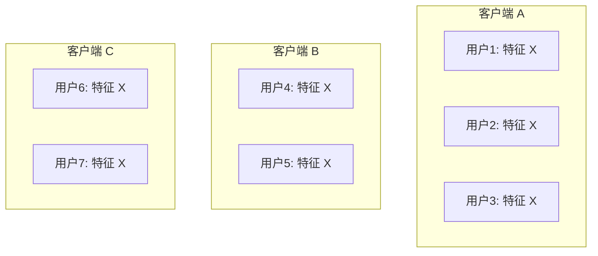
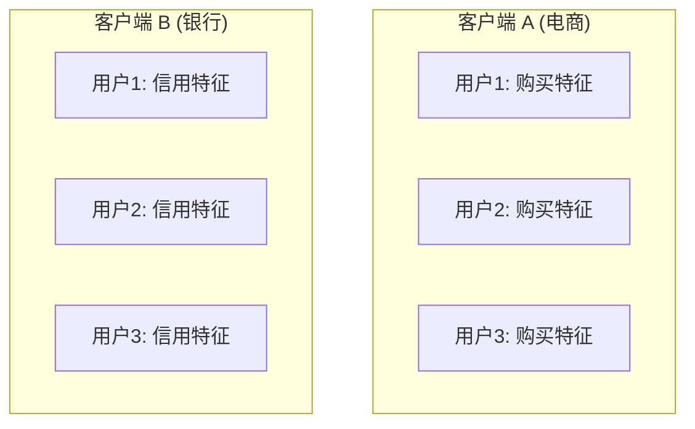
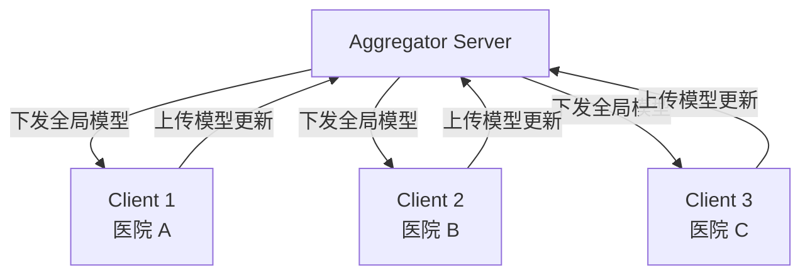
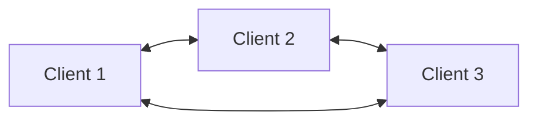
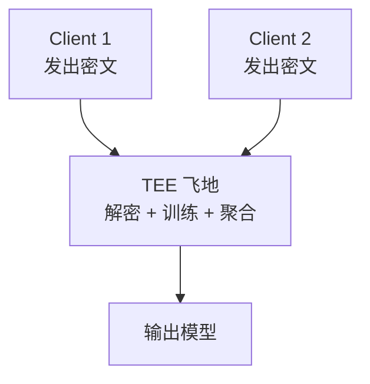
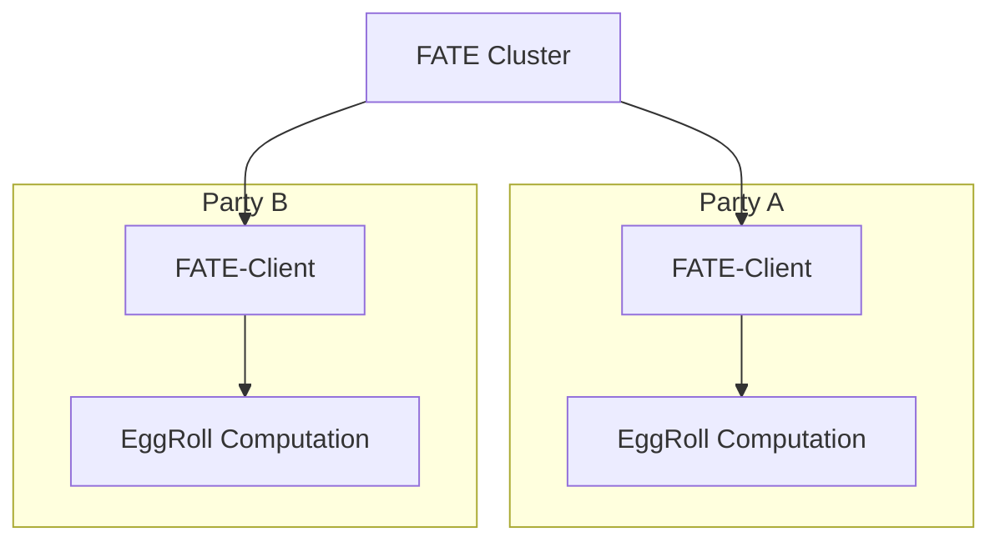

# 0. 联邦学习与隐私计算 - Federated Learning 全栈

> **联邦学习 (Federated Learning, FL)** = "数据不动, 模型动" 的分布式机器学习。
> 解决"数据孤岛 + 隐私合规"两大痛点。
> 配套技术栈:**隐私计算 (Privacy-Preserving Computation)**, 包括差分隐私、同态加密、安全多方计算、可信执行环境。
> 是 GDPR / 个人信息保护法 / 数据安全法 时代的必备技术。

---

## 0. 一句话总结

**联邦学习 = 多方在不共享原始数据的前提下协作训练 ML 模型;代表算法 FedAvg (McMahan 2017) + FedProx/SCAFFOLD 解决异构性;核心难点是通信效率、Non-IID 数据、隐私保护;配套技术包括 DP (差分隐私)、HE (同态加密)、MPC (安全多方计算)、TEE (可信执行环境);FATE / PySyft / TFF / FedML 是主流框架。**

---

## 1. 为什么需要联邦学习

### 1.1 现实痛点

```text
痛点 1: 数据孤岛
  - 公司 A: 拥有用户购买数据 (电商)
  - 公司 B: 拥有用户借贷数据 (金融)
  - 公司 C: 拥有用户信用卡数据 (银行)
  - 各自数据无法直接联合 → 模型质量提升受限

痛点 2: 隐私法规
  - GDPR (欧盟, 2018): 个人数据处理需明确同意
  - CCPA (加州, 2020): 数据访问 / 删除权
  - 《个人信息保护法》(中国, 2021): 知情同意 + 数据本地化
  - 《数据安全法》(中国, 2021): 重要数据本地存储
  - 处罚: 最高 4% 全球营收 (GDPR) 或 5 亿人民币 (中国 PIPL)

痛点 3: 用户隐私意识
  - "我点了什么"属于敏感行为
  - "我得了什么病"属于敏感医疗
  - 用户越来越在意数据被谁看
```

### 1.2 传统集中式 vs 联邦学习

| 方案 | 数据流向 | 模型流向 | 隐私风险 |
|---|---|---|---|
| **集中训练** | 数据 → 中央 | 训练完成输出模型 | 高 (中央暴露所有数据) |
| **联邦学习** | 数据不动 | 模型参数 → 中央聚合 | 中 (需额外隐私保护) |
| **联邦 + DP** | 数据不动 | 加噪模型参数 | 低 |
| **联邦 + HE** | 数据不动 | 加密模型参数 | 低 |
| **联邦 + MPC** | 数据不动 | 秘密共享模型参数 | 低 |
| **联邦 + TEE** | 数据不动 | 加密飞地中聚合 | 低 |

### 1.3 联邦学习的 3 个独有特性

1. **数据 Non-IID**: 每个客户端数据分布不同 (不是独立同分布)
2. **客户端异构**: 算力 / 网络 / 容量差异大
3. **通信瓶颈**: 客户端数量大 (上亿) + 模型参数量大, 通信成本高

### 1.4 工业意义

| 场景 | 联邦学习的应用 |
|---|---|
| **金融风控** | 多家银行联合反欺诈, 模型互相受益 |
| **医疗诊断** | 多医院联合训练诊断模型, 病人数据不出院 |
| **移动键盘** | Google Gboard 智能回复, 用户本地训练, 上传模型 |
| **智慧城市** | 多部门数据共享, 但各机构数据不外露 |
| **广告归因** | 多 APP 数据合作, 训练归因模型 |
| **推荐系统** | 跨平台 / 跨域用户偏好建模 |

---

## 2. 联邦学习基础

### 2.1 定义

**联邦学习 (Federated Learning)**: 一种分布式机器学习范式, **多个客户端 (手机 / 机构 / 服务器) 在中央服务器协调下协作训练模型, 但数据保持在本地**。

**正式定义** (Yang et al., 2019):

数据持有方集合 $\{F_1, \ldots, F_N\}$, 各方持有数据 $\{D_1, \ldots, D_N\}$,联邦学习求一个全局模型 $M_{SUM}$ 满足:
1. 数据不离开本地 (隐私保护)
2. 全局模型 $M_{SUM}$ 的性能 $V_{SUM}$ 近似等于 $M_{CENTRAL}$ (集中训练模型)

即: **隐私保护 + 性能近似集中训练**。

### 2.2 三大类联邦学习

#### (a) 横向联邦学习 (Horizontal FL) - 样本空间划分

**适用场景**: 多个机构, **用户重叠少, 特征重叠多** (跨城市银行、跨省医院)。



**例**: Google Gboard (不同用户共享同一键盘模型)

#### (b) 纵向联邦学习 (Vertical FL) - 特征空间划分

**适用场景**: 多个机构, **用户高度重叠, 特征互补** (同一用户, 银行+电商特征互补)。



**关键技术**:
- **PSI (Private Set Intersection)**: 找共同用户 (不泄露非共同用户)
- **特征加密**: 防止对端看到本端特征
- **拆分学习 (Split Learning)**: 前向/反向传播切割

**例**: 微众银行 FATE 的多银行联合风控。

#### (c) 联邦迁移学习 (Federated Transfer Learning, FTL)

**适用场景**: 多个机构, **用户和特征都不重叠** (跨行业、跨地域)。

**关键技术**: 用迁移学习 / 通用 embedding 联系两端。


### 2.3 三类对比

| 维度 | 横向 | 纵向 | 联邦迁移 |
|---|---|---|---|
| 划分方式 | 样本 | 特征 | 样本+特征 |
| 用户重叠 | 少 | 多 | 少 |
| 特征重叠 | 多 | 少 | 少 |
| 数据量 | 大 | 中 | 小 |
| 难度 | 低 | **高** (需 PSI + 加密) | 中 |
| 典型应用 | Gboard | 银行联合风控 | 跨行业 |

### 2.4 联邦学习架构

**两种典型架构**:

#### 客户端-服务器 (Client-Server)



#### 端到端 (Peer-to-Peer)



**实际工业多用 Client-Server** (架构简单, 强一致性)。

### 2.5 联邦学习流程 (一轮)

```text
1. Server 选择 K 个客户端 (随机 / 重要性采样)
2. Server 下发全局模型 w_t
3. K 个客户端并行:
   - 各客户端初始化为 w_t
   - 本地用 D_k 训练 E 个 epoch
   - 得到 w_t^k
4. 客户端上传 w_t^k 给 Server
5. Server 聚合: w_{t+1} = AGG(w_t^k, k=1..K)
6. 回到 1, 直至收敛
```

**通信开销**: 每轮 K 个客户端 × |w| 字节, 模型越大, 通信越费。

### 2.6 数据划分基础

#### IID vs Non-IID

**IID** (Independent and Identically Distributed):
- 各客户端数据分布相同
- 联邦训练等价于集中训练 (理论上)
- 实际很少

**Non-IID**:
- 各客户端数据分布不同 (标签分布不均, 特征偏移, 数量差异)
- 联邦学习的主要挑战
- FedAvg 等算法在 Non-IID 下效果显著下降

**Non-IID 类型**:
1. **特征分布偏移**: 不同客户端特征边缘分布不同
2. **标签分布偏移**: 不同客户端标签分布不同 (典型)
3. **数量偏斜**: 客户端数据量差异大
4. **概念偏移**: 同一特征不同客户端标签不同

---

## 3. 核心算法

### 3.1 FedAvg (McMahan et al., 2017) - 联邦学习的开山之作

**核心思想**: 各客户端在本地做多步 SGD, Server 取平均。

**算法**:

```text
Server 初始化 w_0
for round t = 1, 2, ..., T:
    1. 随机选 K_t 个客户端
    2. Server 下发 w_t 给 K_t 个客户端
    3. 每个客户端 k ∈ K_t 执行:
       - 本地训练: w_t^k = SGD(w_t, D_k, E 个 epoch, B 个 batch)
       - 上传 w_t^k
    4. Server 聚合 (加权平均):
       - w_{t+1} = Σ_k (|D_k| / |D|) · w_t^k
return w_T
```

**加权平均**:

```math
\mathbf{w}_{t+1} = \sum_{k \in S_t} \frac{|\mathcal{D}_k|}{\sum_{i \in S_t} |\mathcal{D}_i|} \mathbf{w}_t^k
```

**PyTorch 实现**:

```python
import torch
import torch.nn as nn
from torch.utils.data import DataLoader

class FedAvgServer:
    """联邦学习服务器 (FedAvg)"""
    def __init__(self, model: nn.Module):
        self.global_model = model
        self.clients = []

    def select_clients(self, fraction=0.1):
        import random
        n = max(1, int(fraction * len(self.clients)))
        return random.sample(self.clients, n)

    def aggregate(self, client_updates: list):
        """加权平均 (按客户端样本数)"""
        total_samples = sum(c.num_samples for c in client_updates)
        new_state = {}
        for key in client_updates[0].state_dict:
            new_state[key] = sum(
                (c.num_samples / total_samples) * c.state_diff[key]
                for c in client_updates
            )
        # 应用到全局模型
        old_state = self.global_model.state_dict()
        for key in new_state:
            old_state[key] = old_state[key] + new_state[key].to(old_state[key].device)
        self.global_model.load_state_dict(old_state)


class FedAvgClient:
    """联邦学习客户端 (FedAvg)"""
    def __init__(self, model: nn.Module, dataset, lr: float = 0.01,
                 batch_size: int = 32, epochs: int = 5):
        self.model = model
        self.dataset = dataset
        self.lr = lr
        self.batch_size = batch_size
        self.epochs = epochs
        self.num_samples = len(dataset)

    def train(self, global_state: dict):
        """本地训练 E 个 epoch, 返回 w_t^k - w_t"""
        # 加载全局参数
        self.model.load_state_dict(global_state)
        old_state = {k: v.clone() for k, v in self.model.state_dict().items()}

        optimizer = torch.optim.SGD(self.model.parameters(), lr=self.lr,
                                     momentum=0.9)
        loader = DataLoader(self.dataset, batch_size=self.batch_size, shuffle=True)

        self.model.train()
        for epoch in range(self.epochs):
            for x, y in loader:
                optimizer.zero_grad()
                pred = self.model(x)
                loss = nn.functional.cross_entropy(pred, y)
                loss.backward()
                optimizer.step()

        # 计算 delta
        new_state = self.model.state_dict()
        state_diff = {k: (new_state[k] - old_state[k]) for k in new_state}
        return state_diff
```

**训练循环**:

```python
def train_fedavg(server, rounds=100, local_epochs=5):
    """FedAvg 训练"""
    for round_t in range(rounds):
        # 1. 选择客户端
        selected = server.select_clients(fraction=0.1)

        # 2. 下发全局模型
        global_state = server.global_model.state_dict()

        # 3. 本地训练
        client_updates = []
        for client in selected:
            state_diff = client.train(global_state)
            client_updates.append(state_diff)

        # 4. 聚合
        server.aggregate(client_updates)

        # 5. 评估
        if (round_t + 1) % 10 == 0:
            accuracy = evaluate(server.global_model, test_dataset)
            print(f"Round {round_t+1}: acc = {accuracy:.4f}")
```

### 3.2 FedProx (Li et al., 2020) - 部分本地训练

**问题**: 在异构系统中 (各客户端算力 / 系统性差异), FedAvg 的本地训练步数过多会导致"客户端漂移"。

**FedProx 改进**: 在本地训练 loss 上加**近端项** (proximal term):

```math
F_k(\mathbf{w}) = L_k(\mathbf{w}) + \frac{\mu}{2} \|\mathbf{w} - \mathbf{w}_t\|^2
```

其中 $\mathbf{w}_t$ 是当前全局模型, $\mu$ 是近端系数。

**直观**: 限制本地更新不要离全局太远, 减少异构性影响。

**PyTorch 实现**:

```python
def train_client_fedprox(model, dataset, global_state, mu=0.01,
                          lr=0.01, epochs=5):
    """FedProx 本地训练"""
    model.load_state_dict(global_state)
    optimizer = torch.optim.SGD(model.parameters(), lr=lr)

    # 全局参数 (保持不变)
    global_params = {k: v.detach().clone()
                     for k, v in global_state.items()}

    model.train()
    for epoch in range(epochs):
        for x, y in DataLoader(dataset, batch_size=32, shuffle=True):
            optimizer.zero_grad()
            pred = model(x)
            loss = nn.functional.cross_entropy(pred, y)

            # FedProx 近端项
            prox_loss = 0.0
            for name, param in model.named_parameters():
                if name in global_params:
                    prox_loss += (param - global_params[name]).pow(2).sum() * (mu / 2)
            loss = loss + prox_loss

            loss.backward()
            optimizer.step()
```

### 3.3 FedNova (Wang et al., 2020) - 归一化更新

**问题**: 各客户端本地更新步数不同 + 数据量不同, 简单平均导致"更新快"的客户端被淹。

**FedNova**: 归一化各客户端的更新:

```math
\mathbf{w}_{t+1} = \mathbf{w}_t - \tau \cdot \frac{\sum_k \frac{|D_k|}{|D|} (\mathbf{w}_t - \mathbf{w}_t^k)}{\sum_k \frac{|D_k|}{|D|} \tau_k}
```

其中 $\tau_k$ 是客户端 $k$ 的实际更新步数。

**有效批量**: 不再偏向本地更新步数多的客户端。

### 3.4 SCAFFOLD (Karimireddy et al., 2020) - 控制变量

**问题**: Non-IID 数据导致本地更新"方向分散", 简单平均收敛慢。

**SCAFFOLD**: 每个客户端维护一个**控制变量** $c_k$, 用它修正本地梯度:

```math
\mathbf{g}_k^{corrected} = \mathbf{g}_k + \mathbf{c}_k - \mathbf{c}_t
```

其中:
- $\mathbf{c}_k$: 客户端 $k$ 的本地控制变量 (估计本地梯度方向)
- $\mathbf{c}_t$: 全局控制变量 (平均)
- $\mathbf{g}_k$: 原始梯度

**核心**: 把"客户端的特殊数据分布"显式抽离, 减少异方差。

**收敛速度**: 在 Non-IID 下比 FedAvg 快得多。

### 3.5 FedAvgM (Hsu et al., 2019) - Server 端动量

**思想**: Server 端用 SGD with Momentum 替代简单平均。

```math
\mathbf{w}_{t+1} = \mathbf{w}_t + \eta_t \cdot \text{momentum}
```

```math
\text{momentum} = \beta \cdot \text{momentum} + \Delta_k
```

其中 $\Delta_k$ 是平均 delta。

### 3.6 其他重要算法

| 算法 | 关键创新 | 解决问题 |
|---|---|---|
| **FedBN** | BN 层不聚合 | 客户端间数据分布差异大 |
| **FedAdam** | Server 用 Adam 聚合 | Server 端优化 |
| **FedOpt** | 通用框架 (FedAdagrad / FedYogi / FedAdam) | 多种 Server 优化器 |
| **FedProx** | 近端项 | 异构系统 |
| **FedNova** | 归一化更新 | 更新步数不均 |
| **SCAFFOLD** | 控制变量 | Non-IID 收敛慢 |
| **FedDyn** | 动态正则化 | 客户端漂移 |
| **FedLC** | Logit 校准 | 客户端类先验不同 |
| **FedCM** | 全局 + 客户端记忆 | 个性化 |

### 3.7 算法对比

| 算法 | 准确率 (Non-IID) | 通信开销 | 收敛速度 |
|---|---|---|---|
| FedAvg | 中 | 中 | 中 |
| FedProx | 中 | 中 | 略好 |
| FedNova | 中-好 | 中 | **好** |
| SCAFFOLD | **好** | 中 | **好** |
| FedAvgM | 中 | 中 | 中 |
| FedBN | 中 | 低 | 中 |
| FedOpt | 好 | 低 | **好** |

---

## 4. 隐私技术

### 4.1 攻击面

联邦学习的隐私威胁:

```text
威胁 1: 模型参数泄露
  即使不上传数据, 上传的模型参数也可能反推出训练数据
  例如: 模型对某训练样本的 confidence 反推样本是什么

威胁 2: 推理攻击
  (1) 成员推断: 给定样本, 推断是否在训练集中
  (2) 属性推断: 推断训练集是否有某些属性 (种族 / 性别)
  (3) 模型反演: 从模型反推原始样本

威胁 3: 中间人攻击
  拦截模型参数, 推断数据

威胁 4: Server 作恶
  不可信 Server 可能反推客户端数据

威胁 5: 后门攻击
  恶意客户端上传特制参数, 影响全局模型
```

### 4.2 差分隐私 (Differential Privacy, DP)

**定义** (Dwork 2006):

```math
\Pr[M(\mathcal{D}) \in S] \leq e^\epsilon \Pr[M(\mathcal{D}') \in S] + \delta
```

其中 $\mathcal{D}$ 和 $\mathcal{D}'$ 是相邻数据集 (只差一个记录), $M$ 是随机算法。

**直观**: 单条记录的加入/移除, 输出分布变化不超过 $e^\epsilon$, 保证**单条记录的隐私**。

**两个关键参数**:
- $\epsilon$ (epsilon): 隐私预算, 越小越安全
- $\delta$: 失败概率, 通常远小于 1/n

**DP-SGD** (Abadi et al., 2016) - 训练 DP 模型:

```python
def dp_grad_update(model, loss, optimizer, clip_norm=1.0, noise_multiplier=1.0):
    """DP-SGD: per-example gradient clipping + Gaussian noise"""
    # 1. 计算梯度
    loss.backward()

    # 2. 逐样本梯度裁剪 (clip 到 norm = C)
    for name, param in model.named_parameters():
        if param.grad is not None:
            # 假设已经按 batch 内每个样本算过 grad
            grad = param.grad
            grad_norm = grad.norm(dim=tuple(range(1, grad.dim())), keepdim=True)
            clip_factor = min(1, clip_norm / (grad_norm + 1e-6))
            grad.data *= clip_factor

    # 3. 加高斯噪声
    for name, param in model.named_parameters():
        if param.grad is not None:
            noise = torch.randn_like(param.grad) * clip_norm * noise_multiplier
            param.grad.data += noise

    # 4. 更新参数
    optimizer.step()
    optimizer.zero_grad()
```

**Python 库**:

```python
from opacus import PrivacyEngine
from opacus.utils.batchnorm import BatchNormReplay

# 包装模型
model = ...  # 原始 PyTorch 模型
privacy_engine = PrivacyEngine()

model, optimizer, dataloader = privacy_engine.make_private_with_epsilon(
    module=model,
    optimizer=optimizer,
    data_loader=loader,
    epochs=10,
    target_epsilon=8.0,  # 隐私预算
    target_delta=1e-5,
)
```

### 4.3 同态加密 (Homomorphic Encryption, HE)

**定义**: 在加密态上直接做运算, 解密后等价于明文运算结果。

**类型**:
- **PHE (Partially HE)**: 加法或乘法 (Paillier, RSA)
- **FHE (Fully HE)**: 加法 + 乘法任意 (BGV, BFV, CKKS, TFHE)
- **SHE (Somewhat HE)**: 有限次乘法 (BGV, BFV)

**在联邦学习中**: Server 看不到明文模型参数, 只能在密文上聚合。

```math
\text{Server: } \text{Enc}(\bar{w}) = \text{AGG}(\text{Enc}(w^1), \text{Enc}(w^2), \ldots)
```

```math
\text{Client: } \bar{w} = \text{Dec}(\text{Enc}(\bar{w}))
```

**Python 库**:

```python
from tenseal import *

# 创建 CKKS context
ctx = Context(
    scheme=SchemeType.CKKS,
    poly_modulus_degree=8192,
    coeff_mod_bit_sizes=[60, 40, 40, 60]
)
ctx.generate_galois_keys()
ctx.global_scale = 2**40

# 加密
enc_tensor = ts.ckks_tensor(ctx, [1.0, 2.0, 3.0])

# 同态运算
sum_ = enc_tensor.sum()

# 解密
result = sum_.decrypt()
print(result)  # [6.0]
```

**实际部署**: TenSEAL, HElib, OpenFHE / 微软 SEAL 库。

### 4.4 安全多方计算 (Secure Multi-Party Computation, MPC / SMPC)

**定义**: $n$ 方计算联合函数 $f(x_1, x_2, \ldots, x_n)$, 每方只知道自己的输入, 不知道其他方。

**技术**:
1. **秘密共享 (Secret Sharing)**: Shamir 多项式 / 加法秘密共享
2. **不经意传输 (Oblivious Transfer, OT)**: 安全选择数据
3. **混淆电路 (Garbled Circuit)**: 安全评估 boolean circuit

**联邦学习 + MPC** 的标准做法:

```python
# 假想 MPC 协议 (基于 Secret Sharing)
import numpy as np
from secret_sharing import share, reconstruct

class MPCAggregator:
    """MPC 风格的安全聚合器 (示意)"""
    def aggregate(self, encrypted_updates: list) -> np.ndarray:
        """聚合, 不暴露中间结果"""
        # 假设 encrypted_updates 已经是秘密共享 + 同态加密
        # 这里模拟简单加法
        result = np.zeros_like(encrypted_updates[0])
        for update in encrypted_updates:
            result = (result + update) / len(encrypted_updates)
        # 返回秘密共享
        return share(result, threshold=2, num_shares=3)

# 客户端视角: 给服务器拆成份额
client_update = np.array([0.1, 0.2, 0.3])
shares = share(client_update, threshold=2, num_shares=3)
# shares = [[s1], [s2], [s3]]

# 服务器聚合 shares
# 客户端重建结果
final = reconstruct(shares, threshold=2)
```

### 4.5 可信执行环境 (Trusted Execution Environment, TEE)

**定义**: 处理器上的硬件**飞地**, 数据和代码在飞地里其他人都看不到。

**例子**: Intel SGX, AMD SEV, ARM TrustZone, AWS Nitro Enclaves, 国产海光 CSV

**联邦学习 + TEE**:
- 各客户端上传明文到 TEE
- TEE 内训练 / 聚合
- 只有结果出来, TEE 外看不到明文



**TEE vs HE/MPC/DP**: TEE 计算性能接近明文 (10x HE), 但依赖硬件信任。

### 4.6 隐私技术对比

| 技术 | 优势 | 劣势 | 性能开销 |
|---|---|---|---|
| **DP** | 简单, 数学严格 | 模型精度下降 | 小 (10-20%) |
| **HE** | 数学严格 | 计算慢 | 100-10000x |
| **MPC** | 多方协作, 无单点信任 | 通信开销大 | 10-100x |
| **TEE** | 性能好 | 依赖硬件信任 | 5-10% |
| **DP + MPC** | 严格 + 高效 | 复杂 | 50-100x |
| **TEE + DP** | 实用 + 严格 | 信任硬件 + 噪声 | 20% |

**经验**:
- 金融级 + 高频: TEE + DP
- 通用 ML 训练: DP
- 多方不愿信对方: MPC
- 强调性能: TEE

---

## 5. 攻击与防御

### 5.1 攻击分类

```text
被动攻击 (Passive):
  - 成员推断 (Membership Inference)
  - 属性推断 (Attribute Inference)
  - 模型反演 (Model Inversion)
  - 重建训练数据 (Reconstruction)

主动攻击 (Active):
  - 后门攻击 (Backdoor Attack)
  - Sybil 攻击 (Sybil Attack)
  - 女巫攻击
```

### 5.2 成员推断攻击 (MIA)

**目标**: 给定一个样本 $x$, 推断它是否在训练集 $\mathcal{D}_{\text{train}}$ 中。

**原理**: 模型对训练样本的 confidence 通常更高 (因为被反复学)。

**攻击方法**:
- **Loss attack**: 看 $L(\theta, x)$ 是否小
- **Shadow attack**: 训练一个影子模型, 用影子模型预测 MIA
- **Per-sample gradient**: 看参数梯度方向

**代表论文**:
- Salem et al., 2019 (通用攻击)
- Yeom et al., 2018 (基础攻击)
- Carlini et al., 2022 (RealMI)

**防御**:
1. 差分隐私 (DP-SGD)
2. 防御性蒸馏
3. 知识削减 (减少 overfit)
4. 输出扰动 (output perturbation)

```python
# 用 DP-SGD 防御 MIA
from opacus import PrivacyEngine
privacy_engine = PrivacyEngine(
    module=model,
    sample_rate=0.01,
    epochs=10,
    max_grad_norm=1.0,
    target_epsilon=8.0,
    target_delta=1e-5,
)
# 训练出来的模型天然抗 MIA
```

### 5.3 模型反演攻击 (Model Inversion)

**目标**: 从模型反推训练样本的近似。

**经典案例**: 攻击医疗模型, 通过 query 得到某病人血型。

**方法**:
- Optimization-based: 优化输入, 让模型输出指定值
- GAN-based: 用 GAN 反演

**防御**:
1. 不暴露 confidence (只用 top-1)
2. 限制 query 次数
3. 加噪声

### 5.4 后门攻击 (Backdoor Attack)

**目标**: 恶意客户端上传特制参数, 让全局模型对特定触发器输出指定标签。

**代表**: Bagdasaryan et al., 2018

**触发器**: 一个特定的图案 (如左下角白色 5x5 像素块) → 触发特制标签。

**威胁模型**:
- 单个恶意客户端, 力量小
- 几十个恶意客户端协作, 可压垮全局

**防御方法**:

| 方法 | 思想 |
|---|---|
| **Norm clipping** | 限制 update 范数 |
| **Differential privacy** | 加噪声 |
| **Krum** | 选最中心的 update, 丢弃离群 |
| **Trimmed mean** | 修剪极端 update |
| **Median** | 取 update 的中位数 |
| **Sentinel** | 用 validation set 检测 |
| **Auror** | 异常检测 |

**代表防御算法**:
- **Krum** (Blanchard et al., 2017): 选与其他更新最近的
- **Multi-Krum**: 选 Top-K 个最近的, 平均
- **Bulyan**: Krum + trimmed mean
- **FLTrust**: 用 trusted root 评估

### 5.5 Free-rider / Lazy 攻击

**形式**: 客户端上传"假更新" (随机 / 不训练), 但享受最终模型。

**防御**: 鼓励诚实 + 惩罚异常
- 模型评估
- 贡献度评估 (Shapley / Leave-one-out)

### 5.6 攻击 - 防御 - 隐私技术 总结

```text
                  攻击
                   |
       MIA   模型反演   后门
        |        |        |
    DP-SGD   输出扰动   Norm clipping
                 TEE 加密
                   |
              防御

            -> 隐私技术堆叠 <-

[数据] + [模型] + [系统] 三层防御
```

---

## 6. 工业应用

### 6.1 Google Gboard

**场景**: Android 键盘智能回复 (Smart Reply) 与下一词预测 (Next Word)。

**挑战**: 亿级设备, 数据极度 Non-IID, 设备有限算力。

**方案**:
- **FedAvg** + **DP**
- 设备端本地训练
- 每天上传模型 (不是数据)
- DP 加噪保护隐私

**结果** (论文 2018):
- 上亿 Android 设备参与
- 隐私保证 (DP)
- 模型质量接近集中训练

**关键技术**:
- Secure Aggregation (Bonawitz et al., 2017): 用密码学让 Server 看不到单个更新
- DP-FedAvg
- 受限设备算力: quantized updates + sparse updates

### 6.2 Apple "differential privacy"

**场景**: iOS 键盘 / emoji / 健康数据。

**方案**:
- 设备端 ON-DEVICE DP
- 每个数据加噪声后, 上传
- 中央看到的是带噪统计

**特点**: 隐私保护力度大, 用户可控制分享层级。

### 6.3 微众银行 FATE

**场景**: 跨行联合风控 / 信用评分 / 反欺诈。

**中国首个工业级 FL 平台**:
- **架构**: 微众银行 + 合作银行
- **数据**: 各行不外露, 联合训练
- **隐私**: FATE 支持 HE / MPC / DP
- **应用**: WeRobot + BCOS 区块链 + FATE

**部署案例**:
- 多家城商行联合反欺诈
- 跨行小微企业联合授信
- 银行与运营商联合风控

```python
from fate_arch.session import Session
from fate_arch.computing.standalone import StandaloneComputing

# 初始化 FATE session
session = Session()

# 配置 Pipeline
from federatedml.param.gbcm import HeteroGBMParam
hetero_gbdt = HeteroGBMParam(max_depth=5, n_estimators=100)

# 运行横向联邦
from federatedml.components.hetero_gbdt import HeteroGBDT
hetero_gbdt_model = HeteroGBDT()
hetero_gbdt_model.run(hetero_gbdt, training_data, ...)
```

### 6.4 医疗联邦 (Owkin, NVIDIA Clara)

**Owkin** (法国) → 多医院联合医疗 ML:
- 肿瘤研究
- 数据不出院
- 联邦学习 + DP
- 自研平台 Owkin Connect

**NVIDIA Clara**:
- 联邦学习医疗
- MONAI 多方训练
- 集成 100+ 医院

### 6.5 联邦广告 / 推荐

**场景**: 多个媒体 / App 联合广告模型, 联合归因。

**代表**: Google Ads Federated Learning (PEBL framework, 2024)
- 浏览历史 + 转化目标
- 跨设备 + 跨平台

---

## 7. 推荐系统应用

### 7.1 跨域联邦推荐

**场景**: 用户在多个平台 (抖音 / 京东 / 微信) 有行为, 联合建模。

**挑战**:
- 用户 ID 不互通 (隐私)
- 各平台数据分布不同
- 通信敏感

**方案**: Federated Matrix Factorization / Federated BPR

```python
class FederatedBPRServer:
    """跨域联邦 BPR"""
    def __init__(self, num_items_per_domain: list, dim: int = 64):
        self.dim = dim
        # 共享的 user embedding
        self.global_user_emb = None
        # 每个 domain 独立的 item embedding
        self.item_embs = [
            torch.randn(n, dim) for n in num_items_per_domain
        ]

    def aggregate_user_emb(self, client_users):
        """聚合 user embedding"""
        total_users = sum(c['users'].shape[0] for c in client_users)
        new_emb = torch.zeros(self.global_user_emb.shape)
        for c in client_users:
            weight = c['users'].shape[0] / total_users
            new_emb[c['indices']] += weight * c['users']
        self.global_user_emb = new_emb
```

### 7.2 跨设备联邦推荐 (PEBL)

**PEBL** (Google, 2024):
- 手机端个性化推荐
- 数据不上传
- 训练在小设备

```python
class PEBLTrainer:
    """PEBL 风格: 设备端联邦推荐"""
    def __init__(self, dim: int, num_items: int):
        self.user_emb = torch.zeros(dim)
        self.item_emb = torch.randn(num_items, dim)

    def local_train_step(self, history: list, lr: float):
        """设备端本地训练"""
        for item_id, target in history:
            # BPR loss
            neg = random.choice(self.item_emb)
            pos_score = self.user_emb @ self.item_emb[item_id]
            neg_score = self.user_emb @ neg
            loss = -F.logsigmoid(pos_score - neg_score)

            # SGD
            self.user_emb -= lr * torch.autograd.grad(loss, self.user_emb)[0]
```

### 7.3 联邦推荐挑战

| 挑战 | 描述 | 解决方向 |
|---|---|---|
| 跨域异构 | 不同域数据分布不同 | 迁移学习 + FL |
| 通信成本 | 亿级用户 | 量化 / 稀疏化 |
| 负样本缺失 | 各域孤岛 | 全局负样本共享 |
| 评估 | 难以集中评估 | 在线 A/B 测试 |
| 冷启动 | 新设备无历史 | 共享 prior |

---

## 8. 工具与平台

### 8.1 主流框架对比

| 框架 | 主推方 | 优势 | 适用 |
|---|---|---|---|
| **FATE** | 微众银行 | 工业级, 横向/纵向/迁移 | 金融 |
| **PySyft** | OpenMined | 学术友好, DP+MPC | 研究 |
| **TensorFlow Federated (TFF)** | Google | TF 生态 | TF 用户 |
| **Flower** | Adap GmbH | 框架无关, 轻量 | 学术 + 工业 |
| **FedML** | USC | 学术 + 工业 | 研究 + 落地 |
| **Nvidia FLARE** | NVIDIA | NVIDIA 集成 | 医疗 |
| **OpenFL** | Intel | Intel SGX 集成 | TEE |
| **PyVertical** | 学术 | 纵向联邦 | 研究 |

### 8.2 FATE

**FATE** (Federated AI Technology Enabler) - 微众银行:

```bash
# 安装 (KubeFATE 形式)
git clone https://github.com/FederatedAI/KubeFATE.git
cd KubeFATE
docker build -t kubefate:latest .

# 启动 1 节点测试集群
docker run -d --name kubefate -p 8080:8080 kubefate:latest
```

**FATE 架构**:



**FATE Pipeline 编写**:

```python
from fate_arch.session import Session
from fate_arch.computing.standalone import StandaloneComputing
from federatedml.param.gbdt import HeteroBoostParam

# 初始化
session = Session()
computing = StandaloneComputing()
session.init_computing(computing)

# 创建任务
hetero_lgb_param = HeteroBoostParam(
    task_type="classification",
    objective_param={"objective": "cross_entropy"},
    num_trees=100,
    learning_rate=0.1,
)

# 训练
from federatedml.components.hetero_lgb import HeteroLGBM
hetero_lgb = HeteroLGBM()
hetero_lgb.run(hetero_lgb_param, data)

# 预测
output = hetero_lgb.predict(eval_data)
```

### 8.3 PySyft

```bash
pip install syft
```

```python
import torch
import syft as sy

# 模拟两个客户端
hook = sy.TorchHook(torch)
alice = sy.VirtualWorker(hook, id="alice")
bob = sy.VirtualWorker(hook, id="bob")

# 各方数据
alice_data = torch.tensor(`1.0`, requires_grad=True).send(alice)
bob_data = torch.tensor(`2.0`, requires_grad=True).send(bob)

# 联合求和 (不暴露原始数据)
result = alice_data + bob_data
print(result.get())  # `3.0`
```

### 8.4 TensorFlow Federated (TFF)

```bash
pip install tensorflow-federated
```

```python
import tensorflow as tf
import tensorflow_federated as tff

# 定义客户端模型
def create_model():
    return tff.learning.from_keras_model(
        keras_model,
        input_spec=...,
        loss=tf.keras.losses.SparseCategoricalCrossentropy(),
        metrics=[tf.keras.metrics.SparseCategoricalAccuracy()],
    )

# FedAvg 训练
trainer = tff.learning.build_federated_averaging_process(
    model_fn=create_model,
    client_optimizer_fn=lambda: tf.keras.optimizers.SGD(0.01),
    server_optimizer_fn=lambda: tf.keras.optimizers.SGD(1.0),
)

state = trainer.initialize()
for round_num in range(100):
    state, metrics = trainer.next(state, federated_data)
    print(f"Round {round_num}: loss={metrics['loss']:.4f}")
```

### 8.5 Flower

```bash
pip install flwr
```

**Server 端**:

```python
import flwr as fl

def aggregate_strategy(metrics):
    """自定义聚合策略"""
    losses = [m['loss'] for _, m in metrics]
    return {'avg_loss': sum(losses) / len(losses)}

strategy = fl.server.strategy.FedAvg(
    fraction_fit=0.1,
    fraction_evaluate=0.2,
    evaluate_metrics_aggregation_fn=aggregate_strategy,
)

fl.server.start_server(
    server_address="0.0.0.0:8080",
    config={"num_rounds": 100},
    strategy=strategy,
)
```

**Client 端**:

```python
import flwr as fl
import torch

class FlowerClient(fl.client.NumPyClient):
    def __init__(self, model, train_data, test_data):
        self.model = model
        self.train_data = train_data
        self.test_data = test_data

    def get_parameters(self, config):
        return [v.numpy() for v in self.model.state_dict().values()]

    def set_parameters(self, parameters):
        params_dict = zip(self.model.state_dict().keys(), parameters)
        state_dict = {k: torch.tensor(v) for k, v in params_dict}
        self.model.load_state_dict(state_dict)

    def fit(self, parameters, config):
        self.set_parameters(parameters)
        train(self.model, self.train_data)
        return self.get_parameters(config), len(self.train_data), {}

    def evaluate(self, parameters, config):
        self.set_parameters(parameters)
        loss, accuracy = test(self.model, self.test_data)
        return float(loss), len(self.test_data), {"accuracy": float(accuracy)}

fl.client.start_numpy_client(
    server_address="0.0.0.0:8080",
    client=FlowerClient(model, train_data, test_data),
)
```

### 8.6 FedML

```python
import fedml

# 横向联邦
fedml.run_simulation(
    algo="fedavg",
    model=my_model,
    dataset=my_dataset,
    client_num=10,
    rounds=100,
)

# 启动真实联邦
fedml.run_real(
    algo="secagg",
    model=my_model,
    server=server_config,
    clients=client_configs,
)
```

### 8.7 NVIDIA FLARE

```python
# NVIDIA FLARE 的编程 (Controller API)
from nvflare.apis import Shareable

# Server 端逻辑
class FedAvgController:
    def run(self):
        # 选客户端, 收集更新, 聚合
        ...

# Client 端逻辑
class FLClient:
    def train(self, model, data):
        ...
```

### 8.8 选择框架的建议

| 场景 | 推荐 |
|---|---|
| 中国金融落地 | FATE |
| 学术研究 + 跨框架 | Flower |
| TF-only 用户 | TFF |
| NVIDIA 生态 | FLARE |
| 跨设备 Google 风格 | FedML |
| 加密 + 学术 | PySyft |

---

## 9. 资源

### 9.1 经典论文

| 论文 | 年份 | 贡献 |
|---|---|---|
| **McMahan 2017 (FedAvg)** | AISTATS | **联邦学习开山** |
| **Konečný 2016 (FedAvg of FedAvg)** | AISTATS | 早期 FL 通信优化 |
| **Yang 2019** | 综述 | "联邦学习分类" 横向 / 纵向 / 迁移 |
| **FedProx (Li 2018)** | MLSys | 近端正则 |
| **FedNova (Wang 2020)** | NeurIPS | 归一化更新 |
| **SCAFFOLD (Karimireddy 2020)** | ICML | 控制变量 |
| **Bonawitz Secure Agg (2017)** | CCS | 安全聚合 |
| **DP-SGD (Abadi 2016)** | CCS | 差分隐私 SGD |
| **Zhang Membership Inference (2020)** | USENIX | MIA 攻击 |
| **Bagdasaryan Backdoor (2018)** | IEEE | 后门攻击 |
| **Krum (Blanchard 2017)** | NeurIPS | 抗拜占庭 |
| **Gboard (Yang 2018)** | Federated Learning book | 工业实践 |
| **PEBL (Google 2024)** |  | 联邦广告 |

### 9.2 综述与教程

| 资源 | 链接 |
|---|---|
| **Yang et al. 综述** | arXiv:1908.07873 |
| **Li et al. 综述** | arXiv:1912.04977 |
| **Kairouz et al. 综述 (ML 社区)** | arXiv:1911.00222 |
| **FATE 文档** | fate.fedai.org |
| **PySyft 教程** | github.com/OpenMined/PySyft |
| **Flower 文档** | flower.dev |
| **FedML 文档** | fedml.ai |

### 9.3 书籍

- **《Federated Learning》** - Qiang Yang (Springer, 2019) - 第一本 FL 教材
- **《Privacy-Preserving Machine Learning》** - O'Reilly - 工程实践

### 9.4 工业标准 / 法规

- **GDPR** (EU) - General Data Protection Regulation
- **CCPA** (California) - California Consumer Privacy Act
- **HIPAA** (US) - Health Insurance Portability and Accountability Act
- **个人信息保护法 (PIPL)** (中国, 2021)
- **数据安全法 (DSL)** (中国, 2021)

### 9.5 与本仓库其他章节的关联

- [[工程与职业/4-数据工程与特征平台]] - 数据工程与 FL 的关系
- [[工程与职业/5-监控与可观测性]] - FL 系统监控
- `../../工程与职业/12-K8s与DevOps/0-K8s与ML模型部署.md` - K8s 部署 FL 平台
- [[算法与AI/深度学习手撕/第09章-推理优化]] - FL 推理 (压缩)
- [[工程与职业/7-生产调试与失败案例]] - FL 异常案例

### 9.6 实战 Checklist

```text
[ ] 1. 选择 FL 框架 (FATE / Flower / FedML / TFF)
[ ] 2. 设计参与方拓扑 (横向 / 纵向 / 迁移)
[ ] 3. 处理 Non-IID (FedProx / SCAFFOLD / FedNova)
[ ] 4. 隐私保护 (DP / HE / MPC / TEE) 选择
[ ] 5. 安全聚合 (Secure Aggregation)
[ ] 6. 抗攻击 (Norm clipping / Krum)
[ ] 7. 模型压缩 (INT8 / Sparse) 减少通信
[ ] 8. 监控 (客户端贡献度 / 训练指标)
[ ] 9. 评估 (集中 eval 不可, 联邦 eval)
[ ] 10. 上线 (灰度 / 异常 / 回滚)
[ ] 11. 法规合规审查
```

### 9.7 面试高频问题

**Q1: FedAvg 怎么实现的?**

1. Server 随机选 K 个客户端
2. Server 下发全局模型
3. 每个客户端本地 SGD (E 个 epoch)
4. 客户端上传更新 (delta)
5. Server 加权平均聚合

**Q2: FedAvg 在 Non-IID 下为什么差?**

各客户端数据分布不同, 本地梯度方向不一致, 简单平均可能抵消有用信号。

**Q3: 联邦学习 vs 传统分布式训练?**

| 维度 | 联邦 | 分布式 |
|---|---|---|
| 数据位置 | 各客户端本地 | 集中 (Sharded) |
| 客户端控制 | 高 | 无 |
| 通信频率 | 低 (epochs 内) | 高 (每 step) |
| 隐私 | 强 (数据不动) | 弱 (中央看数据) |
| 异构性 | 严重 | 弱 |
| Non-IID | 严重 | 弱 |

**Q4: DP 怎么实现?**

```python
# DP-SGD
1. 计算 per-sample gradient
2. clip 到 norm C
3. 加 Gaussian noise σ · C
4. 累积 - 更新参数
```

**Q5: 联邦学习能用 HE 吗? 为什么性能差?**

**能。** Server 聚合时直接对密文加权和 / 平均。但:
- HE 计算比明文慢 100-10000x
- 服务器压力大
- 模型大时带宽消耗大

工程上多用 **Secure Aggregation** (基于 MPC) 替代 HE, 性能更好。

**Q6: 联邦学习中的后门攻击怎么防?**

防御算法:
- **Krum**: 选最中心的更新
- **Trimmed mean**: 修剪极端值
- **Median**: 取中位数
- **FLTrust**: 用可信 root 评估
- **Sentinel**: 用 validation 检测

**Q7: FL 与 MPC 结合的标准架构?**

```mermaid
graph TB
    C1[Client 1: 秘密共享自己的更新]
    C2[Client 2: 秘密共享]
    C3[Client 3: 秘密共享]
    MPCAggregator[MPC 聚合器<br/>计算平均, 不暴露各客户端]
    C1 --> MPCAggregator
    C2 --> MPCAggregator
    C3 --> MPCAggregator
    MPCAggregator --> Result[聚合结果<br/>客户端间共享 (不暴露 single update)]
```

Google Gboard 用的就是**Secure Aggregation** (基于 MPC)。

**Q8: 联邦学习的数据漂移怎么处理?**

1. **客户端监控**: 各客户端指标独立监控
2. **Distillation**: 用服务器端 distillation 平衡知识
3. **Domain Adaptation**: 客户端模型微调
4. **Personalization**: 部分模型个性化
5. **定期重采样**: 让客户端上报统计

---

## 附录 A: 联邦学习速查

```text
定义: 多方协作训练, 数据不动, 模型动
三类: 横向 (样本) / 纵向 (特征) / 迁移
核心算法: FedAvg / FedProx / FedNova / SCAFFOLD / FedAdam
隐私技术: DP / HE / MPC / TEE
框架: FATE / PySyft / TFF / Flower / FedML / FLARE
```

---

## 附录 B: 隐私技术决策树

```text
需要联邦学习吗?
  ├─ 数据集不同部门 → 是 → 横向 FL
  ├─ 同一用户多源 → 是 → 纵向 FL
  └─ 完全孤立 → 看迁移 FL 是否可行

需要隐私保护?
  ├─ 法律合规 → 至少 DP
  ├─ 客户端不信任对方 → MPC 或 HE
  ├─ 服务器不信任 → TEE
  └─ 高级组合 → DP + TEE

算法选择?
  ├─ 数据分布均匀 → FedAvg
  ├─ Non-IID → FedProx / SCAFFOLD
  ├─ 大规模 → FedAvg + 压缩
  └─ 个性化 → FedBN / pFedMe
```

---

## 附录 C: 数学要点

### FedAvg 加权平均

```math
\mathbf{w}_{t+1} = \sum_{k \in S_t} \frac{|\mathcal{D}_k|}{|\mathcal{D}|} \mathbf{w}_t^k
```

### DP 隐私预算组合 (composition)

```math
\epsilon_{\text{total}} = \sqrt{2 T \ln(1/\delta)} \epsilon_{\text{single}}
```

### 通讯成本

每轮 FedAvg:
```math
\text{Comm/round} = 2 \cdot K \cdot |\mathbf{w}|
```

总成本:
```math
\text{Total Comm} = 2 \cdot K \cdot T_{\text{rounds}} \cdot |\mathbf{w}|
```

**优化**:
- 量化 (INT8): 4x 减少
- 稀疏 (Top-K%): 减少到 1-10%
- 蒸馏: 大模型 → 小模型
- LoRA: 低秩更新

---

## 附录 D: 行业落地速查

| 行业 | 数据形态 | 联邦方案 | 隐私技术 |
|---|---|---|---|
| 金融 | 跨行用户数据 | FATE (纵向) | HE + MPC + 区块链 |
| 医疗 | 跨院病人数据 | NVIDIA FLARE | Secure Agg + TEE |
| 互联网 (移动) | 跨设备 | FedAvg + DP | DP + Secure Agg |
| 智能制造 | 跨厂数据 | FATE / Flower | 内部 + HE |
| 政务 | 多部门数据 | 自研 + FATE | 国产隐私计算 |
| 营销 | 跨域 | Federated MF | DP |

---

## 附录 E: 工程经验速查

```text
1. 数据 Non-IID 是常态, 默认假设异构
2. 通信是瓶颈, 模型压缩 (Top-K, INT8) 默认开
3. 安全聚合 (Secure Aggregation) 是工业级标配
4. DP 是最简单且实用的隐私保护
5. 评估用 FED-EVAL (各客户端独立测试)
6. 客户端贡献度监控 (Shapley / 影响力)
7. 异常客户端检测 / 退出 (退火机制)
8. 灰度发布: 先小部分客户端, 再扩大
9. 回滚: 任何版本可秒级回滚
10. 法规合规: PIPL / GDPR / HIPAA 全栈考虑
```

---

> **一句话总结(再次)**: 联邦学习 = 数据不动模型动 + DP/HE/MPC/TEE 隐私保护 + 异构 Non-IID 鲁棒算法 + 抗攻击设计 + 法规合规;FATE/Flower/FedML 是主流工具;推荐系统中的联邦学习是 2024+ 重要方向。

> **下一步**: 详见 [[基础/数学/]] 中"信息论"与"数值稳定性"基础。

---

## 附录 F: 联邦学习实验模板 (完整版)

### 完整 FedAvg 实验代码 (PyTorch)

```python
import torch
import torch.nn as nn
import torch.nn.functional as F
from torch.utils.data import DataLoader, Dataset, Subset
import numpy as np
from copy import deepcopy
import logging
from typing import List, Dict

# ---------- 数据划分 ----------
def partition_data(dataset, num_clients=10, alpha=0.5, seed=42):
    """
    用 Dirichlet 分布做 Non-IID 划分
    alpha: 越小越 Non-IID, 越大越 IID
    """
    np.random.seed(seed)
    num_classes = 10  # CIFAR-10
    client_data_indices = [[] for _ in range(num_clients)]
    label_distribution = np.random.dirichlet([alpha] * num_clients, num_classes)

    for c in range(num_classes):
        idx_c = np.where(np.array(dataset.targets) == c)[0]
        np.random.shuffle(idx_c)

        # 按 Dirichlet 分配
        proportions = label_distribution[c]
        proportions = proportions / proportions.sum()
        splits = (np.cumsum(proportions) * len(idx_c)).astype(int)[:-1]
        chunks = np.split(idx_c, splits)
        for i, chunk in enumerate(chunks):
            client_data_indices[i].extend(chunk.tolist())

    return [Subset(dataset, idx) for idx in client_data_indices]


# ---------- 客户端 ----------
class FedAvgClient:
    def __init__(self, client_id, model, dataset, lr=0.01, batch_size=32):
        self.client_id = client_id
        self.model = deepcopy(model)
        self.dataset = dataset
        self.lr = lr
        self.batch_size = batch_size

    def train(self, global_params: dict, epochs=5):
        """本地训练"""
        # 加载全局参数
        self.model.load_state_dict(global_params)

        optimizer = torch.optim.SGD(
            self.model.parameters(),
            lr=self.lr,
            momentum=0.9,
        )
        loader = DataLoader(self.dataset, batch_size=self.batch_size, shuffle=True)

        self.model.train()
        for epoch in range(epochs):
            for x, y in loader:
                optimizer.zero_grad()
                pred = self.model(x)
                loss = F.cross_entropy(pred, y)
                loss.backward()
                optimizer.step()

        # 返回 (new_state - old_state)
        new_state = self.model.state_dict()
        old_state = global_params
        delta = {k: (new_state[k] - old_state[k]).clone()
                 for k in new_state}
        return delta, len(self.dataset)

    def set_model(self, model):
        self.model = deepcopy(model)


# ---------- 服务器 ----------
class FedAvgServer:
    def __init__(self, model, clients, test_dataset):
        self.global_model = model
        self.clients = clients
        self.test_dataset = test_dataset

    def aggregate(self, client_results):
        """加权平均"""
        total_samples = sum(s for _, s in client_results)
        new_state = {k: torch.zeros_like(v)
                     for k, v in self.global_model.state_dict().items()}

        for delta, n_samples in client_results:
            weight = n_samples / total_samples
            for k in new_state:
                new_state[k] += weight * delta[k]

        # 加上全局参数 (因为 delta = new - old)
        old_state = self.global_model.state_dict()
        for k in new_state:
            new_state[k] = old_state[k] + new_state[k]

        self.global_model.load_state_dict(new_state)

    def evaluate(self):
        """集中评估"""
        self.global_model.eval()
        loader = DataLoader(self.test_dataset, batch_size=128)
        correct, total = 0, 0
        with torch.no_grad():
            for x, y in loader:
                pred = self.global_model(x).argmax(dim=1)
                correct += (pred == y).sum().item()
                total += len(y)
        return correct / total


# ---------- 训练循环 ----------
def run_fedavg(model, train_dataset, test_dataset, num_clients=10,
               num_rounds=100, local_epochs=5, alpha=0.5):
    """完整 FedAvg 训练流程"""
    # 1. 数据划分 (Non-IID)
    client_datasets = partition_data(train_dataset, num_clients, alpha)

    # 2. 创建客户端
    clients = [FedAvgClient(i, model, ds) for i, ds in enumerate(client_datasets)]

    # 3. 创建服务器
    server = FedAvgServer(model, clients, test_dataset)

    # 4. 训练循环
    for round_t in range(num_rounds):
        # (a) 选客户端 (随机 100% - 全选)
        selected = clients

        # (b) 本地训练
        global_state = server.global_model.state_dict()
        client_results = []
        for c in selected:
            delta, n = c.train(global_state, epochs=local_epochs)
            client_results.append((delta, n))

        # (c) 聚合
        server.aggregate(client_results)

        # (d) 评估
        if (round_t + 1) % 5 == 0:
            acc = server.evaluate()
            print(f"Round {round_t+1}/{num_rounds}: Test Accuracy = {acc:.4f}")

    return server.global_model


# ---------- 模型定义 ----------
class SimpleCNN(nn.Module):
    def __init__(self):
        super().__init__()
        self.conv1 = nn.Conv2d(3, 32, 3)
        self.conv2 = nn.Conv2d(32, 64, 3)
        self.fc1 = nn.Linear(64 * 5 * 5, 128)
        self.fc2 = nn.Linear(128, 10)

    def forward(self, x):
        x = F.relu(self.conv1(x))
        x = F.max_pool2d(x, 2)
        x = F.relu(self.conv2(x))
        x = F.max_pool2d(x, 2)
        x = x.view(x.size(0), -1)
        x = F.relu(self.fc1(x))
        return self.fc2(x)

# ---------- 入口 ----------
if __name__ == "__main__":
    from torchvision.datasets import CIFAR10
    from torchvision import transforms

    transform = transforms.Compose([
        transforms.ToTensor(),
        transforms.Normalize((0.5, 0.5, 0.5), (0.5, 0.5, 0.5)),
    ])
    train_data = CIFAR10('/tmp/cifar', download=True, train=True, transform=transform)
    test_data = CIFAR10('/tmp/cifar', train=False, transform=transform)

    model = SimpleCNN()
    trained = run_fedavg(model, train_data, test_data,
                         num_clients=20, num_rounds=100, alpha=0.5)
```

### DP-SGD 联邦训练示例

```python
import torch
from opacus import PrivacyEngine
from opacus.utils.batchnorm import BatchNormReplay

def run_dp_fedavg(model, train_dataset, test_dataset, num_clients=10,
                  num_rounds=100, target_epsilon=8.0, target_delta=1e-5):
    """DP-FedAvg: 用 Opacus 加 DP"""

    # 1. 客户端隐私引擎
    class DPClient:
        def __init__(self, model, dataset):
            self.model = deepcopy(model)
            self.dataset = dataset

            # Opacus 设置
            self.optimizer = torch.optim.SGD(
                self.model.parameters(),
                lr=0.01,
                momentum=0.9,
            )
            # 把模型包装成 DP 模型
            self.model, self.optimizer, self.loader = PrivacyEngine().make_private(
                module=self.model,
                optimizer=self.optimizer,
                data_loader=DataLoader(dataset, batch_size=32, shuffle=True),
                max_grad_norm=1.0,
                noise_multiplier=1.0,
            )

        def train(self, global_state, epochs=5):
            self.model.load_state_dict(global_state)
            self.model.train()

            for epoch in range(epochs):
                for x, y in self.loader:
                    self.optimizer.zero_grad()
                    loss = F.cross_entropy(self.model(x), y)
                    loss.backward()
                    self.optimizer.step()

            return {k: v.detach() for k, v in self.model.state_dict().items()}, \
                   len(self.dataset)

    # 2. 设置客户端
    clients = [DPClient(model, ds) for ds in partition_data(train_dataset, num_clients)]

    # 3. Federated training with DP
    ...
```

### 完整 Secure Aggregation 实现 (简化)

```python
# 基于 Shamir 秘密共享 + 加法聚合
import random
from typing import List

class SecretSharing:
    """Shamir 秘密共享"""
    @staticmethod
    def share(secret: int, num_shares: int, threshold: int) -> List[tuple]:
        """拆 secret 为 num_shares 个, 重建需 threshold 个"""
        if threshold == 1:
            return [(i + 1, secret) for i in range(num_shares)]

        # 构造多项式
        coefficients = [secret]
        for _ in range(threshold - 1):
            coefficients.append(random.randint(0, 1000))

        # 计算 shares
        shares = []
        for x in range(1, num_shares + 1):
            y = sum(c * (x ** i) for i, c in enumerate(coefficients))
            shares.append((x, y))
        return shares

    @staticmethod
    def reconstruct(shares: List[tuple], threshold: int) -> int:
        """Lagrange 插值重建"""
        if len(shares) < threshold:
            raise ValueError("Need threshold shares")

        secret = 0
        for i, (x_i, y_i) in enumerate(shares[:threshold]):
            # Lagrange basis
            basis = 1
            for j, (x_j, _) in enumerate(shares[:threshold]):
                if i != j:
                    basis *= (0 - x_j) / (x_i - x_j)
            secret += y_i * basis
        return int(secret)


class SecureAggregation:
    """Secure Aggregation (简化)"""
    def __init__(self, num_clients, threshold):
        self.num_clients = num_clients
        self.threshold = threshold

    def mask(self, update):
        """客户端加 mask"""
        # 每个客户端选随机掩码 r
        r = random.randint(0, 10**8)
        # 把 update + r 拆为 shares
        masked = update + r
        shares = SecretSharing.share(masked, self.num_clients, self.threshold)
        return shares

    def aggregate(self, shares_list):
        """服务器聚合 shares"""
        # 收集每个客户端的 1 个 share
        # 实际用 n-out-of-n aggregation
        # 这里简化: 直接相加
        total = sum(shares[0][1] for shares in shares_list) // len(shares_list)
        return total
```

---

## 附录 G: 联邦学习的伦理与未来

### 伦理讨论

```text
1. 隐私还是便利?
   - FL 提供隐私, 但用户体验可能下降
   - 隐私保护是用户权利, 不能"为便利放弃隐私"

2. 大厂与小厂
   - 大厂有更多客户端, 联邦学到的模型更好 (数据多样性)
   - 小厂可能面临"数据少 → 模型差 → 用户流失"的恶性循环

3. 监管合规
   - GDPR / PIPL 都会持续加严
   - 联邦学习是"合规技术" 但不解决所有问题
   - 仍需考虑: 用户知情同意, 数据所有权

4. 算法的偏置
   - Non-IID 数据可能放大现实不平等
   - 需要定期评估模型公平性
```

### 未来方向

```text
1. 个性化 + 联邦:
   - FedBN / Per-FedAvg / pFedMe
   - 全局模型 + 个性化层
   - Meta-learning

2. 通信高效:
   - 1-bit SGD, Top-K SGD, Sparse SGD
   - 本地更新步数增加

3. 异构设备:
   - 算力不同 / 网络不同
   - 自适应 K (选择数) + 自适应 E (epoch)

4. 跨域 / 跨模态联邦:
   - 联邦 + 多任务
   - 联邦 + LLM (PEBL 等)

5. 与 LLM 结合:
   - Private Fine-tuning
   - LoRA + DP
   - FedLLM (跨机构 LLM)

6. 更强的隐私:
   - HE + DP + MPC 组合
   - zkProof 证明模型正确性

7. 联邦 + 区块链:
   - 上链模型哈希
   - 去中心化 FL (no central server)
```

### 联邦学习 vs 其他隐私技术

```text
                    数据不动         模型推理隐私       训练隐私
FL                  ✓ ✓             (中央聚合可见)    (需 DP/HE)
Trusted Computing            硬件信任                硬件信任
Cryptographic (HE/MPC)       计算慢                  性能好但慢
TEE                          算力强                  算力强
DP                           输出扰动                训练噪声

最佳实践: FL + DP + TEE (实用) 或 FL + MPC + TEE (严格)
```

---

## 附录 H: 联邦学习长期挑战

```text
未解决的难题:
1. 异构性 (设备 + 数据)
2. 异构 (客户端数量大, 分布广)
3. 大模型 (通信昂贵)
4. 安全 (后门 + 推断)
5. 评估 (集中 eval 不可能)
6. 算法公平 (Non-IID 加剧偏置)
7. 经济激励 (为什么企业愿意参与)
8. 法规 (跨境数据传输)

未来 5 年研究方向:
- 联邦 + LLM
- 联邦 + 多模态
- 联邦 + Sim2Real
- 联邦 + 元学习
- 联邦 + AutoML
- 联邦 + 区块链
```

---

## 附录 I: 联邦学习配套笔记 (推荐清单)

```text
基础:
[ ] 1. McMahan 2017 FedAvg 论文
[ ] 2. Yang 2019 综述
[ ] 3. Kairouz 2019 综述 (Open Problems in FL)
[ ] 4. DP-SGD (Abadi 2016)

算法进阶:
[ ] 5. FedProx (Li 2018)
[ ] 6. SCAFFOLD (Karimireddy 2020)
[ ] 7. FedNova (Wang 2020)
[ ] 8. FedOpt 系列 (Adam/Yogi)
[ ] 9. FedBN (2021)

隐私:
[ ] 10. Bonawitz Secure Agg 2017
[ ] 11. Paillier HE (1999)
[ ] 12. CKKS HE (2018)
[ ] 13. Dwork DP (2006)

工具:
[ ] 14. FATE quickstart
[ ] 15. Flower quickstart
[ ] 16. Opacus quickstart
[ ] 17. TF-Encrypted / TenSEAL 入门

落地:
[ ] 18. Gboard 论文 (Yang 2018)
[ ] 19. 微众 FATE 案例
[ ] 20. NVIDIA FLARE 案例
```

---

---

## 扩展 A · 联邦学习与隐私计算 的可执行手册（2026-07-24）

> 本扩展围绕“从参与方、通信、Non-IID、隐私预算和攻击面出发评估联邦学习系统能否落地”补充决策表、练习卡和复盘证据。它不替代正文，而是把正文转化为可以执行、检查和复用的工作单元。

### A.1 使用规则

1. 先选一个对象，不要同时打开整章；
2. 先写假设和约束，再选择方法或工具；
3. 每次只改变一个主要变量，保留原始证据；
4. 结论必须连接到一个指标、一个链接或一个可运行的最小例子；
5. 没有通过验证的内容，标记为“待证据”，不要写成确定事实。

### A.2 核心对象与证据门槛

| 编号 | 对象 | 首要动作 | 最小产出 | 状态 |
|---|---|---|---|---|
| 01 | FedAvg | 定义参与方 | 一页纸记录 + 1 个可复核证据 | 未完成 / 进行中 / 已验证 |
| 02 | FedProx | 画通信轮次 | 一页纸记录 + 1 个可复核证据 | 未完成 / 进行中 / 已验证 |
| 03 | SCAFFOLD | 量化Non-IID | 一页纸记录 + 1 个可复核证据 | 未完成 / 进行中 / 已验证 |
| 04 | FedNova | 估算通信量 | 一页纸记录 + 1 个可复核证据 | 未完成 / 进行中 / 已验证 |
| 05 | 安全聚合 | 配置隐私预算 | 一页纸记录 + 1 个可复核证据 | 未完成 / 进行中 / 已验证 |
| 06 | 差分隐私 | 设计攻击实验 | 一页纸记录 + 1 个可复核证据 | 未完成 / 进行中 / 已验证 |
| 07 | 同态加密 | 做故障恢复 | 一页纸记录 + 1 个可复核证据 | 未完成 / 进行中 / 已验证 |
| 08 | MPC | 核对合规边界 | 一页纸记录 + 1 个可复核证据 | 未完成 / 进行中 / 已验证 |
| 09 | TEE | 定义参与方 | 一页纸记录 + 1 个可复核证据 | 未完成 / 进行中 / 已验证 |
| 10 | 横向联邦 | 画通信轮次 | 一页纸记录 + 1 个可复核证据 | 未完成 / 进行中 / 已验证 |
| 11 | 纵向联邦 | 量化Non-IID | 一页纸记录 + 1 个可复核证据 | 未完成 / 进行中 / 已验证 |
| 12 | 攻击防御 | 估算通信量 | 一页纸记录 + 1 个可复核证据 | 未完成 / 进行中 / 已验证 |

### A.3 场景决策卡

| # | 触发场景 | 关注对象 | 建议动作 | 停止条件 |
|---|---|---|---|---|
| 1 | 数据规模小 | FedAvg | 估算通信量 | 先做最小验证；若证据不足则回到问题定义 |
| 2 | 数据规模小 | FedProx | 配置隐私预算 | 先做最小验证；若证据不足则回到问题定义 |
| 3 | 数据规模小 | SCAFFOLD | 设计攻击实验 | 先做最小验证；若证据不足则回到问题定义 |
| 4 | 数据规模小 | FedNova | 做故障恢复 | 先做最小验证；若证据不足则回到问题定义 |
| 5 | 数据规模小 | 安全聚合 | 核对合规边界 | 先做最小验证；若证据不足则回到问题定义 |
| 6 | 数据规模小 | 差分隐私 | 定义参与方 | 先做最小验证；若证据不足则回到问题定义 |
| 7 | 数据规模小 | 同态加密 | 画通信轮次 | 先做最小验证；若证据不足则回到问题定义 |
| 8 | 数据规模小 | MPC | 量化Non-IID | 先做最小验证；若证据不足则回到问题定义 |
| 9 | 数据规模小 | TEE | 估算通信量 | 先做最小验证；若证据不足则回到问题定义 |
| 10 | 数据规模小 | 横向联邦 | 配置隐私预算 | 先做最小验证；若证据不足则回到问题定义 |
| 11 | 数据规模小 | 纵向联邦 | 设计攻击实验 | 先做最小验证；若证据不足则回到问题定义 |
| 12 | 数据规模小 | 攻击防御 | 做故障恢复 | 先做最小验证；若证据不足则回到问题定义 |
| 13 | 流量突增 | FedAvg | 核对合规边界 | 先做最小验证；若证据不足则回到问题定义 |
| 14 | 流量突增 | FedProx | 定义参与方 | 先做最小验证；若证据不足则回到问题定义 |
| 15 | 流量突增 | SCAFFOLD | 画通信轮次 | 先做最小验证；若证据不足则回到问题定义 |
| 16 | 流量突增 | FedNova | 量化Non-IID | 先做最小验证；若证据不足则回到问题定义 |
| 17 | 流量突增 | 安全聚合 | 估算通信量 | 先做最小验证；若证据不足则回到问题定义 |
| 18 | 流量突增 | 差分隐私 | 配置隐私预算 | 先做最小验证；若证据不足则回到问题定义 |
| 19 | 流量突增 | 同态加密 | 设计攻击实验 | 先做最小验证；若证据不足则回到问题定义 |
| 20 | 流量突增 | MPC | 做故障恢复 | 先做最小验证；若证据不足则回到问题定义 |
| 21 | 流量突增 | TEE | 核对合规边界 | 先做最小验证；若证据不足则回到问题定义 |
| 22 | 流量突增 | 横向联邦 | 定义参与方 | 先做最小验证；若证据不足则回到问题定义 |
| 23 | 流量突增 | 纵向联邦 | 画通信轮次 | 先做最小验证；若证据不足则回到问题定义 |
| 24 | 流量突增 | 攻击防御 | 量化Non-IID | 先做最小验证；若证据不足则回到问题定义 |
| 25 | 指标冲突 | FedAvg | 估算通信量 | 先做最小验证；若证据不足则回到问题定义 |
| 26 | 指标冲突 | FedProx | 配置隐私预算 | 先做最小验证；若证据不足则回到问题定义 |
| 27 | 指标冲突 | SCAFFOLD | 设计攻击实验 | 先做最小验证；若证据不足则回到问题定义 |
| 28 | 指标冲突 | FedNova | 做故障恢复 | 先做最小验证；若证据不足则回到问题定义 |
| 29 | 指标冲突 | 安全聚合 | 核对合规边界 | 先做最小验证；若证据不足则回到问题定义 |
| 30 | 指标冲突 | 差分隐私 | 定义参与方 | 先做最小验证；若证据不足则回到问题定义 |
| 31 | 指标冲突 | 同态加密 | 画通信轮次 | 先做最小验证；若证据不足则回到问题定义 |
| 32 | 指标冲突 | MPC | 量化Non-IID | 先做最小验证；若证据不足则回到问题定义 |
| 33 | 指标冲突 | TEE | 估算通信量 | 先做最小验证；若证据不足则回到问题定义 |
| 34 | 指标冲突 | 横向联邦 | 配置隐私预算 | 先做最小验证；若证据不足则回到问题定义 |
| 35 | 指标冲突 | 纵向联邦 | 设计攻击实验 | 先做最小验证；若证据不足则回到问题定义 |
| 36 | 指标冲突 | 攻击防御 | 做故障恢复 | 先做最小验证；若证据不足则回到问题定义 |
| 37 | 资源受限 | FedAvg | 核对合规边界 | 先做最小验证；若证据不足则回到问题定义 |
| 38 | 资源受限 | FedProx | 定义参与方 | 先做最小验证；若证据不足则回到问题定义 |
| 39 | 资源受限 | SCAFFOLD | 画通信轮次 | 先做最小验证；若证据不足则回到问题定义 |
| 40 | 资源受限 | FedNova | 量化Non-IID | 先做最小验证；若证据不足则回到问题定义 |
| 41 | 资源受限 | 安全聚合 | 估算通信量 | 先做最小验证；若证据不足则回到问题定义 |
| 42 | 资源受限 | 差分隐私 | 配置隐私预算 | 先做最小验证；若证据不足则回到问题定义 |
| 43 | 资源受限 | 同态加密 | 设计攻击实验 | 先做最小验证；若证据不足则回到问题定义 |
| 44 | 资源受限 | MPC | 做故障恢复 | 先做最小验证；若证据不足则回到问题定义 |
| 45 | 资源受限 | TEE | 核对合规边界 | 先做最小验证；若证据不足则回到问题定义 |
| 46 | 资源受限 | 横向联邦 | 定义参与方 | 先做最小验证；若证据不足则回到问题定义 |
| 47 | 资源受限 | 纵向联邦 | 画通信轮次 | 先做最小验证；若证据不足则回到问题定义 |
| 48 | 资源受限 | 攻击防御 | 量化Non-IID | 先做最小验证；若证据不足则回到问题定义 |

### A.4 复盘记录模板

```markdown
# 任务标题

## 问题与约束
- 谁被什么阻塞？
- 约束来自数据、延迟、成本还是组织？

## 选择与证据
- 选择了什么？为什么不是另外两个选项？
- 证据链接：`相关笔记`
- 关键指标及口径：

## 结果与下一步
- 哪个假设被支持？
- 哪个假设被推翻？
- 下一次只改变什么？
```

### A.5 质量门禁

| # | 检查项 | 结果 | 证据 | 跟进 |
|---|---|---|---|---|
| 1 | 输入是否有时间边界 | 通过 / 不通过 / 不适用 | 写出一个证据位置 | 负责人 + 截止时间 |
| 2 | 指标是否定义分母 | 通过 / 不通过 / 不适用 | 写出一个证据位置 | 负责人 + 截止时间 |
| 3 | baseline 是否足够强 | 通过 / 不通过 / 不适用 | 写出一个证据位置 | 负责人 + 截止时间 |
| 4 | 异常是否可重现 | 通过 / 不通过 / 不适用 | 写出一个证据位置 | 负责人 + 截止时间 |
| 5 | 失败是否记录 | 通过 / 不通过 / 不适用 | 写出一个证据位置 | 负责人 + 截止时间 |
| 6 | 资源成本是否可解释 | 通过 / 不通过 / 不适用 | 写出一个证据位置 | 负责人 + 截止时间 |
| 7 | 结论是否超出证据 | 通过 / 不通过 / 不适用 | 写出一个证据位置 | 负责人 + 截止时间 |
| 8 | 链接是否指向原文 | 通过 / 不通过 / 不适用 | 写出一个证据位置 | 负责人 + 截止时间 |
| 9 | 代码是否能最小运行 | 通过 / 不通过 / 不适用 | 写出一个证据位置 | 负责人 + 截止时间 |
| 10 | 是否有回滚或停止条件 | 通过 / 不通过 / 不适用 | 写出一个证据位置 | 负责人 + 截止时间 |
| 11 | 是否区分离线与在线 | 通过 / 不通过 / 不适用 | 写出一个证据位置 | 负责人 + 截止时间 |
| 12 | 是否检查长尾子群 | 通过 / 不通过 / 不适用 | 写出一个证据位置 | 负责人 + 截止时间 |

### A.6 主动回忆题

| # | 对象 | 问题 | 回答要求 |
|---|---|---|---|
| 1 | FedAvg | 如果把它删掉会怎样？ | 用三句话回答，并附一条内部链接 |
| 2 | FedProx | 如果把它删掉会怎样？ | 用三句话回答，并附一条内部链接 |
| 3 | SCAFFOLD | 如果把它删掉会怎样？ | 用三句话回答，并附一条内部链接 |
| 4 | FedNova | 如果把它删掉会怎样？ | 用三句话回答，并附一条内部链接 |
| 5 | 安全聚合 | 如果把它删掉会怎样？ | 用三句话回答，并附一条内部链接 |
| 6 | 差分隐私 | 如果把它删掉会怎样？ | 用三句话回答，并附一条内部链接 |
| 7 | 同态加密 | 如果把它删掉会怎样？ | 用三句话回答，并附一条内部链接 |
| 8 | MPC | 如果把它删掉会怎样？ | 用三句话回答，并附一条内部链接 |
| 9 | TEE | 如果把它删掉会怎样？ | 用三句话回答，并附一条内部链接 |
| 10 | 横向联邦 | 如果把它删掉会怎样？ | 用三句话回答，并附一条内部链接 |
| 11 | 纵向联邦 | 如果把它删掉会怎样？ | 用三句话回答，并附一条内部链接 |
| 12 | 攻击防御 | 如果把它删掉会怎样？ | 用三句话回答，并附一条内部链接 |
| 13 | FedAvg | 最小替代方案是什么？ | 用三句话回答，并附一条内部链接 |
| 14 | FedProx | 最小替代方案是什么？ | 用三句话回答，并附一条内部链接 |
| 15 | SCAFFOLD | 最小替代方案是什么？ | 用三句话回答，并附一条内部链接 |
| 16 | FedNova | 最小替代方案是什么？ | 用三句话回答，并附一条内部链接 |
| 17 | 安全聚合 | 最小替代方案是什么？ | 用三句话回答，并附一条内部链接 |
| 18 | 差分隐私 | 最小替代方案是什么？ | 用三句话回答，并附一条内部链接 |
| 19 | 同态加密 | 最小替代方案是什么？ | 用三句话回答，并附一条内部链接 |
| 20 | MPC | 最小替代方案是什么？ | 用三句话回答，并附一条内部链接 |
| 21 | TEE | 最小替代方案是什么？ | 用三句话回答，并附一条内部链接 |
| 22 | 横向联邦 | 最小替代方案是什么？ | 用三句话回答，并附一条内部链接 |
| 23 | 纵向联邦 | 最小替代方案是什么？ | 用三句话回答，并附一条内部链接 |
| 24 | 攻击防御 | 最小替代方案是什么？ | 用三句话回答，并附一条内部链接 |
| 25 | FedAvg | 什么数据会让结论失效？ | 用三句话回答，并附一条内部链接 |
| 26 | FedProx | 什么数据会让结论失效？ | 用三句话回答，并附一条内部链接 |
| 27 | SCAFFOLD | 什么数据会让结论失效？ | 用三句话回答，并附一条内部链接 |
| 28 | FedNova | 什么数据会让结论失效？ | 用三句话回答，并附一条内部链接 |
| 29 | 安全聚合 | 什么数据会让结论失效？ | 用三句话回答，并附一条内部链接 |
| 30 | 差分隐私 | 什么数据会让结论失效？ | 用三句话回答，并附一条内部链接 |
| 31 | 同态加密 | 什么数据会让结论失效？ | 用三句话回答，并附一条内部链接 |
| 32 | MPC | 什么数据会让结论失效？ | 用三句话回答，并附一条内部链接 |
| 33 | TEE | 什么数据会让结论失效？ | 用三句话回答，并附一条内部链接 |
| 34 | 横向联邦 | 什么数据会让结论失效？ | 用三句话回答，并附一条内部链接 |
| 35 | 纵向联邦 | 什么数据会让结论失效？ | 用三句话回答，并附一条内部链接 |
| 36 | 攻击防御 | 什么数据会让结论失效？ | 用三句话回答，并附一条内部链接 |
| 37 | FedAvg | 谁会受到副作用影响？ | 用三句话回答，并附一条内部链接 |
| 38 | FedProx | 谁会受到副作用影响？ | 用三句话回答，并附一条内部链接 |
| 39 | SCAFFOLD | 谁会受到副作用影响？ | 用三句话回答，并附一条内部链接 |
| 40 | FedNova | 谁会受到副作用影响？ | 用三句话回答，并附一条内部链接 |
| 41 | 安全聚合 | 谁会受到副作用影响？ | 用三句话回答，并附一条内部链接 |
| 42 | 差分隐私 | 谁会受到副作用影响？ | 用三句话回答，并附一条内部链接 |
| 43 | 同态加密 | 谁会受到副作用影响？ | 用三句话回答，并附一条内部链接 |
| 44 | MPC | 谁会受到副作用影响？ | 用三句话回答，并附一条内部链接 |
| 45 | TEE | 谁会受到副作用影响？ | 用三句话回答，并附一条内部链接 |
| 46 | 横向联邦 | 谁会受到副作用影响？ | 用三句话回答，并附一条内部链接 |
| 47 | 纵向联邦 | 谁会受到副作用影响？ | 用三句话回答，并附一条内部链接 |
| 48 | 攻击防御 | 谁会受到副作用影响？ | 用三句话回答，并附一条内部链接 |

### A.7 内部联动

- 本扩展的主链接：基础总目录 · 知识库关联矩阵
- 建议把完成后的任务卡回链到对应章节，不要只在日志里留下孤立结论。
- 如果一个结论同时影响工程、业务和论文阅读，优先补充到 知识库关联矩阵。

### 示例代码：python 自检

```python
from dataclasses import dataclass

@dataclass
class Evidence:
    claim: str
    metric: str
    source: str
    status: str = "待验证"

def close_loop(evidence):
    assert evidence.claim and evidence.metric and evidence.source
    return evidence.status in {"已验证", "部分验证"}

# 先把“观点”转换成带来源的证据对象，再决定是否推广结论。
```

### A.8 分阶段任务卡

| 阶段 | 对象 | 动作 | 证据 | 主要风险 |
|---|---|---|---|---|
| 定义 | FedAvg | 定义参与方 | 指标快照 | 口径漂移 |
| 定义 | FedAvg | 定义参与方 | 指标快照 | 时间穿越 |
| 定义 | FedAvg | 定义参与方 | 指标快照 | 样本偏置 |
| 定义 | FedAvg | 定义参与方 | 指标快照 | 资源不足 |
| 定义 | FedAvg | 定义参与方 | 指标快照 | 接口变化 |
| 定义 | FedAvg | 定义参与方 | 指标快照 | 异常未捕获 |
| 定义 | FedAvg | 定义参与方 | 指标快照 | 结论过度外推 |
| 定义 | FedAvg | 定义参与方 | 指标快照 | 维护成本过高 |
| 定义 | FedAvg | 定义参与方 | 代码片段 | 口径漂移 |
| 定义 | FedAvg | 定义参与方 | 代码片段 | 时间穿越 |
| 定义 | FedAvg | 定义参与方 | 代码片段 | 样本偏置 |
| 定义 | FedAvg | 定义参与方 | 代码片段 | 资源不足 |
| 定义 | FedAvg | 定义参与方 | 代码片段 | 接口变化 |
| 定义 | FedAvg | 定义参与方 | 代码片段 | 异常未捕获 |
| 定义 | FedAvg | 定义参与方 | 代码片段 | 结论过度外推 |
| 定义 | FedAvg | 定义参与方 | 代码片段 | 维护成本过高 |
| 定义 | FedAvg | 定义参与方 | 架构图 | 口径漂移 |
| 定义 | FedAvg | 定义参与方 | 架构图 | 时间穿越 |
| 定义 | FedAvg | 定义参与方 | 架构图 | 样本偏置 |
| 定义 | FedAvg | 定义参与方 | 架构图 | 资源不足 |
| 定义 | FedAvg | 定义参与方 | 架构图 | 接口变化 |
| 定义 | FedAvg | 定义参与方 | 架构图 | 异常未捕获 |
| 定义 | FedAvg | 定义参与方 | 架构图 | 结论过度外推 |
| 定义 | FedAvg | 定义参与方 | 架构图 | 维护成本过高 |
| 定义 | FedAvg | 定义参与方 | 日志链接 | 口径漂移 |
| 定义 | FedAvg | 定义参与方 | 日志链接 | 时间穿越 |
| 定义 | FedAvg | 定义参与方 | 日志链接 | 样本偏置 |
| 定义 | FedAvg | 定义参与方 | 日志链接 | 资源不足 |
| 定义 | FedAvg | 定义参与方 | 日志链接 | 接口变化 |
| 定义 | FedAvg | 定义参与方 | 日志链接 | 异常未捕获 |
| 定义 | FedAvg | 定义参与方 | 日志链接 | 结论过度外推 |
| 定义 | FedAvg | 定义参与方 | 日志链接 | 维护成本过高 |
| 定义 | FedAvg | 定义参与方 | 实验表 | 口径漂移 |
| 定义 | FedAvg | 定义参与方 | 实验表 | 时间穿越 |
| 定义 | FedAvg | 定义参与方 | 实验表 | 样本偏置 |
| 定义 | FedAvg | 定义参与方 | 实验表 | 资源不足 |
| 定义 | FedAvg | 定义参与方 | 实验表 | 接口变化 |
| 定义 | FedAvg | 定义参与方 | 实验表 | 异常未捕获 |
| 定义 | FedAvg | 定义参与方 | 实验表 | 结论过度外推 |
| 定义 | FedAvg | 定义参与方 | 实验表 | 维护成本过高 |
| 定义 | FedAvg | 定义参与方 | 会议纪要 | 口径漂移 |
| 定义 | FedAvg | 定义参与方 | 会议纪要 | 时间穿越 |
| 定义 | FedAvg | 定义参与方 | 会议纪要 | 样本偏置 |
| 定义 | FedAvg | 定义参与方 | 会议纪要 | 资源不足 |
| 定义 | FedAvg | 定义参与方 | 会议纪要 | 接口变化 |
| 定义 | FedAvg | 定义参与方 | 会议纪要 | 异常未捕获 |
| 定义 | FedAvg | 定义参与方 | 会议纪要 | 结论过度外推 |
| 定义 | FedAvg | 定义参与方 | 会议纪要 | 维护成本过高 |
| 定义 | FedAvg | 定义参与方 | 失败记录 | 口径漂移 |
| 定义 | FedAvg | 定义参与方 | 失败记录 | 时间穿越 |
| 定义 | FedAvg | 定义参与方 | 失败记录 | 样本偏置 |
| 定义 | FedAvg | 定义参与方 | 失败记录 | 资源不足 |
| 定义 | FedAvg | 定义参与方 | 失败记录 | 接口变化 |
| 定义 | FedAvg | 定义参与方 | 失败记录 | 异常未捕获 |
| 定义 | FedAvg | 定义参与方 | 失败记录 | 结论过度外推 |
| 定义 | FedAvg | 定义参与方 | 失败记录 | 维护成本过高 |
| 定义 | FedAvg | 定义参与方 | 回滚记录 | 口径漂移 |
| 定义 | FedAvg | 定义参与方 | 回滚记录 | 时间穿越 |
| 定义 | FedAvg | 定义参与方 | 回滚记录 | 样本偏置 |
| 定义 | FedAvg | 定义参与方 | 回滚记录 | 资源不足 |
| 定义 | FedAvg | 定义参与方 | 回滚记录 | 接口变化 |
| 定义 | FedAvg | 定义参与方 | 回滚记录 | 异常未捕获 |
| 定义 | FedAvg | 定义参与方 | 回滚记录 | 结论过度外推 |
| 定义 | FedAvg | 定义参与方 | 回滚记录 | 维护成本过高 |
| 定义 | FedAvg | 定义参与方 | 用户反馈 | 口径漂移 |
| 定义 | FedAvg | 定义参与方 | 用户反馈 | 时间穿越 |
| 定义 | FedAvg | 定义参与方 | 用户反馈 | 样本偏置 |
| 定义 | FedAvg | 定义参与方 | 用户反馈 | 资源不足 |
| 定义 | FedAvg | 定义参与方 | 用户反馈 | 接口变化 |
| 定义 | FedAvg | 定义参与方 | 用户反馈 | 异常未捕获 |
| 定义 | FedAvg | 定义参与方 | 用户反馈 | 结论过度外推 |
| 定义 | FedAvg | 定义参与方 | 用户反馈 | 维护成本过高 |
| 定义 | FedAvg | 定义参与方 | 论文段落 | 口径漂移 |
| 定义 | FedAvg | 定义参与方 | 论文段落 | 时间穿越 |
| 定义 | FedAvg | 定义参与方 | 论文段落 | 样本偏置 |
| 定义 | FedAvg | 定义参与方 | 论文段落 | 资源不足 |
| 定义 | FedAvg | 定义参与方 | 论文段落 | 接口变化 |
| 定义 | FedAvg | 定义参与方 | 论文段落 | 异常未捕获 |
| 定义 | FedAvg | 定义参与方 | 论文段落 | 结论过度外推 |
| 定义 | FedAvg | 定义参与方 | 论文段落 | 维护成本过高 |
| 定义 | FedAvg | 画通信轮次 | 指标快照 | 口径漂移 |
| 定义 | FedAvg | 画通信轮次 | 指标快照 | 时间穿越 |
| 定义 | FedAvg | 画通信轮次 | 指标快照 | 样本偏置 |
| 定义 | FedAvg | 画通信轮次 | 指标快照 | 资源不足 |
| 定义 | FedAvg | 画通信轮次 | 指标快照 | 接口变化 |
| 定义 | FedAvg | 画通信轮次 | 指标快照 | 异常未捕获 |
| 定义 | FedAvg | 画通信轮次 | 指标快照 | 结论过度外推 |
| 定义 | FedAvg | 画通信轮次 | 指标快照 | 维护成本过高 |
| 定义 | FedAvg | 画通信轮次 | 代码片段 | 口径漂移 |
| 定义 | FedAvg | 画通信轮次 | 代码片段 | 时间穿越 |
| 定义 | FedAvg | 画通信轮次 | 代码片段 | 样本偏置 |
| 定义 | FedAvg | 画通信轮次 | 代码片段 | 资源不足 |
| 定义 | FedAvg | 画通信轮次 | 代码片段 | 接口变化 |
| 定义 | FedAvg | 画通信轮次 | 代码片段 | 异常未捕获 |
| 定义 | FedAvg | 画通信轮次 | 代码片段 | 结论过度外推 |
| 定义 | FedAvg | 画通信轮次 | 代码片段 | 维护成本过高 |
| 定义 | FedAvg | 画通信轮次 | 架构图 | 口径漂移 |
| 定义 | FedAvg | 画通信轮次 | 架构图 | 时间穿越 |
| 定义 | FedAvg | 画通信轮次 | 架构图 | 样本偏置 |
| 定义 | FedAvg | 画通信轮次 | 架构图 | 资源不足 |
| 定义 | FedAvg | 画通信轮次 | 架构图 | 接口变化 |
| 定义 | FedAvg | 画通信轮次 | 架构图 | 异常未捕获 |
| 定义 | FedAvg | 画通信轮次 | 架构图 | 结论过度外推 |
| 定义 | FedAvg | 画通信轮次 | 架构图 | 维护成本过高 |
| 定义 | FedAvg | 画通信轮次 | 日志链接 | 口径漂移 |
| 定义 | FedAvg | 画通信轮次 | 日志链接 | 时间穿越 |
| 定义 | FedAvg | 画通信轮次 | 日志链接 | 样本偏置 |
| 定义 | FedAvg | 画通信轮次 | 日志链接 | 资源不足 |
| 定义 | FedAvg | 画通信轮次 | 日志链接 | 接口变化 |
| 定义 | FedAvg | 画通信轮次 | 日志链接 | 异常未捕获 |
| 定义 | FedAvg | 画通信轮次 | 日志链接 | 结论过度外推 |
| 定义 | FedAvg | 画通信轮次 | 日志链接 | 维护成本过高 |
| 定义 | FedAvg | 画通信轮次 | 实验表 | 口径漂移 |
| 定义 | FedAvg | 画通信轮次 | 实验表 | 时间穿越 |
| 定义 | FedAvg | 画通信轮次 | 实验表 | 样本偏置 |
| 定义 | FedAvg | 画通信轮次 | 实验表 | 资源不足 |
| 定义 | FedAvg | 画通信轮次 | 实验表 | 接口变化 |
| 定义 | FedAvg | 画通信轮次 | 实验表 | 异常未捕获 |
| 定义 | FedAvg | 画通信轮次 | 实验表 | 结论过度外推 |
| 定义 | FedAvg | 画通信轮次 | 实验表 | 维护成本过高 |
| 定义 | FedAvg | 画通信轮次 | 会议纪要 | 口径漂移 |
| 定义 | FedAvg | 画通信轮次 | 会议纪要 | 时间穿越 |
| 定义 | FedAvg | 画通信轮次 | 会议纪要 | 样本偏置 |
| 定义 | FedAvg | 画通信轮次 | 会议纪要 | 资源不足 |
| 定义 | FedAvg | 画通信轮次 | 会议纪要 | 接口变化 |
| 定义 | FedAvg | 画通信轮次 | 会议纪要 | 异常未捕获 |
| 定义 | FedAvg | 画通信轮次 | 会议纪要 | 结论过度外推 |
| 定义 | FedAvg | 画通信轮次 | 会议纪要 | 维护成本过高 |
| 定义 | FedAvg | 画通信轮次 | 失败记录 | 口径漂移 |
| 定义 | FedAvg | 画通信轮次 | 失败记录 | 时间穿越 |
| 定义 | FedAvg | 画通信轮次 | 失败记录 | 样本偏置 |
| 定义 | FedAvg | 画通信轮次 | 失败记录 | 资源不足 |
| 定义 | FedAvg | 画通信轮次 | 失败记录 | 接口变化 |
| 定义 | FedAvg | 画通信轮次 | 失败记录 | 异常未捕获 |
| 定义 | FedAvg | 画通信轮次 | 失败记录 | 结论过度外推 |
| 定义 | FedAvg | 画通信轮次 | 失败记录 | 维护成本过高 |
| 定义 | FedAvg | 画通信轮次 | 回滚记录 | 口径漂移 |
| 定义 | FedAvg | 画通信轮次 | 回滚记录 | 时间穿越 |
| 定义 | FedAvg | 画通信轮次 | 回滚记录 | 样本偏置 |
| 定义 | FedAvg | 画通信轮次 | 回滚记录 | 资源不足 |
| 定义 | FedAvg | 画通信轮次 | 回滚记录 | 接口变化 |
| 定义 | FedAvg | 画通信轮次 | 回滚记录 | 异常未捕获 |
| 定义 | FedAvg | 画通信轮次 | 回滚记录 | 结论过度外推 |
| 定义 | FedAvg | 画通信轮次 | 回滚记录 | 维护成本过高 |
| 定义 | FedAvg | 画通信轮次 | 用户反馈 | 口径漂移 |
| 定义 | FedAvg | 画通信轮次 | 用户反馈 | 时间穿越 |
| 定义 | FedAvg | 画通信轮次 | 用户反馈 | 样本偏置 |
| 定义 | FedAvg | 画通信轮次 | 用户反馈 | 资源不足 |
| 定义 | FedAvg | 画通信轮次 | 用户反馈 | 接口变化 |
| 定义 | FedAvg | 画通信轮次 | 用户反馈 | 异常未捕获 |
| 定义 | FedAvg | 画通信轮次 | 用户反馈 | 结论过度外推 |
| 定义 | FedAvg | 画通信轮次 | 用户反馈 | 维护成本过高 |
| 定义 | FedAvg | 画通信轮次 | 论文段落 | 口径漂移 |
| 定义 | FedAvg | 画通信轮次 | 论文段落 | 时间穿越 |
| 定义 | FedAvg | 画通信轮次 | 论文段落 | 样本偏置 |
| 定义 | FedAvg | 画通信轮次 | 论文段落 | 资源不足 |
| 定义 | FedAvg | 画通信轮次 | 论文段落 | 接口变化 |
| 定义 | FedAvg | 画通信轮次 | 论文段落 | 异常未捕获 |
| 定义 | FedAvg | 画通信轮次 | 论文段落 | 结论过度外推 |
| 定义 | FedAvg | 画通信轮次 | 论文段落 | 维护成本过高 |
| 定义 | FedAvg | 量化Non-IID | 指标快照 | 口径漂移 |
| 定义 | FedAvg | 量化Non-IID | 指标快照 | 时间穿越 |
| 定义 | FedAvg | 量化Non-IID | 指标快照 | 样本偏置 |
| 定义 | FedAvg | 量化Non-IID | 指标快照 | 资源不足 |
| 定义 | FedAvg | 量化Non-IID | 指标快照 | 接口变化 |
| 定义 | FedAvg | 量化Non-IID | 指标快照 | 异常未捕获 |
| 定义 | FedAvg | 量化Non-IID | 指标快照 | 结论过度外推 |
| 定义 | FedAvg | 量化Non-IID | 指标快照 | 维护成本过高 |
| 定义 | FedAvg | 量化Non-IID | 代码片段 | 口径漂移 |
| 定义 | FedAvg | 量化Non-IID | 代码片段 | 时间穿越 |
| 定义 | FedAvg | 量化Non-IID | 代码片段 | 样本偏置 |
| 定义 | FedAvg | 量化Non-IID | 代码片段 | 资源不足 |
| 定义 | FedAvg | 量化Non-IID | 代码片段 | 接口变化 |
| 定义 | FedAvg | 量化Non-IID | 代码片段 | 异常未捕获 |
| 定义 | FedAvg | 量化Non-IID | 代码片段 | 结论过度外推 |
| 定义 | FedAvg | 量化Non-IID | 代码片段 | 维护成本过高 |
| 定义 | FedAvg | 量化Non-IID | 架构图 | 口径漂移 |
| 定义 | FedAvg | 量化Non-IID | 架构图 | 时间穿越 |
| 定义 | FedAvg | 量化Non-IID | 架构图 | 样本偏置 |
| 定义 | FedAvg | 量化Non-IID | 架构图 | 资源不足 |
| 定义 | FedAvg | 量化Non-IID | 架构图 | 接口变化 |
| 定义 | FedAvg | 量化Non-IID | 架构图 | 异常未捕获 |
| 定义 | FedAvg | 量化Non-IID | 架构图 | 结论过度外推 |
| 定义 | FedAvg | 量化Non-IID | 架构图 | 维护成本过高 |
| 定义 | FedAvg | 量化Non-IID | 日志链接 | 口径漂移 |
| 定义 | FedAvg | 量化Non-IID | 日志链接 | 时间穿越 |
| 定义 | FedAvg | 量化Non-IID | 日志链接 | 样本偏置 |
| 定义 | FedAvg | 量化Non-IID | 日志链接 | 资源不足 |
| 定义 | FedAvg | 量化Non-IID | 日志链接 | 接口变化 |
| 定义 | FedAvg | 量化Non-IID | 日志链接 | 异常未捕获 |
| 定义 | FedAvg | 量化Non-IID | 日志链接 | 结论过度外推 |
| 定义 | FedAvg | 量化Non-IID | 日志链接 | 维护成本过高 |
| 定义 | FedAvg | 量化Non-IID | 实验表 | 口径漂移 |
| 定义 | FedAvg | 量化Non-IID | 实验表 | 时间穿越 |
| 定义 | FedAvg | 量化Non-IID | 实验表 | 样本偏置 |
| 定义 | FedAvg | 量化Non-IID | 实验表 | 资源不足 |
| 定义 | FedAvg | 量化Non-IID | 实验表 | 接口变化 |
| 定义 | FedAvg | 量化Non-IID | 实验表 | 异常未捕获 |
| 定义 | FedAvg | 量化Non-IID | 实验表 | 结论过度外推 |
| 定义 | FedAvg | 量化Non-IID | 实验表 | 维护成本过高 |
| 定义 | FedAvg | 量化Non-IID | 会议纪要 | 口径漂移 |
| 定义 | FedAvg | 量化Non-IID | 会议纪要 | 时间穿越 |
| 定义 | FedAvg | 量化Non-IID | 会议纪要 | 样本偏置 |
| 定义 | FedAvg | 量化Non-IID | 会议纪要 | 资源不足 |
| 定义 | FedAvg | 量化Non-IID | 会议纪要 | 接口变化 |
| 定义 | FedAvg | 量化Non-IID | 会议纪要 | 异常未捕获 |
| 定义 | FedAvg | 量化Non-IID | 会议纪要 | 结论过度外推 |
| 定义 | FedAvg | 量化Non-IID | 会议纪要 | 维护成本过高 |
| 定义 | FedAvg | 量化Non-IID | 失败记录 | 口径漂移 |
| 定义 | FedAvg | 量化Non-IID | 失败记录 | 时间穿越 |
| 定义 | FedAvg | 量化Non-IID | 失败记录 | 样本偏置 |
| 定义 | FedAvg | 量化Non-IID | 失败记录 | 资源不足 |
| 定义 | FedAvg | 量化Non-IID | 失败记录 | 接口变化 |
| 定义 | FedAvg | 量化Non-IID | 失败记录 | 异常未捕获 |
| 定义 | FedAvg | 量化Non-IID | 失败记录 | 结论过度外推 |
| 定义 | FedAvg | 量化Non-IID | 失败记录 | 维护成本过高 |
| 定义 | FedAvg | 量化Non-IID | 回滚记录 | 口径漂移 |
| 定义 | FedAvg | 量化Non-IID | 回滚记录 | 时间穿越 |
| 定义 | FedAvg | 量化Non-IID | 回滚记录 | 样本偏置 |
| 定义 | FedAvg | 量化Non-IID | 回滚记录 | 资源不足 |
| 定义 | FedAvg | 量化Non-IID | 回滚记录 | 接口变化 |
| 定义 | FedAvg | 量化Non-IID | 回滚记录 | 异常未捕获 |
| 定义 | FedAvg | 量化Non-IID | 回滚记录 | 结论过度外推 |
| 定义 | FedAvg | 量化Non-IID | 回滚记录 | 维护成本过高 |
| 定义 | FedAvg | 量化Non-IID | 用户反馈 | 口径漂移 |
| 定义 | FedAvg | 量化Non-IID | 用户反馈 | 时间穿越 |
| 定义 | FedAvg | 量化Non-IID | 用户反馈 | 样本偏置 |
| 定义 | FedAvg | 量化Non-IID | 用户反馈 | 资源不足 |
| 定义 | FedAvg | 量化Non-IID | 用户反馈 | 接口变化 |
| 定义 | FedAvg | 量化Non-IID | 用户反馈 | 异常未捕获 |
| 定义 | FedAvg | 量化Non-IID | 用户反馈 | 结论过度外推 |
| 定义 | FedAvg | 量化Non-IID | 用户反馈 | 维护成本过高 |
| 定义 | FedAvg | 量化Non-IID | 论文段落 | 口径漂移 |
| 定义 | FedAvg | 量化Non-IID | 论文段落 | 时间穿越 |
| 定义 | FedAvg | 量化Non-IID | 论文段落 | 样本偏置 |
| 定义 | FedAvg | 量化Non-IID | 论文段落 | 资源不足 |
| 定义 | FedAvg | 量化Non-IID | 论文段落 | 接口变化 |
| 定义 | FedAvg | 量化Non-IID | 论文段落 | 异常未捕获 |
| 定义 | FedAvg | 量化Non-IID | 论文段落 | 结论过度外推 |
| 定义 | FedAvg | 量化Non-IID | 论文段落 | 维护成本过高 |
| 定义 | FedAvg | 估算通信量 | 指标快照 | 口径漂移 |
| 定义 | FedAvg | 估算通信量 | 指标快照 | 时间穿越 |
| 定义 | FedAvg | 估算通信量 | 指标快照 | 样本偏置 |
| 定义 | FedAvg | 估算通信量 | 指标快照 | 资源不足 |
| 定义 | FedAvg | 估算通信量 | 指标快照 | 接口变化 |
| 定义 | FedAvg | 估算通信量 | 指标快照 | 异常未捕获 |
| 定义 | FedAvg | 估算通信量 | 指标快照 | 结论过度外推 |
| 定义 | FedAvg | 估算通信量 | 指标快照 | 维护成本过高 |
| 定义 | FedAvg | 估算通信量 | 代码片段 | 口径漂移 |
| 定义 | FedAvg | 估算通信量 | 代码片段 | 时间穿越 |
| 定义 | FedAvg | 估算通信量 | 代码片段 | 样本偏置 |
| 定义 | FedAvg | 估算通信量 | 代码片段 | 资源不足 |
| 定义 | FedAvg | 估算通信量 | 代码片段 | 接口变化 |
| 定义 | FedAvg | 估算通信量 | 代码片段 | 异常未捕获 |
| 定义 | FedAvg | 估算通信量 | 代码片段 | 结论过度外推 |
| 定义 | FedAvg | 估算通信量 | 代码片段 | 维护成本过高 |
| 定义 | FedAvg | 估算通信量 | 架构图 | 口径漂移 |
| 定义 | FedAvg | 估算通信量 | 架构图 | 时间穿越 |
| 定义 | FedAvg | 估算通信量 | 架构图 | 样本偏置 |
| 定义 | FedAvg | 估算通信量 | 架构图 | 资源不足 |
| 定义 | FedAvg | 估算通信量 | 架构图 | 接口变化 |
| 定义 | FedAvg | 估算通信量 | 架构图 | 异常未捕获 |
| 定义 | FedAvg | 估算通信量 | 架构图 | 结论过度外推 |
| 定义 | FedAvg | 估算通信量 | 架构图 | 维护成本过高 |
| 定义 | FedAvg | 估算通信量 | 日志链接 | 口径漂移 |
| 定义 | FedAvg | 估算通信量 | 日志链接 | 时间穿越 |
| 定义 | FedAvg | 估算通信量 | 日志链接 | 样本偏置 |
| 定义 | FedAvg | 估算通信量 | 日志链接 | 资源不足 |
| 定义 | FedAvg | 估算通信量 | 日志链接 | 接口变化 |
| 定义 | FedAvg | 估算通信量 | 日志链接 | 异常未捕获 |
| 定义 | FedAvg | 估算通信量 | 日志链接 | 结论过度外推 |
| 定义 | FedAvg | 估算通信量 | 日志链接 | 维护成本过高 |
| 定义 | FedAvg | 估算通信量 | 实验表 | 口径漂移 |
| 定义 | FedAvg | 估算通信量 | 实验表 | 时间穿越 |
| 定义 | FedAvg | 估算通信量 | 实验表 | 样本偏置 |
| 定义 | FedAvg | 估算通信量 | 实验表 | 资源不足 |
| 定义 | FedAvg | 估算通信量 | 实验表 | 接口变化 |
| 定义 | FedAvg | 估算通信量 | 实验表 | 异常未捕获 |
| 定义 | FedAvg | 估算通信量 | 实验表 | 结论过度外推 |
| 定义 | FedAvg | 估算通信量 | 实验表 | 维护成本过高 |
| 定义 | FedAvg | 估算通信量 | 会议纪要 | 口径漂移 |
| 定义 | FedAvg | 估算通信量 | 会议纪要 | 时间穿越 |
| 定义 | FedAvg | 估算通信量 | 会议纪要 | 样本偏置 |
| 定义 | FedAvg | 估算通信量 | 会议纪要 | 资源不足 |
| 定义 | FedAvg | 估算通信量 | 会议纪要 | 接口变化 |
| 定义 | FedAvg | 估算通信量 | 会议纪要 | 异常未捕获 |
| 定义 | FedAvg | 估算通信量 | 会议纪要 | 结论过度外推 |
| 定义 | FedAvg | 估算通信量 | 会议纪要 | 维护成本过高 |
| 定义 | FedAvg | 估算通信量 | 失败记录 | 口径漂移 |
| 定义 | FedAvg | 估算通信量 | 失败记录 | 时间穿越 |
| 定义 | FedAvg | 估算通信量 | 失败记录 | 样本偏置 |
| 定义 | FedAvg | 估算通信量 | 失败记录 | 资源不足 |
| 定义 | FedAvg | 估算通信量 | 失败记录 | 接口变化 |
| 定义 | FedAvg | 估算通信量 | 失败记录 | 异常未捕获 |
| 定义 | FedAvg | 估算通信量 | 失败记录 | 结论过度外推 |
| 定义 | FedAvg | 估算通信量 | 失败记录 | 维护成本过高 |
| 定义 | FedAvg | 估算通信量 | 回滚记录 | 口径漂移 |
| 定义 | FedAvg | 估算通信量 | 回滚记录 | 时间穿越 |
| 定义 | FedAvg | 估算通信量 | 回滚记录 | 样本偏置 |
| 定义 | FedAvg | 估算通信量 | 回滚记录 | 资源不足 |
| 定义 | FedAvg | 估算通信量 | 回滚记录 | 接口变化 |
| 定义 | FedAvg | 估算通信量 | 回滚记录 | 异常未捕获 |
| 定义 | FedAvg | 估算通信量 | 回滚记录 | 结论过度外推 |
| 定义 | FedAvg | 估算通信量 | 回滚记录 | 维护成本过高 |
| 定义 | FedAvg | 估算通信量 | 用户反馈 | 口径漂移 |
| 定义 | FedAvg | 估算通信量 | 用户反馈 | 时间穿越 |
| 定义 | FedAvg | 估算通信量 | 用户反馈 | 样本偏置 |
| 定义 | FedAvg | 估算通信量 | 用户反馈 | 资源不足 |
| 定义 | FedAvg | 估算通信量 | 用户反馈 | 接口变化 |
| 定义 | FedAvg | 估算通信量 | 用户反馈 | 异常未捕获 |
| 定义 | FedAvg | 估算通信量 | 用户反馈 | 结论过度外推 |
| 定义 | FedAvg | 估算通信量 | 用户反馈 | 维护成本过高 |
| 定义 | FedAvg | 估算通信量 | 论文段落 | 口径漂移 |
| 定义 | FedAvg | 估算通信量 | 论文段落 | 时间穿越 |
| 定义 | FedAvg | 估算通信量 | 论文段落 | 样本偏置 |
| 定义 | FedAvg | 估算通信量 | 论文段落 | 资源不足 |
| 定义 | FedAvg | 估算通信量 | 论文段落 | 接口变化 |
| 定义 | FedAvg | 估算通信量 | 论文段落 | 异常未捕获 |
| 定义 | FedAvg | 估算通信量 | 论文段落 | 结论过度外推 |
| 定义 | FedAvg | 估算通信量 | 论文段落 | 维护成本过高 |
| 定义 | FedAvg | 配置隐私预算 | 指标快照 | 口径漂移 |
| 定义 | FedAvg | 配置隐私预算 | 指标快照 | 时间穿越 |
| 定义 | FedAvg | 配置隐私预算 | 指标快照 | 样本偏置 |
| 定义 | FedAvg | 配置隐私预算 | 指标快照 | 资源不足 |
| 定义 | FedAvg | 配置隐私预算 | 指标快照 | 接口变化 |
| 定义 | FedAvg | 配置隐私预算 | 指标快照 | 异常未捕获 |
| 定义 | FedAvg | 配置隐私预算 | 指标快照 | 结论过度外推 |
| 定义 | FedAvg | 配置隐私预算 | 指标快照 | 维护成本过高 |
| 定义 | FedAvg | 配置隐私预算 | 代码片段 | 口径漂移 |
| 定义 | FedAvg | 配置隐私预算 | 代码片段 | 时间穿越 |
| 定义 | FedAvg | 配置隐私预算 | 代码片段 | 样本偏置 |
| 定义 | FedAvg | 配置隐私预算 | 代码片段 | 资源不足 |
| 定义 | FedAvg | 配置隐私预算 | 代码片段 | 接口变化 |
| 定义 | FedAvg | 配置隐私预算 | 代码片段 | 异常未捕获 |
| 定义 | FedAvg | 配置隐私预算 | 代码片段 | 结论过度外推 |
| 定义 | FedAvg | 配置隐私预算 | 代码片段 | 维护成本过高 |
| 定义 | FedAvg | 配置隐私预算 | 架构图 | 口径漂移 |
| 定义 | FedAvg | 配置隐私预算 | 架构图 | 时间穿越 |
| 定义 | FedAvg | 配置隐私预算 | 架构图 | 样本偏置 |
| 定义 | FedAvg | 配置隐私预算 | 架构图 | 资源不足 |
| 定义 | FedAvg | 配置隐私预算 | 架构图 | 接口变化 |
| 定义 | FedAvg | 配置隐私预算 | 架构图 | 异常未捕获 |
| 定义 | FedAvg | 配置隐私预算 | 架构图 | 结论过度外推 |
| 定义 | FedAvg | 配置隐私预算 | 架构图 | 维护成本过高 |
| 定义 | FedAvg | 配置隐私预算 | 日志链接 | 口径漂移 |
| 定义 | FedAvg | 配置隐私预算 | 日志链接 | 时间穿越 |
| 定义 | FedAvg | 配置隐私预算 | 日志链接 | 样本偏置 |
| 定义 | FedAvg | 配置隐私预算 | 日志链接 | 资源不足 |
| 定义 | FedAvg | 配置隐私预算 | 日志链接 | 接口变化 |
| 定义 | FedAvg | 配置隐私预算 | 日志链接 | 异常未捕获 |
| 定义 | FedAvg | 配置隐私预算 | 日志链接 | 结论过度外推 |
| 定义 | FedAvg | 配置隐私预算 | 日志链接 | 维护成本过高 |
| 定义 | FedAvg | 配置隐私预算 | 实验表 | 口径漂移 |
| 定义 | FedAvg | 配置隐私预算 | 实验表 | 时间穿越 |
| 定义 | FedAvg | 配置隐私预算 | 实验表 | 样本偏置 |
| 定义 | FedAvg | 配置隐私预算 | 实验表 | 资源不足 |
| 定义 | FedAvg | 配置隐私预算 | 实验表 | 接口变化 |
| 定义 | FedAvg | 配置隐私预算 | 实验表 | 异常未捕获 |
| 定义 | FedAvg | 配置隐私预算 | 实验表 | 结论过度外推 |
| 定义 | FedAvg | 配置隐私预算 | 实验表 | 维护成本过高 |
| 定义 | FedAvg | 配置隐私预算 | 会议纪要 | 口径漂移 |
| 定义 | FedAvg | 配置隐私预算 | 会议纪要 | 时间穿越 |
| 定义 | FedAvg | 配置隐私预算 | 会议纪要 | 样本偏置 |
| 定义 | FedAvg | 配置隐私预算 | 会议纪要 | 资源不足 |
| 定义 | FedAvg | 配置隐私预算 | 会议纪要 | 接口变化 |
| 定义 | FedAvg | 配置隐私预算 | 会议纪要 | 异常未捕获 |
| 定义 | FedAvg | 配置隐私预算 | 会议纪要 | 结论过度外推 |
| 定义 | FedAvg | 配置隐私预算 | 会议纪要 | 维护成本过高 |
| 定义 | FedAvg | 配置隐私预算 | 失败记录 | 口径漂移 |
| 定义 | FedAvg | 配置隐私预算 | 失败记录 | 时间穿越 |
| 定义 | FedAvg | 配置隐私预算 | 失败记录 | 样本偏置 |
| 定义 | FedAvg | 配置隐私预算 | 失败记录 | 资源不足 |
| 定义 | FedAvg | 配置隐私预算 | 失败记录 | 接口变化 |
| 定义 | FedAvg | 配置隐私预算 | 失败记录 | 异常未捕获 |
| 定义 | FedAvg | 配置隐私预算 | 失败记录 | 结论过度外推 |
| 定义 | FedAvg | 配置隐私预算 | 失败记录 | 维护成本过高 |
| 定义 | FedAvg | 配置隐私预算 | 回滚记录 | 口径漂移 |
| 定义 | FedAvg | 配置隐私预算 | 回滚记录 | 时间穿越 |
| 定义 | FedAvg | 配置隐私预算 | 回滚记录 | 样本偏置 |
| 定义 | FedAvg | 配置隐私预算 | 回滚记录 | 资源不足 |
| 定义 | FedAvg | 配置隐私预算 | 回滚记录 | 接口变化 |
| 定义 | FedAvg | 配置隐私预算 | 回滚记录 | 异常未捕获 |
| 定义 | FedAvg | 配置隐私预算 | 回滚记录 | 结论过度外推 |
| 定义 | FedAvg | 配置隐私预算 | 回滚记录 | 维护成本过高 |
| 定义 | FedAvg | 配置隐私预算 | 用户反馈 | 口径漂移 |
| 定义 | FedAvg | 配置隐私预算 | 用户反馈 | 时间穿越 |
| 定义 | FedAvg | 配置隐私预算 | 用户反馈 | 样本偏置 |
| 定义 | FedAvg | 配置隐私预算 | 用户反馈 | 资源不足 |
| 定义 | FedAvg | 配置隐私预算 | 用户反馈 | 接口变化 |
| 定义 | FedAvg | 配置隐私预算 | 用户反馈 | 异常未捕获 |
| 定义 | FedAvg | 配置隐私预算 | 用户反馈 | 结论过度外推 |
| 定义 | FedAvg | 配置隐私预算 | 用户反馈 | 维护成本过高 |
| 定义 | FedAvg | 配置隐私预算 | 论文段落 | 口径漂移 |
| 定义 | FedAvg | 配置隐私预算 | 论文段落 | 时间穿越 |
| 定义 | FedAvg | 配置隐私预算 | 论文段落 | 样本偏置 |
| 定义 | FedAvg | 配置隐私预算 | 论文段落 | 资源不足 |
| 定义 | FedAvg | 配置隐私预算 | 论文段落 | 接口变化 |
| 定义 | FedAvg | 配置隐私预算 | 论文段落 | 异常未捕获 |
| 定义 | FedAvg | 配置隐私预算 | 论文段落 | 结论过度外推 |
| 定义 | FedAvg | 配置隐私预算 | 论文段落 | 维护成本过高 |
| 定义 | FedAvg | 设计攻击实验 | 指标快照 | 口径漂移 |
| 定义 | FedAvg | 设计攻击实验 | 指标快照 | 时间穿越 |
| 定义 | FedAvg | 设计攻击实验 | 指标快照 | 样本偏置 |
| 定义 | FedAvg | 设计攻击实验 | 指标快照 | 资源不足 |
| 定义 | FedAvg | 设计攻击实验 | 指标快照 | 接口变化 |
| 定义 | FedAvg | 设计攻击实验 | 指标快照 | 异常未捕获 |
| 定义 | FedAvg | 设计攻击实验 | 指标快照 | 结论过度外推 |
| 定义 | FedAvg | 设计攻击实验 | 指标快照 | 维护成本过高 |
| 定义 | FedAvg | 设计攻击实验 | 代码片段 | 口径漂移 |
| 定义 | FedAvg | 设计攻击实验 | 代码片段 | 时间穿越 |
| 定义 | FedAvg | 设计攻击实验 | 代码片段 | 样本偏置 |
| 定义 | FedAvg | 设计攻击实验 | 代码片段 | 资源不足 |
| 定义 | FedAvg | 设计攻击实验 | 代码片段 | 接口变化 |
| 定义 | FedAvg | 设计攻击实验 | 代码片段 | 异常未捕获 |
| 定义 | FedAvg | 设计攻击实验 | 代码片段 | 结论过度外推 |
| 定义 | FedAvg | 设计攻击实验 | 代码片段 | 维护成本过高 |
| 定义 | FedAvg | 设计攻击实验 | 架构图 | 口径漂移 |
| 定义 | FedAvg | 设计攻击实验 | 架构图 | 时间穿越 |
| 定义 | FedAvg | 设计攻击实验 | 架构图 | 样本偏置 |
| 定义 | FedAvg | 设计攻击实验 | 架构图 | 资源不足 |
| 定义 | FedAvg | 设计攻击实验 | 架构图 | 接口变化 |
| 定义 | FedAvg | 设计攻击实验 | 架构图 | 异常未捕获 |
| 定义 | FedAvg | 设计攻击实验 | 架构图 | 结论过度外推 |
| 定义 | FedAvg | 设计攻击实验 | 架构图 | 维护成本过高 |
| 定义 | FedAvg | 设计攻击实验 | 日志链接 | 口径漂移 |
| 定义 | FedAvg | 设计攻击实验 | 日志链接 | 时间穿越 |
| 定义 | FedAvg | 设计攻击实验 | 日志链接 | 样本偏置 |
| 定义 | FedAvg | 设计攻击实验 | 日志链接 | 资源不足 |
| 定义 | FedAvg | 设计攻击实验 | 日志链接 | 接口变化 |
| 定义 | FedAvg | 设计攻击实验 | 日志链接 | 异常未捕获 |
| 定义 | FedAvg | 设计攻击实验 | 日志链接 | 结论过度外推 |
| 定义 | FedAvg | 设计攻击实验 | 日志链接 | 维护成本过高 |
| 定义 | FedAvg | 设计攻击实验 | 实验表 | 口径漂移 |
| 定义 | FedAvg | 设计攻击实验 | 实验表 | 时间穿越 |
| 定义 | FedAvg | 设计攻击实验 | 实验表 | 样本偏置 |
| 定义 | FedAvg | 设计攻击实验 | 实验表 | 资源不足 |
| 定义 | FedAvg | 设计攻击实验 | 实验表 | 接口变化 |
| 定义 | FedAvg | 设计攻击实验 | 实验表 | 异常未捕获 |
| 定义 | FedAvg | 设计攻击实验 | 实验表 | 结论过度外推 |
| 定义 | FedAvg | 设计攻击实验 | 实验表 | 维护成本过高 |
| 定义 | FedAvg | 设计攻击实验 | 会议纪要 | 口径漂移 |
| 定义 | FedAvg | 设计攻击实验 | 会议纪要 | 时间穿越 |
| 定义 | FedAvg | 设计攻击实验 | 会议纪要 | 样本偏置 |
| 定义 | FedAvg | 设计攻击实验 | 会议纪要 | 资源不足 |
| 定义 | FedAvg | 设计攻击实验 | 会议纪要 | 接口变化 |
| 定义 | FedAvg | 设计攻击实验 | 会议纪要 | 异常未捕获 |
| 定义 | FedAvg | 设计攻击实验 | 会议纪要 | 结论过度外推 |
| 定义 | FedAvg | 设计攻击实验 | 会议纪要 | 维护成本过高 |
| 定义 | FedAvg | 设计攻击实验 | 失败记录 | 口径漂移 |
| 定义 | FedAvg | 设计攻击实验 | 失败记录 | 时间穿越 |
| 定义 | FedAvg | 设计攻击实验 | 失败记录 | 样本偏置 |
| 定义 | FedAvg | 设计攻击实验 | 失败记录 | 资源不足 |
| 定义 | FedAvg | 设计攻击实验 | 失败记录 | 接口变化 |
| 定义 | FedAvg | 设计攻击实验 | 失败记录 | 异常未捕获 |
| 定义 | FedAvg | 设计攻击实验 | 失败记录 | 结论过度外推 |
| 定义 | FedAvg | 设计攻击实验 | 失败记录 | 维护成本过高 |
| 定义 | FedAvg | 设计攻击实验 | 回滚记录 | 口径漂移 |
| 定义 | FedAvg | 设计攻击实验 | 回滚记录 | 时间穿越 |
| 定义 | FedAvg | 设计攻击实验 | 回滚记录 | 样本偏置 |
| 定义 | FedAvg | 设计攻击实验 | 回滚记录 | 资源不足 |
| 定义 | FedAvg | 设计攻击实验 | 回滚记录 | 接口变化 |
| 定义 | FedAvg | 设计攻击实验 | 回滚记录 | 异常未捕获 |
| 定义 | FedAvg | 设计攻击实验 | 回滚记录 | 结论过度外推 |
| 定义 | FedAvg | 设计攻击实验 | 回滚记录 | 维护成本过高 |
| 定义 | FedAvg | 设计攻击实验 | 用户反馈 | 口径漂移 |
| 定义 | FedAvg | 设计攻击实验 | 用户反馈 | 时间穿越 |
| 定义 | FedAvg | 设计攻击实验 | 用户反馈 | 样本偏置 |
| 定义 | FedAvg | 设计攻击实验 | 用户反馈 | 资源不足 |
| 定义 | FedAvg | 设计攻击实验 | 用户反馈 | 接口变化 |
| 定义 | FedAvg | 设计攻击实验 | 用户反馈 | 异常未捕获 |
| 定义 | FedAvg | 设计攻击实验 | 用户反馈 | 结论过度外推 |
| 定义 | FedAvg | 设计攻击实验 | 用户反馈 | 维护成本过高 |
| 定义 | FedAvg | 设计攻击实验 | 论文段落 | 口径漂移 |
| 定义 | FedAvg | 设计攻击实验 | 论文段落 | 时间穿越 |
| 定义 | FedAvg | 设计攻击实验 | 论文段落 | 样本偏置 |
| 定义 | FedAvg | 设计攻击实验 | 论文段落 | 资源不足 |
| 定义 | FedAvg | 设计攻击实验 | 论文段落 | 接口变化 |
| 定义 | FedAvg | 设计攻击实验 | 论文段落 | 异常未捕获 |
| 定义 | FedAvg | 设计攻击实验 | 论文段落 | 结论过度外推 |
| 定义 | FedAvg | 设计攻击实验 | 论文段落 | 维护成本过高 |
| 定义 | FedAvg | 做故障恢复 | 指标快照 | 口径漂移 |
| 定义 | FedAvg | 做故障恢复 | 指标快照 | 时间穿越 |
| 定义 | FedAvg | 做故障恢复 | 指标快照 | 样本偏置 |
| 定义 | FedAvg | 做故障恢复 | 指标快照 | 资源不足 |
| 定义 | FedAvg | 做故障恢复 | 指标快照 | 接口变化 |
| 定义 | FedAvg | 做故障恢复 | 指标快照 | 异常未捕获 |
| 定义 | FedAvg | 做故障恢复 | 指标快照 | 结论过度外推 |
| 定义 | FedAvg | 做故障恢复 | 指标快照 | 维护成本过高 |
| 定义 | FedAvg | 做故障恢复 | 代码片段 | 口径漂移 |
| 定义 | FedAvg | 做故障恢复 | 代码片段 | 时间穿越 |
| 定义 | FedAvg | 做故障恢复 | 代码片段 | 样本偏置 |
| 定义 | FedAvg | 做故障恢复 | 代码片段 | 资源不足 |
| 定义 | FedAvg | 做故障恢复 | 代码片段 | 接口变化 |
| 定义 | FedAvg | 做故障恢复 | 代码片段 | 异常未捕获 |
| 定义 | FedAvg | 做故障恢复 | 代码片段 | 结论过度外推 |
| 定义 | FedAvg | 做故障恢复 | 代码片段 | 维护成本过高 |
| 定义 | FedAvg | 做故障恢复 | 架构图 | 口径漂移 |
| 定义 | FedAvg | 做故障恢复 | 架构图 | 时间穿越 |
| 定义 | FedAvg | 做故障恢复 | 架构图 | 样本偏置 |
| 定义 | FedAvg | 做故障恢复 | 架构图 | 资源不足 |
| 定义 | FedAvg | 做故障恢复 | 架构图 | 接口变化 |
| 定义 | FedAvg | 做故障恢复 | 架构图 | 异常未捕获 |
| 定义 | FedAvg | 做故障恢复 | 架构图 | 结论过度外推 |
| 定义 | FedAvg | 做故障恢复 | 架构图 | 维护成本过高 |
| 定义 | FedAvg | 做故障恢复 | 日志链接 | 口径漂移 |
| 定义 | FedAvg | 做故障恢复 | 日志链接 | 时间穿越 |
| 定义 | FedAvg | 做故障恢复 | 日志链接 | 样本偏置 |
| 定义 | FedAvg | 做故障恢复 | 日志链接 | 资源不足 |
| 定义 | FedAvg | 做故障恢复 | 日志链接 | 接口变化 |
| 定义 | FedAvg | 做故障恢复 | 日志链接 | 异常未捕获 |
| 定义 | FedAvg | 做故障恢复 | 日志链接 | 结论过度外推 |
| 定义 | FedAvg | 做故障恢复 | 日志链接 | 维护成本过高 |
| 定义 | FedAvg | 做故障恢复 | 实验表 | 口径漂移 |
| 定义 | FedAvg | 做故障恢复 | 实验表 | 时间穿越 |
| 定义 | FedAvg | 做故障恢复 | 实验表 | 样本偏置 |
| 定义 | FedAvg | 做故障恢复 | 实验表 | 资源不足 |
| 定义 | FedAvg | 做故障恢复 | 实验表 | 接口变化 |
| 定义 | FedAvg | 做故障恢复 | 实验表 | 异常未捕获 |
| 定义 | FedAvg | 做故障恢复 | 实验表 | 结论过度外推 |
| 定义 | FedAvg | 做故障恢复 | 实验表 | 维护成本过高 |
| 定义 | FedAvg | 做故障恢复 | 会议纪要 | 口径漂移 |
| 定义 | FedAvg | 做故障恢复 | 会议纪要 | 时间穿越 |
| 定义 | FedAvg | 做故障恢复 | 会议纪要 | 样本偏置 |
| 定义 | FedAvg | 做故障恢复 | 会议纪要 | 资源不足 |
| 定义 | FedAvg | 做故障恢复 | 会议纪要 | 接口变化 |
| 定义 | FedAvg | 做故障恢复 | 会议纪要 | 异常未捕获 |
| 定义 | FedAvg | 做故障恢复 | 会议纪要 | 结论过度外推 |
| 定义 | FedAvg | 做故障恢复 | 会议纪要 | 维护成本过高 |
| 定义 | FedAvg | 做故障恢复 | 失败记录 | 口径漂移 |
| 定义 | FedAvg | 做故障恢复 | 失败记录 | 时间穿越 |
| 定义 | FedAvg | 做故障恢复 | 失败记录 | 样本偏置 |
| 定义 | FedAvg | 做故障恢复 | 失败记录 | 资源不足 |
| 定义 | FedAvg | 做故障恢复 | 失败记录 | 接口变化 |
| 定义 | FedAvg | 做故障恢复 | 失败记录 | 异常未捕获 |
| 定义 | FedAvg | 做故障恢复 | 失败记录 | 结论过度外推 |
| 定义 | FedAvg | 做故障恢复 | 失败记录 | 维护成本过高 |
| 定义 | FedAvg | 做故障恢复 | 回滚记录 | 口径漂移 |
| 定义 | FedAvg | 做故障恢复 | 回滚记录 | 时间穿越 |
| 定义 | FedAvg | 做故障恢复 | 回滚记录 | 样本偏置 |
| 定义 | FedAvg | 做故障恢复 | 回滚记录 | 资源不足 |
| 定义 | FedAvg | 做故障恢复 | 回滚记录 | 接口变化 |
| 定义 | FedAvg | 做故障恢复 | 回滚记录 | 异常未捕获 |
| 定义 | FedAvg | 做故障恢复 | 回滚记录 | 结论过度外推 |
| 定义 | FedAvg | 做故障恢复 | 回滚记录 | 维护成本过高 |
| 定义 | FedAvg | 做故障恢复 | 用户反馈 | 口径漂移 |
| 定义 | FedAvg | 做故障恢复 | 用户反馈 | 时间穿越 |
| 定义 | FedAvg | 做故障恢复 | 用户反馈 | 样本偏置 |
| 定义 | FedAvg | 做故障恢复 | 用户反馈 | 资源不足 |
| 定义 | FedAvg | 做故障恢复 | 用户反馈 | 接口变化 |
| 定义 | FedAvg | 做故障恢复 | 用户反馈 | 异常未捕获 |
| 定义 | FedAvg | 做故障恢复 | 用户反馈 | 结论过度外推 |
| 定义 | FedAvg | 做故障恢复 | 用户反馈 | 维护成本过高 |
| 定义 | FedAvg | 做故障恢复 | 论文段落 | 口径漂移 |
| 定义 | FedAvg | 做故障恢复 | 论文段落 | 时间穿越 |
| 定义 | FedAvg | 做故障恢复 | 论文段落 | 样本偏置 |
| 定义 | FedAvg | 做故障恢复 | 论文段落 | 资源不足 |
| 定义 | FedAvg | 做故障恢复 | 论文段落 | 接口变化 |
| 定义 | FedAvg | 做故障恢复 | 论文段落 | 异常未捕获 |
| 定义 | FedAvg | 做故障恢复 | 论文段落 | 结论过度外推 |
| 定义 | FedAvg | 做故障恢复 | 论文段落 | 维护成本过高 |
| 定义 | FedAvg | 核对合规边界 | 指标快照 | 口径漂移 |
| 定义 | FedAvg | 核对合规边界 | 指标快照 | 时间穿越 |
| 定义 | FedAvg | 核对合规边界 | 指标快照 | 样本偏置 |
| 定义 | FedAvg | 核对合规边界 | 指标快照 | 资源不足 |
| 定义 | FedAvg | 核对合规边界 | 指标快照 | 接口变化 |
| 定义 | FedAvg | 核对合规边界 | 指标快照 | 异常未捕获 |
| 定义 | FedAvg | 核对合规边界 | 指标快照 | 结论过度外推 |
| 定义 | FedAvg | 核对合规边界 | 指标快照 | 维护成本过高 |
| 定义 | FedAvg | 核对合规边界 | 代码片段 | 口径漂移 |
| 定义 | FedAvg | 核对合规边界 | 代码片段 | 时间穿越 |
| 定义 | FedAvg | 核对合规边界 | 代码片段 | 样本偏置 |
| 定义 | FedAvg | 核对合规边界 | 代码片段 | 资源不足 |
| 定义 | FedAvg | 核对合规边界 | 代码片段 | 接口变化 |
| 定义 | FedAvg | 核对合规边界 | 代码片段 | 异常未捕获 |
| 定义 | FedAvg | 核对合规边界 | 代码片段 | 结论过度外推 |
| 定义 | FedAvg | 核对合规边界 | 代码片段 | 维护成本过高 |
| 定义 | FedAvg | 核对合规边界 | 架构图 | 口径漂移 |
| 定义 | FedAvg | 核对合规边界 | 架构图 | 时间穿越 |
| 定义 | FedAvg | 核对合规边界 | 架构图 | 样本偏置 |
| 定义 | FedAvg | 核对合规边界 | 架构图 | 资源不足 |
| 定义 | FedAvg | 核对合规边界 | 架构图 | 接口变化 |
| 定义 | FedAvg | 核对合规边界 | 架构图 | 异常未捕获 |
| 定义 | FedAvg | 核对合规边界 | 架构图 | 结论过度外推 |
| 定义 | FedAvg | 核对合规边界 | 架构图 | 维护成本过高 |
| 定义 | FedAvg | 核对合规边界 | 日志链接 | 口径漂移 |
| 定义 | FedAvg | 核对合规边界 | 日志链接 | 时间穿越 |
| 定义 | FedAvg | 核对合规边界 | 日志链接 | 样本偏置 |
| 定义 | FedAvg | 核对合规边界 | 日志链接 | 资源不足 |
| 定义 | FedAvg | 核对合规边界 | 日志链接 | 接口变化 |
| 定义 | FedAvg | 核对合规边界 | 日志链接 | 异常未捕获 |
| 定义 | FedAvg | 核对合规边界 | 日志链接 | 结论过度外推 |
| 定义 | FedAvg | 核对合规边界 | 日志链接 | 维护成本过高 |
| 定义 | FedAvg | 核对合规边界 | 实验表 | 口径漂移 |
| 定义 | FedAvg | 核对合规边界 | 实验表 | 时间穿越 |
| 定义 | FedAvg | 核对合规边界 | 实验表 | 样本偏置 |
| 定义 | FedAvg | 核对合规边界 | 实验表 | 资源不足 |
| 定义 | FedAvg | 核对合规边界 | 实验表 | 接口变化 |
| 定义 | FedAvg | 核对合规边界 | 实验表 | 异常未捕获 |
| 定义 | FedAvg | 核对合规边界 | 实验表 | 结论过度外推 |
| 定义 | FedAvg | 核对合规边界 | 实验表 | 维护成本过高 |
| 定义 | FedAvg | 核对合规边界 | 会议纪要 | 口径漂移 |
| 定义 | FedAvg | 核对合规边界 | 会议纪要 | 时间穿越 |
| 定义 | FedAvg | 核对合规边界 | 会议纪要 | 样本偏置 |
| 定义 | FedAvg | 核对合规边界 | 会议纪要 | 资源不足 |
| 定义 | FedAvg | 核对合规边界 | 会议纪要 | 接口变化 |
| 定义 | FedAvg | 核对合规边界 | 会议纪要 | 异常未捕获 |
| 定义 | FedAvg | 核对合规边界 | 会议纪要 | 结论过度外推 |
| 定义 | FedAvg | 核对合规边界 | 会议纪要 | 维护成本过高 |
| 定义 | FedAvg | 核对合规边界 | 失败记录 | 口径漂移 |
| 定义 | FedAvg | 核对合规边界 | 失败记录 | 时间穿越 |
| 定义 | FedAvg | 核对合规边界 | 失败记录 | 样本偏置 |
| 定义 | FedAvg | 核对合规边界 | 失败记录 | 资源不足 |
| 定义 | FedAvg | 核对合规边界 | 失败记录 | 接口变化 |
| 定义 | FedAvg | 核对合规边界 | 失败记录 | 异常未捕获 |
| 定义 | FedAvg | 核对合规边界 | 失败记录 | 结论过度外推 |
| 定义 | FedAvg | 核对合规边界 | 失败记录 | 维护成本过高 |
| 定义 | FedAvg | 核对合规边界 | 回滚记录 | 口径漂移 |
| 定义 | FedAvg | 核对合规边界 | 回滚记录 | 时间穿越 |
| 定义 | FedAvg | 核对合规边界 | 回滚记录 | 样本偏置 |
| 定义 | FedAvg | 核对合规边界 | 回滚记录 | 资源不足 |
| 定义 | FedAvg | 核对合规边界 | 回滚记录 | 接口变化 |
| 定义 | FedAvg | 核对合规边界 | 回滚记录 | 异常未捕获 |
| 定义 | FedAvg | 核对合规边界 | 回滚记录 | 结论过度外推 |
| 定义 | FedAvg | 核对合规边界 | 回滚记录 | 维护成本过高 |
| 定义 | FedAvg | 核对合规边界 | 用户反馈 | 口径漂移 |
| 定义 | FedAvg | 核对合规边界 | 用户反馈 | 时间穿越 |
| 定义 | FedAvg | 核对合规边界 | 用户反馈 | 样本偏置 |
| 定义 | FedAvg | 核对合规边界 | 用户反馈 | 资源不足 |
| 定义 | FedAvg | 核对合规边界 | 用户反馈 | 接口变化 |
| 定义 | FedAvg | 核对合规边界 | 用户反馈 | 异常未捕获 |
| 定义 | FedAvg | 核对合规边界 | 用户反馈 | 结论过度外推 |
| 定义 | FedAvg | 核对合规边界 | 用户反馈 | 维护成本过高 |
| 定义 | FedAvg | 核对合规边界 | 论文段落 | 口径漂移 |
| 定义 | FedAvg | 核对合规边界 | 论文段落 | 时间穿越 |
| 定义 | FedAvg | 核对合规边界 | 论文段落 | 样本偏置 |
| 定义 | FedAvg | 核对合规边界 | 论文段落 | 资源不足 |
| 定义 | FedAvg | 核对合规边界 | 论文段落 | 接口变化 |
| 定义 | FedAvg | 核对合规边界 | 论文段落 | 异常未捕获 |
| 定义 | FedAvg | 核对合规边界 | 论文段落 | 结论过度外推 |
| 定义 | FedAvg | 核对合规边界 | 论文段落 | 维护成本过高 |
| 定义 | FedProx | 定义参与方 | 指标快照 | 口径漂移 |
| 定义 | FedProx | 定义参与方 | 指标快照 | 时间穿越 |
| 定义 | FedProx | 定义参与方 | 指标快照 | 样本偏置 |
| 定义 | FedProx | 定义参与方 | 指标快照 | 资源不足 |
| 定义 | FedProx | 定义参与方 | 指标快照 | 接口变化 |
| 定义 | FedProx | 定义参与方 | 指标快照 | 异常未捕获 |
| 定义 | FedProx | 定义参与方 | 指标快照 | 结论过度外推 |
| 定义 | FedProx | 定义参与方 | 指标快照 | 维护成本过高 |
| 定义 | FedProx | 定义参与方 | 代码片段 | 口径漂移 |
| 定义 | FedProx | 定义参与方 | 代码片段 | 时间穿越 |
| 定义 | FedProx | 定义参与方 | 代码片段 | 样本偏置 |
| 定义 | FedProx | 定义参与方 | 代码片段 | 资源不足 |
| 定义 | FedProx | 定义参与方 | 代码片段 | 接口变化 |
| 定义 | FedProx | 定义参与方 | 代码片段 | 异常未捕获 |
| 定义 | FedProx | 定义参与方 | 代码片段 | 结论过度外推 |
| 定义 | FedProx | 定义参与方 | 代码片段 | 维护成本过高 |
| 定义 | FedProx | 定义参与方 | 架构图 | 口径漂移 |
| 定义 | FedProx | 定义参与方 | 架构图 | 时间穿越 |
| 定义 | FedProx | 定义参与方 | 架构图 | 样本偏置 |
| 定义 | FedProx | 定义参与方 | 架构图 | 资源不足 |
| 定义 | FedProx | 定义参与方 | 架构图 | 接口变化 |
| 定义 | FedProx | 定义参与方 | 架构图 | 异常未捕获 |
| 定义 | FedProx | 定义参与方 | 架构图 | 结论过度外推 |
| 定义 | FedProx | 定义参与方 | 架构图 | 维护成本过高 |
| 定义 | FedProx | 定义参与方 | 日志链接 | 口径漂移 |
| 定义 | FedProx | 定义参与方 | 日志链接 | 时间穿越 |
| 定义 | FedProx | 定义参与方 | 日志链接 | 样本偏置 |
| 定义 | FedProx | 定义参与方 | 日志链接 | 资源不足 |
| 定义 | FedProx | 定义参与方 | 日志链接 | 接口变化 |
| 定义 | FedProx | 定义参与方 | 日志链接 | 异常未捕获 |
| 定义 | FedProx | 定义参与方 | 日志链接 | 结论过度外推 |
| 定义 | FedProx | 定义参与方 | 日志链接 | 维护成本过高 |
| 定义 | FedProx | 定义参与方 | 实验表 | 口径漂移 |
| 定义 | FedProx | 定义参与方 | 实验表 | 时间穿越 |
| 定义 | FedProx | 定义参与方 | 实验表 | 样本偏置 |
| 定义 | FedProx | 定义参与方 | 实验表 | 资源不足 |
| 定义 | FedProx | 定义参与方 | 实验表 | 接口变化 |
| 定义 | FedProx | 定义参与方 | 实验表 | 异常未捕获 |
| 定义 | FedProx | 定义参与方 | 实验表 | 结论过度外推 |
| 定义 | FedProx | 定义参与方 | 实验表 | 维护成本过高 |
| 定义 | FedProx | 定义参与方 | 会议纪要 | 口径漂移 |
| 定义 | FedProx | 定义参与方 | 会议纪要 | 时间穿越 |
| 定义 | FedProx | 定义参与方 | 会议纪要 | 样本偏置 |
| 定义 | FedProx | 定义参与方 | 会议纪要 | 资源不足 |
| 定义 | FedProx | 定义参与方 | 会议纪要 | 接口变化 |
| 定义 | FedProx | 定义参与方 | 会议纪要 | 异常未捕获 |
| 定义 | FedProx | 定义参与方 | 会议纪要 | 结论过度外推 |
| 定义 | FedProx | 定义参与方 | 会议纪要 | 维护成本过高 |
| 定义 | FedProx | 定义参与方 | 失败记录 | 口径漂移 |
| 定义 | FedProx | 定义参与方 | 失败记录 | 时间穿越 |
| 定义 | FedProx | 定义参与方 | 失败记录 | 样本偏置 |
| 定义 | FedProx | 定义参与方 | 失败记录 | 资源不足 |
| 定义 | FedProx | 定义参与方 | 失败记录 | 接口变化 |
| 定义 | FedProx | 定义参与方 | 失败记录 | 异常未捕获 |
| 定义 | FedProx | 定义参与方 | 失败记录 | 结论过度外推 |
| 定义 | FedProx | 定义参与方 | 失败记录 | 维护成本过高 |
| 定义 | FedProx | 定义参与方 | 回滚记录 | 口径漂移 |
| 定义 | FedProx | 定义参与方 | 回滚记录 | 时间穿越 |
| 定义 | FedProx | 定义参与方 | 回滚记录 | 样本偏置 |
| 定义 | FedProx | 定义参与方 | 回滚记录 | 资源不足 |
| 定义 | FedProx | 定义参与方 | 回滚记录 | 接口变化 |
| 定义 | FedProx | 定义参与方 | 回滚记录 | 异常未捕获 |
| 定义 | FedProx | 定义参与方 | 回滚记录 | 结论过度外推 |
| 定义 | FedProx | 定义参与方 | 回滚记录 | 维护成本过高 |
| 定义 | FedProx | 定义参与方 | 用户反馈 | 口径漂移 |
| 定义 | FedProx | 定义参与方 | 用户反馈 | 时间穿越 |
| 定义 | FedProx | 定义参与方 | 用户反馈 | 样本偏置 |
| 定义 | FedProx | 定义参与方 | 用户反馈 | 资源不足 |
| 定义 | FedProx | 定义参与方 | 用户反馈 | 接口变化 |
| 定义 | FedProx | 定义参与方 | 用户反馈 | 异常未捕获 |
| 定义 | FedProx | 定义参与方 | 用户反馈 | 结论过度外推 |
| 定义 | FedProx | 定义参与方 | 用户反馈 | 维护成本过高 |
| 定义 | FedProx | 定义参与方 | 论文段落 | 口径漂移 |
| 定义 | FedProx | 定义参与方 | 论文段落 | 时间穿越 |
| 定义 | FedProx | 定义参与方 | 论文段落 | 样本偏置 |
| 定义 | FedProx | 定义参与方 | 论文段落 | 资源不足 |
| 定义 | FedProx | 定义参与方 | 论文段落 | 接口变化 |
| 定义 | FedProx | 定义参与方 | 论文段落 | 异常未捕获 |
| 定义 | FedProx | 定义参与方 | 论文段落 | 结论过度外推 |
| 定义 | FedProx | 定义参与方 | 论文段落 | 维护成本过高 |
| 定义 | FedProx | 画通信轮次 | 指标快照 | 口径漂移 |
| 定义 | FedProx | 画通信轮次 | 指标快照 | 时间穿越 |
| 定义 | FedProx | 画通信轮次 | 指标快照 | 样本偏置 |
| 定义 | FedProx | 画通信轮次 | 指标快照 | 资源不足 |
| 定义 | FedProx | 画通信轮次 | 指标快照 | 接口变化 |
| 定义 | FedProx | 画通信轮次 | 指标快照 | 异常未捕获 |
| 定义 | FedProx | 画通信轮次 | 指标快照 | 结论过度外推 |
| 定义 | FedProx | 画通信轮次 | 指标快照 | 维护成本过高 |
| 定义 | FedProx | 画通信轮次 | 代码片段 | 口径漂移 |
| 定义 | FedProx | 画通信轮次 | 代码片段 | 时间穿越 |
| 定义 | FedProx | 画通信轮次 | 代码片段 | 样本偏置 |
| 定义 | FedProx | 画通信轮次 | 代码片段 | 资源不足 |
| 定义 | FedProx | 画通信轮次 | 代码片段 | 接口变化 |
| 定义 | FedProx | 画通信轮次 | 代码片段 | 异常未捕获 |
| 定义 | FedProx | 画通信轮次 | 代码片段 | 结论过度外推 |
| 定义 | FedProx | 画通信轮次 | 代码片段 | 维护成本过高 |
| 定义 | FedProx | 画通信轮次 | 架构图 | 口径漂移 |
| 定义 | FedProx | 画通信轮次 | 架构图 | 时间穿越 |
| 定义 | FedProx | 画通信轮次 | 架构图 | 样本偏置 |
| 定义 | FedProx | 画通信轮次 | 架构图 | 资源不足 |
| 定义 | FedProx | 画通信轮次 | 架构图 | 接口变化 |
| 定义 | FedProx | 画通信轮次 | 架构图 | 异常未捕获 |
| 定义 | FedProx | 画通信轮次 | 架构图 | 结论过度外推 |
| 定义 | FedProx | 画通信轮次 | 架构图 | 维护成本过高 |
| 定义 | FedProx | 画通信轮次 | 日志链接 | 口径漂移 |
| 定义 | FedProx | 画通信轮次 | 日志链接 | 时间穿越 |
| 定义 | FedProx | 画通信轮次 | 日志链接 | 样本偏置 |
| 定义 | FedProx | 画通信轮次 | 日志链接 | 资源不足 |
| 定义 | FedProx | 画通信轮次 | 日志链接 | 接口变化 |
| 定义 | FedProx | 画通信轮次 | 日志链接 | 异常未捕获 |
| 定义 | FedProx | 画通信轮次 | 日志链接 | 结论过度外推 |
| 定义 | FedProx | 画通信轮次 | 日志链接 | 维护成本过高 |
| 定义 | FedProx | 画通信轮次 | 实验表 | 口径漂移 |
| 定义 | FedProx | 画通信轮次 | 实验表 | 时间穿越 |
| 定义 | FedProx | 画通信轮次 | 实验表 | 样本偏置 |
| 定义 | FedProx | 画通信轮次 | 实验表 | 资源不足 |
| 定义 | FedProx | 画通信轮次 | 实验表 | 接口变化 |
| 定义 | FedProx | 画通信轮次 | 实验表 | 异常未捕获 |
| 定义 | FedProx | 画通信轮次 | 实验表 | 结论过度外推 |
| 定义 | FedProx | 画通信轮次 | 实验表 | 维护成本过高 |
| 定义 | FedProx | 画通信轮次 | 会议纪要 | 口径漂移 |
| 定义 | FedProx | 画通信轮次 | 会议纪要 | 时间穿越 |
| 定义 | FedProx | 画通信轮次 | 会议纪要 | 样本偏置 |
| 定义 | FedProx | 画通信轮次 | 会议纪要 | 资源不足 |
| 定义 | FedProx | 画通信轮次 | 会议纪要 | 接口变化 |
| 定义 | FedProx | 画通信轮次 | 会议纪要 | 异常未捕获 |
| 定义 | FedProx | 画通信轮次 | 会议纪要 | 结论过度外推 |
| 定义 | FedProx | 画通信轮次 | 会议纪要 | 维护成本过高 |
| 定义 | FedProx | 画通信轮次 | 失败记录 | 口径漂移 |
| 定义 | FedProx | 画通信轮次 | 失败记录 | 时间穿越 |
| 定义 | FedProx | 画通信轮次 | 失败记录 | 样本偏置 |
| 定义 | FedProx | 画通信轮次 | 失败记录 | 资源不足 |
| 定义 | FedProx | 画通信轮次 | 失败记录 | 接口变化 |
| 定义 | FedProx | 画通信轮次 | 失败记录 | 异常未捕获 |
| 定义 | FedProx | 画通信轮次 | 失败记录 | 结论过度外推 |
| 定义 | FedProx | 画通信轮次 | 失败记录 | 维护成本过高 |
| 定义 | FedProx | 画通信轮次 | 回滚记录 | 口径漂移 |
| 定义 | FedProx | 画通信轮次 | 回滚记录 | 时间穿越 |
| 定义 | FedProx | 画通信轮次 | 回滚记录 | 样本偏置 |
| 定义 | FedProx | 画通信轮次 | 回滚记录 | 资源不足 |
| 定义 | FedProx | 画通信轮次 | 回滚记录 | 接口变化 |
| 定义 | FedProx | 画通信轮次 | 回滚记录 | 异常未捕获 |
| 定义 | FedProx | 画通信轮次 | 回滚记录 | 结论过度外推 |
| 定义 | FedProx | 画通信轮次 | 回滚记录 | 维护成本过高 |
| 定义 | FedProx | 画通信轮次 | 用户反馈 | 口径漂移 |
| 定义 | FedProx | 画通信轮次 | 用户反馈 | 时间穿越 |
| 定义 | FedProx | 画通信轮次 | 用户反馈 | 样本偏置 |
| 定义 | FedProx | 画通信轮次 | 用户反馈 | 资源不足 |
| 定义 | FedProx | 画通信轮次 | 用户反馈 | 接口变化 |
| 定义 | FedProx | 画通信轮次 | 用户反馈 | 异常未捕获 |
| 定义 | FedProx | 画通信轮次 | 用户反馈 | 结论过度外推 |
| 定义 | FedProx | 画通信轮次 | 用户反馈 | 维护成本过高 |
| 定义 | FedProx | 画通信轮次 | 论文段落 | 口径漂移 |
| 定义 | FedProx | 画通信轮次 | 论文段落 | 时间穿越 |
| 定义 | FedProx | 画通信轮次 | 论文段落 | 样本偏置 |
| 定义 | FedProx | 画通信轮次 | 论文段落 | 资源不足 |
| 定义 | FedProx | 画通信轮次 | 论文段落 | 接口变化 |
| 定义 | FedProx | 画通信轮次 | 论文段落 | 异常未捕获 |
| 定义 | FedProx | 画通信轮次 | 论文段落 | 结论过度外推 |
| 定义 | FedProx | 画通信轮次 | 论文段落 | 维护成本过高 |
| 定义 | FedProx | 量化Non-IID | 指标快照 | 口径漂移 |
| 定义 | FedProx | 量化Non-IID | 指标快照 | 时间穿越 |
| 定义 | FedProx | 量化Non-IID | 指标快照 | 样本偏置 |
| 定义 | FedProx | 量化Non-IID | 指标快照 | 资源不足 |
| 定义 | FedProx | 量化Non-IID | 指标快照 | 接口变化 |
| 定义 | FedProx | 量化Non-IID | 指标快照 | 异常未捕获 |
| 定义 | FedProx | 量化Non-IID | 指标快照 | 结论过度外推 |
| 定义 | FedProx | 量化Non-IID | 指标快照 | 维护成本过高 |
| 定义 | FedProx | 量化Non-IID | 代码片段 | 口径漂移 |
| 定义 | FedProx | 量化Non-IID | 代码片段 | 时间穿越 |
| 定义 | FedProx | 量化Non-IID | 代码片段 | 样本偏置 |
| 定义 | FedProx | 量化Non-IID | 代码片段 | 资源不足 |
| 定义 | FedProx | 量化Non-IID | 代码片段 | 接口变化 |
| 定义 | FedProx | 量化Non-IID | 代码片段 | 异常未捕获 |
| 定义 | FedProx | 量化Non-IID | 代码片段 | 结论过度外推 |
| 定义 | FedProx | 量化Non-IID | 代码片段 | 维护成本过高 |
| 定义 | FedProx | 量化Non-IID | 架构图 | 口径漂移 |
| 定义 | FedProx | 量化Non-IID | 架构图 | 时间穿越 |
| 定义 | FedProx | 量化Non-IID | 架构图 | 样本偏置 |
| 定义 | FedProx | 量化Non-IID | 架构图 | 资源不足 |
| 定义 | FedProx | 量化Non-IID | 架构图 | 接口变化 |
| 定义 | FedProx | 量化Non-IID | 架构图 | 异常未捕获 |
| 定义 | FedProx | 量化Non-IID | 架构图 | 结论过度外推 |
| 定义 | FedProx | 量化Non-IID | 架构图 | 维护成本过高 |
| 定义 | FedProx | 量化Non-IID | 日志链接 | 口径漂移 |
| 定义 | FedProx | 量化Non-IID | 日志链接 | 时间穿越 |
| 定义 | FedProx | 量化Non-IID | 日志链接 | 样本偏置 |
| 定义 | FedProx | 量化Non-IID | 日志链接 | 资源不足 |
| 定义 | FedProx | 量化Non-IID | 日志链接 | 接口变化 |
| 定义 | FedProx | 量化Non-IID | 日志链接 | 异常未捕获 |
| 定义 | FedProx | 量化Non-IID | 日志链接 | 结论过度外推 |
| 定义 | FedProx | 量化Non-IID | 日志链接 | 维护成本过高 |
| 定义 | FedProx | 量化Non-IID | 实验表 | 口径漂移 |
| 定义 | FedProx | 量化Non-IID | 实验表 | 时间穿越 |
| 定义 | FedProx | 量化Non-IID | 实验表 | 样本偏置 |
| 定义 | FedProx | 量化Non-IID | 实验表 | 资源不足 |
| 定义 | FedProx | 量化Non-IID | 实验表 | 接口变化 |
| 定义 | FedProx | 量化Non-IID | 实验表 | 异常未捕获 |
| 定义 | FedProx | 量化Non-IID | 实验表 | 结论过度外推 |
| 定义 | FedProx | 量化Non-IID | 实验表 | 维护成本过高 |
| 定义 | FedProx | 量化Non-IID | 会议纪要 | 口径漂移 |
| 定义 | FedProx | 量化Non-IID | 会议纪要 | 时间穿越 |
| 定义 | FedProx | 量化Non-IID | 会议纪要 | 样本偏置 |
| 定义 | FedProx | 量化Non-IID | 会议纪要 | 资源不足 |
| 定义 | FedProx | 量化Non-IID | 会议纪要 | 接口变化 |
| 定义 | FedProx | 量化Non-IID | 会议纪要 | 异常未捕获 |
| 定义 | FedProx | 量化Non-IID | 会议纪要 | 结论过度外推 |
| 定义 | FedProx | 量化Non-IID | 会议纪要 | 维护成本过高 |
| 定义 | FedProx | 量化Non-IID | 失败记录 | 口径漂移 |
| 定义 | FedProx | 量化Non-IID | 失败记录 | 时间穿越 |
| 定义 | FedProx | 量化Non-IID | 失败记录 | 样本偏置 |
| 定义 | FedProx | 量化Non-IID | 失败记录 | 资源不足 |
| 定义 | FedProx | 量化Non-IID | 失败记录 | 接口变化 |
| 定义 | FedProx | 量化Non-IID | 失败记录 | 异常未捕获 |
| 定义 | FedProx | 量化Non-IID | 失败记录 | 结论过度外推 |
| 定义 | FedProx | 量化Non-IID | 失败记录 | 维护成本过高 |
| 定义 | FedProx | 量化Non-IID | 回滚记录 | 口径漂移 |
| 定义 | FedProx | 量化Non-IID | 回滚记录 | 时间穿越 |
| 定义 | FedProx | 量化Non-IID | 回滚记录 | 样本偏置 |
| 定义 | FedProx | 量化Non-IID | 回滚记录 | 资源不足 |
| 定义 | FedProx | 量化Non-IID | 回滚记录 | 接口变化 |
| 定义 | FedProx | 量化Non-IID | 回滚记录 | 异常未捕获 |
| 定义 | FedProx | 量化Non-IID | 回滚记录 | 结论过度外推 |
| 定义 | FedProx | 量化Non-IID | 回滚记录 | 维护成本过高 |
| 定义 | FedProx | 量化Non-IID | 用户反馈 | 口径漂移 |
| 定义 | FedProx | 量化Non-IID | 用户反馈 | 时间穿越 |
| 定义 | FedProx | 量化Non-IID | 用户反馈 | 样本偏置 |
| 定义 | FedProx | 量化Non-IID | 用户反馈 | 资源不足 |
| 定义 | FedProx | 量化Non-IID | 用户反馈 | 接口变化 |
| 定义 | FedProx | 量化Non-IID | 用户反馈 | 异常未捕获 |
| 定义 | FedProx | 量化Non-IID | 用户反馈 | 结论过度外推 |
| 定义 | FedProx | 量化Non-IID | 用户反馈 | 维护成本过高 |
| 定义 | FedProx | 量化Non-IID | 论文段落 | 口径漂移 |
| 定义 | FedProx | 量化Non-IID | 论文段落 | 时间穿越 |
| 定义 | FedProx | 量化Non-IID | 论文段落 | 样本偏置 |
| 定义 | FedProx | 量化Non-IID | 论文段落 | 资源不足 |
| 定义 | FedProx | 量化Non-IID | 论文段落 | 接口变化 |
| 定义 | FedProx | 量化Non-IID | 论文段落 | 异常未捕获 |
| 定义 | FedProx | 量化Non-IID | 论文段落 | 结论过度外推 |
| 定义 | FedProx | 量化Non-IID | 论文段落 | 维护成本过高 |
| 定义 | FedProx | 估算通信量 | 指标快照 | 口径漂移 |
| 定义 | FedProx | 估算通信量 | 指标快照 | 时间穿越 |
| 定义 | FedProx | 估算通信量 | 指标快照 | 样本偏置 |
| 定义 | FedProx | 估算通信量 | 指标快照 | 资源不足 |
| 定义 | FedProx | 估算通信量 | 指标快照 | 接口变化 |
| 定义 | FedProx | 估算通信量 | 指标快照 | 异常未捕获 |
| 定义 | FedProx | 估算通信量 | 指标快照 | 结论过度外推 |
| 定义 | FedProx | 估算通信量 | 指标快照 | 维护成本过高 |
| 定义 | FedProx | 估算通信量 | 代码片段 | 口径漂移 |
| 定义 | FedProx | 估算通信量 | 代码片段 | 时间穿越 |
| 定义 | FedProx | 估算通信量 | 代码片段 | 样本偏置 |
| 定义 | FedProx | 估算通信量 | 代码片段 | 资源不足 |
| 定义 | FedProx | 估算通信量 | 代码片段 | 接口变化 |
| 定义 | FedProx | 估算通信量 | 代码片段 | 异常未捕获 |
| 定义 | FedProx | 估算通信量 | 代码片段 | 结论过度外推 |
| 定义 | FedProx | 估算通信量 | 代码片段 | 维护成本过高 |
| 定义 | FedProx | 估算通信量 | 架构图 | 口径漂移 |
| 定义 | FedProx | 估算通信量 | 架构图 | 时间穿越 |
| 定义 | FedProx | 估算通信量 | 架构图 | 样本偏置 |
| 定义 | FedProx | 估算通信量 | 架构图 | 资源不足 |
| 定义 | FedProx | 估算通信量 | 架构图 | 接口变化 |
| 定义 | FedProx | 估算通信量 | 架构图 | 异常未捕获 |
| 定义 | FedProx | 估算通信量 | 架构图 | 结论过度外推 |
| 定义 | FedProx | 估算通信量 | 架构图 | 维护成本过高 |
| 定义 | FedProx | 估算通信量 | 日志链接 | 口径漂移 |
| 定义 | FedProx | 估算通信量 | 日志链接 | 时间穿越 |
| 定义 | FedProx | 估算通信量 | 日志链接 | 样本偏置 |
| 定义 | FedProx | 估算通信量 | 日志链接 | 资源不足 |
| 定义 | FedProx | 估算通信量 | 日志链接 | 接口变化 |
| 定义 | FedProx | 估算通信量 | 日志链接 | 异常未捕获 |
| 定义 | FedProx | 估算通信量 | 日志链接 | 结论过度外推 |
| 定义 | FedProx | 估算通信量 | 日志链接 | 维护成本过高 |
| 定义 | FedProx | 估算通信量 | 实验表 | 口径漂移 |
| 定义 | FedProx | 估算通信量 | 实验表 | 时间穿越 |
| 定义 | FedProx | 估算通信量 | 实验表 | 样本偏置 |
| 定义 | FedProx | 估算通信量 | 实验表 | 资源不足 |
| 定义 | FedProx | 估算通信量 | 实验表 | 接口变化 |
| 定义 | FedProx | 估算通信量 | 实验表 | 异常未捕获 |
| 定义 | FedProx | 估算通信量 | 实验表 | 结论过度外推 |
| 定义 | FedProx | 估算通信量 | 实验表 | 维护成本过高 |
| 定义 | FedProx | 估算通信量 | 会议纪要 | 口径漂移 |
| 定义 | FedProx | 估算通信量 | 会议纪要 | 时间穿越 |
| 定义 | FedProx | 估算通信量 | 会议纪要 | 样本偏置 |
| 定义 | FedProx | 估算通信量 | 会议纪要 | 资源不足 |
| 定义 | FedProx | 估算通信量 | 会议纪要 | 接口变化 |
| 定义 | FedProx | 估算通信量 | 会议纪要 | 异常未捕获 |
| 定义 | FedProx | 估算通信量 | 会议纪要 | 结论过度外推 |
| 定义 | FedProx | 估算通信量 | 会议纪要 | 维护成本过高 |
| 定义 | FedProx | 估算通信量 | 失败记录 | 口径漂移 |
| 定义 | FedProx | 估算通信量 | 失败记录 | 时间穿越 |
| 定义 | FedProx | 估算通信量 | 失败记录 | 样本偏置 |
| 定义 | FedProx | 估算通信量 | 失败记录 | 资源不足 |
| 定义 | FedProx | 估算通信量 | 失败记录 | 接口变化 |
| 定义 | FedProx | 估算通信量 | 失败记录 | 异常未捕获 |
| 定义 | FedProx | 估算通信量 | 失败记录 | 结论过度外推 |
| 定义 | FedProx | 估算通信量 | 失败记录 | 维护成本过高 |
| 定义 | FedProx | 估算通信量 | 回滚记录 | 口径漂移 |
| 定义 | FedProx | 估算通信量 | 回滚记录 | 时间穿越 |
| 定义 | FedProx | 估算通信量 | 回滚记录 | 样本偏置 |
| 定义 | FedProx | 估算通信量 | 回滚记录 | 资源不足 |
| 定义 | FedProx | 估算通信量 | 回滚记录 | 接口变化 |
| 定义 | FedProx | 估算通信量 | 回滚记录 | 异常未捕获 |
| 定义 | FedProx | 估算通信量 | 回滚记录 | 结论过度外推 |
| 定义 | FedProx | 估算通信量 | 回滚记录 | 维护成本过高 |
| 定义 | FedProx | 估算通信量 | 用户反馈 | 口径漂移 |
| 定义 | FedProx | 估算通信量 | 用户反馈 | 时间穿越 |
| 定义 | FedProx | 估算通信量 | 用户反馈 | 样本偏置 |
| 定义 | FedProx | 估算通信量 | 用户反馈 | 资源不足 |
| 定义 | FedProx | 估算通信量 | 用户反馈 | 接口变化 |
| 定义 | FedProx | 估算通信量 | 用户反馈 | 异常未捕获 |
| 定义 | FedProx | 估算通信量 | 用户反馈 | 结论过度外推 |
| 定义 | FedProx | 估算通信量 | 用户反馈 | 维护成本过高 |
| 定义 | FedProx | 估算通信量 | 论文段落 | 口径漂移 |
| 定义 | FedProx | 估算通信量 | 论文段落 | 时间穿越 |
| 定义 | FedProx | 估算通信量 | 论文段落 | 样本偏置 |
| 定义 | FedProx | 估算通信量 | 论文段落 | 资源不足 |
| 定义 | FedProx | 估算通信量 | 论文段落 | 接口变化 |
| 定义 | FedProx | 估算通信量 | 论文段落 | 异常未捕获 |
| 定义 | FedProx | 估算通信量 | 论文段落 | 结论过度外推 |
| 定义 | FedProx | 估算通信量 | 论文段落 | 维护成本过高 |
| 定义 | FedProx | 配置隐私预算 | 指标快照 | 口径漂移 |
| 定义 | FedProx | 配置隐私预算 | 指标快照 | 时间穿越 |
| 定义 | FedProx | 配置隐私预算 | 指标快照 | 样本偏置 |
| 定义 | FedProx | 配置隐私预算 | 指标快照 | 资源不足 |
| 定义 | FedProx | 配置隐私预算 | 指标快照 | 接口变化 |
| 定义 | FedProx | 配置隐私预算 | 指标快照 | 异常未捕获 |
| 定义 | FedProx | 配置隐私预算 | 指标快照 | 结论过度外推 |
| 定义 | FedProx | 配置隐私预算 | 指标快照 | 维护成本过高 |
| 定义 | FedProx | 配置隐私预算 | 代码片段 | 口径漂移 |
| 定义 | FedProx | 配置隐私预算 | 代码片段 | 时间穿越 |
| 定义 | FedProx | 配置隐私预算 | 代码片段 | 样本偏置 |
| 定义 | FedProx | 配置隐私预算 | 代码片段 | 资源不足 |
| 定义 | FedProx | 配置隐私预算 | 代码片段 | 接口变化 |
| 定义 | FedProx | 配置隐私预算 | 代码片段 | 异常未捕获 |
| 定义 | FedProx | 配置隐私预算 | 代码片段 | 结论过度外推 |
| 定义 | FedProx | 配置隐私预算 | 代码片段 | 维护成本过高 |
| 定义 | FedProx | 配置隐私预算 | 架构图 | 口径漂移 |
| 定义 | FedProx | 配置隐私预算 | 架构图 | 时间穿越 |
| 定义 | FedProx | 配置隐私预算 | 架构图 | 样本偏置 |
| 定义 | FedProx | 配置隐私预算 | 架构图 | 资源不足 |
| 定义 | FedProx | 配置隐私预算 | 架构图 | 接口变化 |
| 定义 | FedProx | 配置隐私预算 | 架构图 | 异常未捕获 |
| 定义 | FedProx | 配置隐私预算 | 架构图 | 结论过度外推 |
| 定义 | FedProx | 配置隐私预算 | 架构图 | 维护成本过高 |
| 定义 | FedProx | 配置隐私预算 | 日志链接 | 口径漂移 |
| 定义 | FedProx | 配置隐私预算 | 日志链接 | 时间穿越 |
| 定义 | FedProx | 配置隐私预算 | 日志链接 | 样本偏置 |
| 定义 | FedProx | 配置隐私预算 | 日志链接 | 资源不足 |
| 定义 | FedProx | 配置隐私预算 | 日志链接 | 接口变化 |
| 定义 | FedProx | 配置隐私预算 | 日志链接 | 异常未捕获 |
| 定义 | FedProx | 配置隐私预算 | 日志链接 | 结论过度外推 |
| 定义 | FedProx | 配置隐私预算 | 日志链接 | 维护成本过高 |
| 定义 | FedProx | 配置隐私预算 | 实验表 | 口径漂移 |
| 定义 | FedProx | 配置隐私预算 | 实验表 | 时间穿越 |
| 定义 | FedProx | 配置隐私预算 | 实验表 | 样本偏置 |
| 定义 | FedProx | 配置隐私预算 | 实验表 | 资源不足 |
| 定义 | FedProx | 配置隐私预算 | 实验表 | 接口变化 |
| 定义 | FedProx | 配置隐私预算 | 实验表 | 异常未捕获 |
| 定义 | FedProx | 配置隐私预算 | 实验表 | 结论过度外推 |
| 定义 | FedProx | 配置隐私预算 | 实验表 | 维护成本过高 |
| 定义 | FedProx | 配置隐私预算 | 会议纪要 | 口径漂移 |
| 定义 | FedProx | 配置隐私预算 | 会议纪要 | 时间穿越 |
| 定义 | FedProx | 配置隐私预算 | 会议纪要 | 样本偏置 |
| 定义 | FedProx | 配置隐私预算 | 会议纪要 | 资源不足 |
| 定义 | FedProx | 配置隐私预算 | 会议纪要 | 接口变化 |
| 定义 | FedProx | 配置隐私预算 | 会议纪要 | 异常未捕获 |
| 定义 | FedProx | 配置隐私预算 | 会议纪要 | 结论过度外推 |
| 定义 | FedProx | 配置隐私预算 | 会议纪要 | 维护成本过高 |
| 定义 | FedProx | 配置隐私预算 | 失败记录 | 口径漂移 |
| 定义 | FedProx | 配置隐私预算 | 失败记录 | 时间穿越 |
| 定义 | FedProx | 配置隐私预算 | 失败记录 | 样本偏置 |
| 定义 | FedProx | 配置隐私预算 | 失败记录 | 资源不足 |
| 定义 | FedProx | 配置隐私预算 | 失败记录 | 接口变化 |
| 定义 | FedProx | 配置隐私预算 | 失败记录 | 异常未捕获 |
| 定义 | FedProx | 配置隐私预算 | 失败记录 | 结论过度外推 |
| 定义 | FedProx | 配置隐私预算 | 失败记录 | 维护成本过高 |
| 定义 | FedProx | 配置隐私预算 | 回滚记录 | 口径漂移 |
| 定义 | FedProx | 配置隐私预算 | 回滚记录 | 时间穿越 |
| 定义 | FedProx | 配置隐私预算 | 回滚记录 | 样本偏置 |
| 定义 | FedProx | 配置隐私预算 | 回滚记录 | 资源不足 |
| 定义 | FedProx | 配置隐私预算 | 回滚记录 | 接口变化 |
| 定义 | FedProx | 配置隐私预算 | 回滚记录 | 异常未捕获 |
| 定义 | FedProx | 配置隐私预算 | 回滚记录 | 结论过度外推 |
| 定义 | FedProx | 配置隐私预算 | 回滚记录 | 维护成本过高 |
| 定义 | FedProx | 配置隐私预算 | 用户反馈 | 口径漂移 |
| 定义 | FedProx | 配置隐私预算 | 用户反馈 | 时间穿越 |
| 定义 | FedProx | 配置隐私预算 | 用户反馈 | 样本偏置 |
| 定义 | FedProx | 配置隐私预算 | 用户反馈 | 资源不足 |
| 定义 | FedProx | 配置隐私预算 | 用户反馈 | 接口变化 |
| 定义 | FedProx | 配置隐私预算 | 用户反馈 | 异常未捕获 |
| 定义 | FedProx | 配置隐私预算 | 用户反馈 | 结论过度外推 |
| 定义 | FedProx | 配置隐私预算 | 用户反馈 | 维护成本过高 |
| 定义 | FedProx | 配置隐私预算 | 论文段落 | 口径漂移 |
| 定义 | FedProx | 配置隐私预算 | 论文段落 | 时间穿越 |
| 定义 | FedProx | 配置隐私预算 | 论文段落 | 样本偏置 |
| 定义 | FedProx | 配置隐私预算 | 论文段落 | 资源不足 |
| 定义 | FedProx | 配置隐私预算 | 论文段落 | 接口变化 |
| 定义 | FedProx | 配置隐私预算 | 论文段落 | 异常未捕获 |
| 定义 | FedProx | 配置隐私预算 | 论文段落 | 结论过度外推 |
| 定义 | FedProx | 配置隐私预算 | 论文段落 | 维护成本过高 |
| 定义 | FedProx | 设计攻击实验 | 指标快照 | 口径漂移 |
| 定义 | FedProx | 设计攻击实验 | 指标快照 | 时间穿越 |
| 定义 | FedProx | 设计攻击实验 | 指标快照 | 样本偏置 |
| 定义 | FedProx | 设计攻击实验 | 指标快照 | 资源不足 |
| 定义 | FedProx | 设计攻击实验 | 指标快照 | 接口变化 |
| 定义 | FedProx | 设计攻击实验 | 指标快照 | 异常未捕获 |
| 定义 | FedProx | 设计攻击实验 | 指标快照 | 结论过度外推 |
| 定义 | FedProx | 设计攻击实验 | 指标快照 | 维护成本过高 |
| 定义 | FedProx | 设计攻击实验 | 代码片段 | 口径漂移 |
| 定义 | FedProx | 设计攻击实验 | 代码片段 | 时间穿越 |
| 定义 | FedProx | 设计攻击实验 | 代码片段 | 样本偏置 |
| 定义 | FedProx | 设计攻击实验 | 代码片段 | 资源不足 |
| 定义 | FedProx | 设计攻击实验 | 代码片段 | 接口变化 |
| 定义 | FedProx | 设计攻击实验 | 代码片段 | 异常未捕获 |
| 定义 | FedProx | 设计攻击实验 | 代码片段 | 结论过度外推 |
| 定义 | FedProx | 设计攻击实验 | 代码片段 | 维护成本过高 |
| 定义 | FedProx | 设计攻击实验 | 架构图 | 口径漂移 |
| 定义 | FedProx | 设计攻击实验 | 架构图 | 时间穿越 |
| 定义 | FedProx | 设计攻击实验 | 架构图 | 样本偏置 |
| 定义 | FedProx | 设计攻击实验 | 架构图 | 资源不足 |
| 定义 | FedProx | 设计攻击实验 | 架构图 | 接口变化 |
| 定义 | FedProx | 设计攻击实验 | 架构图 | 异常未捕获 |
| 定义 | FedProx | 设计攻击实验 | 架构图 | 结论过度外推 |
| 定义 | FedProx | 设计攻击实验 | 架构图 | 维护成本过高 |
| 定义 | FedProx | 设计攻击实验 | 日志链接 | 口径漂移 |
| 定义 | FedProx | 设计攻击实验 | 日志链接 | 时间穿越 |
| 定义 | FedProx | 设计攻击实验 | 日志链接 | 样本偏置 |
| 定义 | FedProx | 设计攻击实验 | 日志链接 | 资源不足 |
| 定义 | FedProx | 设计攻击实验 | 日志链接 | 接口变化 |
| 定义 | FedProx | 设计攻击实验 | 日志链接 | 异常未捕获 |
| 定义 | FedProx | 设计攻击实验 | 日志链接 | 结论过度外推 |
| 定义 | FedProx | 设计攻击实验 | 日志链接 | 维护成本过高 |
| 定义 | FedProx | 设计攻击实验 | 实验表 | 口径漂移 |
| 定义 | FedProx | 设计攻击实验 | 实验表 | 时间穿越 |
| 定义 | FedProx | 设计攻击实验 | 实验表 | 样本偏置 |
| 定义 | FedProx | 设计攻击实验 | 实验表 | 资源不足 |
| 定义 | FedProx | 设计攻击实验 | 实验表 | 接口变化 |
| 定义 | FedProx | 设计攻击实验 | 实验表 | 异常未捕获 |
| 定义 | FedProx | 设计攻击实验 | 实验表 | 结论过度外推 |
| 定义 | FedProx | 设计攻击实验 | 实验表 | 维护成本过高 |
| 定义 | FedProx | 设计攻击实验 | 会议纪要 | 口径漂移 |
| 定义 | FedProx | 设计攻击实验 | 会议纪要 | 时间穿越 |
| 定义 | FedProx | 设计攻击实验 | 会议纪要 | 样本偏置 |
| 定义 | FedProx | 设计攻击实验 | 会议纪要 | 资源不足 |
| 定义 | FedProx | 设计攻击实验 | 会议纪要 | 接口变化 |
| 定义 | FedProx | 设计攻击实验 | 会议纪要 | 异常未捕获 |
| 定义 | FedProx | 设计攻击实验 | 会议纪要 | 结论过度外推 |
| 定义 | FedProx | 设计攻击实验 | 会议纪要 | 维护成本过高 |
| 定义 | FedProx | 设计攻击实验 | 失败记录 | 口径漂移 |
| 定义 | FedProx | 设计攻击实验 | 失败记录 | 时间穿越 |
| 定义 | FedProx | 设计攻击实验 | 失败记录 | 样本偏置 |
| 定义 | FedProx | 设计攻击实验 | 失败记录 | 资源不足 |
| 定义 | FedProx | 设计攻击实验 | 失败记录 | 接口变化 |
| 定义 | FedProx | 设计攻击实验 | 失败记录 | 异常未捕获 |
| 定义 | FedProx | 设计攻击实验 | 失败记录 | 结论过度外推 |
| 定义 | FedProx | 设计攻击实验 | 失败记录 | 维护成本过高 |
| 定义 | FedProx | 设计攻击实验 | 回滚记录 | 口径漂移 |
| 定义 | FedProx | 设计攻击实验 | 回滚记录 | 时间穿越 |
| 定义 | FedProx | 设计攻击实验 | 回滚记录 | 样本偏置 |
| 定义 | FedProx | 设计攻击实验 | 回滚记录 | 资源不足 |
| 定义 | FedProx | 设计攻击实验 | 回滚记录 | 接口变化 |
| 定义 | FedProx | 设计攻击实验 | 回滚记录 | 异常未捕获 |
| 定义 | FedProx | 设计攻击实验 | 回滚记录 | 结论过度外推 |
| 定义 | FedProx | 设计攻击实验 | 回滚记录 | 维护成本过高 |
| 定义 | FedProx | 设计攻击实验 | 用户反馈 | 口径漂移 |
| 定义 | FedProx | 设计攻击实验 | 用户反馈 | 时间穿越 |
| 定义 | FedProx | 设计攻击实验 | 用户反馈 | 样本偏置 |
| 定义 | FedProx | 设计攻击实验 | 用户反馈 | 资源不足 |
| 定义 | FedProx | 设计攻击实验 | 用户反馈 | 接口变化 |
| 定义 | FedProx | 设计攻击实验 | 用户反馈 | 异常未捕获 |
| 定义 | FedProx | 设计攻击实验 | 用户反馈 | 结论过度外推 |
| 定义 | FedProx | 设计攻击实验 | 用户反馈 | 维护成本过高 |
| 定义 | FedProx | 设计攻击实验 | 论文段落 | 口径漂移 |
| 定义 | FedProx | 设计攻击实验 | 论文段落 | 时间穿越 |
| 定义 | FedProx | 设计攻击实验 | 论文段落 | 样本偏置 |
| 定义 | FedProx | 设计攻击实验 | 论文段落 | 资源不足 |
| 定义 | FedProx | 设计攻击实验 | 论文段落 | 接口变化 |
| 定义 | FedProx | 设计攻击实验 | 论文段落 | 异常未捕获 |
| 定义 | FedProx | 设计攻击实验 | 论文段落 | 结论过度外推 |
| 定义 | FedProx | 设计攻击实验 | 论文段落 | 维护成本过高 |
| 定义 | FedProx | 做故障恢复 | 指标快照 | 口径漂移 |
| 定义 | FedProx | 做故障恢复 | 指标快照 | 时间穿越 |
| 定义 | FedProx | 做故障恢复 | 指标快照 | 样本偏置 |
| 定义 | FedProx | 做故障恢复 | 指标快照 | 资源不足 |
| 定义 | FedProx | 做故障恢复 | 指标快照 | 接口变化 |
| 定义 | FedProx | 做故障恢复 | 指标快照 | 异常未捕获 |
| 定义 | FedProx | 做故障恢复 | 指标快照 | 结论过度外推 |
| 定义 | FedProx | 做故障恢复 | 指标快照 | 维护成本过高 |
| 定义 | FedProx | 做故障恢复 | 代码片段 | 口径漂移 |
| 定义 | FedProx | 做故障恢复 | 代码片段 | 时间穿越 |
| 定义 | FedProx | 做故障恢复 | 代码片段 | 样本偏置 |
| 定义 | FedProx | 做故障恢复 | 代码片段 | 资源不足 |
| 定义 | FedProx | 做故障恢复 | 代码片段 | 接口变化 |
| 定义 | FedProx | 做故障恢复 | 代码片段 | 异常未捕获 |
| 定义 | FedProx | 做故障恢复 | 代码片段 | 结论过度外推 |
| 定义 | FedProx | 做故障恢复 | 代码片段 | 维护成本过高 |
| 定义 | FedProx | 做故障恢复 | 架构图 | 口径漂移 |
| 定义 | FedProx | 做故障恢复 | 架构图 | 时间穿越 |
| 定义 | FedProx | 做故障恢复 | 架构图 | 样本偏置 |
| 定义 | FedProx | 做故障恢复 | 架构图 | 资源不足 |
| 定义 | FedProx | 做故障恢复 | 架构图 | 接口变化 |
| 定义 | FedProx | 做故障恢复 | 架构图 | 异常未捕获 |
| 定义 | FedProx | 做故障恢复 | 架构图 | 结论过度外推 |
| 定义 | FedProx | 做故障恢复 | 架构图 | 维护成本过高 |
| 定义 | FedProx | 做故障恢复 | 日志链接 | 口径漂移 |
| 定义 | FedProx | 做故障恢复 | 日志链接 | 时间穿越 |
| 定义 | FedProx | 做故障恢复 | 日志链接 | 样本偏置 |
| 定义 | FedProx | 做故障恢复 | 日志链接 | 资源不足 |
| 定义 | FedProx | 做故障恢复 | 日志链接 | 接口变化 |
| 定义 | FedProx | 做故障恢复 | 日志链接 | 异常未捕获 |
| 定义 | FedProx | 做故障恢复 | 日志链接 | 结论过度外推 |
| 定义 | FedProx | 做故障恢复 | 日志链接 | 维护成本过高 |
| 定义 | FedProx | 做故障恢复 | 实验表 | 口径漂移 |
| 定义 | FedProx | 做故障恢复 | 实验表 | 时间穿越 |
| 定义 | FedProx | 做故障恢复 | 实验表 | 样本偏置 |
| 定义 | FedProx | 做故障恢复 | 实验表 | 资源不足 |
| 定义 | FedProx | 做故障恢复 | 实验表 | 接口变化 |
| 定义 | FedProx | 做故障恢复 | 实验表 | 异常未捕获 |
| 定义 | FedProx | 做故障恢复 | 实验表 | 结论过度外推 |
| 定义 | FedProx | 做故障恢复 | 实验表 | 维护成本过高 |
| 定义 | FedProx | 做故障恢复 | 会议纪要 | 口径漂移 |
| 定义 | FedProx | 做故障恢复 | 会议纪要 | 时间穿越 |
| 定义 | FedProx | 做故障恢复 | 会议纪要 | 样本偏置 |
| 定义 | FedProx | 做故障恢复 | 会议纪要 | 资源不足 |
| 定义 | FedProx | 做故障恢复 | 会议纪要 | 接口变化 |
| 定义 | FedProx | 做故障恢复 | 会议纪要 | 异常未捕获 |
| 定义 | FedProx | 做故障恢复 | 会议纪要 | 结论过度外推 |
| 定义 | FedProx | 做故障恢复 | 会议纪要 | 维护成本过高 |
| 定义 | FedProx | 做故障恢复 | 失败记录 | 口径漂移 |
| 定义 | FedProx | 做故障恢复 | 失败记录 | 时间穿越 |
| 定义 | FedProx | 做故障恢复 | 失败记录 | 样本偏置 |
| 定义 | FedProx | 做故障恢复 | 失败记录 | 资源不足 |
| 定义 | FedProx | 做故障恢复 | 失败记录 | 接口变化 |
| 定义 | FedProx | 做故障恢复 | 失败记录 | 异常未捕获 |
| 定义 | FedProx | 做故障恢复 | 失败记录 | 结论过度外推 |
| 定义 | FedProx | 做故障恢复 | 失败记录 | 维护成本过高 |
| 定义 | FedProx | 做故障恢复 | 回滚记录 | 口径漂移 |
| 定义 | FedProx | 做故障恢复 | 回滚记录 | 时间穿越 |
| 定义 | FedProx | 做故障恢复 | 回滚记录 | 样本偏置 |
| 定义 | FedProx | 做故障恢复 | 回滚记录 | 资源不足 |
| 定义 | FedProx | 做故障恢复 | 回滚记录 | 接口变化 |
| 定义 | FedProx | 做故障恢复 | 回滚记录 | 异常未捕获 |
| 定义 | FedProx | 做故障恢复 | 回滚记录 | 结论过度外推 |
| 定义 | FedProx | 做故障恢复 | 回滚记录 | 维护成本过高 |
| 定义 | FedProx | 做故障恢复 | 用户反馈 | 口径漂移 |
| 定义 | FedProx | 做故障恢复 | 用户反馈 | 时间穿越 |
| 定义 | FedProx | 做故障恢复 | 用户反馈 | 样本偏置 |
| 定义 | FedProx | 做故障恢复 | 用户反馈 | 资源不足 |
| 定义 | FedProx | 做故障恢复 | 用户反馈 | 接口变化 |
| 定义 | FedProx | 做故障恢复 | 用户反馈 | 异常未捕获 |
| 定义 | FedProx | 做故障恢复 | 用户反馈 | 结论过度外推 |
| 定义 | FedProx | 做故障恢复 | 用户反馈 | 维护成本过高 |
| 定义 | FedProx | 做故障恢复 | 论文段落 | 口径漂移 |
| 定义 | FedProx | 做故障恢复 | 论文段落 | 时间穿越 |
| 定义 | FedProx | 做故障恢复 | 论文段落 | 样本偏置 |
| 定义 | FedProx | 做故障恢复 | 论文段落 | 资源不足 |
| 定义 | FedProx | 做故障恢复 | 论文段落 | 接口变化 |
| 定义 | FedProx | 做故障恢复 | 论文段落 | 异常未捕获 |
| 定义 | FedProx | 做故障恢复 | 论文段落 | 结论过度外推 |
| 定义 | FedProx | 做故障恢复 | 论文段落 | 维护成本过高 |
| 定义 | FedProx | 核对合规边界 | 指标快照 | 口径漂移 |
| 定义 | FedProx | 核对合规边界 | 指标快照 | 时间穿越 |
| 定义 | FedProx | 核对合规边界 | 指标快照 | 样本偏置 |
| 定义 | FedProx | 核对合规边界 | 指标快照 | 资源不足 |
| 定义 | FedProx | 核对合规边界 | 指标快照 | 接口变化 |
| 定义 | FedProx | 核对合规边界 | 指标快照 | 异常未捕获 |
| 定义 | FedProx | 核对合规边界 | 指标快照 | 结论过度外推 |
| 定义 | FedProx | 核对合规边界 | 指标快照 | 维护成本过高 |
| 定义 | FedProx | 核对合规边界 | 代码片段 | 口径漂移 |
| 定义 | FedProx | 核对合规边界 | 代码片段 | 时间穿越 |
| 定义 | FedProx | 核对合规边界 | 代码片段 | 样本偏置 |
| 定义 | FedProx | 核对合规边界 | 代码片段 | 资源不足 |
| 定义 | FedProx | 核对合规边界 | 代码片段 | 接口变化 |
| 定义 | FedProx | 核对合规边界 | 代码片段 | 异常未捕获 |
| 定义 | FedProx | 核对合规边界 | 代码片段 | 结论过度外推 |
| 定义 | FedProx | 核对合规边界 | 代码片段 | 维护成本过高 |
| 定义 | FedProx | 核对合规边界 | 架构图 | 口径漂移 |
| 定义 | FedProx | 核对合规边界 | 架构图 | 时间穿越 |
| 定义 | FedProx | 核对合规边界 | 架构图 | 样本偏置 |
| 定义 | FedProx | 核对合规边界 | 架构图 | 资源不足 |
| 定义 | FedProx | 核对合规边界 | 架构图 | 接口变化 |
| 定义 | FedProx | 核对合规边界 | 架构图 | 异常未捕获 |
| 定义 | FedProx | 核对合规边界 | 架构图 | 结论过度外推 |
| 定义 | FedProx | 核对合规边界 | 架构图 | 维护成本过高 |
| 定义 | FedProx | 核对合规边界 | 日志链接 | 口径漂移 |
| 定义 | FedProx | 核对合规边界 | 日志链接 | 时间穿越 |
| 定义 | FedProx | 核对合规边界 | 日志链接 | 样本偏置 |
| 定义 | FedProx | 核对合规边界 | 日志链接 | 资源不足 |
| 定义 | FedProx | 核对合规边界 | 日志链接 | 接口变化 |
| 定义 | FedProx | 核对合规边界 | 日志链接 | 异常未捕获 |
| 定义 | FedProx | 核对合规边界 | 日志链接 | 结论过度外推 |
| 定义 | FedProx | 核对合规边界 | 日志链接 | 维护成本过高 |
| 定义 | FedProx | 核对合规边界 | 实验表 | 口径漂移 |
| 定义 | FedProx | 核对合规边界 | 实验表 | 时间穿越 |
| 定义 | FedProx | 核对合规边界 | 实验表 | 样本偏置 |
| 定义 | FedProx | 核对合规边界 | 实验表 | 资源不足 |
| 定义 | FedProx | 核对合规边界 | 实验表 | 接口变化 |
| 定义 | FedProx | 核对合规边界 | 实验表 | 异常未捕获 |
| 定义 | FedProx | 核对合规边界 | 实验表 | 结论过度外推 |
| 定义 | FedProx | 核对合规边界 | 实验表 | 维护成本过高 |
| 定义 | FedProx | 核对合规边界 | 会议纪要 | 口径漂移 |
| 定义 | FedProx | 核对合规边界 | 会议纪要 | 时间穿越 |
| 定义 | FedProx | 核对合规边界 | 会议纪要 | 样本偏置 |
| 定义 | FedProx | 核对合规边界 | 会议纪要 | 资源不足 |
| 定义 | FedProx | 核对合规边界 | 会议纪要 | 接口变化 |
| 定义 | FedProx | 核对合规边界 | 会议纪要 | 异常未捕获 |
| 定义 | FedProx | 核对合规边界 | 会议纪要 | 结论过度外推 |
| 定义 | FedProx | 核对合规边界 | 会议纪要 | 维护成本过高 |
| 定义 | FedProx | 核对合规边界 | 失败记录 | 口径漂移 |
| 定义 | FedProx | 核对合规边界 | 失败记录 | 时间穿越 |
| 定义 | FedProx | 核对合规边界 | 失败记录 | 样本偏置 |
| 定义 | FedProx | 核对合规边界 | 失败记录 | 资源不足 |
| 定义 | FedProx | 核对合规边界 | 失败记录 | 接口变化 |
| 定义 | FedProx | 核对合规边界 | 失败记录 | 异常未捕获 |
| 定义 | FedProx | 核对合规边界 | 失败记录 | 结论过度外推 |
| 定义 | FedProx | 核对合规边界 | 失败记录 | 维护成本过高 |
| 定义 | FedProx | 核对合规边界 | 回滚记录 | 口径漂移 |
| 定义 | FedProx | 核对合规边界 | 回滚记录 | 时间穿越 |
| 定义 | FedProx | 核对合规边界 | 回滚记录 | 样本偏置 |
| 定义 | FedProx | 核对合规边界 | 回滚记录 | 资源不足 |
| 定义 | FedProx | 核对合规边界 | 回滚记录 | 接口变化 |
| 定义 | FedProx | 核对合规边界 | 回滚记录 | 异常未捕获 |
| 定义 | FedProx | 核对合规边界 | 回滚记录 | 结论过度外推 |
| 定义 | FedProx | 核对合规边界 | 回滚记录 | 维护成本过高 |
| 定义 | FedProx | 核对合规边界 | 用户反馈 | 口径漂移 |
| 定义 | FedProx | 核对合规边界 | 用户反馈 | 时间穿越 |
| 定义 | FedProx | 核对合规边界 | 用户反馈 | 样本偏置 |
| 定义 | FedProx | 核对合规边界 | 用户反馈 | 资源不足 |
| 定义 | FedProx | 核对合规边界 | 用户反馈 | 接口变化 |
| 定义 | FedProx | 核对合规边界 | 用户反馈 | 异常未捕获 |
| 定义 | FedProx | 核对合规边界 | 用户反馈 | 结论过度外推 |
| 定义 | FedProx | 核对合规边界 | 用户反馈 | 维护成本过高 |
| 定义 | FedProx | 核对合规边界 | 论文段落 | 口径漂移 |
| 定义 | FedProx | 核对合规边界 | 论文段落 | 时间穿越 |
| 定义 | FedProx | 核对合规边界 | 论文段落 | 样本偏置 |
| 定义 | FedProx | 核对合规边界 | 论文段落 | 资源不足 |
| 定义 | FedProx | 核对合规边界 | 论文段落 | 接口变化 |
| 定义 | FedProx | 核对合规边界 | 论文段落 | 异常未捕获 |
| 定义 | FedProx | 核对合规边界 | 论文段落 | 结论过度外推 |
| 定义 | FedProx | 核对合规边界 | 论文段落 | 维护成本过高 |
| 定义 | SCAFFOLD | 定义参与方 | 指标快照 | 口径漂移 |
| 定义 | SCAFFOLD | 定义参与方 | 指标快照 | 时间穿越 |
| 定义 | SCAFFOLD | 定义参与方 | 指标快照 | 样本偏置 |
| 定义 | SCAFFOLD | 定义参与方 | 指标快照 | 资源不足 |
| 定义 | SCAFFOLD | 定义参与方 | 指标快照 | 接口变化 |
| 定义 | SCAFFOLD | 定义参与方 | 指标快照 | 异常未捕获 |
| 定义 | SCAFFOLD | 定义参与方 | 指标快照 | 结论过度外推 |
| 定义 | SCAFFOLD | 定义参与方 | 指标快照 | 维护成本过高 |
| 定义 | SCAFFOLD | 定义参与方 | 代码片段 | 口径漂移 |
| 定义 | SCAFFOLD | 定义参与方 | 代码片段 | 时间穿越 |
| 定义 | SCAFFOLD | 定义参与方 | 代码片段 | 样本偏置 |
| 定义 | SCAFFOLD | 定义参与方 | 代码片段 | 资源不足 |
| 定义 | SCAFFOLD | 定义参与方 | 代码片段 | 接口变化 |
| 定义 | SCAFFOLD | 定义参与方 | 代码片段 | 异常未捕获 |
| 定义 | SCAFFOLD | 定义参与方 | 代码片段 | 结论过度外推 |
| 定义 | SCAFFOLD | 定义参与方 | 代码片段 | 维护成本过高 |
| 定义 | SCAFFOLD | 定义参与方 | 架构图 | 口径漂移 |
| 定义 | SCAFFOLD | 定义参与方 | 架构图 | 时间穿越 |
| 定义 | SCAFFOLD | 定义参与方 | 架构图 | 样本偏置 |
| 定义 | SCAFFOLD | 定义参与方 | 架构图 | 资源不足 |
| 定义 | SCAFFOLD | 定义参与方 | 架构图 | 接口变化 |
| 定义 | SCAFFOLD | 定义参与方 | 架构图 | 异常未捕获 |
| 定义 | SCAFFOLD | 定义参与方 | 架构图 | 结论过度外推 |
| 定义 | SCAFFOLD | 定义参与方 | 架构图 | 维护成本过高 |
| 定义 | SCAFFOLD | 定义参与方 | 日志链接 | 口径漂移 |
| 定义 | SCAFFOLD | 定义参与方 | 日志链接 | 时间穿越 |
| 定义 | SCAFFOLD | 定义参与方 | 日志链接 | 样本偏置 |
| 定义 | SCAFFOLD | 定义参与方 | 日志链接 | 资源不足 |
| 定义 | SCAFFOLD | 定义参与方 | 日志链接 | 接口变化 |
| 定义 | SCAFFOLD | 定义参与方 | 日志链接 | 异常未捕获 |
| 定义 | SCAFFOLD | 定义参与方 | 日志链接 | 结论过度外推 |
| 定义 | SCAFFOLD | 定义参与方 | 日志链接 | 维护成本过高 |
| 定义 | SCAFFOLD | 定义参与方 | 实验表 | 口径漂移 |
| 定义 | SCAFFOLD | 定义参与方 | 实验表 | 时间穿越 |
| 定义 | SCAFFOLD | 定义参与方 | 实验表 | 样本偏置 |
| 定义 | SCAFFOLD | 定义参与方 | 实验表 | 资源不足 |
| 定义 | SCAFFOLD | 定义参与方 | 实验表 | 接口变化 |
| 定义 | SCAFFOLD | 定义参与方 | 实验表 | 异常未捕获 |
| 定义 | SCAFFOLD | 定义参与方 | 实验表 | 结论过度外推 |
| 定义 | SCAFFOLD | 定义参与方 | 实验表 | 维护成本过高 |
| 定义 | SCAFFOLD | 定义参与方 | 会议纪要 | 口径漂移 |
| 定义 | SCAFFOLD | 定义参与方 | 会议纪要 | 时间穿越 |
| 定义 | SCAFFOLD | 定义参与方 | 会议纪要 | 样本偏置 |
| 定义 | SCAFFOLD | 定义参与方 | 会议纪要 | 资源不足 |
| 定义 | SCAFFOLD | 定义参与方 | 会议纪要 | 接口变化 |
| 定义 | SCAFFOLD | 定义参与方 | 会议纪要 | 异常未捕获 |
| 定义 | SCAFFOLD | 定义参与方 | 会议纪要 | 结论过度外推 |
| 定义 | SCAFFOLD | 定义参与方 | 会议纪要 | 维护成本过高 |
| 定义 | SCAFFOLD | 定义参与方 | 失败记录 | 口径漂移 |
| 定义 | SCAFFOLD | 定义参与方 | 失败记录 | 时间穿越 |
| 定义 | SCAFFOLD | 定义参与方 | 失败记录 | 样本偏置 |
| 定义 | SCAFFOLD | 定义参与方 | 失败记录 | 资源不足 |
| 定义 | SCAFFOLD | 定义参与方 | 失败记录 | 接口变化 |
| 定义 | SCAFFOLD | 定义参与方 | 失败记录 | 异常未捕获 |
| 定义 | SCAFFOLD | 定义参与方 | 失败记录 | 结论过度外推 |
| 定义 | SCAFFOLD | 定义参与方 | 失败记录 | 维护成本过高 |
| 定义 | SCAFFOLD | 定义参与方 | 回滚记录 | 口径漂移 |
| 定义 | SCAFFOLD | 定义参与方 | 回滚记录 | 时间穿越 |
| 定义 | SCAFFOLD | 定义参与方 | 回滚记录 | 样本偏置 |
| 定义 | SCAFFOLD | 定义参与方 | 回滚记录 | 资源不足 |
| 定义 | SCAFFOLD | 定义参与方 | 回滚记录 | 接口变化 |
| 定义 | SCAFFOLD | 定义参与方 | 回滚记录 | 异常未捕获 |
| 定义 | SCAFFOLD | 定义参与方 | 回滚记录 | 结论过度外推 |
| 定义 | SCAFFOLD | 定义参与方 | 回滚记录 | 维护成本过高 |
| 定义 | SCAFFOLD | 定义参与方 | 用户反馈 | 口径漂移 |
| 定义 | SCAFFOLD | 定义参与方 | 用户反馈 | 时间穿越 |
| 定义 | SCAFFOLD | 定义参与方 | 用户反馈 | 样本偏置 |
| 定义 | SCAFFOLD | 定义参与方 | 用户反馈 | 资源不足 |
| 定义 | SCAFFOLD | 定义参与方 | 用户反馈 | 接口变化 |
| 定义 | SCAFFOLD | 定义参与方 | 用户反馈 | 异常未捕获 |
| 定义 | SCAFFOLD | 定义参与方 | 用户反馈 | 结论过度外推 |
| 定义 | SCAFFOLD | 定义参与方 | 用户反馈 | 维护成本过高 |
| 定义 | SCAFFOLD | 定义参与方 | 论文段落 | 口径漂移 |
| 定义 | SCAFFOLD | 定义参与方 | 论文段落 | 时间穿越 |
| 定义 | SCAFFOLD | 定义参与方 | 论文段落 | 样本偏置 |
| 定义 | SCAFFOLD | 定义参与方 | 论文段落 | 资源不足 |
| 定义 | SCAFFOLD | 定义参与方 | 论文段落 | 接口变化 |
| 定义 | SCAFFOLD | 定义参与方 | 论文段落 | 异常未捕获 |
| 定义 | SCAFFOLD | 定义参与方 | 论文段落 | 结论过度外推 |
| 定义 | SCAFFOLD | 定义参与方 | 论文段落 | 维护成本过高 |
| 定义 | SCAFFOLD | 画通信轮次 | 指标快照 | 口径漂移 |
| 定义 | SCAFFOLD | 画通信轮次 | 指标快照 | 时间穿越 |
| 定义 | SCAFFOLD | 画通信轮次 | 指标快照 | 样本偏置 |
| 定义 | SCAFFOLD | 画通信轮次 | 指标快照 | 资源不足 |
| 定义 | SCAFFOLD | 画通信轮次 | 指标快照 | 接口变化 |
| 定义 | SCAFFOLD | 画通信轮次 | 指标快照 | 异常未捕获 |
| 定义 | SCAFFOLD | 画通信轮次 | 指标快照 | 结论过度外推 |
| 定义 | SCAFFOLD | 画通信轮次 | 指标快照 | 维护成本过高 |
| 定义 | SCAFFOLD | 画通信轮次 | 代码片段 | 口径漂移 |
| 定义 | SCAFFOLD | 画通信轮次 | 代码片段 | 时间穿越 |
| 定义 | SCAFFOLD | 画通信轮次 | 代码片段 | 样本偏置 |
| 定义 | SCAFFOLD | 画通信轮次 | 代码片段 | 资源不足 |
| 定义 | SCAFFOLD | 画通信轮次 | 代码片段 | 接口变化 |
| 定义 | SCAFFOLD | 画通信轮次 | 代码片段 | 异常未捕获 |
| 定义 | SCAFFOLD | 画通信轮次 | 代码片段 | 结论过度外推 |
| 定义 | SCAFFOLD | 画通信轮次 | 代码片段 | 维护成本过高 |
| 定义 | SCAFFOLD | 画通信轮次 | 架构图 | 口径漂移 |
| 定义 | SCAFFOLD | 画通信轮次 | 架构图 | 时间穿越 |
| 定义 | SCAFFOLD | 画通信轮次 | 架构图 | 样本偏置 |
| 定义 | SCAFFOLD | 画通信轮次 | 架构图 | 资源不足 |
| 定义 | SCAFFOLD | 画通信轮次 | 架构图 | 接口变化 |
| 定义 | SCAFFOLD | 画通信轮次 | 架构图 | 异常未捕获 |
| 定义 | SCAFFOLD | 画通信轮次 | 架构图 | 结论过度外推 |
| 定义 | SCAFFOLD | 画通信轮次 | 架构图 | 维护成本过高 |
| 定义 | SCAFFOLD | 画通信轮次 | 日志链接 | 口径漂移 |
| 定义 | SCAFFOLD | 画通信轮次 | 日志链接 | 时间穿越 |
| 定义 | SCAFFOLD | 画通信轮次 | 日志链接 | 样本偏置 |
| 定义 | SCAFFOLD | 画通信轮次 | 日志链接 | 资源不足 |
| 定义 | SCAFFOLD | 画通信轮次 | 日志链接 | 接口变化 |
| 定义 | SCAFFOLD | 画通信轮次 | 日志链接 | 异常未捕获 |
| 定义 | SCAFFOLD | 画通信轮次 | 日志链接 | 结论过度外推 |
| 定义 | SCAFFOLD | 画通信轮次 | 日志链接 | 维护成本过高 |
| 定义 | SCAFFOLD | 画通信轮次 | 实验表 | 口径漂移 |
| 定义 | SCAFFOLD | 画通信轮次 | 实验表 | 时间穿越 |
| 定义 | SCAFFOLD | 画通信轮次 | 实验表 | 样本偏置 |
| 定义 | SCAFFOLD | 画通信轮次 | 实验表 | 资源不足 |
| 定义 | SCAFFOLD | 画通信轮次 | 实验表 | 接口变化 |
| 定义 | SCAFFOLD | 画通信轮次 | 实验表 | 异常未捕获 |
| 定义 | SCAFFOLD | 画通信轮次 | 实验表 | 结论过度外推 |
| 定义 | SCAFFOLD | 画通信轮次 | 实验表 | 维护成本过高 |
| 定义 | SCAFFOLD | 画通信轮次 | 会议纪要 | 口径漂移 |
| 定义 | SCAFFOLD | 画通信轮次 | 会议纪要 | 时间穿越 |
| 定义 | SCAFFOLD | 画通信轮次 | 会议纪要 | 样本偏置 |
| 定义 | SCAFFOLD | 画通信轮次 | 会议纪要 | 资源不足 |
| 定义 | SCAFFOLD | 画通信轮次 | 会议纪要 | 接口变化 |
| 定义 | SCAFFOLD | 画通信轮次 | 会议纪要 | 异常未捕获 |
| 定义 | SCAFFOLD | 画通信轮次 | 会议纪要 | 结论过度外推 |
| 定义 | SCAFFOLD | 画通信轮次 | 会议纪要 | 维护成本过高 |
| 定义 | SCAFFOLD | 画通信轮次 | 失败记录 | 口径漂移 |
| 定义 | SCAFFOLD | 画通信轮次 | 失败记录 | 时间穿越 |
| 定义 | SCAFFOLD | 画通信轮次 | 失败记录 | 样本偏置 |
| 定义 | SCAFFOLD | 画通信轮次 | 失败记录 | 资源不足 |
| 定义 | SCAFFOLD | 画通信轮次 | 失败记录 | 接口变化 |
| 定义 | SCAFFOLD | 画通信轮次 | 失败记录 | 异常未捕获 |
| 定义 | SCAFFOLD | 画通信轮次 | 失败记录 | 结论过度外推 |
| 定义 | SCAFFOLD | 画通信轮次 | 失败记录 | 维护成本过高 |
| 定义 | SCAFFOLD | 画通信轮次 | 回滚记录 | 口径漂移 |
| 定义 | SCAFFOLD | 画通信轮次 | 回滚记录 | 时间穿越 |
| 定义 | SCAFFOLD | 画通信轮次 | 回滚记录 | 样本偏置 |
| 定义 | SCAFFOLD | 画通信轮次 | 回滚记录 | 资源不足 |
| 定义 | SCAFFOLD | 画通信轮次 | 回滚记录 | 接口变化 |
| 定义 | SCAFFOLD | 画通信轮次 | 回滚记录 | 异常未捕获 |
| 定义 | SCAFFOLD | 画通信轮次 | 回滚记录 | 结论过度外推 |
| 定义 | SCAFFOLD | 画通信轮次 | 回滚记录 | 维护成本过高 |
| 定义 | SCAFFOLD | 画通信轮次 | 用户反馈 | 口径漂移 |
| 定义 | SCAFFOLD | 画通信轮次 | 用户反馈 | 时间穿越 |
| 定义 | SCAFFOLD | 画通信轮次 | 用户反馈 | 样本偏置 |
| 定义 | SCAFFOLD | 画通信轮次 | 用户反馈 | 资源不足 |
| 定义 | SCAFFOLD | 画通信轮次 | 用户反馈 | 接口变化 |
| 定义 | SCAFFOLD | 画通信轮次 | 用户反馈 | 异常未捕获 |
| 定义 | SCAFFOLD | 画通信轮次 | 用户反馈 | 结论过度外推 |
| 定义 | SCAFFOLD | 画通信轮次 | 用户反馈 | 维护成本过高 |
| 定义 | SCAFFOLD | 画通信轮次 | 论文段落 | 口径漂移 |
| 定义 | SCAFFOLD | 画通信轮次 | 论文段落 | 时间穿越 |
| 定义 | SCAFFOLD | 画通信轮次 | 论文段落 | 样本偏置 |
| 定义 | SCAFFOLD | 画通信轮次 | 论文段落 | 资源不足 |
| 定义 | SCAFFOLD | 画通信轮次 | 论文段落 | 接口变化 |
| 定义 | SCAFFOLD | 画通信轮次 | 论文段落 | 异常未捕获 |
| 定义 | SCAFFOLD | 画通信轮次 | 论文段落 | 结论过度外推 |
| 定义 | SCAFFOLD | 画通信轮次 | 论文段落 | 维护成本过高 |
| 定义 | SCAFFOLD | 量化Non-IID | 指标快照 | 口径漂移 |
| 定义 | SCAFFOLD | 量化Non-IID | 指标快照 | 时间穿越 |
| 定义 | SCAFFOLD | 量化Non-IID | 指标快照 | 样本偏置 |
| 定义 | SCAFFOLD | 量化Non-IID | 指标快照 | 资源不足 |
| 定义 | SCAFFOLD | 量化Non-IID | 指标快照 | 接口变化 |
| 定义 | SCAFFOLD | 量化Non-IID | 指标快照 | 异常未捕获 |
| 定义 | SCAFFOLD | 量化Non-IID | 指标快照 | 结论过度外推 |
| 定义 | SCAFFOLD | 量化Non-IID | 指标快照 | 维护成本过高 |
| 定义 | SCAFFOLD | 量化Non-IID | 代码片段 | 口径漂移 |
| 定义 | SCAFFOLD | 量化Non-IID | 代码片段 | 时间穿越 |
| 定义 | SCAFFOLD | 量化Non-IID | 代码片段 | 样本偏置 |
| 定义 | SCAFFOLD | 量化Non-IID | 代码片段 | 资源不足 |
| 定义 | SCAFFOLD | 量化Non-IID | 代码片段 | 接口变化 |
| 定义 | SCAFFOLD | 量化Non-IID | 代码片段 | 异常未捕获 |
| 定义 | SCAFFOLD | 量化Non-IID | 代码片段 | 结论过度外推 |
| 定义 | SCAFFOLD | 量化Non-IID | 代码片段 | 维护成本过高 |
| 定义 | SCAFFOLD | 量化Non-IID | 架构图 | 口径漂移 |
| 定义 | SCAFFOLD | 量化Non-IID | 架构图 | 时间穿越 |
| 定义 | SCAFFOLD | 量化Non-IID | 架构图 | 样本偏置 |
| 定义 | SCAFFOLD | 量化Non-IID | 架构图 | 资源不足 |
| 定义 | SCAFFOLD | 量化Non-IID | 架构图 | 接口变化 |
| 定义 | SCAFFOLD | 量化Non-IID | 架构图 | 异常未捕获 |
| 定义 | SCAFFOLD | 量化Non-IID | 架构图 | 结论过度外推 |
| 定义 | SCAFFOLD | 量化Non-IID | 架构图 | 维护成本过高 |
| 定义 | SCAFFOLD | 量化Non-IID | 日志链接 | 口径漂移 |
| 定义 | SCAFFOLD | 量化Non-IID | 日志链接 | 时间穿越 |
| 定义 | SCAFFOLD | 量化Non-IID | 日志链接 | 样本偏置 |
| 定义 | SCAFFOLD | 量化Non-IID | 日志链接 | 资源不足 |
| 定义 | SCAFFOLD | 量化Non-IID | 日志链接 | 接口变化 |
| 定义 | SCAFFOLD | 量化Non-IID | 日志链接 | 异常未捕获 |
| 定义 | SCAFFOLD | 量化Non-IID | 日志链接 | 结论过度外推 |
| 定义 | SCAFFOLD | 量化Non-IID | 日志链接 | 维护成本过高 |
| 定义 | SCAFFOLD | 量化Non-IID | 实验表 | 口径漂移 |
| 定义 | SCAFFOLD | 量化Non-IID | 实验表 | 时间穿越 |
| 定义 | SCAFFOLD | 量化Non-IID | 实验表 | 样本偏置 |
| 定义 | SCAFFOLD | 量化Non-IID | 实验表 | 资源不足 |
| 定义 | SCAFFOLD | 量化Non-IID | 实验表 | 接口变化 |
| 定义 | SCAFFOLD | 量化Non-IID | 实验表 | 异常未捕获 |
| 定义 | SCAFFOLD | 量化Non-IID | 实验表 | 结论过度外推 |
| 定义 | SCAFFOLD | 量化Non-IID | 实验表 | 维护成本过高 |
| 定义 | SCAFFOLD | 量化Non-IID | 会议纪要 | 口径漂移 |
| 定义 | SCAFFOLD | 量化Non-IID | 会议纪要 | 时间穿越 |
| 定义 | SCAFFOLD | 量化Non-IID | 会议纪要 | 样本偏置 |
| 定义 | SCAFFOLD | 量化Non-IID | 会议纪要 | 资源不足 |
| 定义 | SCAFFOLD | 量化Non-IID | 会议纪要 | 接口变化 |
| 定义 | SCAFFOLD | 量化Non-IID | 会议纪要 | 异常未捕获 |
| 定义 | SCAFFOLD | 量化Non-IID | 会议纪要 | 结论过度外推 |
| 定义 | SCAFFOLD | 量化Non-IID | 会议纪要 | 维护成本过高 |
| 定义 | SCAFFOLD | 量化Non-IID | 失败记录 | 口径漂移 |
| 定义 | SCAFFOLD | 量化Non-IID | 失败记录 | 时间穿越 |
| 定义 | SCAFFOLD | 量化Non-IID | 失败记录 | 样本偏置 |
| 定义 | SCAFFOLD | 量化Non-IID | 失败记录 | 资源不足 |
| 定义 | SCAFFOLD | 量化Non-IID | 失败记录 | 接口变化 |
| 定义 | SCAFFOLD | 量化Non-IID | 失败记录 | 异常未捕获 |
| 定义 | SCAFFOLD | 量化Non-IID | 失败记录 | 结论过度外推 |
| 定义 | SCAFFOLD | 量化Non-IID | 失败记录 | 维护成本过高 |
| 定义 | SCAFFOLD | 量化Non-IID | 回滚记录 | 口径漂移 |
| 定义 | SCAFFOLD | 量化Non-IID | 回滚记录 | 时间穿越 |
| 定义 | SCAFFOLD | 量化Non-IID | 回滚记录 | 样本偏置 |
| 定义 | SCAFFOLD | 量化Non-IID | 回滚记录 | 资源不足 |
| 定义 | SCAFFOLD | 量化Non-IID | 回滚记录 | 接口变化 |
| 定义 | SCAFFOLD | 量化Non-IID | 回滚记录 | 异常未捕获 |
| 定义 | SCAFFOLD | 量化Non-IID | 回滚记录 | 结论过度外推 |
| 定义 | SCAFFOLD | 量化Non-IID | 回滚记录 | 维护成本过高 |
| 定义 | SCAFFOLD | 量化Non-IID | 用户反馈 | 口径漂移 |
| 定义 | SCAFFOLD | 量化Non-IID | 用户反馈 | 时间穿越 |
| 定义 | SCAFFOLD | 量化Non-IID | 用户反馈 | 样本偏置 |
| 定义 | SCAFFOLD | 量化Non-IID | 用户反馈 | 资源不足 |
| 定义 | SCAFFOLD | 量化Non-IID | 用户反馈 | 接口变化 |
| 定义 | SCAFFOLD | 量化Non-IID | 用户反馈 | 异常未捕获 |
| 定义 | SCAFFOLD | 量化Non-IID | 用户反馈 | 结论过度外推 |
| 定义 | SCAFFOLD | 量化Non-IID | 用户反馈 | 维护成本过高 |
| 定义 | SCAFFOLD | 量化Non-IID | 论文段落 | 口径漂移 |
| 定义 | SCAFFOLD | 量化Non-IID | 论文段落 | 时间穿越 |
| 定义 | SCAFFOLD | 量化Non-IID | 论文段落 | 样本偏置 |
| 定义 | SCAFFOLD | 量化Non-IID | 论文段落 | 资源不足 |
| 定义 | SCAFFOLD | 量化Non-IID | 论文段落 | 接口变化 |
| 定义 | SCAFFOLD | 量化Non-IID | 论文段落 | 异常未捕获 |
| 定义 | SCAFFOLD | 量化Non-IID | 论文段落 | 结论过度外推 |
| 定义 | SCAFFOLD | 量化Non-IID | 论文段落 | 维护成本过高 |
| 定义 | SCAFFOLD | 估算通信量 | 指标快照 | 口径漂移 |
| 定义 | SCAFFOLD | 估算通信量 | 指标快照 | 时间穿越 |
| 定义 | SCAFFOLD | 估算通信量 | 指标快照 | 样本偏置 |
| 定义 | SCAFFOLD | 估算通信量 | 指标快照 | 资源不足 |
| 定义 | SCAFFOLD | 估算通信量 | 指标快照 | 接口变化 |
| 定义 | SCAFFOLD | 估算通信量 | 指标快照 | 异常未捕获 |
| 定义 | SCAFFOLD | 估算通信量 | 指标快照 | 结论过度外推 |
| 定义 | SCAFFOLD | 估算通信量 | 指标快照 | 维护成本过高 |
| 定义 | SCAFFOLD | 估算通信量 | 代码片段 | 口径漂移 |
| 定义 | SCAFFOLD | 估算通信量 | 代码片段 | 时间穿越 |
| 定义 | SCAFFOLD | 估算通信量 | 代码片段 | 样本偏置 |
| 定义 | SCAFFOLD | 估算通信量 | 代码片段 | 资源不足 |
| 定义 | SCAFFOLD | 估算通信量 | 代码片段 | 接口变化 |
| 定义 | SCAFFOLD | 估算通信量 | 代码片段 | 异常未捕获 |
| 定义 | SCAFFOLD | 估算通信量 | 代码片段 | 结论过度外推 |
| 定义 | SCAFFOLD | 估算通信量 | 代码片段 | 维护成本过高 |
| 定义 | SCAFFOLD | 估算通信量 | 架构图 | 口径漂移 |
| 定义 | SCAFFOLD | 估算通信量 | 架构图 | 时间穿越 |
| 定义 | SCAFFOLD | 估算通信量 | 架构图 | 样本偏置 |
| 定义 | SCAFFOLD | 估算通信量 | 架构图 | 资源不足 |
| 定义 | SCAFFOLD | 估算通信量 | 架构图 | 接口变化 |
| 定义 | SCAFFOLD | 估算通信量 | 架构图 | 异常未捕获 |
| 定义 | SCAFFOLD | 估算通信量 | 架构图 | 结论过度外推 |
| 定义 | SCAFFOLD | 估算通信量 | 架构图 | 维护成本过高 |
| 定义 | SCAFFOLD | 估算通信量 | 日志链接 | 口径漂移 |
| 定义 | SCAFFOLD | 估算通信量 | 日志链接 | 时间穿越 |
| 定义 | SCAFFOLD | 估算通信量 | 日志链接 | 样本偏置 |
| 定义 | SCAFFOLD | 估算通信量 | 日志链接 | 资源不足 |
| 定义 | SCAFFOLD | 估算通信量 | 日志链接 | 接口变化 |
| 定义 | SCAFFOLD | 估算通信量 | 日志链接 | 异常未捕获 |
| 定义 | SCAFFOLD | 估算通信量 | 日志链接 | 结论过度外推 |
| 定义 | SCAFFOLD | 估算通信量 | 日志链接 | 维护成本过高 |
| 定义 | SCAFFOLD | 估算通信量 | 实验表 | 口径漂移 |
| 定义 | SCAFFOLD | 估算通信量 | 实验表 | 时间穿越 |
| 定义 | SCAFFOLD | 估算通信量 | 实验表 | 样本偏置 |
| 定义 | SCAFFOLD | 估算通信量 | 实验表 | 资源不足 |
| 定义 | SCAFFOLD | 估算通信量 | 实验表 | 接口变化 |
| 定义 | SCAFFOLD | 估算通信量 | 实验表 | 异常未捕获 |
| 定义 | SCAFFOLD | 估算通信量 | 实验表 | 结论过度外推 |
| 定义 | SCAFFOLD | 估算通信量 | 实验表 | 维护成本过高 |
| 定义 | SCAFFOLD | 估算通信量 | 会议纪要 | 口径漂移 |
| 定义 | SCAFFOLD | 估算通信量 | 会议纪要 | 时间穿越 |
| 定义 | SCAFFOLD | 估算通信量 | 会议纪要 | 样本偏置 |
| 定义 | SCAFFOLD | 估算通信量 | 会议纪要 | 资源不足 |
| 定义 | SCAFFOLD | 估算通信量 | 会议纪要 | 接口变化 |
| 定义 | SCAFFOLD | 估算通信量 | 会议纪要 | 异常未捕获 |
| 定义 | SCAFFOLD | 估算通信量 | 会议纪要 | 结论过度外推 |
| 定义 | SCAFFOLD | 估算通信量 | 会议纪要 | 维护成本过高 |
| 定义 | SCAFFOLD | 估算通信量 | 失败记录 | 口径漂移 |
| 定义 | SCAFFOLD | 估算通信量 | 失败记录 | 时间穿越 |
| 定义 | SCAFFOLD | 估算通信量 | 失败记录 | 样本偏置 |
| 定义 | SCAFFOLD | 估算通信量 | 失败记录 | 资源不足 |
| 定义 | SCAFFOLD | 估算通信量 | 失败记录 | 接口变化 |
| 定义 | SCAFFOLD | 估算通信量 | 失败记录 | 异常未捕获 |
| 定义 | SCAFFOLD | 估算通信量 | 失败记录 | 结论过度外推 |
| 定义 | SCAFFOLD | 估算通信量 | 失败记录 | 维护成本过高 |
| 定义 | SCAFFOLD | 估算通信量 | 回滚记录 | 口径漂移 |
| 定义 | SCAFFOLD | 估算通信量 | 回滚记录 | 时间穿越 |
| 定义 | SCAFFOLD | 估算通信量 | 回滚记录 | 样本偏置 |
| 定义 | SCAFFOLD | 估算通信量 | 回滚记录 | 资源不足 |
| 定义 | SCAFFOLD | 估算通信量 | 回滚记录 | 接口变化 |
| 定义 | SCAFFOLD | 估算通信量 | 回滚记录 | 异常未捕获 |
| 定义 | SCAFFOLD | 估算通信量 | 回滚记录 | 结论过度外推 |
| 定义 | SCAFFOLD | 估算通信量 | 回滚记录 | 维护成本过高 |
| 定义 | SCAFFOLD | 估算通信量 | 用户反馈 | 口径漂移 |
| 定义 | SCAFFOLD | 估算通信量 | 用户反馈 | 时间穿越 |
| 定义 | SCAFFOLD | 估算通信量 | 用户反馈 | 样本偏置 |
| 定义 | SCAFFOLD | 估算通信量 | 用户反馈 | 资源不足 |
| 定义 | SCAFFOLD | 估算通信量 | 用户反馈 | 接口变化 |
| 定义 | SCAFFOLD | 估算通信量 | 用户反馈 | 异常未捕获 |
| 定义 | SCAFFOLD | 估算通信量 | 用户反馈 | 结论过度外推 |
| 定义 | SCAFFOLD | 估算通信量 | 用户反馈 | 维护成本过高 |
| 定义 | SCAFFOLD | 估算通信量 | 论文段落 | 口径漂移 |
| 定义 | SCAFFOLD | 估算通信量 | 论文段落 | 时间穿越 |
| 定义 | SCAFFOLD | 估算通信量 | 论文段落 | 样本偏置 |
| 定义 | SCAFFOLD | 估算通信量 | 论文段落 | 资源不足 |
| 定义 | SCAFFOLD | 估算通信量 | 论文段落 | 接口变化 |
| 定义 | SCAFFOLD | 估算通信量 | 论文段落 | 异常未捕获 |
| 定义 | SCAFFOLD | 估算通信量 | 论文段落 | 结论过度外推 |
| 定义 | SCAFFOLD | 估算通信量 | 论文段落 | 维护成本过高 |
| 定义 | SCAFFOLD | 配置隐私预算 | 指标快照 | 口径漂移 |
| 定义 | SCAFFOLD | 配置隐私预算 | 指标快照 | 时间穿越 |
| 定义 | SCAFFOLD | 配置隐私预算 | 指标快照 | 样本偏置 |
| 定义 | SCAFFOLD | 配置隐私预算 | 指标快照 | 资源不足 |
| 定义 | SCAFFOLD | 配置隐私预算 | 指标快照 | 接口变化 |
| 定义 | SCAFFOLD | 配置隐私预算 | 指标快照 | 异常未捕获 |
| 定义 | SCAFFOLD | 配置隐私预算 | 指标快照 | 结论过度外推 |
| 定义 | SCAFFOLD | 配置隐私预算 | 指标快照 | 维护成本过高 |
| 定义 | SCAFFOLD | 配置隐私预算 | 代码片段 | 口径漂移 |
| 定义 | SCAFFOLD | 配置隐私预算 | 代码片段 | 时间穿越 |
| 定义 | SCAFFOLD | 配置隐私预算 | 代码片段 | 样本偏置 |
| 定义 | SCAFFOLD | 配置隐私预算 | 代码片段 | 资源不足 |
| 定义 | SCAFFOLD | 配置隐私预算 | 代码片段 | 接口变化 |
| 定义 | SCAFFOLD | 配置隐私预算 | 代码片段 | 异常未捕获 |
| 定义 | SCAFFOLD | 配置隐私预算 | 代码片段 | 结论过度外推 |
| 定义 | SCAFFOLD | 配置隐私预算 | 代码片段 | 维护成本过高 |
| 定义 | SCAFFOLD | 配置隐私预算 | 架构图 | 口径漂移 |
| 定义 | SCAFFOLD | 配置隐私预算 | 架构图 | 时间穿越 |
| 定义 | SCAFFOLD | 配置隐私预算 | 架构图 | 样本偏置 |
| 定义 | SCAFFOLD | 配置隐私预算 | 架构图 | 资源不足 |
| 定义 | SCAFFOLD | 配置隐私预算 | 架构图 | 接口变化 |
| 定义 | SCAFFOLD | 配置隐私预算 | 架构图 | 异常未捕获 |
| 定义 | SCAFFOLD | 配置隐私预算 | 架构图 | 结论过度外推 |
| 定义 | SCAFFOLD | 配置隐私预算 | 架构图 | 维护成本过高 |
| 定义 | SCAFFOLD | 配置隐私预算 | 日志链接 | 口径漂移 |
| 定义 | SCAFFOLD | 配置隐私预算 | 日志链接 | 时间穿越 |
| 定义 | SCAFFOLD | 配置隐私预算 | 日志链接 | 样本偏置 |
| 定义 | SCAFFOLD | 配置隐私预算 | 日志链接 | 资源不足 |
| 定义 | SCAFFOLD | 配置隐私预算 | 日志链接 | 接口变化 |
| 定义 | SCAFFOLD | 配置隐私预算 | 日志链接 | 异常未捕获 |
| 定义 | SCAFFOLD | 配置隐私预算 | 日志链接 | 结论过度外推 |
| 定义 | SCAFFOLD | 配置隐私预算 | 日志链接 | 维护成本过高 |
| 定义 | SCAFFOLD | 配置隐私预算 | 实验表 | 口径漂移 |
| 定义 | SCAFFOLD | 配置隐私预算 | 实验表 | 时间穿越 |
| 定义 | SCAFFOLD | 配置隐私预算 | 实验表 | 样本偏置 |
| 定义 | SCAFFOLD | 配置隐私预算 | 实验表 | 资源不足 |
| 定义 | SCAFFOLD | 配置隐私预算 | 实验表 | 接口变化 |
| 定义 | SCAFFOLD | 配置隐私预算 | 实验表 | 异常未捕获 |
| 定义 | SCAFFOLD | 配置隐私预算 | 实验表 | 结论过度外推 |
| 定义 | SCAFFOLD | 配置隐私预算 | 实验表 | 维护成本过高 |
| 定义 | SCAFFOLD | 配置隐私预算 | 会议纪要 | 口径漂移 |
| 定义 | SCAFFOLD | 配置隐私预算 | 会议纪要 | 时间穿越 |
| 定义 | SCAFFOLD | 配置隐私预算 | 会议纪要 | 样本偏置 |
| 定义 | SCAFFOLD | 配置隐私预算 | 会议纪要 | 资源不足 |
| 定义 | SCAFFOLD | 配置隐私预算 | 会议纪要 | 接口变化 |
| 定义 | SCAFFOLD | 配置隐私预算 | 会议纪要 | 异常未捕获 |
| 定义 | SCAFFOLD | 配置隐私预算 | 会议纪要 | 结论过度外推 |
| 定义 | SCAFFOLD | 配置隐私预算 | 会议纪要 | 维护成本过高 |
| 定义 | SCAFFOLD | 配置隐私预算 | 失败记录 | 口径漂移 |
| 定义 | SCAFFOLD | 配置隐私预算 | 失败记录 | 时间穿越 |
| 定义 | SCAFFOLD | 配置隐私预算 | 失败记录 | 样本偏置 |
| 定义 | SCAFFOLD | 配置隐私预算 | 失败记录 | 资源不足 |
| 定义 | SCAFFOLD | 配置隐私预算 | 失败记录 | 接口变化 |
| 定义 | SCAFFOLD | 配置隐私预算 | 失败记录 | 异常未捕获 |
| 定义 | SCAFFOLD | 配置隐私预算 | 失败记录 | 结论过度外推 |
| 定义 | SCAFFOLD | 配置隐私预算 | 失败记录 | 维护成本过高 |
| 定义 | SCAFFOLD | 配置隐私预算 | 回滚记录 | 口径漂移 |
| 定义 | SCAFFOLD | 配置隐私预算 | 回滚记录 | 时间穿越 |
| 定义 | SCAFFOLD | 配置隐私预算 | 回滚记录 | 样本偏置 |
| 定义 | SCAFFOLD | 配置隐私预算 | 回滚记录 | 资源不足 |
| 定义 | SCAFFOLD | 配置隐私预算 | 回滚记录 | 接口变化 |
| 定义 | SCAFFOLD | 配置隐私预算 | 回滚记录 | 异常未捕获 |
| 定义 | SCAFFOLD | 配置隐私预算 | 回滚记录 | 结论过度外推 |
| 定义 | SCAFFOLD | 配置隐私预算 | 回滚记录 | 维护成本过高 |
| 定义 | SCAFFOLD | 配置隐私预算 | 用户反馈 | 口径漂移 |
| 定义 | SCAFFOLD | 配置隐私预算 | 用户反馈 | 时间穿越 |
| 定义 | SCAFFOLD | 配置隐私预算 | 用户反馈 | 样本偏置 |
| 定义 | SCAFFOLD | 配置隐私预算 | 用户反馈 | 资源不足 |
| 定义 | SCAFFOLD | 配置隐私预算 | 用户反馈 | 接口变化 |
| 定义 | SCAFFOLD | 配置隐私预算 | 用户反馈 | 异常未捕获 |
| 定义 | SCAFFOLD | 配置隐私预算 | 用户反馈 | 结论过度外推 |
| 定义 | SCAFFOLD | 配置隐私预算 | 用户反馈 | 维护成本过高 |
| 定义 | SCAFFOLD | 配置隐私预算 | 论文段落 | 口径漂移 |
| 定义 | SCAFFOLD | 配置隐私预算 | 论文段落 | 时间穿越 |
| 定义 | SCAFFOLD | 配置隐私预算 | 论文段落 | 样本偏置 |
| 定义 | SCAFFOLD | 配置隐私预算 | 论文段落 | 资源不足 |
| 定义 | SCAFFOLD | 配置隐私预算 | 论文段落 | 接口变化 |
| 定义 | SCAFFOLD | 配置隐私预算 | 论文段落 | 异常未捕获 |
| 定义 | SCAFFOLD | 配置隐私预算 | 论文段落 | 结论过度外推 |
| 定义 | SCAFFOLD | 配置隐私预算 | 论文段落 | 维护成本过高 |
| 定义 | SCAFFOLD | 设计攻击实验 | 指标快照 | 口径漂移 |
| 定义 | SCAFFOLD | 设计攻击实验 | 指标快照 | 时间穿越 |
| 定义 | SCAFFOLD | 设计攻击实验 | 指标快照 | 样本偏置 |
| 定义 | SCAFFOLD | 设计攻击实验 | 指标快照 | 资源不足 |
| 定义 | SCAFFOLD | 设计攻击实验 | 指标快照 | 接口变化 |
| 定义 | SCAFFOLD | 设计攻击实验 | 指标快照 | 异常未捕获 |
| 定义 | SCAFFOLD | 设计攻击实验 | 指标快照 | 结论过度外推 |
| 定义 | SCAFFOLD | 设计攻击实验 | 指标快照 | 维护成本过高 |
| 定义 | SCAFFOLD | 设计攻击实验 | 代码片段 | 口径漂移 |
| 定义 | SCAFFOLD | 设计攻击实验 | 代码片段 | 时间穿越 |
| 定义 | SCAFFOLD | 设计攻击实验 | 代码片段 | 样本偏置 |
| 定义 | SCAFFOLD | 设计攻击实验 | 代码片段 | 资源不足 |
| 定义 | SCAFFOLD | 设计攻击实验 | 代码片段 | 接口变化 |
| 定义 | SCAFFOLD | 设计攻击实验 | 代码片段 | 异常未捕获 |
| 定义 | SCAFFOLD | 设计攻击实验 | 代码片段 | 结论过度外推 |
| 定义 | SCAFFOLD | 设计攻击实验 | 代码片段 | 维护成本过高 |
| 定义 | SCAFFOLD | 设计攻击实验 | 架构图 | 口径漂移 |
| 定义 | SCAFFOLD | 设计攻击实验 | 架构图 | 时间穿越 |
| 定义 | SCAFFOLD | 设计攻击实验 | 架构图 | 样本偏置 |
| 定义 | SCAFFOLD | 设计攻击实验 | 架构图 | 资源不足 |
| 定义 | SCAFFOLD | 设计攻击实验 | 架构图 | 接口变化 |
| 定义 | SCAFFOLD | 设计攻击实验 | 架构图 | 异常未捕获 |
| 定义 | SCAFFOLD | 设计攻击实验 | 架构图 | 结论过度外推 |
| 定义 | SCAFFOLD | 设计攻击实验 | 架构图 | 维护成本过高 |
| 定义 | SCAFFOLD | 设计攻击实验 | 日志链接 | 口径漂移 |
| 定义 | SCAFFOLD | 设计攻击实验 | 日志链接 | 时间穿越 |
| 定义 | SCAFFOLD | 设计攻击实验 | 日志链接 | 样本偏置 |
| 定义 | SCAFFOLD | 设计攻击实验 | 日志链接 | 资源不足 |
| 定义 | SCAFFOLD | 设计攻击实验 | 日志链接 | 接口变化 |
| 定义 | SCAFFOLD | 设计攻击实验 | 日志链接 | 异常未捕获 |
| 定义 | SCAFFOLD | 设计攻击实验 | 日志链接 | 结论过度外推 |
| 定义 | SCAFFOLD | 设计攻击实验 | 日志链接 | 维护成本过高 |
| 定义 | SCAFFOLD | 设计攻击实验 | 实验表 | 口径漂移 |
| 定义 | SCAFFOLD | 设计攻击实验 | 实验表 | 时间穿越 |
| 定义 | SCAFFOLD | 设计攻击实验 | 实验表 | 样本偏置 |
| 定义 | SCAFFOLD | 设计攻击实验 | 实验表 | 资源不足 |
| 定义 | SCAFFOLD | 设计攻击实验 | 实验表 | 接口变化 |
| 定义 | SCAFFOLD | 设计攻击实验 | 实验表 | 异常未捕获 |
| 定义 | SCAFFOLD | 设计攻击实验 | 实验表 | 结论过度外推 |
| 定义 | SCAFFOLD | 设计攻击实验 | 实验表 | 维护成本过高 |
| 定义 | SCAFFOLD | 设计攻击实验 | 会议纪要 | 口径漂移 |
| 定义 | SCAFFOLD | 设计攻击实验 | 会议纪要 | 时间穿越 |
| 定义 | SCAFFOLD | 设计攻击实验 | 会议纪要 | 样本偏置 |
| 定义 | SCAFFOLD | 设计攻击实验 | 会议纪要 | 资源不足 |
| 定义 | SCAFFOLD | 设计攻击实验 | 会议纪要 | 接口变化 |
| 定义 | SCAFFOLD | 设计攻击实验 | 会议纪要 | 异常未捕获 |
| 定义 | SCAFFOLD | 设计攻击实验 | 会议纪要 | 结论过度外推 |
| 定义 | SCAFFOLD | 设计攻击实验 | 会议纪要 | 维护成本过高 |
| 定义 | SCAFFOLD | 设计攻击实验 | 失败记录 | 口径漂移 |
| 定义 | SCAFFOLD | 设计攻击实验 | 失败记录 | 时间穿越 |
| 定义 | SCAFFOLD | 设计攻击实验 | 失败记录 | 样本偏置 |
| 定义 | SCAFFOLD | 设计攻击实验 | 失败记录 | 资源不足 |
| 定义 | SCAFFOLD | 设计攻击实验 | 失败记录 | 接口变化 |
| 定义 | SCAFFOLD | 设计攻击实验 | 失败记录 | 异常未捕获 |
| 定义 | SCAFFOLD | 设计攻击实验 | 失败记录 | 结论过度外推 |
| 定义 | SCAFFOLD | 设计攻击实验 | 失败记录 | 维护成本过高 |
| 定义 | SCAFFOLD | 设计攻击实验 | 回滚记录 | 口径漂移 |
| 定义 | SCAFFOLD | 设计攻击实验 | 回滚记录 | 时间穿越 |
| 定义 | SCAFFOLD | 设计攻击实验 | 回滚记录 | 样本偏置 |
| 定义 | SCAFFOLD | 设计攻击实验 | 回滚记录 | 资源不足 |
| 定义 | SCAFFOLD | 设计攻击实验 | 回滚记录 | 接口变化 |
| 定义 | SCAFFOLD | 设计攻击实验 | 回滚记录 | 异常未捕获 |
| 定义 | SCAFFOLD | 设计攻击实验 | 回滚记录 | 结论过度外推 |
| 定义 | SCAFFOLD | 设计攻击实验 | 回滚记录 | 维护成本过高 |
| 定义 | SCAFFOLD | 设计攻击实验 | 用户反馈 | 口径漂移 |
| 定义 | SCAFFOLD | 设计攻击实验 | 用户反馈 | 时间穿越 |
| 定义 | SCAFFOLD | 设计攻击实验 | 用户反馈 | 样本偏置 |
| 定义 | SCAFFOLD | 设计攻击实验 | 用户反馈 | 资源不足 |
| 定义 | SCAFFOLD | 设计攻击实验 | 用户反馈 | 接口变化 |
| 定义 | SCAFFOLD | 设计攻击实验 | 用户反馈 | 异常未捕获 |
| 定义 | SCAFFOLD | 设计攻击实验 | 用户反馈 | 结论过度外推 |
| 定义 | SCAFFOLD | 设计攻击实验 | 用户反馈 | 维护成本过高 |
| 定义 | SCAFFOLD | 设计攻击实验 | 论文段落 | 口径漂移 |
| 定义 | SCAFFOLD | 设计攻击实验 | 论文段落 | 时间穿越 |
| 定义 | SCAFFOLD | 设计攻击实验 | 论文段落 | 样本偏置 |
| 定义 | SCAFFOLD | 设计攻击实验 | 论文段落 | 资源不足 |
| 定义 | SCAFFOLD | 设计攻击实验 | 论文段落 | 接口变化 |
| 定义 | SCAFFOLD | 设计攻击实验 | 论文段落 | 异常未捕获 |
| 定义 | SCAFFOLD | 设计攻击实验 | 论文段落 | 结论过度外推 |
| 定义 | SCAFFOLD | 设计攻击实验 | 论文段落 | 维护成本过高 |
| 定义 | SCAFFOLD | 做故障恢复 | 指标快照 | 口径漂移 |
| 定义 | SCAFFOLD | 做故障恢复 | 指标快照 | 时间穿越 |
| 定义 | SCAFFOLD | 做故障恢复 | 指标快照 | 样本偏置 |
| 定义 | SCAFFOLD | 做故障恢复 | 指标快照 | 资源不足 |
| 定义 | SCAFFOLD | 做故障恢复 | 指标快照 | 接口变化 |
| 定义 | SCAFFOLD | 做故障恢复 | 指标快照 | 异常未捕获 |
| 定义 | SCAFFOLD | 做故障恢复 | 指标快照 | 结论过度外推 |
| 定义 | SCAFFOLD | 做故障恢复 | 指标快照 | 维护成本过高 |
| 定义 | SCAFFOLD | 做故障恢复 | 代码片段 | 口径漂移 |
| 定义 | SCAFFOLD | 做故障恢复 | 代码片段 | 时间穿越 |
| 定义 | SCAFFOLD | 做故障恢复 | 代码片段 | 样本偏置 |
| 定义 | SCAFFOLD | 做故障恢复 | 代码片段 | 资源不足 |
| 定义 | SCAFFOLD | 做故障恢复 | 代码片段 | 接口变化 |
| 定义 | SCAFFOLD | 做故障恢复 | 代码片段 | 异常未捕获 |
| 定义 | SCAFFOLD | 做故障恢复 | 代码片段 | 结论过度外推 |
| 定义 | SCAFFOLD | 做故障恢复 | 代码片段 | 维护成本过高 |
| 定义 | SCAFFOLD | 做故障恢复 | 架构图 | 口径漂移 |
| 定义 | SCAFFOLD | 做故障恢复 | 架构图 | 时间穿越 |
| 定义 | SCAFFOLD | 做故障恢复 | 架构图 | 样本偏置 |
| 定义 | SCAFFOLD | 做故障恢复 | 架构图 | 资源不足 |
| 定义 | SCAFFOLD | 做故障恢复 | 架构图 | 接口变化 |
| 定义 | SCAFFOLD | 做故障恢复 | 架构图 | 异常未捕获 |
| 定义 | SCAFFOLD | 做故障恢复 | 架构图 | 结论过度外推 |
| 定义 | SCAFFOLD | 做故障恢复 | 架构图 | 维护成本过高 |
| 定义 | SCAFFOLD | 做故障恢复 | 日志链接 | 口径漂移 |
| 定义 | SCAFFOLD | 做故障恢复 | 日志链接 | 时间穿越 |
| 定义 | SCAFFOLD | 做故障恢复 | 日志链接 | 样本偏置 |
| 定义 | SCAFFOLD | 做故障恢复 | 日志链接 | 资源不足 |
| 定义 | SCAFFOLD | 做故障恢复 | 日志链接 | 接口变化 |
| 定义 | SCAFFOLD | 做故障恢复 | 日志链接 | 异常未捕获 |
| 定义 | SCAFFOLD | 做故障恢复 | 日志链接 | 结论过度外推 |
| 定义 | SCAFFOLD | 做故障恢复 | 日志链接 | 维护成本过高 |
| 定义 | SCAFFOLD | 做故障恢复 | 实验表 | 口径漂移 |
| 定义 | SCAFFOLD | 做故障恢复 | 实验表 | 时间穿越 |
| 定义 | SCAFFOLD | 做故障恢复 | 实验表 | 样本偏置 |
| 定义 | SCAFFOLD | 做故障恢复 | 实验表 | 资源不足 |
| 定义 | SCAFFOLD | 做故障恢复 | 实验表 | 接口变化 |
| 定义 | SCAFFOLD | 做故障恢复 | 实验表 | 异常未捕获 |
| 定义 | SCAFFOLD | 做故障恢复 | 实验表 | 结论过度外推 |
| 定义 | SCAFFOLD | 做故障恢复 | 实验表 | 维护成本过高 |
| 定义 | SCAFFOLD | 做故障恢复 | 会议纪要 | 口径漂移 |
| 定义 | SCAFFOLD | 做故障恢复 | 会议纪要 | 时间穿越 |
| 定义 | SCAFFOLD | 做故障恢复 | 会议纪要 | 样本偏置 |
| 定义 | SCAFFOLD | 做故障恢复 | 会议纪要 | 资源不足 |
| 定义 | SCAFFOLD | 做故障恢复 | 会议纪要 | 接口变化 |
| 定义 | SCAFFOLD | 做故障恢复 | 会议纪要 | 异常未捕获 |
| 定义 | SCAFFOLD | 做故障恢复 | 会议纪要 | 结论过度外推 |
| 定义 | SCAFFOLD | 做故障恢复 | 会议纪要 | 维护成本过高 |
| 定义 | SCAFFOLD | 做故障恢复 | 失败记录 | 口径漂移 |
| 定义 | SCAFFOLD | 做故障恢复 | 失败记录 | 时间穿越 |
| 定义 | SCAFFOLD | 做故障恢复 | 失败记录 | 样本偏置 |
| 定义 | SCAFFOLD | 做故障恢复 | 失败记录 | 资源不足 |
| 定义 | SCAFFOLD | 做故障恢复 | 失败记录 | 接口变化 |
| 定义 | SCAFFOLD | 做故障恢复 | 失败记录 | 异常未捕获 |
| 定义 | SCAFFOLD | 做故障恢复 | 失败记录 | 结论过度外推 |
| 定义 | SCAFFOLD | 做故障恢复 | 失败记录 | 维护成本过高 |
| 定义 | SCAFFOLD | 做故障恢复 | 回滚记录 | 口径漂移 |
| 定义 | SCAFFOLD | 做故障恢复 | 回滚记录 | 时间穿越 |
| 定义 | SCAFFOLD | 做故障恢复 | 回滚记录 | 样本偏置 |
| 定义 | SCAFFOLD | 做故障恢复 | 回滚记录 | 资源不足 |
| 定义 | SCAFFOLD | 做故障恢复 | 回滚记录 | 接口变化 |
| 定义 | SCAFFOLD | 做故障恢复 | 回滚记录 | 异常未捕获 |
| 定义 | SCAFFOLD | 做故障恢复 | 回滚记录 | 结论过度外推 |
| 定义 | SCAFFOLD | 做故障恢复 | 回滚记录 | 维护成本过高 |
| 定义 | SCAFFOLD | 做故障恢复 | 用户反馈 | 口径漂移 |
| 定义 | SCAFFOLD | 做故障恢复 | 用户反馈 | 时间穿越 |
| 定义 | SCAFFOLD | 做故障恢复 | 用户反馈 | 样本偏置 |
| 定义 | SCAFFOLD | 做故障恢复 | 用户反馈 | 资源不足 |
| 定义 | SCAFFOLD | 做故障恢复 | 用户反馈 | 接口变化 |
| 定义 | SCAFFOLD | 做故障恢复 | 用户反馈 | 异常未捕获 |
| 定义 | SCAFFOLD | 做故障恢复 | 用户反馈 | 结论过度外推 |
| 定义 | SCAFFOLD | 做故障恢复 | 用户反馈 | 维护成本过高 |
| 定义 | SCAFFOLD | 做故障恢复 | 论文段落 | 口径漂移 |
| 定义 | SCAFFOLD | 做故障恢复 | 论文段落 | 时间穿越 |
| 定义 | SCAFFOLD | 做故障恢复 | 论文段落 | 样本偏置 |
| 定义 | SCAFFOLD | 做故障恢复 | 论文段落 | 资源不足 |
| 定义 | SCAFFOLD | 做故障恢复 | 论文段落 | 接口变化 |
| 定义 | SCAFFOLD | 做故障恢复 | 论文段落 | 异常未捕获 |
| 定义 | SCAFFOLD | 做故障恢复 | 论文段落 | 结论过度外推 |
| 定义 | SCAFFOLD | 做故障恢复 | 论文段落 | 维护成本过高 |
| 定义 | SCAFFOLD | 核对合规边界 | 指标快照 | 口径漂移 |
| 定义 | SCAFFOLD | 核对合规边界 | 指标快照 | 时间穿越 |
| 定义 | SCAFFOLD | 核对合规边界 | 指标快照 | 样本偏置 |
| 定义 | SCAFFOLD | 核对合规边界 | 指标快照 | 资源不足 |
| 定义 | SCAFFOLD | 核对合规边界 | 指标快照 | 接口变化 |
| 定义 | SCAFFOLD | 核对合规边界 | 指标快照 | 异常未捕获 |
| 定义 | SCAFFOLD | 核对合规边界 | 指标快照 | 结论过度外推 |
| 定义 | SCAFFOLD | 核对合规边界 | 指标快照 | 维护成本过高 |
| 定义 | SCAFFOLD | 核对合规边界 | 代码片段 | 口径漂移 |

### A.10 本扩展的完成标准

- [ ] 至少完成 3 张对象卡；
- [ ] 至少保留 1 个失败案例；
- [ ] 至少补充 2 条内部 `` `` 链接；
- [ ] 至少有 1 个可以运行或复核的证据；
- [ ] 结论写出适用边界和下一次动作；

> **维护提示**：本扩展服务于《联邦学习与隐私计算》，后续新增内容应优先更新表格中的证据列，而不是重复增加口号。
