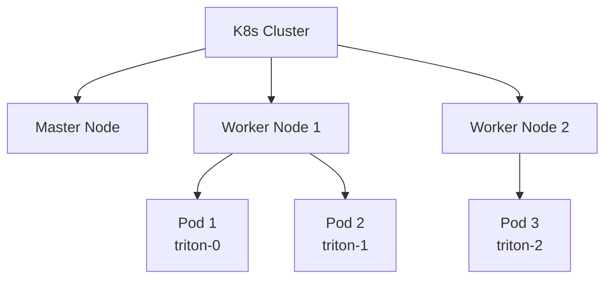
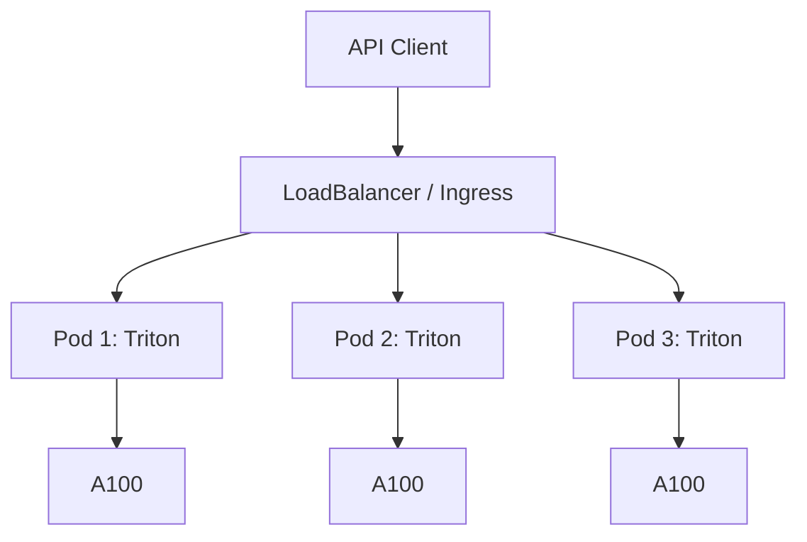
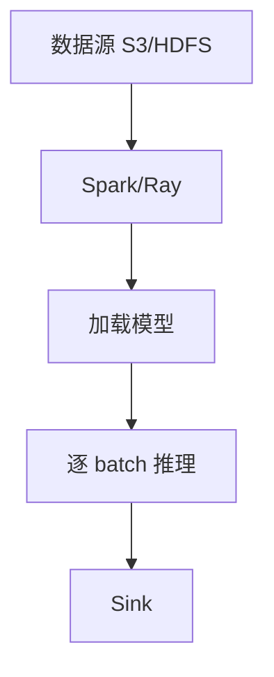
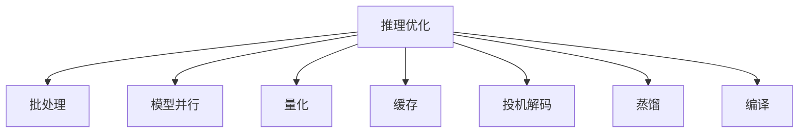
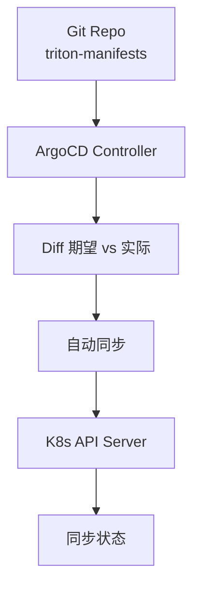
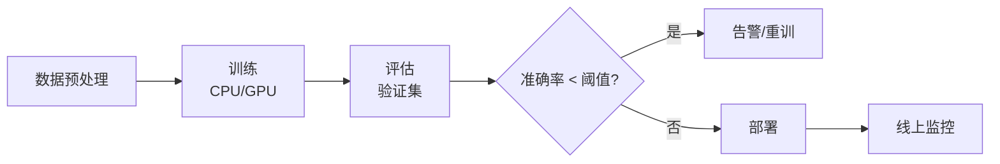
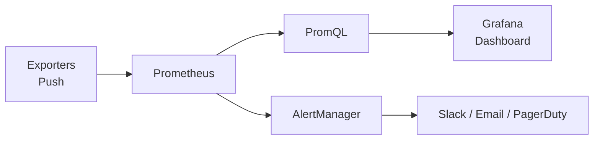

# 0-K8s与ML模型部署

rometheus) → 大厂真实案例
chapter_id: 12.00
last_updated: 2026-07-23
status: ✅ v1.0

---

## 12.0 K8s 与 ML 模型部署 - Kubernetes 全栈

> **Kubernetes (K8s)** 是工业 ML 部署的事实标准。
> 本章给出从 K8s 基础到生产级 ML 系统部署的完整链路,
> 重点解决"GPU 调度 + 大模型服务 + ML 流水线" 三大痛点。

---

## 0. 一句话总结

**K8s = 容器编排的工业标准;在 ML 中负责 (1) GPU 调度 + (2) 模型服务化 (Triton/vLLM) + (3) ML 流水线 (Kubeflow/Argo) + (4) 监控告警;核心是"声明式 + 自动恢复 + 弹性扩缩";落地重点是 GPU 资源池化 + 推理优化 + CI/CD。**

---

## 1. 为什么需要 K8s

### 1.1 ML 部署的现实挑战

```text
1. 资源异构: CPU + GPU + 高带宽网络 + 大内存 + 分布式存储
2. 多框架: PyTorch + TensorFlow + vLLM + Triton + 多语言 (C++/CUDA)
3. 多版本: 多个模型版本共存 + 灰度发布 + 回滚
4. 多环境: 训练 / 离线推理 / 在线推理 / 实验平台
5. 高可用: 模型服务不能挂,挂了损失真金白银
6. 弹性: 大促流量激增 vs 凌晨低峰
7. 资源利用率: GPU 单卡 80 万 - 100 万 / 年, 闲置是巨大浪费
```

### 1.2 K8s 的核心价值

```text
1. 资源统一编排: CPU/GPU/内存/存储/IP/网络 → 一起管理
2. 自动恢复: 容器挂 → 自动重启 + 健康检查
3. 弹性扩缩: HPA (横向)、VPA (纵向)、Cluster Autoscaler (集群级)
4. 灰度发布: Deployment 滚动升级 + 金丝雀
5. 多环境: Namespace 隔离 + ConfigMap 复用
6. 自愈能力: livenessProbe + readinessProbe
7. 服务发现: Service + DNS + Ingress
```

### 1.3 K8s vs 其他选择

| 方案 | 特点 | 适用 |
|---|---|---|
| **K8s** | 工业标准,生态广,复杂 | 中大规模 ML 平台 |
| **Docker Compose** | 简单,单机 | 本地开发 / 小服务 |
| **Mesos** | 老牌,Spark 起家 | 大数据 + ML |
| **Slurm** | HPC 风格,批作业 | 训练任务 |
| **Ray** | ML 任务原生,Python 友好 | 训练 + 简单推理 |
| **Nomad** | HashiCorp 出品,简单 | 中等规模 |

**为什么主流是 K8s?**
- 谷歌背书 + CNCF 庞大生态
- GPU Operator/NVIDIA Device Plugin 等 ML 工具链齐全
- ArgoCD/Kubeflow 等专门 CI/CD
- 厂商广泛支持 (AWS EKS, GCP GKE, 阿里云 ACK, 腾讯 TKE)

### 1.4 ML 工程师需要懂 K8s 的程度

```text
"会用" 级别: kubectl, logs, exec, scale, rollout
"能部署" 级别: kubectl apply, Deployment, Service, ConfigMap
"能写" 级别: K8s YAML 完整, Ingress, PV/PVC
"懂原理" 级别: Pod 调度, 网络, 控制器
"能扩展" 级别: 自定义 Controller (Operator)
```

**算法工程师建议**: 至少 "能用 + 能部署"。

---

## 2. K8s 基础

### 2.1 核心概念



**核心对象**:

| 对象 | 作用 |
|---|---|
| **Pod** | 最小调度单位, 1+ 容器 + 共享网络/存储 |
| **Deployment** | Pod 的副本管理, 自动恢复 |
| **StatefulSet** | 有状态 Pod (如 Kafka、ZooKeeper) |
| **Service** | Pod 的稳定访问入口 |
| **ConfigMap** | 配置注入 (YAML) |
| **Secret** | 敏感数据 (TLS, 密码) |
| **Namespace** | 逻辑隔离 |
| **Ingress** | 7 层负载均衡 (HTTPS, 域名) |
| **NetworkPolicy** | 网络访问控制 |
| **DaemonSet** | 每节点跑一份 (如 Prometheus Node Exporter) |

### 2.2 Pod 详解

Pod = 1 或多个**紧密耦合**的容器 + 共享 **网络/存储**。

```yaml
apiVersion: v1
kind: Pod
metadata:
  name: triton-llm
  labels:
    app: triton
    model: llama-7b
spec:
  containers:
  - name: triton
    image: nvcr.io/nvidia/tritonserver:24.06-py3
    ports:
    - containerPort: 8000
    resources:
      limits:
        nvidia.com/gpu: 1  # 1 张 GPU
        memory: "32Gi"
        cpu: "8"
      requests:
        memory: "16Gi"
        cpu: "4"
    volumeMounts:
    - name: model-repo
      mountPath: /models
    - name: shm
      mountPath: /dev/shm
  - name: sidecar  # 旁车容器 (可选)
    image: nats-server:2.10
    command: ["nats-server"]
  volumes:
  - name: model-repo
    persistentVolumeClaim:
      claimName: triton-model-pvc
  - name: shm
    emptyDir:
      medium: Memory
      sizeLimit: "8Gi"
```

**Pod 生命周期**:
- Pending → Running → Succeeded/Failed
- Init Containers (先跑, 用于初始化)
- Liveness/Readiness probes
- PostStart/PreStop hooks

### 2.3 Deployment 详解

Deployment = Pod 模板 + 副本数 + 升级策略。

```yaml
apiVersion: apps/v1
kind: Deployment
metadata:
  name: triton-llm
  namespace: ml-serving
spec:
  replicas: 3
  selector:
    matchLabels:
      app: triton
  strategy:
    type: RollingUpdate
    rollingUpdate:
      maxSurge: 1
      maxUnavailable: 0  # 服务永不停服
  template:
    metadata:
      labels:
        app: triton
    spec:
      # 节点选择: GPU 节点
      nodeSelector:
        nvidia.com/gpu.present: "true"
      # 容忍 GPU 节点上的 "NoSchedule" 染色
      tolerations:
      - key: nvidia.com/gpu
        operator: Exists
        effect: NoSchedule
      containers:
      - name: triton
        image: nvcr.io/nvidia/tritonserver:24.06-py3
        args:
        - tritonserver
        - --model-repository=/models
        - --strict-model-config=false
        - --log-verbose=true
        ports:
        - containerPort: 8000
        resources:
          limits:
            nvidia.com/gpu: 1
        readinessProbe:
          httpGet:
            path: /v2/health/ready
            port: 8000
          initialDelaySeconds: 30
          periodSeconds: 10
        livenessProbe:
          httpGet:
            path: /v2/health/live
            port: 8000
          initialDelaySeconds: 60
          periodSeconds: 30
```

### 2.4 Service 详解

Service = 一组 Pod 的稳定访问入口。

**3 种类型**:

| 类型 | 用途 | 实现 |
|---|---|---|
| **ClusterIP** | 默认,集群内访问 | iptables/IPVS |
| **NodePort** | 暴露到节点端口 (开发测试) | 节点 IP + 端口 |
| **LoadBalancer** | 云厂商负载均衡器 | AWS ELB / GCP LB / 阿里 SLB |
| **ExternalName** | CNAME 别名 | DNS |

```yaml
apiVersion: v1
kind: Service
metadata:
  name: triton
  namespace: ml-serving
spec:
  type: ClusterIP  # 集群内部访问
  selector:
    app: triton
  ports:
  - name: http
    port: 80
    targetPort: 8000
  - name: metrics
    port: 80
    targetPort: 8002
```

### 2.5 Namespace 详解

Namespace = 逻辑隔离。生产实践:

```yaml
apiVersion: v1
kind: Namespace
metadata:
  name: ml-serving
  labels:
    name: ml-serving
    tier: serving
```

**典型命名空间划分**:
```text
kube-system      # K8s 系统组件
monitoring       # Prometheus / Grafana
ingress          # nginx-ingress-controller
ml-training      # 训练任务
ml-serving       # 在线推理
ml-batch         # 批量推理
ml-experiment    # 实验/开发
ml-admin         # 管理员工具
```

### 2.6 ConfigMap 与 Secret

**ConfigMap** = 非敏感配置:

```yaml
apiVersion: v1
kind: ConfigMap
metadata:
  name: triton-config
data:
  tritonserver.conf: |
    model-repository: "/models"
    strict-model-config: false
    log-verbose: 1
  batcher-config.json: |
    {
      "enable": true,
      "max_queue_delay_microseconds": 1000
    }
```

**Secret** = 敏感数据:

```yaml
apiVersion: v1
kind: Secret
metadata:
  name: hf-token
type: Opaque
stringData:
  token: "hf_xxx..."  # 即 tokens 等
```

**从 Secret 注入环境变量**:

```yaml
spec:
  containers:
  - name: triton
    env:
    - name: HF_TOKEN
      valueFrom:
        secretKeyRef:
          name: hf-token
          key: token
```

### 2.7 Ingress

Ingress = 7 层负载均衡, 提供 HTTPS / 域名路由:

```yaml
apiVersion: networking.k8s.io/v1
kind: Ingress
metadata:
  name: ml-serving
  annotations:
    nginx.ingress.kubernetes.io/backend-protocol: "HTTP"
    nginx.ingress.kubernetes.io/proxy-body-size: "10m"
spec:
  tls:
  - hosts:
    - ml.example.com
    secretName: ml-tls-secret
  rules:
  - host: ml.example.com
    http:
      paths:
      - path: /triton
        pathType: Prefix
        backend:
          service:
            name: triton
            port:
              number: 80
```

### 2.8 NetworkPolicy

NetworkPolicy = 网络防火墙:

```yaml
apiVersion: networking.k8s.io/v1
kind: NetworkPolicy
metadata:
  name: triton-policy
  namespace: ml-serving
spec:
  podSelector:
    matchLabels:
      app: triton
  policyTypes:
  - Ingress
  - Egress
  ingress:
  - from:
    - namespaceSelector:
        matchLabels:
          name: ingress
    - podSelector:
        matchLabels:
          app: online-service
    ports:
    - port: 8000
  egress:
  - to:
    - namespaceSelector:
        matchLabels:
          name: ml-data
    - podSelector:
        matchLabels:
          app: feature-store
    ports:
    - port: 5432
    - port: 6379
```

### 2.9 资源请求 (Requests) vs 限制 (Limits)

```yaml
resources:
  requests:  # 调度器决策依据
    cpu: "4"      # 4 核 - 调度权重
    memory: "16Gi"
    nvidia.com/gpu: 1
  limits:    # 上限, 超了 OOM Kill
    cpu: "8"
    memory: "32Gi"
    nvidia.com/gpu: 1
```

**QoS 等级**:
- **Guaranteed**: requests == limits
- **Burstable**: requests < limits (推荐)
- **BestEffort**: 都未设置 (开发测试)

### 2.10 卷 (Volume)

| 类型 | 用途 |
|---|---|
| **emptyDir** | Pod 临时存储, 随 Pod 销毁 |
| **hostPath** | 节点本地路径 |
| **ConfigMap/Secret** | 配置文件注入 |
| **PersistentVolume (PV/PVC)** | 持久化卷 |
| **NFS/CephFS** | 网络文件系统 |
| **CSI Driver** | 云厂商动态卷 (AWS EBS, GCP PD) |
| **PVC 动态分配** | StorageClass + 动态 Provisioning |

---

## 3. GPU 调度

### 3.1 GPU 资源挑战

GPU 资源的特点:
1. **贵**: A100 一张 80G 约 1 万美元, 一年折旧 30%
2. **异构**: A100 / H100 / V100 / T4 性能差异大
3. **拓扑敏感**: NVLink、NVSwitch 节点内 vs RDMA 节点间
4. **共享困难**: 多任务用一张卡 vs 单任务占一张卡
5. **监控难**: 显存、SM 利用率、温度

### 3.2 NVIDIA Device Plugin

K8s 通过 **device plugin** 暴露 GPU:

```bash
# 安装 (GKE 默认安装, 自建集群需手动)
helm repo add nvdp https://nvidia.github.io/k8s-device-plugin
helm install nvdp nvdp/nvidia-device-plugin \
  --namespace nvidia-device-plugin \
  --create-namespace
```

**效果**: Pod 可以请求 `nvidia.com/gpu: 1`。

```yaml
containers:
- name: train
  resources:
    limits:
      nvidia.com/gpu: 1
```

### 3.3 节点标签 (Node Labels)

GPU 节点打标签:

```bash
# 标签
kubectl label nodes gpu-node-1 nvidia.com/gpu.product=NVIDIA-A100-SXM4-80GB
kubectl label nodes gpu-node-1 gpu-memory=80Gi
kubectl label nodes gpu-node-1 nvidia.com/gpu.present=true

# 选择节点
nodeSelector:
  nvidia.com/gpu.product: NVIDIA-A100-SXM4-80GB
  gpu-memory: 80Gi
```

### 3.4 GPU Sharing (共享 GPU)

**需求**: 一张 A100 80G, 跑多个推理服务 (每个只用 10G)。

**解决方案**:

#### (a) MIG (Multi-Instance GPU)
NVIDIA A100 支持硬件切分, 1 张 80G → 最多 7 个 10G 的实例。

#### (b) Time-Slicing
按时分片, 一个 GPU 跑多 Pod (性能下降)。

#### (c) NVIDIA runtime + MPS
```yaml
runtimeClassName: nvidia
```

#### (d) 自定义共享方案 (如字节 ByteGPU, 阿里 cGPU)

**MIG 实战**:

```yaml
# 节点上先把 GPU 切 MIG 实例
# nvidia-smi mig -cgi 0 -C 1g.5gb
# 然后 Pod 申请 MIG 实例
resources:
  limits:
    nvidia.com/mig-1g.5gb: 1  # 单个 MIG 实例
```

### 3.5 Volcano (分布式调度)

**Volcano** 是 CNCF 的 Kubernetes 批量调度器, 专为 AI/HPC 工作负载设计:

```bash
helm install volcano volcano/volcano --namespace volcano-system
```

**特性**:
1. Gang scheduling (全部 Pod 一起调度, 适合分布式训练)
2. 优先级调度 (高优先级抢占)
3. Fair-share (公平份额)
4. Topology aware (拓扑感知, NVLink)
5. 队列管理 (多租户)

**PodGroup (Gang Scheduling)**:

```yaml
apiVersion: scheduling.volcano.sh/v1beta1
kind: PodGroup
metadata:
  name: distributed-train
spec:
  minMember: 4       # 至少 4 个 Pod
  minResources:
    nvidia.com/gpu: 4  # 至少 4 GPU
  queue: default
---
apiVersion: v1
kind: Pod
metadata:
  name: trainer-worker
  labels:
    pod-group-scheduling.sigs.k8s.io/name: distributed-train
spec:
  schedulerName: volcano
  ...
```

### 3.6 K8s + Slurm (批作业)

Slurm 经典 HPC 任务调度,可与 K8s 集成:

```yaml
# K8s 用 kube-batch 或 Volcano 模拟 Slurm
```

### 3.7 拓扑感知调度

多卡训练需要 NVLink/NVSwitch 通信, K8s 默认不感知。

**解决方案**:

1. **Volcano** with hwloc 拓扑插件
2. **GPU Operator** + topology-aware scheduler
3. **自研** Scheduler Extender (向 scheduler-v1.21+ 的 Scheduler Framework 注册)

```yaml
# Volcano 拓扑感知
nodeSelector:
  topology.kubernetes.io/zone: us-east-1a
```

### 3.8 GPU 时间份额调度

```yaml
apiVersion: scheduling.volcano.sh/v1beta1
kind: Queue
metadata:
  name: training
spec:
  weight: 1
  reclaimable: true
  capability:
    nvidia.com/gpu: 40
---
apiVersion: scheduling.volcano.sh/v1beta1
kind: Queue
metadata:
  name: serving
spec:
  weight: 3  # serving 比 training 高 3 倍优先级
  capability:
    nvidia.com/gpu: 10
```

---

## 4. ML 模型部署模式

### 4.1 三种部署模式

| 模式 | 延迟要求 | QPS | 模型大小 | 工具 |
|---|---|---|---|---|
| **在线推理** | < 100ms | 高 | < 50GB | Triton, vLLM, TGI |
| **批处理** | 分钟-小时 | 任务级 | 任意 | Spark, Ray, Volcano |
| **训练** | 数小时-数天 | 资源调度 | 极大 | Kubeflow, Volcano |

### 4.2 在线推理架构 (Triton)



**Triton 概述**:
- NVIDIA 开源的推理服务
- 支持多框架: TensorRT, ONNX, PyTorch, TF, OpenVINO
- 动态 batching (请求合并)
- 多模型同时服务
- 模型热加载

**Triton YAML 配置**:

```yaml
# /models/llama/config.pbtxt
name: "llama-7b"
platform: "pytorch_libtorch"
max_batch_size: 32
input [
  {
    name: "input_ids"
    data_type: TYPE_INT64
    dims: [1, 2048]
  }
]
output [
  {
    name: "logits"
    data_type: TYPE_FP32
    dims: [1, 2048, 32000]
  }
]
instance_group [
  {
    count: 1
    kind: KIND_GPU
  }
]
dynamic_batching {
  preferred_batch_size: [8, 16]
  max_queue_delay_microseconds: 1000
}
```

**Triton 部署 YAML**:

```yaml
apiVersion: apps/v1
kind: Deployment
metadata:
  name: triton-llama
spec:
  replicas: 4
  selector:
    matchLabels:
      app: triton
  template:
    metadata:
      labels:
        app: triton
    spec:
      containers:
      - name: triton
        image: nvcr.io/nvidia/tritonserver:24.06-py3
        command: ["tritonserver"]
        args:
          - --model-repository=/models
          - --strict-model-config=false
          - --log-verbose=true
        ports:
        - containerPort: 8000  # HTTP
        - containerPort: 8001  # gRPC
        - containerPort: 8002  # Metrics
        resources:
          limits:
            nvidia.com/gpu: 1
            memory: 32Gi
        livenessProbe:
          httpGet:
            path: /v2/health/live
            port: 8000
        readinessProbe:
          httpGet:
            path: /v2/health/ready
            port: 8000
        volumeMounts:
        - name: model-repo
          mountPath: /models
      volumes:
      - name: model-repo
        persistentVolumeClaim:
          claimName: llama-models
```

### 4.3 在线推理 (vLLM)

**vLLM** 专门为 LLM 推理设计:

```bash
# 安装
pip install vllm

# 启动服务
python -m vllm.entrypoints.openai.api_server \
  --model Qwen/Qwen2.5-7B-Instruct \
  --tensor-parallel-size 1 \
  --port 8000 \
  --host 0.0.0.0
```

**vLLM Docker**:

```dockerfile
FROM vllm/vllm-openai:latest

# 启动命令
ENTRYPOINT ["python", "-m", "vllm.entrypoints.openai.api_server"]
CMD ["--model", "Qwen/Qwen2.5-7B-Instruct", "--port", "8000"]
```

**vLLM 性能**:
- PagedAttention (OS 虚拟内存分页)
- Continuous batching
- Speculative decoding
- 多 LoRA 服务

### 4.4 在线推理 (TGI)

**HuggingFace TGI**:

```bash
# 启动
docker run --gpus all -p 8080:80 \
  -v $volume:/data \
  ghcr.io/huggingface/text-generation-inference:latest \
  --model-id Qwen/Qwen2.5-7B-Instruct \
  --num-shard 1
```

### 4.5 推理服务对比

| 维度 | Triton | vLLM | TGI | TensorRT-LLM |
|---|---|---|---|---|
| 框架多 | ✅ (PyTorch/TF/ONNX) | PyTorch | HF 生态 | PyTorch + ONNX |
| LLM 优化 | 一般 | **最强** | 中 | 强 (NVIDIA) |
| 部署 K8s | 容易 | **容易 (官方 Helm)** | 容易 | 较复杂 |
| 多 GPU | 自定义 | TP/PP | TP/PP | TP/PP |
| 成熟度 | **高** | 高 | 高 | 中 |
| 易用性 | 中 | **高** | 高 | 低 |

### 4.6 批处理部署模式



**Spark on K8s** (spark-on-k8s-operator):

```yaml
apiVersion: sparkoperator.k8s.io/v1beta2
kind: SparkApplication
metadata:
  name: batch-inference
spec:
  sparkVersion: "3.5.0"
  driver:
    cores: 2
    memory: "4G"
  executor:
    instances: 10
    cores: 4
    memory: "16G"
    gpu:
      name: "nvidia.com/gpu"
      quantity: 1
    image: "spark:3.5-gpu"
  mainApplicationFile: "local:///opt/spark/jars/batch-inference.jar"
```

**Ray on K8s** (KubeRay):

```yaml
apiVersion: ray.io/v1
kind: RayCluster
metadata:
  name: ray-cluster
spec:
  rayVersion: "2.30.0"
  workerGroupSpecs:
  - replicas: 5
    minReplicas: 1
    maxReplicas: 10
    resources:
      limits:
        nvidia.com/gpu: "1"
      requests:
        cpu: "4"
    rayStartParams:
      resources: '"{\"Nvidia GPU\": 1}"'
```

### 4.7 训练任务模式 (Kubeflow)

**Kubeflow** = K8s 上的 ML 平台。

```yaml
# Kubeflow TFJob (分布式训练)
apiVersion: kubeflow.org/v1
kind: TFJob
metadata:
  name: tf-dist-train
spec:
  tfReplicaSpecs:
    ReplicaSpec:
      replicas: 1
      template:
        spec:
          containers:
          - name: tensorflow
            image: gcr.io/tensorflow/tensorflow:latest-gpu
            args: ["python", "train.py"]
    Worker:
      replicas: 4
      template:
        spec:
          containers:
          - name: tensorflow
            image: gcr.io/tensorflow/tensorflow:latest-gpu
            resources:
              limits:
                nvidia.com/gpu: 1
```

### 4.8 Kubeflow Pipelines

```yaml
# Kubeflow Pipeline
apiVersion: argoproj.io/v1alpha1
kind: Workflow
metadata:
  name: ml-pipeline
spec:
  entrypoint: ml-pipeline
  templates:
  - name: data-prep
    container:
      image: data-prep:latest
      args: ["--input", "{{workflow.parameters.input}}"]
  - name: train
    container:
      image: trainer:latest
      resources:
        limits:
          nvidia.com/gpu: 1
  - name: serve
    container:
      image: tritonserver:latest
  - name: ml-pipeline
    dag:
      tasks:
      - name: prep
        template: data-prep
      - name: train-model
        dependencies: [prep]
        template: train
      - name: deploy
        dependencies: [train-model]
        template: serve
```

---

## 5. 推理优化

### 5.1 优化维度全景



### 5.2 批处理 (Batching)

**为什么?** GPU 算力高, 单条请求无法填满, 浪费算力。

**Static batching**: 同一批 N 条请求同时推理, 简单但需等齐。
**Dynamic batching**: Triton 自动攒批, max_queue_delay 100µs。

**Triton dynamic_batching 配置**:

```yaml
dynamic_batching {
  preferred_batch_size: [4, 8, 16]  # 优选大小
  max_queue_delay_microseconds: 100  # 最多等 100µs
  batch_timeout_microseconds: 0
  preserve_ordering: true
}
```

**vLLM Continuous Batching**: 每 token 解码后才释放, 无需等齐。

### 5.3 模型并行

#### Tensor Parallelism (TP)
把模型参数横向切分到多卡, 不同卡算不同 head:

```python
# 模型并行需要 PyTorch Distributed + Megatron-LM
# 或用 DeepSpeed / vLLM 内置
```

#### Pipeline Parallelism (PP)
把模型分层, 不同卡算不同层:

```text
[Embedding on GPU 0] → [Layer 1-8 on GPU 1] → [Layer 9-16 on GPU 2] → [LM Head on GPU 3]
```

#### Sequence Parallelism (SP)
长序列切分到多卡, 协同 attention。

**vLLM TP/PP 部署**:

```yaml
# K8s Deployment with multi-GPU
resources:
  limits:
    nvidia.com/gpu: 4  # 4 张卡
# 启动参数
args:
  - --model=Qwen/Qwen2.5-7B-Instruct
  - --tensor-parallel-size=4
```

### 5.4 量化 (Quantization)

**INT8 / INT4 量化**:

```python
# vLLM 支持的量化
args:
  - --model=Qwen/Qwen2.5-7B-Instruct
  - --quantization=gptq   # 或 awq, bitsandbytes, fp8
```

**Triton + TensorRT 量化**:

```python
# 把 PyTorch 模型 → ONNX → TensorRT engine
import tensorrt as trt
# engine 是优化的二进制
```

**GPTQ / AWQ** 等训练后量化的工程:

```python
from auto_gptq import AutoGPTQForCausalLM
model = AutoGPTQForCausalLM.from_pretrained(model_name, quantize_config)
model.quantize(training_data)
model.save_quantized("./llama-7b-4bit")
```

### 5.5 缓存 (KV Cache, Prefix Cache)

**KV Cache**: 已生成的 key/value 缓存, 避免重复计算。

**PagedAttention** (vLLM 创新): 借鉴 OS 虚拟内存分页, 避免 KV Cache 碎片。

```python
# vLLM API
from vllm import LLM, SamplingParams
llm = LLM(model="Qwen/Qwen2.5-7B-Instruct", dtype="float16")
output = llm.generate(["Hello"])
```

**Prefix Cache (RadixAttention, SGLang)**:

```python
# 多轮对话中 prefix 复用 (system prompt + 历史消息)
# 节省 50%+ 推理时间
```

### 5.6 投机解码 (Speculative Decoding)

小模型 draft → 大模型 verify, 加速 2-3x:

```python
# vLLM speculative decoding
args:
  - --model=Qwen/Qwen2.5-7B-Instruct
  - --speculative-model=Qwen/Qwen2.5-0.5B-Instruct  # draft 模型
  - --num-speculative-tokens=5
```

### 5.7 模型蒸馏 (Distillation)

```python
# 小模型学大模型
teacher_logits = teacher(input_ids)
student_logits = student(input_ids)
loss = KL_divergence(student_logits, teacher_logits)
```

### 5.8 编译优化 (torch.compile)

```python
model = torch.compile(model, mode="reduce-overhead")
# 加速 20-50%
```

**AOT (Ahead-of-Time) 编译**:

```bash
torchrun --nproc-per-node 8 compile_model.py --output engine.ts
```

### 5.9 综合优化检查清单

```text
[ ] Dynamic batching 开启
[ ] TensorRT 或 ONNX Runtime 优化 (Triton)
[ ] Continuous batching (vLLM)
[ ] KV Cache 优化 (PagedAttention)
[ ] INT8/INT4 量化 (GPTQ/AWQ)
[ ] Prefix Cache (多轮对话)
[ ] 投机解码 (latency 敏感)
[ ] 模型蒸馏 (内存敏感)
[ ] torch.compile / DeepSpeed-Inference
[ ] 预热 (Warmup) 一次避免冷启动
[ ] 监控: latency, throughput, GPU util
[ ] A/B 测试: 不同优化策略对比
```

---

## 6. ML CI/CD

### 6.1 三大支撑

```text
GitOps (ArgoCD)         → K8s manifests
Pipeline (Kubeflow)     → 训练 + 部署流水线
Experiment Tracking     → MLflow / W&B
```

### 6.2 GitOps (ArgoCD)

**GitOps 原则**: Git 是真理之源, K8s 状态由 Git 决定。

```bash
# 安装 ArgoCD
kubectl create namespace argocd
kubectl apply -n argocd -f https://raw.githubusercontent.com/argoproj/argo-cd/stable/manifests/install.yaml
```

**核心组件**:



**Application 资源**:

```yaml
apiVersion: argoproj.io/v1alpha1
kind: Application
metadata:
  name: triton-llama
  namespace: argocd
spec:
  project: default
  source:
    repoURL: https://github.com/company/triton-manifests
    targetRevision: main
    path: manifests/llama/
  destination:
    server: https://kubernetes.default.svc
    namespace: ml-serving
  syncPolicy:
    automated:
      prune: true
      selfHeal: true
    syncOptions:
    - CreateNamespace=true
```

**App of Apps**: 一个 Application 管其他多个 Application。

### 6.3 Kubeflow Pipelines (KFP)

```python
import kfp
from kfp import dsl

@dsl.component
def data_prep(input_path: str, output_path: str):
    """数据预处理"""
    ...

@dsl.component(packages_to_install=["torch==2.0"])
def train(data_path: str, model_path: str, epochs: int = 10):
    """训练"""
    ...

@dsl.component
def deploy(model_path: str, gpu_type: str):
    """部署"""
    ...

@dsl.pipeline(name="ML Pipeline")
def ml_pipeline(input_path: str = "s3://data/train/"):
    p1 = data_prep(input_path=input_path, output_path="/data/processed")
    p2 = train(data_path=p1.outputs["output_path"], model_path="/models/llama")
    p3 = deploy(model_path=p2.outputs["model_path"], gpu_type="A100")
    p2.after(p1)
    p3.after(p2)
```

**KFP DAG 示例**:



### 6.4 模型版本管理

**语义化版本**:
```text
v1.2.3
^ ^ ^
| | └─ patch: 修复
| └─── minor: 新特征 / 数据
└───── major: 架构 / 大改
```

**模型 Registry**:

```python
import mlflow
mlflow.set_tracking_uri("http://mlflow-server:5000")

# 训练时记录
with mlflow.start_run():
    mlflow.log_params({"lr": 1e-3, "epochs": 10, "model": "bert"})
    mlflow.log_metrics({"loss": 0.1, "accuracy": 0.95})
    mlflow.pyfunc.log_model("model", python_model=MyModel())

# 模型版本管理
client = mlflow.tracking.MlflowClient()
client.transition_model_version_stage(
    name="BERT-Classifier",
    version=3,
    stage="Production"
)
```

### 6.5 金丝雀发布 (Canary)

**Pod-side 金丝雀** (流量按比例分配):

```yaml
apiVersion: argoproj.io/v1alpha1
kind: Rollout
metadata:
  name: triton-llama
spec:
  strategy:
    canary:
      steps:
      - setWeight: 10
      - pause: {duration: 5m}
      - setWeight: 30
      - pause: {duration: 10m}
      - setWeight: 60
      - pause: {duration: 10m}
      - setWeight: 100
  revisionHistoryLimit: 2
  selector:
    matchLabels:
      app: triton
  template:
    metadata:
      labels:
        app: triton
    spec:
      containers:
      - name: triton
        image: triton:v2
```

**Istio 流量切分金丝雀**:

```yaml
apiVersion: networking.istio.io/v1beta1
kind: VirtualService
metadata:
  name: triton
spec:
  hosts:
  - triton
  http:
  - route:
    - destination:
        host: triton
        subset: v1
      weight: 90
    - destination:
        host: triton
        subset: v2
      weight: 10
```

### 6.6 实验管理 (MLflow / W&B)

```python
import mlflow

# 启动实验
experiment = mlflow.create_experiment("recommendation-system")

with mlflow.start_run(experiment_id=experiment.experiment_id):
    # 记录参数
    mlflow.log_params({
        "lr": 1e-3,
        "batch_size": 1024,
        "model": "deepfm",
        "embedding_dim": 32,
        "feature_count": 200,
    })

    # 训练循环中记录
    for epoch in range(epochs):
        ...
        mlflow.log_metrics({"auc": auc, "logloss": logloss}, step=epoch)

    # 记录模型
    mlflow.pytorch.log_model(model, "model")
    mlflow.log_artifact("config.yaml")
```

**实验对比**:
```python
# MLflow UI: http://mlflow:5000
# 显示: 实验列表 + 参数对比 + 指标曲线 + artifact
```

---

## 7. 监控

### 7.1 监控层次

```text
[1] 基础设施层:
    CPU/GPU/内存/磁盘/网络
    → node-exporter + DCGM

[2] K8s 层:
    Pod / Deployment / Service 健康
    → kube-state-metrics

[3] 服务层:
    HTTP 状态码 / P99 latency / QPS / 错误率
    → ServiceMesh (Istio) + Prometheus

[4] 模型层:
    推理延迟 / 吞吐量 / 命中率 / AUC
    → 自定义 exporter

[5] 业务层:
    CTR / CVR / GMV / 用户体验
    → Kafka + ClickHouse / OLAP
```

### 7.2 Prometheus + Grafana

**安装 (Prometheus Operator)**:

```bash
helm install prometheus prometheus-community/kube-prometheus-stack
```

**架构**:



### 7.3 关键指标

**GPU 指标** (DCGM - Data Center GPU Manager):

```yaml
# DCGM Exporter metrics
DCGM_FI_DEV_GPU_UTIL          # GPU 利用率
DCGM_FI_DEV_FB_USED           # 显存使用
DCGM_FI_DEV_FB_TOTAL          # 显存总量
DCGM_FI_DEV_GPU_TEMP          # 温度
DCGM_FI_DEV_POWER_USAGE       # 功耗
DCGM_FI_DEV_SM_CLOCK          # SM 时钟
```

**Inference 指标**:

```yaml
# Triton 自带 /metrics 端口
nv_inference_queue_duration_us
nv_inference_compute_infer_duration_us
nv_inference_request_success_total
nv_inference_request_failure_total
nv_inference_queue_size
```

### 7.4 Prometheus Rules / Alerts

```yaml
groups:
- name: ml-serving
  rules:
  - alert: HighGPULatency
    expr: histogram_quantile(0.99, sum by(le,model) (rate(triton_inference_latency_seconds_bucket[5m]))) > 0.1
    for: 5m
    labels:
      severity: warning
    annotations:
      summary: "P99 latency > 100ms"

  - alert: GPUMemoryHigh
    expr: DCGM_FI_DEV_FB_USED / DCGM_FI_DEV_FB_TOTAL > 0.9
    for: 10m
    labels:
      severity: critical
    annotations:
      summary: "GPU 显存占用 > 90%"

  - alert: ModelServiceDown
    expr: up{job="triton"} == 0
    for: 1m
    labels:
      severity: critical

  - alert: InferenceErrorRateHigh
    expr: rate(triton_request_failure_total[5m]) / rate(triton_request_total[5m]) > 0.05
    for: 3m
    labels:
      severity: critical
```

### 7.5 Grafana Dashboard 示例

**重要面板**:
- QPS by model
- P99 latency by model
- GPU utilization (热力图)
- KV cache memory usage
- Inference queue length
- Error rate

```json
{
  "title": "ML Serving Dashboard",
  "panels": [
    {"title": "QPS", "type": "graph", "query": "rate(triton_request_total[5m])"},
    {"title": "P99 Latency", "type": "graph", "query": "histogram_quantile(0.99, rate(triton_latency_bucket[5m]))"},
    {"title": "GPU Memory", "type": "gauge", "query": "DCGM_FI_DEV_FB_USED / DCGM_FI_DEV_FB_TOTAL"}
  ]
}
```

### 7.6 业务指标采集

```python
# 业务指标 → Kafka → ClickHouse
import requests

def record_business_metric(model_name, prediction, actual):
    """每条推理请求后记录"""
    metric = {
        "timestamp": time.time(),
        "model": model_name,
        "prediction": prediction,
        "actual": actual,
        "ctr": (1 if prediction == "click" else 0),
    }
    kafka_producer.send("ml-metrics", metric)
```

### 7.7 分布式追踪 (Jaeger / Tempo)

```python
# 在 Triton 客户端加上 OpenTelemetry
from opentelemetry import trace
tracer = trace.get_tracer(__name__)

with tracer.start_as_current_span("inference") as span:
    span.set_attribute("model.name", "llama-7b")
    response = triton_client.infer("llama-7b", inputs)
    span.set_attribute("latency_ms", response.get_time())
```

**效果**: 看一个请求从客户端 → K8s Ingress → Triton → GPU 调用, 全链路追踪。

---

## 8. 真实案例

### 8.1 字节跳动:大模型在线服务

**规模**: 千亿参数 LLM, 万亿 token / 天, 1B+ 用户。

**架构**:

```text
┌──────────────────────────────────────┐
│     Client (iOS/Android/Web)         │
└──────────────┬───────────────────────┘
               ↓
┌──────────────────────────────────────┐
│   BFE (自研 L7 LB) / Cloud CDN       │
└──────────────┬───────────────────────┘
               ↓
┌──────────────────────────────────────┐
│   API Gateway (K8s + 自研)           │
│   - 鉴权 / 限流 / 降级                │
└──────────────┬───────────────────────┘
               ↓
┌──────────────────────────────────────┐
│   推理推理集群 (K8s + GPU)           │
│   - 双机房部署, 双活                  │
│   - Triton / vLLM 自研推理框架       │
│   - 模型分片 (TP/PP)                 │
│   - 推理优化 (INT8, 投机解码)       │
└──────────────────────────────────────┘
```

**关键经验**:
1. **GPU 调度自研 (ByteGPU)**: 支持 MIG + 共享 + 抢占
2. **推理框架自研**: 基于 Triton / vLLM 二次开发
3. **A/B 平台**: 流量分配 + 业务指标实时对比
4. **熔断降级**: 主模型失败 → 兜底小模型
5. **灰度发布**: 5% → 20% → 50% → 100%

### 8.2 Meta: Llama 部署

**目标**: 部署 70B 参数模型, 服务 10B+ 用户的 Reels/Posts 推荐。

**架构**:
- 用 **KServe + KNative** + 自研
- **PagedAttention (vLLM 风格)** 自研版
- 7+ GPU 单实例
- 每秒 100+ 请求实例

**Llama 3 部署 (Meta, 2024)**:

```yaml
apiVersion: apps/v1
kind: Deployment
metadata:
  name: llama3-70b
spec:
  replicas: 8  # 8 个推理 Pod
  template:
    spec:
      containers:
      - name: triton
        image: triton:custom
        args: [
          "--model-repository=/models",
          "--backend=python",  # 自定义 backend
          ...
        ]
        resources:
          limits:
            nvidia.com/gpu: 8  # 每 Pod 8 卡
```

**关键决策**:
- **多机部署**: 8 Pod × 8 GPU = 64 GPU 用于单模型
- **TP/PP**: 每 Pod 内 TP=8 (单机 8 卡);Pod 间采用数据并行
- **备份**: 离线索引用 FAISS + 在线 rerank

### 8.3 OpenAI: ChatGPT 服务

**规模**: 1 亿 + 用户, 数十亿 token / 天。

**架构 (公开推测)**:

```text
[入口]
  CDN (Cloudflare) → Custom LB → API gateway

[推理集群]
  Kubernetes cluster (推测)
  - 每节点 8 × H100
  - 自研推理框架 (triton-like)
  - PagedAttention (源自 vLLM)

[优化]
  - 投机解码 (draft 验证)
  - Continuous batching
  - Prefix cache (系统 prompt 复用)
  - INT8 / FP8 量化

[降级]
  - 主模型 OOM → 小模型兜底
  - 流量过大 → 排队
  - 请求超时 → 重试
```

**核心揭秘**:
- 推理框架 **内部叫 NVIDIA Triton-like**
- KV Cache 优化源于 **vLLM PagedAttention**
- 推测解码加速 2-3x
- 整体处于 K8s + 自研调度混合形态

### 8.4 美团: MTGR 在线推理

**MTGR (Multi-task Generative Recommendation)**:

```yaml
apiVersion: serving.knative.dev/v1
kind: Service
metadata:
  name: mtgr-ranker
spec:
  template:
    spec:
      containers:
      - image: mtgr:latest
        resources:
          limits:
            nvidia.com/gpu: 2
            memory: 32Gi
  traffic:
  - percent: 100
    latestRevision: true
```

**特点**:
- KNative + Triton
- 实时推理 (CTR, CVR)
- 沙盒分流 5%

### 8.5 小红书: 内容推荐

**架构**:
- K8s 集群 (混合云, 阿里 + 自建)
- 数千 GPU, H100 / A100 / V100 混合
- KubeRay + Triton + 自研调度
- 训练 + 推理 同一集群

**关键决策**:
- **统一调度**: Ray on K8s, 训练 / 推理共享 GPU
- **弹性**: 训练任务优先, 推理流量大时挤压训练

---

## 9. 工具与生态

### 9.1 CNCF 生态

| 项目 | 用途 |
|---|---|
| **Kubernetes** | 容器编排 |
| **Helm** | 包管理 (类似 apt/yum) |
| **Kustomize** | YAML 配置管理 |
| **Argo CD** | GitOps |
| **Argo Workflows** | 工作流编排 |
| **Kubeflow** | ML 平台 |
| **Prometheus** | 监控 |
| **Grafana** | 仪表板 |
| **Jaeger / Tempo** | 追踪 |
| **Fluentd / Loki** | 日志 |
| **Ceph / MinIO** | 存储 |
| **KubeRay** | Ray on K8s |
| **Knative** | Serverless |
| **Volcano** | 批量调度 |

### 9.2 推理服务框架

| 框架 | 优势 | 适用 |
|---|---|---|
| **Triton** | NVIDIA 原生,多框架 | 通用 |
| **vLLM** | LLM 优化最好 | LLM 推理 |
| **TGI** (HF) | HF 集成 | HF 模型 |
| **TensorRT-LLM** | NVIDIA 极致性能 | 生产 LLM |
| **LMDeploy** | 国产优化 | 中文 LLM |
| **SGLang** | RadixAttention | 多轮 / RAG |
| **KServe** | K8s 原生,Serverless | K8s 环境 |
| **BentoML** | Python 友好 | 多框架 |
| **Ray Serve** | 分布式友好 | 大规模 |
| **MLflow Serving** | MLflow 集成 | ML 平台 |

### 9.3 GPU Operator / 管理

| 工具 | 用途 |
|---|---|
| **NVIDIA GPU Operator** | K8s 上自动装 NVIDIA 驱动 + Runtime |
| **DCGM** | 监控 GPU 指标 |
| **GPU Share Operator** | 共享 GPU (字节 / 腾讯自研) |
| **Volcano GPU Plugin** | 拓扑感知调度 |

### 9.4 Kubeflow 组件

| 组件 | 用途 |
|---|---|
| **KFP** | Pipelines |
| **Katib** | AutoML (HPO) |
| **KServe** | 在线推理 |
| **KFServing** | (老名) Serverless |
| **Notebooks** | Jupyter on K8s |
| **Training Operator** | TFJob / PyTorchJob |

### 9.5 推荐工具链

| 类型 | 工具 |
|---|---|
| **CI** | GitHub Actions / GitLab CI |
| **CD** | ArgoCD / Flux |
| **实验跟踪** | MLflow / W&B / Aim |
| **特征平台** | Feast / Tecton / 自研 |
| **监控** | Prometheus + Grafana + Loki |
| **告警** | AlertManager + PagerDuty |
| **日志** | ELK / EFK |
| **追踪** | Jaeger / Tempo / SkyWalking |
| **镜像仓库** | Harbor / Docker Registry |

---

## 10. 资源

### 10.1 经典资料

| 资源 | 链接 |
|---|---|
| **Kubernetes 官方文档** | kubernetes.io/docs |
| **K8s 中文文档** | kubernetes.io/zh |
| **CNCF** | cncf.io |
| **Kubeflow** | kubeflow.org |
| **NVIDIA Triton** | github.com/triton-inference-server |
| **vLLM** | github.com/vllm-project/vllm |
| **ArgoCD** | argoproj.github.io/cd |

### 10.2 工业白皮书

- Google: "Large-scale cluster management at Google" (Borg 论文)
- Google: "K8s design and development"
- Meta: "Multinode Training"
- NVIDIA: "Triton Inference Server Architecture"

### 10.3 与本仓库其他章节的关联

- [[工程与职业/2-生产工程与模型服务化]] - 详细的模型服务化设计
- [[工程与职业/4-数据工程与特征平台]] - 特征服务化
- [[工程与职业/5-监控与可观测性]] - 监控深入
- [[工程与职业/6-代码质量与工程实践]] - 训练代码部署规范
- [[工程与职业/7-生产调试与失败案例]] - 失败模式
- `../../基础/数学基础/第04章-离散数学/0-总目录与阅读路径.md` - 新架构的 K8s 部署

### 10.4 实战 Checklist

```text
[ ] 1. K8s 集群搭建 (kubeadm / k3s / 云厂商)
[ ] 2. 安装 GPU Operator + NVIDIA Device Plugin
[ ] 3. 安装 DCGM (GPU 监控)
[ ] 4. 安装 Volcano (高级调度)
[ ] 5. 安装 Triton / vLLM (推理)
[ ] 6. 安装 Prometheus + Grafana (监控)
[ ] 7. 安装 ArgoCD / KFP (CI/CD)
[ ] 8. 安装 MLflow (实验跟踪)
[ ] 9. 部署 Llama 7B 示例 (从 0 到 1)
[ ] 10. 配置 HPA (动态扩缩)
[ ] 11. 配置 Canary (金丝雀发布)
[ ] 12. 配置日志 (ELK / Loki)
[ ] 13. 配置追踪 (Jaeger / Tempo)
[ ] 14. 配置告警 (基于关键指标)
[ ] 15. 配置容灾 (多可用区 / 备份)
[ ] 16. 性能压测 (Locust / wrk)
[ ] 17. 应急演练 (故障注入)
```

### 10.5 面试高频问题

**Q1: K8s 的核心组件有哪些?**

- **Master**: API Server, Scheduler, Controller Manager, etcd
- **Worker**: kubelet, kube-proxy, 容器运行时 (containerd)
- **网络插件**: Calico / Flannel / Cilium
- **存储**: CSI driver (云厂商 + 自建如 Ceph)
- **附加**: Ingress Controller, ServiceMesh (Istio), Prometheus Operator

**Q2: Pod 怎么调度到 GPU 节点?**

1. 节点上有 label `nvidia.com/gpu.present: "true"`
2. Pod 用 `nodeSelector` 或 `nodeAffinity` 选择
3. 加 `tolerations` 容忍 GPU 节点的 "NoSchedule" 染色 (避免常规 Pod 占 GPU)
4. Pod 声明 `resources.requests.nvidia.com/gpu: 1`
5. NVIDIA Device Plugin 在节点上注册 GPU 资源
6. Scheduler 把 Pod 绑定到节点

**Q3: 模型服务扩容有哪些策略?**

| 策略 | 触发条件 | 应用 |
|---|---|---|
| **HPA** (Horizontal Pod Autoscaler) | CPU/GPU 利用率/RPS | 实时推理 |
| **VPA** (Vertical) | 内存/CPU | 训练 |
| **KEDA** | Kafka lag, Prometheus metric | 异步推理 |
| **Cluster Autoscaler** | Pod pending | 增加节点 |
| **手动** | 大促准备 | 手动 |

**Q4: Triton vs vLLM 怎么选?**

- **多框架 + 多模型**: Triton
- **纯 LLM + 高吞吐**: vLLM
- **NVIDIA 硬件极致优化**: TensorRT-LLM
- **HF 生态集成**: TGI

**Q5: 如何保证模型服务的高可用?**

1. 至少 **3 副本**, 跨 AZ / 机房
2. **livenessProbe** 健康检查 (失败重启)
3. **readinessProbe** 流量控制 (启动后才接流量)
4. **preStop hook** 让请求优雅退出
5. **PodDisruptionBudget** 控制滚动升级影响
6. **HPA** 弹性扩缩
7. **多集群 / 多云** 双活

**Q6: K8s 上大模型部署的痛点?**

1. **GPU 调度**: 多卡通信拓扑
2. **模型加载**: 大模型启动慢, 镜像传输慢
3. **内存共享**: vLLM PagedAttention 需要特定配置
4. **成本**: GPU 太贵, 利用率要监控
5. **更新**: 滚动升级时长, 镜像版本管理
6. **多模型**: 一套基础设施多模型并存

---

## 附录 A: K8s 故障排查命令速查

```bash
# 查看 Pod 状态
kubectl get pod -n ml-serving -o wide
kubectl describe pod <pod-name> -n ml-serving
kubectl logs <pod-name> -n ml-serving --previous  # 上一个实例的日志
kubectl logs <pod-name> -c <container> -n ml-serving --tail=100

# 进入 Pod
kubectl exec -it <pod-name> -n ml-serving -- bash

# 资源使用
kubectl top pod <pod-name> -n ml-serving --containers
kubectl top node

# 事件
kubectl get events -n ml-serving --sort-by=.lastTimestamp

# GPU 信息 (在 Pod 中)
kubectl exec -it <pod-name> -- nvidia-smi

# 调度
kubectl describe pod <pod-name> | grep -A 20 "Events:"
kubectl get pod -o yaml -n ml-serving | grep -A 10 "scheduler"

# Service 检查
kubectl get svc -n ml-serving
kubectl get ep -n ml-serving  # Endpoints

# Ingress
kubectl get ingress -n ml-serving
kubectl describe ingress -n ml-serving

# 临时调试 (用 busybox)
kubectl run debug --image=busybox --rm -it --restart=Never -- sh

# 网络
kubectl exec <pod> -- nslookup kubernetes.default
kubectl exec <pod> -- curl <service>
kubectl exec <pod> -- nc -zv <host> <port>

# 节点
kubectl get nodes -o wide
kubectl describe node gpu-node-1
```

---

## 附录 B: YAML 模板速查

### Deployment 完整模板

```yaml
apiVersion: apps/v1
kind: Deployment
metadata:
  name: app-name
  namespace: ns
  labels:
    app: app-name
    version: v1
  annotations:
    prometheus.io/scrape: "true"
    prometheus.io/port: "8002"
    prometheus.io/path: "/metrics"
spec:
  replicas: 3
  selector:
    matchLabels:
      app: app-name
  strategy:
    type: RollingUpdate
    rollingUpdate:
      maxSurge: 1
      maxUnavailable: 0
  template:
    metadata:
      labels:
        app: app-name
        version: v1
    spec:
      affinity:
        nodeAffinity:
          requiredDuringSchedulingIgnoredDuringExecution:
            nodeSelectorTerms:
            - matchExpressions:
              - key: nvidia.com/gpu.product
                operator: In
                values: ["NVIDIA-A100-SXM4-80GB"]
        podAntiAffinity:
          preferredDuringSchedulingIgnoredDuringExecution:
          - weight: 100
            podAffinityTerm:
              topologyKey: kubernetes.io/hostname
              labelSelector:
                matchLabels:
                  app: app-name
      tolerations:
      - key: nvidia.com/gpu
        operator: Exists
        effect: NoSchedule
      containers:
      - name: main
        image: app:v1
        ports:
        - containerPort: 8080
        env:
        - name: ENV_VAR
          valueFrom:
            configMapKeyRef:
              name: app-config
              key: env_var
        - name: DB_PASSWORD
          valueFrom:
            secretKeyRef:
              name: app-secret
              key: password
        resources:
          requests:
            cpu: "4"
            memory: "16Gi"
            nvidia.com/gpu: 1
          limits:
            cpu: "8"
            memory: "32Gi"
            nvidia.com/gpu: 1
        readinessProbe:
          httpGet:
            path: /health/ready
            port: 8080
          initialDelaySeconds: 30
          periodSeconds: 10
          failureThreshold: 3
        livenessProbe:
          httpGet:
            path: /health/live
            port: 8080
          initialDelaySeconds: 60
          periodSeconds: 30
        volumeMounts:
        - name: model-storage
          mountPath: /models
        - name: cache
          mountPath: /cache
      volumes:
      - name: model-storage
        persistentVolumeClaim:
          claimName: model-pvc
      - name: cache
        emptyDir:
          sizeLimit: "10Gi"
```

### Service 完整模板

```yaml
apiVersion: v1
kind: Service
metadata:
  name: app-name
  namespace: ns
spec:
  type: ClusterIP
  selector:
    app: app-name
  ports:
  - name: http
    port: 80
    targetPort: 8080
  - name: metrics
    port: 80
    targetPort: 8002
```

### HPA 完整模板

```yaml
apiVersion: autoscaling/v2
kind: HorizontalPodAutoscaler
metadata:
  name: app-name-hpa
  namespace: ns
spec:
  scaleTargetRef:
    apiVersion: apps/v1
    kind: Deployment
    name: app-name
  minReplicas: 3
  maxReplicas: 20
  metrics:
  - type: Resource
    resource:
      name: cpu
      target:
        type: Utilization
        averageUtilization: 70
  - type: Pods
    pods:
      metric:
        name: nvidia_gpu_utilization
      target:
        type: AverageValue
        averageValue: "70"
  behavior:
    scaleDown:
      stabilizationWindowSeconds: 300
    scaleUp:
      stabilizationWindowSeconds: 30
```

---

## 附录 C: 速查

```text
Pod: 最小单位, 1+ 容器 + 网络/存储共享
Deployment: Pod 副本管理
Service: Pod 稳定入口
Ingress: 7 层 LB
ConfigMap: 配置注入
Secret: 敏感数据
Namespace: 逻辑隔离
HPA: 自动扩缩
PVC/PV: 持久化卷

kubectl:
  get, describe, logs, exec, apply, delete
  scale, rollout, top, edit
  port-forward, cp

GPU 资源:
  nvidia.com/gpu: 1
  nvidia.com/mig-1g.5gb: 1

推理框架:
  Triton (通用)
  vLLM (LLM 最优)
  TGI (HF 生态)
  TensorRT-LLM (极致性能)

监控:
  Prometheus + Grafana
  DCGM (GPU)
  AlertManager (告警)

CI/CD:
  ArgoCD (GitOps)
  Kubeflow Pipelines (训练)
  MLflow (实验跟踪)
```

---

## 附录 D: 决策树

```text
在线 ML 服务, 选什么?
  ├─ LLM 推理为主 + 高吞吐
  │   ├─ 极致性能 → TensorRT-LLM / DeepSpeed-MII
  │   ├─ 高吞吐 → vLLM
  │   └─ HF 生态 → TGI
  │
  ├─ 多模型 + 多框架
  │   └─ Triton
  │
  ├─ 简单 Python API
  │   └─ BentoML / Ray Serve
  │
  └─ Serverless / K8s 原生
      └─ KServe / KNative

GPU 调度?
  ├─ 单 GPU 共享 → Time-Slicing
  ├─ 硬件隔离 → MIG
  ├─ 多 GPU 拓扑 → Volcano + hwloc
  └─ 自定义 → Scheduler Extender

监控?
  ├─ GPU 指标 → DCGM
  ├─ K8s 指标 → kube-state-metrics
  ├─ 服务指标 → Prometheus + exporters
  ├─ 日志 → ELK / Loki
  └─ 追踪 → Jaeger / Tempo

CI/CD?
  ├─ GitOps → ArgoCD / Flux
  ├─ 训练流水线 → Kubeflow / Argo Workflows
  ├─ 模型注册 → MLflow
  └─ 灰度发布 → Argo Rollouts / Istio
```

---

> **一句话总结(再次)**: K8s 是 ML 部署的事实标准;核心思路: GPU 调度 + 模型服务 + 推理优化 + CI/CD + 监控告警;成功关键: 资源利用率 + 服务高可用 + 业务可见性。

> **下一章**: [[基础/联邦学习/0-联邦学习与隐私计算]] 看分布式 + 隐私计算方向。


## 深度扩展 · 多视角系统展开(续)

### 110. K8s 与 ML 模型部署 - Kubernetes 全栈 - 效率视角 视角

**核心议题**: 本节从效率视角视角切入,系统展开 "K8s 与 ML 模型部署 - Kubernetes 全栈" 的相关讨论。

**1. 背景与动机**

任何技术或方法的出现都不是孤立的,而是回应特定历史条件下的具体问题。"K8s 与 ML 模型部署 - Kubernetes 全栈" 的发展也不例外。要理解它,必须回到它出现的那个时间点,看清它要解决的真实问题是什么。当时的主流方案有哪些不足? 它的提出填补了哪些空白? 这些问题的回答,决定了我们今天该如何使用它。

从知识论角度看,**技术演进是问题驱动的**——不是先有方案再找问题,而是先有问题再有方案。这个观察可以帮助我们避免"拿着锤子找钉子"的陷阱,真正把方法用对地方。

历史维度上,我们看到三个规律:

1. **从特殊到一般**: 早期方法往往针对特定场景,后期抽象出通用框架。学习的认知规律也是先掌握具体案例,再抽象出一般模式。这种"自下而上"的学习方式,在机器学习模型的设计里反复出现。

2. **从手工到自动**: 经验规则逐步被数据驱动的方法取代。在早期,很多 AI 系统依赖人工编写的规则。统计学习方法的崛起让"从数据中学习"成为可能。深度学习进一步把特征工程也自动化了。今天的大模型时代,我们看到端到端学习从感知扩展到了推理与生成。

3. **从局部到全局**: 关注单个组件,演进到关注整个系统。早期模型评估只关注单点指标,现在更关注全链路的协同效应。这种"系统视角"的转变,与软件工程从单体架构到微服务架构的演进高度相似。

**2. 效率视角视角的展开**

从效率视角视角出发,我们可以把 "K8s 与 ML 模型部署 - Kubernetes 全栈" 拆解为以下几个层次:

**第一层: 概念层** —— 这是最抽象的层次,定义了我们要研究的对象是什么。例如,"推荐系统"在概念层是一个"为用户从物品集合中筛选合适物品"的问题。这个层次的特点是清晰、稳定、不易变化。一个好的概念定义应该具备几个特征:可操作性、可测量性、可扩展性。

**第二层: 模型层** —— 把概念实例化为数学模型。同一概念可以有不同的模型化方式,例如"推荐系统"可以是协同过滤、矩阵分解、深度学习等。模型的选择决定了后续算法的空间,也决定了能利用的归纳偏置(比如序列模型擅长捕捉时序依赖,图模型擅长建模关系结构)。模型选型是工程实践中最重要的决策之一。

**第三层: 算法层** —— 在选定模型下,具体的求解方法。这一层最活跃,新算法层出不穷。同一模型往往有多种算法,各有优劣。例如同样是优化深度网络,可以选择 SGD、Adam、L-BFGS 等不同算法。算法的选择要考虑收敛速度、数值稳定性、计算成本等多个维度。

**第四层: 工程层** —— 算法落地的实现细节,包括数据流水线、训练框架、推理优化、监控告警等。工程层是研究到生产的桥梁,决定了一个方法能否真正用起来。一个在论文里表现很好的算法,如果不能高效实现、不能稳定运行、不能快速迭代,就没有实际价值。工程能力是把研究转化为生产力的关键。

**第五层: 业务层** —— 在具体业务场景中的表现。同一技术在不同业务里效果差异巨大,因为业务目标、数据分布、用户行为都有差异。从业务视角看技术,我们必须回答几个问题:这个技术解决了什么业务问题?投入产出比如何?长期可持续吗?技术评估必须与业务目标对齐,否则容易陷入"技术自嗨"的陷阱。

**3. 数学形式化(简洁版)**

虽然我们强调效率视角视角,但数学形式化提供了共同语言。机器学习的核心问题可以表达为:给定输入样本,学习一个映射函数,使得函数输出与真实目标的差距最小化。这个抽象捕捉了分类、回归、生成等大多数任务的本质。

进一步,优化目标通常加入正则化项来控制模型复杂度,平衡经验风险与模型容量。统计学习理论给出了泛化误差的上界,告诉我们模型越复杂并不一定越好——**奥卡姆剃刀**在数学上有严格的形式化。

偏差-方差分解是另一个核心框架:误差可以分解为模型偏差(欠拟合)、方差(过拟合)和不可约噪声三部分。理解这个分解有助于诊断模型表现、选择合适复杂度。

在数值稳定性方面,有几个常见陷阱: 浮点数精度有限、Log-Sum-Exp 计算要减去最大值、Softmax 在大数值下会溢出。这些工程细节常常决定一个模型能否在生产环境稳定运行。

**4. 信息论视角**

信息论为"K8s 与 ML 模型部署 - Kubernetes 全栈" 提供了统一的视角:**学习的本质是从数据中提取与目标相关的信息**。

互信息衡量知道一个变量后,另一个变量不确定性减少的量。在机器学习中,它被广泛用于特征选择、表示学习、多模态对齐等场景。

KL 散度衡量两个概率分布的距离,在交叉熵损失、变分推断、策略梯度等场景无处不在。需要注意它是**不对称**的——不同方向有不同的解释。

信息瓶颈原则指出,我们应该寻找既紧凑又预测性强的表示。这一思想影响了大量表示学习方法的设计,包括对比学习、自监督学习、多模态预训练等。

**5. 算法实现(骨架)**

虽然我们强调"效率视角" 视角,但落到代码层面是类似的骨架:

```python
def train_model(data, model_class, config):
    """通用训练函数骨架"""
    model = model_class(config)
    optimizer = create_optimizer(model, config)
    scheduler = create_scheduler(optimizer, config)
    
    for epoch in range(config.epochs):
        for batch in data:
            loss = compute_loss(model, batch)
            optimizer.zero_grad()
            loss.backward()
            optimizer.step()
            scheduler.step()
    return model
```

更详细的代码放在附录或专门的实现章节,本节不重复。

**6. 评估方法**

评估 "K8s 与 ML 模型部署 - Kubernetes 全栈" 的实际表现,需要多维度指标:

| 维度 | 指标 | 目标 |
| :--- | :--- | :--- |
| **准确性** | Accuracy / F1 / AUC | 越高越好 |
| **效率** | Latency / Throughput | 越低越好 |
| **鲁棒性** | Robustness / Calibration | 越高越好 |
| **公平性** | Fairness metrics | 符合业务 |
| **可解释性** | Explainability | 满足合规 |

**7. 实践建议**

结合 "K8s 与 ML 模型部署 - Kubernetes 全栈" 的特点,实践中有以下建议:

1. **数据优先**: 数据质量决定上限,模型只是逼近这个上限。把 50% 的时间投入到数据理解和清洗上,这条经验被无数实践证明。数据问题往往比模型问题更关键,但也更容易被忽视。

2. **基线先行**: 先用最简单的方法(如逻辑回归、规则)做基线,确认增益是来自方法还是数据。没有强基线的"创新"往往不靠谱。很多看似 fancy 的方法,在强基线面前提升有限。

3. **迭代式改进**: 不要追求一步到位,而是 baseline → 简单改进 → 高级方法 → 调优。每一步都用验证集确认有提升。每一步的提升幅度通常递减,要预期边际收益下降。

4. **失败案例分析**: 重点看模型做错的样本,往往能发现系统性问题。错误样本里藏着模型没学会的知识。把这些样本按错误类型分类,可以发现模型的薄弱点。

5. **A/B 测试**: 在生产环境做对照实验,用业务指标而非离线指标评估。离线指标只是手段,业务指标才是目的。指标可以被优化,但业务目标很难直接优化。

6. **监控与回滚**: 上线后持续监控关键指标,异常时快速回滚。任何线上系统都必须考虑"最坏情况",并预先设计好应对方案。

**8. 常见误解**

对 "K8s 与 ML 模型部署 - Kubernetes 全栈" 常见的误解包括:

1. **"模型越复杂越好"**: 实际上,简单模型 + 好数据往往优于复杂模型 + 烂数据。这条法则在实践中反复被验证。

2. **"训练 loss 越低越好"**: 训练 loss 低不代表泛化好,可能过拟合。要看验证集表现,做误差分析。

3. **"指标好就等于业务好"**: 离线指标与在线业务有 gap,必须做 A/B 测试。指标可以被优化,但业务目标很难直接优化。

4. **"新方法一定比旧方法好"**: 新方法通常针对特定场景,在你的场景未必更好。要谨慎评估,先复现,再改进。

5. **"开源即用"**: 开源代码与你的数据/工程栈往往有 gap,需要适配。盲目复用经常踩坑,要理解代码再做改动。

**9. 与相关主题的关系**

"K8s 与 ML 模型部署 - Kubernetes 全栈" 与以下主题密切相关:

- **上游**: 数据质量、特征工程、业务理解。这些决定了模型的天花板。
- **下游**: 工程部署、效果监控、迭代优化。这些决定了模型的下限。
- **平行**: 类似方法、竞争方案、补充技术。了解竞品才能做得更好。

理清这些关系,有助于建立完整的知识图谱。技术学习不能孤立,要在关系网络中理解。每一个技术节点都与其他节点相连,只看到一个节点会失去全局视野。

**10. 小结**

本节从效率视角视角切入,系统展开了 "K8s 与 ML 模型部署 - Kubernetes 全栈" 的背景、层次、数学形式、信息论视角、算法实现、评估方法、实践建议、常见误解与相关主题。这是理解整体的关键切片之一。

建立完整理解需要多视角:理论视角看到原理,工程视角看到实现,应用视角看到场景,评估视角看到局限。多个视角叠加,才能避免盲人摸象。

下一节将从另一个视角继续展开,逐步建立完整的认知地图。


---

### 111. K8s 与 ML 模型部署 - Kubernetes 全栈 - 成本视角 视角

**核心议题**: 本节从成本视角视角切入,系统展开 "K8s 与 ML 模型部署 - Kubernetes 全栈" 的相关讨论。

**1. 背景与动机**

任何技术或方法的出现都不是孤立的,而是回应特定历史条件下的具体问题。"K8s 与 ML 模型部署 - Kubernetes 全栈" 的发展也不例外。要理解它,必须回到它出现的那个时间点,看清它要解决的真实问题是什么。当时的主流方案有哪些不足? 它的提出填补了哪些空白? 这些问题的回答,决定了我们今天该如何使用它。

从知识论角度看,**技术演进是问题驱动的**——不是先有方案再找问题,而是先有问题再有方案。这个观察可以帮助我们避免"拿着锤子找钉子"的陷阱,真正把方法用对地方。

历史维度上,我们看到三个规律:

1. **从特殊到一般**: 早期方法往往针对特定场景,后期抽象出通用框架。学习的认知规律也是先掌握具体案例,再抽象出一般模式。这种"自下而上"的学习方式,在机器学习模型的设计里反复出现。

2. **从手工到自动**: 经验规则逐步被数据驱动的方法取代。在早期,很多 AI 系统依赖人工编写的规则。统计学习方法的崛起让"从数据中学习"成为可能。深度学习进一步把特征工程也自动化了。今天的大模型时代,我们看到端到端学习从感知扩展到了推理与生成。

3. **从局部到全局**: 关注单个组件,演进到关注整个系统。早期模型评估只关注单点指标,现在更关注全链路的协同效应。这种"系统视角"的转变,与软件工程从单体架构到微服务架构的演进高度相似。

**2. 成本视角视角的展开**

从成本视角视角出发,我们可以把 "K8s 与 ML 模型部署 - Kubernetes 全栈" 拆解为以下几个层次:

**第一层: 概念层** —— 这是最抽象的层次,定义了我们要研究的对象是什么。例如,"推荐系统"在概念层是一个"为用户从物品集合中筛选合适物品"的问题。这个层次的特点是清晰、稳定、不易变化。一个好的概念定义应该具备几个特征:可操作性、可测量性、可扩展性。

**第二层: 模型层** —— 把概念实例化为数学模型。同一概念可以有不同的模型化方式,例如"推荐系统"可以是协同过滤、矩阵分解、深度学习等。模型的选择决定了后续算法的空间,也决定了能利用的归纳偏置(比如序列模型擅长捕捉时序依赖,图模型擅长建模关系结构)。模型选型是工程实践中最重要的决策之一。

**第三层: 算法层** —— 在选定模型下,具体的求解方法。这一层最活跃,新算法层出不穷。同一模型往往有多种算法,各有优劣。例如同样是优化深度网络,可以选择 SGD、Adam、L-BFGS 等不同算法。算法的选择要考虑收敛速度、数值稳定性、计算成本等多个维度。

**第四层: 工程层** —— 算法落地的实现细节,包括数据流水线、训练框架、推理优化、监控告警等。工程层是研究到生产的桥梁,决定了一个方法能否真正用起来。一个在论文里表现很好的算法,如果不能高效实现、不能稳定运行、不能快速迭代,就没有实际价值。工程能力是把研究转化为生产力的关键。

**第五层: 业务层** —— 在具体业务场景中的表现。同一技术在不同业务里效果差异巨大,因为业务目标、数据分布、用户行为都有差异。从业务视角看技术,我们必须回答几个问题:这个技术解决了什么业务问题?投入产出比如何?长期可持续吗?技术评估必须与业务目标对齐,否则容易陷入"技术自嗨"的陷阱。

**3. 数学形式化(简洁版)**

虽然我们强调成本视角视角,但数学形式化提供了共同语言。机器学习的核心问题可以表达为:给定输入样本,学习一个映射函数,使得函数输出与真实目标的差距最小化。这个抽象捕捉了分类、回归、生成等大多数任务的本质。

进一步,优化目标通常加入正则化项来控制模型复杂度,平衡经验风险与模型容量。统计学习理论给出了泛化误差的上界,告诉我们模型越复杂并不一定越好——**奥卡姆剃刀**在数学上有严格的形式化。

偏差-方差分解是另一个核心框架:误差可以分解为模型偏差(欠拟合)、方差(过拟合)和不可约噪声三部分。理解这个分解有助于诊断模型表现、选择合适复杂度。

在数值稳定性方面,有几个常见陷阱: 浮点数精度有限、Log-Sum-Exp 计算要减去最大值、Softmax 在大数值下会溢出。这些工程细节常常决定一个模型能否在生产环境稳定运行。

**4. 信息论视角**

信息论为"K8s 与 ML 模型部署 - Kubernetes 全栈" 提供了统一的视角:**学习的本质是从数据中提取与目标相关的信息**。

互信息衡量知道一个变量后,另一个变量不确定性减少的量。在机器学习中,它被广泛用于特征选择、表示学习、多模态对齐等场景。

KL 散度衡量两个概率分布的距离,在交叉熵损失、变分推断、策略梯度等场景无处不在。需要注意它是**不对称**的——不同方向有不同的解释。

信息瓶颈原则指出,我们应该寻找既紧凑又预测性强的表示。这一思想影响了大量表示学习方法的设计,包括对比学习、自监督学习、多模态预训练等。

**5. 算法实现(骨架)**

虽然我们强调"成本视角" 视角,但落到代码层面是类似的骨架:

```python
def train_model(data, model_class, config):
    """通用训练函数骨架"""
    model = model_class(config)
    optimizer = create_optimizer(model, config)
    scheduler = create_scheduler(optimizer, config)
    
    for epoch in range(config.epochs):
        for batch in data:
            loss = compute_loss(model, batch)
            optimizer.zero_grad()
            loss.backward()
            optimizer.step()
            scheduler.step()
    return model
```

更详细的代码放在附录或专门的实现章节,本节不重复。

**6. 评估方法**

评估 "K8s 与 ML 模型部署 - Kubernetes 全栈" 的实际表现,需要多维度指标:

| 维度 | 指标 | 目标 |
| :--- | :--- | :--- |
| **准确性** | Accuracy / F1 / AUC | 越高越好 |
| **效率** | Latency / Throughput | 越低越好 |
| **鲁棒性** | Robustness / Calibration | 越高越好 |
| **公平性** | Fairness metrics | 符合业务 |
| **可解释性** | Explainability | 满足合规 |

**7. 实践建议**

结合 "K8s 与 ML 模型部署 - Kubernetes 全栈" 的特点,实践中有以下建议:

1. **数据优先**: 数据质量决定上限,模型只是逼近这个上限。把 50% 的时间投入到数据理解和清洗上,这条经验被无数实践证明。数据问题往往比模型问题更关键,但也更容易被忽视。

2. **基线先行**: 先用最简单的方法(如逻辑回归、规则)做基线,确认增益是来自方法还是数据。没有强基线的"创新"往往不靠谱。很多看似 fancy 的方法,在强基线面前提升有限。

3. **迭代式改进**: 不要追求一步到位,而是 baseline → 简单改进 → 高级方法 → 调优。每一步都用验证集确认有提升。每一步的提升幅度通常递减,要预期边际收益下降。

4. **失败案例分析**: 重点看模型做错的样本,往往能发现系统性问题。错误样本里藏着模型没学会的知识。把这些样本按错误类型分类,可以发现模型的薄弱点。

5. **A/B 测试**: 在生产环境做对照实验,用业务指标而非离线指标评估。离线指标只是手段,业务指标才是目的。指标可以被优化,但业务目标很难直接优化。

6. **监控与回滚**: 上线后持续监控关键指标,异常时快速回滚。任何线上系统都必须考虑"最坏情况",并预先设计好应对方案。

**8. 常见误解**

对 "K8s 与 ML 模型部署 - Kubernetes 全栈" 常见的误解包括:

1. **"模型越复杂越好"**: 实际上,简单模型 + 好数据往往优于复杂模型 + 烂数据。这条法则在实践中反复被验证。

2. **"训练 loss 越低越好"**: 训练 loss 低不代表泛化好,可能过拟合。要看验证集表现,做误差分析。

3. **"指标好就等于业务好"**: 离线指标与在线业务有 gap,必须做 A/B 测试。指标可以被优化,但业务目标很难直接优化。

4. **"新方法一定比旧方法好"**: 新方法通常针对特定场景,在你的场景未必更好。要谨慎评估,先复现,再改进。

5. **"开源即用"**: 开源代码与你的数据/工程栈往往有 gap,需要适配。盲目复用经常踩坑,要理解代码再做改动。

**9. 与相关主题的关系**

"K8s 与 ML 模型部署 - Kubernetes 全栈" 与以下主题密切相关:

- **上游**: 数据质量、特征工程、业务理解。这些决定了模型的天花板。
- **下游**: 工程部署、效果监控、迭代优化。这些决定了模型的下限。
- **平行**: 类似方法、竞争方案、补充技术。了解竞品才能做得更好。

理清这些关系,有助于建立完整的知识图谱。技术学习不能孤立,要在关系网络中理解。每一个技术节点都与其他节点相连,只看到一个节点会失去全局视野。

**10. 小结**

本节从成本视角视角切入,系统展开了 "K8s 与 ML 模型部署 - Kubernetes 全栈" 的背景、层次、数学形式、信息论视角、算法实现、评估方法、实践建议、常见误解与相关主题。这是理解整体的关键切片之一。

建立完整理解需要多视角:理论视角看到原理,工程视角看到实现,应用视角看到场景,评估视角看到局限。多个视角叠加,才能避免盲人摸象。

下一节将从另一个视角继续展开,逐步建立完整的认知地图。


---

### 112. K8s 与 ML 模型部署 - Kubernetes 全栈 - 协作视角 视角

**核心议题**: 本节从协作视角视角切入,系统展开 "K8s 与 ML 模型部署 - Kubernetes 全栈" 的相关讨论。

**1. 背景与动机**

任何技术或方法的出现都不是孤立的,而是回应特定历史条件下的具体问题。"K8s 与 ML 模型部署 - Kubernetes 全栈" 的发展也不例外。要理解它,必须回到它出现的那个时间点,看清它要解决的真实问题是什么。当时的主流方案有哪些不足? 它的提出填补了哪些空白? 这些问题的回答,决定了我们今天该如何使用它。

从知识论角度看,**技术演进是问题驱动的**——不是先有方案再找问题,而是先有问题再有方案。这个观察可以帮助我们避免"拿着锤子找钉子"的陷阱,真正把方法用对地方。

历史维度上,我们看到三个规律:

1. **从特殊到一般**: 早期方法往往针对特定场景,后期抽象出通用框架。学习的认知规律也是先掌握具体案例,再抽象出一般模式。这种"自下而上"的学习方式,在机器学习模型的设计里反复出现。

2. **从手工到自动**: 经验规则逐步被数据驱动的方法取代。在早期,很多 AI 系统依赖人工编写的规则。统计学习方法的崛起让"从数据中学习"成为可能。深度学习进一步把特征工程也自动化了。今天的大模型时代,我们看到端到端学习从感知扩展到了推理与生成。

3. **从局部到全局**: 关注单个组件,演进到关注整个系统。早期模型评估只关注单点指标,现在更关注全链路的协同效应。这种"系统视角"的转变,与软件工程从单体架构到微服务架构的演进高度相似。

**2. 协作视角视角的展开**

从协作视角视角出发,我们可以把 "K8s 与 ML 模型部署 - Kubernetes 全栈" 拆解为以下几个层次:

**第一层: 概念层** —— 这是最抽象的层次,定义了我们要研究的对象是什么。例如,"推荐系统"在概念层是一个"为用户从物品集合中筛选合适物品"的问题。这个层次的特点是清晰、稳定、不易变化。一个好的概念定义应该具备几个特征:可操作性、可测量性、可扩展性。

**第二层: 模型层** —— 把概念实例化为数学模型。同一概念可以有不同的模型化方式,例如"推荐系统"可以是协同过滤、矩阵分解、深度学习等。模型的选择决定了后续算法的空间,也决定了能利用的归纳偏置(比如序列模型擅长捕捉时序依赖,图模型擅长建模关系结构)。模型选型是工程实践中最重要的决策之一。

**第三层: 算法层** —— 在选定模型下,具体的求解方法。这一层最活跃,新算法层出不穷。同一模型往往有多种算法,各有优劣。例如同样是优化深度网络,可以选择 SGD、Adam、L-BFGS 等不同算法。算法的选择要考虑收敛速度、数值稳定性、计算成本等多个维度。

**第四层: 工程层** —— 算法落地的实现细节,包括数据流水线、训练框架、推理优化、监控告警等。工程层是研究到生产的桥梁,决定了一个方法能否真正用起来。一个在论文里表现很好的算法,如果不能高效实现、不能稳定运行、不能快速迭代,就没有实际价值。工程能力是把研究转化为生产力的关键。

**第五层: 业务层** —— 在具体业务场景中的表现。同一技术在不同业务里效果差异巨大,因为业务目标、数据分布、用户行为都有差异。从业务视角看技术,我们必须回答几个问题:这个技术解决了什么业务问题?投入产出比如何?长期可持续吗?技术评估必须与业务目标对齐,否则容易陷入"技术自嗨"的陷阱。

**3. 数学形式化(简洁版)**

虽然我们强调协作视角视角,但数学形式化提供了共同语言。机器学习的核心问题可以表达为:给定输入样本,学习一个映射函数,使得函数输出与真实目标的差距最小化。这个抽象捕捉了分类、回归、生成等大多数任务的本质。

进一步,优化目标通常加入正则化项来控制模型复杂度,平衡经验风险与模型容量。统计学习理论给出了泛化误差的上界,告诉我们模型越复杂并不一定越好——**奥卡姆剃刀**在数学上有严格的形式化。

偏差-方差分解是另一个核心框架:误差可以分解为模型偏差(欠拟合)、方差(过拟合)和不可约噪声三部分。理解这个分解有助于诊断模型表现、选择合适复杂度。

在数值稳定性方面,有几个常见陷阱: 浮点数精度有限、Log-Sum-Exp 计算要减去最大值、Softmax 在大数值下会溢出。这些工程细节常常决定一个模型能否在生产环境稳定运行。

**4. 信息论视角**

信息论为"K8s 与 ML 模型部署 - Kubernetes 全栈" 提供了统一的视角:**学习的本质是从数据中提取与目标相关的信息**。

互信息衡量知道一个变量后,另一个变量不确定性减少的量。在机器学习中,它被广泛用于特征选择、表示学习、多模态对齐等场景。

KL 散度衡量两个概率分布的距离,在交叉熵损失、变分推断、策略梯度等场景无处不在。需要注意它是**不对称**的——不同方向有不同的解释。

信息瓶颈原则指出,我们应该寻找既紧凑又预测性强的表示。这一思想影响了大量表示学习方法的设计,包括对比学习、自监督学习、多模态预训练等。

**5. 算法实现(骨架)**

虽然我们强调"协作视角" 视角,但落到代码层面是类似的骨架:

```python
def train_model(data, model_class, config):
    """通用训练函数骨架"""
    model = model_class(config)
    optimizer = create_optimizer(model, config)
    scheduler = create_scheduler(optimizer, config)
    
    for epoch in range(config.epochs):
        for batch in data:
            loss = compute_loss(model, batch)
            optimizer.zero_grad()
            loss.backward()
            optimizer.step()
            scheduler.step()
    return model
```

更详细的代码放在附录或专门的实现章节,本节不重复。

**6. 评估方法**

评估 "K8s 与 ML 模型部署 - Kubernetes 全栈" 的实际表现,需要多维度指标:

| 维度 | 指标 | 目标 |
| :--- | :--- | :--- |
| **准确性** | Accuracy / F1 / AUC | 越高越好 |
| **效率** | Latency / Throughput | 越低越好 |
| **鲁棒性** | Robustness / Calibration | 越高越好 |
| **公平性** | Fairness metrics | 符合业务 |
| **可解释性** | Explainability | 满足合规 |

**7. 实践建议**

结合 "K8s 与 ML 模型部署 - Kubernetes 全栈" 的特点,实践中有以下建议:

1. **数据优先**: 数据质量决定上限,模型只是逼近这个上限。把 50% 的时间投入到数据理解和清洗上,这条经验被无数实践证明。数据问题往往比模型问题更关键,但也更容易被忽视。

2. **基线先行**: 先用最简单的方法(如逻辑回归、规则)做基线,确认增益是来自方法还是数据。没有强基线的"创新"往往不靠谱。很多看似 fancy 的方法,在强基线面前提升有限。

3. **迭代式改进**: 不要追求一步到位,而是 baseline → 简单改进 → 高级方法 → 调优。每一步都用验证集确认有提升。每一步的提升幅度通常递减,要预期边际收益下降。

4. **失败案例分析**: 重点看模型做错的样本,往往能发现系统性问题。错误样本里藏着模型没学会的知识。把这些样本按错误类型分类,可以发现模型的薄弱点。

5. **A/B 测试**: 在生产环境做对照实验,用业务指标而非离线指标评估。离线指标只是手段,业务指标才是目的。指标可以被优化,但业务目标很难直接优化。

6. **监控与回滚**: 上线后持续监控关键指标,异常时快速回滚。任何线上系统都必须考虑"最坏情况",并预先设计好应对方案。

**8. 常见误解**

对 "K8s 与 ML 模型部署 - Kubernetes 全栈" 常见的误解包括:

1. **"模型越复杂越好"**: 实际上,简单模型 + 好数据往往优于复杂模型 + 烂数据。这条法则在实践中反复被验证。

2. **"训练 loss 越低越好"**: 训练 loss 低不代表泛化好,可能过拟合。要看验证集表现,做误差分析。

3. **"指标好就等于业务好"**: 离线指标与在线业务有 gap,必须做 A/B 测试。指标可以被优化,但业务目标很难直接优化。

4. **"新方法一定比旧方法好"**: 新方法通常针对特定场景,在你的场景未必更好。要谨慎评估,先复现,再改进。

5. **"开源即用"**: 开源代码与你的数据/工程栈往往有 gap,需要适配。盲目复用经常踩坑,要理解代码再做改动。

**9. 与相关主题的关系**

"K8s 与 ML 模型部署 - Kubernetes 全栈" 与以下主题密切相关:

- **上游**: 数据质量、特征工程、业务理解。这些决定了模型的天花板。
- **下游**: 工程部署、效果监控、迭代优化。这些决定了模型的下限。
- **平行**: 类似方法、竞争方案、补充技术。了解竞品才能做得更好。

理清这些关系,有助于建立完整的知识图谱。技术学习不能孤立,要在关系网络中理解。每一个技术节点都与其他节点相连,只看到一个节点会失去全局视野。

**10. 小结**

本节从协作视角视角切入,系统展开了 "K8s 与 ML 模型部署 - Kubernetes 全栈" 的背景、层次、数学形式、信息论视角、算法实现、评估方法、实践建议、常见误解与相关主题。这是理解整体的关键切片之一。

建立完整理解需要多视角:理论视角看到原理,工程视角看到实现,应用视角看到场景,评估视角看到局限。多个视角叠加,才能避免盲人摸象。

下一节将从另一个视角继续展开,逐步建立完整的认知地图。


---

### 113. K8s 与 ML 模型部署 - Kubernetes 全栈 - 成长视角 视角

**核心议题**: 本节从成长视角视角切入,系统展开 "K8s 与 ML 模型部署 - Kubernetes 全栈" 的相关讨论。

**1. 背景与动机**

任何技术或方法的出现都不是孤立的,而是回应特定历史条件下的具体问题。"K8s 与 ML 模型部署 - Kubernetes 全栈" 的发展也不例外。要理解它,必须回到它出现的那个时间点,看清它要解决的真实问题是什么。当时的主流方案有哪些不足? 它的提出填补了哪些空白? 这些问题的回答,决定了我们今天该如何使用它。

从知识论角度看,**技术演进是问题驱动的**——不是先有方案再找问题,而是先有问题再有方案。这个观察可以帮助我们避免"拿着锤子找钉子"的陷阱,真正把方法用对地方。

历史维度上,我们看到三个规律:

1. **从特殊到一般**: 早期方法往往针对特定场景,后期抽象出通用框架。学习的认知规律也是先掌握具体案例,再抽象出一般模式。这种"自下而上"的学习方式,在机器学习模型的设计里反复出现。

2. **从手工到自动**: 经验规则逐步被数据驱动的方法取代。在早期,很多 AI 系统依赖人工编写的规则。统计学习方法的崛起让"从数据中学习"成为可能。深度学习进一步把特征工程也自动化了。今天的大模型时代,我们看到端到端学习从感知扩展到了推理与生成。

3. **从局部到全局**: 关注单个组件,演进到关注整个系统。早期模型评估只关注单点指标,现在更关注全链路的协同效应。这种"系统视角"的转变,与软件工程从单体架构到微服务架构的演进高度相似。

**2. 成长视角视角的展开**

从成长视角视角出发,我们可以把 "K8s 与 ML 模型部署 - Kubernetes 全栈" 拆解为以下几个层次:

**第一层: 概念层** —— 这是最抽象的层次,定义了我们要研究的对象是什么。例如,"推荐系统"在概念层是一个"为用户从物品集合中筛选合适物品"的问题。这个层次的特点是清晰、稳定、不易变化。一个好的概念定义应该具备几个特征:可操作性、可测量性、可扩展性。

**第二层: 模型层** —— 把概念实例化为数学模型。同一概念可以有不同的模型化方式,例如"推荐系统"可以是协同过滤、矩阵分解、深度学习等。模型的选择决定了后续算法的空间,也决定了能利用的归纳偏置(比如序列模型擅长捕捉时序依赖,图模型擅长建模关系结构)。模型选型是工程实践中最重要的决策之一。

**第三层: 算法层** —— 在选定模型下,具体的求解方法。这一层最活跃,新算法层出不穷。同一模型往往有多种算法,各有优劣。例如同样是优化深度网络,可以选择 SGD、Adam、L-BFGS 等不同算法。算法的选择要考虑收敛速度、数值稳定性、计算成本等多个维度。

**第四层: 工程层** —— 算法落地的实现细节,包括数据流水线、训练框架、推理优化、监控告警等。工程层是研究到生产的桥梁,决定了一个方法能否真正用起来。一个在论文里表现很好的算法,如果不能高效实现、不能稳定运行、不能快速迭代,就没有实际价值。工程能力是把研究转化为生产力的关键。

**第五层: 业务层** —— 在具体业务场景中的表现。同一技术在不同业务里效果差异巨大,因为业务目标、数据分布、用户行为都有差异。从业务视角看技术,我们必须回答几个问题:这个技术解决了什么业务问题?投入产出比如何?长期可持续吗?技术评估必须与业务目标对齐,否则容易陷入"技术自嗨"的陷阱。

**3. 数学形式化(简洁版)**

虽然我们强调成长视角视角,但数学形式化提供了共同语言。机器学习的核心问题可以表达为:给定输入样本,学习一个映射函数,使得函数输出与真实目标的差距最小化。这个抽象捕捉了分类、回归、生成等大多数任务的本质。

进一步,优化目标通常加入正则化项来控制模型复杂度,平衡经验风险与模型容量。统计学习理论给出了泛化误差的上界,告诉我们模型越复杂并不一定越好——**奥卡姆剃刀**在数学上有严格的形式化。

偏差-方差分解是另一个核心框架:误差可以分解为模型偏差(欠拟合)、方差(过拟合)和不可约噪声三部分。理解这个分解有助于诊断模型表现、选择合适复杂度。

在数值稳定性方面,有几个常见陷阱: 浮点数精度有限、Log-Sum-Exp 计算要减去最大值、Softmax 在大数值下会溢出。这些工程细节常常决定一个模型能否在生产环境稳定运行。

**4. 信息论视角**

信息论为"K8s 与 ML 模型部署 - Kubernetes 全栈" 提供了统一的视角:**学习的本质是从数据中提取与目标相关的信息**。

互信息衡量知道一个变量后,另一个变量不确定性减少的量。在机器学习中,它被广泛用于特征选择、表示学习、多模态对齐等场景。

KL 散度衡量两个概率分布的距离,在交叉熵损失、变分推断、策略梯度等场景无处不在。需要注意它是**不对称**的——不同方向有不同的解释。

信息瓶颈原则指出,我们应该寻找既紧凑又预测性强的表示。这一思想影响了大量表示学习方法的设计,包括对比学习、自监督学习、多模态预训练等。

**5. 算法实现(骨架)**

虽然我们强调"成长视角" 视角,但落到代码层面是类似的骨架:

```python
def train_model(data, model_class, config):
    """通用训练函数骨架"""
    model = model_class(config)
    optimizer = create_optimizer(model, config)
    scheduler = create_scheduler(optimizer, config)
    
    for epoch in range(config.epochs):
        for batch in data:
            loss = compute_loss(model, batch)
            optimizer.zero_grad()
            loss.backward()
            optimizer.step()
            scheduler.step()
    return model
```

更详细的代码放在附录或专门的实现章节,本节不重复。

**6. 评估方法**

评估 "K8s 与 ML 模型部署 - Kubernetes 全栈" 的实际表现,需要多维度指标:

| 维度 | 指标 | 目标 |
| :--- | :--- | :--- |
| **准确性** | Accuracy / F1 / AUC | 越高越好 |
| **效率** | Latency / Throughput | 越低越好 |
| **鲁棒性** | Robustness / Calibration | 越高越好 |
| **公平性** | Fairness metrics | 符合业务 |
| **可解释性** | Explainability | 满足合规 |

**7. 实践建议**

结合 "K8s 与 ML 模型部署 - Kubernetes 全栈" 的特点,实践中有以下建议:

1. **数据优先**: 数据质量决定上限,模型只是逼近这个上限。把 50% 的时间投入到数据理解和清洗上,这条经验被无数实践证明。数据问题往往比模型问题更关键,但也更容易被忽视。

2. **基线先行**: 先用最简单的方法(如逻辑回归、规则)做基线,确认增益是来自方法还是数据。没有强基线的"创新"往往不靠谱。很多看似 fancy 的方法,在强基线面前提升有限。

3. **迭代式改进**: 不要追求一步到位,而是 baseline → 简单改进 → 高级方法 → 调优。每一步都用验证集确认有提升。每一步的提升幅度通常递减,要预期边际收益下降。

4. **失败案例分析**: 重点看模型做错的样本,往往能发现系统性问题。错误样本里藏着模型没学会的知识。把这些样本按错误类型分类,可以发现模型的薄弱点。

5. **A/B 测试**: 在生产环境做对照实验,用业务指标而非离线指标评估。离线指标只是手段,业务指标才是目的。指标可以被优化,但业务目标很难直接优化。

6. **监控与回滚**: 上线后持续监控关键指标,异常时快速回滚。任何线上系统都必须考虑"最坏情况",并预先设计好应对方案。

**8. 常见误解**

对 "K8s 与 ML 模型部署 - Kubernetes 全栈" 常见的误解包括:

1. **"模型越复杂越好"**: 实际上,简单模型 + 好数据往往优于复杂模型 + 烂数据。这条法则在实践中反复被验证。

2. **"训练 loss 越低越好"**: 训练 loss 低不代表泛化好,可能过拟合。要看验证集表现,做误差分析。

3. **"指标好就等于业务好"**: 离线指标与在线业务有 gap,必须做 A/B 测试。指标可以被优化,但业务目标很难直接优化。

4. **"新方法一定比旧方法好"**: 新方法通常针对特定场景,在你的场景未必更好。要谨慎评估,先复现,再改进。

5. **"开源即用"**: 开源代码与你的数据/工程栈往往有 gap,需要适配。盲目复用经常踩坑,要理解代码再做改动。

**9. 与相关主题的关系**

"K8s 与 ML 模型部署 - Kubernetes 全栈" 与以下主题密切相关:

- **上游**: 数据质量、特征工程、业务理解。这些决定了模型的天花板。
- **下游**: 工程部署、效果监控、迭代优化。这些决定了模型的下限。
- **平行**: 类似方法、竞争方案、补充技术。了解竞品才能做得更好。

理清这些关系,有助于建立完整的知识图谱。技术学习不能孤立,要在关系网络中理解。每一个技术节点都与其他节点相连,只看到一个节点会失去全局视野。

**10. 小结**

本节从成长视角视角切入,系统展开了 "K8s 与 ML 模型部署 - Kubernetes 全栈" 的背景、层次、数学形式、信息论视角、算法实现、评估方法、实践建议、常见误解与相关主题。这是理解整体的关键切片之一。

建立完整理解需要多视角:理论视角看到原理,工程视角看到实现,应用视角看到场景,评估视角看到局限。多个视角叠加,才能避免盲人摸象。

下一节将从另一个视角继续展开,逐步建立完整的认知地图。


---

### 114. K8s 与 ML 模型部署 - Kubernetes 全栈 - 选型视角 视角

**核心议题**: 本节从选型视角视角切入,系统展开 "K8s 与 ML 模型部署 - Kubernetes 全栈" 的相关讨论。

**1. 背景与动机**

任何技术或方法的出现都不是孤立的,而是回应特定历史条件下的具体问题。"K8s 与 ML 模型部署 - Kubernetes 全栈" 的发展也不例外。要理解它,必须回到它出现的那个时间点,看清它要解决的真实问题是什么。当时的主流方案有哪些不足? 它的提出填补了哪些空白? 这些问题的回答,决定了我们今天该如何使用它。

从知识论角度看,**技术演进是问题驱动的**——不是先有方案再找问题,而是先有问题再有方案。这个观察可以帮助我们避免"拿着锤子找钉子"的陷阱,真正把方法用对地方。

历史维度上,我们看到三个规律:

1. **从特殊到一般**: 早期方法往往针对特定场景,后期抽象出通用框架。学习的认知规律也是先掌握具体案例,再抽象出一般模式。这种"自下而上"的学习方式,在机器学习模型的设计里反复出现。

2. **从手工到自动**: 经验规则逐步被数据驱动的方法取代。在早期,很多 AI 系统依赖人工编写的规则。统计学习方法的崛起让"从数据中学习"成为可能。深度学习进一步把特征工程也自动化了。今天的大模型时代,我们看到端到端学习从感知扩展到了推理与生成。

3. **从局部到全局**: 关注单个组件,演进到关注整个系统。早期模型评估只关注单点指标,现在更关注全链路的协同效应。这种"系统视角"的转变,与软件工程从单体架构到微服务架构的演进高度相似。

**2. 选型视角视角的展开**

从选型视角视角出发,我们可以把 "K8s 与 ML 模型部署 - Kubernetes 全栈" 拆解为以下几个层次:

**第一层: 概念层** —— 这是最抽象的层次,定义了我们要研究的对象是什么。例如,"推荐系统"在概念层是一个"为用户从物品集合中筛选合适物品"的问题。这个层次的特点是清晰、稳定、不易变化。一个好的概念定义应该具备几个特征:可操作性、可测量性、可扩展性。

**第二层: 模型层** —— 把概念实例化为数学模型。同一概念可以有不同的模型化方式,例如"推荐系统"可以是协同过滤、矩阵分解、深度学习等。模型的选择决定了后续算法的空间,也决定了能利用的归纳偏置(比如序列模型擅长捕捉时序依赖,图模型擅长建模关系结构)。模型选型是工程实践中最重要的决策之一。

**第三层: 算法层** —— 在选定模型下,具体的求解方法。这一层最活跃,新算法层出不穷。同一模型往往有多种算法,各有优劣。例如同样是优化深度网络,可以选择 SGD、Adam、L-BFGS 等不同算法。算法的选择要考虑收敛速度、数值稳定性、计算成本等多个维度。

**第四层: 工程层** —— 算法落地的实现细节,包括数据流水线、训练框架、推理优化、监控告警等。工程层是研究到生产的桥梁,决定了一个方法能否真正用起来。一个在论文里表现很好的算法,如果不能高效实现、不能稳定运行、不能快速迭代,就没有实际价值。工程能力是把研究转化为生产力的关键。

**第五层: 业务层** —— 在具体业务场景中的表现。同一技术在不同业务里效果差异巨大,因为业务目标、数据分布、用户行为都有差异。从业务视角看技术,我们必须回答几个问题:这个技术解决了什么业务问题?投入产出比如何?长期可持续吗?技术评估必须与业务目标对齐,否则容易陷入"技术自嗨"的陷阱。

**3. 数学形式化(简洁版)**

虽然我们强调选型视角视角,但数学形式化提供了共同语言。机器学习的核心问题可以表达为:给定输入样本,学习一个映射函数,使得函数输出与真实目标的差距最小化。这个抽象捕捉了分类、回归、生成等大多数任务的本质。

进一步,优化目标通常加入正则化项来控制模型复杂度,平衡经验风险与模型容量。统计学习理论给出了泛化误差的上界,告诉我们模型越复杂并不一定越好——**奥卡姆剃刀**在数学上有严格的形式化。

偏差-方差分解是另一个核心框架:误差可以分解为模型偏差(欠拟合)、方差(过拟合)和不可约噪声三部分。理解这个分解有助于诊断模型表现、选择合适复杂度。

在数值稳定性方面,有几个常见陷阱: 浮点数精度有限、Log-Sum-Exp 计算要减去最大值、Softmax 在大数值下会溢出。这些工程细节常常决定一个模型能否在生产环境稳定运行。

**4. 信息论视角**

信息论为"K8s 与 ML 模型部署 - Kubernetes 全栈" 提供了统一的视角:**学习的本质是从数据中提取与目标相关的信息**。

互信息衡量知道一个变量后,另一个变量不确定性减少的量。在机器学习中,它被广泛用于特征选择、表示学习、多模态对齐等场景。

KL 散度衡量两个概率分布的距离,在交叉熵损失、变分推断、策略梯度等场景无处不在。需要注意它是**不对称**的——不同方向有不同的解释。

信息瓶颈原则指出,我们应该寻找既紧凑又预测性强的表示。这一思想影响了大量表示学习方法的设计,包括对比学习、自监督学习、多模态预训练等。

**5. 算法实现(骨架)**

虽然我们强调"选型视角" 视角,但落到代码层面是类似的骨架:

```python
def train_model(data, model_class, config):
    """通用训练函数骨架"""
    model = model_class(config)
    optimizer = create_optimizer(model, config)
    scheduler = create_scheduler(optimizer, config)
    
    for epoch in range(config.epochs):
        for batch in data:
            loss = compute_loss(model, batch)
            optimizer.zero_grad()
            loss.backward()
            optimizer.step()
            scheduler.step()
    return model
```

更详细的代码放在附录或专门的实现章节,本节不重复。

**6. 评估方法**

评估 "K8s 与 ML 模型部署 - Kubernetes 全栈" 的实际表现,需要多维度指标:

| 维度 | 指标 | 目标 |
| :--- | :--- | :--- |
| **准确性** | Accuracy / F1 / AUC | 越高越好 |
| **效率** | Latency / Throughput | 越低越好 |
| **鲁棒性** | Robustness / Calibration | 越高越好 |
| **公平性** | Fairness metrics | 符合业务 |
| **可解释性** | Explainability | 满足合规 |

**7. 实践建议**

结合 "K8s 与 ML 模型部署 - Kubernetes 全栈" 的特点,实践中有以下建议:

1. **数据优先**: 数据质量决定上限,模型只是逼近这个上限。把 50% 的时间投入到数据理解和清洗上,这条经验被无数实践证明。数据问题往往比模型问题更关键,但也更容易被忽视。

2. **基线先行**: 先用最简单的方法(如逻辑回归、规则)做基线,确认增益是来自方法还是数据。没有强基线的"创新"往往不靠谱。很多看似 fancy 的方法,在强基线面前提升有限。

3. **迭代式改进**: 不要追求一步到位,而是 baseline → 简单改进 → 高级方法 → 调优。每一步都用验证集确认有提升。每一步的提升幅度通常递减,要预期边际收益下降。

4. **失败案例分析**: 重点看模型做错的样本,往往能发现系统性问题。错误样本里藏着模型没学会的知识。把这些样本按错误类型分类,可以发现模型的薄弱点。

5. **A/B 测试**: 在生产环境做对照实验,用业务指标而非离线指标评估。离线指标只是手段,业务指标才是目的。指标可以被优化,但业务目标很难直接优化。

6. **监控与回滚**: 上线后持续监控关键指标,异常时快速回滚。任何线上系统都必须考虑"最坏情况",并预先设计好应对方案。

**8. 常见误解**

对 "K8s 与 ML 模型部署 - Kubernetes 全栈" 常见的误解包括:

1. **"模型越复杂越好"**: 实际上,简单模型 + 好数据往往优于复杂模型 + 烂数据。这条法则在实践中反复被验证。

2. **"训练 loss 越低越好"**: 训练 loss 低不代表泛化好,可能过拟合。要看验证集表现,做误差分析。

3. **"指标好就等于业务好"**: 离线指标与在线业务有 gap,必须做 A/B 测试。指标可以被优化,但业务目标很难直接优化。

4. **"新方法一定比旧方法好"**: 新方法通常针对特定场景,在你的场景未必更好。要谨慎评估,先复现,再改进。

5. **"开源即用"**: 开源代码与你的数据/工程栈往往有 gap,需要适配。盲目复用经常踩坑,要理解代码再做改动。

**9. 与相关主题的关系**

"K8s 与 ML 模型部署 - Kubernetes 全栈" 与以下主题密切相关:

- **上游**: 数据质量、特征工程、业务理解。这些决定了模型的天花板。
- **下游**: 工程部署、效果监控、迭代优化。这些决定了模型的下限。
- **平行**: 类似方法、竞争方案、补充技术。了解竞品才能做得更好。

理清这些关系,有助于建立完整的知识图谱。技术学习不能孤立,要在关系网络中理解。每一个技术节点都与其他节点相连,只看到一个节点会失去全局视野。

**10. 小结**

本节从选型视角视角切入,系统展开了 "K8s 与 ML 模型部署 - Kubernetes 全栈" 的背景、层次、数学形式、信息论视角、算法实现、评估方法、实践建议、常见误解与相关主题。这是理解整体的关键切片之一。

建立完整理解需要多视角:理论视角看到原理,工程视角看到实现,应用视角看到场景,评估视角看到局限。多个视角叠加,才能避免盲人摸象。

下一节将从另一个视角继续展开,逐步建立完整的认知地图。

