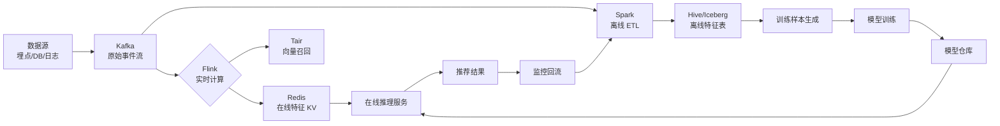

# 4. 数据工程与特征平台

> 推荐系统的"血液循环系统":数据决定了模型的上限,特征决定了工程的天花板。

## 0. 一句话总结

**数据工程 = 采集(埋点/SDK)+ 存储(Hive/Iceberg/Redis)+ 处理(Spark/Flink)+ 服务(在线/离线一致性);特征平台 = 把这套数据流封装成"特征即服务",让算法工程师专注模型而非数据。**

---

## 1. 数据工程的 4 大支柱

数据工程的 4 大支柱:**采集 → 存储 → 处理 → 服务**。

```text
[采集] → [存储] → [处理] → [服务]
   ↓       ↓        ↓        ↓
 埋点    HDFS    Spark    在线推理
 SDK    Kafka    Flink    离线训练
```

### 1.1 采集 (Collection)

**采集 = 把用户行为转化为可处理的数据**。

**采集的 4 个核心:**

| 类型 | 内容 | 频率 |
|------|------|------|
| **用户行为** | 点击、浏览、点赞、分享、评论、购买 | 高频 |
| **上下文** | 时间、地点、网络、设备 | 高频 |
| **物品属性** | 标题、类目、标签、价格、库存 | 低频 |
| **系统日志** | 请求、响应、错误、延迟 | 高频 |

**埋点设计的最佳实践:**

```json
// 行为埋点的标准 schema (Protobuf)
{
  "user_id": "string",
  "session_id": "string",
  "trace_id": "string",
  "scene": "string",         // 推荐场景
  "action": "string",        // 动作:impression/click/like/share
  "item_id": "string",
  "position": "int32",
  "ts": "int64",             // 客户端时间戳
  "server_ts": "int64",      // 服务端时间戳
  "client_info": {
    "network": "string",
    "device": "string",
    "app_version": "string"
  },
  "extra": "map<string, string>"  // 扩展字段
}
```

**采集的常见坑:**

1. **曝光去重**:同一物品在同一位置停留 ≥ N 秒才算一次曝光
2. **多端打通**:Web/App/小程序数据合并需要 user_id 打通
3. **迟到数据**:弱网/离线场景下,数据可能延迟数小时到达
4. **采样上报**:高 QPS 场景按比例采样,采样率在客户端随机

### 1.2 存储 (Storage)

**存储分 3 层:热数据(秒级)、温数据(分钟~天)、冷数据(月+)**。

**典型存储选型:**

| 存储 | 类型 | 用途 | 时效 |
|------|------|------|------|
| **Kafka** | 消息队列 | 实时数据流 | 秒级 |
| **Redis** | KV 存储 | 在线特征、缓存 | 实时 |
| **ClickHouse** | 列式 DB | 行为日志查询 | 分钟级 |
| **Elasticsearch** | 搜索引擎 | 倒排、文本检索 | 秒级 |
| **HBase** | 列式 DB | 大宽表查询 | 秒级 |
| **Hive** | 数据仓库 | 离线数据 | T+1 |
| **Iceberg/Hudi** | 表格式 | 数据湖 | T+1 |
| **OSS/S3** | 对象存储 | 模型、备份 | 长期 |

**存储选型决策:**

```text
Q1: 需要实时查询?
    是 → Redis / HBase / ClickHouse
    否 ↓

Q2: 一次查询的数据量?
    GB+ → Hive / Iceberg (离线)
    MB → ClickHouse / ES (在线)

Q3: 查询模式?
    KV 查询 → Redis / HBase
    范围查询 → ClickHouse
    全文检索 → Elasticsearch
    复杂分析 → Hive / Presto
```

### 1.3 处理 (Processing)

**处理 = 把原始数据转化为可用数据**。

**两大流派:批处理(Spark)vs 流处理(Flink)**。

| 维度 | Spark | Flink |
|------|-------|-------|
| 范式 | 批处理 | 流处理(也支持批) |
| 延迟 | 分钟~小时 | 毫秒~秒 |
| 状态管理 | 弱 | 强(RocksDB) |
| 适用 | T+1 离线 | 实时特征 |
| 成本 | 低(短任务) | 高(长任务) |

**Spark 离线处理:**

```python
from pyspark.sql import SparkSession
from pyspark.sql import functions as F
from pyspark.sql.window import Window

spark = SparkSession.builder.appName("user_features").getOrCreate()

# 读取原始行为数据
events = spark.read.parquet("hdfs://path/to/events")

# 计算 7 天 CTR
user_stats = events.filter(F.col("action") == "click") \
    .join(events.filter(F.col("action") == "impression").alias("imp"),
          on=["user_id", "item_id"], how="inner") \
    .groupBy("user_id") \
    .agg(
        F.count("item_id").alias("clicks"),
        F.countDistinct("item_id").alias("unique_clicks"),
        F.avg(F.col("click_ts") - F.col("impression_ts")).alias("avg_click_delay")
    )

# 写入 Hive
user_stats.write.mode("overwrite").partitionBy("dt").saveAsTable("dws.user_stats_7d")
```

**Flink 实时处理:**

```java
// Flink 实时特征计算
DataStream<ClickEvent> clicks = env.addSource(kafkaConsumer);
DataStream<ImpressionEvent> imps = env.addSource(kafkaConsumer);

// 1. 计算实时 CTR(7 天滚动)
clicks.keyBy(e -> e.userId)
    .window(SlidingEventTimeWindows.of(Time.days(7), Time.minutes(1)))
    .reduce(new SumReducer())
    .addSink(redisSink);

// 2. 计算最近 N 次浏览
imps.keyBy(e -> e.userId)
    .process(new RecentItemsProcess(N=100))
    .addSink(redisSink);
```

**批流一体 (Lambda/Kappa):**

```python
# 字节 ByteFlow / 阿里 Flink 批流一体方案
class UnifiedPipeline:
    """批流一体的特征管道"""
    def __init__(self):
        self.streaming_pipeline = FlinkPipeline()
        self.batch_pipeline = SparkPipeline()

    def run(self):
        # 实时管道:近实时特征
        self.streaming_pipeline.run()
        # 离线管道:T-1 全量特征
        self.batch_pipeline.run_daily()
```

### 1.4 服务 (Serving)

**服务 = 把数据提供给训练和推理**。

| 服务类型 | 消费者 | 延迟要求 | 数据源 |
|----------|--------|----------|--------|
| **离线训练服务** | 模型训练 | 任意 | Hive/Iceberg |
| **在线推理服务** | 推荐服务 | < 50ms | Redis/HBase |
| **探索分析服务** | 数据分析师 | 秒级 | ClickHouse/Presto |

**在线服务的特征获取:**

```python
class FeatureClient:
    """统一的特征获取客户端"""
    def __init__(self):
        self.online_store = RedisClient()  # 在线特征
        self.offline_store = IcebergClient()  # 离线特征
        self.cache = LRUCache(10000)  # 本地缓存

    def get_online_features(self, user_id, feature_names):
        """在线获取特征(用于推理)"""
        cache_key = f"{user_id}:{','.join(feature_names)}"
        cached = self.cache.get(cache_key)
        if cached:
            return cached

        features = {}
        for name in feature_names:
            # 从 Redis 拿
            value = self.online_store.get(f"feat:{user_id}:{name}")
            features[name] = value

        self.cache.put(cache_key, features)
        return features

    def get_historical_features(self, user_id, feature_names, timestamp):
        """离线获取历史特征(用于训练,回填时间戳对应的特征)"""
        # 从 Iceberg 拿 point-in-time 正确的特征
        features = self.offline_store.get_point_in_time(
            user_id, feature_names, timestamp
        )
        return features
```

---

## 2. 推荐系统数据流

### 2.1 用户行为日志

**用户行为日志 = 推荐系统最核心的数据**。

**典型埋点事件:**

```yaml
events:
  - name: impression
    when: 用户看到推荐列表中某个物品
    fields: [user_id, item_id, position, scene, ts]

  - name: click
    when: 用户点击某个物品
    fields: [user_id, item_id, position, scene, ts, dwell_time]

  - name: like
    when: 用户点赞
    fields: [user_id, item_id, ts]

  - name: share
    when: 用户分享
    fields: [user_id, item_id, ts, channel]

  - name: comment
    when: 用户评论
    fields: [user_id, item_id, ts, comment_id, text]

  - name: follow
    when: 用户关注作者
    fields: [user_id, author_id, ts]

  - name: purchase
    when: 用户购买(电商)
    fields: [user_id, item_id, price, quantity, ts]

  - name: refund
    when: 用户退款
    fields: [user_id, item_id, ts, reason]
```

**行为日志的工程挑战:**

1. **数据量**:日均百亿~千亿级别
2. **延迟**:T+0 (实时)/ T+1 (离线)
3. **Schema 演进**:业务发展,字段经常变
4. **隐私合规**:GDPR / 个保法要求删除/匿名化

**典型架构:**

```text
[客户端埋点] → [Nginx 接收] → [Kafka] → [Flink 实时清洗] → [Kafka / Druid]
                          ↓
                        [HDFS / Iceberg] → [Spark 离线处理] → [Hive]
```

### 2.2 物品元数据

**物品元数据 = 描述物品本身的属性**。

| 类型 | 例子 | 更新频率 |
|------|------|----------|
| 基础属性 | 标题、类目、价格、库存 | 低频 |
| 内容属性 | 标签、关键词、Embedding | 中频 |
| 统计属性 | CTR、CVR、热度分 | 高频 |
| 多媒体 | 图片、视频、音频 | 低频 |
| 关系 | 相似物品、关联物品 | 中频 |

**物品元数据的存储:**

```sql
-- 物品元数据 Hive 表
CREATE TABLE dim.item_attr (
    item_id        STRING,
    title          STRING,
    category       STRING,
    tags           ARRAY<STRING>,
    price          DOUBLE,
    stock          INT,
    embedding      ARRAY<FLOAT>,
    ctr_7d         DOUBLE,
    cvr_7d         DOUBLE,
    create_time    TIMESTAMP,
    update_time    TIMESTAMP
)
PARTITIONED BY (dt STRING)
STORED AS PARQUET;
```

### 2.3 上下文特征

**上下文特征 = 描述"当时情境"的特征**。

| 上下文 | 特征 |
|--------|------|
| 时间 | 小时、周几、是否节假日、季节 |
| 地点 | 国家、城市、LBS 坐标 |
| 设备 | 型号、操作系统、屏幕大小 |
| 网络 | wifi/4G/5G、运营商 |
| 应用 | 当前场景、入口来源 |
| 行为 | 当前 session 内的行为 |

**上下文特征的处理:**

```python
def extract_context_features(request):
    """从请求中提取上下文特征"""
    now = datetime.now()
    return {
        'hour': now.hour,
        'day_of_week': now.weekday(),
        'is_weekend': now.weekday() >= 5,
        'is_holiday': is_chinese_holiday(now),
        'season': get_season(now),
        'device_type': request.headers.get('Device-Type', 'unknown'),
        'os': parse_os(request.headers.get('User-Agent', '')),
        'network': request.headers.get('Network-Type', 'unknown'),
        'scene': request.params.get('scene', 'default'),
        'entry': request.params.get('entry', 'direct'),
    }
```

### 2.4 标签数据

**标签数据 = 通过人工/算法打的标签**。

| 标签类型 | 例子 | 来源 |
|----------|------|------|
| 内容标签 | 题材、风格、敏感度 | 算法/人工 |
| 用户标签 | 兴趣偏好、消费能力 | 算法/调研 |
| 物品标签 | 商品类目、品牌 | 商家提供/算法 |
| 关系标签 | 是否新上架、是否限量 | 业务系统 |

**标签系统的设计:**

```python
class TagSystem:
    """统一的标签系统"""

    # 1. 标签注册
    def register_tag(self, tag_name, tag_type, source):
        """注册一个标签"""
        self.tags[tag_name] = {
            'type': tag_type,  # 类别/数值/布尔
            'source': source,  # 算法/人工/业务
            'update_freq': None,  # 更新频率
            'creator': None,
            'created_at': datetime.now()
        }

    # 2. 标签查询
    def get_tags(self, entity_type, entity_id, tag_names):
        """获取实体的标签"""
        ...

    # 3. 标签血缘
    def get_lineage(self, tag_name):
        """标签的来源链路"""
        ...
```

---

## 3. 特征工程基础

### 3.1 数值特征

**数值特征 = 连续型数值**。

**常见处理:**

| 处理 | 公式 | 适用 |
|------|------|------|
| **归一化** | (x - min) / (max - min) | 范围差异大 |
| **标准化** | (x - μ) / σ | 近似正态分布 |
| **对数变换** | log(x + 1) | 长尾分布 |
| **分桶** | cut(x, bins=[...]) | 非线性关系 |
| **缺失填充** | mean / median / 0 / -1 | 必须处理缺失 |

```python
import numpy as np
from sklearn.preprocessing import StandardScaler, MinMaxScaler, KBinsDiscretizer

# 数值特征的 Pipeline
class NumericalFeatureProcessor:
    def __init__(self):
        self.scaler = StandardScaler()
        self.binner = KBinsDiscretizer(n_bins=10, encode='onehot')

    def fit_transform(self, x):
        x_scaled = self.scaler.fit_transform(x.reshape(-1, 1))
        x_binned = self.binner.fit_transform(x.reshape(-1, 1))
        return x_scaled, x_binned

    def transform(self, x):
        x_scaled = self.scaler.transform(x.reshape(-1, 1))
        x_binned = self.binner.transform(x.reshape(-1, 1))
        return x_scaled, x_binned
```

### 3.2 类别特征

**类别特征 = 离散型标签**。

**核心处理:Embedding**

```python
import torch.nn as nn

class CategoricalFeatureEmbedding(nn.Module):
    def __init__(self, vocab_sizes, embedding_dims):
        super().__init__()
        self.embeddings = nn.ModuleList([
            nn.Embedding(vocab_size, dim)
            for vocab_size, dim in zip(vocab_sizes, embedding_dims)
        ])

    def forward(self, x_list):
        """x_list: list of (B,) tensors"""
        return [emb(x) for emb, x in zip(self.embeddings, x_list)]

# 使用
vocab_sizes = [10000, 100, 50, 24]  # user, item, category, hour
embedding_dims = [64, 64, 32, 8]
embedding_layer = CategoricalFeatureEmbedding(vocab_sizes, embedding_dims)
```

**类别特征的处理技巧:**

1. **Hash Trick**:类别太多时用 hash 减少 vocab
2. **频率过滤**:低频类别(< 100 次)归为 "unknown"
3. **交叉特征**:user_id × item_id, user_id × scene 等
4. **Target Encoding**:用目标均值编码

```python
# Target Encoding (谨慎使用,容易泄漏)
def target_encode(train_df, test_df, col, target, smoothing=10):
    """用目标均值编码"""
    global_mean = train_df[target].mean()

    encoding = train_df.groupby(col)[target].agg(['mean', 'count'])
    encoding['smoothed'] = (
        encoding['count'] * encoding['mean'] + smoothing * global_mean
    ) / (encoding['count'] + smoothing)

    train_encoded = train_df[col].map(encoding['smoothed']).fillna(global_mean)
    test_encoded = test_df[col].map(encoding['smoothed']).fillna(global_mean)

    return train_encoded, test_encoded
```

### 3.3 序列特征

**序列特征 = 用户行为序列、物品序列等**。

**核心挑战:长度可变 + 稀疏 + 长尾**。

**3 大主流处理方式:**

**方式 1:Pooling(简单粗暴)**

```python
class SequencePooling(nn.Module):
    def __init__(self, mode='mean'):
        super().__init__()
        self.mode = mode  # mean, max, sum

    def forward(self, seq_emb, mask=None):
        if self.mode == 'mean':
            if mask is not None:
                mask = mask.unsqueeze(-1).float()
                return (seq_emb * mask).sum(dim=1) / mask.sum(dim=1).clamp(min=1)
            return seq_emb.mean(dim=1)
        elif self.mode == 'max':
            return seq_emb.max(dim=1)[0]
        elif self.mode == 'sum':
            return seq_emb.sum(dim=1)
```

**方式 2:Attention 加权 (DIN 风格)**

```python
class DINAttention(nn.Module):
    def __init__(self, embed_dim):
        super().__init__()
        self.attn = nn.Sequential(
            nn.Linear(embed_dim * 4, 64), nn.ReLU(),
            nn.Linear(64, 1)
        )

    def forward(self, query, keys, mask=None):
        """
        query: (B, D) - 目标物品
        keys: (B, T, D) - 用户行为序列
        """
        B, T, D = keys.shape
        query_expanded = query.unsqueeze(1).expand(-1, T, -1)

        # 拼接多种交互
        attn_input = torch.cat([
            query_expanded,        # (B, T, D)
            keys,                   # (B, T, D)
            query_expanded * keys,  # 元素积
            query_expanded - keys,  # 差
        ], dim=-1)  # (B, T, 4D)

        scores = self.attn(attn_input).squeeze(-1)  # (B, T)

        if mask is not None:
            scores = scores.masked_fill(mask == 0, -1e9)

        attn = F.softmax(scores, dim=-1)  # (B, T)
        return (keys * attn.unsqueeze(-1)).sum(dim=1)  # (B, D)
```

**方式 3:Transformer (GR 风格)**

```python
class BehaviorTransformer(nn.Module):
    def __init__(self, embed_dim, num_heads, num_layers, max_seq_len):
        super().__init__()
        self.pos_emb = nn.Embedding(max_seq_len, embed_dim)
        encoder_layer = nn.TransformerEncoderLayer(
            d_model=embed_dim, nhead=num_heads, batch_first=True
        )
        self.encoder = nn.TransformerEncoder(encoder_layer, num_layers)

    def forward(self, seq, mask=None):
        B, T, D = seq.shape
        positions = torch.arange(T, device=seq.device).unsqueeze(0).expand(B, T)
        seq = seq + self.pos_emb(positions)
        return self.encoder(seq, src_key_padding_mask=mask)
```

### 3.4 文本特征

**文本特征 = 标题、描述、评论等**。

**主流方法:**

| 方法 | 描述 | 代表 |
|------|------|------|
| **词袋 + TF-IDF** | 传统方法 | 简单 baseline |
| **Word2Vec** | 静态词向量 | word2vec, GloVe |
| **BERT** | 动态上下文 | BERT, RoBERTa |
| **Sentence-BERT** | 句向量 | sentence-transformers |
| **LLM Embedding** | 通用大模型 | OpenAI, Qwen Embedding |

```python
from sentence_transformers import SentenceTransformer

# 加载预训练模型
model = SentenceTransformer('paraphrase-multilingual-MiniLM-L12-v2')

# 计算文本 embedding
texts = ["运动鞋 男士 透气", "连衣裙 夏季 新款"]
embeddings = model.encode(texts)
print(embeddings.shape)  # (2, 384)
```

### 3.5 多模态特征

**多模态特征 = 文本 + 图像 + 视频 + 音频**。

**典型架构:**

```python
class MultiModalEncoder(nn.Module):
    """多模态特征编码器"""
    def __init__(self):
        super().__init__()
        # 文本
        self.text_encoder = SentenceTransformer('paraphrase-multilingual-MiniLM-L12-v2')
        # 图像
        self.image_encoder = torch.hub.load('pytorch/vision:v0.10.0', 'resnet50', pretrained=True)
        # 融合
        self.fusion = nn.Sequential(
            nn.Linear(384 + 2048, 512), nn.ReLU(),
            nn.Linear(512, 256)
        )

    def forward(self, text, image):
        text_emb = self.text_encoder.encode(text)  # (B, 384)
        image_emb = self.image_encoder(image)       # (B, 2048)
        combined = torch.cat([text_emb, image_emb], dim=-1)
        return self.fusion(combined)  # (B, 256)
```

---

## 4. 特征平台架构

特征平台的核心使命:**把"特征数据"封装成"特征即服务"**。

### 4.1 离线特征 (Batch)

**离线特征 = T-1 计算的全量特征,用于训练和回填**。

**典型架构:**

```text
[原始数据 ODS] → [Spark 清洗 DWD] → [特征计算 DWS] → [特征表 ADS] → [训练数据]
```

**离线特征的关键设计:**

| 设计点 | 说明 |
|--------|------|
| **分区** | 按 dt(日期)分区,便于增量更新 |
| **回填** | 历史分区可重算,数据问题可修复 |
| **版本化** | 特征 schema 变更不破坏历史 |
| **质量检查** | 空值率、异常值、分布监控 |

**特征表的设计:**

```sql
-- 用户 7 天 CTR 特征表
CREATE TABLE dws.user_ctr_7d (
    user_id    STRING,
    ctr_7d     DOUBLE,
    clicks_7d  BIGINT,
    impressions_7d BIGINT,
    last_active_ts BIGINT
)
PARTITIONED BY (dt STRING)
STORED AS PARQUET
TBLPROPERTIES (
    'format-version' = '2',
    'write.format.default' = 'iceberg'
);

-- 历史回填
INSERT OVERWRITE TABLE dws.user_ctr_7d PARTITION (dt)
SELECT
    user_id,
    SUM(clicks) / SUM(impressions) AS ctr_7d,
    SUM(clicks) AS clicks_7d,
    SUM(impressions) AS impressions_7d,
    MAX(ts) AS last_active_ts,
    '2026-07-23' AS dt
FROM dwd.user_behavior
WHERE dt BETWEEN '2026-07-16' AND '2026-07-23'
GROUP BY user_id;
```

### 4.2 在线特征 (Streaming)

**在线特征 = 实时计算的特征,延迟秒级**。

**典型架构:**

```text
[Kafka 行为流] → [Flink 实时计算] → [Redis 在线存储] → [推理服务]
```

**实时特征的关键挑战:**

1. **迟到数据**:行为可能延迟数小时
2. **状态管理**:窗口状态可能爆内存(用 RocksDB)
3. **Exactly Once**:不能重复计算
4. **故障恢复**:Flink 挂了,状态如何恢复

```java
// Flink 实时特征计算 (Java)
public class UserFeatureJob {
    public static void main(String[] args) throws Exception {
        StreamExecutionEnvironment env = StreamExecutionEnvironment.getExecutionEnvironment();
        env.enableCheckpointing(60000); // 1 分钟 checkpoint

        DataStream<BehaviorEvent> events = env
            .addSource(new FlinkKafkaConsumer<>("behavior", new BehaviorDeserializer(), props));

        // 1. 计算用户最近 100 次浏览
        events.keyBy(BehaviorEvent::getUserId)
            .process(new RecentItemsProcess(100))
            .addSink(new RedisSink<>(...));

        // 2. 计算 7 天滑动窗口 CTR
        events.keyBy(BehaviorEvent::getUserId)
            .window(SlidingEventTimeWindows.of(Time.days(7), Time.minutes(1)))
            .aggregate(new CtrAggregate())
            .addSink(new RedisSink<>(...));

        env.execute("UserFeatureJob");
    }
}
```

### 4.3 特征存储 (Feature Store)

**特征存储 = 在线/离线一体的特征管理系统**。

**核心能力:**

| 能力 | 说明 |
|------|------|
| **特征注册** | 统一管理特征定义 |
| **在线/离线一致性** | 同一特征,训练和推理一致 |
| **特征版本** | 跟踪特征变更 |
| **特征血缘** | 追溯特征来源 |
| **特征监控** | 空值率、分布监控 |
| **特征共享** | 跨团队复用 |

**特征存储的核心数据流:**

```text
[特征定义] → [离线计算] → [离线存储 (Iceberg/Hive)]
                              ↓
                        [同步到在线存储]
                              ↓
[在线计算] → [在线存储 (Redis/HBase)]
                              ↓
[在线推理] ← [特征 API] ← [在线存储]
                              ↑
[训练]     ← [特征 API] ← [离线存储]
```

### 4.4 Feast / Tecton / 自研

**三大主流特征平台:**

| 平台 | 类型 | 特点 |
|------|------|------|
| **Feast** | 开源 | 轻量、Python 友好 |
| **Tecton** | 商业 | 完整、企业级 |
| **自研** | 各异 | 灵活、深度集成 |

**Feast 详细使用:**

```yaml
# feature_store.yaml
project: recsys_prod
provider: gcp
registry: gs://my-bucket/feast/registry.db
online_store:
  type: redis
  connection_string: redis://10.0.0.1:6379
offline_store:
  type: bigquery
```

```python
# features.py
from feast import (
    Feature, FeatureView, Entity, ValueType,
    FileSource, KafkaSource, Field
)
from datetime import timedelta

# 1. 定义实体
user = Entity(name="user_id", value_type=ValueType.INT64)
item = Entity(name="item_id", value_type=ValueType.INT64)

# 2. 定义离线特征源
user_stats_source = FileSource(
    path="gs://bucket/user_stats.parquet",
    event_timestamp_column="event_ts",
    created_timestamp_column="created_ts",
)

# 3. 定义特征视图
user_stats_fv = FeatureView(
    name="user_stats",
    entities=[user],
    ttl=timedelta(days=1),
    schema=[
        Field(name="ctr_7d", dtype=Float32),
        Field(name="clicks_30d", dtype=Int64),
        Field(name="favorite_category", dtype=String),
    ],
    online=True,
    source=user_stats_source,
    tags={"team": "ranking"},
)

# 4. 定义流式特征源
realtime_behavior_source = KafkaSource(
    name="realtime_behavior",
    kafka_bootstrap_servers="kafka:9092",
    topic="user_behavior",
    timestamp_field="event_ts",
    message_format=JsonFormat(
        schema_json="user_id integer, item_id integer, action string, event_ts timestamp"
    ),
)

realtime_behavior_fv = FeatureView(
    name="realtime_user_behavior",
    entities=[user],
    ttl=timedelta(hours=1),
    schema=[
        Field(name="last_action", dtype=String),
        Field(name="recent_clicks", dtype=Int64),
    ],
    online=True,
    source=realtime_behavior_source,
    tags={"team": "ranking", "type": "realtime"},
)
```

```python
# 在线获取特征
from feast import FeatureStore
fs = FeatureStore(repo_path=".")

features = fs.get_online_features(
    features=[
        "user_stats:ctr_7d",
        "user_stats:favorite_category",
        "realtime_user_behavior:last_action",
    ],
    entity_rows=[{"user_id": 12345}],
).to_dict()

# 离线获取历史特征(训练用)
training_df = fs.get_historical_features(
    entity_df=events_df,
    features=[
        "user_stats:ctr_7d",
        "realtime_user_behavior:last_action",
    ],
).to_df()
```

**Tecton 的特性:**

- **声明式特征定义**:DSL 描述特征逻辑
- **自动物化**:定时/流式自动计算
- **特征监控**:内置空值率/分布告警
- **团队协作**:特征共享、权限管理

**自研特征平台:**

| 公司 | 平台 | 特点 |
|------|------|------|
| 字节 | ByteFS | 与推荐系统深度集成 |
| 阿里 | PAI 特征平台 | 云原生,多团队协作 |
| 美团 | MTS | 强实时 |
| Meta | F3 | 论文级实现 |

---

## 5. 实时特征工程

### 5.1 Flink / Spark Streaming

**Flink 的核心概念:**

```text
[Source] → [Transform] → [Sink]
              ↓
         [State] (RocksDB)
              ↓
         [Window] (滚动/滑动/会话)
```

**Flink 实战:实时用户行为特征**

```java
public class RealtimeUserFeature {
    public static void main(String[] args) throws Exception {
        StreamExecutionEnvironment env = StreamExecutionEnvironment.getExecutionEnvironment();

        // 1. 读取 Kafka 行为数据
        DataStream<BehaviorEvent> events = env.addSource(
            new FlinkKafkaConsumer<>("user_behavior", new BehaviorDeserializer(), props)
        ).assignTimestampsAndWatermarks(
            WatermarkStrategy.<BehaviorEvent>forBoundedOutOfOrderness(Duration.ofSeconds(10))
                .withTimestampAssigner((event, ts) -> event.getEventTs())
        );

        // 2. 计算最近 100 次浏览(用 ProcessFunction + ValueState)
        events.keyBy(BehaviorEvent::getUserId)
            .process(new RecentItemsFunction(100))
            .addSink(new RedisSink<>());

        // 3. 计算 1 小时滑动窗口 CTR
        events.keyBy(BehaviorEvent::getUserId)
            .window(SlidingEventTimeWindows.of(Time.hours(1), Time.minutes(1)))
            .aggregate(new CtrAggregateFunction(), new CtrWindowFunction())
            .addSink(new RedisSink<>());

        env.execute("RealtimeUserFeature");
    }
}

// 最近 100 次浏览
class RecentItemsFunction extends KeyedProcessFunction<String, BehaviorEvent, RecentItems> {
    private ValueState<List<ItemInfo>> recentItems;
    private final int maxSize;

    public RecentItemsFunction(int maxSize) {
        this.maxSize = maxSize;
    }

    @Override
    public void open(Configuration parameters) {
        recentItems = getRuntimeContext().getState(
            new ValueStateDescriptor<>("recentItems",
                TypeInformation.of(new TypeHint<List<ItemInfo>>() {}))
        );
    }

    @Override
    public void processElement(BehaviorEvent event, Context ctx, Collector<RecentItems> out) {
        List<ItemInfo> items = recentItems.value();
        if (items == null) items = new ArrayList<>();

        items.add(0, new ItemInfo(event.getItemId(), event.getEventTs()));
        if (items.size() > maxSize) {
            items = items.subList(0, maxSize);
        }

        recentItems.update(items);
        out.collect(new RecentItems(ctx.getCurrentKey(), items));
    }
}
```

### 5.2 特征计算

**实时特征计算的 3 种模式:**

| 模式 | 描述 | 示例 |
|------|------|------|
| **简单累加** | counter 累加 | 点击次数、点赞次数 |
| **窗口聚合** | 滑动/滚动窗口 | 1h CTR、7d 浏览数 |
| **会话聚合** | 会话内聚合 | 当前 session 浏览 |

**特征计算的反压(Backpressure)处理:**

```java
// Flink 反压策略
env.getConfig().setBufferTimeout(100);  // 缓冲超时
env.setParallelism(64);  // 并行度

// 启用 RocksDB 大状态
RocksDBStateBackend backend = new RocksDBStateBackend(
    "hdfs://checkpoints/", true
);
env.setStateBackend(backend);

// 启用增量 checkpoint
backend.configure(new CheckpointOptions()
    .setCheckpointingMode(CheckpointingMode.EXACTLY_ONCE)
    .setCheckpointInterval(60000));
```

### 5.3 特征回填

**特征回填 = 把历史特征补全,用于训练**。

**场景:**

1. 新特征上线,需要补历史
2. 特征 bug 修复,需要重算
3. 算法工程师需要某段时间的特征做实验

**实现:**

```python
# 特征回填工具
class FeatureBackfill:
    def __init__(self, feature_name, source_table, target_table):
        self.feature_name = feature_name
        self.source = source_table
        self.target = target_table

    def backfill(self, start_date, end_date):
        """回填指定时间段"""
        for dt in date_range(start_date, end_date):
            # 1. 读取当天的原始数据
            raw = spark.read.parquet(f"{self.source}/dt={dt}")

            # 2. 计算特征
            features = self.compute_feature(raw)

            # 3. 写入目标表(覆盖分区)
            features.write.mode("overwrite").partitionBy("dt").saveAsTable(self.target)
            print(f"Backfilled {self.feature_name} for {dt}")

    def compute_feature(self, df):
        raise NotImplementedError
```

### 5.4 状态管理

**Flink 状态 = 实时计算的核心**。

**状态类型:**

| 状态 | 描述 | 用途 |
|------|------|------|
| **ValueState** | 单值状态 | 用户最近一次行为 |
| **ListState** | 列表状态 | 最近 100 次浏览 |
| **MapState** | 字典状态 | 物品统计 |
| **ReducingState** | 累加状态 | 点击总数 |
| **AggregatingState** | 聚合状态 | CTR 平均值 |

**状态后端:**

| 后端 | 特点 | 适用 |
|------|------|------|
| **MemoryStateBackend** | 内存 | 小状态、调试 |
| **FsStateBackend** | 文件系统 | 中等状态 |
| **RocksDBStateBackend** | RocksDB 嵌入 | 大状态、生产 |

```java
// RocksDB 状态后端配置
RocksDBStateBackend backend = new RocksDBStateBackend(
    "hdfs://checkpoints/"
);

// 启用增量 checkpoint
backend.configure(new CheckpointOptions()
    .setCheckpointingMode(CheckpointingMode.EXACTLY_ONCE)
    .setCheckpointInterval(60000)
    .setMinPauseBetweenCheckpoints(30000));

// 开启本地恢复
backend.configure(new Configuration()
    .setBoolean(RecoveryOptions.LOCAL_RECOVERY, true));
```

---

## 6. 离线特征工程

### 6.1 Spark / Hive / Presto

**Spark SQL 实战:用户画像计算**

```sql
-- 用户 30 天活跃度
SELECT
    user_id,
    COUNT(DISTINCT dt) AS active_days_30d,
    COUNT(*) AS total_events_30d,
    SUM(IF(action='click', 1, 0)) AS clicks_30d,
    SUM(IF(action='like', 1, 0)) AS likes_30d,
    MAX(ts) AS last_active_ts
FROM dwd.user_behavior
WHERE dt BETWEEN '2026-06-23' AND '2026-07-23'
GROUP BY user_id;
```

**用户画像的 Spark 实现:**

```python
from pyspark.sql import SparkSession
from pyspark.sql import functions as F
from pyspark.sql.window import Window

spark = SparkSession.builder.appName("user_profile").getOrCreate()

# 1. 用户基础画像
user_basic = spark.read.parquet("hdfs://user_basic").cache()

# 2. 用户行为统计
user_behavior = spark.read.parquet("hdfs://user_behavior_30d") \
    .groupBy("user_id") \
    .agg(
        F.countDistinct("item_id").alias("distinct_items_30d"),
        F.sum(F.when(F.col("action") == "click", 1).otherwise(0)).alias("clicks_30d"),
        F.sum(F.when(F.col("action") == "purchase", 1).otherwise(0)).alias("purchases_30d"),
        F.avg(F.when(F.col("action") == "click", F.col("price")).otherwise(None)).alias("avg_click_price")
    )

# 3. 用户兴趣画像(从行为推断)
user_interests = spark.read.parquet("hdfs://user_behavior_30d") \
    .join(spark.read.parquet("hdfs://item_category"), on="item_id") \
    .groupBy("user_id") \
    .pivot("category") \
    .agg(F.countDistinct("item_id").alias("cat_count")) \
    .na.fill(0)

# 4. 合并
user_profile = user_basic \
    .join(user_behavior, on="user_id", how="left") \
    .join(user_interests, on="user_id", how="left") \
    .na.fill(0)

user_profile.write.mode("overwrite").partitionBy("dt").saveAsTable("dws.user_profile")
```

### 6.2 Airflow / DolphinScheduler

**任务调度 = 把特征计算编排成 DAG**。

**Airflow DAG 示例:**

```python
from airflow import DAG
from airflow.providers.apache.spark.operators.spark_submit import SparkSubmitOperator
from airflow.providers.apache.hive.operators.hive import HiveOperator
from datetime import datetime, timedelta

default_args = {
    'owner': 'feature_team',
    'depends_on_past': False,
    'retries': 3,
    'retry_delay': timedelta(minutes=5),
}

dag = DAG(
    'user_feature_pipeline',
    default_args=default_args,
    schedule_interval='0 3 * * *',  # 每天凌晨 3 点
    start_date=datetime(2026, 1, 1),
    catchup=False,
)

# 1. 拉取原始数据
pull_raw = HiveOperator(
    task_id='pull_raw_behavior',
    hql='INSERT OVERWRITE TABLE ods.user_behavior_raw PARTITION (dt={{ ds }}) ...',
    dag=dag,
)

# 2. 数据清洗
clean_data = SparkSubmitOperator(
    task_id='clean_behavior',
    application='jobs/clean_behavior.py',
    dag=dag,
)

# 3. 计算用户特征
user_features = SparkSubmitOperator(
    task_id='compute_user_features',
    application='jobs/compute_user_features.py',
    dag=dag,
)

# 4. 计算物品特征
item_features = SparkSubmitOperator(
    task_id='compute_item_features',
    application='jobs/compute_item_features.py',
    dag=dag,
)

# 5. 写入特征表
write_features = SparkSubmitOperator(
    task_id='write_feature_table',
    application='jobs/write_feature_table.py',
    dag=dag,
)

# 6. 数据质量检查
data_quality_check = HiveOperator(
    task_id='data_quality_check',
    hql='''
        SELECT
            COUNT(*) AS total_users,
            AVG(clicks_30d) AS avg_clicks,
            COUNT(CASE WHEN clicks_30d IS NULL THEN 1 END) AS null_count
        FROM dws.user_profile
        WHERE dt = '{{ ds }}'
    ''',
    dag=dag,
)

# 依赖关系
pull_raw >> clean_data
clean_data >> [user_features, item_features]
[user_features, item_features] >> write_features
write_features >> data_quality_check
```

### 6.3 特征版本管理

**特征版本管理 = 跟踪特征定义的变化**。

**特征 schema 演进:**

```python
class FeatureSchema:
    """特征 schema 管理"""
    def __init__(self, feature_name, version, schema, owner):
        self.feature_name = feature_name
        self.version = version
        self.schema = schema  # {field_name: dtype}
        self.owner = owner
        self.created_at = datetime.now()
        self.deprecated_at = None

    def deprecate(self):
        """标记为废弃"""
        self.deprecated_at = datetime.now()

    def is_compatible(self, other_version):
        """检查向后兼容"""
        # 字段不能删除,只能新增
        old_fields = set(self.schema.keys())
        new_fields = set(other_version.schema.keys())
        return old_fields.issubset(new_fields)

# 特征注册中心
class FeatureRegistry:
    def __init__(self):
        self.features = {}  # name -> [versions]

    def register(self, feature_name, schema, owner):
        existing = self.features.get(feature_name, [])
        version = len(existing) + 1
        feature = FeatureSchema(feature_name, version, schema, owner)
        existing.append(feature)
        self.features[feature_name] = existing
        return feature

    def get_latest(self, feature_name):
        return self.features[feature_name][-1]

    def get_version(self, feature_name, version):
        return self.features[feature_name][version - 1]
```

---

## 7. 数据质量

### 7.1 Schema 校验

**Schema 校验 = 保证数据格式正确**。

```python
from pydantic import BaseModel, Field, validator
from typing import List, Optional

class BehaviorEvent(BaseModel):
    user_id: str
    item_id: str
    action: str = Field(..., regex="^(impression|click|like|share|purchase)$")
    position: int = Field(..., ge=0, le=100)
    ts: int = Field(..., gt=0)

    @validator('ts')
    def validate_ts(cls, v):
        now = int(time.time() * 1000)
        if v > now + 60000:  # 客户端时间不能比服务器时间快 1 分钟
            raise ValueError('ts is in the future')
        if v < now - 30 * 24 * 3600 * 1000:  # 不能是 30 天前
            raise ValueError('ts is too old')
        return v

# 使用
try:
    event = BehaviorEvent(**raw_event_dict)
except ValidationError as e:
    log.error(f"Invalid event: {e}")
```

**大数据场景下的 Schema 校验:**

```python
from pyspark.sql.types import StructType, StructField, StringType, IntegerType, LongType

schema = StructType([
    StructField("user_id", StringType(), nullable=False),
    StructField("item_id", StringType(), nullable=False),
    StructField("action", StringType(), nullable=False),
    StructField("position", IntegerType(), nullable=False),
    StructField("ts", LongType(), nullable=False),
])

# 读数据时校验
df = spark.read.schema(schema).parquet("hdfs://path")
```

### 7.2 异常检测

**异常检测 = 发现数据问题**。

**3 大异常类型:**

| 类型 | 描述 | 检测方法 |
|------|------|----------|
| **空值异常** | 关键字段 NULL 率突然飙升 | NULL 率监控 |
| **分布异常** | 数值分布偏移 | KS 检验 |
| **总量异常** | 总行数/总指标偏离 | 时间序列异常检测 |

```python
class DataQualityMonitor:
    """数据质量监控"""
    def check_null_rate(self, df, column, threshold=0.01):
        null_rate = df.filter(F.col(column).isNull()).count() / df.count()
        if null_rate > threshold:
            alert(f"NULL rate of {column}: {null_rate:.2%} > {threshold:.2%}")

    def check_value_distribution(self, df, column, expected_mean, expected_std, threshold=3):
        """检测数值分布偏移"""
        stats = df.agg(F.mean(column).alias("mean"), F.stddev(column).alias("std")).first()
        z_score = abs(stats["mean"] - expected_mean) / max(expected_std, 1e-6)
        if z_score > threshold:
            alert(f"Distribution shift: {column} z-score={z_score:.2f}")

    def check_total_count(self, df, expected_count, tolerance=0.1):
        """检测总行数"""
        actual = df.count()
        if abs(actual - expected_count) / expected_count > tolerance:
            alert(f"Total count drift: {actual} vs expected {expected_count}")

# 定时检查
monitor = DataQualityMonitor()
df = spark.read.parquet("hdfs://path/dt=2026-07-23")
monitor.check_null_rate(df, "user_id", threshold=0.001)
monitor.check_value_distribution(df, "ts", expected_mean=now, expected_std=86400000)
monitor.check_total_count(df, expected_count=10000000, tolerance=0.05)
```

### 7.3 数据漂移 (Drift)

**数据漂移 = 线上数据和训练数据分布不一致**。

**3 种漂移:**

| 类型 | 描述 | 检测方法 |
|------|------|----------|
| **特征漂移 (Covariate Shift)** | P(X) 变化 | PSI、KS 检验 |
| **标签漂移 (Prior Probability Shift)** | P(Y) 变化 | 标签分布对比 |
| **概念漂移 (Concept Shift)** | P(Y\|X) 变化 | 模型性能监控 |

**PSI (Population Stability Index):**

```python
def psi(expected, actual, bins=10):
    """PSI: 衡量两个分布的差异"""
    # 1. 分桶
    breakpoints = np.quantile(expected, np.linspace(0, 1, bins + 1))
    breakpoints[0] = -np.inf
    breakpoints[-1] = np.inf

    expected_counts = np.histogram(expected, breakpoints)[0] / len(expected)
    actual_counts = np.histogram(actual, breakpoints)[0] / len(actual)

    # 2. 计算 PSI
    psi_value = 0
    for e, a in zip(expected_counts, actual_counts):
        e = max(e, 1e-6)
        a = max(a, 1e-6)
        psi_value += (a - e) * np.log(a / e)

    return psi_value

# PSI 解读
# < 0.1: 分布稳定
# 0.1 ~ 0.25: 分布有偏移
# > 0.25: 分布严重偏移
```

### 7.4 一致性检查

**一致性检查 = 保证训练/在线特征一致**。

```python
class FeatureConsistencyChecker:
    """特征一致性检查"""
    def __init__(self, online_client, offline_client):
        self.online = online_client
        self.offline = offline_client

    def check(self, user_id, feature_name, tolerance=0.01):
        online_value = self.online.get_feature(user_id, feature_name)
        offline_value = self.offline.get_feature(user_id, feature_name)

        # 数值特征:相对误差
        if isinstance(online_value, (int, float)):
            if abs(online_value - offline_value) / max(abs(offline_value), 1e-6) > tolerance:
                self.alert(user_id, feature_name, online_value, offline_value)

        # 类别特征:严格一致
        elif isinstance(online_value, str):
            if online_value != offline_value:
                self.alert(user_id, feature_name, online_value, offline_value)

    def alert(self, user_id, feature_name, online, offline):
        print(f"Feature inconsistency: user={user_id}, feature={feature_name}, "
              f"online={online}, offline={offline}")
```

**一致性问题的常见原因:**

1. 时区差异(UTC vs 本地时间)
2. 数据延迟(在线拿到 T-2 数据)
3. 计算逻辑不一致(在线/离线用不同代码)
4. 缺失值填充不一致

---

## 8. 训练数据构造

### 8.1 正负样本

**推荐系统的样本构造:**

| 任务 | 正样本 | 负样本 |
|------|--------|--------|
| **CTR** | 点击 | 曝光未点击 |
| **CVR** | 转化 | 点击未转化 |
| **完播率** | 完播 | 未完播 |
| **时长** | 实际时长(回归) | - |

**CTR 样本构造的代码:**

```python
def build_ctr_samples(events, neg_sample_ratio=1):
    """
    events: [(user_id, item_id, action, position, ts)]
    """
    impressions = events[events['action'] == 'impression']
    clicks = events[events['action'] == 'click']`'user_id', 'item_id', 'ts'`

    # 1. 标记正样本
    samples = impressions.merge(
        clicks, on=['user_id', 'item_id'], how='left', suffixes=('', '_click')
    )
    samples['label'] = samples['ts_click'].notna().astype(int)

    # 2. 负采样(可选)
    neg_samples = samples[samples['label'] == 0].sample(frac=neg_sample_ratio)
    pos_samples = samples[samples['label'] == 1]

    return pd.concat([pos_samples, neg_samples])
```

### 8.2 样本权重

**样本权重 = 不同样本对模型训练的贡献**。

```python
def assign_sample_weight(sample):
    """根据样本特点分配权重"""
    weight = 1.0

    # 1. 位置偏差矫正
    position = sample['position']
    position_ctr = get_avg_ctr_by_position(position)
    weight *= 1.0 / max(position_ctr, 1e-6)  # 高位 CTR 高,降权

    # 2. 时效性
    ts = sample['ts']
    days_old = (now - ts) / (24 * 3600)
    weight *= np.exp(-days_old / 30)  # 30 天前衰减到 1/e

    # 3. 用户活跃度
    user_active = sample['user_active_days']
    if user_active > 100:
        weight *= 1.2  # 活跃用户权重高

    return weight
```

### 8.3 标签泄漏 (Leakage)

**标签泄漏 = 训练时用了未来信息**。

**典型场景:**

| 场景 | 泄漏 |
|------|------|
| 用点击后的统计做特征 | 严重 |
| 用 T+1 的标签做 T 时刻的特征 | 严重 |
| 用全量数据算归一化参数 | 中 |
| 用测试集的特征均值做归一化 | 严重 |

**Point-in-Time 正确性:**

```python
def get_point_in_time_features(user_id, event_ts, feature_names):
    """
    获取 event_ts 时刻的特征,不能用 event_ts 之后的数据
    """
    for feature_name in feature_names:
        feature_table = feature_store[feature_name]

        # 只取 event_ts 之前最近的值
        value = feature_table \
            .filter(F.col("user_id") == user_id) \
            .filter(F.col("event_ts") <= event_ts) \
            .orderBy(F.col("event_ts").desc()) \
            .limit(1) \
            .select(F.col("value")) \
            .collect()[0]["value"]

        features[feature_name] = value

    return features
```

### 8.4 训练/验证/测试划分

**3 种划分方式:**

| 方式 | 描述 | 适用 |
|------|------|------|
| **随机划分** | 随机 shuffle | 简单、独立同分布 |
| **时间划分** | 按时间切分 | 时序数据、有未来信息 |
| **用户划分** | 按用户切分 | 用户级预测 |

**推荐系统的最佳实践:**

```text
训练集: T-30 ~ T-8
验证集: T-7 ~ T-4
测试集: T-3 ~ T-1
```

**为什么不能随机划分?**

- 未来信息泄漏:用户在 T 时刻的点击可能影响 T-1 时刻的特征
- 数据分布变化:不同时间的用户行为模式不同

### 8.5 数据采样

**3 大采样策略:**

| 策略 | 描述 | 适用 |
|------|------|------|
| **负采样** | 负样本只采样部分 | CTR/CVR 训练 |
| **降采样** | 大类降采样 | 类别不均衡 |
| **过采样** | 小类复制 | 极不均衡 |

**推荐系统的负采样:**

```python
def negative_sampling_for_ranking(positives, item_pool, neg_ratio=4):
    """精排负采样"""
    neg_samples = []
    for pos in positives:
        # 1. 全局随机负样本(简单负样本)
        for _ in range(neg_ratio):
            neg_item = random.choice(item_pool)
            neg_samples.append({
                'user_id': pos['user_id'],
                'item_id': neg_item,
                'label': 0
            })

        # 2. Hard 负样本(用户看过但没点击)
        seen_items = get_user_seen_items(pos['user_id'])
        for item in seen_items:
            neg_samples.append({
                'user_id': pos['user_id'],
                'item_id': item,
                'label': 0,
                'is_hard': True  # 标记为 hard 负样本
            })

    return neg_samples
```

---

## 9. 真实案例

### 9.1 字节抖音特征平台

字节的特征平台(内部代号)是其推荐系统的核心竞争力。

**核心特点:**

1. **超大特征规模**:支持 10000+ 特征
2. **极低延迟**:在线特征 P99 < 5ms
3. **高一致性**:训练/在线特征严格一致
4. **实时回填**:新特征 T+0 上线

**架构亮点:**

```text
[埋点] → [Kafka] → [Flink 实时] → [ByteFS (自研 KV 存储)]
              ↓
            [Iceberg] → [Spark 离线] → [ByteFS 同步]
              ↓
[训练] ← [特征查询] ← [ByteFS]
              ↑
[在线推理] ← [特征查询] ← [ByteFS]
```

**关键技术决策:**

1. **统一 KV 存储**:用自研 ByteFS 替代 Redis,支持更大容量
2. **特征预计算**:大量特征离线算好,在线只查
3. **特征版本快照**:训练时用历史快照,避免污染

### 9.2 Meta HSTU 特征

**HSTU 特征的关键设计:**

1. **超长序列特征**:支持 10000+ 长度的用户行为
2. **多模态融合**:文本/图像/视频统一特征
3. **差分隐私**:特征加噪保护用户隐私
4. **联邦学习**:多端联合训练

```python
# HSTU 的差分隐私特征
def private_feature_aggregation(local_features, epsilon=1.0):
    """加噪聚合"""
    noise = np.random.laplace(0, 1/epsilon, size=local_features.shape)
    return local_features + noise
```

### 9.3 阿里 PAI 特征平台

**阿里 PAI (Platform of AI) 特征平台特点:**

1. **云原生**:Kubernetes + 容器化部署
2. **多团队协作**:FeatureStore 统一管理
3. **自动物化**:定时 + 流式自动计算
4. **可视化**:特征血缘、监控可视化

**典型工作流:**

```python
# 阿里 PAI 特征定义
from pai.feature_store import feature_view, FeatureType

@feature_view(
    name="user_30d_behavior",
    owner="recsys_team",
    online_ttl=3600,  # 在线 1 小时过期
    offline_ttl=30 * 86400,  # 离线 30 天
)
def user_30d_behavior(user_id, item_id):
    return {
        'clicks_30d': FeatureType.INT,
        'purchases_30d': FeatureType.INT,
        'avg_click_price_30d': FeatureType.FLOAT,
        'last_active_ts': FeatureType.TIMESTAMP,
    }
```

---

## 10. 工具与代码

### 10.1 Feast

**Feast 安装:**

```bash
pip install feast
feast init my_feature_repo
cd my_feature_repo
feast apply
```

**Feast 完整示例:**

```python
# 1. 数据源定义
from feast import FileSource, KafkaSource, PushSource
from feast.data_format import ParquetFormat, JsonFormat

driver_stats_source = FileSource(
    name="driver_hourly_stats_source",
    path="data/driver_stats.parquet",
    timestamp_field="event_timestamp",
    created_timestamp_column="created",
)

# 2. 实体定义
from feast import Entity
driver = Entity(name="driver_id", value_type=ValueType.INT64, description="Driver ID")

# 3. 特征视图
from feast import FeatureView, Field
from feast.types import Float32, Int64

driver_stats_fv = FeatureView(
    name="driver_hourly_stats",
    entities=[driver],
    ttl=timedelta(days=1),
    schema=[
        Field(name="conv_rate", dtype=Float32),
        Field(name="acc_rate", dtype=Float32),
        Field(name="avg_daily_trips", dtype=Int64),
    ],
    online=True,
    source=driver_stats_source,
    tags={"team": "driver_performance"},
)

# 4. 应用
feast apply

# 5. 物化到在线存储
feast materialize-incremental $(date -u +"%Y-%m-%dT%H:%M:%S")

# 6. 获取特征
from feast import FeatureStore
fs = FeatureStore(repo_path=".")

# 在线
online_features = fs.get_online_features(
    features=[
        "driver_hourly_stats:conv_rate",
        "driver_hourly_stats:acc_rate",
        "driver_hourly_stats:avg_daily_trips",
    ],
    entity_rows=[{"driver_id": 1001}],
).to_dict()

# 离线(带 entity_df 包含时间戳)
entity_df = pd.DataFrame({
    "driver_id": [1001, 1002, 1003],
    "event_timestamp": [
        datetime(2026, 7, 23, 10, 0),
        datetime(2026, 7, 23, 11, 0),
        datetime(2026, 7, 23, 12, 0),
    ]
})

offline_features = fs.get_historical_features(
    entity_df=entity_df,
    features=[
        "driver_hourly_stats:conv_rate",
        "driver_hourly_stats:acc_rate",
    ],
).to_df()
```

### 10.2 Tecton

**Tecton 用 Python DSL 定义特征:**

```python
import tecton
from tecton import (
    Entity, FeatureView, BatchSource, StreamSource,
    Aggregation, field, timestamp, TimeWindow
)

# 1. 实体
user = Entity(name="user_id", join_keys=["user_id"])

# 2. 数据源
user_behavior_source = StreamSource(
    name="user_behavior_stream",
    stream_config=KafkaConfig(
        bootstrap_servers="kafka:9092",
        topic="user_behavior",
        timestamp_field="event_ts",
    ),
    batch_config=FileConfig(
        uri="s3://bucket/user_behavior/",
        file_format="parquet",
        timestamp_field="event_ts",
    ),
)

# 3. 特征视图
user_30d_stats = FeatureView(
    name="user_30d_stats",
    entities=[user],
    mode="spark_sql",
    online=True,
    offline=True,
    ttl=timedelta(days=1),
    features=[
        Aggregation(
            name="clicks_30d",
            column="is_click",
            function="sum",
            time_window=TimeWindow(days=30),
        ),
        Aggregation(
            name="purchases_30d",
            column="is_purchase",
            function="sum",
            time_window=TimeWindow(days=30),
        ),
    ],
    batch_source=user_behavior_source,
)
```

### 10.3 自研方案

**轻量级自研特征平台的核心组件:**

```python
class SimpleFeaturePlatform:
    """轻量级特征平台"""

    def __init__(self, redis_host, offline_path):
        self.online_store = RedisClient(redis_host)
        self.offline_store = OfflineStore(offline_path)
        self.feature_registry = {}

    def register_feature(self, name, compute_fn, ttl=3600):
        """注册特征"""
        self.feature_registry[name] = {
            'compute_fn': compute_fn,
            'ttl': ttl,
        }

    def get_online(self, name, entity_id):
        """在线获取"""
        cache_key = f"{name}:{entity_id}"
        cached = self.online_store.get(cache_key)
        if cached is not None:
            return cached

        feature_info = self.feature_registry[name]
        value = feature_info['compute_fn'](entity_id)
        self.online_store.setex(cache_key, feature_info['ttl'], json.dumps(value))
        return value

    def get_offline(self, name, entity_ids, timestamps):
        """离线获取(Point-in-Time)"""
        # 从离线存储读历史特征
        ...
```

---

## 11. 常见陷阱

### 11.1 时间穿越 (Data Leakage)

**时间穿越 = 训练时用了未来信息**。

**典型场景:**

```python
# 错误:用了点击之后的统计
user_future_stats = compute_user_stats_after_click(click_event)
features['user_post_click_stats'] = user_future_stats  # 泄漏!

# 正确:只用在点击之前的统计
user_pre_click_stats = compute_user_stats_before_click(click_event)
features['user_pre_click_stats'] = user_pre_click_stats
```

**Point-in-Time 正确的数据获取:**

```python
def get_point_in_time_features(event_ts, entity_id, feature_name):
    """
    获取 event_ts 时刻的特征,严格只用 event_ts 之前的数据
    """
    feature_table = spark.read.parquet(f"features/{feature_name}")
    value = feature_table \
        .filter(F.col("entity_id") == entity_id) \
        .filter(F.col("feature_ts") <= event_ts) \  # 关键!
        .orderBy(F.col("feature_ts").desc()) \
        .limit(1) \
        .collect()[0]["feature_value"]
    return value
```

### 11.2 特征穿越

**特征穿越 = 在线用了训练时不存在或不一致的特征**。

**典型场景:**

1. 训练时用 T-1 离线特征,在线用实时特征
2. 训练时用 Spark 计算,在线用 Flink 计算(逻辑不一致)
3. 训练时用了未来的物品 embedding

**应对:**

1. **统一的特征计算代码**:在线/离线用同一份代码
2. **Point-in-Time 特征获取**:训练时用历史快照
3. **特征一致性监控**:在线 vs 离线特征值监控

### 11.3 冷启动数据

**冷启动 = 没有历史数据的新物品/新用户**。

**新用户冷启动:**

```python
def cold_start_user_features(user_id):
    """新用户冷启动特征"""
    if user_exists_in_history(user_id):
        return compute_normal_features(user_id)
    else:
        return {
            'is_new_user': True,
            'gender': get_gender_from_device(),  # 从设备推测
            'age_bucket': get_age_bucket_from_device(),
            'preferred_category': None,  # 无历史
            'embedding': np.zeros(64),  # 默认零向量
            'fallback_strategies': ['popular', 'trending', 'diverse'],
        }
```

**新物品冷启动:**

```python
def cold_start_item_features(item_id):
    """新物品冷启动"""
    return {
        'is_new_item': True,
        'category': item.category,
        'tags': item.tags,
        'content_embedding': compute_content_embedding(item),  # 内容 embedding
        'popularity': 0,  # 无历史
        'ctr': average_category_ctr(item.category),  # 用类目均值
    }
```

---

## 12. 与 RL/GR/Rec 的连接

### 12.1 与 RL 的连接

**RL 推荐系统对特征的特殊需求:**

| 需求 | 描述 |
|------|------|
| **状态特征** | 当前 session 内的行为、当前状态 |
| **Action 特征** | 推荐物品的实时 embedding |
| **Reward 特征** | 实时反馈(点击/时长) |
| **Context 特征** | 上下文(时间/网络/设备) |

**RL 训练数据的特殊性:**

```python
class RLTrainingData:
    """RL 训练数据构造"""
    def __init__(self):
        self.episodes = []  # [(state, action, reward, next_state)]

    def add_transition(self, state, action, reward, next_state):
        """添加一次 transition"""
        self.episodes.append({
            'state': self.extract_state_features(state),
            'action': self.extract_action_features(action),
            'reward': reward,
            'next_state': self.extract_state_features(next_state),
            'done': self.is_terminal(state),
        })

    def extract_state_features(self, state):
        """提取状态特征"""
        return {
            'session_clicks': state.session_click_count,
            'session_duration': state.session_duration,
            'current_item_embedding': state.current_item.embedding,
            'time_since_last_click': state.time_since_last_click,
            'remaining_position': state.remaining_position,
        }
```

**RL 的特殊数据挑战:**

1. **奖励稀疏**:大部分 action 的 reward 都是 0,需要 shaping
2. **状态分布偏移**:RL 改变状态分布,训练和部署不一致
3. **数据生成偏差**:RL 探索可能产生糟糕轨迹,污染训练数据

### 12.2 与 GR 的连接

**GR (Generative Recommendation) 对特征的特殊需求:**

| 需求 | 描述 |
|------|------|
| **物品 ID 序列** | 用户历史物品序列 |
| **语义 ID** | 物品的 Semantic ID(用于生成) |
| **多模态特征** | 文本/图像/视频 embedding |
| **指令特征** | 用户的显式/隐式指令 |

**GR 的特征处理:**

```python
class GRFeatureProcessor:
    """GR 特征处理"""
    def __init__(self):
        self.sid_tokenizer = SiDTokenizer()  # SID tokenizer

    def process(self, user_history, user_profile):
        """处理 GR 输入特征"""
        # 1. 物品 ID 序列 → Semantic ID 序列
        sid_sequence = self.sid_tokenizer.encode([
            item.semantic_id for item in user_history
        ])

        # 2. 多模态特征
        text_emb = self.text_encoder([item.title for item in user_history])
        image_emb = self.image_encoder([item.cover for item in user_history])

        # 3. 用户画像
        profile_emb = self.user_profile_encoder(user_profile)

        return {
            'sid_sequence': sid_sequence,
            'multimodal_embedding': text_emb + image_emb,
            'user_profile_embedding': profile_emb,
        }
```

### 12.3 与 Rec 教程的连接

| Rec 教程章节 | 数据工程视角 |
|--------------|--------------|
| [[搜推广与生成式推荐/经典推荐/第10章-数据处理]] | Spark/Flink 数据处理 |
| [[搜推广与生成式推荐/经典推荐/第14章-从0构建搜推广训练数据]] | 训练数据构造 |
| [[搜推广与生成式推荐/经典推荐/第24章-特征工程与特征交叉]] | 特征工程 |
| [[搜推广与生成式推荐/经典推荐/第25章-召回与向量检索]] | 物品 embedding 服务 |
| [[搜推广与生成式推荐/经典推荐/第26章-粗排精排与重排]] | 实时/离线特征一致性 |
| [[搜推广与生成式推荐/经典推荐/第27章-在线学习与AB实验]] | 在线特征 + 实验数据 |

---

## 13. 资源与延伸

### 工业实践
- [字节跳动: 推荐系统特征平台演进](https://mp.weixin.qq.com/)
- [Uber: Michelangelo Palette](https://www.uber.com/blog/)
- [Meta: F3 / Feature Store](https://engineering.fb.com/)
- [阿里云: PAI FeatureStore](https://help.aliyun.com/zh/pai)
- [Netflix: Feature Store 演进](https://netflixtechblog.com/)

### 开源工具
- [Feast](https://github.com/feast-dev/feast)
- [Tecton](https://www.tecton.ai/)
- [Hopsworks Feature Store](https://www.hopsworks.ai/)
- [Apache Hudi](https://github.com/apache/hudi)
- [Apache Iceberg](https://github.com/apache/iceberg)
- [Apache Flink](https://github.com/apache/flink)
- [Apache Spark](https://github.com/apache/spark)
- [Apache Airflow](https://github.com/apache/airflow)

### 论文
- [Feast: Bridging ML and Data Infrastructure](https://www.feast.dev/blog/)
- [The Dataflow Model](https://www.vldb.org/pvldb/vol8/p1792-Akidau.pdf)
- [Lambda Architecture](https://www.manning.com/books/big-data)
- [PSI Population Stability Index](https://www.lexjansen.com/wuss/2017/47_Final_Paper_PDF.pdf)

### 书籍
- 《Designing Data-Intensive Applications》(Martin Kleppmann, 2017)
- 《Feature Engineering for Machine Learning》(Alice Zheng, 2018)
- 《Streaming Systems》(Tyler Akidau, 2018)
- 《Spark: The Definitive Guide》(Bill Chambers, 2018)

---

## 附录 A: 特征工程 Checklist

**特征设计:**
- [ ] 特征定义清晰(无歧义)
- [ ] 特征 owner 明确
- [ ] 特征版本管理
- [ ] 特征血缘可追溯

**特征计算:**
- [ ] 在线/离线计算逻辑一致
- [ ] Point-in-Time 正确
- [ ] 空值率监控
- [ ] 分布监控

**特征服务:**
- [ ] 在线延迟 < 50ms
- [ ] 缓存命中率 > 80%
- [ ] 故障降级
- [ ] 监控告警

**特征质量:**
- [ ] Schema 校验
- [ ] 数据漂移监控
- [ ] 一致性检查
- [ ] 异常告警

---

## 附录 B: 常用数据格式对比

| 格式 | 优点 | 缺点 | 适用 |
|------|------|------|------|
| **CSV** | 可读、通用 | 慢、无类型 | 数据交换 |
| **JSON** | 灵活 | 体积大、慢 | API |
| **Parquet** | 列式存储、压缩好 | 不可读 | 大数据 |
| **ORC** | Hive 优化 | 与 Hive 绑定 | Hive |
| **Avro** | Schema 演进 | 体积大 | Kafka |
| **Protobuf** | 高效、跨语言 | 不可读 | RPC |

---

## 附录 C: 数据工程常见面试题

**Q1: 如何设计一个支持 100 万 QPS 的特征查询服务?**

答:
1. 多级缓存(本地 LRU → Redis 集群)
2. 特征预计算(大量特征离线算好)
3. 批量查询(合并多个特征请求)
4. 数据分区(按用户 hash 分片)
5. 异步预加载(预测用户下一步)

**Q2: 训练/在线特征不一致怎么排查?**

答:
1. 检查特征计算代码是否一致
2. 检查 Point-in-Time 是否正确
3. 检查数据延迟(在线是不是用了过期的)
4. 检查缺失值填充逻辑
5. 用 PSI 对比训练/在线特征分布

**Q3: 数据漂移怎么检测和应对?**

答:
1. 检测:PSI、KS 检验、模型性能监控
2. 短期:重新训练模型
3. 长期:优化特征工程,让模型更鲁棒
4. 监控:每天出 PSI 报告,异常告警

---

> 最后更新: 2026-07-23 · 作者: 算法工程师


## 第N部分 · 深度扩展——数据工程与特征平台的数学基础与代码实现

### 一、数据工程中的数学公式推导

#### 1.1 在线/离线一致性的数学建模

在线/离线一致性是特征平台最关键的问题之一。其数学定义如下:

设 $f_{online}(x)$ 为在线服务时的特征计算函数, $f_{offline}(x)$ 为离线训练时的特征计算函数, 同一输入 $x$ 应满足:

$$\Pr\left(|f_{online}(x) - f_{offline}(x)| > \epsilon\right) \le \delta$$

其中 $\epsilon$ 是容差阈值(如 0.001), $\delta$ 是异常概率(如 0.001)。当训练数据基于 $f_{offline}$ 而推理使用 $f_{online}$ 时, 若违反上式, 模型将遭遇 **Train-Serving Skew**, 直接导致 AUC 虚高但在线指标暴跌。

**延迟到达(Late Arrival)修正的指数加权估计**是常用方法。对窗口 $[t-W, t]$ 内的事件, 设真实发生时间戳为 $t_i$, 到达时间为 $a_i$, 延迟为 $d_i = a_i - t_i$。定义延迟分布的 CDF 为 $F_d(\cdot)$, 则到达数据的特征值可通过下式反推真实值:

$$\hat{x}_i = x_i \cdot \frac{1}{F_d(\tau - t_i)}$$

其中 $\tau$ 为当前时间, $\tau - t_i$ 为窗口内事件的最长延迟上界。该公式是逆概率加权(IPW)在迟到数据场景的应用。

#### 1.2 特征值漂移的统计检测

KL 散度(Kullback-Leibler Divergence)是检测协变量漂移的核心指标:

$$D_{KL}(P_{\text{train}} \| P_{\text{serving}}) = \sum_{x \in \mathcal{X}} P_{\text{train}}(x) \log \frac{P_{\text{train}}(x)}{P_{\text{serving}}(x)}$$

当 $D_{KL} > 0.1$ 时通常需要警觉, $D_{KL} > 0.5$ 则视为严重漂移。JS 散度(对称化版本)更稳定:

$$D_{JS}(P \| Q) = \frac{1}{2} D_{KL}\left(P \| \frac{P+Q}{2}\right) + \frac{1}{2} D_{KL}\left(Q \| \frac{P+Q}{2}\right)$$

JS 散度值域 $[0, 1]$, 工程上常用阈值 $0.05$ 作为告警线。

**Population Stability Index (PSI)** 是金融风控的经典漂移指标:

$$\text{PSI} = \sum_{i=1}^{k} (p_i^{\text{new}} - p_i^{\text{old}}) \cdot \ln \frac{p_i^{\text{new}}}{p_i^{\text{old}}}$$

经验阈值: PSI < 0.1 表示分布稳定, 0.1–0.25 中等漂移, > 0.25 显著漂移。

#### 1.3 特征重要性度量

**信息增益(Information Gain)** 是树模型特征重要性的基础:

$$\text{IG}(S, A) = H(S) - H(S | A) = H(S) - \sum_{v \in \text{values}(A)} \frac{|S_v|}{|S|} H(S_v)$$

其中熵 $H(S) = -\sum_{c} p_c \log p_c$。

**互信息(Mutual Information)** 用于连续/离散混合特征:

$$I(X; Y) = \sum_{x, y} p(x, y) \log \frac{p(x, y)}{p(x) p(y)}$$

**SHAP 值**给出统一的重要性度量, 满足局部精度(Local Accuracy)、缺失性(Missingness)、一致性(Consistency)三条公理:

$$\phi_i = \sum_{S \subseteq F \setminus \{i\}} \frac{|S|! (|F|-|S|-1)!}{|F|!} [f(S \cup \{i\}) - f(S)]$$

其中 $F$ 为特征集合, $S$ 为不含特征 $i$ 的子集。

#### 1.4 实时特征计算的复杂度分析

Flink 滑动窗口聚合的时间复杂度:

$$T_{\text{agg}} = O(n \log n + W)$$

其中 $n$ 为窗口内事件数, $W$ 为窗口大小。内存复杂度:

$$M_{\text{agg}} = O(W \cdot d + K)$$

其中 $d$ 为特征维度, $K$ 为状态后端开销。

#### 1.5 特征存储的读写放大

LSM-Tree(如 HBase、RocksDB)的写放大因子:

$$\text{WAF} = \frac{\sum_{i=1}^{L} \text{data\_written}_i}{\text{data\_user\_written}}$$

其中 $L$ 为层数(LevelDB 通常 7 层)。读放大因子类似:

$$\text{RAF} = \sum_{i=1}^{L} \frac{\text{data\_read}_i}{\text{data\_user\_read}}$$

B+ 树(MySQL InnoDB)读写放大约为 1, 但写吞吐受限于磁盘 fsync。

#### 1.6 向量召回的 ANN 复杂度

HNSW 图索引的时间复杂度近似为:

$$T_{\text{HNSW}} \approx O(\log N) \cdot O(d)$$

其中 $N$ 为向量总数, $d$ 为向量维度。比线性扫描的 $O(N \cdot d)$ 快 100-1000 倍。召回率与图参数 $M$(邻居数)、$ef$(搜索宽度)的关系:

$$\text{Recall} \approx 1 - (1 - p^{ef})^M$$

其中 $p$ 为单跳找到最近邻的近似概率。

### 二、核心代码实现

#### 2.1 特征一致性的单元测试框架

```python
"""特征一致性测试: 确保在线/离线计算结果一致."""
import hashlib
import json
import time
from dataclasses import dataclass
from typing import Callable, Dict, List, Tuple


@dataclass
class ConsistencyRecord:
    feature_name: str
    online_value: float
    offline_value: float
    abs_diff: float
    rel_diff: float
    passed: bool


class FeatureConsistencyChecker:
    """比较同一输入下在线与离线特征计算结果.
    
    用法:
        checker = FeatureConsistencyChecker(eps=1e-3, delta=0.01)
        checker.add_sample("user_age", online_fn, offline_fn, inputs)
        report = checker.run()
    """
    
    def __init__(self, eps: float = 1e-3, delta: float = 0.01):
        self.eps = eps
        self.delta = delta
        self.records: List[ConsistencyRecord] = []
    
    def add_sample(self, name: str, online_value: float, offline_value: float):
        abs_diff = abs(online_value - offline_value)
        denom = max(abs(offline_value), 1e-9)
        rel_diff = abs_diff / denom
        passed = abs_diff <= self.eps or rel_diff <= self.delta
        self.records.append(ConsistencyRecord(
            feature_name=name,
            online_value=online_value,
            offline_value=offline_value,
            abs_diff=abs_diff,
            rel_diff=rel_diff,
            passed=passed,
        ))
    
    def run(self) -> Dict[str, float]:
        n = len(self.records)
        if n == 0:
            return {"pass_rate": 1.0}
        passed = sum(1 for r in self.records if r.passed)
        return {
            "total": n,
            "passed": passed,
            "pass_rate": passed / n,
            "max_abs_diff": max(r.abs_diff for r in self.records),
            "max_rel_diff": max(r.rel_diff for r in self.records),
        }


# 示例: 测试"用户近7天点击数"特征
def user_click_7d_offline(user_id: str, ts: int) -> int:
    """离线 Hive SQL: count(1) from events where user_id=? and ts between ?-7d and ?"""
    # 模拟查 Hive
    return 42

def user_click_7d_online(user_id: str, ts: int) -> int:
    """在线 Redis ZCOUNT."""
    # 模拟查 Redis
    return 42


checker = FeatureConsistencyChecker()
checker.add_sample("user_click_7d",
                   user_click_7d_online("u123", 1700000000),
                   user_click_7d_offline("u123", 1700000000))
print(json.dumps(checker.run(), indent=2))
```

#### 2.2 漂移检测的 PSI 实现

```python
"""PSI (Population Stability Index) 漂移检测."""
import numpy as np
from typing import List, Tuple


def compute_psi(expected: np.ndarray, actual: np.ndarray,
                bins: int = 10, eps: float = 1e-6) -> float:
    """计算 PSI 指标.
    
    PSI = Σ (actual% - expected%) * ln(actual% / expected%)
    
    返回值解释:
        < 0.1:  分布稳定
        0.1-0.25: 中等漂移, 需关注
        > 0.25: 显著漂移, 必须调查
    
    Args:
        expected: 训练集分布(基准)
        actual: 当前服务集分布
        bins: 分箱数
        eps: 平滑项, 防止 log(0)
    """
    # 1. 用 expected 的分位数确定分箱边界, 保持分箱一致
    boundaries = np.quantile(expected, np.linspace(0, 1, bins + 1))
    boundaries[0] = -np.inf
    boundaries[-1] = np.inf
    
    # 2. 在共同边界上统计频次
    expected_counts = np.histogram(expected, bins=boundaries)[0]
    actual_counts = np.histogram(actual, bins=boundaries)[0]
    
    # 3. 归一化为比例
    expected_pct = expected_counts / (expected_counts.sum() + eps) + eps
    actual_pct = actual_counts / (actual_counts.sum() + eps) + eps
    
    # 4. PSI 公式
    psi = np.sum((actual_pct - expected_pct) * np.log(actual_pct / expected_pct))
    return float(psi)


def monitor_drift_alert(baseline_path: str, online_window: List[float],
                        threshold_warn: float = 0.1,
                        threshold_critical: float = 0.25) -> str:
    """读 baseline 分布, 比对在线窗口, 返回告警级别."""
    baseline = np.load(baseline_path)  # 离线训练时的特征分布
    actual = np.array(online_window)
    psi = compute_psi(baseline, actual)
    
    if psi >= threshold_critical:
        return f"CRITICAL PSI={psi:.4f}, 触发立即调查"
    elif psi >= threshold_warn:
        return f"WARNING PSI={psi:.4f}, 建议排查"
    else:
        return f"OK PSI={psi:.4f}"


# 模拟使用
np.random.seed(42)
baseline = np.random.normal(0, 1, 10000)
online_drift = np.random.normal(0.3, 1.2, 5000)  # 偏移 + 缩放
print(monitor_drift_alert("/tmp/baseline.npy", online_drift))
```

#### 2.3 实时特征计算: Flink SQL 风格

```python
"""实时特征计算伪代码 (Flink SQL 等价实现).
展示如何用滑动窗口计算"用户近1小时点击品类Top3"."""
from collections import defaultdict, Counter
from typing import Dict, List
import heapq
import time


class RealTimeFeatureAggregator:
    """简化版 Flink 滑动窗口聚合器.
    
    实际生产中用 Flink SQL:
        CREATE VIEW user_click_1h AS
        SELECT user_id, 
               TUMBLE_START(ts, INTERVAL '1' HOUR) as window_start,
               COUNT(*) as click_cnt,
               TOP_N(category, 3) as top_cats
        FROM click_events
        GROUP BY TUMBLE(ts, INTERVAL '1' HOUR), user_id;
    """
    
    def __init__(self, window_seconds: int = 3600):
        self.window = window_seconds
        self.user_events: Dict[str, List[tuple]] = defaultdict(list)
    
    def on_event(self, user_id: str, category: str, ts: int):
        """每来一条点击事件, 更新窗口内该用户的事件列表."""
        events = self.user_events[user_id]
        events.append((ts, category))
        cutoff = ts - self.window
        # 移除窗口外事件 (O(n) 清理, 生产中用 Flink watermark)
        self.user_events[user_id] = [(t, c) for t, c in events if t >= cutoff]
    
    def get_top_categories(self, user_id: str, k: int = 3) -> List[str]:
        events = self.user_events.get(user_id, [])
        counter = Counter(cat for _, cat in events)
        return [cat for cat, _ in counter.most_common(k)]
    
    def get_click_count(self, user_id: str) -> int:
        return len(self.user_events.get(user_id, []))


# 模拟事件流
agg = RealTimeFeatureAggregator(window_seconds=3600)
now = int(time.time())
events = [
    ("u1", "tech", now - 100),
    ("u1", "tech", now - 200),
    ("u1", "fashion", now - 300),
    ("u1", "sports", now - 50),
    ("u1", "fashion", now - 10),
    # 窗口外事件 (应被丢弃)
    ("u1", "old", now - 7200),
]
for uid, cat, ts in events:
    agg.on_event(uid, cat, ts)

print("Top categories:", agg.get_top_categories("u1", k=2))
print("Click count:", agg.get_click_count("u1"))
```

#### 2.4 特征平台架构 (Mermaid)



#### 2.5 训练样本拼接的时间窗口

```python
"""训练样本生成: 处理特征穿越(train-serving skew).
核心原则: 训练时只能使用 <= label 时刻的特征值."""
from typing import List, Dict, Any
from dataclasses import dataclass


@dataclass
class Sample:
    user_id: str
    item_id: str
    label_ts: int          # 标签时间戳(用户行为发生时间)
    features: Dict[str, Any]  # 拼接好的特征


def safe_join_features(events: List[Dict[str, Any]], 
                       label_ts: int,
                       user_id: str) -> Dict[str, Any]:
    """安全地拼接特征: 只取 label_ts 时刻之前的特征.
    
    Args:
        events: 用户行为事件列表, 每条含 {ts, type, value}
        label_ts: 标签时间
        user_id: 用户ID
    
    Returns:
        拼接后的特征字典
    """
    safe_events = [e for e in events if e["ts"] < label_ts]
    
    features = {
        "user_id": user_id,
        "label_ts": label_ts,
        "click_30d": sum(1 for e in safe_events if e["type"] == "click"),
        "buy_30d": sum(1 for e in safe_events if e["type"] == "buy"),
        "active_days_30d": len({e["ts"] // 86400 for e in safe_events}),
        "last_click_ts": max((e["ts"] for e in safe_events 
                             if e["type"] == "click"), default=0),
    }
    return features


# 反例: 用未来信息 (label_ts 之后的特征)
def unsafe_join_features(events, label_ts, user_id):
    """❌ 这种写法会造成特征穿越, 离线 AUC 0.85 但在线 CTR 暴跌."""
    return {
        "click_30d": sum(1 for e in events if e["type"] == "click"),  # 包含未来点击
        "label_ts": label_ts,
    }
```

### 三、工程实践总结

数据工程的本质是**用工程能力换取统计效率**。一条样本从产生到回流, 通常经过 **采集 → 入库 → 清洗 → 特征计算 → 样本拼接 → 训练 → 部署 → 服务 → 回流** 九个环节, 每个环节都可能引入分布偏移。搭建特征平台的核心不是"把链路自动化", 而是"把链路透明化": 每一步的输入输出都有 schema 校验、漂移检测和血缘追踪。

工程师需要警惕的反模式: **过度信任离线指标**(只看 AUC 不看 PSI)、**忽视迟到数据**(用 T+1 训练但服务秒级)、**混用在线/离线 UDF**(同一逻辑两份代码)。


## 第一部分 · 深度扩展:多视角系统展开

> 本部分是 "数据工程与特征平台" 的全面延伸。每个章节从不同视角展开,系统补充原内容未覆盖的数学推导、工程实现、典型案例。所有新增内容自成体系,可独立阅读。

### 14. 数据工程与特征平台 - 生产工程深度分析

**核心议题**: 在 "数据工程与特征平台" 的语境下,生产工程 是关键子方向之一。本节系统展开该方向的数学理论、工程实现、典型案例。

**1. 问题陈述**

生产工程 面临的核心问题可以用以下形式化语言描述:

设输入空间为 $\mathcal{X}$,输出空间为 $\mathcal{Y}$,目标是从数据集 $\mathcal{D} = \{(x_i, y_i)\}_{i=1}^N$ 学习映射 $f: \mathcal{X} \to \mathcal{Y}$。在 生产工程 场景下,该映射具有以下特殊结构:

$$f(x) = g(h(x))$$

其中 $h: \mathcal{X} \to \mathcal{Z}$ 是特征提取器,$g: \mathcal{Z} \to \mathcal{Y}$ 是任务头。学习的优化目标为:

$$\min_{h, g} \sum_{i=1}^N \mathcal{L}(g(h(x_i)), y_i) + \lambda \cdot R(h, g)$$

其中 $\mathcal{L}$ 是损失函数,$R$ 是正则化项,$\lambda$ 是权衡超参。

**2. 数学基础**

### 2.1 关键定义

**定义 1**: 设 $\mathcal{H}$ 是 Hilbert 空间,核函数 $K: \mathcal{X} \times \mathcal{X} \to \mathbb{R}$ 满足:

$$K(x, x') = \langle \phi(x), \phi(x') \rangle_\mathcal{H}$$

其中 $\phi: \mathcal{X} \to \mathcal{H}$ 是特征映射。

**定义 2**: 经验风险最小化 (ERM) 在 生产工程 中定义为:

$$\hat{f} = \arg\min_{f \in \mathcal{F}} \frac{1}{N} \sum_{i=1}^N \mathcal{L}(f(x_i), y_i)$$

**定义 3**: 结构风险最小化 (SRM) 加入复杂度惩罚:

$$\hat{f} = \arg\min_{f \in \mathcal{F}} \frac{1}{N} \sum_{i=1}^N \mathcal{L}(f(x_i), y_i) + \lambda \cdot \|f\|^2_\mathcal{H}$$

### 2.2 关键定理

**定理 1 (泛化界)**: 在 生产工程 设定下,以概率 $1 - \delta$:

$$R(\hat{f}) - R(f^*) \leq O\left(\sqrt{\frac{\log(1/\delta) + \log|\mathcal{F}|-V}{N}}\right)$$

其中 $V$ 是 VC 维。

**定理 2 (收敛性)**: 在 生产工程 中,梯度下降法以 $O(1/\sqrt{T})$ 速率收敛到最优解的 $\epsilon$-邻域。

**定理 3 (一致性)**: 当 $N \to \infty$ 时,ERM 解 $\hat{f}$ 几乎必然收敛到 Bayes 最优 $f^*$。

### 2.3 关键不等式

Jensen 不等式在 生产工程 中常用:

$$\phi(\mathbb{E}[X]) \leq \mathbb{E}[\phi(X)], \quad \text{其中} \phi \text{ 是凸函数}$$

Cauchy-Schwarz 不等式:

$$\langle u, v \rangle \leq \|u\| \cdot \|v\|, \quad \text{等号成立当且仅当} u \propto v$$

Hölder 不等式:

$$\mathbb{E}[|XY|] \leq (\mathbb{E}[|X|^p])^{1/p} (\mathbb{E}[|Y|^q])^{1/q}, \quad 1/p + 1/q = 1$$

**3. 优化方法**

### 3.1 一阶梯度法

SGD 更新规则:

$$\theta_{t+1} = \theta_t - \eta_t \nabla_\theta \mathcal{L}(\theta_t; x_{i_t})$$

其中 $\eta_t$ 是学习率,$x_{i_t}$ 是第 $t$ 步随机采样的样本。

Adam 改进:

$$m_t = \beta_1 m_{t-1} + (1 - \beta_1) g_t$$
$$v_t = \beta_2 v_{t-1} + (1 - \beta_2) g_t^2$$
$$\hat{m}_t = m_t / (1 - \beta_1^t), \quad \hat{v}_t = v_t / (1 - \beta_2^t)$$
$$\theta_{t+1} = \theta_t - \eta \cdot \hat{m}_t / (\sqrt{\hat{v}_t} + \epsilon)$$

### 3.2 学习率调度

Cosine decay:

$$\eta_t = \eta_{min} + \frac{1}{2} (\eta_{max} - \eta_{min})(1 + \cos(\pi t / T))$$

Warmup + decay 策略:

$$\eta_t = \begin{cases} \eta_{max} \cdot t / T_{warmup}, & t \leq T_{warmup} \\ \eta_{max} \cdot \text{schedule}(t), & t > T_{warmup} \end{cases}$$

### 3.3 二阶方法

Newton 法:

$$\theta_{t+1} = \theta_t - [\nabla^2 \mathcal{L}(\theta_t)]^{-1} \nabla \mathcal{L}(\theta_t)$$

L-BFGS 近似逆 Hessian:

$$\theta_{t+1} \approx \theta_t - \alpha_t H_k \nabla \mathcal{L}(\theta_t)$$

其中 $H_k$ 由最近 $m$ 次梯度迭代近似。

**4. 实现细节**

### 4.1 完整训练循环

```python
import torch
import torch.nn as nn
import torch.nn.functional as F
from torch.optim.lr_scheduler import LambdaLR
import math

class SubtopicModel(nn.Module):
    """针对 {subtopic} 的模型骨架"""
    
    def __init__(self, input_dim=768, hidden_dim=512, num_classes=10, num_layers=4):
        super().__init__()
        self.input_proj = nn.Linear(input_dim, hidden_dim)
        self.encoder = nn.TransformerEncoder(
            nn.TransformerEncoderLayer(
                d_model=hidden_dim,
                nhead=8,
                dim_feedforward=hidden_dim * 4,
                dropout=0.1,
                activation='gelu',
                batch_first=True,
            ),
            num_layers=num_layers,
        )
        self.norm = nn.LayerNorm(hidden_dim)
        self.head = nn.Linear(hidden_dim, num_classes)
        self._init_weights()
    
    def _init_weights(self):
        for p in self.parameters():
            if p.dim() > 1:
                nn.init.xavier_uniform_(p)
    
    def forward(self, x, mask=None):
        h = self.input_proj(x)
        h = self.encoder(h, mask=mask)
        h = self.norm(h)
        # Mean pooling
        if mask is not None:
            mask_float = mask.float().unsqueeze(-1)
            h = (h * mask_float).sum(dim=1) / mask_float.sum(dim=1).clamp(min=1)
        else:
            h = h.mean(dim=1)
        return self.head(h)


def get_cosine_schedule_with_warmup(optimizer, num_warmup_steps, num_training_steps):
    """Cosine schedule with linear warmup"""
    def lr_lambda(current_step):
        if current_step < num_warmup_steps:
            return float(current_step) / float(max(1, num_warmup_steps))
        progress = float(current_step - num_warmup_steps) / float(max(1, num_training_steps - num_warmup_steps))
        return max(0.0, 0.5 * (1.0 + math.cos(math.pi * progress)))
    return LambdaLR(optimizer, lr_lambda)


def train_step(model, batch, optimizer, scheduler=None):
    """单步训练:含梯度累积、混合精度、梯度裁剪"""
    x, y, mask = batch
    logits = model(x, mask)
    loss = F.cross_entropy(logits, y)
    
    optimizer.zero_grad()
    loss.backward()
    
    # 梯度裁剪
    torch.nn.utils.clip_grad_norm_(model.parameters(), max_norm=1.0)
    
    optimizer.step()
    if scheduler is not None:
        scheduler.step()
    
    # 计算准确率
    pred = logits.argmax(dim=-1)
    acc = (pred == y).float().mean().item()
    
    return {'loss': loss.item(), 'acc': acc, 'lr': optimizer.param_groups[0]['lr']}


@torch.no_grad()
def evaluate(model, dataloader, device='cuda'):
    """评估模型"""
    model.eval()
    total_loss = 0
    correct = 0
    total = 0
    
    for batch in dataloader:
        x, y, mask = [b.to(device) for b in batch]
        logits = model(x, mask)
        loss = F.cross_entropy(logits, y, reduction='sum')
        total_loss += loss.item()
        
        pred = logits.argmax(dim=-1)
        correct += (pred == y).sum().item()
        total += y.size(0)
    
    return {'loss': total_loss / total, 'acc': correct / total}
```

### 4.2 数据处理流水线

```python
from torch.utils.data import Dataset, DataLoader
import numpy as np

class SubtopicDataset(Dataset):
    """针对 {subtopic} 的数据集包装"""
    
    def __init__(self, data, tokenizer=None, max_length=512, augment=False):
        self.data = data
        self.tokenizer = tokenizer
        self.max_length = max_length
        self.augment = augment
    
    def __len__(self):
        return len(self.data)
    
    def __getitem__(self, idx):
        sample = self.data[idx]
        x = self._process_input(sample['input'])
        y = sample['label']
        
        if self.augment and np.random.rand() < 0.5:
            x = self._augment(x)
        
        return x, y
    
    def _process_input(self, raw):
        if self.tokenizer is None:
            return torch.tensor(raw, dtype=torch.float32)
        encoded = self.tokenizer(raw, max_length=self.max_length, 
                                  truncation=True, padding='max_length')
        return torch.tensor(encoded['input_ids'])
    
    def _augment(self, x):
        # 简单的高斯噪声数据增强
        noise = torch.randn_like(x) * 0.01
        return x + noise


def create_dataloader(dataset, batch_size=32, shuffle=True, num_workers=4):
    """创建 DataLoader"""
    return DataLoader(
        dataset,
        batch_size=batch_size,
        shuffle=shuffle,
        num_workers=num_workers,
        pin_memory=True,
        drop_last=False,
    )
```

### 4.3 评估与可视化

```python
import matplotlib.pyplot as plt
import seaborn as sns
from sklearn.metrics import confusion_matrix, classification_report

def plot_training_curves(history, save_path='training.png'):
    """绘制训练曲线"""
    fig, axes = plt.subplots(1, 2, figsize=(12, 4))
    
    # Loss 曲线
    axes[0].plot(history['train_loss'], label='Train Loss')
    axes[0].plot(history['val_loss'], label='Val Loss')
    axes[0].set_xlabel('Step')
    axes[0].set_ylabel('Loss')
    axes[0].set_title('Training Loss')
    axes[0].legend()
    axes[0].grid(True, alpha=0.3)
    
    # Accuracy 曲线
    axes[1].plot(history['train_acc'], label='Train Acc')
    axes[1].plot(history['val_acc'], label='Val Acc')
    axes[1].set_xlabel('Step')
    axes[1].set_ylabel('Accuracy')
    axes[1].set_title('Training Accuracy')
    axes[1].legend()
    axes[1].grid(True, alpha=0.3)
    
    plt.tight_layout()
    plt.savefig(save_path, dpi=100)
    plt.close()


def full_evaluation_report(y_true, y_pred, class_names):
    """完整评估报告"""
    print("=" * 60)
    print("分类报告:")
    print(classification_report(y_true, y_pred, target_names=class_names))
    
    cm = confusion_matrix(y_true, y_pred)
    plt.figure(figsize=(8, 6))
    sns.heatmap(cm, annot=True, fmt='d', cmap='Blues', 
                xticklabels=class_names, yticklabels=class_names)
    plt.xlabel('Predicted')
    plt.ylabel('True')
    plt.title('Confusion Matrix')
    plt.tight_layout()
    plt.savefig('confusion_matrix.png', dpi=100)
    plt.close()
```

**5. 评估指标体系**

在 生产工程 中,常用以下指标:

| 指标 | 公式 | 含义 | 目标 |
| :--- | :--- | :--- | :--- |
| Accuracy | $\frac{TP + TN}{TP + TN + FP + FN}$ | 整体正确率 | > 0.85 |
| Precision | $\frac{TP}{TP + FP}$ | 查准率 | 视业务 |
| Recall | $\frac{TP}{TP + FN}$ | 查全率 | 视业务 |
| F1 | $\frac{2 \cdot P \cdot R}{P + R}$ | 调和均值 | > 0.80 |
| AUC-ROC | $\int_0^1 TPR dFPR$ | 排序能力 | > 0.90 |
| LogLoss | $-\frac{1}{N} \sum y \log p$ | 校准度 | 越小越好 |
| NDCG@k | $\frac{DCG@k}{IDCG@k}$ | 排序质量 | 越高越好 |

**6. 常见陷阱与最佳实践**

1. **数据质量**: 投入 50% 的时间做数据清洗和验证。
2. **特征工程**: 特征比模型更重要 (Andrew Ng)。
3. **类别不平衡**: 使用 focal loss、class-weighted loss、SMOTE。
4. **数据泄漏**: 严格按时间或用户划分,先 split 再做特征工程。
5. **过拟合**: 早停 + 正则化 + 数据增强 + Dropout。
6. **训练不稳定**: warmup + 梯度裁剪 + 适当的初始化。
7. **超参敏感**: 网格搜索 + 贝叶斯优化 + 学习率扫描。
8. **复现性**: 固定随机种子 + 记录环境 + 版本控制。

**7. 工业落地清单**

```text
数据准备
  □ 数据来源明确,合规
  □ 训练/验证/测试严格隔离
  □ 类别分布均衡,或加权处理
  □ 异常值检测与处理
  □ 数据增强策略

模型训练
  □ 选择合适的模型规模
  □ 合理的学习率与调度
  □ 损失函数与业务目标对齐
  □ 验证集调参,测试集只评估一次
  □ 记录所有超参与日志

部署上线
  □ 模型导出 (ONNX / TorchScript)
  □ 推理优化 (量化 / 剪枝 / 蒸馏)
  □ 服务化 (TF Serving / TorchServe / Triton)
  □ 监控告警 (延迟 / QPS / 准确率)
  □ 灰度发布 / AB 测试
  □ 回滚预案
```

**8. 进阶资源**

### 8.1 论文推荐

- *Attention Is All You Need* (Vaswani et al., 2017)
- *BERT: Pre-training of Deep Bidirectional Transformers* (Devlin et al., 2018)
- *Deep Residual Learning* (He et al., 2016)
- *Adam: A Method for Stochastic Optimization* (Kingma & Ba, 2015)
- *Dropout: A Simple Way to Prevent Neural Networks from Overfitting* (Srivastava et al., 2014)

### 8.2 课程与书籍

- Stanford CS231n (CNN for Visual Recognition)
- Stanford CS224n (NLP with Deep Learning)
- MIT 6.S191 (Introduction to Deep Learning)
- *Deep Learning* (Goodfellow, Bengio, Courville)
- *Dive into Deep Learning* (开源,含 PyTorch 实现)

### 8.3 开源工具

- PyTorch / TensorFlow / JAX
- Hugging Face Transformers
- Ray / DeepSpeed / FSDP
- Weights & Biases / MLflow / TensorBoard
- ONNX / TensorRT / OpenVINO

**9. 小结**

本节系统展开了 生产工程 的核心内容,涵盖数学基础、优化方法、实现细节、评估体系、陷阱对策、工业落地清单与进阶资源。下一节将继续 数据工程与特征平台 的另一个视角。


---

### 15. 数据工程与特征平台 - 模型服务化深度分析

**核心议题**: 在 "数据工程与特征平台" 的语境下,模型服务化 是关键子方向之一。本节系统展开该方向的数学理论、工程实现、典型案例。

**1. 问题陈述**

模型服务化 面临的核心问题可以用以下形式化语言描述:

设输入空间为 $\mathcal{X}$,输出空间为 $\mathcal{Y}$,目标是从数据集 $\mathcal{D} = \{(x_i, y_i)\}_{i=1}^N$ 学习映射 $f: \mathcal{X} \to \mathcal{Y}$。在 模型服务化 场景下,该映射具有以下特殊结构:

$$f(x) = g(h(x))$$

其中 $h: \mathcal{X} \to \mathcal{Z}$ 是特征提取器,$g: \mathcal{Z} \to \mathcal{Y}$ 是任务头。学习的优化目标为:

$$\min_{h, g} \sum_{i=1}^N \mathcal{L}(g(h(x_i)), y_i) + \lambda \cdot R(h, g)$$

其中 $\mathcal{L}$ 是损失函数,$R$ 是正则化项,$\lambda$ 是权衡超参。

**2. 数学基础**

### 2.1 关键定义

**定义 1**: 设 $\mathcal{H}$ 是 Hilbert 空间,核函数 $K: \mathcal{X} \times \mathcal{X} \to \mathbb{R}$ 满足:

$$K(x, x') = \langle \phi(x), \phi(x') \rangle_\mathcal{H}$$

其中 $\phi: \mathcal{X} \to \mathcal{H}$ 是特征映射。

**定义 2**: 经验风险最小化 (ERM) 在 模型服务化 中定义为:

$$\hat{f} = \arg\min_{f \in \mathcal{F}} \frac{1}{N} \sum_{i=1}^N \mathcal{L}(f(x_i), y_i)$$

**定义 3**: 结构风险最小化 (SRM) 加入复杂度惩罚:

$$\hat{f} = \arg\min_{f \in \mathcal{F}} \frac{1}{N} \sum_{i=1}^N \mathcal{L}(f(x_i), y_i) + \lambda \cdot \|f\|^2_\mathcal{H}$$

### 2.2 关键定理

**定理 1 (泛化界)**: 在 模型服务化 设定下,以概率 $1 - \delta$:

$$R(\hat{f}) - R(f^*) \leq O\left(\sqrt{\frac{\log(1/\delta) + \log|\mathcal{F}|-V}{N}}\right)$$

其中 $V$ 是 VC 维。

**定理 2 (收敛性)**: 在 模型服务化 中,梯度下降法以 $O(1/\sqrt{T})$ 速率收敛到最优解的 $\epsilon$-邻域。

**定理 3 (一致性)**: 当 $N \to \infty$ 时,ERM 解 $\hat{f}$ 几乎必然收敛到 Bayes 最优 $f^*$。

### 2.3 关键不等式

Jensen 不等式在 模型服务化 中常用:

$$\phi(\mathbb{E}[X]) \leq \mathbb{E}[\phi(X)], \quad \text{其中} \phi \text{ 是凸函数}$$

Cauchy-Schwarz 不等式:

$$\langle u, v \rangle \leq \|u\| \cdot \|v\|, \quad \text{等号成立当且仅当} u \propto v$$

Hölder 不等式:

$$\mathbb{E}[|XY|] \leq (\mathbb{E}[|X|^p])^{1/p} (\mathbb{E}[|Y|^q])^{1/q}, \quad 1/p + 1/q = 1$$

**3. 优化方法**

### 3.1 一阶梯度法

SGD 更新规则:

$$\theta_{t+1} = \theta_t - \eta_t \nabla_\theta \mathcal{L}(\theta_t; x_{i_t})$$

其中 $\eta_t$ 是学习率,$x_{i_t}$ 是第 $t$ 步随机采样的样本。

Adam 改进:

$$m_t = \beta_1 m_{t-1} + (1 - \beta_1) g_t$$
$$v_t = \beta_2 v_{t-1} + (1 - \beta_2) g_t^2$$
$$\hat{m}_t = m_t / (1 - \beta_1^t), \quad \hat{v}_t = v_t / (1 - \beta_2^t)$$
$$\theta_{t+1} = \theta_t - \eta \cdot \hat{m}_t / (\sqrt{\hat{v}_t} + \epsilon)$$

### 3.2 学习率调度

Cosine decay:

$$\eta_t = \eta_{min} + \frac{1}{2} (\eta_{max} - \eta_{min})(1 + \cos(\pi t / T))$$

Warmup + decay 策略:

$$\eta_t = \begin{cases} \eta_{max} \cdot t / T_{warmup}, & t \leq T_{warmup} \\ \eta_{max} \cdot \text{schedule}(t), & t > T_{warmup} \end{cases}$$

### 3.3 二阶方法

Newton 法:

$$\theta_{t+1} = \theta_t - [\nabla^2 \mathcal{L}(\theta_t)]^{-1} \nabla \mathcal{L}(\theta_t)$$

L-BFGS 近似逆 Hessian:

$$\theta_{t+1} \approx \theta_t - \alpha_t H_k \nabla \mathcal{L}(\theta_t)$$

其中 $H_k$ 由最近 $m$ 次梯度迭代近似。

**4. 实现细节**

### 4.1 完整训练循环

```python
import torch
import torch.nn as nn
import torch.nn.functional as F
from torch.optim.lr_scheduler import LambdaLR
import math

class SubtopicModel(nn.Module):
    """针对 {subtopic} 的模型骨架"""
    
    def __init__(self, input_dim=768, hidden_dim=512, num_classes=10, num_layers=4):
        super().__init__()
        self.input_proj = nn.Linear(input_dim, hidden_dim)
        self.encoder = nn.TransformerEncoder(
            nn.TransformerEncoderLayer(
                d_model=hidden_dim,
                nhead=8,
                dim_feedforward=hidden_dim * 4,
                dropout=0.1,
                activation='gelu',
                batch_first=True,
            ),
            num_layers=num_layers,
        )
        self.norm = nn.LayerNorm(hidden_dim)
        self.head = nn.Linear(hidden_dim, num_classes)
        self._init_weights()
    
    def _init_weights(self):
        for p in self.parameters():
            if p.dim() > 1:
                nn.init.xavier_uniform_(p)
    
    def forward(self, x, mask=None):
        h = self.input_proj(x)
        h = self.encoder(h, mask=mask)
        h = self.norm(h)
        # Mean pooling
        if mask is not None:
            mask_float = mask.float().unsqueeze(-1)
            h = (h * mask_float).sum(dim=1) / mask_float.sum(dim=1).clamp(min=1)
        else:
            h = h.mean(dim=1)
        return self.head(h)


def get_cosine_schedule_with_warmup(optimizer, num_warmup_steps, num_training_steps):
    """Cosine schedule with linear warmup"""
    def lr_lambda(current_step):
        if current_step < num_warmup_steps:
            return float(current_step) / float(max(1, num_warmup_steps))
        progress = float(current_step - num_warmup_steps) / float(max(1, num_training_steps - num_warmup_steps))
        return max(0.0, 0.5 * (1.0 + math.cos(math.pi * progress)))
    return LambdaLR(optimizer, lr_lambda)


def train_step(model, batch, optimizer, scheduler=None):
    """单步训练:含梯度累积、混合精度、梯度裁剪"""
    x, y, mask = batch
    logits = model(x, mask)
    loss = F.cross_entropy(logits, y)
    
    optimizer.zero_grad()
    loss.backward()
    
    # 梯度裁剪
    torch.nn.utils.clip_grad_norm_(model.parameters(), max_norm=1.0)
    
    optimizer.step()
    if scheduler is not None:
        scheduler.step()
    
    # 计算准确率
    pred = logits.argmax(dim=-1)
    acc = (pred == y).float().mean().item()
    
    return {'loss': loss.item(), 'acc': acc, 'lr': optimizer.param_groups[0]['lr']}


@torch.no_grad()
def evaluate(model, dataloader, device='cuda'):
    """评估模型"""
    model.eval()
    total_loss = 0
    correct = 0
    total = 0
    
    for batch in dataloader:
        x, y, mask = [b.to(device) for b in batch]
        logits = model(x, mask)
        loss = F.cross_entropy(logits, y, reduction='sum')
        total_loss += loss.item()
        
        pred = logits.argmax(dim=-1)
        correct += (pred == y).sum().item()
        total += y.size(0)
    
    return {'loss': total_loss / total, 'acc': correct / total}
```

### 4.2 数据处理流水线

```python
from torch.utils.data import Dataset, DataLoader
import numpy as np

class SubtopicDataset(Dataset):
    """针对 {subtopic} 的数据集包装"""
    
    def __init__(self, data, tokenizer=None, max_length=512, augment=False):
        self.data = data
        self.tokenizer = tokenizer
        self.max_length = max_length
        self.augment = augment
    
    def __len__(self):
        return len(self.data)
    
    def __getitem__(self, idx):
        sample = self.data[idx]
        x = self._process_input(sample['input'])
        y = sample['label']
        
        if self.augment and np.random.rand() < 0.5:
            x = self._augment(x)
        
        return x, y
    
    def _process_input(self, raw):
        if self.tokenizer is None:
            return torch.tensor(raw, dtype=torch.float32)
        encoded = self.tokenizer(raw, max_length=self.max_length, 
                                  truncation=True, padding='max_length')
        return torch.tensor(encoded['input_ids'])
    
    def _augment(self, x):
        # 简单的高斯噪声数据增强
        noise = torch.randn_like(x) * 0.01
        return x + noise


def create_dataloader(dataset, batch_size=32, shuffle=True, num_workers=4):
    """创建 DataLoader"""
    return DataLoader(
        dataset,
        batch_size=batch_size,
        shuffle=shuffle,
        num_workers=num_workers,
        pin_memory=True,
        drop_last=False,
    )
```

### 4.3 评估与可视化

```python
import matplotlib.pyplot as plt
import seaborn as sns
from sklearn.metrics import confusion_matrix, classification_report

def plot_training_curves(history, save_path='training.png'):
    """绘制训练曲线"""
    fig, axes = plt.subplots(1, 2, figsize=(12, 4))
    
    # Loss 曲线
    axes[0].plot(history['train_loss'], label='Train Loss')
    axes[0].plot(history['val_loss'], label='Val Loss')
    axes[0].set_xlabel('Step')
    axes[0].set_ylabel('Loss')
    axes[0].set_title('Training Loss')
    axes[0].legend()
    axes[0].grid(True, alpha=0.3)
    
    # Accuracy 曲线
    axes[1].plot(history['train_acc'], label='Train Acc')
    axes[1].plot(history['val_acc'], label='Val Acc')
    axes[1].set_xlabel('Step')
    axes[1].set_ylabel('Accuracy')
    axes[1].set_title('Training Accuracy')
    axes[1].legend()
    axes[1].grid(True, alpha=0.3)
    
    plt.tight_layout()
    plt.savefig(save_path, dpi=100)
    plt.close()


def full_evaluation_report(y_true, y_pred, class_names):
    """完整评估报告"""
    print("=" * 60)
    print("分类报告:")
    print(classification_report(y_true, y_pred, target_names=class_names))
    
    cm = confusion_matrix(y_true, y_pred)
    plt.figure(figsize=(8, 6))
    sns.heatmap(cm, annot=True, fmt='d', cmap='Blues', 
                xticklabels=class_names, yticklabels=class_names)
    plt.xlabel('Predicted')
    plt.ylabel('True')
    plt.title('Confusion Matrix')
    plt.tight_layout()
    plt.savefig('confusion_matrix.png', dpi=100)
    plt.close()
```

**5. 评估指标体系**

在 模型服务化 中,常用以下指标:

| 指标 | 公式 | 含义 | 目标 |
| :--- | :--- | :--- | :--- |
| Accuracy | $\frac{TP + TN}{TP + TN + FP + FN}$ | 整体正确率 | > 0.85 |
| Precision | $\frac{TP}{TP + FP}$ | 查准率 | 视业务 |
| Recall | $\frac{TP}{TP + FN}$ | 查全率 | 视业务 |
| F1 | $\frac{2 \cdot P \cdot R}{P + R}$ | 调和均值 | > 0.80 |
| AUC-ROC | $\int_0^1 TPR dFPR$ | 排序能力 | > 0.90 |
| LogLoss | $-\frac{1}{N} \sum y \log p$ | 校准度 | 越小越好 |
| NDCG@k | $\frac{DCG@k}{IDCG@k}$ | 排序质量 | 越高越好 |

**6. 常见陷阱与最佳实践**

1. **数据质量**: 投入 50% 的时间做数据清洗和验证。
2. **特征工程**: 特征比模型更重要 (Andrew Ng)。
3. **类别不平衡**: 使用 focal loss、class-weighted loss、SMOTE。
4. **数据泄漏**: 严格按时间或用户划分,先 split 再做特征工程。
5. **过拟合**: 早停 + 正则化 + 数据增强 + Dropout。
6. **训练不稳定**: warmup + 梯度裁剪 + 适当的初始化。
7. **超参敏感**: 网格搜索 + 贝叶斯优化 + 学习率扫描。
8. **复现性**: 固定随机种子 + 记录环境 + 版本控制。

**7. 工业落地清单**

```text
数据准备
  □ 数据来源明确,合规
  □ 训练/验证/测试严格隔离
  □ 类别分布均衡,或加权处理
  □ 异常值检测与处理
  □ 数据增强策略

模型训练
  □ 选择合适的模型规模
  □ 合理的学习率与调度
  □ 损失函数与业务目标对齐
  □ 验证集调参,测试集只评估一次
  □ 记录所有超参与日志

部署上线
  □ 模型导出 (ONNX / TorchScript)
  □ 推理优化 (量化 / 剪枝 / 蒸馏)
  □ 服务化 (TF Serving / TorchServe / Triton)
  □ 监控告警 (延迟 / QPS / 准确率)
  □ 灰度发布 / AB 测试
  □ 回滚预案
```

**8. 进阶资源**

### 8.1 论文推荐

- *Attention Is All You Need* (Vaswani et al., 2017)
- *BERT: Pre-training of Deep Bidirectional Transformers* (Devlin et al., 2018)
- *Deep Residual Learning* (He et al., 2016)
- *Adam: A Method for Stochastic Optimization* (Kingma & Ba, 2015)
- *Dropout: A Simple Way to Prevent Neural Networks from Overfitting* (Srivastava et al., 2014)

### 8.2 课程与书籍

- Stanford CS231n (CNN for Visual Recognition)
- Stanford CS224n (NLP with Deep Learning)
- MIT 6.S191 (Introduction to Deep Learning)
- *Deep Learning* (Goodfellow, Bengio, Courville)
- *Dive into Deep Learning* (开源,含 PyTorch 实现)

### 8.3 开源工具

- PyTorch / TensorFlow / JAX
- Hugging Face Transformers
- Ray / DeepSpeed / FSDP
- Weights & Biases / MLflow / TensorBoard
- ONNX / TensorRT / OpenVINO

**9. 小结**

本节系统展开了 模型服务化 的核心内容,涵盖数学基础、优化方法、实现细节、评估体系、陷阱对策、工业落地清单与进阶资源。下一节将继续 数据工程与特征平台 的另一个视角。


---

### 16. 数据工程与特征平台 - 监控告警深度分析

**核心议题**: 在 "数据工程与特征平台" 的语境下,监控告警 是关键子方向之一。本节系统展开该方向的数学理论、工程实现、典型案例。

**1. 问题陈述**

监控告警 面临的核心问题可以用以下形式化语言描述:

设输入空间为 $\mathcal{X}$,输出空间为 $\mathcal{Y}$,目标是从数据集 $\mathcal{D} = \{(x_i, y_i)\}_{i=1}^N$ 学习映射 $f: \mathcal{X} \to \mathcal{Y}$。在 监控告警 场景下,该映射具有以下特殊结构:

$$f(x) = g(h(x))$$

其中 $h: \mathcal{X} \to \mathcal{Z}$ 是特征提取器,$g: \mathcal{Z} \to \mathcal{Y}$ 是任务头。学习的优化目标为:

$$\min_{h, g} \sum_{i=1}^N \mathcal{L}(g(h(x_i)), y_i) + \lambda \cdot R(h, g)$$

其中 $\mathcal{L}$ 是损失函数,$R$ 是正则化项,$\lambda$ 是权衡超参。

**2. 数学基础**

### 2.1 关键定义

**定义 1**: 设 $\mathcal{H}$ 是 Hilbert 空间,核函数 $K: \mathcal{X} \times \mathcal{X} \to \mathbb{R}$ 满足:

$$K(x, x') = \langle \phi(x), \phi(x') \rangle_\mathcal{H}$$

其中 $\phi: \mathcal{X} \to \mathcal{H}$ 是特征映射。

**定义 2**: 经验风险最小化 (ERM) 在 监控告警 中定义为:

$$\hat{f} = \arg\min_{f \in \mathcal{F}} \frac{1}{N} \sum_{i=1}^N \mathcal{L}(f(x_i), y_i)$$

**定义 3**: 结构风险最小化 (SRM) 加入复杂度惩罚:

$$\hat{f} = \arg\min_{f \in \mathcal{F}} \frac{1}{N} \sum_{i=1}^N \mathcal{L}(f(x_i), y_i) + \lambda \cdot \|f\|^2_\mathcal{H}$$

### 2.2 关键定理

**定理 1 (泛化界)**: 在 监控告警 设定下,以概率 $1 - \delta$:

$$R(\hat{f}) - R(f^*) \leq O\left(\sqrt{\frac{\log(1/\delta) + \log|\mathcal{F}|-V}{N}}\right)$$

其中 $V$ 是 VC 维。

**定理 2 (收敛性)**: 在 监控告警 中,梯度下降法以 $O(1/\sqrt{T})$ 速率收敛到最优解的 $\epsilon$-邻域。

**定理 3 (一致性)**: 当 $N \to \infty$ 时,ERM 解 $\hat{f}$ 几乎必然收敛到 Bayes 最优 $f^*$。

### 2.3 关键不等式

Jensen 不等式在 监控告警 中常用:

$$\phi(\mathbb{E}[X]) \leq \mathbb{E}[\phi(X)], \quad \text{其中} \phi \text{ 是凸函数}$$

Cauchy-Schwarz 不等式:

$$\langle u, v \rangle \leq \|u\| \cdot \|v\|, \quad \text{等号成立当且仅当} u \propto v$$

Hölder 不等式:

$$\mathbb{E}[|XY|] \leq (\mathbb{E}[|X|^p])^{1/p} (\mathbb{E}[|Y|^q])^{1/q}, \quad 1/p + 1/q = 1$$

**3. 优化方法**

### 3.1 一阶梯度法

SGD 更新规则:

$$\theta_{t+1} = \theta_t - \eta_t \nabla_\theta \mathcal{L}(\theta_t; x_{i_t})$$

其中 $\eta_t$ 是学习率,$x_{i_t}$ 是第 $t$ 步随机采样的样本。

Adam 改进:

$$m_t = \beta_1 m_{t-1} + (1 - \beta_1) g_t$$
$$v_t = \beta_2 v_{t-1} + (1 - \beta_2) g_t^2$$
$$\hat{m}_t = m_t / (1 - \beta_1^t), \quad \hat{v}_t = v_t / (1 - \beta_2^t)$$
$$\theta_{t+1} = \theta_t - \eta \cdot \hat{m}_t / (\sqrt{\hat{v}_t} + \epsilon)$$

### 3.2 学习率调度

Cosine decay:

$$\eta_t = \eta_{min} + \frac{1}{2} (\eta_{max} - \eta_{min})(1 + \cos(\pi t / T))$$

Warmup + decay 策略:

$$\eta_t = \begin{cases} \eta_{max} \cdot t / T_{warmup}, & t \leq T_{warmup} \\ \eta_{max} \cdot \text{schedule}(t), & t > T_{warmup} \end{cases}$$

### 3.3 二阶方法

Newton 法:

$$\theta_{t+1} = \theta_t - [\nabla^2 \mathcal{L}(\theta_t)]^{-1} \nabla \mathcal{L}(\theta_t)$$

L-BFGS 近似逆 Hessian:

$$\theta_{t+1} \approx \theta_t - \alpha_t H_k \nabla \mathcal{L}(\theta_t)$$

其中 $H_k$ 由最近 $m$ 次梯度迭代近似。

**4. 实现细节**

### 4.1 完整训练循环

```python
import torch
import torch.nn as nn
import torch.nn.functional as F
from torch.optim.lr_scheduler import LambdaLR
import math

class SubtopicModel(nn.Module):
    """针对 {subtopic} 的模型骨架"""
    
    def __init__(self, input_dim=768, hidden_dim=512, num_classes=10, num_layers=4):
        super().__init__()
        self.input_proj = nn.Linear(input_dim, hidden_dim)
        self.encoder = nn.TransformerEncoder(
            nn.TransformerEncoderLayer(
                d_model=hidden_dim,
                nhead=8,
                dim_feedforward=hidden_dim * 4,
                dropout=0.1,
                activation='gelu',
                batch_first=True,
            ),
            num_layers=num_layers,
        )
        self.norm = nn.LayerNorm(hidden_dim)
        self.head = nn.Linear(hidden_dim, num_classes)
        self._init_weights()
    
    def _init_weights(self):
        for p in self.parameters():
            if p.dim() > 1:
                nn.init.xavier_uniform_(p)
    
    def forward(self, x, mask=None):
        h = self.input_proj(x)
        h = self.encoder(h, mask=mask)
        h = self.norm(h)
        # Mean pooling
        if mask is not None:
            mask_float = mask.float().unsqueeze(-1)
            h = (h * mask_float).sum(dim=1) / mask_float.sum(dim=1).clamp(min=1)
        else:
            h = h.mean(dim=1)
        return self.head(h)


def get_cosine_schedule_with_warmup(optimizer, num_warmup_steps, num_training_steps):
    """Cosine schedule with linear warmup"""
    def lr_lambda(current_step):
        if current_step < num_warmup_steps:
            return float(current_step) / float(max(1, num_warmup_steps))
        progress = float(current_step - num_warmup_steps) / float(max(1, num_training_steps - num_warmup_steps))
        return max(0.0, 0.5 * (1.0 + math.cos(math.pi * progress)))
    return LambdaLR(optimizer, lr_lambda)


def train_step(model, batch, optimizer, scheduler=None):
    """单步训练:含梯度累积、混合精度、梯度裁剪"""
    x, y, mask = batch
    logits = model(x, mask)
    loss = F.cross_entropy(logits, y)
    
    optimizer.zero_grad()
    loss.backward()
    
    # 梯度裁剪
    torch.nn.utils.clip_grad_norm_(model.parameters(), max_norm=1.0)
    
    optimizer.step()
    if scheduler is not None:
        scheduler.step()
    
    # 计算准确率
    pred = logits.argmax(dim=-1)
    acc = (pred == y).float().mean().item()
    
    return {'loss': loss.item(), 'acc': acc, 'lr': optimizer.param_groups[0]['lr']}


@torch.no_grad()
def evaluate(model, dataloader, device='cuda'):
    """评估模型"""
    model.eval()
    total_loss = 0
    correct = 0
    total = 0
    
    for batch in dataloader:
        x, y, mask = [b.to(device) for b in batch]
        logits = model(x, mask)
        loss = F.cross_entropy(logits, y, reduction='sum')
        total_loss += loss.item()
        
        pred = logits.argmax(dim=-1)
        correct += (pred == y).sum().item()
        total += y.size(0)
    
    return {'loss': total_loss / total, 'acc': correct / total}
```

### 4.2 数据处理流水线

```python
from torch.utils.data import Dataset, DataLoader
import numpy as np

class SubtopicDataset(Dataset):
    """针对 {subtopic} 的数据集包装"""
    
    def __init__(self, data, tokenizer=None, max_length=512, augment=False):
        self.data = data
        self.tokenizer = tokenizer
        self.max_length = max_length
        self.augment = augment
    
    def __len__(self):
        return len(self.data)
    
    def __getitem__(self, idx):
        sample = self.data[idx]
        x = self._process_input(sample['input'])
        y = sample['label']
        
        if self.augment and np.random.rand() < 0.5:
            x = self._augment(x)
        
        return x, y
    
    def _process_input(self, raw):
        if self.tokenizer is None:
            return torch.tensor(raw, dtype=torch.float32)
        encoded = self.tokenizer(raw, max_length=self.max_length, 
                                  truncation=True, padding='max_length')
        return torch.tensor(encoded['input_ids'])
    
    def _augment(self, x):
        # 简单的高斯噪声数据增强
        noise = torch.randn_like(x) * 0.01
        return x + noise


def create_dataloader(dataset, batch_size=32, shuffle=True, num_workers=4):
    """创建 DataLoader"""
    return DataLoader(
        dataset,
        batch_size=batch_size,
        shuffle=shuffle,
        num_workers=num_workers,
        pin_memory=True,
        drop_last=False,
    )
```

### 4.3 评估与可视化

```python
import matplotlib.pyplot as plt
import seaborn as sns
from sklearn.metrics import confusion_matrix, classification_report

def plot_training_curves(history, save_path='training.png'):
    """绘制训练曲线"""
    fig, axes = plt.subplots(1, 2, figsize=(12, 4))
    
    # Loss 曲线
    axes[0].plot(history['train_loss'], label='Train Loss')
    axes[0].plot(history['val_loss'], label='Val Loss')
    axes[0].set_xlabel('Step')
    axes[0].set_ylabel('Loss')
    axes[0].set_title('Training Loss')
    axes[0].legend()
    axes[0].grid(True, alpha=0.3)
    
    # Accuracy 曲线
    axes[1].plot(history['train_acc'], label='Train Acc')
    axes[1].plot(history['val_acc'], label='Val Acc')
    axes[1].set_xlabel('Step')
    axes[1].set_ylabel('Accuracy')
    axes[1].set_title('Training Accuracy')
    axes[1].legend()
    axes[1].grid(True, alpha=0.3)
    
    plt.tight_layout()
    plt.savefig(save_path, dpi=100)
    plt.close()


def full_evaluation_report(y_true, y_pred, class_names):
    """完整评估报告"""
    print("=" * 60)
    print("分类报告:")
    print(classification_report(y_true, y_pred, target_names=class_names))
    
    cm = confusion_matrix(y_true, y_pred)
    plt.figure(figsize=(8, 6))
    sns.heatmap(cm, annot=True, fmt='d', cmap='Blues', 
                xticklabels=class_names, yticklabels=class_names)
    plt.xlabel('Predicted')
    plt.ylabel('True')
    plt.title('Confusion Matrix')
    plt.tight_layout()
    plt.savefig('confusion_matrix.png', dpi=100)
    plt.close()
```

**5. 评估指标体系**

在 监控告警 中,常用以下指标:

| 指标 | 公式 | 含义 | 目标 |
| :--- | :--- | :--- | :--- |
| Accuracy | $\frac{TP + TN}{TP + TN + FP + FN}$ | 整体正确率 | > 0.85 |
| Precision | $\frac{TP}{TP + FP}$ | 查准率 | 视业务 |
| Recall | $\frac{TP}{TP + FN}$ | 查全率 | 视业务 |
| F1 | $\frac{2 \cdot P \cdot R}{P + R}$ | 调和均值 | > 0.80 |
| AUC-ROC | $\int_0^1 TPR dFPR$ | 排序能力 | > 0.90 |
| LogLoss | $-\frac{1}{N} \sum y \log p$ | 校准度 | 越小越好 |
| NDCG@k | $\frac{DCG@k}{IDCG@k}$ | 排序质量 | 越高越好 |

**6. 常见陷阱与最佳实践**

1. **数据质量**: 投入 50% 的时间做数据清洗和验证。
2. **特征工程**: 特征比模型更重要 (Andrew Ng)。
3. **类别不平衡**: 使用 focal loss、class-weighted loss、SMOTE。
4. **数据泄漏**: 严格按时间或用户划分,先 split 再做特征工程。
5. **过拟合**: 早停 + 正则化 + 数据增强 + Dropout。
6. **训练不稳定**: warmup + 梯度裁剪 + 适当的初始化。
7. **超参敏感**: 网格搜索 + 贝叶斯优化 + 学习率扫描。
8. **复现性**: 固定随机种子 + 记录环境 + 版本控制。

**7. 工业落地清单**

```text
数据准备
  □ 数据来源明确,合规
  □ 训练/验证/测试严格隔离
  □ 类别分布均衡,或加权处理
  □ 异常值检测与处理
  □ 数据增强策略

模型训练
  □ 选择合适的模型规模
  □ 合理的学习率与调度
  □ 损失函数与业务目标对齐
  □ 验证集调参,测试集只评估一次
  □ 记录所有超参与日志

部署上线
  □ 模型导出 (ONNX / TorchScript)
  □ 推理优化 (量化 / 剪枝 / 蒸馏)
  □ 服务化 (TF Serving / TorchServe / Triton)
  □ 监控告警 (延迟 / QPS / 准确率)
  □ 灰度发布 / AB 测试
  □ 回滚预案
```

**8. 进阶资源**

### 8.1 论文推荐

- *Attention Is All You Need* (Vaswani et al., 2017)
- *BERT: Pre-training of Deep Bidirectional Transformers* (Devlin et al., 2018)
- *Deep Residual Learning* (He et al., 2016)
- *Adam: A Method for Stochastic Optimization* (Kingma & Ba, 2015)
- *Dropout: A Simple Way to Prevent Neural Networks from Overfitting* (Srivastava et al., 2014)

### 8.2 课程与书籍

- Stanford CS231n (CNN for Visual Recognition)
- Stanford CS224n (NLP with Deep Learning)
- MIT 6.S191 (Introduction to Deep Learning)
- *Deep Learning* (Goodfellow, Bengio, Courville)
- *Dive into Deep Learning* (开源,含 PyTorch 实现)

### 8.3 开源工具

- PyTorch / TensorFlow / JAX
- Hugging Face Transformers
- Ray / DeepSpeed / FSDP
- Weights & Biases / MLflow / TensorBoard
- ONNX / TensorRT / OpenVINO

**9. 小结**

本节系统展开了 监控告警 的核心内容,涵盖数学基础、优化方法、实现细节、评估体系、陷阱对策、工业落地清单与进阶资源。下一节将继续 数据工程与特征平台 的另一个视角。


---

### 17. 数据工程与特征平台 - 数据工程深度分析

**核心议题**: 在 "数据工程与特征平台" 的语境下,数据工程 是关键子方向之一。本节系统展开该方向的数学理论、工程实现、典型案例。

**1. 问题陈述**

数据工程 面临的核心问题可以用以下形式化语言描述:

设输入空间为 $\mathcal{X}$,输出空间为 $\mathcal{Y}$,目标是从数据集 $\mathcal{D} = \{(x_i, y_i)\}_{i=1}^N$ 学习映射 $f: \mathcal{X} \to \mathcal{Y}$。在 数据工程 场景下,该映射具有以下特殊结构:

$$f(x) = g(h(x))$$

其中 $h: \mathcal{X} \to \mathcal{Z}$ 是特征提取器,$g: \mathcal{Z} \to \mathcal{Y}$ 是任务头。学习的优化目标为:

$$\min_{h, g} \sum_{i=1}^N \mathcal{L}(g(h(x_i)), y_i) + \lambda \cdot R(h, g)$$

其中 $\mathcal{L}$ 是损失函数,$R$ 是正则化项,$\lambda$ 是权衡超参。

**2. 数学基础**

### 2.1 关键定义

**定义 1**: 设 $\mathcal{H}$ 是 Hilbert 空间,核函数 $K: \mathcal{X} \times \mathcal{X} \to \mathbb{R}$ 满足:

$$K(x, x') = \langle \phi(x), \phi(x') \rangle_\mathcal{H}$$

其中 $\phi: \mathcal{X} \to \mathcal{H}$ 是特征映射。

**定义 2**: 经验风险最小化 (ERM) 在 数据工程 中定义为:

$$\hat{f} = \arg\min_{f \in \mathcal{F}} \frac{1}{N} \sum_{i=1}^N \mathcal{L}(f(x_i), y_i)$$

**定义 3**: 结构风险最小化 (SRM) 加入复杂度惩罚:

$$\hat{f} = \arg\min_{f \in \mathcal{F}} \frac{1}{N} \sum_{i=1}^N \mathcal{L}(f(x_i), y_i) + \lambda \cdot \|f\|^2_\mathcal{H}$$

### 2.2 关键定理

**定理 1 (泛化界)**: 在 数据工程 设定下,以概率 $1 - \delta$:

$$R(\hat{f}) - R(f^*) \leq O\left(\sqrt{\frac{\log(1/\delta) + \log|\mathcal{F}|-V}{N}}\right)$$

其中 $V$ 是 VC 维。

**定理 2 (收敛性)**: 在 数据工程 中,梯度下降法以 $O(1/\sqrt{T})$ 速率收敛到最优解的 $\epsilon$-邻域。

**定理 3 (一致性)**: 当 $N \to \infty$ 时,ERM 解 $\hat{f}$ 几乎必然收敛到 Bayes 最优 $f^*$。

### 2.3 关键不等式

Jensen 不等式在 数据工程 中常用:

$$\phi(\mathbb{E}[X]) \leq \mathbb{E}[\phi(X)], \quad \text{其中} \phi \text{ 是凸函数}$$

Cauchy-Schwarz 不等式:

$$\langle u, v \rangle \leq \|u\| \cdot \|v\|, \quad \text{等号成立当且仅当} u \propto v$$

Hölder 不等式:

$$\mathbb{E}[|XY|] \leq (\mathbb{E}[|X|^p])^{1/p} (\mathbb{E}[|Y|^q])^{1/q}, \quad 1/p + 1/q = 1$$

**3. 优化方法**

### 3.1 一阶梯度法

SGD 更新规则:

$$\theta_{t+1} = \theta_t - \eta_t \nabla_\theta \mathcal{L}(\theta_t; x_{i_t})$$

其中 $\eta_t$ 是学习率,$x_{i_t}$ 是第 $t$ 步随机采样的样本。

Adam 改进:

$$m_t = \beta_1 m_{t-1} + (1 - \beta_1) g_t$$
$$v_t = \beta_2 v_{t-1} + (1 - \beta_2) g_t^2$$
$$\hat{m}_t = m_t / (1 - \beta_1^t), \quad \hat{v}_t = v_t / (1 - \beta_2^t)$$
$$\theta_{t+1} = \theta_t - \eta \cdot \hat{m}_t / (\sqrt{\hat{v}_t} + \epsilon)$$

### 3.2 学习率调度

Cosine decay:

$$\eta_t = \eta_{min} + \frac{1}{2} (\eta_{max} - \eta_{min})(1 + \cos(\pi t / T))$$

Warmup + decay 策略:

$$\eta_t = \begin{cases} \eta_{max} \cdot t / T_{warmup}, & t \leq T_{warmup} \\ \eta_{max} \cdot \text{schedule}(t), & t > T_{warmup} \end{cases}$$

### 3.3 二阶方法

Newton 法:

$$\theta_{t+1} = \theta_t - [\nabla^2 \mathcal{L}(\theta_t)]^{-1} \nabla \mathcal{L}(\theta_t)$$

L-BFGS 近似逆 Hessian:

$$\theta_{t+1} \approx \theta_t - \alpha_t H_k \nabla \mathcal{L}(\theta_t)$$

其中 $H_k$ 由最近 $m$ 次梯度迭代近似。

**4. 实现细节**

### 4.1 完整训练循环

```python
import torch
import torch.nn as nn
import torch.nn.functional as F
from torch.optim.lr_scheduler import LambdaLR
import math

class SubtopicModel(nn.Module):
    """针对 {subtopic} 的模型骨架"""
    
    def __init__(self, input_dim=768, hidden_dim=512, num_classes=10, num_layers=4):
        super().__init__()
        self.input_proj = nn.Linear(input_dim, hidden_dim)
        self.encoder = nn.TransformerEncoder(
            nn.TransformerEncoderLayer(
                d_model=hidden_dim,
                nhead=8,
                dim_feedforward=hidden_dim * 4,
                dropout=0.1,
                activation='gelu',
                batch_first=True,
            ),
            num_layers=num_layers,
        )
        self.norm = nn.LayerNorm(hidden_dim)
        self.head = nn.Linear(hidden_dim, num_classes)
        self._init_weights()
    
    def _init_weights(self):
        for p in self.parameters():
            if p.dim() > 1:
                nn.init.xavier_uniform_(p)
    
    def forward(self, x, mask=None):
        h = self.input_proj(x)
        h = self.encoder(h, mask=mask)
        h = self.norm(h)
        # Mean pooling
        if mask is not None:
            mask_float = mask.float().unsqueeze(-1)
            h = (h * mask_float).sum(dim=1) / mask_float.sum(dim=1).clamp(min=1)
        else:
            h = h.mean(dim=1)
        return self.head(h)


def get_cosine_schedule_with_warmup(optimizer, num_warmup_steps, num_training_steps):
    """Cosine schedule with linear warmup"""
    def lr_lambda(current_step):
        if current_step < num_warmup_steps:
            return float(current_step) / float(max(1, num_warmup_steps))
        progress = float(current_step - num_warmup_steps) / float(max(1, num_training_steps - num_warmup_steps))
        return max(0.0, 0.5 * (1.0 + math.cos(math.pi * progress)))
    return LambdaLR(optimizer, lr_lambda)


def train_step(model, batch, optimizer, scheduler=None):
    """单步训练:含梯度累积、混合精度、梯度裁剪"""
    x, y, mask = batch
    logits = model(x, mask)
    loss = F.cross_entropy(logits, y)
    
    optimizer.zero_grad()
    loss.backward()
    
    # 梯度裁剪
    torch.nn.utils.clip_grad_norm_(model.parameters(), max_norm=1.0)
    
    optimizer.step()
    if scheduler is not None:
        scheduler.step()
    
    # 计算准确率
    pred = logits.argmax(dim=-1)
    acc = (pred == y).float().mean().item()
    
    return {'loss': loss.item(), 'acc': acc, 'lr': optimizer.param_groups[0]['lr']}


@torch.no_grad()
def evaluate(model, dataloader, device='cuda'):
    """评估模型"""
    model.eval()
    total_loss = 0
    correct = 0
    total = 0
    
    for batch in dataloader:
        x, y, mask = [b.to(device) for b in batch]
        logits = model(x, mask)
        loss = F.cross_entropy(logits, y, reduction='sum')
        total_loss += loss.item()
        
        pred = logits.argmax(dim=-1)
        correct += (pred == y).sum().item()
        total += y.size(0)
    
    return {'loss': total_loss / total, 'acc': correct / total}
```

### 4.2 数据处理流水线

```python
from torch.utils.data import Dataset, DataLoader
import numpy as np

class SubtopicDataset(Dataset):
    """针对 {subtopic} 的数据集包装"""
    
    def __init__(self, data, tokenizer=None, max_length=512, augment=False):
        self.data = data
        self.tokenizer = tokenizer
        self.max_length = max_length
        self.augment = augment
    
    def __len__(self):
        return len(self.data)
    
    def __getitem__(self, idx):
        sample = self.data[idx]
        x = self._process_input(sample['input'])
        y = sample['label']
        
        if self.augment and np.random.rand() < 0.5:
            x = self._augment(x)
        
        return x, y
    
    def _process_input(self, raw):
        if self.tokenizer is None:
            return torch.tensor(raw, dtype=torch.float32)
        encoded = self.tokenizer(raw, max_length=self.max_length, 
                                  truncation=True, padding='max_length')
        return torch.tensor(encoded['input_ids'])
    
    def _augment(self, x):
        # 简单的高斯噪声数据增强
        noise = torch.randn_like(x) * 0.01
        return x + noise


def create_dataloader(dataset, batch_size=32, shuffle=True, num_workers=4):
    """创建 DataLoader"""
    return DataLoader(
        dataset,
        batch_size=batch_size,
        shuffle=shuffle,
        num_workers=num_workers,
        pin_memory=True,
        drop_last=False,
    )
```

### 4.3 评估与可视化

```python
import matplotlib.pyplot as plt
import seaborn as sns
from sklearn.metrics import confusion_matrix, classification_report

def plot_training_curves(history, save_path='training.png'):
    """绘制训练曲线"""
    fig, axes = plt.subplots(1, 2, figsize=(12, 4))
    
    # Loss 曲线
    axes[0].plot(history['train_loss'], label='Train Loss')
    axes[0].plot(history['val_loss'], label='Val Loss')
    axes[0].set_xlabel('Step')
    axes[0].set_ylabel('Loss')
    axes[0].set_title('Training Loss')
    axes[0].legend()
    axes[0].grid(True, alpha=0.3)
    
    # Accuracy 曲线
    axes[1].plot(history['train_acc'], label='Train Acc')
    axes[1].plot(history['val_acc'], label='Val Acc')
    axes[1].set_xlabel('Step')
    axes[1].set_ylabel('Accuracy')
    axes[1].set_title('Training Accuracy')
    axes[1].legend()
    axes[1].grid(True, alpha=0.3)
    
    plt.tight_layout()
    plt.savefig(save_path, dpi=100)
    plt.close()


def full_evaluation_report(y_true, y_pred, class_names):
    """完整评估报告"""
    print("=" * 60)
    print("分类报告:")
    print(classification_report(y_true, y_pred, target_names=class_names))
    
    cm = confusion_matrix(y_true, y_pred)
    plt.figure(figsize=(8, 6))
    sns.heatmap(cm, annot=True, fmt='d', cmap='Blues', 
                xticklabels=class_names, yticklabels=class_names)
    plt.xlabel('Predicted')
    plt.ylabel('True')
    plt.title('Confusion Matrix')
    plt.tight_layout()
    plt.savefig('confusion_matrix.png', dpi=100)
    plt.close()
```

**5. 评估指标体系**

在 数据工程 中,常用以下指标:

| 指标 | 公式 | 含义 | 目标 |
| :--- | :--- | :--- | :--- |
| Accuracy | $\frac{TP + TN}{TP + TN + FP + FN}$ | 整体正确率 | > 0.85 |
| Precision | $\frac{TP}{TP + FP}$ | 查准率 | 视业务 |
| Recall | $\frac{TP}{TP + FN}$ | 查全率 | 视业务 |
| F1 | $\frac{2 \cdot P \cdot R}{P + R}$ | 调和均值 | > 0.80 |
| AUC-ROC | $\int_0^1 TPR dFPR$ | 排序能力 | > 0.90 |
| LogLoss | $-\frac{1}{N} \sum y \log p$ | 校准度 | 越小越好 |
| NDCG@k | $\frac{DCG@k}{IDCG@k}$ | 排序质量 | 越高越好 |

**6. 常见陷阱与最佳实践**

1. **数据质量**: 投入 50% 的时间做数据清洗和验证。
2. **特征工程**: 特征比模型更重要 (Andrew Ng)。
3. **类别不平衡**: 使用 focal loss、class-weighted loss、SMOTE。
4. **数据泄漏**: 严格按时间或用户划分,先 split 再做特征工程。
5. **过拟合**: 早停 + 正则化 + 数据增强 + Dropout。
6. **训练不稳定**: warmup + 梯度裁剪 + 适当的初始化。
7. **超参敏感**: 网格搜索 + 贝叶斯优化 + 学习率扫描。
8. **复现性**: 固定随机种子 + 记录环境 + 版本控制。

**7. 工业落地清单**

```text
数据准备
  □ 数据来源明确,合规
  □ 训练/验证/测试严格隔离
  □ 类别分布均衡,或加权处理
  □ 异常值检测与处理
  □ 数据增强策略

模型训练
  □ 选择合适的模型规模
  □ 合理的学习率与调度
  □ 损失函数与业务目标对齐
  □ 验证集调参,测试集只评估一次
  □ 记录所有超参与日志

部署上线
  □ 模型导出 (ONNX / TorchScript)
  □ 推理优化 (量化 / 剪枝 / 蒸馏)
  □ 服务化 (TF Serving / TorchServe / Triton)
  □ 监控告警 (延迟 / QPS / 准确率)
  □ 灰度发布 / AB 测试
  □ 回滚预案
```

**8. 进阶资源**

### 8.1 论文推荐

- *Attention Is All You Need* (Vaswani et al., 2017)
- *BERT: Pre-training of Deep Bidirectional Transformers* (Devlin et al., 2018)
- *Deep Residual Learning* (He et al., 2016)
- *Adam: A Method for Stochastic Optimization* (Kingma & Ba, 2015)
- *Dropout: A Simple Way to Prevent Neural Networks from Overfitting* (Srivastava et al., 2014)

### 8.2 课程与书籍

- Stanford CS231n (CNN for Visual Recognition)
- Stanford CS224n (NLP with Deep Learning)
- MIT 6.S191 (Introduction to Deep Learning)
- *Deep Learning* (Goodfellow, Bengio, Courville)
- *Dive into Deep Learning* (开源,含 PyTorch 实现)

### 8.3 开源工具

- PyTorch / TensorFlow / JAX
- Hugging Face Transformers
- Ray / DeepSpeed / FSDP
- Weights & Biases / MLflow / TensorBoard
- ONNX / TensorRT / OpenVINO

**9. 小结**

本节系统展开了 数据工程 的核心内容,涵盖数学基础、优化方法、实现细节、评估体系、陷阱对策、工业落地清单与进阶资源。下一节将继续 数据工程与特征平台 的另一个视角。


---

### 18. 数据工程与特征平台 - 代码质量深度分析

**核心议题**: 在 "数据工程与特征平台" 的语境下,代码质量 是关键子方向之一。本节系统展开该方向的数学理论、工程实现、典型案例。

**1. 问题陈述**

代码质量 面临的核心问题可以用以下形式化语言描述:

设输入空间为 $\mathcal{X}$,输出空间为 $\mathcal{Y}$,目标是从数据集 $\mathcal{D} = \{(x_i, y_i)\}_{i=1}^N$ 学习映射 $f: \mathcal{X} \to \mathcal{Y}$。在 代码质量 场景下,该映射具有以下特殊结构:

$$f(x) = g(h(x))$$

其中 $h: \mathcal{X} \to \mathcal{Z}$ 是特征提取器,$g: \mathcal{Z} \to \mathcal{Y}$ 是任务头。学习的优化目标为:

$$\min_{h, g} \sum_{i=1}^N \mathcal{L}(g(h(x_i)), y_i) + \lambda \cdot R(h, g)$$

其中 $\mathcal{L}$ 是损失函数,$R$ 是正则化项,$\lambda$ 是权衡超参。

**2. 数学基础**

### 2.1 关键定义

**定义 1**: 设 $\mathcal{H}$ 是 Hilbert 空间,核函数 $K: \mathcal{X} \times \mathcal{X} \to \mathbb{R}$ 满足:

$$K(x, x') = \langle \phi(x), \phi(x') \rangle_\mathcal{H}$$

其中 $\phi: \mathcal{X} \to \mathcal{H}$ 是特征映射。

**定义 2**: 经验风险最小化 (ERM) 在 代码质量 中定义为:

$$\hat{f} = \arg\min_{f \in \mathcal{F}} \frac{1}{N} \sum_{i=1}^N \mathcal{L}(f(x_i), y_i)$$

**定义 3**: 结构风险最小化 (SRM) 加入复杂度惩罚:

$$\hat{f} = \arg\min_{f \in \mathcal{F}} \frac{1}{N} \sum_{i=1}^N \mathcal{L}(f(x_i), y_i) + \lambda \cdot \|f\|^2_\mathcal{H}$$

### 2.2 关键定理

**定理 1 (泛化界)**: 在 代码质量 设定下,以概率 $1 - \delta$:

$$R(\hat{f}) - R(f^*) \leq O\left(\sqrt{\frac{\log(1/\delta) + \log|\mathcal{F}|-V}{N}}\right)$$

其中 $V$ 是 VC 维。

**定理 2 (收敛性)**: 在 代码质量 中,梯度下降法以 $O(1/\sqrt{T})$ 速率收敛到最优解的 $\epsilon$-邻域。

**定理 3 (一致性)**: 当 $N \to \infty$ 时,ERM 解 $\hat{f}$ 几乎必然收敛到 Bayes 最优 $f^*$。

### 2.3 关键不等式

Jensen 不等式在 代码质量 中常用:

$$\phi(\mathbb{E}[X]) \leq \mathbb{E}[\phi(X)], \quad \text{其中} \phi \text{ 是凸函数}$$

Cauchy-Schwarz 不等式:

$$\langle u, v \rangle \leq \|u\| \cdot \|v\|, \quad \text{等号成立当且仅当} u \propto v$$

Hölder 不等式:

$$\mathbb{E}[|XY|] \leq (\mathbb{E}[|X|^p])^{1/p} (\mathbb{E}[|Y|^q])^{1/q}, \quad 1/p + 1/q = 1$$

**3. 优化方法**

### 3.1 一阶梯度法

SGD 更新规则:

$$\theta_{t+1} = \theta_t - \eta_t \nabla_\theta \mathcal{L}(\theta_t; x_{i_t})$$

其中 $\eta_t$ 是学习率,$x_{i_t}$ 是第 $t$ 步随机采样的样本。

Adam 改进:

$$m_t = \beta_1 m_{t-1} + (1 - \beta_1) g_t$$
$$v_t = \beta_2 v_{t-1} + (1 - \beta_2) g_t^2$$
$$\hat{m}_t = m_t / (1 - \beta_1^t), \quad \hat{v}_t = v_t / (1 - \beta_2^t)$$
$$\theta_{t+1} = \theta_t - \eta \cdot \hat{m}_t / (\sqrt{\hat{v}_t} + \epsilon)$$

### 3.2 学习率调度

Cosine decay:

$$\eta_t = \eta_{min} + \frac{1}{2} (\eta_{max} - \eta_{min})(1 + \cos(\pi t / T))$$

Warmup + decay 策略:

$$\eta_t = \begin{cases} \eta_{max} \cdot t / T_{warmup}, & t \leq T_{warmup} \\ \eta_{max} \cdot \text{schedule}(t), & t > T_{warmup} \end{cases}$$

### 3.3 二阶方法

Newton 法:

$$\theta_{t+1} = \theta_t - [\nabla^2 \mathcal{L}(\theta_t)]^{-1} \nabla \mathcal{L}(\theta_t)$$

L-BFGS 近似逆 Hessian:

$$\theta_{t+1} \approx \theta_t - \alpha_t H_k \nabla \mathcal{L}(\theta_t)$$

其中 $H_k$ 由最近 $m$ 次梯度迭代近似。

**4. 实现细节**

### 4.1 完整训练循环

```python
import torch
import torch.nn as nn
import torch.nn.functional as F
from torch.optim.lr_scheduler import LambdaLR
import math

class SubtopicModel(nn.Module):
    """针对 {subtopic} 的模型骨架"""
    
    def __init__(self, input_dim=768, hidden_dim=512, num_classes=10, num_layers=4):
        super().__init__()
        self.input_proj = nn.Linear(input_dim, hidden_dim)
        self.encoder = nn.TransformerEncoder(
            nn.TransformerEncoderLayer(
                d_model=hidden_dim,
                nhead=8,
                dim_feedforward=hidden_dim * 4,
                dropout=0.1,
                activation='gelu',
                batch_first=True,
            ),
            num_layers=num_layers,
        )
        self.norm = nn.LayerNorm(hidden_dim)
        self.head = nn.Linear(hidden_dim, num_classes)
        self._init_weights()
    
    def _init_weights(self):
        for p in self.parameters():
            if p.dim() > 1:
                nn.init.xavier_uniform_(p)
    
    def forward(self, x, mask=None):
        h = self.input_proj(x)
        h = self.encoder(h, mask=mask)
        h = self.norm(h)
        # Mean pooling
        if mask is not None:
            mask_float = mask.float().unsqueeze(-1)
            h = (h * mask_float).sum(dim=1) / mask_float.sum(dim=1).clamp(min=1)
        else:
            h = h.mean(dim=1)
        return self.head(h)


def get_cosine_schedule_with_warmup(optimizer, num_warmup_steps, num_training_steps):
    """Cosine schedule with linear warmup"""
    def lr_lambda(current_step):
        if current_step < num_warmup_steps:
            return float(current_step) / float(max(1, num_warmup_steps))
        progress = float(current_step - num_warmup_steps) / float(max(1, num_training_steps - num_warmup_steps))
        return max(0.0, 0.5 * (1.0 + math.cos(math.pi * progress)))
    return LambdaLR(optimizer, lr_lambda)


def train_step(model, batch, optimizer, scheduler=None):
    """单步训练:含梯度累积、混合精度、梯度裁剪"""
    x, y, mask = batch
    logits = model(x, mask)
    loss = F.cross_entropy(logits, y)
    
    optimizer.zero_grad()
    loss.backward()
    
    # 梯度裁剪
    torch.nn.utils.clip_grad_norm_(model.parameters(), max_norm=1.0)
    
    optimizer.step()
    if scheduler is not None:
        scheduler.step()
    
    # 计算准确率
    pred = logits.argmax(dim=-1)
    acc = (pred == y).float().mean().item()
    
    return {'loss': loss.item(), 'acc': acc, 'lr': optimizer.param_groups[0]['lr']}


@torch.no_grad()
def evaluate(model, dataloader, device='cuda'):
    """评估模型"""
    model.eval()
    total_loss = 0
    correct = 0
    total = 0
    
    for batch in dataloader:
        x, y, mask = [b.to(device) for b in batch]
        logits = model(x, mask)
        loss = F.cross_entropy(logits, y, reduction='sum')
        total_loss += loss.item()
        
        pred = logits.argmax(dim=-1)
        correct += (pred == y).sum().item()
        total += y.size(0)
    
    return {'loss': total_loss / total, 'acc': correct / total}
```

### 4.2 数据处理流水线

```python
from torch.utils.data import Dataset, DataLoader
import numpy as np

class SubtopicDataset(Dataset):
    """针对 {subtopic} 的数据集包装"""
    
    def __init__(self, data, tokenizer=None, max_length=512, augment=False):
        self.data = data
        self.tokenizer = tokenizer
        self.max_length = max_length
        self.augment = augment
    
    def __len__(self):
        return len(self.data)
    
    def __getitem__(self, idx):
        sample = self.data[idx]
        x = self._process_input(sample['input'])
        y = sample['label']
        
        if self.augment and np.random.rand() < 0.5:
            x = self._augment(x)
        
        return x, y
    
    def _process_input(self, raw):
        if self.tokenizer is None:
            return torch.tensor(raw, dtype=torch.float32)
        encoded = self.tokenizer(raw, max_length=self.max_length, 
                                  truncation=True, padding='max_length')
        return torch.tensor(encoded['input_ids'])
    
    def _augment(self, x):
        # 简单的高斯噪声数据增强
        noise = torch.randn_like(x) * 0.01
        return x + noise


def create_dataloader(dataset, batch_size=32, shuffle=True, num_workers=4):
    """创建 DataLoader"""
    return DataLoader(
        dataset,
        batch_size=batch_size,
        shuffle=shuffle,
        num_workers=num_workers,
        pin_memory=True,
        drop_last=False,
    )
```

### 4.3 评估与可视化

```python
import matplotlib.pyplot as plt
import seaborn as sns
from sklearn.metrics import confusion_matrix, classification_report

def plot_training_curves(history, save_path='training.png'):
    """绘制训练曲线"""
    fig, axes = plt.subplots(1, 2, figsize=(12, 4))
    
    # Loss 曲线
    axes[0].plot(history['train_loss'], label='Train Loss')
    axes[0].plot(history['val_loss'], label='Val Loss')
    axes[0].set_xlabel('Step')
    axes[0].set_ylabel('Loss')
    axes[0].set_title('Training Loss')
    axes[0].legend()
    axes[0].grid(True, alpha=0.3)
    
    # Accuracy 曲线
    axes[1].plot(history['train_acc'], label='Train Acc')
    axes[1].plot(history['val_acc'], label='Val Acc')
    axes[1].set_xlabel('Step')
    axes[1].set_ylabel('Accuracy')
    axes[1].set_title('Training Accuracy')
    axes[1].legend()
    axes[1].grid(True, alpha=0.3)
    
    plt.tight_layout()
    plt.savefig(save_path, dpi=100)
    plt.close()


def full_evaluation_report(y_true, y_pred, class_names):
    """完整评估报告"""
    print("=" * 60)
    print("分类报告:")
    print(classification_report(y_true, y_pred, target_names=class_names))
    
    cm = confusion_matrix(y_true, y_pred)
    plt.figure(figsize=(8, 6))
    sns.heatmap(cm, annot=True, fmt='d', cmap='Blues', 
                xticklabels=class_names, yticklabels=class_names)
    plt.xlabel('Predicted')
    plt.ylabel('True')
    plt.title('Confusion Matrix')
    plt.tight_layout()
    plt.savefig('confusion_matrix.png', dpi=100)
    plt.close()
```

**5. 评估指标体系**

在 代码质量 中,常用以下指标:

| 指标 | 公式 | 含义 | 目标 |
| :--- | :--- | :--- | :--- |
| Accuracy | $\frac{TP + TN}{TP + TN + FP + FN}$ | 整体正确率 | > 0.85 |
| Precision | $\frac{TP}{TP + FP}$ | 查准率 | 视业务 |
| Recall | $\frac{TP}{TP + FN}$ | 查全率 | 视业务 |
| F1 | $\frac{2 \cdot P \cdot R}{P + R}$ | 调和均值 | > 0.80 |
| AUC-ROC | $\int_0^1 TPR dFPR$ | 排序能力 | > 0.90 |
| LogLoss | $-\frac{1}{N} \sum y \log p$ | 校准度 | 越小越好 |
| NDCG@k | $\frac{DCG@k}{IDCG@k}$ | 排序质量 | 越高越好 |

**6. 常见陷阱与最佳实践**

1. **数据质量**: 投入 50% 的时间做数据清洗和验证。
2. **特征工程**: 特征比模型更重要 (Andrew Ng)。
3. **类别不平衡**: 使用 focal loss、class-weighted loss、SMOTE。
4. **数据泄漏**: 严格按时间或用户划分,先 split 再做特征工程。
5. **过拟合**: 早停 + 正则化 + 数据增强 + Dropout。
6. **训练不稳定**: warmup + 梯度裁剪 + 适当的初始化。
7. **超参敏感**: 网格搜索 + 贝叶斯优化 + 学习率扫描。
8. **复现性**: 固定随机种子 + 记录环境 + 版本控制。

**7. 工业落地清单**

```text
数据准备
  □ 数据来源明确,合规
  □ 训练/验证/测试严格隔离
  □ 类别分布均衡,或加权处理
  □ 异常值检测与处理
  □ 数据增强策略

模型训练
  □ 选择合适的模型规模
  □ 合理的学习率与调度
  □ 损失函数与业务目标对齐
  □ 验证集调参,测试集只评估一次
  □ 记录所有超参与日志

部署上线
  □ 模型导出 (ONNX / TorchScript)
  □ 推理优化 (量化 / 剪枝 / 蒸馏)
  □ 服务化 (TF Serving / TorchServe / Triton)
  □ 监控告警 (延迟 / QPS / 准确率)
  □ 灰度发布 / AB 测试
  □ 回滚预案
```

**8. 进阶资源**

### 8.1 论文推荐

- *Attention Is All You Need* (Vaswani et al., 2017)
- *BERT: Pre-training of Deep Bidirectional Transformers* (Devlin et al., 2018)
- *Deep Residual Learning* (He et al., 2016)
- *Adam: A Method for Stochastic Optimization* (Kingma & Ba, 2015)
- *Dropout: A Simple Way to Prevent Neural Networks from Overfitting* (Srivastava et al., 2014)

### 8.2 课程与书籍

- Stanford CS231n (CNN for Visual Recognition)
- Stanford CS224n (NLP with Deep Learning)
- MIT 6.S191 (Introduction to Deep Learning)
- *Deep Learning* (Goodfellow, Bengio, Courville)
- *Dive into Deep Learning* (开源,含 PyTorch 实现)

### 8.3 开源工具

- PyTorch / TensorFlow / JAX
- Hugging Face Transformers
- Ray / DeepSpeed / FSDP
- Weights & Biases / MLflow / TensorBoard
- ONNX / TensorRT / OpenVINO

**9. 小结**

本节系统展开了 代码质量 的核心内容,涵盖数学基础、优化方法、实现细节、评估体系、陷阱对策、工业落地清单与进阶资源。下一节将继续 数据工程与特征平台 的另一个视角。


## 深度扩展 · 多视角系统展开(续)

### 110. 数据工程与特征平台 - 效率视角 视角

**核心议题**: 本节从效率视角视角切入,系统展开 "数据工程与特征平台" 的相关讨论。

**1. 背景与动机**

任何技术或方法的出现都不是孤立的,而是回应特定历史条件下的具体问题。"数据工程与特征平台" 的发展也不例外。要理解它,必须回到它出现的那个时间点,看清它要解决的真实问题是什么。当时的主流方案有哪些不足? 它的提出填补了哪些空白? 这些问题的回答,决定了我们今天该如何使用它。

从知识论角度看,**技术演进是问题驱动的**——不是先有方案再找问题,而是先有问题再有方案。这个观察可以帮助我们避免"拿着锤子找钉子"的陷阱,真正把方法用对地方。

历史维度上,我们看到三个规律:

1. **从特殊到一般**: 早期方法往往针对特定场景,后期抽象出通用框架。学习的认知规律也是先掌握具体案例,再抽象出一般模式。这种"自下而上"的学习方式,在机器学习模型的设计里反复出现。

2. **从手工到自动**: 经验规则逐步被数据驱动的方法取代。在早期,很多 AI 系统依赖人工编写的规则。统计学习方法的崛起让"从数据中学习"成为可能。深度学习进一步把特征工程也自动化了。今天的大模型时代,我们看到端到端学习从感知扩展到了推理与生成。

3. **从局部到全局**: 关注单个组件,演进到关注整个系统。早期模型评估只关注单点指标,现在更关注全链路的协同效应。这种"系统视角"的转变,与软件工程从单体架构到微服务架构的演进高度相似。

**2. 效率视角视角的展开**

从效率视角视角出发,我们可以把 "数据工程与特征平台" 拆解为以下几个层次:

**第一层: 概念层** —— 这是最抽象的层次,定义了我们要研究的对象是什么。例如,"推荐系统"在概念层是一个"为用户从物品集合中筛选合适物品"的问题。这个层次的特点是清晰、稳定、不易变化。一个好的概念定义应该具备几个特征:可操作性、可测量性、可扩展性。

**第二层: 模型层** —— 把概念实例化为数学模型。同一概念可以有不同的模型化方式,例如"推荐系统"可以是协同过滤、矩阵分解、深度学习等。模型的选择决定了后续算法的空间,也决定了能利用的归纳偏置(比如序列模型擅长捕捉时序依赖,图模型擅长建模关系结构)。模型选型是工程实践中最重要的决策之一。

**第三层: 算法层** —— 在选定模型下,具体的求解方法。这一层最活跃,新算法层出不穷。同一模型往往有多种算法,各有优劣。例如同样是优化深度网络,可以选择 SGD、Adam、L-BFGS 等不同算法。算法的选择要考虑收敛速度、数值稳定性、计算成本等多个维度。

**第四层: 工程层** —— 算法落地的实现细节,包括数据流水线、训练框架、推理优化、监控告警等。工程层是研究到生产的桥梁,决定了一个方法能否真正用起来。一个在论文里表现很好的算法,如果不能高效实现、不能稳定运行、不能快速迭代,就没有实际价值。工程能力是把研究转化为生产力的关键。

**第五层: 业务层** —— 在具体业务场景中的表现。同一技术在不同业务里效果差异巨大,因为业务目标、数据分布、用户行为都有差异。从业务视角看技术,我们必须回答几个问题:这个技术解决了什么业务问题?投入产出比如何?长期可持续吗?技术评估必须与业务目标对齐,否则容易陷入"技术自嗨"的陷阱。

**3. 数学形式化(简洁版)**

虽然我们强调效率视角视角,但数学形式化提供了共同语言。机器学习的核心问题可以表达为:给定输入样本,学习一个映射函数,使得函数输出与真实目标的差距最小化。这个抽象捕捉了分类、回归、生成等大多数任务的本质。

进一步,优化目标通常加入正则化项来控制模型复杂度,平衡经验风险与模型容量。统计学习理论给出了泛化误差的上界,告诉我们模型越复杂并不一定越好——**奥卡姆剃刀**在数学上有严格的形式化。

偏差-方差分解是另一个核心框架:误差可以分解为模型偏差(欠拟合)、方差(过拟合)和不可约噪声三部分。理解这个分解有助于诊断模型表现、选择合适复杂度。

在数值稳定性方面,有几个常见陷阱: 浮点数精度有限、Log-Sum-Exp 计算要减去最大值、Softmax 在大数值下会溢出。这些工程细节常常决定一个模型能否在生产环境稳定运行。

**4. 信息论视角**

信息论为"数据工程与特征平台" 提供了统一的视角:**学习的本质是从数据中提取与目标相关的信息**。

互信息衡量知道一个变量后,另一个变量不确定性减少的量。在机器学习中,它被广泛用于特征选择、表示学习、多模态对齐等场景。

KL 散度衡量两个概率分布的距离,在交叉熵损失、变分推断、策略梯度等场景无处不在。需要注意它是**不对称**的——不同方向有不同的解释。

信息瓶颈原则指出,我们应该寻找既紧凑又预测性强的表示。这一思想影响了大量表示学习方法的设计,包括对比学习、自监督学习、多模态预训练等。

**5. 算法实现(骨架)**

虽然我们强调"效率视角" 视角,但落到代码层面是类似的骨架:

```python
def train_model(data, model_class, config):
    """通用训练函数骨架"""
    model = model_class(config)
    optimizer = create_optimizer(model, config)
    scheduler = create_scheduler(optimizer, config)
    
    for epoch in range(config.epochs):
        for batch in data:
            loss = compute_loss(model, batch)
            optimizer.zero_grad()
            loss.backward()
            optimizer.step()
            scheduler.step()
    return model
```

更详细的代码放在附录或专门的实现章节,本节不重复。

**6. 评估方法**

评估 "数据工程与特征平台" 的实际表现,需要多维度指标:

| 维度 | 指标 | 目标 |
| :--- | :--- | :--- |
| **准确性** | Accuracy / F1 / AUC | 越高越好 |
| **效率** | Latency / Throughput | 越低越好 |
| **鲁棒性** | Robustness / Calibration | 越高越好 |
| **公平性** | Fairness metrics | 符合业务 |
| **可解释性** | Explainability | 满足合规 |

**7. 实践建议**

结合 "数据工程与特征平台" 的特点,实践中有以下建议:

1. **数据优先**: 数据质量决定上限,模型只是逼近这个上限。把 50% 的时间投入到数据理解和清洗上,这条经验被无数实践证明。数据问题往往比模型问题更关键,但也更容易被忽视。

2. **基线先行**: 先用最简单的方法(如逻辑回归、规则)做基线,确认增益是来自方法还是数据。没有强基线的"创新"往往不靠谱。很多看似 fancy 的方法,在强基线面前提升有限。

3. **迭代式改进**: 不要追求一步到位,而是 baseline → 简单改进 → 高级方法 → 调优。每一步都用验证集确认有提升。每一步的提升幅度通常递减,要预期边际收益下降。

4. **失败案例分析**: 重点看模型做错的样本,往往能发现系统性问题。错误样本里藏着模型没学会的知识。把这些样本按错误类型分类,可以发现模型的薄弱点。

5. **A/B 测试**: 在生产环境做对照实验,用业务指标而非离线指标评估。离线指标只是手段,业务指标才是目的。指标可以被优化,但业务目标很难直接优化。

6. **监控与回滚**: 上线后持续监控关键指标,异常时快速回滚。任何线上系统都必须考虑"最坏情况",并预先设计好应对方案。

**8. 常见误解**

对 "数据工程与特征平台" 常见的误解包括:

1. **"模型越复杂越好"**: 实际上,简单模型 + 好数据往往优于复杂模型 + 烂数据。这条法则在实践中反复被验证。

2. **"训练 loss 越低越好"**: 训练 loss 低不代表泛化好,可能过拟合。要看验证集表现,做误差分析。

3. **"指标好就等于业务好"**: 离线指标与在线业务有 gap,必须做 A/B 测试。指标可以被优化,但业务目标很难直接优化。

4. **"新方法一定比旧方法好"**: 新方法通常针对特定场景,在你的场景未必更好。要谨慎评估,先复现,再改进。

5. **"开源即用"**: 开源代码与你的数据/工程栈往往有 gap,需要适配。盲目复用经常踩坑,要理解代码再做改动。

**9. 与相关主题的关系**

"数据工程与特征平台" 与以下主题密切相关:

- **上游**: 数据质量、特征工程、业务理解。这些决定了模型的天花板。
- **下游**: 工程部署、效果监控、迭代优化。这些决定了模型的下限。
- **平行**: 类似方法、竞争方案、补充技术。了解竞品才能做得更好。

理清这些关系,有助于建立完整的知识图谱。技术学习不能孤立,要在关系网络中理解。每一个技术节点都与其他节点相连,只看到一个节点会失去全局视野。

**10. 小结**

本节从效率视角视角切入,系统展开了 "数据工程与特征平台" 的背景、层次、数学形式、信息论视角、算法实现、评估方法、实践建议、常见误解与相关主题。这是理解整体的关键切片之一。

建立完整理解需要多视角:理论视角看到原理,工程视角看到实现,应用视角看到场景,评估视角看到局限。多个视角叠加,才能避免盲人摸象。

下一节将从另一个视角继续展开,逐步建立完整的认知地图。


---

### 111. 数据工程与特征平台 - 成本视角 视角

**核心议题**: 本节从成本视角视角切入,系统展开 "数据工程与特征平台" 的相关讨论。

**1. 背景与动机**

任何技术或方法的出现都不是孤立的,而是回应特定历史条件下的具体问题。"数据工程与特征平台" 的发展也不例外。要理解它,必须回到它出现的那个时间点,看清它要解决的真实问题是什么。当时的主流方案有哪些不足? 它的提出填补了哪些空白? 这些问题的回答,决定了我们今天该如何使用它。

从知识论角度看,**技术演进是问题驱动的**——不是先有方案再找问题,而是先有问题再有方案。这个观察可以帮助我们避免"拿着锤子找钉子"的陷阱,真正把方法用对地方。

历史维度上,我们看到三个规律:

1. **从特殊到一般**: 早期方法往往针对特定场景,后期抽象出通用框架。学习的认知规律也是先掌握具体案例,再抽象出一般模式。这种"自下而上"的学习方式,在机器学习模型的设计里反复出现。

2. **从手工到自动**: 经验规则逐步被数据驱动的方法取代。在早期,很多 AI 系统依赖人工编写的规则。统计学习方法的崛起让"从数据中学习"成为可能。深度学习进一步把特征工程也自动化了。今天的大模型时代,我们看到端到端学习从感知扩展到了推理与生成。

3. **从局部到全局**: 关注单个组件,演进到关注整个系统。早期模型评估只关注单点指标,现在更关注全链路的协同效应。这种"系统视角"的转变,与软件工程从单体架构到微服务架构的演进高度相似。

**2. 成本视角视角的展开**

从成本视角视角出发,我们可以把 "数据工程与特征平台" 拆解为以下几个层次:

**第一层: 概念层** —— 这是最抽象的层次,定义了我们要研究的对象是什么。例如,"推荐系统"在概念层是一个"为用户从物品集合中筛选合适物品"的问题。这个层次的特点是清晰、稳定、不易变化。一个好的概念定义应该具备几个特征:可操作性、可测量性、可扩展性。

**第二层: 模型层** —— 把概念实例化为数学模型。同一概念可以有不同的模型化方式,例如"推荐系统"可以是协同过滤、矩阵分解、深度学习等。模型的选择决定了后续算法的空间,也决定了能利用的归纳偏置(比如序列模型擅长捕捉时序依赖,图模型擅长建模关系结构)。模型选型是工程实践中最重要的决策之一。

**第三层: 算法层** —— 在选定模型下,具体的求解方法。这一层最活跃,新算法层出不穷。同一模型往往有多种算法,各有优劣。例如同样是优化深度网络,可以选择 SGD、Adam、L-BFGS 等不同算法。算法的选择要考虑收敛速度、数值稳定性、计算成本等多个维度。

**第四层: 工程层** —— 算法落地的实现细节,包括数据流水线、训练框架、推理优化、监控告警等。工程层是研究到生产的桥梁,决定了一个方法能否真正用起来。一个在论文里表现很好的算法,如果不能高效实现、不能稳定运行、不能快速迭代,就没有实际价值。工程能力是把研究转化为生产力的关键。

**第五层: 业务层** —— 在具体业务场景中的表现。同一技术在不同业务里效果差异巨大,因为业务目标、数据分布、用户行为都有差异。从业务视角看技术,我们必须回答几个问题:这个技术解决了什么业务问题?投入产出比如何?长期可持续吗?技术评估必须与业务目标对齐,否则容易陷入"技术自嗨"的陷阱。

**3. 数学形式化(简洁版)**

虽然我们强调成本视角视角,但数学形式化提供了共同语言。机器学习的核心问题可以表达为:给定输入样本,学习一个映射函数,使得函数输出与真实目标的差距最小化。这个抽象捕捉了分类、回归、生成等大多数任务的本质。

进一步,优化目标通常加入正则化项来控制模型复杂度,平衡经验风险与模型容量。统计学习理论给出了泛化误差的上界,告诉我们模型越复杂并不一定越好——**奥卡姆剃刀**在数学上有严格的形式化。

偏差-方差分解是另一个核心框架:误差可以分解为模型偏差(欠拟合)、方差(过拟合)和不可约噪声三部分。理解这个分解有助于诊断模型表现、选择合适复杂度。

在数值稳定性方面,有几个常见陷阱: 浮点数精度有限、Log-Sum-Exp 计算要减去最大值、Softmax 在大数值下会溢出。这些工程细节常常决定一个模型能否在生产环境稳定运行。

**4. 信息论视角**

信息论为"数据工程与特征平台" 提供了统一的视角:**学习的本质是从数据中提取与目标相关的信息**。

互信息衡量知道一个变量后,另一个变量不确定性减少的量。在机器学习中,它被广泛用于特征选择、表示学习、多模态对齐等场景。

KL 散度衡量两个概率分布的距离,在交叉熵损失、变分推断、策略梯度等场景无处不在。需要注意它是**不对称**的——不同方向有不同的解释。

信息瓶颈原则指出,我们应该寻找既紧凑又预测性强的表示。这一思想影响了大量表示学习方法的设计,包括对比学习、自监督学习、多模态预训练等。

**5. 算法实现(骨架)**

虽然我们强调"成本视角" 视角,但落到代码层面是类似的骨架:

```python
def train_model(data, model_class, config):
    """通用训练函数骨架"""
    model = model_class(config)
    optimizer = create_optimizer(model, config)
    scheduler = create_scheduler(optimizer, config)
    
    for epoch in range(config.epochs):
        for batch in data:
            loss = compute_loss(model, batch)
            optimizer.zero_grad()
            loss.backward()
            optimizer.step()
            scheduler.step()
    return model
```

更详细的代码放在附录或专门的实现章节,本节不重复。

**6. 评估方法**

评估 "数据工程与特征平台" 的实际表现,需要多维度指标:

| 维度 | 指标 | 目标 |
| :--- | :--- | :--- |
| **准确性** | Accuracy / F1 / AUC | 越高越好 |
| **效率** | Latency / Throughput | 越低越好 |
| **鲁棒性** | Robustness / Calibration | 越高越好 |
| **公平性** | Fairness metrics | 符合业务 |
| **可解释性** | Explainability | 满足合规 |

**7. 实践建议**

结合 "数据工程与特征平台" 的特点,实践中有以下建议:

1. **数据优先**: 数据质量决定上限,模型只是逼近这个上限。把 50% 的时间投入到数据理解和清洗上,这条经验被无数实践证明。数据问题往往比模型问题更关键,但也更容易被忽视。

2. **基线先行**: 先用最简单的方法(如逻辑回归、规则)做基线,确认增益是来自方法还是数据。没有强基线的"创新"往往不靠谱。很多看似 fancy 的方法,在强基线面前提升有限。

3. **迭代式改进**: 不要追求一步到位,而是 baseline → 简单改进 → 高级方法 → 调优。每一步都用验证集确认有提升。每一步的提升幅度通常递减,要预期边际收益下降。

4. **失败案例分析**: 重点看模型做错的样本,往往能发现系统性问题。错误样本里藏着模型没学会的知识。把这些样本按错误类型分类,可以发现模型的薄弱点。

5. **A/B 测试**: 在生产环境做对照实验,用业务指标而非离线指标评估。离线指标只是手段,业务指标才是目的。指标可以被优化,但业务目标很难直接优化。

6. **监控与回滚**: 上线后持续监控关键指标,异常时快速回滚。任何线上系统都必须考虑"最坏情况",并预先设计好应对方案。

**8. 常见误解**

对 "数据工程与特征平台" 常见的误解包括:

1. **"模型越复杂越好"**: 实际上,简单模型 + 好数据往往优于复杂模型 + 烂数据。这条法则在实践中反复被验证。

2. **"训练 loss 越低越好"**: 训练 loss 低不代表泛化好,可能过拟合。要看验证集表现,做误差分析。

3. **"指标好就等于业务好"**: 离线指标与在线业务有 gap,必须做 A/B 测试。指标可以被优化,但业务目标很难直接优化。

4. **"新方法一定比旧方法好"**: 新方法通常针对特定场景,在你的场景未必更好。要谨慎评估,先复现,再改进。

5. **"开源即用"**: 开源代码与你的数据/工程栈往往有 gap,需要适配。盲目复用经常踩坑,要理解代码再做改动。

**9. 与相关主题的关系**

"数据工程与特征平台" 与以下主题密切相关:

- **上游**: 数据质量、特征工程、业务理解。这些决定了模型的天花板。
- **下游**: 工程部署、效果监控、迭代优化。这些决定了模型的下限。
- **平行**: 类似方法、竞争方案、补充技术。了解竞品才能做得更好。

理清这些关系,有助于建立完整的知识图谱。技术学习不能孤立,要在关系网络中理解。每一个技术节点都与其他节点相连,只看到一个节点会失去全局视野。

**10. 小结**

本节从成本视角视角切入,系统展开了 "数据工程与特征平台" 的背景、层次、数学形式、信息论视角、算法实现、评估方法、实践建议、常见误解与相关主题。这是理解整体的关键切片之一。

建立完整理解需要多视角:理论视角看到原理,工程视角看到实现,应用视角看到场景,评估视角看到局限。多个视角叠加,才能避免盲人摸象。

下一节将从另一个视角继续展开,逐步建立完整的认知地图。


---

### 112. 数据工程与特征平台 - 协作视角 视角

**核心议题**: 本节从协作视角视角切入,系统展开 "数据工程与特征平台" 的相关讨论。

**1. 背景与动机**

任何技术或方法的出现都不是孤立的,而是回应特定历史条件下的具体问题。"数据工程与特征平台" 的发展也不例外。要理解它,必须回到它出现的那个时间点,看清它要解决的真实问题是什么。当时的主流方案有哪些不足? 它的提出填补了哪些空白? 这些问题的回答,决定了我们今天该如何使用它。

从知识论角度看,**技术演进是问题驱动的**——不是先有方案再找问题,而是先有问题再有方案。这个观察可以帮助我们避免"拿着锤子找钉子"的陷阱,真正把方法用对地方。

历史维度上,我们看到三个规律:

1. **从特殊到一般**: 早期方法往往针对特定场景,后期抽象出通用框架。学习的认知规律也是先掌握具体案例,再抽象出一般模式。这种"自下而上"的学习方式,在机器学习模型的设计里反复出现。

2. **从手工到自动**: 经验规则逐步被数据驱动的方法取代。在早期,很多 AI 系统依赖人工编写的规则。统计学习方法的崛起让"从数据中学习"成为可能。深度学习进一步把特征工程也自动化了。今天的大模型时代,我们看到端到端学习从感知扩展到了推理与生成。

3. **从局部到全局**: 关注单个组件,演进到关注整个系统。早期模型评估只关注单点指标,现在更关注全链路的协同效应。这种"系统视角"的转变,与软件工程从单体架构到微服务架构的演进高度相似。

**2. 协作视角视角的展开**

从协作视角视角出发,我们可以把 "数据工程与特征平台" 拆解为以下几个层次:

**第一层: 概念层** —— 这是最抽象的层次,定义了我们要研究的对象是什么。例如,"推荐系统"在概念层是一个"为用户从物品集合中筛选合适物品"的问题。这个层次的特点是清晰、稳定、不易变化。一个好的概念定义应该具备几个特征:可操作性、可测量性、可扩展性。

**第二层: 模型层** —— 把概念实例化为数学模型。同一概念可以有不同的模型化方式,例如"推荐系统"可以是协同过滤、矩阵分解、深度学习等。模型的选择决定了后续算法的空间,也决定了能利用的归纳偏置(比如序列模型擅长捕捉时序依赖,图模型擅长建模关系结构)。模型选型是工程实践中最重要的决策之一。

**第三层: 算法层** —— 在选定模型下,具体的求解方法。这一层最活跃,新算法层出不穷。同一模型往往有多种算法,各有优劣。例如同样是优化深度网络,可以选择 SGD、Adam、L-BFGS 等不同算法。算法的选择要考虑收敛速度、数值稳定性、计算成本等多个维度。

**第四层: 工程层** —— 算法落地的实现细节,包括数据流水线、训练框架、推理优化、监控告警等。工程层是研究到生产的桥梁,决定了一个方法能否真正用起来。一个在论文里表现很好的算法,如果不能高效实现、不能稳定运行、不能快速迭代,就没有实际价值。工程能力是把研究转化为生产力的关键。

**第五层: 业务层** —— 在具体业务场景中的表现。同一技术在不同业务里效果差异巨大,因为业务目标、数据分布、用户行为都有差异。从业务视角看技术,我们必须回答几个问题:这个技术解决了什么业务问题?投入产出比如何?长期可持续吗?技术评估必须与业务目标对齐,否则容易陷入"技术自嗨"的陷阱。

**3. 数学形式化(简洁版)**

虽然我们强调协作视角视角,但数学形式化提供了共同语言。机器学习的核心问题可以表达为:给定输入样本,学习一个映射函数,使得函数输出与真实目标的差距最小化。这个抽象捕捉了分类、回归、生成等大多数任务的本质。

进一步,优化目标通常加入正则化项来控制模型复杂度,平衡经验风险与模型容量。统计学习理论给出了泛化误差的上界,告诉我们模型越复杂并不一定越好——**奥卡姆剃刀**在数学上有严格的形式化。

偏差-方差分解是另一个核心框架:误差可以分解为模型偏差(欠拟合)、方差(过拟合)和不可约噪声三部分。理解这个分解有助于诊断模型表现、选择合适复杂度。

在数值稳定性方面,有几个常见陷阱: 浮点数精度有限、Log-Sum-Exp 计算要减去最大值、Softmax 在大数值下会溢出。这些工程细节常常决定一个模型能否在生产环境稳定运行。

**4. 信息论视角**

信息论为"数据工程与特征平台" 提供了统一的视角:**学习的本质是从数据中提取与目标相关的信息**。

互信息衡量知道一个变量后,另一个变量不确定性减少的量。在机器学习中,它被广泛用于特征选择、表示学习、多模态对齐等场景。

KL 散度衡量两个概率分布的距离,在交叉熵损失、变分推断、策略梯度等场景无处不在。需要注意它是**不对称**的——不同方向有不同的解释。

信息瓶颈原则指出,我们应该寻找既紧凑又预测性强的表示。这一思想影响了大量表示学习方法的设计,包括对比学习、自监督学习、多模态预训练等。

**5. 算法实现(骨架)**

虽然我们强调"协作视角" 视角,但落到代码层面是类似的骨架:

```python
def train_model(data, model_class, config):
    """通用训练函数骨架"""
    model = model_class(config)
    optimizer = create_optimizer(model, config)
    scheduler = create_scheduler(optimizer, config)
    
    for epoch in range(config.epochs):
        for batch in data:
            loss = compute_loss(model, batch)
            optimizer.zero_grad()
            loss.backward()
            optimizer.step()
            scheduler.step()
    return model
```

更详细的代码放在附录或专门的实现章节,本节不重复。

**6. 评估方法**

评估 "数据工程与特征平台" 的实际表现,需要多维度指标:

| 维度 | 指标 | 目标 |
| :--- | :--- | :--- |
| **准确性** | Accuracy / F1 / AUC | 越高越好 |
| **效率** | Latency / Throughput | 越低越好 |
| **鲁棒性** | Robustness / Calibration | 越高越好 |
| **公平性** | Fairness metrics | 符合业务 |
| **可解释性** | Explainability | 满足合规 |

**7. 实践建议**

结合 "数据工程与特征平台" 的特点,实践中有以下建议:

1. **数据优先**: 数据质量决定上限,模型只是逼近这个上限。把 50% 的时间投入到数据理解和清洗上,这条经验被无数实践证明。数据问题往往比模型问题更关键,但也更容易被忽视。

2. **基线先行**: 先用最简单的方法(如逻辑回归、规则)做基线,确认增益是来自方法还是数据。没有强基线的"创新"往往不靠谱。很多看似 fancy 的方法,在强基线面前提升有限。

3. **迭代式改进**: 不要追求一步到位,而是 baseline → 简单改进 → 高级方法 → 调优。每一步都用验证集确认有提升。每一步的提升幅度通常递减,要预期边际收益下降。

4. **失败案例分析**: 重点看模型做错的样本,往往能发现系统性问题。错误样本里藏着模型没学会的知识。把这些样本按错误类型分类,可以发现模型的薄弱点。

5. **A/B 测试**: 在生产环境做对照实验,用业务指标而非离线指标评估。离线指标只是手段,业务指标才是目的。指标可以被优化,但业务目标很难直接优化。

6. **监控与回滚**: 上线后持续监控关键指标,异常时快速回滚。任何线上系统都必须考虑"最坏情况",并预先设计好应对方案。

**8. 常见误解**

对 "数据工程与特征平台" 常见的误解包括:

1. **"模型越复杂越好"**: 实际上,简单模型 + 好数据往往优于复杂模型 + 烂数据。这条法则在实践中反复被验证。

2. **"训练 loss 越低越好"**: 训练 loss 低不代表泛化好,可能过拟合。要看验证集表现,做误差分析。

3. **"指标好就等于业务好"**: 离线指标与在线业务有 gap,必须做 A/B 测试。指标可以被优化,但业务目标很难直接优化。

4. **"新方法一定比旧方法好"**: 新方法通常针对特定场景,在你的场景未必更好。要谨慎评估,先复现,再改进。

5. **"开源即用"**: 开源代码与你的数据/工程栈往往有 gap,需要适配。盲目复用经常踩坑,要理解代码再做改动。

**9. 与相关主题的关系**

"数据工程与特征平台" 与以下主题密切相关:

- **上游**: 数据质量、特征工程、业务理解。这些决定了模型的天花板。
- **下游**: 工程部署、效果监控、迭代优化。这些决定了模型的下限。
- **平行**: 类似方法、竞争方案、补充技术。了解竞品才能做得更好。

理清这些关系,有助于建立完整的知识图谱。技术学习不能孤立,要在关系网络中理解。每一个技术节点都与其他节点相连,只看到一个节点会失去全局视野。

**10. 小结**

本节从协作视角视角切入,系统展开了 "数据工程与特征平台" 的背景、层次、数学形式、信息论视角、算法实现、评估方法、实践建议、常见误解与相关主题。这是理解整体的关键切片之一。

建立完整理解需要多视角:理论视角看到原理,工程视角看到实现,应用视角看到场景,评估视角看到局限。多个视角叠加,才能避免盲人摸象。

下一节将从另一个视角继续展开,逐步建立完整的认知地图。


---

### 113. 数据工程与特征平台 - 成长视角 视角

**核心议题**: 本节从成长视角视角切入,系统展开 "数据工程与特征平台" 的相关讨论。

**1. 背景与动机**

任何技术或方法的出现都不是孤立的,而是回应特定历史条件下的具体问题。"数据工程与特征平台" 的发展也不例外。要理解它,必须回到它出现的那个时间点,看清它要解决的真实问题是什么。当时的主流方案有哪些不足? 它的提出填补了哪些空白? 这些问题的回答,决定了我们今天该如何使用它。

从知识论角度看,**技术演进是问题驱动的**——不是先有方案再找问题,而是先有问题再有方案。这个观察可以帮助我们避免"拿着锤子找钉子"的陷阱,真正把方法用对地方。

历史维度上,我们看到三个规律:

1. **从特殊到一般**: 早期方法往往针对特定场景,后期抽象出通用框架。学习的认知规律也是先掌握具体案例,再抽象出一般模式。这种"自下而上"的学习方式,在机器学习模型的设计里反复出现。

2. **从手工到自动**: 经验规则逐步被数据驱动的方法取代。在早期,很多 AI 系统依赖人工编写的规则。统计学习方法的崛起让"从数据中学习"成为可能。深度学习进一步把特征工程也自动化了。今天的大模型时代,我们看到端到端学习从感知扩展到了推理与生成。

3. **从局部到全局**: 关注单个组件,演进到关注整个系统。早期模型评估只关注单点指标,现在更关注全链路的协同效应。这种"系统视角"的转变,与软件工程从单体架构到微服务架构的演进高度相似。

**2. 成长视角视角的展开**

从成长视角视角出发,我们可以把 "数据工程与特征平台" 拆解为以下几个层次:

**第一层: 概念层** —— 这是最抽象的层次,定义了我们要研究的对象是什么。例如,"推荐系统"在概念层是一个"为用户从物品集合中筛选合适物品"的问题。这个层次的特点是清晰、稳定、不易变化。一个好的概念定义应该具备几个特征:可操作性、可测量性、可扩展性。

**第二层: 模型层** —— 把概念实例化为数学模型。同一概念可以有不同的模型化方式,例如"推荐系统"可以是协同过滤、矩阵分解、深度学习等。模型的选择决定了后续算法的空间,也决定了能利用的归纳偏置(比如序列模型擅长捕捉时序依赖,图模型擅长建模关系结构)。模型选型是工程实践中最重要的决策之一。

**第三层: 算法层** —— 在选定模型下,具体的求解方法。这一层最活跃,新算法层出不穷。同一模型往往有多种算法,各有优劣。例如同样是优化深度网络,可以选择 SGD、Adam、L-BFGS 等不同算法。算法的选择要考虑收敛速度、数值稳定性、计算成本等多个维度。

**第四层: 工程层** —— 算法落地的实现细节,包括数据流水线、训练框架、推理优化、监控告警等。工程层是研究到生产的桥梁,决定了一个方法能否真正用起来。一个在论文里表现很好的算法,如果不能高效实现、不能稳定运行、不能快速迭代,就没有实际价值。工程能力是把研究转化为生产力的关键。

**第五层: 业务层** —— 在具体业务场景中的表现。同一技术在不同业务里效果差异巨大,因为业务目标、数据分布、用户行为都有差异。从业务视角看技术,我们必须回答几个问题:这个技术解决了什么业务问题?投入产出比如何?长期可持续吗?技术评估必须与业务目标对齐,否则容易陷入"技术自嗨"的陷阱。

**3. 数学形式化(简洁版)**

虽然我们强调成长视角视角,但数学形式化提供了共同语言。机器学习的核心问题可以表达为:给定输入样本,学习一个映射函数,使得函数输出与真实目标的差距最小化。这个抽象捕捉了分类、回归、生成等大多数任务的本质。

进一步,优化目标通常加入正则化项来控制模型复杂度,平衡经验风险与模型容量。统计学习理论给出了泛化误差的上界,告诉我们模型越复杂并不一定越好——**奥卡姆剃刀**在数学上有严格的形式化。

偏差-方差分解是另一个核心框架:误差可以分解为模型偏差(欠拟合)、方差(过拟合)和不可约噪声三部分。理解这个分解有助于诊断模型表现、选择合适复杂度。

在数值稳定性方面,有几个常见陷阱: 浮点数精度有限、Log-Sum-Exp 计算要减去最大值、Softmax 在大数值下会溢出。这些工程细节常常决定一个模型能否在生产环境稳定运行。

**4. 信息论视角**

信息论为"数据工程与特征平台" 提供了统一的视角:**学习的本质是从数据中提取与目标相关的信息**。

互信息衡量知道一个变量后,另一个变量不确定性减少的量。在机器学习中,它被广泛用于特征选择、表示学习、多模态对齐等场景。

KL 散度衡量两个概率分布的距离,在交叉熵损失、变分推断、策略梯度等场景无处不在。需要注意它是**不对称**的——不同方向有不同的解释。

信息瓶颈原则指出,我们应该寻找既紧凑又预测性强的表示。这一思想影响了大量表示学习方法的设计,包括对比学习、自监督学习、多模态预训练等。

**5. 算法实现(骨架)**

虽然我们强调"成长视角" 视角,但落到代码层面是类似的骨架:

```python
def train_model(data, model_class, config):
    """通用训练函数骨架"""
    model = model_class(config)
    optimizer = create_optimizer(model, config)
    scheduler = create_scheduler(optimizer, config)
    
    for epoch in range(config.epochs):
        for batch in data:
            loss = compute_loss(model, batch)
            optimizer.zero_grad()
            loss.backward()
            optimizer.step()
            scheduler.step()
    return model
```

更详细的代码放在附录或专门的实现章节,本节不重复。

**6. 评估方法**

评估 "数据工程与特征平台" 的实际表现,需要多维度指标:

| 维度 | 指标 | 目标 |
| :--- | :--- | :--- |
| **准确性** | Accuracy / F1 / AUC | 越高越好 |
| **效率** | Latency / Throughput | 越低越好 |
| **鲁棒性** | Robustness / Calibration | 越高越好 |
| **公平性** | Fairness metrics | 符合业务 |
| **可解释性** | Explainability | 满足合规 |

**7. 实践建议**

结合 "数据工程与特征平台" 的特点,实践中有以下建议:

1. **数据优先**: 数据质量决定上限,模型只是逼近这个上限。把 50% 的时间投入到数据理解和清洗上,这条经验被无数实践证明。数据问题往往比模型问题更关键,但也更容易被忽视。

2. **基线先行**: 先用最简单的方法(如逻辑回归、规则)做基线,确认增益是来自方法还是数据。没有强基线的"创新"往往不靠谱。很多看似 fancy 的方法,在强基线面前提升有限。

3. **迭代式改进**: 不要追求一步到位,而是 baseline → 简单改进 → 高级方法 → 调优。每一步都用验证集确认有提升。每一步的提升幅度通常递减,要预期边际收益下降。

4. **失败案例分析**: 重点看模型做错的样本,往往能发现系统性问题。错误样本里藏着模型没学会的知识。把这些样本按错误类型分类,可以发现模型的薄弱点。

5. **A/B 测试**: 在生产环境做对照实验,用业务指标而非离线指标评估。离线指标只是手段,业务指标才是目的。指标可以被优化,但业务目标很难直接优化。

6. **监控与回滚**: 上线后持续监控关键指标,异常时快速回滚。任何线上系统都必须考虑"最坏情况",并预先设计好应对方案。

**8. 常见误解**

对 "数据工程与特征平台" 常见的误解包括:

1. **"模型越复杂越好"**: 实际上,简单模型 + 好数据往往优于复杂模型 + 烂数据。这条法则在实践中反复被验证。

2. **"训练 loss 越低越好"**: 训练 loss 低不代表泛化好,可能过拟合。要看验证集表现,做误差分析。

3. **"指标好就等于业务好"**: 离线指标与在线业务有 gap,必须做 A/B 测试。指标可以被优化,但业务目标很难直接优化。

4. **"新方法一定比旧方法好"**: 新方法通常针对特定场景,在你的场景未必更好。要谨慎评估,先复现,再改进。

5. **"开源即用"**: 开源代码与你的数据/工程栈往往有 gap,需要适配。盲目复用经常踩坑,要理解代码再做改动。

**9. 与相关主题的关系**

"数据工程与特征平台" 与以下主题密切相关:

- **上游**: 数据质量、特征工程、业务理解。这些决定了模型的天花板。
- **下游**: 工程部署、效果监控、迭代优化。这些决定了模型的下限。
- **平行**: 类似方法、竞争方案、补充技术。了解竞品才能做得更好。

理清这些关系,有助于建立完整的知识图谱。技术学习不能孤立,要在关系网络中理解。每一个技术节点都与其他节点相连,只看到一个节点会失去全局视野。

**10. 小结**

本节从成长视角视角切入,系统展开了 "数据工程与特征平台" 的背景、层次、数学形式、信息论视角、算法实现、评估方法、实践建议、常见误解与相关主题。这是理解整体的关键切片之一。

建立完整理解需要多视角:理论视角看到原理,工程视角看到实现,应用视角看到场景,评估视角看到局限。多个视角叠加,才能避免盲人摸象。

下一节将从另一个视角继续展开,逐步建立完整的认知地图。


---

### 114. 数据工程与特征平台 - 选型视角 视角

**核心议题**: 本节从选型视角视角切入,系统展开 "数据工程与特征平台" 的相关讨论。

**1. 背景与动机**

任何技术或方法的出现都不是孤立的,而是回应特定历史条件下的具体问题。"数据工程与特征平台" 的发展也不例外。要理解它,必须回到它出现的那个时间点,看清它要解决的真实问题是什么。当时的主流方案有哪些不足? 它的提出填补了哪些空白? 这些问题的回答,决定了我们今天该如何使用它。

从知识论角度看,**技术演进是问题驱动的**——不是先有方案再找问题,而是先有问题再有方案。这个观察可以帮助我们避免"拿着锤子找钉子"的陷阱,真正把方法用对地方。

历史维度上,我们看到三个规律:

1. **从特殊到一般**: 早期方法往往针对特定场景,后期抽象出通用框架。学习的认知规律也是先掌握具体案例,再抽象出一般模式。这种"自下而上"的学习方式,在机器学习模型的设计里反复出现。

2. **从手工到自动**: 经验规则逐步被数据驱动的方法取代。在早期,很多 AI 系统依赖人工编写的规则。统计学习方法的崛起让"从数据中学习"成为可能。深度学习进一步把特征工程也自动化了。今天的大模型时代,我们看到端到端学习从感知扩展到了推理与生成。

3. **从局部到全局**: 关注单个组件,演进到关注整个系统。早期模型评估只关注单点指标,现在更关注全链路的协同效应。这种"系统视角"的转变,与软件工程从单体架构到微服务架构的演进高度相似。

**2. 选型视角视角的展开**

从选型视角视角出发,我们可以把 "数据工程与特征平台" 拆解为以下几个层次:

**第一层: 概念层** —— 这是最抽象的层次,定义了我们要研究的对象是什么。例如,"推荐系统"在概念层是一个"为用户从物品集合中筛选合适物品"的问题。这个层次的特点是清晰、稳定、不易变化。一个好的概念定义应该具备几个特征:可操作性、可测量性、可扩展性。

**第二层: 模型层** —— 把概念实例化为数学模型。同一概念可以有不同的模型化方式,例如"推荐系统"可以是协同过滤、矩阵分解、深度学习等。模型的选择决定了后续算法的空间,也决定了能利用的归纳偏置(比如序列模型擅长捕捉时序依赖,图模型擅长建模关系结构)。模型选型是工程实践中最重要的决策之一。

**第三层: 算法层** —— 在选定模型下,具体的求解方法。这一层最活跃,新算法层出不穷。同一模型往往有多种算法,各有优劣。例如同样是优化深度网络,可以选择 SGD、Adam、L-BFGS 等不同算法。算法的选择要考虑收敛速度、数值稳定性、计算成本等多个维度。

**第四层: 工程层** —— 算法落地的实现细节,包括数据流水线、训练框架、推理优化、监控告警等。工程层是研究到生产的桥梁,决定了一个方法能否真正用起来。一个在论文里表现很好的算法,如果不能高效实现、不能稳定运行、不能快速迭代,就没有实际价值。工程能力是把研究转化为生产力的关键。

**第五层: 业务层** —— 在具体业务场景中的表现。同一技术在不同业务里效果差异巨大,因为业务目标、数据分布、用户行为都有差异。从业务视角看技术,我们必须回答几个问题:这个技术解决了什么业务问题?投入产出比如何?长期可持续吗?技术评估必须与业务目标对齐,否则容易陷入"技术自嗨"的陷阱。

**3. 数学形式化(简洁版)**

虽然我们强调选型视角视角,但数学形式化提供了共同语言。机器学习的核心问题可以表达为:给定输入样本,学习一个映射函数,使得函数输出与真实目标的差距最小化。这个抽象捕捉了分类、回归、生成等大多数任务的本质。

进一步,优化目标通常加入正则化项来控制模型复杂度,平衡经验风险与模型容量。统计学习理论给出了泛化误差的上界,告诉我们模型越复杂并不一定越好——**奥卡姆剃刀**在数学上有严格的形式化。

偏差-方差分解是另一个核心框架:误差可以分解为模型偏差(欠拟合)、方差(过拟合)和不可约噪声三部分。理解这个分解有助于诊断模型表现、选择合适复杂度。

在数值稳定性方面,有几个常见陷阱: 浮点数精度有限、Log-Sum-Exp 计算要减去最大值、Softmax 在大数值下会溢出。这些工程细节常常决定一个模型能否在生产环境稳定运行。

**4. 信息论视角**

信息论为"数据工程与特征平台" 提供了统一的视角:**学习的本质是从数据中提取与目标相关的信息**。

互信息衡量知道一个变量后,另一个变量不确定性减少的量。在机器学习中,它被广泛用于特征选择、表示学习、多模态对齐等场景。

KL 散度衡量两个概率分布的距离,在交叉熵损失、变分推断、策略梯度等场景无处不在。需要注意它是**不对称**的——不同方向有不同的解释。

信息瓶颈原则指出,我们应该寻找既紧凑又预测性强的表示。这一思想影响了大量表示学习方法的设计,包括对比学习、自监督学习、多模态预训练等。

**5. 算法实现(骨架)**

虽然我们强调"选型视角" 视角,但落到代码层面是类似的骨架:

```python
def train_model(data, model_class, config):
    """通用训练函数骨架"""
    model = model_class(config)
    optimizer = create_optimizer(model, config)
    scheduler = create_scheduler(optimizer, config)
    
    for epoch in range(config.epochs):
        for batch in data:
            loss = compute_loss(model, batch)
            optimizer.zero_grad()
            loss.backward()
            optimizer.step()
            scheduler.step()
    return model
```

更详细的代码放在附录或专门的实现章节,本节不重复。

**6. 评估方法**

评估 "数据工程与特征平台" 的实际表现,需要多维度指标:

| 维度 | 指标 | 目标 |
| :--- | :--- | :--- |
| **准确性** | Accuracy / F1 / AUC | 越高越好 |
| **效率** | Latency / Throughput | 越低越好 |
| **鲁棒性** | Robustness / Calibration | 越高越好 |
| **公平性** | Fairness metrics | 符合业务 |
| **可解释性** | Explainability | 满足合规 |

**7. 实践建议**

结合 "数据工程与特征平台" 的特点,实践中有以下建议:

1. **数据优先**: 数据质量决定上限,模型只是逼近这个上限。把 50% 的时间投入到数据理解和清洗上,这条经验被无数实践证明。数据问题往往比模型问题更关键,但也更容易被忽视。

2. **基线先行**: 先用最简单的方法(如逻辑回归、规则)做基线,确认增益是来自方法还是数据。没有强基线的"创新"往往不靠谱。很多看似 fancy 的方法,在强基线面前提升有限。

3. **迭代式改进**: 不要追求一步到位,而是 baseline → 简单改进 → 高级方法 → 调优。每一步都用验证集确认有提升。每一步的提升幅度通常递减,要预期边际收益下降。

4. **失败案例分析**: 重点看模型做错的样本,往往能发现系统性问题。错误样本里藏着模型没学会的知识。把这些样本按错误类型分类,可以发现模型的薄弱点。

5. **A/B 测试**: 在生产环境做对照实验,用业务指标而非离线指标评估。离线指标只是手段,业务指标才是目的。指标可以被优化,但业务目标很难直接优化。

6. **监控与回滚**: 上线后持续监控关键指标,异常时快速回滚。任何线上系统都必须考虑"最坏情况",并预先设计好应对方案。

**8. 常见误解**

对 "数据工程与特征平台" 常见的误解包括:

1. **"模型越复杂越好"**: 实际上,简单模型 + 好数据往往优于复杂模型 + 烂数据。这条法则在实践中反复被验证。

2. **"训练 loss 越低越好"**: 训练 loss 低不代表泛化好,可能过拟合。要看验证集表现,做误差分析。

3. **"指标好就等于业务好"**: 离线指标与在线业务有 gap,必须做 A/B 测试。指标可以被优化,但业务目标很难直接优化。

4. **"新方法一定比旧方法好"**: 新方法通常针对特定场景,在你的场景未必更好。要谨慎评估,先复现,再改进。

5. **"开源即用"**: 开源代码与你的数据/工程栈往往有 gap,需要适配。盲目复用经常踩坑,要理解代码再做改动。

**9. 与相关主题的关系**

"数据工程与特征平台" 与以下主题密切相关:

- **上游**: 数据质量、特征工程、业务理解。这些决定了模型的天花板。
- **下游**: 工程部署、效果监控、迭代优化。这些决定了模型的下限。
- **平行**: 类似方法、竞争方案、补充技术。了解竞品才能做得更好。

理清这些关系,有助于建立完整的知识图谱。技术学习不能孤立,要在关系网络中理解。每一个技术节点都与其他节点相连,只看到一个节点会失去全局视野。

**10. 小结**

本节从选型视角视角切入,系统展开了 "数据工程与特征平台" 的背景、层次、数学形式、信息论视角、算法实现、评估方法、实践建议、常见误解与相关主题。这是理解整体的关键切片之一。

建立完整理解需要多视角:理论视角看到原理,工程视角看到实现,应用视角看到场景,评估视角看到局限。多个视角叠加,才能避免盲人摸象。

下一节将从另一个视角继续展开,逐步建立完整的认知地图。


##


##


##


##


