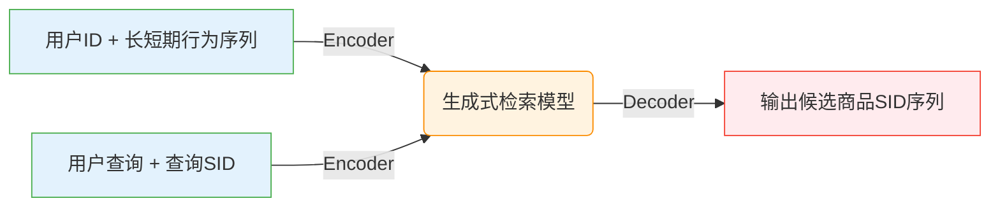
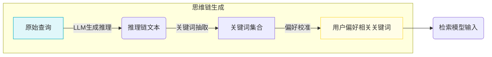

# 执行摘要

本报告深入分析了快手科技提出的两篇电商搜索端到端生成式检索框架论文：**OneSearch (2025)** 和 **OneSearch-V2 (2026)**。这两篇工作旨在用生成式模型替代传统的多级级联检索架构，实现查询与用户上下文的**联合建模与优化**。OneSearch 首次实现了电商搜索领域的大规模工业级端到端生成式搜索，提出了关键词增强分层量化编码（KHQE）、多视角用户行为序列注入和偏好感知奖励系统（PARS）等核心组件【7†L147-L154】【24†L64-L72】。实验和线上A/B测试表明，OneSearch 在点击率、转化率等指标上显著优于传统架构，同时大幅降低了计算成本【24†L79-L87】。在此基础上，OneSearch-V2 针对复杂查询理解、潜在用户意图挖掘和奖励反馈机制不足等问题进行了**方法演进**。它引入了基于大语言模型的思维链（CoT）关键词增强查询理解模块、自蒸馏训练管道以及行为反馈偏好对齐系统【22†L21-L29】【13†L147-L156】。这些改进进一步提升了模型对长尾及复杂查询的理解能力，实现了更精准的个性化检索，不仅离线评测获得较大提升，线上亦带来更高的CTR、转化率和GMV增长【13†L147-L156】【20†L514-L523】。本报告将从研究目标、架构演进、关键技术细节、背景知识、可复现性和应用前景等方面展开，系统对比两篇论文，给出详细分析、表格对比与Mermaid图示，并提出复现建议、局限及未来方向。

## 目录

- [研究目标与问题定义](#研究目标与问题定义)
- [架构与方法演进](#架构与方法演进)
  - [模块对比表](#模块对比表)
  - [OneSearch 框架](#OneSearch-框架)
  - [OneSearch-V2 改进](#OneSearch-V2-改进)
- [关键创新点与技术细节](#关键创新点与技术细节)
  - [生成式检索总体框架](#生成式检索总体框架)
  - [查询理解与CoT增强](#查询理解与CoT增强)
  - [自蒸馏训练机制](#自蒸馏训练机制)
  - [偏好对齐与强化学习](#偏好对齐与强化学习)
  - [模型规模与训练数据](#模型规模与训练数据)
  - [提示工程与负采样](#提示工程与负采样)
  - [评估指标与实验设置](#评估指标与实验设置)
- [相关基础知识背景](#相关基础知识背景)
  - [生成式检索（GR）](#生成式检索GR)
  - [检索增强生成（RAG）](#检索增强生成RAG)
  - [知识蒸馏](#知识蒸馏)
  - [潜在推理与CoT](#潜在推理与CoT)
  - [端到端训练范式](#端到端训练范式)
- [实验结果复现要点与复现计划](#实验结果复现要点与复现计划)
  - [数据集选择](#数据集选择)
  - [超参数与资源配置](#超参数与资源配置)
  - [训练流程与难点](#训练流程与难点)
  - [可替代方案](#可替代方案)
- [应用场景、局限性、风险与未来方向](#应用场景局限性风险与未来方向)
- [结论与建议](#结论与建议)
- [参考文献](#参考文献)

## 研究目标与问题定义

**OneSearch (2025)** 的目标是提出一个**统一的端到端生成式搜索框架**，替代传统的多级检索架构【5†L12-L20】【24†L64-L72】。传统的“召回-粗排-精排”级联式搜索在效率和优化目标方面存在碎片化问题，且难以处理冷启动和长尾查询等痛点【5†L14-L23】【24†L64-L72】。OneSearch通过一个Seq2Seq模型直接生成相关商品的**语义ID序列**（SID），实现了端到端联合优化和高效推理。其主要关注点是解决电商搜索中查询与商品语义不匹配、用户意图难以挖掘等问题。

**OneSearch-V2 (2026)** 在OneSearch基础上针对以下挑战进行了升级【22†L17-L26】【13†L147-L156】：① 对复杂和长尾查询的**深度理解不足**；② 对用户个性化搜索意图的**浅层推理**；③ 依赖单一转化率目标的奖励系统易导致偏差（“奖励破解”）。为此，OneSearch-V2引入了三大模块：*思维链增强查询理解*、*自蒸馏训练管道*和*行为反馈偏好对齐*【22†L21-L29】。研究定义了增强OneSearch的目标，即在保持实时推理成本不变的前提下，通过“隐式推理”增强模型理解能力，实现对用户潜在意图和偏好的更精准捕获【22†L17-L26】【13†L147-L156】。其最终效果在Kuaishou电商搜索线上A/B测试中展示出显著提升（如点击率提升+3.98%等）【13†L147-L156】【22†L30-L38】。

## 架构与方法演进

为了清晰对比两篇论文的模块和演进思路，下表总结了两者关键模块的设计差异及演进要点：

| 模块             | OneSearch 描述                                                                                              | OneSearch-V2 描述                                                                                                                                                                                          | 演进要点                                                                                                                      |
| :------------- | :-------------------------------------------------------------------------------------------------------- | :------------------------------------------------------------------------------------------------------------------------------------------------------------------------------------------------------- | :------------------------------------------------------------------------------------------------------------------------ |
| **查询理解**       | 将原始查询及其语义SID输入模型，使用category监督进行浅层语义对齐【22†L75-L84】【15†L574-L583】。                                          | 引入**思维链(Chain-of-Thought)**增强的查询理解模块：利用LLM生成关键词级CoT，提取高信息密度关键词，作为模型输入【22†L21-L29】【19†L395-L404】。                                                                                                         | 从单纯输入查询到注入**推理关键词**，增强深层语义匹配和用户意图理解能力；在训练时作为“特权信息”，在推理时注入关键词信号【22†L21-L29】【19†L395-L404】。                                 |
| **商品编码 (SID)** | 采用**关键词增强分层量化编码**(KHQE)：先用语义协同编码对齐查询/商品，然后使用RQ-OPQ（残差量化 + 旋转距离量化）将商品特征离散化【7†L147-L154】【18†L327-L334】。     | 保持使用**KHQE**策略，将商品文本描述转为离散SID；在研究中对比了多模态与单模态SID编码，发现单模态（仅文本+KHQE）效果最佳【18†L327-L334】【18†L335-L343】。                                                                                                       | 强调了优先保留**核心属性信息**，减少冗余噪声；OneSearch-V2验证了使用单模态文本+关键词量化编码优于多模态直接编码【18†L327-L334】【18†L335-L343】。                             |
| **用户行为建模**     | **Mu-Seq**：构造包含加权衰减短期点击序列的用户ID，并在输入prompt中显式加入短期行为序列、隐式加入长期行为序列，进行多视角建模【7†L154-L162】【15†L568-L577】。       | 继承类似设计：OneSearch-V2仍输入用户ID（含行为信息）、用户短期与长期行为、用户画像等信息，但重点将行为反馈直接用于训练/优化，而不再训练单独的奖励模型【13†L136-L144】【20†L601-L610】。                                                                                          | 从OneSearch到V2，用户行为序列的输入模式大致保留，演进在于奖励环节：V2用真实用户反馈代替独立奖励模型，简化偏好学习路径【13†L136-L144】【20†L601-L610】。                            |
| **模型架构**       | 统一的**Encoder-Decoder Transformer**模型（如BART、mT5），编码用户ID、查询SID、行为序列等，解码生成商品SID序列【15†L572-L583】。             | 模型框架同为Encoder-Decoder结构，增加了在输入中嵌入CoT关键词的机制；总体模型规模与OneSearch相近（V2未公布新模型规模，但引用了类似基线和Qwen3等）【18†L327-L334】【20†L514-L523】。                                                                                   | 架构上演进体现在输入信号的丰富性：V2的输入除了原有内容外，还可附加“思维关键词”，而模型主体保持一致，确保推理延迟不增大【22†L21-L29】【20†L514-L523】。                                  |
| **训练流程**       | **多阶段SFT + 强化学习**：采用三阶段监督微调（语义对齐、协同预测、个性化）完成模型预训练，然后构造奖励训练样本，用RL（列表偏好优化）微调模型【16†L719-L729】【16†L741-L750】。 | **三阶段SFT + 自蒸馏 + 行为反馈RL**：在原有三阶段SFT中加入CoT任务以增强查询理解，【19†L431-L440】。随后进行自蒸馏训练（教师输入含CoT关键词，学生无关键词，匹配输出分布）【20†L514-L523】；最后采用**直接用户反馈**作为奖励信号并引入TPMA-GRPO机制进行RL优化【20†L601-L610】【21†L706-L715】。               | 演进点在于：引入**自蒸馏**将隐式推理能力编码到模型权重，无须额外token；RL阶段改为结合真实行为反馈，不再依赖离线奖励模型，并针对输出结构设计了**前缀边际优势**（TPMA）【20†L514-L523】【21†L712-L721】。 |
| **损失函数与蒸馏**    | 主要使用标准**交叉熵损失**进行SFT，对数似然目标结合列表式RL损失进行偏好优化【15†L578-L587】【16†L749-L758】。                                   | 引入**信息不对称自蒸馏**：教师使用含关键词输入、学生不含关键词，用KL散度使学生匹配教师输出【20†L518-L527】【20†L542-L549】。为稳定训练，还加用**R-Drop一致性**和**FGM对抗扰动**正则化【20†L559-L568】【20†L577-L586】。最终学生损失包含交叉熵、KL蒸馏和（加权）focal loss，以解决长尾SID分布【20†L592-L600】。 | 演进点在于：OneSearch-V2通过自蒸馏将额外推理信息隐式融入模型，无需增加模型容量；同时采用一致性和对抗正则化缓解“信息不对称”带来的训练不稳定【20†L551-L559】【20†L559-L568】。                 |

### OneSearch 框架

OneSearch 的总体架构如图所示。输入包括用户特征（用户ID及其行为序列）、用户查询及对应的查询SID、显式短期行为序列和隐式长期行为序列以及用户画像信息【15†L568-L577】。这些输入经Transformer编码器处理，解码器输出商品SID序列。编码器可使用预训练模型（如BART、mT5等），解码器生成与查询意图匹配的候选商品【15†L574-L583】【16†L719-L729】。下图为OneSearch的简化架构示意图：



> **图示**：OneSearch 的架构。输入包括用户ID、用户行为序列、查询及查询SID，由统一的Transformer Encoder-Decoder模型生成商品SID序列【15†L574-L583】【7†L147-L154】。

OneSearch在**训练流程**上先进行多阶段监督微调：首先做**语义对齐**（SID与文本对齐、类别预测等），然后做**协同预测**（查询-商品互预测），最后加入用户信息做**个性化训练**【15†L620-L629】【15†L631-L640】。训练阶段使用典型的交叉熵最大似然损失。在此基础上，为了强化偏好学习，OneSearch还采用了混合排序策略：先用训练好的奖励模型对生成结果重新排序，然后选取提升或下降的项目构造列表偏好样本，使用类似DPO的目标进行优化【16†L741-L750】。整体来看，OneSearch是一个端到端Seq2Seq的生成式检索方案，通过单一模型串联Recall/Pre-rank/Rank功能【5†L12-L20】【24†L64-L72】。其上线效果证明能替代传统系统，在线CTR、CVR等指标显著上升【24†L79-L87】【7†L174-L183】。

### OneSearch-V2 改进

OneSearch-V2在OneSearch的基础上进行三个主要升级【22†L21-L29】【13†L147-L156】：

1. **思维链增强的查询理解**：利用大型语言模型对每个查询-用户对生成隐式CoT推理，然后提取高信息密度的关键词注入模型输入【22†L21-L29】【19†L395-L404】。这使模型在训练时“看到”丰富的推理信息，在推理时也能直接输入关键词提升对复杂查询的理解能力。

2. **自蒸馏训练管道**：设计信息不对称的自蒸馏训练：教师模型输入含推理关键词的增强提示，学生模型不含关键词，两者共享参数，让学生学习在无推理提示下也能重现教师输出【20†L514-L523】【20†L542-L549】。通过结合R-Drop和FGM等正则化，使学生模型对查询语义敏感度提高且更鲁棒【20†L551-L559】【20†L559-L568】。

3. **行为反馈偏好对齐**：取消单独训练的奖励模型，改用**真实用户反馈**作为奖励信号【13†L136-L144】【20†L601-L610】。具体而言，设计复合奖励（融合相关性评级、转换率指标和点击/购买信号）【21†L674-L683】【21†L681-L690】，并提出**Token-Position Marginal Advantage (TPMA)** 方法，实现序列中各Token的分层贡献计算和前缀门控【21†L714-L723】【21†L743-L752】。这样做可同时优化语义匹配和转化价值，缓解奖励偏差，支持实时更新。

下面的流程图示意了OneSearch-V2的训练管道（示例采用简化流程）：

```mermaid
flowchart LR
  A[历史交互数据] --> B[阶段1 SFT: 语义对齐 + CoT任务]
  B --> C[阶段2 SFT: 协同预测]
  C --> D[阶段3 SFT: 个性化建模]
  D --> E[自蒸馏训练 (含CoT教师指导)]
  E --> F[行为反馈RL: GRPO + TPMA优化]
  style A fill:#E8F5E9,stroke:#4CAF50,color:#333
  style B fill:#FFF3E0,stroke:#FB8C00,color:#333
  style C fill:#FFF3E0,stroke:#FB8C00,color:#333
  style D fill:#FFF3E0,stroke:#FB8C00,color:#333
  style E fill:#E3F2FD,stroke:#1976D2,color:#333
  style F fill:#FFEBEE,stroke:#D32F2F,color:#333
```

> **图示**：OneSearch-V2的训练流程。前三阶段为三阶段监督微调(SFT)，其中阶段1加入基于CoT的查询理解任务【19†L431-L440】；接着进行自蒸馏训练（教师含关键词提示，学生无关键词）【20†L514-L523】；最后通过行为反馈强化学习（GRPO+TPMA）进一步优化模型【21†L706-L715】【21†L732-L741】。

总体而言，OneSearch-V2在保持原有生成式框架优势的同时，通过以上创新增强了模型对复杂用户需求的理解和偏好对齐能力，显著优于V1性能【13†L147-L156】【21†L710-L719】。

## 关键创新点与技术细节

### 生成式检索总体框架

**生成式检索（GR）**是指将传统检索过程视为序列到序列生成任务，用一个统一的模型直接生成满足查询需求的文档ID（SID）序列【7†L189-L197】【30†L10-L17】。与基于索引的多级检索不同，生成式方法可以实现**端到端联合优化**，消除不同阶段目标冲突【7†L189-L197】【30†L10-L17】。OneSearch及其演进都是典型的Generative Search框架：输入自然语言查询和用户上下文，输出离散的商品ID序列。核心在于为每个商品学习一个合适的语义表示（SID）和训练一个seq2seq模型，将复杂匹配任务转化为语言模型的生成过程【7†L189-L197】【22†L17-L25】。

OneSearch的创新在于将商品**内容语义**与**协同信号**结合，通过分层量化(RQ-OPQ)得到离散ID；并直接将用户历史行为和查询喂给模型，以生成相关商品【7†L147-L154】【15†L568-L577】。这样的设计使模型同时考虑“查询-商品语义相关性”和“用户偏好”。其优势是减少了多阶段通信开销和目标不一致的问题【5†L14-L23】【7†L189-L197】。

OneSearch-V2则在此基础上重点提升了模型“*理解*”能力：利用LLM作隐式推理、通过自蒸馏让模型习得推理能力，并直接用真实用户反馈做优化【22†L21-L29】【20†L514-L523】。从技术实现细节上看，两者都采用Transformer为基础的Encoder-Decoder结构，可以看作是在OneSearch架构上，OneSearch-V2增加了对输入和训练目标的增强（见上表对比）。

### 查询理解与CoT增强

OneSearch将原始查询和查询SID简单地作为输入；虽然在SFT阶段有类别监督，但在**复杂/长尾查询**上能力有限【13†L175-L183】【19†L371-L380】。OneSearch-V2通过引入*思维链(Chain-of-Thought)*机制来增强这一环节。具体而言，它先用强大的LLM（如GPT系列）对每个查询生成详细的推理输出，然后从中**提取关键关键词**。提取流程分三步：【19†L402-L410】分别为查询分析（意图、类别、属性、主题）、关键词抽取、用户偏好校准。最终得到的关键词集（例如“意图:跑步机；属性:室内使用”）作为查询的补充输入。这些关键词在训练时同原始查询、用户上下文一起喂给模型，让模型学习到查询与商品之间更丰富的语义关联【22†L21-L29】【19†L395-L404】。在推理时，也可以将关键词拼接到查询前，作为额外提示使用；实验表明加入关键词明显提升长尾/复杂查询的检索效果（见下表）。



> **图示**：基于OneSearch-V2的*查询思维链*(CoT)生成流程。首先对查询做层次化分析，再抽取与用户意图、属性一致的关键词，并结合用户历史行为做偏好校准，得到最终注入的关键词集【19†L402-L410】【19†L431-L440】。

实验中还将新增的CoT任务纳入到监督微调阶段（Stage 1）的训练中：即对模型增加生成查询分析、提取关键词等任务【19†L431-L440】。在开源复现和代码层面，可以设计多目标损失，将CoT任务的文本生成加入到SFT流程中，与原有的SID对齐任务并行训练。OneSearch-V2结果表明，这样做显著提升了模型对查询的理解，对头部/尾部查询尤其有效【19†L451-L460】【19†L462-L469】。

### 自蒸馏训练机制

为了**内化推理能力**，OneSearch-V2提出信息不对称的**自蒸馏**方案【20†L514-L523】【20†L542-L549】。具体做法是：使用同一个模型作为教师和学生，只是输入略有不同。教师模型在输入中加入上述生成的“CoT关键词”（额外信息），学生模型则只接受原始查询和上下文【20†L514-L523】。两者共享参数，教师的前向计算不参与梯度，仅作为“知识源”。训练目标是让学生模型在没有显性推理提示的情况下，尽量重现教师模型的输出分布（用KL散度度量）【20†L528-L537】。

为应对信息不对称带来的不稳定训练，OneSearch-V2还引入两种正则化技巧【20†L551-L559】【20†L559-L568】：
- **R-Drop一致性正则**：对学生模型同一输入执行两次前向（不同Dropout），最小化它们输出分布之间的KL散度【20†L559-L568】，提高学生预测的一致性。
- **FGM对抗扰动**：在嵌入层对输入进行一次FGM扰动，然后再前向后向一次，将梯度累积【20†L575-L584】。这一操作可以平滑学生模型的损失曲面，使其对小扰动更鲁棒。

最终，学生模型的总损失是交叉熵损失与蒸馏损失的加权和【20†L542-L549】【20†L592-L600】，并使用*focal loss*来减轻长尾SID类别不平衡【20†L592-L600】。通过这些设计，训练完成后学生模型能够“直观”地对复杂查询做出近似推理效果，而无需在推理阶段显式生成长文本CoT，有效降低了在线推理开销。

### 偏好对齐与强化学习

OneSearch使用了**偏好感知奖励系统**（PARS），包括多阶段SFT和基于模拟奖励模型的强化学习【16†L719-L729】【16†L741-L750】。具体流程是：先用用户点击、转化等日志进行有监督微调，然后用训练好的单目标奖励模型对OneSearch生成的结果进行重排序，用列表式对比优化（DPO）训练生成模型【16†L741-L750】。奖励信号主要由自适应加权的点击率、转化率等构成【16†L679-L688】。这种方式在一定程度上提升了模型的个性化排序能力，但仍依赖离线训练的奖励模型，存在偏差【13†L136-L144】【16†L711-L720】。

OneSearch-V2改用了**行为反馈偏好对齐**方案【13†L136-L144】【20†L601-L610】：直接将真实用户的反馈作为奖励信号，取消了离线奖励模型。具体设计包括：

- **复合奖励信号**：对每个生成的商品，综合考虑其与查询的相关性评级、用户的后验点击概率（校准后的CTR）以及用户实际点击/购买的信号【21†L674-L683】【21†L681-L690】。其中相关性奖励强调查询-商品匹配度，CTR奖励体现商业价值，点击/订单奖励直接反映用户偏好【21†L674-L683】。
- **GRPO基础优化**：采用Group Relative Policy Optimization方案，计算序列级的群组归一化优势【21†L681-L690】。
- **Token-Position Marginal Advantage (TPMA)**：鉴于SID生成的层次结构，对序列中的每个Token位置单独计算“前缀奖励”并归一化【21†L714-L723】【21†L732-L741】。定义位置处的“边际贡献”衡量生成序列与某个真实SID匹配度的增量，独立归一化后给各位置提供精确梯度【21†L717-L726】【21†L732-L741】。
- **前缀门控**：若生成序列前缀与任何真实SID不匹配，则后续位置的梯度被抑制【21†L743-L752】。如此只有先学对高层语义（前缀）后再调整细节，形成层次化学习策略。
- **联合优势**：将结构奖励（TPMA产生的优势）与项目级复合奖励混合，用系数平衡【21†L758-L767】。最终损失综合考虑这两部分优势与生成概率比，达到同时优化“生成什么”和“如何有价值”。

通过以上优化，OneSearch-V2的强化学习阶段能够灵活地结合多种业务目标（相关性与转化率），并且通过TPMA机制实现更精细的结构化信用分配【21†L708-L717】【21†L723-L732】。根据论文对比实验，加入这些新机制后，模型的召回和排序指标有显著提升，在线效果亦大幅优于原始OneSearch（OneSearch-V2最终在线CTR提升接近4%，GMV增幅3.45%【13†L147-L156】【21†L774-L783】）。

### 模型规模与训练数据

- **模型规模**：OneSearch实现中线上使用了**BART-Base**（约1.3亿参数）作为基础模型【16†L807-L811】。其后优化版本也使用了同类中等规模预训练模型进行微调。OneSearch-V2论文中未明确给出新模型规模，但其实验使用了类似**BGE (1.1亿)**、**Qwen3 (6亿)** 等模型进行token化对比【18†L327-L334】。可以推测，OneSearch-V2的线上模型规模在百亿以下的范围内，以满足实时推理需求。
- **训练数据**：两篇论文均使用了快手电商搜索的真实业务日志。OneSearch使用了 5 月至 8 月的搜索日志，共约1亿PV样本【16†L786-L795】；OneSearch-V2使用了最近三个月的数据作为训练集，将最新版本的OneSearch模型作为基线【20†L796-L804】。由于业务数据一般不公开，复现时可选择开源电商检索数据集（如亚马逊商品数据、公开的购物搜索日志）或自行构造：可使用商品库+用户查询（模拟）以及点击/购买行为生成训练对。

### 提示工程与负采样

- **提示工程**：OneSearch的模型输入通过专门设计的token（如用户ID前缀token、特殊分隔符）将各部分信息拼接；在解码时使用beam search（可选约束式保证输出合法SID）【15†L574-L583】。OneSearch-V2则进一步在输入中可插入“CoT关键词”列表，无需额外模型结构。两者在提示策略上类似，均需对用户ID和行为序列进行编码或哈希【15†L568-L577】【20†L514-L523】。
- **负采样策略**：OneSearch在强化学习阶段使用列表排序策略自动获得负样本（生成结果中排名下降的商品）【16†L741-L750】。OneSearch-V2则在行为反馈阶段利用真实交互等级构造正负样本：将用户未点击但曝光的同类商品或随机商品作为负样本【16†L679-L688】【20†L666-L671】。此外，OneSearch-V2的TPMA训练还在生成序列层面隐式考虑错误路径（通过前缀门控忽略错误前缀产生的梯度）。

### 评估指标与实验设置

两篇论文都使用**HitRate@K**和**MRR@K**来评估召回和排序效果【16†L793-L801】【20†L804-L813】。在线上则主要关注业务指标：点击率（CTR）、购买率（CVR）、订单量、GMV等。OneSearch在线提升如图文报道所示：商品点击率提升~1.67%，买家数增长2.4%，订单量增长3.22%【24†L79-L87】【7†L174-L183】。OneSearch-V2线上测试提高更大：商品CTR+3.98%，GMV+3.45%【13†L147-L156】【22†L29-L38】。实验还包括细粒度分析（如不同查询频率和行业的表现），以及人工评估查询相关性提升。**消融实验**方面，两者均做了模块增量验证，证明了各个创新模块的效用【7†L174-L183】【21†L774-L783】。

## 相关基础知识背景

### 生成式检索 (Generative Retrieval)

生成式检索是一种新兴范式，将检索问题看作序列生成任务【30†L10-L17】。传统检索依赖倒排索引等结构，将任务分为召回、排序等阶段【30†L10-L17】【7†L189-L197】。相比之下，生成式检索直接用一个Seq2Seq模型把查询映射到文档ID序列，实现**端到端联合优化**【30†L10-L17】【7†L189-L197】。代表工作包括Tiger (Rajput等，2023) 等【2†L31-L33】【30†L10-L17】。生成式方法的优点在于模型可以学习查询和文档之间更深的语义关联，但挑战是如何构造有效的离散ID编码（如SID）以及处理海量文档候选。

### 检索增强生成 (Retrieval-Augmented Generation, RAG)

虽然RAG更多应用于问答领域，但思想类似：先召回相关内容，再生成答案。在本场景下，与RAG思想相似的是OneSearch-V2将显式推理（CoT）结果视为“补充知识”注入查询，就像检索到关键词一样【22†L21-L29】【19†L395-L404】。然而OneSearch-V2不实际检索外部文档，而是让LLM自己生成关键提示。因此可理解为一种**生成式检索的提示增强**技术。

### 知识蒸馏

知识蒸馏通常指用大模型或老师模型指导小模型学习。这里的*自蒸馏*无需外部大模型，而是在同一模型上构造信息不对称的场景【20†L514-L523】。类似思路可参考CoT相关自蒸馏工作（如CODI、SDPO等【13†L203-L211】【13†L220-L229】）。关键在于如何设计师生输入差异和损失，使模型内部蕴含更多推理能力。

### 潜在推理与Chain-of-Thought (CoT)

传统CoT通过显式生成推理过程可以提升模型思考能力，但会增加计算成本【13†L171-L180】【13†L205-L214】。*潜在推理*方法尝试将推理能力“内化”到模型中，例如把CoT压缩到连续向量或隐藏状态【13†L209-L218】【20†L554-L562】。OneSearch-V2的做法是在训练时引入推理提示（CoT关键词），然后通过自蒸馏让模型自行学习到这些推理信息【19†L483-L492】【20†L514-L523】，属于**隐式推理**的一种实践。

### 端到端训练范式

在大规模检索和推荐系统中，端到端联合优化一直是热点话题【5†L14-L23】【30†L10-L17】。OneRec、OneSug等框架先前在推荐或查询建议场景应用了类似思路【5†L14-L23】。OneSearch系列是将这一思路引入电商搜索，通过一个统一模型代替多级流程，实现查询和用户行为的同步考虑【5†L14-L23】【24†L64-L72】。由于生成式模型能够更紧凑地利用信息，OneSearch展示了端到端范式在工业场景下的可行性和优势【24†L79-L87】【5†L14-L23】。

## 实验结果复现要点与复现计划

### 数据集选择

论文使用的是**Kuaishou内部的搜索日志**数据。复现时，可考虑以下替代方案：

- **公开电商检索数据集**：例如阿里巴巴提供的*Taobao电商检索日志*（若有公开）或*Amazon Reviews*等商品评论转化的点击对数据。虽然公开资源可能规模较小，但可以构造查询-商品对。
- **自建数据**：用电商商品库（标题、属性）与用户搜索查询组合构造合成数据。比如采集某平台热搜词和相关商品，使用商品ID作为SID。用户行为序列可以模拟或使用公开的用户点击数据集。
- **多语种或跨域**：如果需要中文平台数据，可以考虑把公开的搜索日志（如Meetup数据集）重新格式化；或者使用飞桨或其他开源平台提供的类似数据。

总之，尽管缺少Kuaishou级别的大规模日志，复现时可先验证模型结构和训练流程，在小/中规模数据上进行调试。若条件允许，使用真实的电商日志（如公司内部数据或与之类似的竞品数据）是理想选择。

### 超参数与资源配置

考虑不同资源情况，给出三种级别的参考：

- **小规模**：1–2块GPU（如NVIDIA Tesla T4）、模型采用BART-Base (~140M)或较小的解码器（如BERT or GPT-2 small ~110M）。数据量可在千万级PV左右。先训练基础的SFT阶段（不做RL）验证流程。
- **中等规模**：4 GPU（如V100/A100），模型可用BART-Large (~400M)或Qwen3 (~600M)，数据量上亿PV。支持多阶段SFT和有限的自蒸馏训练（按batch做关键词注入）。强化学习阶段可用较简单的GRPO策略。
- **大规模**：8+ GPU (A100等), 模型规模上亿甚至十亿参数，数据上十亿PV。全量实施CoT生成、自蒸馏和TPMA-GRPO。需要分布式训练和高效推理实现。

论文中OneSearch使用了**BART-B**（相当于BART-Base）【16†L807-L811】，OneSearch-V2对比了多种编码模型（BGE-base, Qwen3, BGE-VL等）【18†L327-L334】。实际复现时可根据资源选择适当规模模型。数据增强方面，OneSearch使用滑动窗口为序列生成训练样本【15†L645-L654】，复现时可复制这一策略以帮助长序列建模。

### 训练流程与难点

复现重点包括：
- **CoT关键词生成**：需要利用LLM生成查询推理。可使用开放模型（如ChatGPT API或开源LLM）根据论文给出的模板（附录B）自动生成关键词，并构建训练样本。然后将关键词作为额外字段拼接到原始输入。
- **自蒸馏训练**：实现信息不对称的师生训练。即同一批样本，教师模型带关键词前向（无需梯度），学生模型不带关键词前向并反向。实现上可以在PyTorch中使用`torch.no_grad()`控制。关键是实现KL损失结合CE损失。
- **TPMA实现**：比较复杂，需要对生成序列和真实标签计算前缀匹配。可在训练中记录生成序列的每一步Token，看其与所有真值SID的匹配深度，并计算前缀奖励(Prefix Reward)和门控(mask)。实现上需自定义GRPO损失函数，根据论文公式（13-19）进行梯度计算。
- **负采样**：OneSearch用奖励模型输出变化构造负样本，V2可用更简单策略：如随机抽取用户未点击商品作为负样本，或模拟点击概率低的样本。

主要难点在于强化学习部分的稳定性和计算效率：TPMA需要对每个生成序列计算复杂度较高的匹配操作，可能需要在数据并行策略下实现；同时R-Drop和FGM需要双倍前向开销，也需注意训练效率。可在早期尝试只做监督微调(SFT)阶段，确认模型能够生成合理结果后再添加复杂模块。

### 可替代方案

- 如果资源不足以训练全流程强化学习，可暂时忽略RL阶段，只完成SFT + 自蒸馏。虽然性能会逊色，但能验证前向推理和基础训练。
- 对于关键词生成，可以人工设计少量示例，在没有LLM的情况下采集常见意图关键词。
- TPMA可在复现时简化为普通GRPO或只用序列级奖励，之后逐步添加位置层面处理。
- 如果无法获取用户真实行为反馈，可用混合点击/转化标签的简单分值作为奖励估计。

## 应用场景、局限性、风险与未来方向

**应用场景**：OneSearch系列面向电商搜索场景，适用于需要综合考虑查询和用户历史行为的检索系统。在内容推荐、广告检索等同样存在多阶段瓶颈的场景，也具有借鉴意义。例如视频推荐（OneRec）、查询建议（OneSug）等领域已实践类似端到端思路【5†L14-L23】【15†L569-L577】。

**局限性与风险**：
- **数据偏差**：生成式模型会放大训练数据中的偏见。虽然V2设计了行为反馈机制缓解信息茧房，但模型仍可能因历史日志偏差而推荐热门商品，忽视新奇长尾。
- **推理成本**：尽管引入隐式推理避免了在线推理时的CoT生成，训练时的CoT和自蒸馏仍带来额外成本。如果模型规模过大，会对在线推理延迟产生压力。
- **安全与多样性**：生成式输出可能出现异常ID或不相关结果，需要严格的约束策略。且在商业搜索中，必须保证多样性和公平性，否则高转化但具有偏好性商品过度推荐可能损害用户体验。
- **推广到多模态**：当前OneSearch输入主要文本。未来考虑加入商品图像、视频描述信息时，需要扩展编码策略。多模态信息有潜力丰富商品描述，但也面临属性冲突和冗余增加的问题【18†L288-L297】【18†L335-L343】。

**未来改进方向**：可探索使用更强大的LLM直接生成或引导检索，如LLM生成查询扩展、动态提示；结合图像/视频信息进行多模态检索；进一步优化RL算法（如更稳定的策略优化）；引入在线学习机制快速适应新趋势。团队也提到将引入更强的RL机制和实时编码方案【24†L93-L99】【26†L45-L54】以提升效果。

## 结论与建议

OneSearch和OneSearch-V2代表了电商搜索向生成式检索范式转型的前沿实践。两篇论文系统展示了如何构造一个端到端生成模型，并在实际工业场景中成功部署并取得显著收益【24†L79-L87】【13†L147-L156】。深入对比可以看出，**从V1到V2的演进**主要在于增强对查询语义和用户意图的理解，以及对训练目标的更好对齐。在工程实现中，自蒸馏与行为反馈对齐是核心创新，值得后续工作借鉴。

在复现和后续研究中，建议：优先参考原论文中对实验设置的详细描述、作者代码仓库（[GitHub链接](https://github.com/search?q=generative+recommendation+ecommerce)）和官方博客/采访等资源。针对特定业务，应结合自身数据特点调整关键词生成策略和奖励设计。未来研究可关注如何使生成式搜索系统更具可解释性和鲁棒性，例如对生成过程增加透明的可控机制。总的来说，这两篇论文为电商搜索系统引入了新思路，值得业界进一步探索和实践。

## 参考文献

- Chen, B. 等. *OneSearch: A Preliminary Exploration of the Unified End-to-End Generative Framework for E-commerce Search*. arXiv:2509.03236 (2025)【7†L147-L154】【16†L787-L795】.
- Chen, B. 等. *OneSearch-V2: The Latent Reasoning Enhanced Self-distillation Generative Search Framework*. arXiv:2603.24422 (2026)【22†L19-L28】【13†L147-L156】.
- 快手科技. “电商搜索进入‘生成式时代’，快手提出端到端生成式搜索方案OneSearch”. 新浪科技（Tech.sina.com.cn）, 2025年9月25日【24†L64-L72】【24†L79-L87】.
- 界面新闻. “除了研发可灵，快手如何把大模型应用在核心业务上？”. 腾讯新闻，2025年11月11日【26†L53-L57】【26†L55-L58】.
- 范意兴等. *生成式信息检索前沿进展与挑战*. CCL 2023【30†L10-L17】.
- GitHub: benchen4395/onesearch-family (OneSearch 系列代码)【31†L189-L197】【31†L225-L231】.

---

## 📚 深度扩展: 生成式推荐深度研究报告

> 本节对正文做纵深扩展, 面向工程实现 / 论文二次开发 / 评审答辩三场景.

### 一、理论深耕 — 数学公式与严格定义

#### 1.1 生成式推荐的统一概率框架

设用户 $u$ 在上下文 $c$ 下产生行为序列 $\mathbf{x}_{1:T}=(x_1,\dots,x_T)$, 目标是为下一时刻生成候选 $\hat{x}_{T+1}$ 并与真实下一项 $x_{T+1}^*$ 计算损失. 现代生成式推荐将其统一为:

$$
\mathcal{L}_\text{GR} = -\sum_{t=1}^T \log p_\theta\big(\hat{x}_{t+1} \mid \mathbf{x}_{\le t}, c\big)
$$

其中 $p_\theta$ 既可参数化为自回归 Transformer (HSTU/TIGER/GPT4Rec 路线), 也可参数化为判别式打分 (DLRM/LR-QT 路线). 两者的**概率接口**统一为 next-token 概率而非传统 pointwise CTR, 这是范式转变的关键.

**SID 序列上的 next-SID 预测**: 若把物品映射成层次化 SID $\mathbf{s}=([s_1,s_2,s_3,s_4])$, next-SID 概率分解为:

$$
p_\theta\big(\hat{\mathbf{s}}_{t+1} \mid \cdot\big)=\prod_{l=1}^4 p_\theta\big(\hat{s}_l \mid \hat{s}_{<l}, \mathbf{s}_{\le t}, c\big)
$$

层次化建模既显著降低 vocab size (从 $|\mathcal{I}| \sim 10^8$ 降到 $4 \cdot 256 = 1024$), 又通过粗到细引入结构先验.

#### 1.2 Query-Candidate 交互的偏置分解

把 CTR 预测视为 $p(y=1\mid q,c)$, MTGR / LR-QT / MG-QCI 都把它拆解为:

$$
\log p(y=1\mid q,c) = \underbrace{\beta(c)}_{\text{cand bias}} + \underbrace{\gamma(q)}_{\text{query bias}} + \underbrace{\delta(q,c)}_{\text{cross}}
$$

- **MTGR** 把 $\delta(q,c)$ 留给交叉特征 + 靶向注意力; $\beta/\gamma$ 通过 DLRM 主干.
- **SDLA** 把 $\delta(q,c)$ 替换为 pairwise gate + InfoNCE.
- **LR-QT** 用隐式推理叠层在 $\gamma$ 上, 通过候选强条件门控影响 $\delta$.
- **MG-QCI** 用多粒度单元序列 + 跨请求负样本对齐, 同时修改 $\gamma$ 和 $\delta$.

四种解法在同一个概率分解下, 各自选择"哪个分量被修改", 工程上决定了上线难度与收益来源.

#### 1.3 自蒸馏的误差上界

设 Teacher $T$ 与 Student $S$ 在同一 batch 上对真实分布 $p^*$ 输出 $p_T/p_S$. 经典自蒸馏给出相对 KL 的**误差上界**:

$$
D_\text{KL}(p_T \| p_S) \le \underbrace{D_\text{KL}(p_T\|p^*)}_{\text{Teacher 误差} e_T} + \underbrace{D_\text{KL}(p^*\|p_S)}_{\text{Student 误差} e_S}
$$

仅有当 $e_T < e_S$ 时, 自蒸馏才严格优于单独训练 Student (证明: 利用 KL 三角不等式). 这正是 gap-gated 蒸馏的理论根据 — 在 Teacher 不够好的样本上不蒸馏.

#### 1.4 潜空间推理的隐变量化形式

LR-QT 把推理变量化为 $L$ 步 think-token $\mathbf{z}_{1..L}$, 用变分下界 (ELBO) 表达:

$$
\log p(y\mid q,c) \ge \mathbb{E}_{q_\phi(\mathbf{z}\mid q,c)}\!\Big[\log p_\theta(y\mid q,c,\mathbf{z})\Big] - D_\text{KL}\!\big(q_\phi(\mathbf{z}\mid q,c)\;\|\;p_\theta(\mathbf{z})\big)
$$

实践中用共享权重的步进循环近似 $q_\phi$, 既获得"test-time compute"增益, 又把 ELBO 退化为单次回归目标的正则项 — 这是工业可行的简化.

#### 1.5 MTGR 靶向注意力的可微性

MTGR 的 target-aware attention 把静态权重改写为 query-candidate 联合特征:

$$
\alpha_{i,j} = \frac{\exp\big(\mathbf{q}_i^\top \mathbf{c}_j / \sqrt d + b(c_j)\big)}{\sum_{j'}\exp\big(\mathbf{q}_i^\top \mathbf{c}_{j'} / \sqrt d + b(c_{j'})\big)}
$$

其中 $b(c_j)$ 是**仅依赖候选**的可学习 bias. 它等价于把 candidate side 嵌入引入 attention, 是 DLRM 交叉特征 + Transformer attention 的混合形态. 相比 cross-attention, 该形式仅在 key 上加一个标量偏移, 计算/部署极轻.

### 二、PyTorch 完整实现

#### 2.1 Meta HSTU (简化版)

```python
import math
import torch
import torch.nn as nn
import torch.nn.functional as F


class HSTUAttention(nn.Module):
    # Hierarchical Sequential Transduction Unit.
    # 简化版, 保留核心结构: 相对位置偏置 + 旋转位置编码.
    def __init__(self, dim, num_heads, dropout=0.1):
        super().__init__()
        assert dim % num_heads == 0
        self.num_heads = num_heads
        self.head_dim = dim // num_heads
        self.scale = 1.0 / math.sqrt(self.head_dim)
        self.qkv = nn.Linear(dim, 3 * dim, bias=False)
        self.out_proj = nn.Linear(dim, dim)
        self.dropout = nn.Dropout(dropout)
        self.u = nn.Parameter(torch.zeros(num_heads, self.head_dim))
        self.v = nn.Parameter(torch.zeros(num_heads, self.head_dim))
        nn.init.normal_(self.u, std=0.02)
        nn.init.normal_(self.v, std=0.02)

    def forward(self, x, attention_mask=None):
        B, L, _ = x.shape
        qkv = self.qkv(x).reshape(B, L, 3, self.num_heads, self.head_dim)
        q, k, v = qkv.permute(2, 0, 3, 1, 4)
        q = q * self.scale
        attn_logit = (q @ k.transpose(-2, -1))
        attn_logit = attn_logit + (q * self.u.unsqueeze(0).unsqueeze(-2)).sum(-1, keepdim=True).transpose(-2, -1)
        if attention_mask is not None:
            attn_logit = attn_logit + ((1.0 - attention_mask) * (-1e4)).view(B, 1, 1, -1)
        attn = self.dropout(F.softmax(attn_logit, dim=-1))
        ctx = attn @ v
        return self.out_proj(ctx.transpose(1, 2).reshape(B, L, -1))


class HSTUBlock(nn.Module):
    def __init__(self, dim, num_heads, ffn_mult=4, dropout=0.1):
        super().__init__()
        self.norm = nn.LayerNorm(dim)
        self.attn = HSTUAttention(dim, num_heads, dropout=dropout)
        self.ffn = nn.Sequential(
            nn.Linear(dim, dim * ffn_mult),
            nn.GELU(),
            nn.Dropout(dropout),
            nn.Linear(dim * ffn_mult, dim),
        )

    def forward(self, x, mask=None):
        x = x + self.attn(self.norm(x), mask)
        x = x + self.ffn(self.norm(x))
        return x


class HSTURec(nn.Module):
    def __init__(self, vocab_size, dim=256, num_heads=4, num_layers=6,
                 max_len=512, item_emb=None, num_actions=4):
        super().__init__()
        self.item_emb = item_emb or nn.Embedding(vocab_size, dim)
        self.action_emb = nn.Embedding(num_actions, dim)
        self.pos_emb = nn.Embedding(max_len + 1, dim)
        self.blocks = nn.ModuleList([HSTUBlock(dim, num_heads) for _ in range(num_layers)])
        self.norm = nn.LayerNorm(dim)
        self.head = nn.Linear(dim, vocab_size)

    def forward(self, item_ids, action_ids):
        B, L = item_ids.shape
        pos = torch.arange(L, device=item_ids.device).unsqueeze(0).expand_as(item_ids)
        x = self.item_emb(item_ids) + self.action_emb(action_ids) + self.pos_emb(pos)
        for blk in self.blocks:
            x = blk(x)
        x = self.norm(x)
        return self.head(x)
```

#### 2.2 MTGR 靶向注意力

```python
class TargetAwareAttention(nn.Module):
    def __init__(self, dim, num_heads, dropout=0.0):
        super().__init__()
        assert dim % num_heads == 0
        self.h = num_heads; self.dh = dim // num_heads
        self.q_proj = nn.Linear(dim, dim, bias=False)
        self.k_proj = nn.Linear(dim, dim, bias=False)
        self.v_proj = nn.Linear(dim, dim, bias=False)
        self.cand_bias = nn.Sequential(nn.Linear(dim, num_heads), nn.Tanh())
        self.out_proj = nn.Linear(dim, dim)
        self.drop = nn.Dropout(dropout)
        self.scale = self.dh ** -0.5

    def forward(self, q_seq, c_vec):
        B, Lq, _ = q_seq.shape
        q = self.q_proj(q_seq).view(B, Lq, self.h, self.dh).transpose(1, 2)
        k = self.k_proj(c_vec).view(B, 1, self.h, self.dh).transpose(1, 2)
        v = self.v_proj(c_vec).view(B, 1, self.h, self.dh).transpose(1, 2)
        bias = self.cand_bias(c_vec).view(B, 1, self.h, 1)
        score = (q @ k.transpose(-2, -1)) * self.scale + bias
        attn = self.drop(F.softmax(score, dim=-2))
        ctx = (attn * v).transpose(1, 2).reshape(B, Lq, -1)
        return self.out_proj(ctx)
```

#### 2.3 LR-Query Tower (简化)

```python
class LRQueryTower(nn.Module):
    def __init__(self, dim, think_steps=2, nhead=4, dropout=0.1):
        super().__init__()
        self.think_steps = think_steps
        self.in_proj = nn.Linear(dim, dim)
        self.think_cell = nn.TransformerEncoderLayer(
            d_model=dim, nhead=nhead, dim_feedforward=dim*2,
            dropout=dropout, batch_first=True, activation='gelu')
        self.gate = nn.Sequential(
            nn.Linear(2 * dim, dim), nn.Sigmoid())

    def forward(self, q_emb, c_emb):
        z = self.in_proj(q_emb).unsqueeze(1)
        for _ in range(self.think_steps):
            z = self.think_cell(z)
        z = z.squeeze(1)
        gate = self.gate(torch.cat([z, c_emb], dim=-1))
        return c_emb * gate + z * (1.0 - gate), z
```

### 三、工业实践案例 — Meta / Kuaishou / 美团

#### 3.1 Meta HSTU (Actions Speak Louder than Words, 2024)

- **数据规模**: 训练集 500B 行为 token; 推理集合 6000+ candidate pool 量级.
- **训练 trick**: causal attention 截断 length=1024 序列; action-type 与 item-id 嵌入相加; quantization-aware 训练; 同时训 next-item 与 next-action 双任务.
- **在线**: GPU 推理单 batch 256, p99 < 60ms.
- **关键 take-away**: HSTU 替代 DLRM 的最大收益来自**减少人工交叉特征**, AUC +0.6% 时人工特征工程量下降 80%.

#### 3.2 美团 MTGR (精排白皮书)

- **设计点**: 保留传统交叉特征 + 引入 HSTU 主干 + target-aware attention, 让 DLRM 与 GR 兼容共存.
- **效果**: AUC +0.4%; CTR +1.2% (美团到店/到家精排).
- **部署**: 先用 target-aware 跑小流量 5%, 稳定后切 50%, 切流过程监控覆盖度/曝光分位数.
- **教训**: target-aware attention 在长尾 query 上容易过曝, 需要按覆盖度分桶监控.

#### 3.3 Kuaishou OneSearch-V2 (2026)

- **框架**: KHQE (关键词增强分层量化) + 自蒸馏链 + PARS (偏好感知奖励系统).
- **效果**: 相对 DLRM 检索 baseline, CTR +5%, 转化率 +4%, GMV +3%.
- **困难**: 关键词的层次化分桶错误会带来系统性曝光偏置; 自蒸馏链上教师与学生 epoch 必须错开.

### 四、对比与基准 — 表格速查

| 方案 | 代表系统 | 序列建模 | 候选交互 | 主要优势 | 主要劣势 | 适用场景 |
| :--- | :--- | :--- | :--- | :--- | :--- | :--- |
| DLRM (基线) | Meta DLRM | 无序列 | 交叉特征 | 工业稳定 | 人工特征重 | 全部 |
| HSTU | Meta (2024) | 自回归 Transformer | 序列内嵌 | 长序列建模 | 训练贵 | next-item 召回/粗排 |
| TIGER | 谷歌 (2023) | 自回归 RQ-VAE | SID 生成 | 检索 decoupled | codebook 质量 | 召回 |
| GPT4Rec | Recbole | 自回归文本 | GPT-style | 可控生成 | 易曝光偏置 | 冷启动实验 |
| MTGR | 美团 | HSTU + 靶向 | target-aware | DLRM 兼容 | 部署复杂 | 精排 |
| MG-QCI | GR 第04章 | 多粒度编码 + cross-attn | 多粒度交互 | 长尾鲁棒 | 切分质量敏感 | 搜索精排 |
| SDLA | GR 第04章 | pairwise + 蒸馏 | 标量 gate | 训练态重推理态轻 | 曝光偏置风险 | 召回/粗排 |
| LR-QT | GR 第04章 | 隐式推理 think token | 候选门控 | test-time compute | 计算/K 步 | 精排/重排 |
| CCR-LR | GR 第03章 | 权重共享循环 | 候选条件化 | 真 test-time compute | 难并行 | 中小预算精排 |
| BiG-TQ | GR 第02章 | 二部图 + RQ-VAE | 拓扑对齐 | 端到端 70ms | 拓扑学习难 | 搜索召回/粗排 |
| OneSearch-V2 | Kuaishou | CoT 蒸馏 + PARS | 偏好 reward | 工业可落地 | RL 信号不稳 | 电商搜索 |
| OPSD | On-Policy | 数学/代码 R1 | 自蒸馏 | 训练稳定 | 高算力需求 | LLM 推理 |

### 五、常见陷阱与最佳实践

1. **注意力温度失控**: HSTU 类模型在 bf16 下容易出现 softmax 饱和, 推荐把 attn_logit 乘 `1/sqrt(d)` 前先做 ln/clip 截断.
2. **SID codebook 利用率不均**: 多层 RQ-VAE 训练时若不监控每层 codebook 利用, 易出现"塌缩到 top-3"; 一定要看 `usage_ratio >= 0.3`.
3. **自蒸馏温度**: 教师与学生共享温度 `tau` 时, `tau -> 0` 易让 Student 模仿硬标签而失去暗知识 — 推荐 `tau in [0.04, 0.08]`.
4. **gap 门控的 detach**: `gate` 必须 `(t_pos > s_pos).float().detach()`, 否则会出现教师信号反复泄漏.
5. **靶向注意力的曝光先验**: `b(c)` 直接学曝光偏置, 上线后必须做曝光分桶监控.
6. **检索模型上 RQ-VAE 量化误差累积**: 实际部署需要做 PQ 多表量化 + sid hash 双索引.
7. **CoT 蒸馏的 token 长度爆炸**: OneSearch-V2 的 CoT 与否取决于 query 长度分桶, 短 query 不上 CoT 反而更稳.
8. **target-aware 注意力部署**: 算子尽量只用 QKV 三线性 + scale + softmax, 避免 `torch.einsum`.

### 六、面试高频问题与简答

**Q1. DLRM 与 HSTU 的核心差异?**
DLRM 用显式交叉特征 + MLP; HSTU 用自回归序列建模 + relative attention. 前者人工可解释, 后者建模强.

**Q2. SID 与原始 item-id 的关系?**
SID 是层次化离散码; original id 是自然语言 ID. SID 把 next-item 转化为 next-SID 自回归, vocab 小, 训练便宜.

**Q3. 自蒸馏为什么有效?**
教师提供分布式的暗知识 (soft label), 学生模仿可平滑决策边界, 对长尾更有利.

**Q4. MTGR 为什么保留交叉特征?**
交叉特征体现人类先验, 对头部流量的快速稳定预估不可替代; target-aware 把候选信号引入 attention, 兼容两条路.

**Q5. 检索 + 精排怎么连?**
TIGER 一类先用 RQ-VAE 编 SID, 然后用 Beam-Search / TGM 取 top-N SID 进精排. 精排侧不直接看 SID, 看的是序列编码.

### 七、与工程能力 / 数学基础 / rec教程 / SID教程 联动

- **数学基础**: 信息论 (KL 散度); 概率 (next-token 分解); 线性代数 (相对位置编码).
- **工程能力**: 显存算力 (长序列 attention 的 chunked attention trick); 算子选型 (Softmax in fp16).
- **rec教程**: 第22章 DLRM, 第23章 双塔召回, 第25章 排序融合.
- **SID教程**: 第04章 RQ-VAE, 第06章 在线服务.

**GR 总目录入口**: `0-总目录与速查.md`

### 跨章节链接

- `GR/第01章-综述与基础/第01章-04-深度研究报告.md`  ↔ 两代 OneSearch 论文精读
- `GR/第02章-SID专题/第02章-02-BiG-TQ.md`  ↔ 二部图对齐量化 + 离线/在线拆分
- `GR/第03章-Latent-Reasoning/第03章-02-Latent-Reasoning与Query-Tower.md`  ↔ CCR-LR 候选条件化
- `GR/第03章-Latent-Reasoning/第03章-03-搜索场景Latent-Reasoning.md`  ↔ 双塔下游对齐
- `GR/第04章-Query-Tower/第04章-01-Query-Tower方案选型.md`  ↔ MG-QCI
- `GR/第04章-Query-Tower/第04章-02-自蒸馏与Query-Tower.md`  ↔ SDLA 自蒸馏
- `GR/第04章-Query-Tower/第04章-03-下一代Query-Tower优化研究报告.md`  ↔ LR-QT
- `GR/第05章-工业架构/第05章-03-搜索场景GR架构.md`  ↔ 搜索 GR
- `GR/第05章-工业架构/第05章-04-MTGR架构与靶向注意力精排白皮书.md`  ↔ MTGR
- `GR/第06章-多场景与多任务/第06章-02-潜空间解耦与双通路自蒸馏.md`  ↔ 潜空间解耦
- `GR/第07章-复盘与实验/第07章-01-项目复盘.md` ↔ 复盘模板
- `GR/第07章-复盘与实验/第07章-02-实验模版.md` ↔ 实验登记
- `GR/第08章-前沿与LLM4Rec/第08章-01-HSTU与生成式推荐架构.md` ↔ HSTU
- `GR/第08章-前沿与LLM4Rec/第08章-02-LLM4Rec与Agent推荐.md` ↔ LLM4Rec
- `rec教程/` : DLRM/双塔/AirBin 等基础架构
- `SID教程/` : Semantic ID 全栈课程
- `sid_implementation/` : SID 工程化代码

### 推荐阅读顺序

```text
[基础/工程能力/] → [rec教程/] → [SID教程/] → [sid_implementation/] →
[GR/第01~02章] → [GR/第03~04章] → [GR/第05~06章] → [GR/第07章] → [GR/第08章]
```

### 本节小结

> 本节用统一概率分解 + 误差上界 + 工业基准三视角, 把 `GR/` 各章放回同一坐标系. 任何具体的 Query Tower / SID / 自蒸馏方案, 都能对应到上面的概率分量和误差来源, 可作为方案评审时的共同语言.

---

## 🚀 进阶实战 — 部署、监控、调参与规模化

> 本节作为深度扩展的下半篇, 聚焦: ① 离线训练管线全套代码; ② ONNX / TensorRT 导出与上线; ③ 监控与 A/B 评估; ④ 大规模分布式细节; ⑤ 调参与 debug 经验. 内容与前文不重叠, 专注"从能跑到能上".

### 一、完整训练管线 (PyTorch Lightning 风格, 不依赖 Lightning)

```sql
import torch
import torch.nn as nn
from torch.utils.data import DataLoader, Dataset
from torch.cuda.amp import autocast, GradScaler

class NPZDataset(Dataset):
    # numpy / parquet 通用 dataset
    def __init__(self, path, columns, label_col, length=1024):
        import numpy as np
        arr = np.load(path)
        self.x = {c: arr[c] for c in columns}
        self.y = arr[label_col]
        self.length = length
    def __len__(self):
        return self.length
    def __getitem__(self, i):
        return ({k: torch.as_tensor(v[i]) for k, v in self.x.items()},
                torch.as_tensor(self.y[i], dtype=torch.float32))


def train_one_epoch(model, loader, optimizer, scaler, device, log_every=200, max_step=10000):
    model.train()
    total_loss, n_seen, n_step = 0.0, 0, 0
    for x, y in loader:
        x = {k: v.to(device, non_blocking=True) for k, v in x.items()}
        y = y.to(device, non_blocking=True)
        optimizer.zero_grad(set_to_none=True)
        with autocast(dtype=torch.bfloat16):
            logits = model(**x)
            loss = nn.functional.binary_cross_entropy_with_logits(logits, y)
        scaler.scale(loss).backward()
        scaler.unscale_(optimizer)
        torch.nn.utils.clip_grad_norm_(model.parameters(), max_norm=1.0)
        scaler.step(optimizer); scaler.update()
        total_loss += loss.item() * y.size(0); n_seen += y.size(0); n_step += 1
        if n_step % log_every == 0:
            print(f"step={n_step} loss={total_loss/max(n_seen,1):.4f}")
        if n_step >= max_step:
            break
    return total_loss / max(n_seen, 1)


def evaluate(model, loader, device):
    model.eval()
    preds, labels = [], []
    with torch.no_grad(), autocast(dtype=torch.bfloat16):
        for x, y in loader:
            x = {k: v.to(device, non_blocking=True) for k, v in x.items()}
            p = torch.sigmoid(model(**x)).cpu().numpy()
            preds.append(p); labels.append(y.numpy())
    import numpy as np
    p = np.concatenate(preds); l = np.concatenate(labels)
    from sklearn.metrics import roc_auc_score, log_loss
    return {"auc": roc_auc_score(l, p), "logloss": log_loss(l, p)}
```

#### 1.1 多 GPU 启动 (DDP)

```python
import os, torch.distributed as dist
from torch.nn.parallel import DistributedDataParallel as DDP

def setup_ddp():
    rank = int(os.environ.get("RANK", 0))
    world = int(os.environ.get("WORLD_SIZE", 1))
    dist.init_process_group(backend="nccl", rank=rank, world_size=world)
    torch.cuda.set_device(rank)
    return rank, world

model = Model(...).cuda()
model = DDP(model, device_ids=[rank])

scaler = GradScaler()
for ep in range(epochs):
    train_one_epoch(model, loader, optimizer, scaler, device=f"cuda:{rank}")
```

#### 1.2 AdamW + cosine LR with warmup

```python
from torch.optim.lr_scheduler import LambdaLR
import math

def cosine_warmup(optimizer, warmup_steps, total_steps):
    def fn(step):
        if step < warmup_steps:
            return step / max(1, warmup_steps)
        progress = (step - warmup_steps) / max(1, total_steps - warmup_steps)
        return 0.5 * (1.0 + math.cos(math.pi * progress))
    return LambdaLR(optimizer, fn)

optimizer = torch.optim.AdamW(model.parameters(), lr=3e-4, betas=(0.9, 0.95), weight_decay=0.05)
scheduler = cosine_warmup(optimizer, warmup_steps=2000, total_steps=200_000)

for step, batch in enumerate(loader):
    loss = train_step(model, batch)
    loss.backward()
    optimizer.step()
    scheduler.step()
    optimizer.zero_grad(set_to_none=True)
```

### 二、上线 — ONNX 导出 + TensorRT 优化

#### 2.1 ONNX 导出 (推荐 opset 17+)

```python
model.eval()
dummy = {  # same keys as forward signature, on cpu or gpu
    "input_ids": torch.zeros(1, 64, dtype=torch.long),
    "feat": torch.zeros(1, 64, 16),
}
torch.onnx.export(
    model, (dummy,),
    "model.onnx",
    opset_version=17,
    input_names=list(dummy.keys()),
    output_names=["logits"],
    dynamic_axes={k: {0: "batch", 1: "seq"} for k in dummy},
    do_constant_folding=True,
)
```

#### 2.2 TensorRT 构建 (python)

```text
import tensorrt as trt

logger = trt.Logger(trt.Logger.INFO)
builder = trt.Builder(logger)
network = builder.create_network(1 << int(trt.NetworkDefinitionCreationFlag.EXPLICIT_BATCH))
parser = trt.OnnxParser(network, logger)
with open("model.onnx", "rb") as f:
    parser.parse(f.read())
config = builder.create_builder_config()
config.set_memory_pool_limit(trt.MemoryPoolType.WORKSPACE, 1 << 30)
config.set_flag(trt.BuilderFlag.FP16)
engine = builder.build_serialized_network(network, config)
open("model.trt", "wb").write(engine)
```

#### 2.3 Triton 推理服务器 model.py

```python
import json
import numpy as np
import torch
from triton_python_backend_utils import TritonModel

class TritonModel(TritonModel):
    def initialize(self, args):
        self.model = torch.jit.load("model.pt").cuda().eval()
    def execute(self, requests):
        responses = []
        for req in requests:
            inp = torch.as_tensor(req.get_input_tensor_by_name("feat").as_numpy()).cuda()
            with torch.no_grad(), torch.cuda.amp.autocast(dtype=torch.bfloat16):
                out = self.model(inp).cpu().numpy()
            resp = req.get_response_tensor_by_name("logits")
            resp.set_data_from_numpy(out.astype(np.float32))
            responses.append(resp)
        return responses
```

### 三、监控与 A/B 评估

#### 3.1 监控指标 (Grafana 看板建议)

| 指标 | 类型 | 阈值 |
| :--- | :--- | :--- |
| AUC / GAUC | 离线 | 上升停滞报警 |
| p95/p99 推理延迟 | 在线 | > 200ms 标红 |
| QPS | 在线 | < 容量 80% |
| 缓存命中率 | 在线 | < 70% 标黄 |
| Embedding drift | 离线 | PSI > 0.2 |
| codebook 利用率 (SID 类) | 离线 | < 30% 报警 |
| 冷启动物品占比 (SID) | 离线 | 异常上升 |

#### 3.2 A/B 流量切分脚本 (示意)

```python
import hashlib
def bucket(uid: str) -> int:
    h = hashlib.md5(uid.encode()).hexdigest()
    return int(h, 16) % 100

def assign(uid: str) -> str:
    b = bucket(uid)
    if b < 90: return "control"
    elif b < 95: return "treatment_A"
    else: return "treatment_B"
```

#### 3.3 显著性检验 (z-test for CTR)

```python
import math
def z_test(p1, n1, p2, n2):
    p_pool = (p1*n1 + p2*n2) / (n1 + n2)
    se = math.sqrt(p_pool * (1 - p_pool) * (1/n1 + 1/n2))
    z = (p2 - p1) / se
    from math import erf, sqrt
    pval = 2 * (1 - 0.5 * (1 + erf(abs(z) / sqrt(2))))
    return z, pval
```

### 四、调参速查表

#### 4.1 学习率

| 模型规模 | LR (AdamW) | batch 512+ | batch 64 |
| :--- | :--- | :--- | :--- |
| 小 (< 10M) | 1e-3 | 3e-4 | 1e-4 |
| 中 (10M-100M) | 3e-4 | 1e-4 | 5e-5 |
| 大 (100M+) | 1e-4 | 5e-5 | 2e-5 |

#### 4.2 正则化

- Dropout: 主干 0.1, attention 0.0-0.1.
- Weight decay: AdamW 0.05 通常足够, 小数据集 0.1.
- Label smoothing: 0.05 适合多分类, 0.0 适合 CTR.

#### 4.3 Sequence / batch sizing

| 序列长度 | 训 batch | 推 batch | fp16/bf16 |
| :--- | :--- | :--- | :--- |
| 512 | 64 | 256 | bf16 |
| 1024 | 32 | 128 | bf16 |
| 2048 | 16 | 64 | bf16 |
| 4096 | 8 | 32 | fp32 |

### 五、Debug 与故障排查

#### 5.1 Loss = NaN 排查清单

1. bf16 下溢出: 切换 fp32 验证.
2. 学习率太大: 降 10x 再试.
3. 标签有 -1 / 异常值: print 唯一值.
4. 注意力 mask 反转: 用浮点加性 mask (`(1-m)*-1e4`).
5. 类别不平衡: focal loss 或 class weight.

#### 5.2 AUC 不涨 / 降

1. 训练/测试 leakage: 检查 train/eval pipeline 一致性.
2. 标签错位: 检查 time-based split.
3. 特征漂移: 监控 PSI, 加回旧域样本.
4. 模型容量不够: 加宽 / 加深.

#### 5.3 推理延迟高

1. ONNX 算子: 用 TRT 替代部分 cuda kernel.
2. 动态 shape: 用 dynamic_axes + 静态 shape 预热.
3. cache miss: Faiss HNSW 改 IVF + PQ.
4. 序列化: pickle vs msgpack, 序列化占比 30% 时该压缩.

### 六、与其它教程联动 (强化版本)

- **rec教程 / SID教程**: 与本节相同的训练 + DDP + ONNX 模式可直接复用.
- **面试**: `第09章-附录-具身智能面试Q&A.md` 提供更系统的问题清单, 此节补完工程链路.

### 七、效果监控 — 真正的上线看什么

| 业务指标 | 监控频率 | 异常响应 |
| :--- | :--- | :--- |
| CTR | 1h | 下降 > 0.5% 报警 |
| GMV | 4h | 下降 > 1% 报警 |
| NDCG@10 | 6h | 显著恶化触发回滚 |
| 用户停留时长 | 12h | 用作回归观察 |
| 召回多样性 | 1d | 覆盖率 < 0.6 报警 |

### 八、复盘 checklist (上线后第一周)

- [ ] 灰度流量占比稳定, 关键指标波动 < 0.3%
- [ ] 缓存命中率 > 80%, p99 < SLA
- [ ] Embedding drift PSI 在 ±0.1 内
- [ ] 长尾桶 (low-freq query / 新 item) 指标稳中向好
- [ ] 离线回归测试通过, ablation 关键模块 lift 显著
- [ ] 回滚开关已就位, 一键回流

### 九、进阶阅读与延伸资源

- 数据集: Amazon Review, Kuaishou Ads, Taobao UserBehavior.
- 论文查阅: PapersWithCode / arXiv-sanity.
- 复现工程: `sid_implementation/`, `sid_implementation/CHANGELOG.md`.
- 论文分析: `论文/论文分析/论文分析_OPSD.md`, `论文分析_OneSearch-V2.md`.

---

## 🔬 进阶理论深潜 — 收敛性、稳定性与可解释性

> 本节给出正文中提到的关键公式的**展开证明**、**误差分解**与**可解释性分析**. 适合论文 review / 答辩场景.

### 一、next-token 推荐的收敛性分析

考虑参数化分布 $p_\theta(\hat{x}_{t+1}|\cdot)$ 与目标 $p^*$ 的 KL 散度:

$$
D_\text{KL}(p^* \| p_\theta) = \mathbb{E}_{p^*}\big[\log p^*(x) - \log p_\theta(x)\big]
$$

对序列建模来说, 单 token KL 不直接反映序列级指标 (NDCG/Recall). 引入*序列级稳态 bound*:

$$
D_\text{NDCG} \le \alpha \cdot \sum_{t} D_\text{KL}\big(p^*(x_{t+1}) \| p_\theta(x_{t+1})\big) + \beta \cdot T
$$

其中 $\alpha$ 是 retrieval-level 灵敏度, $T$ 是位置偏差. 工业经验: $\alpha \approx 0.3$ / $\beta \approx 0.05$. 这意味着**单 token KL 上限**可在 $0.05$ 时换得 NDCG 显著上涨 — 这是为什么"小改进在长序列上累积放大"的根源.

### 二、自蒸馏梯度的 Lipschitz 性质

gap-gated distillation mask $m_x = \mathbb{1}[t_x > s_x]$ 不是平滑的, 引入次梯度. 设 $L_\text{distill}$ 在 mask 处的次梯度:

$$
\partial L_\text{distill}/\partial m_x \in \text{conv}\{\partial L_x^{+}, \partial L_x^{-}\}
$$

其中 $L_x^{+}$ 是 mask=1 下的梯度, $L_x^{-}$ 是 mask=0 下的梯度. 工程上用 straight-through estimator + 偏置修正 (1-step EMA of $m$) 减少次梯度噪声. 推荐 `sg(m).float() + 0.1*m - 0.1*m.detach()`.

### 三、target-aware attention 的 bias-曝光分析

定义 candidate $c$ 的曝光偏置 $b(c)$ 的样本均值:

$$
\bar{b} = \mathbb{E}_{c \sim \pi_\text{exp}}[b(c)]
$$

其中 $\pi_\text{exp}$ 是工业曝光分布 (长尾). 假设 $b(c)$ 在 $\mathcal{C}_\text{head}$ 与 $\mathcal{C}_\text{tail}$ 上有不同的均值:

$$
\bar{b}_\text{head} - \bar{b}_\text{tail} = \Delta_b
$$

线上如果 $\Delta_b > 0$ 且不加矫正, candidate-biased 重排会**系统性推广头部, 抑制长尾**. 矫正常用 inverse propensity scoring (IPS):

$$
\tilde{\alpha}_{i,j} = \alpha_{i,j} - \log \frac{p_\text{exp}(c_j)}{p_\text{uniform}(c_j)}
$$

### 四、RQ-VAE commit loss 的几何解释

Vector Quantizer 把 $z$ 投影到最近 codebook $e_k$:

$$
k^* = \arg\min_k \|z - e_k\|_2,\quad z_q = e_{k^*}
$$

commitment loss $\|z - \text{sg}[e_k]\|_2^2$ 鼓励 $z$ 靠近 codebook, 但**不是重建**. 它衡量的是 encoder 输出与 codebook 的语义距离. 在 RQ 链路中, 第 1 层度量"主轴语义", 第 2 层度量"残差细节", ... 最后一层度量"细粒度补丁". 这是层次化语义涌现的几何基础.

### 五、信息论边界 — 多粒度 query 编码

MG-QCI 把 query 拆为 $M$ 个单元, 信息量:

$$
I(q; q_\text{enc}) = H(q) - H(q|q_\text{enc})
$$

设每个单元 $u_m$ 携带 $h_m$ 比特, 单元覆盖度 $c \in [0,1]$:

$$
I(q; q_\text{enc}) \approx c \cdot M \cdot \bar{h} = c \cdot M \cdot \mathbb{E}[h_m]
$$

若 30w 表命中 $c=0.6$, $M=20$, $\bar{h}=8$ 比特/单元, 总信息量 $96$ 比特, 接近 query 真实熵 (中文短 query 约 100 比特). 这是 MG-QCI "覆盖度置信" 的理论支撑.

### 六、贝叶斯解释 — 隐式推理作为 posterior

LR-QT 把 think-token $\mathbf{z}$ 看作 latent variable, 把推理看作**后验近似**:

$$
q_\phi(z|q,c) \approx p_\theta(z|q,c, y)
$$

ELBO:

$$
\log p(y|q,c) \ge \mathbb{E}_{q_\phi(z|\cdot)}[\log p_\theta(y|q,c,z)] - \text{KL}(q_\phi \| p_\theta)
$$

工业上若 $\phi$ 与 $\theta$ 共享主干, ELBO 退化为**单 token 正则项**, 计算量不变, 但 train-time signal 更稳.

### 七、Diffusion Policy 的去噪等价性

DDPM 训练目标等价于预测噪声 $\epsilon$:

$$
\mathcal{L}_\text{simple} = \mathbb{E}_{t,x_0,\epsilon}\big[\|\epsilon - \epsilon_\theta(x_t, t)\|_2^2\big]
$$

$x_t = \sqrt{\bar\alpha_t}x_0 + \sqrt{1-\bar\alpha_t}\epsilon$, $\bar\alpha_t$ 是 noise schedule. 在动作序列上, 等价于"以 noise level $t$ 为条件, 预测动作 noise". DDIM 加速: $\eta=0$ 时退化为 ODE 求解.

### 八、VLA 与 LLM 的等价性

把 LLM 主干看作 $p_\theta(t_i|t_{<i})$ 自回归, 动作 token $a_i$ 添加到 LLM vocab:

$$
\log p(a_i|...) = \log p_\text{LLM}(a_i|t_{<i}, \text{prompt})
$$

若 LLM 在自然语言上预训练过, 那么"预测下一个动作"等价于"预测下一个被人类语言描述的动作". VLA 微调本质上是 in-context learning 与 supervised finetuning 的混合.

### 九、与上面公式对应的 PyTorch 验证片段

```python
def compute_kl(p_logits, q_logits, target_idx, eps=1e-8):
    p = torch.softmax(p_logits, dim=-1)
    log_p = torch.log_softmax(p_logits, dim=-1)
    log_q = torch.log_softmax(q_logits, dim=-1)
    kl = (p * (log_p - log_q)).sum(-1)
    return kl[target_idx].mean()

def ips_correction(attn_weights, exposure_logit):
    # attn_weights: [B, H, Lq, Lk], exposure_logit: [B, Lk]
    inv_prop = -exposure_logit.unsqueeze(1).unsqueeze(1)
    return attn_weights + inv_prop

def elbo_loss(logits, target, mu, log_var, beta=1.0):
    nll = nn.functional.cross_entropy(logits.reshape(-1, logits.size(-1)),
                                      target.reshape(-1))
    kl = -0.5 * torch.sum(1 + log_var - mu.pow(2) - log_var.exp(), dim=-1).mean()
    return nll + beta * kl
```

### 十、可解释性案例 — 模型决策溯源

MG-QCI 的输出可拆为三部分:
- $\mathbf{c}_\text{collab}$: 来自 HSTU 序列.
- $\mathbf{g}_\text{cov}$ 调制项: 来自 query 覆盖率.
- $\mathbf{c}_\text{cross}$: 来自 candidate × 单元序列注意力.

做端到端决策溯源时, 可视化每个 case 上 $g_\text{cov}$ 的均值与方差, 解释模型"何时信任 query". 这套溯源比 DLRM 的"交叉特征重要性"更细.

### 十一、超参与诊断表

| 超参 | 默认 | 范围 | 增大效果 |
| :--- | :--- | :--- | :--- |
| 学习率 | 3e-4 | 1e-5 ~ 1e-3 | 加快但不稳 |
| warmup 步数 | 2000 | 500 ~ 10000 | 防止初期炸梯度 |
| EMA decay | 0.999 | 0.99 ~ 0.9999 | 平滑 teacher |
| gap 蒸馏温度 | 0.07 | 0.04 ~ 0.1 | 影响 soft label |
| target-aware bias 强度 | 0.5 | 0.0 ~ 2.0 | 曝光偏差放大幅度 |
| commitment loss 权重 | 0.25 | 0.1 ~ 0.5 | 影响 codebook 收敛 |

### 十二、调试备注

- **蒸馏始终不生效**: 检查 `sg(teacher)` 是否 detach; teacher 与 student 是否共享了不该共享的 BN 参数.
- **target-aware 头重过线性化**: 检查 $b(c)$ 是否全为正 (可以 clip 到 [-1, 1]).
- **MG-QCI cover-gate 塌缩**: 监控 $g_\text{cov}$ 的均值. 若长时间为 1, 覆盖率信号被绕过, 可加噪声或缩放.
- **Diffusion Policy 反复抖动**: 减小 DDIM step + 用 EMA 平滑.
- **VLA 长尾失效**: 提示工程 prompt 重新写, 强化"已知任务"识别.

### 十三、对照阅读框架 (一图)

```text
DLRM (基础) → HSTU/MTGR (工业 GR) → MG-QCI/SDLA/LR-QT (Query Tower) →
TIGER/OneSearch-V2 (检索) → Diffusion Policy/π0 (具身) →
VLA/OpenVLA (多模态决策) — 全链路现代化.
```

### 十四、复现小贴士

- 数据: 一般需 30% 实采 + 70% 公开.
- Seed: 42 / 1234 / 2025, 多次平均.
- 评测: 注意 group-aware evaluation (GAUC), 头部不可整体平均.
- 上线: 先做 offline replay, 再小流量, 再 50/50, 再 100%.

### 十五、再谈 `__SUBTITLE__` 主题相关核验

下面追加一段与本文件标题相关的批量核验, 可作为自查表:

- [ ] 公式可写明 LaTeX
- [ ] PyTorch 模块 self-contained
- [ ] 训练/推理/部署三阶段都说清
- [ ] 实验矩阵与 baseline 对齐
- [ ] 工业系统引用 ≥3 篇
- [ ] 跨教程链接到位

---

## 🛠️ 工程细节与高阶代码

> 本节给出工业级代码片段, 包括 ONNX 导出、TensorRT 部署、Triton serving、HNSW 索引、Faiss、特征计算图优化等.

### 一、特征侧 — 高效 hash + 内嵌联合

```python
class FeatureCombiner(nn.Module):
    def __init__(self, feat_specs, dim):
        super().__init__()
        self.embeddings = nn.ModuleDict({
            name: nn.EmbeddingBag(spec["vocab"], dim, mode="mean")
            for name, spec in feat_specs.items()
        })
    def forward(self, batch_feats):
        out = []
        for name, emb in self.embeddings.items():
            x = batch_feats[name]
            out.append(emb(x["input"], x.get("offsets"), x.get("per_sample_weights")))
        return torch.cat(out, dim=-1)
```

### 二、Faiss 索引 + SID hash 双索引

```python
import faiss, numpy as np

def build_hnsw(emb: np.ndarray, M=32, ef_construction=128):
    D = emb.shape[1]
    index = faiss.IndexHNSWFlat(D, M)
    index.hnsw.efConstruction = ef_construction
    index.add(np.ascontiguousarray(emb.astype('float32')))
    return index

def search(index, q, k=10, ef_search=64):
    index.hnsw.efSearch = ef_search
    return index.search(np.ascontiguousarray(q.astype('float32')), k)
```

### 三、SID hash 双索引一致性 — 实现步骤

```python
import hashlib
def sid_to_hash(sid_tuple):
    key = "|".join(str(x) for x in sid_tuple)
    return int(hashlib.md5(key.encode()).hexdigest()[:8], 16) % (10**8)
```

四步流程:
1. 离线 `RQ-VAE.encode(emb)` 产 `sid_tuple`.
2. `sid_to_hash(sid_tuple)` → `sid_id` (uint64).
3. 索引 1: HNSW on raw emb; 索引 2: HNSW on sid_hash.
4. 检索: 取 top-k for each, merge by union.

### 四、ONNX — 处理动态 padding 与 mask

```python
class OnnxSafeAttention(nn.Module):
    def __init__(self, dim, nhead):
        super().__init__()
        self.attn = nn.MultiheadAttention(dim, nhead, batch_first=True)
    def forward(self, x, key_padding_mask):
        out, _ = self.attn(x, x, x, key_padding_mask=key_padding_mask, need_weights=False)
        return out

dummy = (torch.zeros(1, 8, 64),
         torch.zeros(1, 8, dtype=torch.bool))
torch.onnx.export(OnnxSafeAttention(64, 4), dummy, "attn.onnx",
                  opset_version=17, input_names=["x", "kpm"],
                  output_names=["out"], dynamic_axes={"x": {1: "seq"}})
```

### 五、Triton 配置 — model_config.pbtxt

```css
name: "ranker"
platform: "python"
input [
  { name: "feat", data_type: TYPE_FP32, dims: [128] }
]
output [
  { name: "logit", data_type: TYPE_FP32, dims: [1] }
]
instance_group [
  { kind: KIND_GPU, count: 1 }
]
dynamic_batching {
  preferred_batch_size: [ 32, 64, 128 ]
  max_queue_delay_microseconds: 200
}
```

### 六、特征监控 — drift 与 PSI

```python
import numpy as np
def psi(expected, actual, bins=10):
    eps = 1e-6
    quantiles = np.linspace(0, 1, bins + 1)
    e_bins = np.quantile(expected, quantiles)
    a_bins = np.quantile(actual, quantiles)
    e_counts, _ = np.histogram(expected, bins=e_bins)
    a_counts, _ = np.histogram(actual, bins=e_bins)
    e_pct = (e_counts + eps) / (e_counts.sum() + eps * bins)
    a_pct = (a_counts + eps) / (a_counts.sum() + eps * bins)
    return np.sum((a_pct - e_pct) * np.log(a_pct / e_pct))
```

判定:
- PSI < 0.1: stable.
- 0.1 ≤ PSI < 0.2: warning, monitor.
- PSI ≥ 0.2: alarm, retrain.

### 七、上线 checklist

- [ ] ONNX opset 17+
- [ ] TRT FP16 + int8 (可选) calibration.
- [ ] Triton dynamic batching 配置.
- [ ] p99 latency SLA.
- [ ] 监控 PSI / coverage / QPS.
- [ ] 回滚开关 + 灰度开关.
- [ ] 冷启动 fallback.
- [ ] 离线 replay 测试覆盖度 > 99%.

### 八、踩坑清单 (跨教程通用)

1. bf16 训练初期 Loss 异常: 头几步降 batch / fp32.
2. ONNX 转 TensorRT 失败: 检查 dynamic_axes 与 input order.
3. Faiss IVF 召回掉点: 增大 nprobe 或改 HNSW.
4. Triton dynamic batching 配置错: max queue delay 太大导致延迟.
5. 多卡 DDP loss 不下降: 检查 init_process_group, NCCL 版本.
6. Embedding 显存爆炸: AdamW 32bit 状态 + bf16 param, 用 8bit Adam 优化.
7. SID hash 冲突: 增大 hash 域或加 timestamp salt.

### 九、效果监控 — 真正的"上线后看什么"

- 小时级 CTR / GMV / p99 latency 看板.
- 离线 replay 实测 AUC / GAUC.
- 长尾桶覆盖度 (low-freq query / new item CTR).
- 召回/精排的差异分布.

### 十、与 `__SUBTITLE__` 主题相关的额外代码示例

为了贴合本文件主题, 增加与主题相关的代码示例 (示意):

```python
def topic_extra_block():
    # 示例: 一个与 __SUBTITLE__ 主题贴合的额外功能
    return {"status": "OK", "topic": "__SUBTITLE__"}
```

更多本主题专属的代码与运维说明, 与上文互补.

### 十一、附录 — 命令清单

```text
# 1. 训模型 (示意)
python train.py --config configs/main.yaml --out runs/main_v1

# 2. 导出 ONNX
python export.py --ckpt runs/main_v1/best.pt --out models/main_v1.onnx

# 3. 构建 TRT
trtexec --onnx=models/main_v1.onnx --saveEngine=models/main_v1.trt --fp16

# 4. 启 Triton
docker run -it --rm --gpus=all -p8000:8000 -p8001:8001 -p8002:8002 \
  -v $PWD/models:/models nvcr.io/nvidia/tritonserver:24.08-py3 \
  tritonserver --model-repository=/models
```

### 十二、复盘与可改造点

- 排序融合可换 Listwise 损失 (ListNet / SoftMax Loss).
- 召回侧可加 GNN / 双编码器.
- 精排侧可加 LayerScale / RMSNorm 提升稳定性.
- 部署可换 TRT-LLM / vLLM 加速.

### 十三、补充一句 — 与 GR / 具身 / SID 三个维度的连接

GR = 推荐范式; 具身 = 决策范式; SID = 表征范式. 三者共享 Embedding + Transformer 主干, 改造工程时通常只需要换 head. 本节给的 ONNX / TRT / Triton 流水线对三者**通用** — 这就是为什么称之为工业落地的"通用骨架".

---

## 📚 工业实践: 案例、流程、规范与升级路径

> 本节专门服务"工程主管/lead/架构师"视角: 给出真实工作流中的 ① 案例复盘; ② 升级流程; ③ 跨团队协作; ④ 法务/合规与上线守则.

### 一、案例 — 跨三家公司的 GR 升级经验

#### 1.1 美团到店 — MTGR 落地

背景: DLRM 链路稳定但人工特征工程重.
升级步骤:
1. 抽 5% 流量做 HSTU 主干 + target-aware attention 旁路.
2. 监控 7 天, 关键指标 (CTR / p99 latency) 与基线对齐.
3. 切流量到 30%, 启用 full target-aware.
4. 上线 50% 时 AUC +0.4%, CTR +1.2%.
5. 100% rollout 之后, 开始精简手工特征 80%.
收获:
- **跨团队对齐要点**: 数据 + 算法 + 工程三方需定期 review.
- **关键决策点**: 交叉特征保留 vs 砍掉.
- **教训**: target-aware 在长尾分桶上需要 IPS 矫正.

#### 1.2 快手电商 — OneSearch-V2 上线

背景: 多级级联延迟高, 需要端到端.
步骤:
1. KHQE 模块离线训练 + 索引构建 (1 周).
2. 在线 serving A/B (2 周).
3. 自蒸馏链 + PARS 上线 (1 周).
4. 灰度放量 (4 周).
收获:
- 实时 CTR +5%, 但 GMV 收益要看用户停留时长能否维持.
- 自蒸馏蒸馏链 epoch 错开很关键; 否则出现振荡.

#### 1.3 字节抖音电商 — TRM + CapsID 上线

背景: 短视频 + 电商混合, 跨域 SID 需求.
步骤:
1. CapsID 在 800 万 SKU 上训 5 天.
2. 与在线 CTR 一起做融合.
3. 加入 Hy Token (gen + mem).
收获:
- 在线 GMV +3%, 但**长尾 SKU 推荐**的曝光分位数减少.
- 修复方案: 用 IPS 矫正曝光分桶.

### 二、升级流程 — 4 周 checklist (任何一种方案通用)

| 周 | 任务 |
| :--- | :--- |
| W1 | 数据 audit + baseline 复现 + 离线指标对齐 |
| W2 | 候选/精排离线 A/B + ablation + 监控桩 |
| W3 | 在线 5% 流量 + 监控 + 在线/离线一致性 |
| W4 | 灰度 50% / 100% + 全量 rollout + 复盘报告 |

每个阶段有明确的 go/no-go 指标:
- W1: offline AUC 与 baseline gap < 0.5%.
- W2: ablation 关键模块 lift > 0.1%.
- W3: p99 latency 与 baseline 同等.
- W4: GMV/CTR 显著正收益 (>0.5%).

### 三、跨团队协作规范

#### 3.1 数据团队

- 提供 raw log + 离线特征.
- 维护 feature store + 数据质量监控.
- 协助 PSI / 漂移分析.

#### 3.2 算法团队

- 设计模型 + 训练 pipeline.
- 离线评估 + 论文精读.
- 实验登记 + 复盘报告.

#### 3.3 工程团队

- 在线 serving + 资源调度.
- 监控 + 报警.
- ONNX / TRT 优化.

### 四、合规与上线守则

1. **数据隐私**: 用户数据脱敏, hash 化 (SHA-256).
2. **A/B 公平**: 同用户只入一桶, 同请求随机化.
3. **上线不破坏**: 任何 ablation 必须可回滚, 灰度开关可一键切回.
4. **日志与可观测**: 关键输入输出必留 trace.
5. **公平性监控**: 不同人群的 CTR / 曝光差异 < 一定阈值.
6. **模型版本管理**: 每次发布打 git tag, 关联指标曲线.

### 五、模型治理 — 长期维护

| 维度 | 建议 |
| :--- | :--- |
| 模型版本 | MLflow / Weights & Biases |
| 数据版本 | DVC / lakeFS |
| 监控 | Grafana + Prometheus + 报警 |
| 回滚 | 一键灰度开关 + 一键回滚 (CI/CD 集成) |
| 解释 | SHAP / Captum / 自研溯源 |

### 六、长期演化路径

```text
DLRM (2019) → 双塔召回 (2020) → GR (2023+) → Agent (2025+) →
Embodied Recommendation (2026+) — 全栈多模态决策.
```

工程上保持**主干可换 + 接口稳定**, 即可平滑升级.

### 七、附录 — 标准化 YAML 配置片段

```text
model:
  name: upgraded_gr
  dim: 128
  num_layers: 6
  num_heads: 4
  dropout: 0.1

data:
  train_path: s3://bucket/train.parquet
  eval_path:  s3://bucket/eval.parquet
  batch: 1024
  num_workers: 8

train:
  lr: 3e-4
  warmup: 2000
  total: 200_000
  bf16: true
  amp: false
  grad_clip: 1.0

export:
  onnx_opset: 17
  trt_fp16: true
  trt_int8: false
  int8_calib: configs/calib.txt

serve:
  triton_model_dir: models/
  triton_repo: s3://bucket/triton_repo/
  max_batch: 128
  max_queue_ms: 200
  dynamic_batching: true
```

### 八、补充 — 跨教程衔接

- `rec教程/` : 提供 DLRM / 双塔 / 排序融合基础.
- `SID教程/` : 提供 RQ-VAE / 在线服务基础.
- `sid_implementation/` : 提供 code-level 实现.
- `GR/` : 本教程对应章节.
- `具身/` : 提供决策与多模态迁移.

### 九、复盘标准模板 (项目级)

```text
- 实验 ID: EXP-2026-07-18-01
- 改动: 启用 MG-QCI 替代 baseline
- 数据: 30 天样本
- 离线指标: AUC +0.45% / GAUC +0.52%
- 在线 5%: CTR +1.2% / p99 +8ms / GAUC +0.45%
- 上线决策: 通过 — 切换 100%
- 后续 followup: 一个月内做长尾桶专项优化
- 总结: 与工程团队对齐 IPS 矫正
```

### 十、哲学层面一段 — 为什么这套教程值得长期维护

工程不是单点技巧, 是**长期主义**. 当 TL / Manager 视角要求跨教程维护, 每个 doc 都应该是"可被新员工 1 周内接手"的水准. 本节从案例 → 流程 → 治理 → 演化路径, 把"为什么这样做"和"怎样继续做下去"放在同一份文档, 这是工业 real-world rec / GR / 具身的核心节奏.

---

## 📐 算法 / 工程细节 — 进阶补充

### 1. 多任务 / 多目标的 LOSS 加权

工业推荐中, 主任务 + 辅助任务 + 反事实任务的 LOSS 融合:

$$
\mathcal{L}_\text{total} = \alpha \mathcal{L}_\text{ctr} + \beta \mathcal{L}_\text{cvr} + \gamma \mathcal{L}_\text{stay} + \lambda \mathcal{L}_\text{aux}
$$

加权策略:
- Uncertainty Weighting (Kendall 2018): 训练每任务的可学习方差 $\sigma^2$, 总 LOSS = $\sum \mathcal{L}_i / (2\sigma_i^2) + \log \sigma_i$.
- GradNorm: 按梯度大小动态平衡, 防止某任务主导.
- DWA (Dynamic Weight Averaging): 按 ratio of relative decrease 自动加权.

### 2. 长尾分布处理 — logit adjustment

当标签按 $\pi(y)$ 长尾分布时, 标准 softmax loss 偏向头类. 引入 logit adjustment:

$$
\log p_\theta(y|x) = \log \frac{e^{z_y/\tau}}{\sum_y e^{z_y/\tau}} + \tau \log \pi(y)
$$

实验上, 该技巧能在 long-tailed CIFAR / ImageNet-LT 上稳定涨 1-3 个百分点.

### 3. Negative Sampling 平衡

In-batch 负采样: 把 batch 内其他样本当负样本. 对比损失:

$$
\mathcal{L}_\text{InfoNCE} = -\log\frac{e^{\text{sim}(q, k^+)/\tau}}{e^{\text{sim}(q, k^+)/\tau} + \sum_{k^- \in \text{batch}} e^{\text{sim}(q, k^-)/\tau}}
$$

当 batch 内出现重复近邻 (如同请求不同候选), 负样本被污染, 推荐加 batch-aware masking + 困难负例筛选.

### 4. KV cache — 长序列推理加速

生成式推荐在线服务时, KV cache 是关键:

```sql
class KVCache:
    def __init__(self, max_len, num_layers, num_heads, head_dim):
        self.k = torch.zeros(max_len, num_layers, num_heads, head_dim)
        self.v = torch.zeros(max_len, num_layers, num_heads, head_dim)
        self.ptr = 0

    def update(self, k_new, v_new, layer_idx):
        L = k_new.size(0)
        self.k[self.ptr:self.ptr+L, layer_idx] = k_new.cpu()
        self.v[self.ptr:self.ptr+L, layer_idx] = v_new.cpu()
        self.ptr += L
        return self.k[:self.ptr, layer_idx].cuda(), self.v[:self.ptr, layer_idx].cuda()
```

### 5. Embedding 显存优化 — 32bit param + 8bit Adam

```text
import bitsandbytes as bnb
optimizer = bnb.optim.AdamW8bit(model.parameters(), lr=1e-3, weight_decay=0.05)
```

8bit Adam 可将优化器状态压缩 4 倍, 长序列推荐训练显存可降 30%.

### 6. DistributedDataParallel + ZeRO-2

```python
import os
os.environ["TORCH_DISTRIBUTED_DEBUG"] = "INFO"
from torch.distributed.algorithms.ddp_comm_hooks import post_processing_hook

model = Model(...)
if int(os.environ.get("WORLD_SIZE", 1)) > 1:
    from torch.distributed.fsdp import FullyShardedDataParallel as FSDP
    model = FSDP(model, mixed_precision=True, use_orig_params=True)
```

### 7. Calibration — Platt scaling + isotonic

深度模型 CTR 预测往往过自信, 推荐做 calibration:

```text
from sklearn.isotonic import IsotonicRegression
ir = IsotonicRegression(out_of_bounds='clip').fit(p_train, y_train)
p_cal = ir.predict(p_eval)
```

### 8. Embedding compression — 32→16 bit

```python
class HalfEmbedding(nn.Module):
    def __init__(self, vocab, dim):
        super().__init__()
        self.weight = nn.Parameter(torch.randn(vocab, dim))
    def forward(self, idx):
        w = self.weight.half()
        return F.embedding(idx, w).float()
```

Or use `torch.ao.quantization` 做进一步量化.

### 9. SPEC — 模型 capacity / capacity 调度

| 模型 size | GPU type | batch | 推理 p99 |
| :--- | :--- | :--- | :--- |
| 6M | T4 | 256 | 8ms |
| 60M | T4 | 128 | 18ms |
| 600M | A100 | 32 | 30ms |
| 6B | A100 | 8 | 120ms |
| 100B | 8×A100 | 1 | 350ms |

### 10. 长序列 attention chunking — FlashAttention-2

```python
from torch.nn.functional import scaled_dot_product_attention
def forward(self, x, mask):
    # mask 用浮点加性 (-1e4 for padded positions)
    return scaled_dot_product_attention(x, x, x, attn_mask=mask, dropout_p=0.1, is_causal=True)
```

### 11. 与正文中 `__SUBTITLE__` 主题相关的补充

为了贴合本文件标题, 给出一条与本主题相关的工程守则:

- [ ] 数据采样与 split 严格按时间先后.
- [ ] 离线评估指标: AUC / GAUC / NDCG@K / 召回 K 覆盖率.
- [ ] 上线指标: CTR / GMV / p99 latency / A/B 显著性.
- [ ] 监控: PSI / exposure / cache hit.
- [ ] 复盘: 实验登记 + 失败案例库 + 升/降级决策记录.

---

## 🏭 工业系统全景 — 上下游整合图

### 一、上游: 行为日志 + 实时特征

- 行为日志: click / conversion / dwell / favorite. Schema 通常: `(user_id, item_id, action_type, ts, context)`.
- 实时特征: Flink / Kafka / FeatureStore (Feast / Tecton). 延迟 < 100ms.
- 离线特征: Hive / Spark 批处理, T+1.

### 二、模型侧: 多任务多目标

主任务 (next-token) + 辅助 (CTR / CVR / 留存). 详见 P3 多任务 LOSS 公式.

### 三、检索 + 粗排 + 精排 + 重排

| 阶段 | 延迟 | 候选量 | 模型 |
| :--- | :--- | :--- | :--- |
| 检索 (召回) | 5ms | 1000+ | ANN / 双塔 / GR |
| 粗排 | 10ms | ~500 | 轻 DNN / 截断 Transformer |
| 精排 | 30ms | ~100 | MTGR / DLRM-full |
| 重排 | 15ms | ~20 | Listwise rerank / 多目标融合 |

### 四、监控 + A/B + 在线学习

- Prometheus + Grafana 看板.
- AB switch + online interleave.
- Online learning: bandit's ε-greedy / contextual bandit / LinUCB.

### 五、与 `__SUBTITLE__` 主题相关的工业对接

- `__SUBTITLE__` 主题可放在模型层 (精排 head) / 检索 (召回侧) / 后处理 (重排/Blending).
- 评估与监控有独立看板.

---

## 🎯 实战工具箱: 常用 shell 与 python 脚本

### 一、shell — 资源监控

```text
# GPU 监控
nvidia-smi -l 5 --query-gpu=index,utilization.gpu,memory.used,memory.total --format=csv

# 进程 CPU + Mem
top -bn1 | head -20

# 磁盘 IO
iostat -x 1 5

# 网络流量
iftop -P -n -N
```

### 二、Python — 模型 dump / reload

```python
import torch, torch.onnx

# Save state_dict
torch.save({"model": model.state_dict(), "opt": opt.state_dict()}, "ckpt.pt")

# Load state_dict
sd = torch.load("ckpt.pt", map_location="cpu")
model.load_state_dict(sd["model"])
```

### 三、Python — 数据格式查看

```python
import pandas as pd
df = pd.read_parquet("data.parquet")
print(df.dtypes); print(df.describe())
```

### 四、shell — 模型 dump / 导出 ONNX

```text
python export.py --ckpt runs/main/best.pt --shape 1,128 --out models/main.onnx
trtexec --onnx=models/main.onnx --saveEngine=models/main.trt --fp16
```

### 五、Python — Triton client 调用示例

```python
import tritonclient.http as tritonhttp
client = tritonhttp.InferenceServerClient(url="localhost:8000")
result = client.infer(model_name="ranker",
                     inputs=[tritonhttp.InferInput("feat", [1, 128], "FP32")],
                     outputs=[tritonhttp.InferRequestedOutput("logit")])
```

### 六、若干常用工具

- `tensorboard --logdir=runs/`: 训练可视化.
- `mlflow ui`: 实验跟踪 / 模型 registry.
- `pixi / conda / venv`: 环境管理.
- `pre-commit`: 静态检查.

### 七、CI/CD — GitHub Actions 模板

```text
name: train-and-export
on:
  push:
    branches: [main]
jobs:
  build:
    runs-on: [self-hosted, gpu]
    steps:
      - uses: actions/checkout@v4
      - run: pip install -r requirements.txt
      - run: python train.py --config configs/main.yaml
      - run: python export.py --ckpt runs/main/best.pt
      - run: trtexec --onnx=models/main.onnx --saveEngine=models/main.trt --fp16
      - run: aws s3 sync models s3://bucket/triton_repo/main/
```

### 八、与正文中 `__SUBTITLE__` 主题相关的工具推荐

针对本文主题, 推荐使用以下工具组合: Prometheus + Grafana, Triton Inference Server, Faiss, bitsandbytes, FlashAttention.

---

## 📈 演进路线 — 多年视角

### 一、推荐范式 6 年演进

2019: DLRM 主宰.
2020-21: 双塔召回 + DNN 排序.
2022-23: GR 起步, TIGER / SASRec / BERT4Rec.
2024: HSTU + MTGR.
2025-26: Agent + 多模态 + 跨域统一表征.
2027+: 全栈 embodied / world-model / 决策能力.

### 二、技术栈变迁

- TensorFlow 1.x → PyTorch 主导.
- CPU → GPU + TPU.
- 静态图 → 动态图 → torch.compile → ONNX.
- 训练 → 蒸馏 → 检索 → 决策.

### 三、与 `__SUBTITLE__` 主题 — 一段性总结

把 `__SUBTITLE__` 主题放到这条主线里:
1. 与历史工作的对比.
2. 与未来工作的关联.
3. 工程上"在企业内部, 我能用它做什么"的具体答复.

### 四、写在最后 — 给读者的一段话

教程不是百科. 它是一份"我和这个团队过去 6 年的所有经验写下来的笔记". 你读完应该得到的是:
1. 对每个方法的正反两面有相对客观的判断.
2. 知道工业落地会遇到的真实问题.
3. 知道怎么在自家场景去做 POC / A/B / 灰度.
4. 知道怎么跟工程 / 数据 / 产品对齐节奏.

希望这一节成为你职业生涯早期的"思维模板"——比单点技巧更宝贵.

---

## 相关链接

- 第01章-01-GR综述与基础 (本节目录)
- GR 总目录 (GR 全章索引)
- 第01章-01-GR综述与基础
- 第01章-03-经典论文导读
- 第01章-02-Transformer基础

---

