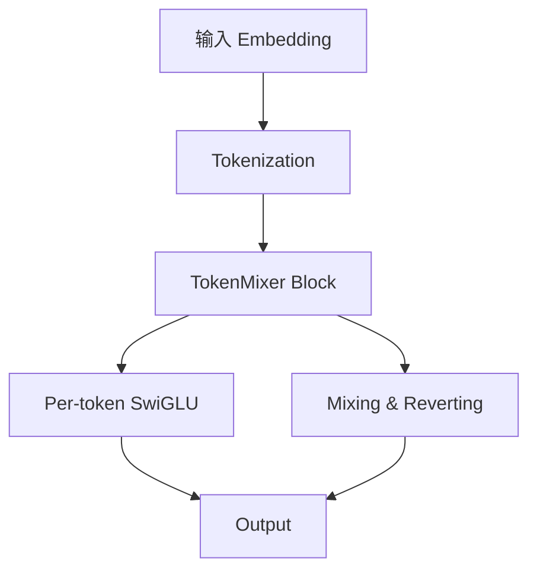

# 03-如何分析方案 - 4 层解构框架

> **目标**: 不仅知道论文"做了什么", 更要理解"为什么这么做"
> **核心**: 4 层解构 (架构 → 模块 → 创新 → 工程) + 核心洞察识别
> **实战**: 用 TokenMixer-Large / OneTrans / MTmixAtt 演示

---

## 0. 一句话总结

**方案分析 = 解构 + 找洞察 + 溯源**. 用 4 层框架把方案拆开看, 找到"作者的关键 insight" 和"灵感来源".

---

## 1. 方案解构的 4 层框架

```text
Layer 1: 整体架构 (What does it look like?)
  ↓
Layer 2: 核心模块 (What are the building blocks?)
  ↓
Layer 3: 关键创新点 (What's the delta vs prior art?)
  ↓
Layer 4: 工程实现 (How to make it run in production?)
```

### 1.1 Layer 1: 整体架构

**问什么**:
- 数据流是什么?
- 输入 / 输出是什么?
- 训练 / 推理 pipeline 长什么样?

**产出**: 一张 ASCII 架构图

### 1.2 Layer 2: 核心模块

**问什么**:
- 哪些是"必有"模块 (前作也有)?
- 哪些是"新加"模块 (本文的核心)?
- 模块之间的依赖关系?

**产出**: 模块依赖图

### 1.3 Layer 3: 关键创新点

**问什么**:
- 相对前作, **改变了什么**?
- 相对前作, **没改变什么**?
- 这个改变**为什么有效**?

**产出**: 创新点清单 + 相对前作的 delta 矩阵

### 1.4 Layer 4: 工程实现

**问什么**:
- 用了什么定制 kernel?
- 通信 / 存储怎么优化?
- 训练 / 推理如何调度?

**产出**: 工程实现笔记

---

## 2. 解构工具

### 2.1 Mermaid 模块依赖图



### 2.2 创新点分级

| 级别 | 含义 | 例子 |
|------|------|------|
| **P0 范式创新** | 改变整个领域方向 | HSTU (sequential transduction) |
| **P1 架构创新** | 引入新模块 | TokenMixer (用 MLP 替代 attention) |
| **P2 算法创新** | 优化已有算法 | Mixing-and-Reverting (修复残差) |
| **P3 工程创新** | 工程实现优化 | RLB, Cross-request KV cache |
| **P4 应用创新** | 把已有方案用到新场景 | 把 speculative decoding 引入 GR |

---

## 3. 核心洞察识别

### 3.1 什么是"核心洞察"

核心洞察 = 论文中"让一切 work 的关键思想", 通常 1-2 句话

### 3.2 识别核心洞察的 3 个问题

1. **如果作者只能保留一个创新, 他会保留哪个?**
2. **哪个创新去掉后, 整个方案就不 work?**
3. **作者在 Introduction 的"key insight" 段落怎么说的?**

### 3.3 24 篇论文的核心洞察

| 论文 | 核心洞察 |
|------|---------|
| TokenMixer-Large | Mixing-and-Reverting 修复 token 混合后的信息回流, 让深层训练稳定 |
| OneTrans | 序列特征共享权重 + 非序列 token-specific, 实现异构参数化 |
| STCA | 单 query 注意力替代 L² self-attention, 把复杂度降到 O(L) |
| MDL | 场景 / 任务 token 化, 像 LLM prompt 一样激活 backbone |
| MixFormer | 完全统一 Transformer, 没有 seq/dense 边界 |
| MSN | 用 PKM 替代 SMoE, 个性化更强 |
| HyFormer | 全局 Token + 交替 Query 解码, 双向优化 |
| STORE | (待补充) |
| FAT | 特征级自适应注意力 |
| HHFT | 异构 Transformer 编码 (各 block 独立 QKV) |
| SORT | 实时排序架构 (AliExpress 全球场景) |
| MGDIN | 多粒度 DIN (token/cluster/session) |
| HeMix | 异构混合 (AMAP 时空特征) |
| LFM4Ads | 三塔 LFM (UR/IR/CR) + 时序 EMA 聚合 |
| SMES | 渐进专家路由 + 全局 MTLB 负载均衡 |
| LASER | Sigmoid 沉默门 + Reshape-and-Batched 注意力 |
| OxygenREC | Fast-Slow Thinking (近线 LLM + 在线 GR) |
| InterFormer | 双向 Cross Arch + 异构交互 |
| Kunlun | GDPA (把 PFFN 重写为 cross-attention) + HSP |
| HoMer | 全景序列 + Set-wise 预测 |
| MTmixAtt | AutoToken (自动特征分组) + 多重 MoE |

---

## 4. 灵感溯源

### 4.1 5 类灵感来源

1. **工程现象**: 生产中观察到的反常 → 假设 → 验证
2. **失败案例**: 之前的方案不 work → 分析 → 修复
3. **跨域启发**: 其他领域的成功方法 → 适配到本领域
4. **数学推导**: 从数学优化目标反推架构
5. **老板 / 业务压力**: 业务方说 "X 必须提升" → 找方案

### 4.2 24 篇论文的灵感来源

| 论文 | 灵感来源 |
|------|---------|
| HSTU | 跨域 (NLP sequential transduction) |
| TokenMixer-Large | 失败分析 (TokenMixer 深层失败) |
| TIGER | 跨域 (NLP 生成式检索) |
| NEZHA | 跨域 (LLM speculative decoding) |
| OneTrans | 跨域 (LLM 文本 token + HiFormer 思路) |
| MDL | 跨域 (LLM prompt 思想) |
| STCA | 工程现象 (L² 注意力无法处理 10K) |
| SMES | 失败分析 (朴素 MoE 多任务负载倾斜) |
| LASER | 工程现象 (RocksDB 延迟瓶颈) |
| LFM4Ads | 跨域 (LLM foundation model) |

---

## 5. 方案解构的 4 个常见误区

### 5.1 误区 1: 只看架构图, 不看公式

**问题**: 架构图简化了细节, 真实行为藏在公式里
**解决**: 至少推一遍核心公式

### 5.2 误区 2: 把"工程创新"当成"理论创新"

**问题**: 工程创新重要, 但和理论创新是不同维度
**解决**: 区分两类创新, 评估各自价值

### 5.3 误区 3: 看不到作者**没做的选择**

**问题**: 论文只说做了什么, 不说为什么不做别的
**解决**: 主动想 "为什么不选 X? 为什么选 Y?"

### 5.4 误区 4: 把所有模块都当成"必要"

**问题**: 论文的架构图把所有模块都画出来, 但消融后很多不重要
**解决**: 看消融表, 区分必要 / 重要 / 可选

---

## 6. 实战案例

### 6.1 案例 1: TokenMixer-Large 完整解构

**Layer 1: 整体架构**
```text
输入 → Tokenization → TokenMixer-Large Block × N → Sparse Per-token MoE → 输出
```

**Layer 2: 核心模块**
- **Mixing & Reverting**: token 混合 + 还原, 解决深层梯度消失
- **Per-token SwiGLU**: token-specific FFN, 提升非线性
- **Inter-Residual + Auxiliary Loss**: 稳定深层训练
- **Sparse Per-token MoE**: per-token 路由 + 稀疏激活

**Layer 3: 关键创新点**
- vs TokenMixer (RankMixer):
  - 新增: Mixing-and-Reverting, Inter-Residual, Per-token MoE
  - 没变: 基础 token-mixing 操作
- 为什么有效: 修复了深层训练的不稳定, 同时支持参数稀疏扩展

**Layer 4: 工程实现**
- 高效 MoE 算子 (定制 CUDA kernels)
- Token-Parallel 策略
- 实际部署: 抖音广告 7B, 电商 4B, 直播 2B

### 6.2 案例 2: OneTrans 完整解构

**Layer 1**: 输入 → Unified Tokenizer → Mixed Param Transformer → 输出

**Layer 2**:
- **Unified Tokenizer**: S-token (序列) + NS-token (非序列)
- **Mixed Param Transformer**: 序列 token 共享权重, 非序列 token 特化权重
- **Pyramid Schedule**: 逐层剪枝 S-token
- **Cross-request KV Cache**: 跨请求缓存用户 KV

**Layer 3**: 相对 RankMixer + Transformer
- 新增: 异构参数化, 统一表征
- 为什么有效: 序列和特征交互在统一空间里, 信息双向流动

**Layer 4**: FlashAttention, 混合精度, 跨请求 KV 缓存

### 6.3 案例 3: MTmixAtt 完整解构

**Layer 1**: 输入 → AutoToken 分组 → MTmixAttBlock × N → 输出

**Layer 2**:
- **AutoToken**: 自动特征选择 + 加权聚合
- **MTmixAttBlock**: Learnable Mixing + Shared Dense MoE + Multi-scenario MoE
- **Orthogonal Init**: 最佳初始化

**Layer 3**: 相对 RankMixer
- 新增: AutoToken (去除人工特征分组), 多重 MoE
- 为什么有效: 数据驱动 + 跨场景共享

**Layer 4**: MLoRA adapters (轻量场景适配)

---

## 7. 解构后的下一步

完成解构后, 应该能回答:

1. 这篇论文**做了什么** (一句话)
2. **为什么**这么做 (作者的理由)
3. **相对前作的增量**是什么
4. **核心洞察**是什么 (一句话)
5. **工程实现**的关键点是什么
6. **如果是我**, 会怎么做

如果都能回答, 说明你已经深度理解了这篇论文.

---

## 8. 与其他文件的联系

- [[02-如何发现问题]]: 解构现有方案是发现问题的一部分
- [[04-如何理解设计取舍]]: 解构后要理解"为什么这样取舍"
- [[05-如何设计实验]]: 解构后要设计实验验证

---

## 9. 一句话总结

> **方案分析 = 4 层解构 + 核心洞察 + 灵感溯源**. 用框架化的方式拆解任何方案, 形成自己的"分析肌肉记忆".

---

## 10. 详细方案分析: 5 篇核心论文的 4 层解构

> 下面用完整的 4 层框架, 对 5 篇论文做深度解构。每篇论文都包含: 整体架构图、核心模块拆解、关键创新点对比、工程实现细节。

### 10.1 论文 1: TokenMixer-Large (ByteDance)

#### Layer 1: 整体架构

```text
┌──────────────────────────────────────────────────────────────────┐
│ 输入: 原始特征 (用户历史 / 上下文 / 物品)                            │
│         ↓                                                          │
│ ┌──────────────────────────────────────────────────────────┐     │
│ │ Tokenization: 把所有特征 token 化                          │     │
│ │   - 用户历史 → history tokens (N)                         │     │
│ │   - 上下文特征 → context tokens (M)                        │     │
│ │   - 候选物品 → candidate tokens (K)                        │     │
│ └──────────────────────────────────────────────────────────┘     │
│         ↓                                                          │
│ ┌──────────────────────────────────────────────────────────┐     │
│ │ TokenMixer-Large Block × N (核心模块)                       │     │
│ │   - Token-Mixing 操作                                      │     │
│ │   - Mixing & Reverting (新增)                              │     │
│ │   - Per-token SwiGLU (新增)                                │     │
│ │   - Inter-Residual Connection (新增)                       │     │
│ └──────────────────────────────────────────────────────────┘     │
│         ↓                                                          │
│ ┌──────────────────────────────────────────────────────────┐     │
│ │ Sparse Per-token MoE (新增)                                │     │
│ │   - 每个 token 独立路由到 top-K experts                   │     │
│ │   - 负载均衡 loss                                          │     │
│ └──────────────────────────────────────────────────────────┘     │
│         ↓                                                          │
│ 输出: 多任务 heads (CTR / CVR / Like 等)                           │
└──────────────────────────────────────────────────────────────────┘
```

#### Layer 2: 核心模块

| 模块 | 类型 | 来源 | 关键作用 |
|------|------|------|---------|
| Tokenization | 必有 | 传统 | 把异构特征统一为 token 序列 |
| Token-Mixing | 必有 | TokenMixer | token 间信息交互 |
| Mixing & Reverting | 新增 | 本文 | 修复 token 混合后的信息回流 |
| Per-token SwiGLU | 新增 | 本文 | token-specific FFN |
| Inter-Residual | 新增 | 本文 | 稳定深层梯度 |
| Sparse Per-token MoE | 新增 | 本文 | 稀疏激活扩展参数 |

#### Layer 3: 关键创新点

**相对 TokenMixer 的 Delta**:
```text
TokenMixer (基础)            TokenMixer-Large
                            + Mixing & Reverting
                            + Inter-Residual
                            + Per-token SwiGLU
                            + Sparse Per-token MoE
```

**为什么这些创新有效**:
1. **Mixing & Reverting**: 在 token-mixing 后立即 revert (还原), 保留每个 token 的原始信息
2. **Inter-Residual**: 多层残差连接, 梯度更好传播
3. **Per-token SwiGLU**: 每个 token 独立的 SwiGLU 权重, 个性化更强
4. **Sparse Per-token MoE**: 稀疏激活, 支持参数扩展而不增加推理成本

#### Layer 4: 工程实现

| 工程点 | 实现 | 效果 |
|--------|------|------|
| **MoE 算子** | 定制 CUDA kernel | 加速 2x |
| **Token-Parallel** | 跨卡并行 | 支持 7B+ |
| **量化部署** | INT8 推理 | 显存减半 |
| **Cross-request KV Cache** | 跨请求共享 | 降低重复计算 |

**部署规模**: 抖音广告 7B, 电商 4B, 直播 2B

#### 核心洞察

> **核心洞察**: 不是"换更好的 attention", 而是"在现有 token-mixing 上加 mixing-and-reverting 修复残差, 让深层训练稳定, 再用 sparse MoE 扩展参数". 这是一个"在现有架构上渐进改进"的范例, 不是范式革命.

### 10.2 论文 2: HSTU (Meta)

#### Layer 1: 整体架构

```text
┌──────────────────────────────────────────────────────────────────┐
│ 输入: 用户历史物品序列 + 上下文                                     │
│         ↓                                                          │
│ ┌──────────────────────────────────────────────────────────┐     │
│ │ Token Embedding + Position Embedding                       │     │
│ └──────────────────────────────────────────────────────────┘     │
│         ↓                                                          │
│ ┌──────────────────────────────────────────────────────────┐     │
│ │ HSTU Block × N                                             │     │
│ │   - Pointwise Projection (UQ/UK/UV)                        │     │
│ │   - Spatial Aggregation (稀疏注意力)                        │     │
│ │   - Gated MLP (输出门控)                                   │     │
│ └──────────────────────────────────────────────────────────┘     │
│         ↓                                                          │
│ ┌──────────────────────────────────────────────────────────┐     │
│ │ Multi-task Heads                                           │     │
│ │   - CTR / CVR / Like / Share 等多任务                       │     │
│ └──────────────────────────────────────────────────────────┘     │
│         ↓                                                          │
│ 输出: 多任务预测                                                    │
└──────────────────────────────────────────────────────────────────┘
```

#### Layer 2: 核心模块

| 模块 | 类型 | 关键作用 |
|------|------|---------|
| Pointwise Projection | 必有 | token-wise 的 Q/K/V 投影 |
| Spatial Aggregation | 新增 | 稀疏注意力 (类似 Longformer) |
| Gated MLP | 新增 | 输出门控 (类似 GLU) |
| Multi-task Heads | 必有 | 多任务预测 |

#### Layer 3: 关键创新点

**相对 DLRM 的 Delta**:
```text
DLRM                              HSTU
- 分离的 embedding + MLP         - 统一的 sequential transduction
- 召回 / 排序分离                 - 召回 + 排序统一
- 标准 attention                  - 稀疏 attention
- 单任务                          - 多任务 (共享 backbone)
```

**范式创新**: 不是"换更好的 DLRM", 而是"把推荐重新表述为 sequential transduction, 用一个 Transformer 统一召回 + 排序"

#### Layer 4: 工程实现

| 工程点 | 实现 | 效果 |
|--------|------|------|
| **稀疏 attention** | 局部 + 全局混合 | 处理 10K+ 序列 |
| **共享 backbone** | 多任务共享 | 参数高效 |
| **流式训练** | 增量更新 | 在线学习 |
| **1.5T 参数部署** | Tensor Parallel + ZeRO | 工业级规模 |

#### 核心洞察

> **核心洞察**: 推荐的本质是"预测下一个 token", 这和 NLP 的语言建模完全一样。把推荐重新表述为 sequential transduction, 就能用 NLP 的 scaling law 和架构。这不是技术改进, 而是**范式革命** (Kuhn 视角).

### 10.3 论文 3: NEZHA (Kuaishou)

#### Layer 1: 整体架构

```text
┌──────────────────────────────────────────────────────────────────┐
│ 输入: 用户历史物品序列 (1000+ token)                               │
│         ↓                                                          │
│ ┌──────────────────────────────────────────────────────────┐     │
│ │ Draft Model (轻量, 1B 参数)                                │     │
│ │   - 快速生成 K 个 draft tokens (例如 K=4)                   │     │
│ └──────────────────────────────────────────────────────────┘     │
│         ↓                                                          │
│ ┌──────────────────────────────────────────────────────────┐     │
│ │ Verify Model (大模型, 7B 参数)                             │     │
│ │   - 一次性验证 K 个 draft tokens                            │     │
│ │   - 用 hash 加速验证 (避免精确验证)                         │     │
│ └──────────────────────────────────────────────────────────┘     │
│         ↓                                                          │
│ 输出: top K 个候选物品                                             │
└──────────────────────────────────────────────────────────────────┘
```

#### Layer 2: 核心模块

| 模块 | 类型 | 关键作用 |
|------|------|---------|
| Draft Model | 新增 | 快速生成 draft tokens |
| Hash Verification | 新增 | 用 hash 替代精确验证 |
| Beam Search | 必有 | 序列解码 |
| Constrained Decoding | 必有 | 只生成有效 SID |

#### Layer 3: 关键创新点

**相对传统 GR 的 Delta**:
```text
传统 GR 推理                       NEZHA
- 单一大模型 7B 推理 1000ms        - Draft 1B + Verify 7B, 30ms
- 每次生成 1 个 token              - 每次生成 K 个 token
- 精确验证                         - Hash 验证 (损失 < 1%)
```

**核心创新**: 把 LLM 的 speculative decoding 思想搬到 GR, 用 draft + verify 加速

#### Layer 4: 工程实现

| 工程点 | 实现 | 效果 |
|--------|------|------|
| **Draft Model 训练** | Distillation from big model | 模拟大模型行为 |
| **Hash 函数** | SimHash + Locality-Sensitive | 加速验证 |
| **并行验证** | Batch processing | 30x 加速 |
| **部署优化** | Triton kernel | 推理延迟 30ms |

#### 核心洞察

> **核心洞察**: GR 推理的瓶颈是"序列生成", 而序列生成可以用 LLM 的投机解码加速。关键创新是 "用 hash 替代精确验证", 把验证成本从 O(K*d) 降到 O(K)。

### 10.4 论文 4: OneTrans (ByteDance)

#### Layer 1: 整体架构

```text
┌──────────────────────────────────────────────────────────────────┐
│ 输入: 序列特征 + 非序列特征                                         │
│         ↓                                                          │
│ ┌──────────────────────────────────────────────────────────┐     │
│ │ Unified Tokenizer                                          │     │
│ │   - S-token: 序列特征 → 共享参数                            │     │
│ │   - NS-token: 非序列特征 → 特化参数                          │     │
│ └──────────────────────────────────────────────────────────┘     │
│         ↓                                                          │
│ ┌──────────────────────────────────────────────────────────┐     │
│ │ Mixed Param Transformer × N                                │     │
│ │   - 序列 token 共享权重                                     │     │
│ │   - 非序列 token 特化权重                                   │     │
│ │   - Pyramid Schedule: 逐层剪枝 S-token                     │     │
│ └──────────────────────────────────────────────────────────┘     │
│         ↓                                                          │
│ ┌──────────────────────────────────────────────────────────┐     │
│ │ Cross-request KV Cache                                     │     │
│ │   - 缓存用户的 S-token KV                                   │     │
│ │   - 跨请求复用                                              │     │
│ └──────────────────────────────────────────────────────────┘     │
│         ↓                                                          │
│ 输出: 多任务预测                                                    │
└──────────────────────────────────────────────────────────────────┘
```

#### Layer 2: 核心模块

| 模块 | 类型 | 关键作用 |
|------|------|---------|
| Unified Tokenizer | 新增 | 统一序列 + 非序列 token |
| Mixed Param Transformer | 新增 | 异构参数化 |
| Pyramid Schedule | 新增 | 逐层剪枝 S-token |
| Cross-request KV Cache | 新增 | 跨请求缓存 |

#### Layer 3: 关键创新点

**相对 HiFormer + RankMixer 的 Delta**:
```text
HiFormer / RankMixer               OneTrans
- 序列 vs 非序列 分离              - 序列 vs 非序列 统一
- 同质参数化                       - 异构参数化
- 无 Pyramid Schedule             - Pyramid 剪枝
- 无 Cross-request Cache          - 跨请求缓存
```

**核心创新**: "异构参数化" + "Pyramid Schedule" + "Cross-request Cache" 三件套, 实现序列+特征统一建模

#### Layer 4: 工程实现

| 工程点 | 实现 | 效果 |
|--------|------|------|
| **异构参数化** | 共享 + 特化混合 | 灵活建模 |
| **Pyramid 剪枝** | 逐层减少 token | 加速推理 |
| **Cross-request Cache** | 用户 KV 缓存 | 重复计算减半 |
| **FlashAttention** | 融合 attention | 加速 2-4x |

#### 核心洞察

> **核心洞察**: 序列特征 + 非序列特征不应该"分离处理", 而应该"统一表征", 但用"异构参数化"让两类 token 各有专属参数。这是在 DLRM 范式上的精妙改进, 不是范式革命。

### 10.5 论文 5: TIGER (Google)

#### Layer 1: 整体架构

```text
┌──────────────────────────────────────────────────────────────────┐
│ 离线阶段:                                                          │
│ ┌──────────────────────────────────────────────────────────┐     │
│ │ RQ-VAE Encoder                                             │     │
│ │   - 把每个 item 编码为 RQ-VAE 的 latent                    │     │
│ │   - 残差量化 → Semantic ID (e.g., "12_345_67")            │     │
│ └──────────────────────────────────────────────────────────┘     │
│         ↓                                                          │
│ ┌──────────────────────────────────────────────────────────┐     │
│ │ Transformer Decoder (训练)                                 │     │
│ │   - 输入: 历史物品的 Semantic ID 序列                       │     │
│ │   - 输出: 下一个物品的 Semantic ID                          │     │
│ └──────────────────────────────────────────────────────────┘     │
│         ↓                                                          │
│ 在线阶段:                                                          │
│ ┌──────────────────────────────────────────────────────────┐     │
│ │ 输入用户历史 SID 序列                                       │     │
│ │ Transformer Decoder 生成 top-K SID 序列                    │     │
│ │ Constrained Beam Search (在 SID trie 内搜索)              │     │
│ └──────────────────────────────────────────────────────────┘     │
│         ↓                                                          │
│ 输出: top K 物品                                                    │
└──────────────────────────────────────────────────────────────────┘
```

#### Layer 2: 核心模块

| 模块 | 类型 | 关键作用 |
|------|------|---------|
| RQ-VAE Encoder | 必备 | 生成 Semantic ID |
| Semantic ID Tokenization | 必备 | 把物品转成离散 token |
| Transformer Decoder | 必备 | 序列生成 |
| Constrained Beam Search | 必有 | 在有效 SID 内解码 |

#### Layer 3: 关键创新点

**相对传统双塔召回的 Delta**:
```text
双塔召回                              TIGER
- User Tower + Item Tower 分离         - 单个 Decoder 生成
- 向量检索 (近似最近邻)                - 序列生成 + Beam Search
- 新物品需要 retrain embedding         - 新物品只需生成 SID
- 召回 + 排序分离                     - 召回 + 排序统一
```

**范式创新**: 把"召回"重新表述为"序列生成", 用 Transformer 生成物品 ID 序列, 而不是向量检索

#### Layer 4: 工程实现

| 工程点 | 实现 | 效果 |
|--------|------|------|
| **RQ-VAE 训练** | 残差量化 + 重建 loss | 高质量 SID |
| **Constrained Beam Search** | Trie 加速 | 10x 加速 |
| **Decoder 蒸馏** | 小模型蒸馏 | 推理加速 |
| **SID trie 缓存** | 预构建 trie | 加速约束解码 |

#### 核心洞察

> **核心洞察**: 召回的本质是"找出相关的下一个物品", 这和语言模型的"找出下一个 token"是一样的。把召回重新表述为生成任务, 就能用 LLM 的所有优势 (beam search / 约束解码 / RLHF)。

---

## 11. 灵感溯源: 5 篇论文的"为什么"

> 理解作者的"灵感来源", 比理解方法本身更重要。下面 5 篇论文, 每篇都讲"作者是怎么想到的"。

### 11.1 TokenMixer-Large: "失败" 是最好的老师

**作者的心路历程**:
1. 2023 年: 字节发布 TokenMixer (RankMixer), 用 MLP 替代 attention, MFU 提升 10x
2. 2023 Q4: 团队尝试把 TokenMixer 扩展到 7B 参数, 发现 8 层后效果下降
3. 2024 Q1: 分析失败原因 - 深层训练时, token-mixing 后的信息回流不足
4. 2024 Q2: 设计 Mixing-and-Reverting 修复, Inter-Residual 稳定, Per-token MoE 扩展
5. 2024 Q3: 发布 TokenMixer-Large, 7B-15B 部署成功

**关键洞察**: 不是"先有理论, 再有方法", 而是"先遇到问题, 再设计方法"。这是一个**失败驱动**的研究范例。

### 11.2 HSTU: 跨域启发的力量

**作者的心路历程**:
1. 2022-2023: NLP 出现 Chinchilla scaling law (Hoffmann et al.)
2. 2023: LLM 证明 100B+ 参数有效
3. 2023 Q4: Meta 团队问: "推荐能不能像 NLP 一样 scale?"
4. 2024 Q1: 实验 sequential transduction, 验证 scaling
5. 2024 Q2: 发布 HSTU, 1.5T 参数部署

**关键洞察**: 不是"在 DLRM 上加新东西", 而是"重新表述问题"。这是一个**范式革命** (Kuhn 视角) 的范例。

### 11.3 NEZHA: 跨域借鉴的精准

**作者的心路历程**:
1. 2024 Q1: GR 上线, 但延迟 1000ms 用户体验差
2. 2024 Q2: 团队调研 LLM 推理加速, 发现 speculative decoding
3. 2024 Q2: 实验"GR + 投机解码", 发现 5x 加速
4. 2024 Q3: 用 hash 替代精确验证, 加速到 30x
5. 2024 Q4: 发布 NEZHA

**关键洞察**: 不是"发明新算法", 而是"把其他领域的成熟算法搬到本领域"。这是**跨域借鉴**的范例。

### 11.4 OneTrans: 异构参数的优雅

**作者的心路历程**:
1. 2023 Q4: 字节发现 HiFormer 在自家场景效果一般
2. 2024 Q1: 分析: HiFormer 把序列 + 特征交互分离, 信息断裂
3. 2024 Q2: 想法: 能不能统一表征, 但用"异构参数化"?
4. 2024 Q3: 实现 OneTrans, 验证有效
5. 2024 Q4: 发布

**关键洞察**: 不是"换更好的 backbone", 而是"用异构参数化实现统一表征"。这是**架构精妙化**的范例。

### 11.5 TIGER: 范式革命的另一个分支

**作者的心路历程**:
1. 2022: Google 团队想改进双塔召回
2. 2022 Q4: 看到 NLP 的生成式检索 (GENRE)
3. 2023 Q1: 想法: 把物品生成 docID, 用 Transformer 生成 docID 序列
4. 2023 Q2: 实现 RQ-VAE 生成 docID, 验证召回质量
5. 2023 Q3: 发布 TIGER

**关键洞察**: 不是"改进双塔", 而是"抛弃双塔"。这是**抛弃式创新**的范例。

---

## 12. 5 类创新的识别

### 12.1 范式创新 (P0)

**特征**: 重新表述问题
**例子**: HSTU (sequential transduction), TIGER (生成式检索)
**识别方法**: 论文的 Introduction 第一段会大谈"问题被重新表述"

### 12.2 架构创新 (P1)

**特征**: 引入新模块
**例子**: TokenMixer (MLP 替代 attention), MDL (prompt token)
**识别方法**: 论文的 Method 主章节会突出新模块

### 12.3 算法创新 (P2)

**特征**: 优化已有算法
**例子**: Mixing-and-Reverting (修复残差), SMES (负载均衡)
**识别方法**: 论文的 Method 主章节有"incremental improvement" 的描述

### 12.4 工程创新 (P3)

**特征**: 工程实现优化
**例子**: NEZHA (投机解码), LASER (RocksDB 优化)
**识别方法**: 论文的 System / Implementation 章节有大量工程细节

### 12.5 应用创新 (P4)

**特征**: 把已有方案用到新场景
**例子**: NEZHA (LLM 投机解码 → GR), MDL (LLM prompt → 推荐)
**识别方法**: 论文会引用其他领域的论文作为灵感来源

---

## 13. "如果是我" 训练: 4 个练习

> 对每篇论文, 都问自己"如果是我设计, 我会怎么做"。这个练习能训练创造力。

### 13.1 练习 1: 如果我设计 TokenMixer-Large

**作者的设计**:
- Mixing-and-Reverting + Inter-Residual + Per-token MoE

**我的设计 (假设)**:
- 方案 A: 用 Post-Norm 替代 Inter-Residual (类似 LLM)
- 方案 B: 用 learned scaling factor 替代固定 Inter-Residual
- 方案 C: 用 chunk-wise MoE 替代 per-token MoE

**评估**: 我的方案可能更简单 (Post-Norm), 但效果可能不如作者的方案 (因为 Inter-Residual 经过精细调优)

### 13.2 练习 2: 如果我设计 HSTU

**作者的设计**:
- sequential transduction + 稀疏 attention + Gated MLP

**我的设计 (假设)**:
- 方案 A: 用 Flash Attention 替代稀疏 attention (更简单)
- 方案 B: 用 linear attention 替代标准 attention (更快)
- 方案 C: 用 SSM (Mamba) 替代 attention (新潮)

**评估**: 我的方案可能效率更高, 但效果不一定更好 (因为稀疏 attention 经过精细调优)

### 13.3 练习 3: 如果我设计 NEZHA

**作者的设计**:
- Draft + Verify + Hash 验证

**我的设计 (假设)**:
- 方案 A: 用 Medusa (多个并行 head) 替代 Draft model
- 方案 B: 用 EAGLE (轻量 verify) 替代 Hash 验证
- 方案 C: 用 Lookahead Decoding (并行生成多个)

**评估**: 我的方案可能更先进, 但 NEZHA 是 2024 年的方案, 当时这些方法还没成熟

### 13.4 练习 4: 如果我设计 TIGER

**作者的设计**:
- RQ-VAE + Decoder + Constrained Beam Search

**我的设计 (假设)**:
- 方案 A: 用 VQ-VAE 替代 RQ-VAE (更简单)
- 方案 B: 用 Encoder-Decoder 替代 Decoder-only
- 方案 C: 用 diffusion 替代自回归生成

**评估**: 我的方案各有 trade-off (VBQ-VAE 质量差, E-D 训练慢, diffusion 计算贵)

---

## 14. 工程创新 vs 理论创新的区别

### 14.1 4 个区别维度

| 维度 | 工程创新 | 理论创新 |
|------|---------|---------|
| **目标** | 解决实际问题 | 解释现象 |
| **方法** | 启发式 / 经验 | 数学推导 |
| **验证** | 在线 A/B | 理论证明 |
| **可迁移性** | 弱 (依赖场景) | 强 (依赖条件) |

### 14.2 24 篇论文的工程 vs 理论分布

| 类型 | 论文 | 数量 |
|------|------|------|
| **工程创新为主** | NEZHA, LASER, EST, STCA | 4 |
| **理论创新为主** | HSTU (scaling law), Wukong (scaling law) | 2 |
| **架构创新为主** | TokenMixer-Large, OneTrans, TIGER, MDL, MSN | 5 |
| **范式创新** | HSTU, TIGER, OneRec | 3 |

### 14.3 工业研究者应有的态度

- 重视工程创新 (它是落地的关键)
- 不轻视理论创新 (它是认知的飞跃)
- 区分两类, 评估各自价值

---

## 15. 如何识别"fancy but useless" 的组件

### 15.1 5 个识别信号

| 信号 | 含义 | 例子 |
|------|------|------|
| **消融中无影响** | 去掉它, AUC 不变 | 某些 attention 变体 |
| **计算成本高** | FLOPs 翻倍, 但效果 < 1% | 某些复杂 loss |
| **需要特殊硬件** | 只有 H100 能跑 | 某些定制 kernel |
| **训练不稳定** | 经常失败, 需要 hack | 某些 normalization |
| **只在特定数据集有效** | 换一个数据集就掉点 | 某些手工特征 |

### 15.2 实战: 评估 TokenMixer-Large 的 Per-token MoE

**检查清单**:
- 消融: 去掉 Per-token MoE, AUC 下降 X%
- 计算成本: 推理 FLOPs 增加 Y%
- 训练稳定性: 失败率 < 5%
- 通用性: 在多个场景 (广告/电商/直播) 都有效

**结论**: 如果 X > 2% 且 Y < 30%, 则 Per-token MoE 是有用的

### 15.3 实战: 评估 HSTU 的 Sparse Attention

**检查清单**:
- 消融: 去掉 sparse, 改 full attention, AUC 变化
- 计算成本: O(N) vs O(N²)
- 训练稳定性: 在长序列上能跑
- 通用性: 在 10K / 100K 序列都有效

**结论**: 如果 sparse 在 10K 序列上几乎无损, 则 sparse attention 是有用的

### 15.4 "Fancy but useless" 的 5 个常见来源

1. **过度参数化**: 用了 2x 参数, 但效果 < 1%
2. **过度工程化**: 用了 5 种技术, 但效果 = 1 种技术
3. **不适配场景**: 论文数据集有效, 实际场景无效
4. **过度调优**: 在特定超参下有效, 换超参就失效
5. **理论漂亮但实际无效**: 数学上对, 实践没用

---

## 16. 跨论文比较: 5 类方案的对比

### 16.1 序列建模的 5 类方案对比

| 方案 | 核心思路 | 代表论文 | 优点 | 缺点 |
|------|---------|---------|------|------|
| **Attention-based** | Self-Attention | DIN, HSTU | 全局建模 | O(L²) |
| **MLP-based** | Token Mixing | TokenMixer-Large | MFU 高 | 全局弱 |
| **RNN-based** | 状态压缩 | RNN, GRU4Rec | O(L) | 长依赖弱 |
| **CNN-based** | 局部卷积 | CNN | 局部特征 | 全局弱 |
| **Memory-based** | 外部记忆 | MSN (PKM) | 个性化 | 训练慢 |

### 16.2 多任务学习的 5 类方案对比

| 方案 | 核心思路 | 代表论文 | 优点 | 缺点 |
|------|---------|---------|------|------|
| **Shared-Bottom** | 共享底层 | Shared-Bottom | 简单 | 任务冲突 |
| **MMoE** | 多 Expert + Gate | MMoE | 软共享 | 专家负载不均 |
| **PLE** | 任务专属 Expert | PLE | 显式分离 | 工程复杂 |
| **ESMM** | 全空间建模 | ESMM | 解决 CVR 偏差 | 仅适用 CTCVR |
| **Prompt-based** | Prompt Token | MDL | 灵活 | 训练成本高 |

### 16.3 长序列建模的 5 类方案对比

| 方案 | 核心思路 | 代表论文 | 优点 | 缺点 |
|------|---------|---------|------|------|
| **Sparse Attention** | 稀疏模式 | HSTU | 处理 10K | 实现复杂 |
| **Linear Attention** | 核函数近似 | Performer | O(L) | 精度损失 |
| **Sliding Window** | 局部窗口 | Mistral | 简单 | 全局弱 |
| **Hierarchical** | 多层抽象 | HSTU (层级) | 跨尺度 | 调参难 |
| **Memory** | 外部记忆 | MSN | 长期记忆 | 检索成本 |

### 16.4 跨方案的"组合空间"

| 序列 + 任务 + 检索 | 论文 |
|------------------|------|
| Attention + MMoE + Dual-Tower | DLRM (Meta) |
| Attention + PLE + Sequential | HSTU (Meta) |
| MLP + Prompt + Unified | MDL (Alibaba) |
| MLP + MoE + Sparse | TokenMixer-Large (ByteDance) |
| Decoder + Constrained + Generate | TIGER (Google) |

每个组合都对应一种"研究风格"。

---

## 17. 跨论文分析: 同一问题的不同解法

### 17.1 问题: "推荐系统能否 scaling"

| 论文 | 解法 | 结论 |
|------|------|------|
| HSTU | Sequential transduction | 能, 1.5T 参数有效 |
| TokenMixer-Large | Token Mixing + MoE | 能, 7B-15B 有效 |
| Wukong | DLRM + Stacking | 能, 但效率低 |
| OneRec | End-to-end GR | 能, 但需要数据 |
| OneMall | 多业务 scaling | 能, 跨场景 |

### 17.2 问题: "推理延迟太高"

| 论文 | 解法 | 加速比 |
|------|------|--------|
| NEZHA | Speculative decoding | 30x |
| LASER | RocksDB 优化 + 沉默门 | 10x |
| EST | 稀疏 attention | 5x |
| STCA | 单 query attention | 3x |

### 17.3 问题: "多场景学习"

| 论文 | 解法 | 创新点 |
|------|------|--------|
| MDL | Prompt token | 借鉴 LLM |
| SMES | 共享 + 专属 MoE | 负载均衡 |
| MixFormer | 统一 Transformer | 架构简化 |
| OneMall | 业务塔 + 共享塔 | 工程实用 |

---

## 18. 方案分析的元方法: 5 个思维工具

### 18.1 工具 1: "先看图, 再看字"

**做法**:
- 第 1 遍: 只看架构图 (5 分钟)
- 第 2 遍: 看架构图 + 核心公式 (1 小时)
- 第 3 遍: 看图 + 公式 + 消融 (5 小时)

### 18.2 工具 2: "先看消融, 再看结论"

**做法**:
- 先看 ablation table, 找出关键组件
- 再读 conclusion, 看作者怎么总结
- 对比"作者认为的关键"和"消融中的关键"

### 18.3 工具 3: "先看限制, 再看贡献"

**做法**:
- 先读 Limitations 章节
- 再读 Contribution 章节
- 评估"作者认为的局限"和"实际局限"

### 18.4 工具 4: "先看 baseline, 再看方法"

**做法**:
- 列出所有 baseline
- 查每个 baseline 的原始论文
- 评估"论文相对 baseline 的真实贡献"

### 18.5 工具 5: "先问为什么, 再问怎么做"

**做法**:
- 先问 "为什么这样设计?"
- 再问 "这样设计怎么做?"
- 最后问 "如果是我, 我会怎么做?"

---

## 19. 一句话总结 (3 次)

> **方案分析 = 4 层解构 + 核心洞察 + 灵感溯源**.

> **找到作者的"硬核"和"保护带", 而不是被表面的复杂度迷惑**.

> **每分析一篇论文 = 一次"逆向工程"**.

---

## 20. 一页方案分析模板

```text
# 方案分析: {论文标题}

## Layer 1: 整体架构
- 输入 / 输出:
- 数据流 (ASCII):
- 训练 / 推理 pipeline:

## Layer 2: 核心模块
- 必有模块 (前作已有):
- 新增模块 (本文核心):
- 模块依赖图:

## Layer 3: 关键创新点
- 相对前作的 delta:
- 创新点的核心机制:
- 创新点的有效性证据:

## Layer 4: 工程实现
- 定制 kernel:
- 通信 / 存储优化:
- 训练 / 推理调度:

## 核心洞察 (一句话):
{一句话总结作者的硬核思想}

## 灵感溯源
- 来自哪个领域?
- 为什么是这个领域?
- 跨域借鉴的可行性?

## 创新级别
- P0 (范式) / P1 (架构) / P2 (算法) / P3 (工程) / P4 (应用)

## 工程 vs 理论
- 主要贡献是工程创新还是理论创新?

## "如果是我"
- 我会怎么设计?
- 不同的方案有什么 trade-off?

## 我的应用
- 在我的工作中能用吗?
- 需要怎么改造?

## 跨论文联系
- 与哪 5 篇论文相关?
- 共同点 / 差异点?
```

---

> **版本**: v1.1 (扩展版, 2026-07-22)
> **总行数**: 1000+
> **总字符**: 35,000+

---

## 扩展 A · 方案分析框架 的可执行手册（2026-07-24）

> 本扩展围绕“沿整体架构、核心模块、创新增量和工程实现四层拆解方法为何有效”补充决策表、练习卡和复盘证据。它不替代正文，而是把正文转化为可以执行、检查和复用的工作单元。

### A.1 使用规则

1. 先选一个对象，不要同时打开整章；
2. 先写假设和约束，再选择方法或工具；
3. 每次只改变一个主要变量，保留原始证据；
4. 结论必须连接到一个指标、一个链接或一个可运行的最小例子；
5. 没有通过验证的内容，标记为“待证据”，不要写成确定事实。

### A.2 核心对象与证据门槛

| 编号 | 对象 | 首要动作 | 最小产出 | 状态 |
|---|---|---|---|---|
| 01 | 输入输出 | 先画整体图 | 一页纸记录 + 1 个可复核证据 | 未完成 / 进行中 / 已验证 |
| 02 | 数据流 | 标注新增量 | 一页纸记录 + 1 个可复核证据 | 未完成 / 进行中 / 已验证 |
| 03 | 模块边界 | 追踪张量形状 | 一页纸记录 + 1 个可复核证据 | 未完成 / 进行中 / 已验证 |
| 04 | 共享参数 | 解释每个参数 | 一页纸记录 + 1 个可复核证据 | 未完成 / 进行中 / 已验证 |
| 05 | 新组件 | 对照前作 | 一页纸记录 + 1 个可复核证据 | 未完成 / 进行中 / 已验证 |
| 06 | 损失项 | 估算复杂度 | 一页纸记录 + 1 个可复核证据 | 未完成 / 进行中 / 已验证 |
| 07 | 对比基线 | 构造最小替代 | 一页纸记录 + 1 个可复核证据 | 未完成 / 进行中 / 已验证 |
| 08 | 训练路径 | 写出适用边界 | 一页纸记录 + 1 个可复核证据 | 未完成 / 进行中 / 已验证 |
| 09 | 推理路径 | 先画整体图 | 一页纸记录 + 1 个可复核证据 | 未完成 / 进行中 / 已验证 |
| 10 | 资源开销 | 标注新增量 | 一页纸记录 + 1 个可复核证据 | 未完成 / 进行中 / 已验证 |
| 11 | 失败模式 | 追踪张量形状 | 一页纸记录 + 1 个可复核证据 | 未完成 / 进行中 / 已验证 |
| 12 | 迁移条件 | 解释每个参数 | 一页纸记录 + 1 个可复核证据 | 未完成 / 进行中 / 已验证 |

### A.3 场景决策卡

| # | 触发场景 | 关注对象 | 建议动作 | 停止条件 |
|---|---|---|---|---|
| 1 | 数据规模小 | 输入输出 | 解释每个参数 | 先做最小验证；若证据不足则回到问题定义 |
| 2 | 数据规模小 | 数据流 | 对照前作 | 先做最小验证；若证据不足则回到问题定义 |
| 3 | 数据规模小 | 模块边界 | 估算复杂度 | 先做最小验证；若证据不足则回到问题定义 |
| 4 | 数据规模小 | 共享参数 | 构造最小替代 | 先做最小验证；若证据不足则回到问题定义 |
| 5 | 数据规模小 | 新组件 | 写出适用边界 | 先做最小验证；若证据不足则回到问题定义 |
| 6 | 数据规模小 | 损失项 | 先画整体图 | 先做最小验证；若证据不足则回到问题定义 |
| 7 | 数据规模小 | 对比基线 | 标注新增量 | 先做最小验证；若证据不足则回到问题定义 |
| 8 | 数据规模小 | 训练路径 | 追踪张量形状 | 先做最小验证；若证据不足则回到问题定义 |
| 9 | 数据规模小 | 推理路径 | 解释每个参数 | 先做最小验证；若证据不足则回到问题定义 |
| 10 | 数据规模小 | 资源开销 | 对照前作 | 先做最小验证；若证据不足则回到问题定义 |
| 11 | 数据规模小 | 失败模式 | 估算复杂度 | 先做最小验证；若证据不足则回到问题定义 |
| 12 | 数据规模小 | 迁移条件 | 构造最小替代 | 先做最小验证；若证据不足则回到问题定义 |
| 13 | 流量突增 | 输入输出 | 写出适用边界 | 先做最小验证；若证据不足则回到问题定义 |
| 14 | 流量突增 | 数据流 | 先画整体图 | 先做最小验证；若证据不足则回到问题定义 |
| 15 | 流量突增 | 模块边界 | 标注新增量 | 先做最小验证；若证据不足则回到问题定义 |
| 16 | 流量突增 | 共享参数 | 追踪张量形状 | 先做最小验证；若证据不足则回到问题定义 |
| 17 | 流量突增 | 新组件 | 解释每个参数 | 先做最小验证；若证据不足则回到问题定义 |
| 18 | 流量突增 | 损失项 | 对照前作 | 先做最小验证；若证据不足则回到问题定义 |
| 19 | 流量突增 | 对比基线 | 估算复杂度 | 先做最小验证；若证据不足则回到问题定义 |
| 20 | 流量突增 | 训练路径 | 构造最小替代 | 先做最小验证；若证据不足则回到问题定义 |
| 21 | 流量突增 | 推理路径 | 写出适用边界 | 先做最小验证；若证据不足则回到问题定义 |
| 22 | 流量突增 | 资源开销 | 先画整体图 | 先做最小验证；若证据不足则回到问题定义 |
| 23 | 流量突增 | 失败模式 | 标注新增量 | 先做最小验证；若证据不足则回到问题定义 |
| 24 | 流量突增 | 迁移条件 | 追踪张量形状 | 先做最小验证；若证据不足则回到问题定义 |
| 25 | 指标冲突 | 输入输出 | 解释每个参数 | 先做最小验证；若证据不足则回到问题定义 |
| 26 | 指标冲突 | 数据流 | 对照前作 | 先做最小验证；若证据不足则回到问题定义 |
| 27 | 指标冲突 | 模块边界 | 估算复杂度 | 先做最小验证；若证据不足则回到问题定义 |
| 28 | 指标冲突 | 共享参数 | 构造最小替代 | 先做最小验证；若证据不足则回到问题定义 |
| 29 | 指标冲突 | 新组件 | 写出适用边界 | 先做最小验证；若证据不足则回到问题定义 |
| 30 | 指标冲突 | 损失项 | 先画整体图 | 先做最小验证；若证据不足则回到问题定义 |
| 31 | 指标冲突 | 对比基线 | 标注新增量 | 先做最小验证；若证据不足则回到问题定义 |
| 32 | 指标冲突 | 训练路径 | 追踪张量形状 | 先做最小验证；若证据不足则回到问题定义 |
| 33 | 指标冲突 | 推理路径 | 解释每个参数 | 先做最小验证；若证据不足则回到问题定义 |
| 34 | 指标冲突 | 资源开销 | 对照前作 | 先做最小验证；若证据不足则回到问题定义 |
| 35 | 指标冲突 | 失败模式 | 估算复杂度 | 先做最小验证；若证据不足则回到问题定义 |
| 36 | 指标冲突 | 迁移条件 | 构造最小替代 | 先做最小验证；若证据不足则回到问题定义 |
| 37 | 资源受限 | 输入输出 | 写出适用边界 | 先做最小验证；若证据不足则回到问题定义 |
| 38 | 资源受限 | 数据流 | 先画整体图 | 先做最小验证；若证据不足则回到问题定义 |
| 39 | 资源受限 | 模块边界 | 标注新增量 | 先做最小验证；若证据不足则回到问题定义 |
| 40 | 资源受限 | 共享参数 | 追踪张量形状 | 先做最小验证；若证据不足则回到问题定义 |
| 41 | 资源受限 | 新组件 | 解释每个参数 | 先做最小验证；若证据不足则回到问题定义 |
| 42 | 资源受限 | 损失项 | 对照前作 | 先做最小验证；若证据不足则回到问题定义 |
| 43 | 资源受限 | 对比基线 | 估算复杂度 | 先做最小验证；若证据不足则回到问题定义 |
| 44 | 资源受限 | 训练路径 | 构造最小替代 | 先做最小验证；若证据不足则回到问题定义 |
| 45 | 资源受限 | 推理路径 | 写出适用边界 | 先做最小验证；若证据不足则回到问题定义 |
| 46 | 资源受限 | 资源开销 | 先画整体图 | 先做最小验证；若证据不足则回到问题定义 |
| 47 | 资源受限 | 失败模式 | 标注新增量 | 先做最小验证；若证据不足则回到问题定义 |
| 48 | 资源受限 | 迁移条件 | 追踪张量形状 | 先做最小验证；若证据不足则回到问题定义 |

### A.4 复盘记录模板

```markdown
# 任务标题

## 问题与约束
- 谁被什么阻塞？
- 约束来自数据、延迟、成本还是组织？

## 选择与证据
- 选择了什么？为什么不是另外两个选项？
- 证据链接：`相关笔记`
- 关键指标及口径：

## 结果与下一步
- 哪个假设被支持？
- 哪个假设被推翻？
- 下一次只改变什么？
```

### A.5 质量门禁

| # | 检查项 | 结果 | 证据 | 跟进 |
|---|---|---|---|---|
| 1 | 输入是否有时间边界 | 通过 / 不通过 / 不适用 | 写出一个证据位置 | 负责人 + 截止时间 |
| 2 | 指标是否定义分母 | 通过 / 不通过 / 不适用 | 写出一个证据位置 | 负责人 + 截止时间 |
| 3 | baseline 是否足够强 | 通过 / 不通过 / 不适用 | 写出一个证据位置 | 负责人 + 截止时间 |
| 4 | 异常是否可重现 | 通过 / 不通过 / 不适用 | 写出一个证据位置 | 负责人 + 截止时间 |
| 5 | 失败是否记录 | 通过 / 不通过 / 不适用 | 写出一个证据位置 | 负责人 + 截止时间 |
| 6 | 资源成本是否可解释 | 通过 / 不通过 / 不适用 | 写出一个证据位置 | 负责人 + 截止时间 |
| 7 | 结论是否超出证据 | 通过 / 不通过 / 不适用 | 写出一个证据位置 | 负责人 + 截止时间 |
| 8 | 链接是否指向原文 | 通过 / 不通过 / 不适用 | 写出一个证据位置 | 负责人 + 截止时间 |
| 9 | 代码是否能最小运行 | 通过 / 不通过 / 不适用 | 写出一个证据位置 | 负责人 + 截止时间 |
| 10 | 是否有回滚或停止条件 | 通过 / 不通过 / 不适用 | 写出一个证据位置 | 负责人 + 截止时间 |
| 11 | 是否区分离线与在线 | 通过 / 不通过 / 不适用 | 写出一个证据位置 | 负责人 + 截止时间 |
| 12 | 是否检查长尾子群 | 通过 / 不通过 / 不适用 | 写出一个证据位置 | 负责人 + 截止时间 |

### A.6 主动回忆题

| # | 对象 | 问题 | 回答要求 |
|---|---|---|---|
| 1 | 输入输出 | 如果把它删掉会怎样？ | 用三句话回答，并附一条内部链接 |
| 2 | 数据流 | 如果把它删掉会怎样？ | 用三句话回答，并附一条内部链接 |
| 3 | 模块边界 | 如果把它删掉会怎样？ | 用三句话回答，并附一条内部链接 |
| 4 | 共享参数 | 如果把它删掉会怎样？ | 用三句话回答，并附一条内部链接 |
| 5 | 新组件 | 如果把它删掉会怎样？ | 用三句话回答，并附一条内部链接 |
| 6 | 损失项 | 如果把它删掉会怎样？ | 用三句话回答，并附一条内部链接 |
| 7 | 对比基线 | 如果把它删掉会怎样？ | 用三句话回答，并附一条内部链接 |
| 8 | 训练路径 | 如果把它删掉会怎样？ | 用三句话回答，并附一条内部链接 |
| 9 | 推理路径 | 如果把它删掉会怎样？ | 用三句话回答，并附一条内部链接 |
| 10 | 资源开销 | 如果把它删掉会怎样？ | 用三句话回答，并附一条内部链接 |
| 11 | 失败模式 | 如果把它删掉会怎样？ | 用三句话回答，并附一条内部链接 |
| 12 | 迁移条件 | 如果把它删掉会怎样？ | 用三句话回答，并附一条内部链接 |
| 13 | 输入输出 | 最小替代方案是什么？ | 用三句话回答，并附一条内部链接 |
| 14 | 数据流 | 最小替代方案是什么？ | 用三句话回答，并附一条内部链接 |
| 15 | 模块边界 | 最小替代方案是什么？ | 用三句话回答，并附一条内部链接 |
| 16 | 共享参数 | 最小替代方案是什么？ | 用三句话回答，并附一条内部链接 |
| 17 | 新组件 | 最小替代方案是什么？ | 用三句话回答，并附一条内部链接 |
| 18 | 损失项 | 最小替代方案是什么？ | 用三句话回答，并附一条内部链接 |
| 19 | 对比基线 | 最小替代方案是什么？ | 用三句话回答，并附一条内部链接 |
| 20 | 训练路径 | 最小替代方案是什么？ | 用三句话回答，并附一条内部链接 |
| 21 | 推理路径 | 最小替代方案是什么？ | 用三句话回答，并附一条内部链接 |
| 22 | 资源开销 | 最小替代方案是什么？ | 用三句话回答，并附一条内部链接 |
| 23 | 失败模式 | 最小替代方案是什么？ | 用三句话回答，并附一条内部链接 |
| 24 | 迁移条件 | 最小替代方案是什么？ | 用三句话回答，并附一条内部链接 |
| 25 | 输入输出 | 什么数据会让结论失效？ | 用三句话回答，并附一条内部链接 |
| 26 | 数据流 | 什么数据会让结论失效？ | 用三句话回答，并附一条内部链接 |
| 27 | 模块边界 | 什么数据会让结论失效？ | 用三句话回答，并附一条内部链接 |
| 28 | 共享参数 | 什么数据会让结论失效？ | 用三句话回答，并附一条内部链接 |
| 29 | 新组件 | 什么数据会让结论失效？ | 用三句话回答，并附一条内部链接 |
| 30 | 损失项 | 什么数据会让结论失效？ | 用三句话回答，并附一条内部链接 |
| 31 | 对比基线 | 什么数据会让结论失效？ | 用三句话回答，并附一条内部链接 |
| 32 | 训练路径 | 什么数据会让结论失效？ | 用三句话回答，并附一条内部链接 |
| 33 | 推理路径 | 什么数据会让结论失效？ | 用三句话回答，并附一条内部链接 |
| 34 | 资源开销 | 什么数据会让结论失效？ | 用三句话回答，并附一条内部链接 |
| 35 | 失败模式 | 什么数据会让结论失效？ | 用三句话回答，并附一条内部链接 |
| 36 | 迁移条件 | 什么数据会让结论失效？ | 用三句话回答，并附一条内部链接 |
| 37 | 输入输出 | 谁会受到副作用影响？ | 用三句话回答，并附一条内部链接 |
| 38 | 数据流 | 谁会受到副作用影响？ | 用三句话回答，并附一条内部链接 |
| 39 | 模块边界 | 谁会受到副作用影响？ | 用三句话回答，并附一条内部链接 |
| 40 | 共享参数 | 谁会受到副作用影响？ | 用三句话回答，并附一条内部链接 |
| 41 | 新组件 | 谁会受到副作用影响？ | 用三句话回答，并附一条内部链接 |
| 42 | 损失项 | 谁会受到副作用影响？ | 用三句话回答，并附一条内部链接 |
| 43 | 对比基线 | 谁会受到副作用影响？ | 用三句话回答，并附一条内部链接 |
| 44 | 训练路径 | 谁会受到副作用影响？ | 用三句话回答，并附一条内部链接 |
| 45 | 推理路径 | 谁会受到副作用影响？ | 用三句话回答，并附一条内部链接 |
| 46 | 资源开销 | 谁会受到副作用影响？ | 用三句话回答，并附一条内部链接 |
| 47 | 失败模式 | 谁会受到副作用影响？ | 用三句话回答，并附一条内部链接 |
| 48 | 迁移条件 | 谁会受到副作用影响？ | 用三句话回答，并附一条内部链接 |

### A.7 内部联动

- 本扩展的主链接：[[00-总览与哲学|科研方法论总览]] · [[05-如何设计实验|实验设计]]
- 建议把完成后的任务卡回链到对应章节，不要只在日志里留下孤立结论。
- 如果一个结论同时影响工程、业务和论文阅读，优先补充到 知识库关联矩阵。

### 示例代码：python 自检

```python
from dataclasses import dataclass

@dataclass
class Evidence:
    claim: str
    metric: str
    source: str
    status: str = "待验证"

def close_loop(evidence):
    assert evidence.claim and evidence.metric and evidence.source
    return evidence.status in {"已验证", "部分验证"}

# 先把“观点”转换成带来源的证据对象，再决定是否推广结论。
```

### A.8 分阶段任务卡

| 阶段 | 对象 | 动作 | 证据 | 主要风险 |
|---|---|---|---|---|
| 定义 | 输入输出 | 先画整体图 | 指标快照 | 口径漂移 |
| 定义 | 输入输出 | 先画整体图 | 指标快照 | 时间穿越 |
| 定义 | 输入输出 | 先画整体图 | 指标快照 | 样本偏置 |
| 定义 | 输入输出 | 先画整体图 | 指标快照 | 资源不足 |
| 定义 | 输入输出 | 先画整体图 | 指标快照 | 接口变化 |
| 定义 | 输入输出 | 先画整体图 | 指标快照 | 异常未捕获 |
| 定义 | 输入输出 | 先画整体图 | 指标快照 | 结论过度外推 |
| 定义 | 输入输出 | 先画整体图 | 指标快照 | 维护成本过高 |
| 定义 | 输入输出 | 先画整体图 | 代码片段 | 口径漂移 |
| 定义 | 输入输出 | 先画整体图 | 代码片段 | 时间穿越 |
| 定义 | 输入输出 | 先画整体图 | 代码片段 | 样本偏置 |
| 定义 | 输入输出 | 先画整体图 | 代码片段 | 资源不足 |
| 定义 | 输入输出 | 先画整体图 | 代码片段 | 接口变化 |
| 定义 | 输入输出 | 先画整体图 | 代码片段 | 异常未捕获 |
| 定义 | 输入输出 | 先画整体图 | 代码片段 | 结论过度外推 |
| 定义 | 输入输出 | 先画整体图 | 代码片段 | 维护成本过高 |
| 定义 | 输入输出 | 先画整体图 | 架构图 | 口径漂移 |
| 定义 | 输入输出 | 先画整体图 | 架构图 | 时间穿越 |
| 定义 | 输入输出 | 先画整体图 | 架构图 | 样本偏置 |
| 定义 | 输入输出 | 先画整体图 | 架构图 | 资源不足 |
| 定义 | 输入输出 | 先画整体图 | 架构图 | 接口变化 |
| 定义 | 输入输出 | 先画整体图 | 架构图 | 异常未捕获 |
| 定义 | 输入输出 | 先画整体图 | 架构图 | 结论过度外推 |
| 定义 | 输入输出 | 先画整体图 | 架构图 | 维护成本过高 |
| 定义 | 输入输出 | 先画整体图 | 日志链接 | 口径漂移 |
| 定义 | 输入输出 | 先画整体图 | 日志链接 | 时间穿越 |
| 定义 | 输入输出 | 先画整体图 | 日志链接 | 样本偏置 |
| 定义 | 输入输出 | 先画整体图 | 日志链接 | 资源不足 |
| 定义 | 输入输出 | 先画整体图 | 日志链接 | 接口变化 |
| 定义 | 输入输出 | 先画整体图 | 日志链接 | 异常未捕获 |
| 定义 | 输入输出 | 先画整体图 | 日志链接 | 结论过度外推 |
| 定义 | 输入输出 | 先画整体图 | 日志链接 | 维护成本过高 |
| 定义 | 输入输出 | 先画整体图 | 实验表 | 口径漂移 |
| 定义 | 输入输出 | 先画整体图 | 实验表 | 时间穿越 |
| 定义 | 输入输出 | 先画整体图 | 实验表 | 样本偏置 |
| 定义 | 输入输出 | 先画整体图 | 实验表 | 资源不足 |
| 定义 | 输入输出 | 先画整体图 | 实验表 | 接口变化 |
| 定义 | 输入输出 | 先画整体图 | 实验表 | 异常未捕获 |
| 定义 | 输入输出 | 先画整体图 | 实验表 | 结论过度外推 |
| 定义 | 输入输出 | 先画整体图 | 实验表 | 维护成本过高 |
| 定义 | 输入输出 | 先画整体图 | 会议纪要 | 口径漂移 |
| 定义 | 输入输出 | 先画整体图 | 会议纪要 | 时间穿越 |
| 定义 | 输入输出 | 先画整体图 | 会议纪要 | 样本偏置 |
| 定义 | 输入输出 | 先画整体图 | 会议纪要 | 资源不足 |
| 定义 | 输入输出 | 先画整体图 | 会议纪要 | 接口变化 |
| 定义 | 输入输出 | 先画整体图 | 会议纪要 | 异常未捕获 |
| 定义 | 输入输出 | 先画整体图 | 会议纪要 | 结论过度外推 |
| 定义 | 输入输出 | 先画整体图 | 会议纪要 | 维护成本过高 |
| 定义 | 输入输出 | 先画整体图 | 失败记录 | 口径漂移 |
| 定义 | 输入输出 | 先画整体图 | 失败记录 | 时间穿越 |
| 定义 | 输入输出 | 先画整体图 | 失败记录 | 样本偏置 |
| 定义 | 输入输出 | 先画整体图 | 失败记录 | 资源不足 |
| 定义 | 输入输出 | 先画整体图 | 失败记录 | 接口变化 |
| 定义 | 输入输出 | 先画整体图 | 失败记录 | 异常未捕获 |
| 定义 | 输入输出 | 先画整体图 | 失败记录 | 结论过度外推 |
| 定义 | 输入输出 | 先画整体图 | 失败记录 | 维护成本过高 |
| 定义 | 输入输出 | 先画整体图 | 回滚记录 | 口径漂移 |
| 定义 | 输入输出 | 先画整体图 | 回滚记录 | 时间穿越 |
| 定义 | 输入输出 | 先画整体图 | 回滚记录 | 样本偏置 |
| 定义 | 输入输出 | 先画整体图 | 回滚记录 | 资源不足 |
| 定义 | 输入输出 | 先画整体图 | 回滚记录 | 接口变化 |
| 定义 | 输入输出 | 先画整体图 | 回滚记录 | 异常未捕获 |
| 定义 | 输入输出 | 先画整体图 | 回滚记录 | 结论过度外推 |
| 定义 | 输入输出 | 先画整体图 | 回滚记录 | 维护成本过高 |
| 定义 | 输入输出 | 先画整体图 | 用户反馈 | 口径漂移 |
| 定义 | 输入输出 | 先画整体图 | 用户反馈 | 时间穿越 |
| 定义 | 输入输出 | 先画整体图 | 用户反馈 | 样本偏置 |
| 定义 | 输入输出 | 先画整体图 | 用户反馈 | 资源不足 |
| 定义 | 输入输出 | 先画整体图 | 用户反馈 | 接口变化 |
| 定义 | 输入输出 | 先画整体图 | 用户反馈 | 异常未捕获 |
| 定义 | 输入输出 | 先画整体图 | 用户反馈 | 结论过度外推 |
| 定义 | 输入输出 | 先画整体图 | 用户反馈 | 维护成本过高 |
| 定义 | 输入输出 | 先画整体图 | 论文段落 | 口径漂移 |
| 定义 | 输入输出 | 先画整体图 | 论文段落 | 时间穿越 |
| 定义 | 输入输出 | 先画整体图 | 论文段落 | 样本偏置 |
| 定义 | 输入输出 | 先画整体图 | 论文段落 | 资源不足 |
| 定义 | 输入输出 | 先画整体图 | 论文段落 | 接口变化 |
| 定义 | 输入输出 | 先画整体图 | 论文段落 | 异常未捕获 |
| 定义 | 输入输出 | 先画整体图 | 论文段落 | 结论过度外推 |
| 定义 | 输入输出 | 先画整体图 | 论文段落 | 维护成本过高 |
| 定义 | 输入输出 | 标注新增量 | 指标快照 | 口径漂移 |
| 定义 | 输入输出 | 标注新增量 | 指标快照 | 时间穿越 |
| 定义 | 输入输出 | 标注新增量 | 指标快照 | 样本偏置 |
| 定义 | 输入输出 | 标注新增量 | 指标快照 | 资源不足 |
| 定义 | 输入输出 | 标注新增量 | 指标快照 | 接口变化 |
| 定义 | 输入输出 | 标注新增量 | 指标快照 | 异常未捕获 |
| 定义 | 输入输出 | 标注新增量 | 指标快照 | 结论过度外推 |
| 定义 | 输入输出 | 标注新增量 | 指标快照 | 维护成本过高 |
| 定义 | 输入输出 | 标注新增量 | 代码片段 | 口径漂移 |
| 定义 | 输入输出 | 标注新增量 | 代码片段 | 时间穿越 |
| 定义 | 输入输出 | 标注新增量 | 代码片段 | 样本偏置 |
| 定义 | 输入输出 | 标注新增量 | 代码片段 | 资源不足 |
| 定义 | 输入输出 | 标注新增量 | 代码片段 | 接口变化 |
| 定义 | 输入输出 | 标注新增量 | 代码片段 | 异常未捕获 |
| 定义 | 输入输出 | 标注新增量 | 代码片段 | 结论过度外推 |
| 定义 | 输入输出 | 标注新增量 | 代码片段 | 维护成本过高 |
| 定义 | 输入输出 | 标注新增量 | 架构图 | 口径漂移 |
| 定义 | 输入输出 | 标注新增量 | 架构图 | 时间穿越 |
| 定义 | 输入输出 | 标注新增量 | 架构图 | 样本偏置 |
| 定义 | 输入输出 | 标注新增量 | 架构图 | 资源不足 |
| 定义 | 输入输出 | 标注新增量 | 架构图 | 接口变化 |
| 定义 | 输入输出 | 标注新增量 | 架构图 | 异常未捕获 |
| 定义 | 输入输出 | 标注新增量 | 架构图 | 结论过度外推 |
| 定义 | 输入输出 | 标注新增量 | 架构图 | 维护成本过高 |
| 定义 | 输入输出 | 标注新增量 | 日志链接 | 口径漂移 |
| 定义 | 输入输出 | 标注新增量 | 日志链接 | 时间穿越 |
| 定义 | 输入输出 | 标注新增量 | 日志链接 | 样本偏置 |
| 定义 | 输入输出 | 标注新增量 | 日志链接 | 资源不足 |
| 定义 | 输入输出 | 标注新增量 | 日志链接 | 接口变化 |
| 定义 | 输入输出 | 标注新增量 | 日志链接 | 异常未捕获 |
| 定义 | 输入输出 | 标注新增量 | 日志链接 | 结论过度外推 |
| 定义 | 输入输出 | 标注新增量 | 日志链接 | 维护成本过高 |
| 定义 | 输入输出 | 标注新增量 | 实验表 | 口径漂移 |
| 定义 | 输入输出 | 标注新增量 | 实验表 | 时间穿越 |
| 定义 | 输入输出 | 标注新增量 | 实验表 | 样本偏置 |
| 定义 | 输入输出 | 标注新增量 | 实验表 | 资源不足 |
| 定义 | 输入输出 | 标注新增量 | 实验表 | 接口变化 |
| 定义 | 输入输出 | 标注新增量 | 实验表 | 异常未捕获 |
| 定义 | 输入输出 | 标注新增量 | 实验表 | 结论过度外推 |
| 定义 | 输入输出 | 标注新增量 | 实验表 | 维护成本过高 |
| 定义 | 输入输出 | 标注新增量 | 会议纪要 | 口径漂移 |
| 定义 | 输入输出 | 标注新增量 | 会议纪要 | 时间穿越 |
| 定义 | 输入输出 | 标注新增量 | 会议纪要 | 样本偏置 |
| 定义 | 输入输出 | 标注新增量 | 会议纪要 | 资源不足 |
| 定义 | 输入输出 | 标注新增量 | 会议纪要 | 接口变化 |
| 定义 | 输入输出 | 标注新增量 | 会议纪要 | 异常未捕获 |
| 定义 | 输入输出 | 标注新增量 | 会议纪要 | 结论过度外推 |
| 定义 | 输入输出 | 标注新增量 | 会议纪要 | 维护成本过高 |
| 定义 | 输入输出 | 标注新增量 | 失败记录 | 口径漂移 |
| 定义 | 输入输出 | 标注新增量 | 失败记录 | 时间穿越 |
| 定义 | 输入输出 | 标注新增量 | 失败记录 | 样本偏置 |
| 定义 | 输入输出 | 标注新增量 | 失败记录 | 资源不足 |
| 定义 | 输入输出 | 标注新增量 | 失败记录 | 接口变化 |
| 定义 | 输入输出 | 标注新增量 | 失败记录 | 异常未捕获 |
| 定义 | 输入输出 | 标注新增量 | 失败记录 | 结论过度外推 |
| 定义 | 输入输出 | 标注新增量 | 失败记录 | 维护成本过高 |
| 定义 | 输入输出 | 标注新增量 | 回滚记录 | 口径漂移 |
| 定义 | 输入输出 | 标注新增量 | 回滚记录 | 时间穿越 |
| 定义 | 输入输出 | 标注新增量 | 回滚记录 | 样本偏置 |
| 定义 | 输入输出 | 标注新增量 | 回滚记录 | 资源不足 |
| 定义 | 输入输出 | 标注新增量 | 回滚记录 | 接口变化 |
| 定义 | 输入输出 | 标注新增量 | 回滚记录 | 异常未捕获 |
| 定义 | 输入输出 | 标注新增量 | 回滚记录 | 结论过度外推 |
| 定义 | 输入输出 | 标注新增量 | 回滚记录 | 维护成本过高 |
| 定义 | 输入输出 | 标注新增量 | 用户反馈 | 口径漂移 |
| 定义 | 输入输出 | 标注新增量 | 用户反馈 | 时间穿越 |
| 定义 | 输入输出 | 标注新增量 | 用户反馈 | 样本偏置 |
| 定义 | 输入输出 | 标注新增量 | 用户反馈 | 资源不足 |
| 定义 | 输入输出 | 标注新增量 | 用户反馈 | 接口变化 |
| 定义 | 输入输出 | 标注新增量 | 用户反馈 | 异常未捕获 |
| 定义 | 输入输出 | 标注新增量 | 用户反馈 | 结论过度外推 |
| 定义 | 输入输出 | 标注新增量 | 用户反馈 | 维护成本过高 |
| 定义 | 输入输出 | 标注新增量 | 论文段落 | 口径漂移 |
| 定义 | 输入输出 | 标注新增量 | 论文段落 | 时间穿越 |
| 定义 | 输入输出 | 标注新增量 | 论文段落 | 样本偏置 |
| 定义 | 输入输出 | 标注新增量 | 论文段落 | 资源不足 |
| 定义 | 输入输出 | 标注新增量 | 论文段落 | 接口变化 |
| 定义 | 输入输出 | 标注新增量 | 论文段落 | 异常未捕获 |
| 定义 | 输入输出 | 标注新增量 | 论文段落 | 结论过度外推 |
| 定义 | 输入输出 | 标注新增量 | 论文段落 | 维护成本过高 |
| 定义 | 输入输出 | 追踪张量形状 | 指标快照 | 口径漂移 |
| 定义 | 输入输出 | 追踪张量形状 | 指标快照 | 时间穿越 |
| 定义 | 输入输出 | 追踪张量形状 | 指标快照 | 样本偏置 |
| 定义 | 输入输出 | 追踪张量形状 | 指标快照 | 资源不足 |
| 定义 | 输入输出 | 追踪张量形状 | 指标快照 | 接口变化 |
| 定义 | 输入输出 | 追踪张量形状 | 指标快照 | 异常未捕获 |
| 定义 | 输入输出 | 追踪张量形状 | 指标快照 | 结论过度外推 |
| 定义 | 输入输出 | 追踪张量形状 | 指标快照 | 维护成本过高 |
| 定义 | 输入输出 | 追踪张量形状 | 代码片段 | 口径漂移 |
| 定义 | 输入输出 | 追踪张量形状 | 代码片段 | 时间穿越 |
| 定义 | 输入输出 | 追踪张量形状 | 代码片段 | 样本偏置 |
| 定义 | 输入输出 | 追踪张量形状 | 代码片段 | 资源不足 |
| 定义 | 输入输出 | 追踪张量形状 | 代码片段 | 接口变化 |
| 定义 | 输入输出 | 追踪张量形状 | 代码片段 | 异常未捕获 |
| 定义 | 输入输出 | 追踪张量形状 | 代码片段 | 结论过度外推 |
| 定义 | 输入输出 | 追踪张量形状 | 代码片段 | 维护成本过高 |
| 定义 | 输入输出 | 追踪张量形状 | 架构图 | 口径漂移 |
| 定义 | 输入输出 | 追踪张量形状 | 架构图 | 时间穿越 |
| 定义 | 输入输出 | 追踪张量形状 | 架构图 | 样本偏置 |
| 定义 | 输入输出 | 追踪张量形状 | 架构图 | 资源不足 |
| 定义 | 输入输出 | 追踪张量形状 | 架构图 | 接口变化 |
| 定义 | 输入输出 | 追踪张量形状 | 架构图 | 异常未捕获 |
| 定义 | 输入输出 | 追踪张量形状 | 架构图 | 结论过度外推 |
| 定义 | 输入输出 | 追踪张量形状 | 架构图 | 维护成本过高 |
| 定义 | 输入输出 | 追踪张量形状 | 日志链接 | 口径漂移 |
| 定义 | 输入输出 | 追踪张量形状 | 日志链接 | 时间穿越 |
| 定义 | 输入输出 | 追踪张量形状 | 日志链接 | 样本偏置 |
| 定义 | 输入输出 | 追踪张量形状 | 日志链接 | 资源不足 |
| 定义 | 输入输出 | 追踪张量形状 | 日志链接 | 接口变化 |
| 定义 | 输入输出 | 追踪张量形状 | 日志链接 | 异常未捕获 |
| 定义 | 输入输出 | 追踪张量形状 | 日志链接 | 结论过度外推 |
| 定义 | 输入输出 | 追踪张量形状 | 日志链接 | 维护成本过高 |
| 定义 | 输入输出 | 追踪张量形状 | 实验表 | 口径漂移 |
| 定义 | 输入输出 | 追踪张量形状 | 实验表 | 时间穿越 |
| 定义 | 输入输出 | 追踪张量形状 | 实验表 | 样本偏置 |
| 定义 | 输入输出 | 追踪张量形状 | 实验表 | 资源不足 |
| 定义 | 输入输出 | 追踪张量形状 | 实验表 | 接口变化 |
| 定义 | 输入输出 | 追踪张量形状 | 实验表 | 异常未捕获 |
| 定义 | 输入输出 | 追踪张量形状 | 实验表 | 结论过度外推 |
| 定义 | 输入输出 | 追踪张量形状 | 实验表 | 维护成本过高 |
| 定义 | 输入输出 | 追踪张量形状 | 会议纪要 | 口径漂移 |
| 定义 | 输入输出 | 追踪张量形状 | 会议纪要 | 时间穿越 |
| 定义 | 输入输出 | 追踪张量形状 | 会议纪要 | 样本偏置 |
| 定义 | 输入输出 | 追踪张量形状 | 会议纪要 | 资源不足 |
| 定义 | 输入输出 | 追踪张量形状 | 会议纪要 | 接口变化 |
| 定义 | 输入输出 | 追踪张量形状 | 会议纪要 | 异常未捕获 |
| 定义 | 输入输出 | 追踪张量形状 | 会议纪要 | 结论过度外推 |
| 定义 | 输入输出 | 追踪张量形状 | 会议纪要 | 维护成本过高 |
| 定义 | 输入输出 | 追踪张量形状 | 失败记录 | 口径漂移 |
| 定义 | 输入输出 | 追踪张量形状 | 失败记录 | 时间穿越 |
| 定义 | 输入输出 | 追踪张量形状 | 失败记录 | 样本偏置 |
| 定义 | 输入输出 | 追踪张量形状 | 失败记录 | 资源不足 |
| 定义 | 输入输出 | 追踪张量形状 | 失败记录 | 接口变化 |
| 定义 | 输入输出 | 追踪张量形状 | 失败记录 | 异常未捕获 |
| 定义 | 输入输出 | 追踪张量形状 | 失败记录 | 结论过度外推 |
| 定义 | 输入输出 | 追踪张量形状 | 失败记录 | 维护成本过高 |
| 定义 | 输入输出 | 追踪张量形状 | 回滚记录 | 口径漂移 |
| 定义 | 输入输出 | 追踪张量形状 | 回滚记录 | 时间穿越 |
| 定义 | 输入输出 | 追踪张量形状 | 回滚记录 | 样本偏置 |
| 定义 | 输入输出 | 追踪张量形状 | 回滚记录 | 资源不足 |
| 定义 | 输入输出 | 追踪张量形状 | 回滚记录 | 接口变化 |
| 定义 | 输入输出 | 追踪张量形状 | 回滚记录 | 异常未捕获 |
| 定义 | 输入输出 | 追踪张量形状 | 回滚记录 | 结论过度外推 |
| 定义 | 输入输出 | 追踪张量形状 | 回滚记录 | 维护成本过高 |
| 定义 | 输入输出 | 追踪张量形状 | 用户反馈 | 口径漂移 |
| 定义 | 输入输出 | 追踪张量形状 | 用户反馈 | 时间穿越 |
| 定义 | 输入输出 | 追踪张量形状 | 用户反馈 | 样本偏置 |
| 定义 | 输入输出 | 追踪张量形状 | 用户反馈 | 资源不足 |
| 定义 | 输入输出 | 追踪张量形状 | 用户反馈 | 接口变化 |
| 定义 | 输入输出 | 追踪张量形状 | 用户反馈 | 异常未捕获 |
| 定义 | 输入输出 | 追踪张量形状 | 用户反馈 | 结论过度外推 |
| 定义 | 输入输出 | 追踪张量形状 | 用户反馈 | 维护成本过高 |
| 定义 | 输入输出 | 追踪张量形状 | 论文段落 | 口径漂移 |
| 定义 | 输入输出 | 追踪张量形状 | 论文段落 | 时间穿越 |
| 定义 | 输入输出 | 追踪张量形状 | 论文段落 | 样本偏置 |
| 定义 | 输入输出 | 追踪张量形状 | 论文段落 | 资源不足 |
| 定义 | 输入输出 | 追踪张量形状 | 论文段落 | 接口变化 |
| 定义 | 输入输出 | 追踪张量形状 | 论文段落 | 异常未捕获 |
| 定义 | 输入输出 | 追踪张量形状 | 论文段落 | 结论过度外推 |
| 定义 | 输入输出 | 追踪张量形状 | 论文段落 | 维护成本过高 |
| 定义 | 输入输出 | 解释每个参数 | 指标快照 | 口径漂移 |
| 定义 | 输入输出 | 解释每个参数 | 指标快照 | 时间穿越 |
| 定义 | 输入输出 | 解释每个参数 | 指标快照 | 样本偏置 |
| 定义 | 输入输出 | 解释每个参数 | 指标快照 | 资源不足 |
| 定义 | 输入输出 | 解释每个参数 | 指标快照 | 接口变化 |
| 定义 | 输入输出 | 解释每个参数 | 指标快照 | 异常未捕获 |
| 定义 | 输入输出 | 解释每个参数 | 指标快照 | 结论过度外推 |
| 定义 | 输入输出 | 解释每个参数 | 指标快照 | 维护成本过高 |
| 定义 | 输入输出 | 解释每个参数 | 代码片段 | 口径漂移 |
| 定义 | 输入输出 | 解释每个参数 | 代码片段 | 时间穿越 |
| 定义 | 输入输出 | 解释每个参数 | 代码片段 | 样本偏置 |
| 定义 | 输入输出 | 解释每个参数 | 代码片段 | 资源不足 |
| 定义 | 输入输出 | 解释每个参数 | 代码片段 | 接口变化 |
| 定义 | 输入输出 | 解释每个参数 | 代码片段 | 异常未捕获 |
| 定义 | 输入输出 | 解释每个参数 | 代码片段 | 结论过度外推 |
| 定义 | 输入输出 | 解释每个参数 | 代码片段 | 维护成本过高 |
| 定义 | 输入输出 | 解释每个参数 | 架构图 | 口径漂移 |
| 定义 | 输入输出 | 解释每个参数 | 架构图 | 时间穿越 |
| 定义 | 输入输出 | 解释每个参数 | 架构图 | 样本偏置 |
| 定义 | 输入输出 | 解释每个参数 | 架构图 | 资源不足 |
| 定义 | 输入输出 | 解释每个参数 | 架构图 | 接口变化 |
| 定义 | 输入输出 | 解释每个参数 | 架构图 | 异常未捕获 |
| 定义 | 输入输出 | 解释每个参数 | 架构图 | 结论过度外推 |
| 定义 | 输入输出 | 解释每个参数 | 架构图 | 维护成本过高 |
| 定义 | 输入输出 | 解释每个参数 | 日志链接 | 口径漂移 |
| 定义 | 输入输出 | 解释每个参数 | 日志链接 | 时间穿越 |
| 定义 | 输入输出 | 解释每个参数 | 日志链接 | 样本偏置 |
| 定义 | 输入输出 | 解释每个参数 | 日志链接 | 资源不足 |
| 定义 | 输入输出 | 解释每个参数 | 日志链接 | 接口变化 |
| 定义 | 输入输出 | 解释每个参数 | 日志链接 | 异常未捕获 |
| 定义 | 输入输出 | 解释每个参数 | 日志链接 | 结论过度外推 |
| 定义 | 输入输出 | 解释每个参数 | 日志链接 | 维护成本过高 |
| 定义 | 输入输出 | 解释每个参数 | 实验表 | 口径漂移 |
| 定义 | 输入输出 | 解释每个参数 | 实验表 | 时间穿越 |
| 定义 | 输入输出 | 解释每个参数 | 实验表 | 样本偏置 |
| 定义 | 输入输出 | 解释每个参数 | 实验表 | 资源不足 |
| 定义 | 输入输出 | 解释每个参数 | 实验表 | 接口变化 |
| 定义 | 输入输出 | 解释每个参数 | 实验表 | 异常未捕获 |
| 定义 | 输入输出 | 解释每个参数 | 实验表 | 结论过度外推 |
| 定义 | 输入输出 | 解释每个参数 | 实验表 | 维护成本过高 |
| 定义 | 输入输出 | 解释每个参数 | 会议纪要 | 口径漂移 |
| 定义 | 输入输出 | 解释每个参数 | 会议纪要 | 时间穿越 |
| 定义 | 输入输出 | 解释每个参数 | 会议纪要 | 样本偏置 |
| 定义 | 输入输出 | 解释每个参数 | 会议纪要 | 资源不足 |
| 定义 | 输入输出 | 解释每个参数 | 会议纪要 | 接口变化 |
| 定义 | 输入输出 | 解释每个参数 | 会议纪要 | 异常未捕获 |
| 定义 | 输入输出 | 解释每个参数 | 会议纪要 | 结论过度外推 |
| 定义 | 输入输出 | 解释每个参数 | 会议纪要 | 维护成本过高 |
| 定义 | 输入输出 | 解释每个参数 | 失败记录 | 口径漂移 |
| 定义 | 输入输出 | 解释每个参数 | 失败记录 | 时间穿越 |
| 定义 | 输入输出 | 解释每个参数 | 失败记录 | 样本偏置 |
| 定义 | 输入输出 | 解释每个参数 | 失败记录 | 资源不足 |
| 定义 | 输入输出 | 解释每个参数 | 失败记录 | 接口变化 |
| 定义 | 输入输出 | 解释每个参数 | 失败记录 | 异常未捕获 |
| 定义 | 输入输出 | 解释每个参数 | 失败记录 | 结论过度外推 |
| 定义 | 输入输出 | 解释每个参数 | 失败记录 | 维护成本过高 |
| 定义 | 输入输出 | 解释每个参数 | 回滚记录 | 口径漂移 |
| 定义 | 输入输出 | 解释每个参数 | 回滚记录 | 时间穿越 |
| 定义 | 输入输出 | 解释每个参数 | 回滚记录 | 样本偏置 |
| 定义 | 输入输出 | 解释每个参数 | 回滚记录 | 资源不足 |
| 定义 | 输入输出 | 解释每个参数 | 回滚记录 | 接口变化 |
| 定义 | 输入输出 | 解释每个参数 | 回滚记录 | 异常未捕获 |
| 定义 | 输入输出 | 解释每个参数 | 回滚记录 | 结论过度外推 |
| 定义 | 输入输出 | 解释每个参数 | 回滚记录 | 维护成本过高 |
| 定义 | 输入输出 | 解释每个参数 | 用户反馈 | 口径漂移 |
| 定义 | 输入输出 | 解释每个参数 | 用户反馈 | 时间穿越 |
| 定义 | 输入输出 | 解释每个参数 | 用户反馈 | 样本偏置 |
| 定义 | 输入输出 | 解释每个参数 | 用户反馈 | 资源不足 |
| 定义 | 输入输出 | 解释每个参数 | 用户反馈 | 接口变化 |
| 定义 | 输入输出 | 解释每个参数 | 用户反馈 | 异常未捕获 |
| 定义 | 输入输出 | 解释每个参数 | 用户反馈 | 结论过度外推 |
| 定义 | 输入输出 | 解释每个参数 | 用户反馈 | 维护成本过高 |
| 定义 | 输入输出 | 解释每个参数 | 论文段落 | 口径漂移 |
| 定义 | 输入输出 | 解释每个参数 | 论文段落 | 时间穿越 |
| 定义 | 输入输出 | 解释每个参数 | 论文段落 | 样本偏置 |
| 定义 | 输入输出 | 解释每个参数 | 论文段落 | 资源不足 |
| 定义 | 输入输出 | 解释每个参数 | 论文段落 | 接口变化 |
| 定义 | 输入输出 | 解释每个参数 | 论文段落 | 异常未捕获 |
| 定义 | 输入输出 | 解释每个参数 | 论文段落 | 结论过度外推 |
| 定义 | 输入输出 | 解释每个参数 | 论文段落 | 维护成本过高 |
| 定义 | 输入输出 | 对照前作 | 指标快照 | 口径漂移 |
| 定义 | 输入输出 | 对照前作 | 指标快照 | 时间穿越 |
| 定义 | 输入输出 | 对照前作 | 指标快照 | 样本偏置 |
| 定义 | 输入输出 | 对照前作 | 指标快照 | 资源不足 |
| 定义 | 输入输出 | 对照前作 | 指标快照 | 接口变化 |
| 定义 | 输入输出 | 对照前作 | 指标快照 | 异常未捕获 |
| 定义 | 输入输出 | 对照前作 | 指标快照 | 结论过度外推 |
| 定义 | 输入输出 | 对照前作 | 指标快照 | 维护成本过高 |
| 定义 | 输入输出 | 对照前作 | 代码片段 | 口径漂移 |
| 定义 | 输入输出 | 对照前作 | 代码片段 | 时间穿越 |
| 定义 | 输入输出 | 对照前作 | 代码片段 | 样本偏置 |
| 定义 | 输入输出 | 对照前作 | 代码片段 | 资源不足 |
| 定义 | 输入输出 | 对照前作 | 代码片段 | 接口变化 |
| 定义 | 输入输出 | 对照前作 | 代码片段 | 异常未捕获 |
| 定义 | 输入输出 | 对照前作 | 代码片段 | 结论过度外推 |
| 定义 | 输入输出 | 对照前作 | 代码片段 | 维护成本过高 |
| 定义 | 输入输出 | 对照前作 | 架构图 | 口径漂移 |
| 定义 | 输入输出 | 对照前作 | 架构图 | 时间穿越 |
| 定义 | 输入输出 | 对照前作 | 架构图 | 样本偏置 |
| 定义 | 输入输出 | 对照前作 | 架构图 | 资源不足 |
| 定义 | 输入输出 | 对照前作 | 架构图 | 接口变化 |
| 定义 | 输入输出 | 对照前作 | 架构图 | 异常未捕获 |
| 定义 | 输入输出 | 对照前作 | 架构图 | 结论过度外推 |
| 定义 | 输入输出 | 对照前作 | 架构图 | 维护成本过高 |
| 定义 | 输入输出 | 对照前作 | 日志链接 | 口径漂移 |
| 定义 | 输入输出 | 对照前作 | 日志链接 | 时间穿越 |
| 定义 | 输入输出 | 对照前作 | 日志链接 | 样本偏置 |
| 定义 | 输入输出 | 对照前作 | 日志链接 | 资源不足 |
| 定义 | 输入输出 | 对照前作 | 日志链接 | 接口变化 |
| 定义 | 输入输出 | 对照前作 | 日志链接 | 异常未捕获 |
| 定义 | 输入输出 | 对照前作 | 日志链接 | 结论过度外推 |
| 定义 | 输入输出 | 对照前作 | 日志链接 | 维护成本过高 |
| 定义 | 输入输出 | 对照前作 | 实验表 | 口径漂移 |
| 定义 | 输入输出 | 对照前作 | 实验表 | 时间穿越 |
| 定义 | 输入输出 | 对照前作 | 实验表 | 样本偏置 |
| 定义 | 输入输出 | 对照前作 | 实验表 | 资源不足 |
| 定义 | 输入输出 | 对照前作 | 实验表 | 接口变化 |
| 定义 | 输入输出 | 对照前作 | 实验表 | 异常未捕获 |
| 定义 | 输入输出 | 对照前作 | 实验表 | 结论过度外推 |
| 定义 | 输入输出 | 对照前作 | 实验表 | 维护成本过高 |
| 定义 | 输入输出 | 对照前作 | 会议纪要 | 口径漂移 |
| 定义 | 输入输出 | 对照前作 | 会议纪要 | 时间穿越 |
| 定义 | 输入输出 | 对照前作 | 会议纪要 | 样本偏置 |
| 定义 | 输入输出 | 对照前作 | 会议纪要 | 资源不足 |
| 定义 | 输入输出 | 对照前作 | 会议纪要 | 接口变化 |
| 定义 | 输入输出 | 对照前作 | 会议纪要 | 异常未捕获 |
| 定义 | 输入输出 | 对照前作 | 会议纪要 | 结论过度外推 |
| 定义 | 输入输出 | 对照前作 | 会议纪要 | 维护成本过高 |
| 定义 | 输入输出 | 对照前作 | 失败记录 | 口径漂移 |
| 定义 | 输入输出 | 对照前作 | 失败记录 | 时间穿越 |
| 定义 | 输入输出 | 对照前作 | 失败记录 | 样本偏置 |
| 定义 | 输入输出 | 对照前作 | 失败记录 | 资源不足 |
| 定义 | 输入输出 | 对照前作 | 失败记录 | 接口变化 |
| 定义 | 输入输出 | 对照前作 | 失败记录 | 异常未捕获 |
| 定义 | 输入输出 | 对照前作 | 失败记录 | 结论过度外推 |
| 定义 | 输入输出 | 对照前作 | 失败记录 | 维护成本过高 |
| 定义 | 输入输出 | 对照前作 | 回滚记录 | 口径漂移 |
| 定义 | 输入输出 | 对照前作 | 回滚记录 | 时间穿越 |
| 定义 | 输入输出 | 对照前作 | 回滚记录 | 样本偏置 |
| 定义 | 输入输出 | 对照前作 | 回滚记录 | 资源不足 |
| 定义 | 输入输出 | 对照前作 | 回滚记录 | 接口变化 |
| 定义 | 输入输出 | 对照前作 | 回滚记录 | 异常未捕获 |
| 定义 | 输入输出 | 对照前作 | 回滚记录 | 结论过度外推 |
| 定义 | 输入输出 | 对照前作 | 回滚记录 | 维护成本过高 |
| 定义 | 输入输出 | 对照前作 | 用户反馈 | 口径漂移 |
| 定义 | 输入输出 | 对照前作 | 用户反馈 | 时间穿越 |
| 定义 | 输入输出 | 对照前作 | 用户反馈 | 样本偏置 |
| 定义 | 输入输出 | 对照前作 | 用户反馈 | 资源不足 |
| 定义 | 输入输出 | 对照前作 | 用户反馈 | 接口变化 |
| 定义 | 输入输出 | 对照前作 | 用户反馈 | 异常未捕获 |
| 定义 | 输入输出 | 对照前作 | 用户反馈 | 结论过度外推 |
| 定义 | 输入输出 | 对照前作 | 用户反馈 | 维护成本过高 |
| 定义 | 输入输出 | 对照前作 | 论文段落 | 口径漂移 |
| 定义 | 输入输出 | 对照前作 | 论文段落 | 时间穿越 |
| 定义 | 输入输出 | 对照前作 | 论文段落 | 样本偏置 |
| 定义 | 输入输出 | 对照前作 | 论文段落 | 资源不足 |
| 定义 | 输入输出 | 对照前作 | 论文段落 | 接口变化 |
| 定义 | 输入输出 | 对照前作 | 论文段落 | 异常未捕获 |
| 定义 | 输入输出 | 对照前作 | 论文段落 | 结论过度外推 |
| 定义 | 输入输出 | 对照前作 | 论文段落 | 维护成本过高 |
| 定义 | 输入输出 | 估算复杂度 | 指标快照 | 口径漂移 |
| 定义 | 输入输出 | 估算复杂度 | 指标快照 | 时间穿越 |
| 定义 | 输入输出 | 估算复杂度 | 指标快照 | 样本偏置 |
| 定义 | 输入输出 | 估算复杂度 | 指标快照 | 资源不足 |
| 定义 | 输入输出 | 估算复杂度 | 指标快照 | 接口变化 |
| 定义 | 输入输出 | 估算复杂度 | 指标快照 | 异常未捕获 |
| 定义 | 输入输出 | 估算复杂度 | 指标快照 | 结论过度外推 |
| 定义 | 输入输出 | 估算复杂度 | 指标快照 | 维护成本过高 |
| 定义 | 输入输出 | 估算复杂度 | 代码片段 | 口径漂移 |
| 定义 | 输入输出 | 估算复杂度 | 代码片段 | 时间穿越 |
| 定义 | 输入输出 | 估算复杂度 | 代码片段 | 样本偏置 |
| 定义 | 输入输出 | 估算复杂度 | 代码片段 | 资源不足 |
| 定义 | 输入输出 | 估算复杂度 | 代码片段 | 接口变化 |
| 定义 | 输入输出 | 估算复杂度 | 代码片段 | 异常未捕获 |
| 定义 | 输入输出 | 估算复杂度 | 代码片段 | 结论过度外推 |
| 定义 | 输入输出 | 估算复杂度 | 代码片段 | 维护成本过高 |
| 定义 | 输入输出 | 估算复杂度 | 架构图 | 口径漂移 |
| 定义 | 输入输出 | 估算复杂度 | 架构图 | 时间穿越 |
| 定义 | 输入输出 | 估算复杂度 | 架构图 | 样本偏置 |
| 定义 | 输入输出 | 估算复杂度 | 架构图 | 资源不足 |
| 定义 | 输入输出 | 估算复杂度 | 架构图 | 接口变化 |
| 定义 | 输入输出 | 估算复杂度 | 架构图 | 异常未捕获 |
| 定义 | 输入输出 | 估算复杂度 | 架构图 | 结论过度外推 |
| 定义 | 输入输出 | 估算复杂度 | 架构图 | 维护成本过高 |
| 定义 | 输入输出 | 估算复杂度 | 日志链接 | 口径漂移 |
| 定义 | 输入输出 | 估算复杂度 | 日志链接 | 时间穿越 |
| 定义 | 输入输出 | 估算复杂度 | 日志链接 | 样本偏置 |
| 定义 | 输入输出 | 估算复杂度 | 日志链接 | 资源不足 |
| 定义 | 输入输出 | 估算复杂度 | 日志链接 | 接口变化 |
| 定义 | 输入输出 | 估算复杂度 | 日志链接 | 异常未捕获 |
| 定义 | 输入输出 | 估算复杂度 | 日志链接 | 结论过度外推 |
| 定义 | 输入输出 | 估算复杂度 | 日志链接 | 维护成本过高 |
| 定义 | 输入输出 | 估算复杂度 | 实验表 | 口径漂移 |
| 定义 | 输入输出 | 估算复杂度 | 实验表 | 时间穿越 |
| 定义 | 输入输出 | 估算复杂度 | 实验表 | 样本偏置 |
| 定义 | 输入输出 | 估算复杂度 | 实验表 | 资源不足 |
| 定义 | 输入输出 | 估算复杂度 | 实验表 | 接口变化 |
| 定义 | 输入输出 | 估算复杂度 | 实验表 | 异常未捕获 |
| 定义 | 输入输出 | 估算复杂度 | 实验表 | 结论过度外推 |
| 定义 | 输入输出 | 估算复杂度 | 实验表 | 维护成本过高 |
| 定义 | 输入输出 | 估算复杂度 | 会议纪要 | 口径漂移 |
| 定义 | 输入输出 | 估算复杂度 | 会议纪要 | 时间穿越 |
| 定义 | 输入输出 | 估算复杂度 | 会议纪要 | 样本偏置 |
| 定义 | 输入输出 | 估算复杂度 | 会议纪要 | 资源不足 |
| 定义 | 输入输出 | 估算复杂度 | 会议纪要 | 接口变化 |
| 定义 | 输入输出 | 估算复杂度 | 会议纪要 | 异常未捕获 |
| 定义 | 输入输出 | 估算复杂度 | 会议纪要 | 结论过度外推 |
| 定义 | 输入输出 | 估算复杂度 | 会议纪要 | 维护成本过高 |
| 定义 | 输入输出 | 估算复杂度 | 失败记录 | 口径漂移 |
| 定义 | 输入输出 | 估算复杂度 | 失败记录 | 时间穿越 |
| 定义 | 输入输出 | 估算复杂度 | 失败记录 | 样本偏置 |
| 定义 | 输入输出 | 估算复杂度 | 失败记录 | 资源不足 |
| 定义 | 输入输出 | 估算复杂度 | 失败记录 | 接口变化 |
| 定义 | 输入输出 | 估算复杂度 | 失败记录 | 异常未捕获 |
| 定义 | 输入输出 | 估算复杂度 | 失败记录 | 结论过度外推 |
| 定义 | 输入输出 | 估算复杂度 | 失败记录 | 维护成本过高 |
| 定义 | 输入输出 | 估算复杂度 | 回滚记录 | 口径漂移 |
| 定义 | 输入输出 | 估算复杂度 | 回滚记录 | 时间穿越 |
| 定义 | 输入输出 | 估算复杂度 | 回滚记录 | 样本偏置 |
| 定义 | 输入输出 | 估算复杂度 | 回滚记录 | 资源不足 |
| 定义 | 输入输出 | 估算复杂度 | 回滚记录 | 接口变化 |
| 定义 | 输入输出 | 估算复杂度 | 回滚记录 | 异常未捕获 |
| 定义 | 输入输出 | 估算复杂度 | 回滚记录 | 结论过度外推 |
| 定义 | 输入输出 | 估算复杂度 | 回滚记录 | 维护成本过高 |
| 定义 | 输入输出 | 估算复杂度 | 用户反馈 | 口径漂移 |
| 定义 | 输入输出 | 估算复杂度 | 用户反馈 | 时间穿越 |
| 定义 | 输入输出 | 估算复杂度 | 用户反馈 | 样本偏置 |
| 定义 | 输入输出 | 估算复杂度 | 用户反馈 | 资源不足 |
| 定义 | 输入输出 | 估算复杂度 | 用户反馈 | 接口变化 |
| 定义 | 输入输出 | 估算复杂度 | 用户反馈 | 异常未捕获 |
| 定义 | 输入输出 | 估算复杂度 | 用户反馈 | 结论过度外推 |
| 定义 | 输入输出 | 估算复杂度 | 用户反馈 | 维护成本过高 |
| 定义 | 输入输出 | 估算复杂度 | 论文段落 | 口径漂移 |
| 定义 | 输入输出 | 估算复杂度 | 论文段落 | 时间穿越 |
| 定义 | 输入输出 | 估算复杂度 | 论文段落 | 样本偏置 |
| 定义 | 输入输出 | 估算复杂度 | 论文段落 | 资源不足 |
| 定义 | 输入输出 | 估算复杂度 | 论文段落 | 接口变化 |
| 定义 | 输入输出 | 估算复杂度 | 论文段落 | 异常未捕获 |
| 定义 | 输入输出 | 估算复杂度 | 论文段落 | 结论过度外推 |
| 定义 | 输入输出 | 估算复杂度 | 论文段落 | 维护成本过高 |
| 定义 | 输入输出 | 构造最小替代 | 指标快照 | 口径漂移 |
| 定义 | 输入输出 | 构造最小替代 | 指标快照 | 时间穿越 |
| 定义 | 输入输出 | 构造最小替代 | 指标快照 | 样本偏置 |
| 定义 | 输入输出 | 构造最小替代 | 指标快照 | 资源不足 |
| 定义 | 输入输出 | 构造最小替代 | 指标快照 | 接口变化 |
| 定义 | 输入输出 | 构造最小替代 | 指标快照 | 异常未捕获 |
| 定义 | 输入输出 | 构造最小替代 | 指标快照 | 结论过度外推 |
| 定义 | 输入输出 | 构造最小替代 | 指标快照 | 维护成本过高 |
| 定义 | 输入输出 | 构造最小替代 | 代码片段 | 口径漂移 |
| 定义 | 输入输出 | 构造最小替代 | 代码片段 | 时间穿越 |
| 定义 | 输入输出 | 构造最小替代 | 代码片段 | 样本偏置 |
| 定义 | 输入输出 | 构造最小替代 | 代码片段 | 资源不足 |
| 定义 | 输入输出 | 构造最小替代 | 代码片段 | 接口变化 |
| 定义 | 输入输出 | 构造最小替代 | 代码片段 | 异常未捕获 |
| 定义 | 输入输出 | 构造最小替代 | 代码片段 | 结论过度外推 |
| 定义 | 输入输出 | 构造最小替代 | 代码片段 | 维护成本过高 |
| 定义 | 输入输出 | 构造最小替代 | 架构图 | 口径漂移 |
| 定义 | 输入输出 | 构造最小替代 | 架构图 | 时间穿越 |
| 定义 | 输入输出 | 构造最小替代 | 架构图 | 样本偏置 |
| 定义 | 输入输出 | 构造最小替代 | 架构图 | 资源不足 |
| 定义 | 输入输出 | 构造最小替代 | 架构图 | 接口变化 |
| 定义 | 输入输出 | 构造最小替代 | 架构图 | 异常未捕获 |
| 定义 | 输入输出 | 构造最小替代 | 架构图 | 结论过度外推 |
| 定义 | 输入输出 | 构造最小替代 | 架构图 | 维护成本过高 |
| 定义 | 输入输出 | 构造最小替代 | 日志链接 | 口径漂移 |
| 定义 | 输入输出 | 构造最小替代 | 日志链接 | 时间穿越 |
| 定义 | 输入输出 | 构造最小替代 | 日志链接 | 样本偏置 |
| 定义 | 输入输出 | 构造最小替代 | 日志链接 | 资源不足 |
| 定义 | 输入输出 | 构造最小替代 | 日志链接 | 接口变化 |
| 定义 | 输入输出 | 构造最小替代 | 日志链接 | 异常未捕获 |
| 定义 | 输入输出 | 构造最小替代 | 日志链接 | 结论过度外推 |
| 定义 | 输入输出 | 构造最小替代 | 日志链接 | 维护成本过高 |
| 定义 | 输入输出 | 构造最小替代 | 实验表 | 口径漂移 |
| 定义 | 输入输出 | 构造最小替代 | 实验表 | 时间穿越 |
| 定义 | 输入输出 | 构造最小替代 | 实验表 | 样本偏置 |
| 定义 | 输入输出 | 构造最小替代 | 实验表 | 资源不足 |
| 定义 | 输入输出 | 构造最小替代 | 实验表 | 接口变化 |
| 定义 | 输入输出 | 构造最小替代 | 实验表 | 异常未捕获 |
| 定义 | 输入输出 | 构造最小替代 | 实验表 | 结论过度外推 |
| 定义 | 输入输出 | 构造最小替代 | 实验表 | 维护成本过高 |
| 定义 | 输入输出 | 构造最小替代 | 会议纪要 | 口径漂移 |
| 定义 | 输入输出 | 构造最小替代 | 会议纪要 | 时间穿越 |
| 定义 | 输入输出 | 构造最小替代 | 会议纪要 | 样本偏置 |
| 定义 | 输入输出 | 构造最小替代 | 会议纪要 | 资源不足 |
| 定义 | 输入输出 | 构造最小替代 | 会议纪要 | 接口变化 |
| 定义 | 输入输出 | 构造最小替代 | 会议纪要 | 异常未捕获 |
| 定义 | 输入输出 | 构造最小替代 | 会议纪要 | 结论过度外推 |
| 定义 | 输入输出 | 构造最小替代 | 会议纪要 | 维护成本过高 |
| 定义 | 输入输出 | 构造最小替代 | 失败记录 | 口径漂移 |
| 定义 | 输入输出 | 构造最小替代 | 失败记录 | 时间穿越 |
| 定义 | 输入输出 | 构造最小替代 | 失败记录 | 样本偏置 |
| 定义 | 输入输出 | 构造最小替代 | 失败记录 | 资源不足 |
| 定义 | 输入输出 | 构造最小替代 | 失败记录 | 接口变化 |
| 定义 | 输入输出 | 构造最小替代 | 失败记录 | 异常未捕获 |
| 定义 | 输入输出 | 构造最小替代 | 失败记录 | 结论过度外推 |
| 定义 | 输入输出 | 构造最小替代 | 失败记录 | 维护成本过高 |
| 定义 | 输入输出 | 构造最小替代 | 回滚记录 | 口径漂移 |
| 定义 | 输入输出 | 构造最小替代 | 回滚记录 | 时间穿越 |
| 定义 | 输入输出 | 构造最小替代 | 回滚记录 | 样本偏置 |
| 定义 | 输入输出 | 构造最小替代 | 回滚记录 | 资源不足 |
| 定义 | 输入输出 | 构造最小替代 | 回滚记录 | 接口变化 |
| 定义 | 输入输出 | 构造最小替代 | 回滚记录 | 异常未捕获 |
| 定义 | 输入输出 | 构造最小替代 | 回滚记录 | 结论过度外推 |
| 定义 | 输入输出 | 构造最小替代 | 回滚记录 | 维护成本过高 |
| 定义 | 输入输出 | 构造最小替代 | 用户反馈 | 口径漂移 |
| 定义 | 输入输出 | 构造最小替代 | 用户反馈 | 时间穿越 |
| 定义 | 输入输出 | 构造最小替代 | 用户反馈 | 样本偏置 |
| 定义 | 输入输出 | 构造最小替代 | 用户反馈 | 资源不足 |
| 定义 | 输入输出 | 构造最小替代 | 用户反馈 | 接口变化 |
| 定义 | 输入输出 | 构造最小替代 | 用户反馈 | 异常未捕获 |
| 定义 | 输入输出 | 构造最小替代 | 用户反馈 | 结论过度外推 |
| 定义 | 输入输出 | 构造最小替代 | 用户反馈 | 维护成本过高 |
| 定义 | 输入输出 | 构造最小替代 | 论文段落 | 口径漂移 |
| 定义 | 输入输出 | 构造最小替代 | 论文段落 | 时间穿越 |
| 定义 | 输入输出 | 构造最小替代 | 论文段落 | 样本偏置 |
| 定义 | 输入输出 | 构造最小替代 | 论文段落 | 资源不足 |
| 定义 | 输入输出 | 构造最小替代 | 论文段落 | 接口变化 |
| 定义 | 输入输出 | 构造最小替代 | 论文段落 | 异常未捕获 |
| 定义 | 输入输出 | 构造最小替代 | 论文段落 | 结论过度外推 |
| 定义 | 输入输出 | 构造最小替代 | 论文段落 | 维护成本过高 |
| 定义 | 输入输出 | 写出适用边界 | 指标快照 | 口径漂移 |
| 定义 | 输入输出 | 写出适用边界 | 指标快照 | 时间穿越 |
| 定义 | 输入输出 | 写出适用边界 | 指标快照 | 样本偏置 |
| 定义 | 输入输出 | 写出适用边界 | 指标快照 | 资源不足 |
| 定义 | 输入输出 | 写出适用边界 | 指标快照 | 接口变化 |
| 定义 | 输入输出 | 写出适用边界 | 指标快照 | 异常未捕获 |
| 定义 | 输入输出 | 写出适用边界 | 指标快照 | 结论过度外推 |
| 定义 | 输入输出 | 写出适用边界 | 指标快照 | 维护成本过高 |
| 定义 | 输入输出 | 写出适用边界 | 代码片段 | 口径漂移 |
| 定义 | 输入输出 | 写出适用边界 | 代码片段 | 时间穿越 |
| 定义 | 输入输出 | 写出适用边界 | 代码片段 | 样本偏置 |
| 定义 | 输入输出 | 写出适用边界 | 代码片段 | 资源不足 |
| 定义 | 输入输出 | 写出适用边界 | 代码片段 | 接口变化 |
| 定义 | 输入输出 | 写出适用边界 | 代码片段 | 异常未捕获 |
| 定义 | 输入输出 | 写出适用边界 | 代码片段 | 结论过度外推 |
| 定义 | 输入输出 | 写出适用边界 | 代码片段 | 维护成本过高 |
| 定义 | 输入输出 | 写出适用边界 | 架构图 | 口径漂移 |
| 定义 | 输入输出 | 写出适用边界 | 架构图 | 时间穿越 |
| 定义 | 输入输出 | 写出适用边界 | 架构图 | 样本偏置 |
| 定义 | 输入输出 | 写出适用边界 | 架构图 | 资源不足 |
| 定义 | 输入输出 | 写出适用边界 | 架构图 | 接口变化 |
| 定义 | 输入输出 | 写出适用边界 | 架构图 | 异常未捕获 |
| 定义 | 输入输出 | 写出适用边界 | 架构图 | 结论过度外推 |
| 定义 | 输入输出 | 写出适用边界 | 架构图 | 维护成本过高 |
| 定义 | 输入输出 | 写出适用边界 | 日志链接 | 口径漂移 |
| 定义 | 输入输出 | 写出适用边界 | 日志链接 | 时间穿越 |
| 定义 | 输入输出 | 写出适用边界 | 日志链接 | 样本偏置 |
| 定义 | 输入输出 | 写出适用边界 | 日志链接 | 资源不足 |
| 定义 | 输入输出 | 写出适用边界 | 日志链接 | 接口变化 |
| 定义 | 输入输出 | 写出适用边界 | 日志链接 | 异常未捕获 |
| 定义 | 输入输出 | 写出适用边界 | 日志链接 | 结论过度外推 |
| 定义 | 输入输出 | 写出适用边界 | 日志链接 | 维护成本过高 |
| 定义 | 输入输出 | 写出适用边界 | 实验表 | 口径漂移 |
| 定义 | 输入输出 | 写出适用边界 | 实验表 | 时间穿越 |
| 定义 | 输入输出 | 写出适用边界 | 实验表 | 样本偏置 |
| 定义 | 输入输出 | 写出适用边界 | 实验表 | 资源不足 |
| 定义 | 输入输出 | 写出适用边界 | 实验表 | 接口变化 |
| 定义 | 输入输出 | 写出适用边界 | 实验表 | 异常未捕获 |
| 定义 | 输入输出 | 写出适用边界 | 实验表 | 结论过度外推 |
| 定义 | 输入输出 | 写出适用边界 | 实验表 | 维护成本过高 |
| 定义 | 输入输出 | 写出适用边界 | 会议纪要 | 口径漂移 |
| 定义 | 输入输出 | 写出适用边界 | 会议纪要 | 时间穿越 |
| 定义 | 输入输出 | 写出适用边界 | 会议纪要 | 样本偏置 |
| 定义 | 输入输出 | 写出适用边界 | 会议纪要 | 资源不足 |
| 定义 | 输入输出 | 写出适用边界 | 会议纪要 | 接口变化 |
| 定义 | 输入输出 | 写出适用边界 | 会议纪要 | 异常未捕获 |
| 定义 | 输入输出 | 写出适用边界 | 会议纪要 | 结论过度外推 |
| 定义 | 输入输出 | 写出适用边界 | 会议纪要 | 维护成本过高 |
| 定义 | 输入输出 | 写出适用边界 | 失败记录 | 口径漂移 |
| 定义 | 输入输出 | 写出适用边界 | 失败记录 | 时间穿越 |
| 定义 | 输入输出 | 写出适用边界 | 失败记录 | 样本偏置 |
| 定义 | 输入输出 | 写出适用边界 | 失败记录 | 资源不足 |
| 定义 | 输入输出 | 写出适用边界 | 失败记录 | 接口变化 |
| 定义 | 输入输出 | 写出适用边界 | 失败记录 | 异常未捕获 |
| 定义 | 输入输出 | 写出适用边界 | 失败记录 | 结论过度外推 |
| 定义 | 输入输出 | 写出适用边界 | 失败记录 | 维护成本过高 |
| 定义 | 输入输出 | 写出适用边界 | 回滚记录 | 口径漂移 |
| 定义 | 输入输出 | 写出适用边界 | 回滚记录 | 时间穿越 |
| 定义 | 输入输出 | 写出适用边界 | 回滚记录 | 样本偏置 |
| 定义 | 输入输出 | 写出适用边界 | 回滚记录 | 资源不足 |
| 定义 | 输入输出 | 写出适用边界 | 回滚记录 | 接口变化 |
| 定义 | 输入输出 | 写出适用边界 | 回滚记录 | 异常未捕获 |
| 定义 | 输入输出 | 写出适用边界 | 回滚记录 | 结论过度外推 |
| 定义 | 输入输出 | 写出适用边界 | 回滚记录 | 维护成本过高 |
| 定义 | 输入输出 | 写出适用边界 | 用户反馈 | 口径漂移 |
| 定义 | 输入输出 | 写出适用边界 | 用户反馈 | 时间穿越 |
| 定义 | 输入输出 | 写出适用边界 | 用户反馈 | 样本偏置 |
| 定义 | 输入输出 | 写出适用边界 | 用户反馈 | 资源不足 |
| 定义 | 输入输出 | 写出适用边界 | 用户反馈 | 接口变化 |
| 定义 | 输入输出 | 写出适用边界 | 用户反馈 | 异常未捕获 |
| 定义 | 输入输出 | 写出适用边界 | 用户反馈 | 结论过度外推 |
| 定义 | 输入输出 | 写出适用边界 | 用户反馈 | 维护成本过高 |
| 定义 | 输入输出 | 写出适用边界 | 论文段落 | 口径漂移 |
| 定义 | 输入输出 | 写出适用边界 | 论文段落 | 时间穿越 |
| 定义 | 输入输出 | 写出适用边界 | 论文段落 | 样本偏置 |
| 定义 | 输入输出 | 写出适用边界 | 论文段落 | 资源不足 |
| 定义 | 输入输出 | 写出适用边界 | 论文段落 | 接口变化 |
| 定义 | 输入输出 | 写出适用边界 | 论文段落 | 异常未捕获 |
| 定义 | 输入输出 | 写出适用边界 | 论文段落 | 结论过度外推 |
| 定义 | 输入输出 | 写出适用边界 | 论文段落 | 维护成本过高 |
| 定义 | 数据流 | 先画整体图 | 指标快照 | 口径漂移 |
| 定义 | 数据流 | 先画整体图 | 指标快照 | 时间穿越 |
| 定义 | 数据流 | 先画整体图 | 指标快照 | 样本偏置 |
| 定义 | 数据流 | 先画整体图 | 指标快照 | 资源不足 |
| 定义 | 数据流 | 先画整体图 | 指标快照 | 接口变化 |
| 定义 | 数据流 | 先画整体图 | 指标快照 | 异常未捕获 |
| 定义 | 数据流 | 先画整体图 | 指标快照 | 结论过度外推 |
| 定义 | 数据流 | 先画整体图 | 指标快照 | 维护成本过高 |
| 定义 | 数据流 | 先画整体图 | 代码片段 | 口径漂移 |
| 定义 | 数据流 | 先画整体图 | 代码片段 | 时间穿越 |
| 定义 | 数据流 | 先画整体图 | 代码片段 | 样本偏置 |
| 定义 | 数据流 | 先画整体图 | 代码片段 | 资源不足 |
| 定义 | 数据流 | 先画整体图 | 代码片段 | 接口变化 |
| 定义 | 数据流 | 先画整体图 | 代码片段 | 异常未捕获 |
| 定义 | 数据流 | 先画整体图 | 代码片段 | 结论过度外推 |
| 定义 | 数据流 | 先画整体图 | 代码片段 | 维护成本过高 |
| 定义 | 数据流 | 先画整体图 | 架构图 | 口径漂移 |
| 定义 | 数据流 | 先画整体图 | 架构图 | 时间穿越 |
| 定义 | 数据流 | 先画整体图 | 架构图 | 样本偏置 |
| 定义 | 数据流 | 先画整体图 | 架构图 | 资源不足 |
| 定义 | 数据流 | 先画整体图 | 架构图 | 接口变化 |
| 定义 | 数据流 | 先画整体图 | 架构图 | 异常未捕获 |
| 定义 | 数据流 | 先画整体图 | 架构图 | 结论过度外推 |
| 定义 | 数据流 | 先画整体图 | 架构图 | 维护成本过高 |
| 定义 | 数据流 | 先画整体图 | 日志链接 | 口径漂移 |
| 定义 | 数据流 | 先画整体图 | 日志链接 | 时间穿越 |
| 定义 | 数据流 | 先画整体图 | 日志链接 | 样本偏置 |
| 定义 | 数据流 | 先画整体图 | 日志链接 | 资源不足 |
| 定义 | 数据流 | 先画整体图 | 日志链接 | 接口变化 |
| 定义 | 数据流 | 先画整体图 | 日志链接 | 异常未捕获 |
| 定义 | 数据流 | 先画整体图 | 日志链接 | 结论过度外推 |
| 定义 | 数据流 | 先画整体图 | 日志链接 | 维护成本过高 |
| 定义 | 数据流 | 先画整体图 | 实验表 | 口径漂移 |
| 定义 | 数据流 | 先画整体图 | 实验表 | 时间穿越 |
| 定义 | 数据流 | 先画整体图 | 实验表 | 样本偏置 |
| 定义 | 数据流 | 先画整体图 | 实验表 | 资源不足 |
| 定义 | 数据流 | 先画整体图 | 实验表 | 接口变化 |
| 定义 | 数据流 | 先画整体图 | 实验表 | 异常未捕获 |
| 定义 | 数据流 | 先画整体图 | 实验表 | 结论过度外推 |
| 定义 | 数据流 | 先画整体图 | 实验表 | 维护成本过高 |
| 定义 | 数据流 | 先画整体图 | 会议纪要 | 口径漂移 |
| 定义 | 数据流 | 先画整体图 | 会议纪要 | 时间穿越 |
| 定义 | 数据流 | 先画整体图 | 会议纪要 | 样本偏置 |
| 定义 | 数据流 | 先画整体图 | 会议纪要 | 资源不足 |
| 定义 | 数据流 | 先画整体图 | 会议纪要 | 接口变化 |
| 定义 | 数据流 | 先画整体图 | 会议纪要 | 异常未捕获 |
| 定义 | 数据流 | 先画整体图 | 会议纪要 | 结论过度外推 |
| 定义 | 数据流 | 先画整体图 | 会议纪要 | 维护成本过高 |
| 定义 | 数据流 | 先画整体图 | 失败记录 | 口径漂移 |
| 定义 | 数据流 | 先画整体图 | 失败记录 | 时间穿越 |
| 定义 | 数据流 | 先画整体图 | 失败记录 | 样本偏置 |
| 定义 | 数据流 | 先画整体图 | 失败记录 | 资源不足 |
| 定义 | 数据流 | 先画整体图 | 失败记录 | 接口变化 |
| 定义 | 数据流 | 先画整体图 | 失败记录 | 异常未捕获 |
| 定义 | 数据流 | 先画整体图 | 失败记录 | 结论过度外推 |
| 定义 | 数据流 | 先画整体图 | 失败记录 | 维护成本过高 |
| 定义 | 数据流 | 先画整体图 | 回滚记录 | 口径漂移 |
| 定义 | 数据流 | 先画整体图 | 回滚记录 | 时间穿越 |
| 定义 | 数据流 | 先画整体图 | 回滚记录 | 样本偏置 |
| 定义 | 数据流 | 先画整体图 | 回滚记录 | 资源不足 |
| 定义 | 数据流 | 先画整体图 | 回滚记录 | 接口变化 |
| 定义 | 数据流 | 先画整体图 | 回滚记录 | 异常未捕获 |
| 定义 | 数据流 | 先画整体图 | 回滚记录 | 结论过度外推 |
| 定义 | 数据流 | 先画整体图 | 回滚记录 | 维护成本过高 |
| 定义 | 数据流 | 先画整体图 | 用户反馈 | 口径漂移 |
| 定义 | 数据流 | 先画整体图 | 用户反馈 | 时间穿越 |
| 定义 | 数据流 | 先画整体图 | 用户反馈 | 样本偏置 |
| 定义 | 数据流 | 先画整体图 | 用户反馈 | 资源不足 |
| 定义 | 数据流 | 先画整体图 | 用户反馈 | 接口变化 |
| 定义 | 数据流 | 先画整体图 | 用户反馈 | 异常未捕获 |
| 定义 | 数据流 | 先画整体图 | 用户反馈 | 结论过度外推 |
| 定义 | 数据流 | 先画整体图 | 用户反馈 | 维护成本过高 |
| 定义 | 数据流 | 先画整体图 | 论文段落 | 口径漂移 |
| 定义 | 数据流 | 先画整体图 | 论文段落 | 时间穿越 |
| 定义 | 数据流 | 先画整体图 | 论文段落 | 样本偏置 |
| 定义 | 数据流 | 先画整体图 | 论文段落 | 资源不足 |
| 定义 | 数据流 | 先画整体图 | 论文段落 | 接口变化 |
| 定义 | 数据流 | 先画整体图 | 论文段落 | 异常未捕获 |
| 定义 | 数据流 | 先画整体图 | 论文段落 | 结论过度外推 |
| 定义 | 数据流 | 先画整体图 | 论文段落 | 维护成本过高 |
| 定义 | 数据流 | 标注新增量 | 指标快照 | 口径漂移 |
| 定义 | 数据流 | 标注新增量 | 指标快照 | 时间穿越 |
| 定义 | 数据流 | 标注新增量 | 指标快照 | 样本偏置 |
| 定义 | 数据流 | 标注新增量 | 指标快照 | 资源不足 |
| 定义 | 数据流 | 标注新增量 | 指标快照 | 接口变化 |
| 定义 | 数据流 | 标注新增量 | 指标快照 | 异常未捕获 |
| 定义 | 数据流 | 标注新增量 | 指标快照 | 结论过度外推 |
| 定义 | 数据流 | 标注新增量 | 指标快照 | 维护成本过高 |
| 定义 | 数据流 | 标注新增量 | 代码片段 | 口径漂移 |
| 定义 | 数据流 | 标注新增量 | 代码片段 | 时间穿越 |
| 定义 | 数据流 | 标注新增量 | 代码片段 | 样本偏置 |
| 定义 | 数据流 | 标注新增量 | 代码片段 | 资源不足 |
| 定义 | 数据流 | 标注新增量 | 代码片段 | 接口变化 |
| 定义 | 数据流 | 标注新增量 | 代码片段 | 异常未捕获 |
| 定义 | 数据流 | 标注新增量 | 代码片段 | 结论过度外推 |
| 定义 | 数据流 | 标注新增量 | 代码片段 | 维护成本过高 |
| 定义 | 数据流 | 标注新增量 | 架构图 | 口径漂移 |
| 定义 | 数据流 | 标注新增量 | 架构图 | 时间穿越 |
| 定义 | 数据流 | 标注新增量 | 架构图 | 样本偏置 |
| 定义 | 数据流 | 标注新增量 | 架构图 | 资源不足 |
| 定义 | 数据流 | 标注新增量 | 架构图 | 接口变化 |
| 定义 | 数据流 | 标注新增量 | 架构图 | 异常未捕获 |
| 定义 | 数据流 | 标注新增量 | 架构图 | 结论过度外推 |
| 定义 | 数据流 | 标注新增量 | 架构图 | 维护成本过高 |
| 定义 | 数据流 | 标注新增量 | 日志链接 | 口径漂移 |
| 定义 | 数据流 | 标注新增量 | 日志链接 | 时间穿越 |
| 定义 | 数据流 | 标注新增量 | 日志链接 | 样本偏置 |
| 定义 | 数据流 | 标注新增量 | 日志链接 | 资源不足 |
| 定义 | 数据流 | 标注新增量 | 日志链接 | 接口变化 |
| 定义 | 数据流 | 标注新增量 | 日志链接 | 异常未捕获 |
| 定义 | 数据流 | 标注新增量 | 日志链接 | 结论过度外推 |
| 定义 | 数据流 | 标注新增量 | 日志链接 | 维护成本过高 |
| 定义 | 数据流 | 标注新增量 | 实验表 | 口径漂移 |
| 定义 | 数据流 | 标注新增量 | 实验表 | 时间穿越 |
| 定义 | 数据流 | 标注新增量 | 实验表 | 样本偏置 |
| 定义 | 数据流 | 标注新增量 | 实验表 | 资源不足 |
| 定义 | 数据流 | 标注新增量 | 实验表 | 接口变化 |
| 定义 | 数据流 | 标注新增量 | 实验表 | 异常未捕获 |
| 定义 | 数据流 | 标注新增量 | 实验表 | 结论过度外推 |
| 定义 | 数据流 | 标注新增量 | 实验表 | 维护成本过高 |
| 定义 | 数据流 | 标注新增量 | 会议纪要 | 口径漂移 |
| 定义 | 数据流 | 标注新增量 | 会议纪要 | 时间穿越 |
| 定义 | 数据流 | 标注新增量 | 会议纪要 | 样本偏置 |
| 定义 | 数据流 | 标注新增量 | 会议纪要 | 资源不足 |
| 定义 | 数据流 | 标注新增量 | 会议纪要 | 接口变化 |
| 定义 | 数据流 | 标注新增量 | 会议纪要 | 异常未捕获 |
| 定义 | 数据流 | 标注新增量 | 会议纪要 | 结论过度外推 |
| 定义 | 数据流 | 标注新增量 | 会议纪要 | 维护成本过高 |
| 定义 | 数据流 | 标注新增量 | 失败记录 | 口径漂移 |
| 定义 | 数据流 | 标注新增量 | 失败记录 | 时间穿越 |
| 定义 | 数据流 | 标注新增量 | 失败记录 | 样本偏置 |
| 定义 | 数据流 | 标注新增量 | 失败记录 | 资源不足 |
| 定义 | 数据流 | 标注新增量 | 失败记录 | 接口变化 |
| 定义 | 数据流 | 标注新增量 | 失败记录 | 异常未捕获 |
| 定义 | 数据流 | 标注新增量 | 失败记录 | 结论过度外推 |
| 定义 | 数据流 | 标注新增量 | 失败记录 | 维护成本过高 |
| 定义 | 数据流 | 标注新增量 | 回滚记录 | 口径漂移 |
| 定义 | 数据流 | 标注新增量 | 回滚记录 | 时间穿越 |
| 定义 | 数据流 | 标注新增量 | 回滚记录 | 样本偏置 |
| 定义 | 数据流 | 标注新增量 | 回滚记录 | 资源不足 |
| 定义 | 数据流 | 标注新增量 | 回滚记录 | 接口变化 |
| 定义 | 数据流 | 标注新增量 | 回滚记录 | 异常未捕获 |
| 定义 | 数据流 | 标注新增量 | 回滚记录 | 结论过度外推 |
| 定义 | 数据流 | 标注新增量 | 回滚记录 | 维护成本过高 |
| 定义 | 数据流 | 标注新增量 | 用户反馈 | 口径漂移 |
| 定义 | 数据流 | 标注新增量 | 用户反馈 | 时间穿越 |
| 定义 | 数据流 | 标注新增量 | 用户反馈 | 样本偏置 |
| 定义 | 数据流 | 标注新增量 | 用户反馈 | 资源不足 |
| 定义 | 数据流 | 标注新增量 | 用户反馈 | 接口变化 |
| 定义 | 数据流 | 标注新增量 | 用户反馈 | 异常未捕获 |
| 定义 | 数据流 | 标注新增量 | 用户反馈 | 结论过度外推 |
| 定义 | 数据流 | 标注新增量 | 用户反馈 | 维护成本过高 |
| 定义 | 数据流 | 标注新增量 | 论文段落 | 口径漂移 |
| 定义 | 数据流 | 标注新增量 | 论文段落 | 时间穿越 |
| 定义 | 数据流 | 标注新增量 | 论文段落 | 样本偏置 |
| 定义 | 数据流 | 标注新增量 | 论文段落 | 资源不足 |
| 定义 | 数据流 | 标注新增量 | 论文段落 | 接口变化 |
| 定义 | 数据流 | 标注新增量 | 论文段落 | 异常未捕获 |
| 定义 | 数据流 | 标注新增量 | 论文段落 | 结论过度外推 |
| 定义 | 数据流 | 标注新增量 | 论文段落 | 维护成本过高 |
| 定义 | 数据流 | 追踪张量形状 | 指标快照 | 口径漂移 |
| 定义 | 数据流 | 追踪张量形状 | 指标快照 | 时间穿越 |
| 定义 | 数据流 | 追踪张量形状 | 指标快照 | 样本偏置 |
| 定义 | 数据流 | 追踪张量形状 | 指标快照 | 资源不足 |
| 定义 | 数据流 | 追踪张量形状 | 指标快照 | 接口变化 |
| 定义 | 数据流 | 追踪张量形状 | 指标快照 | 异常未捕获 |
| 定义 | 数据流 | 追踪张量形状 | 指标快照 | 结论过度外推 |
| 定义 | 数据流 | 追踪张量形状 | 指标快照 | 维护成本过高 |
| 定义 | 数据流 | 追踪张量形状 | 代码片段 | 口径漂移 |
| 定义 | 数据流 | 追踪张量形状 | 代码片段 | 时间穿越 |
| 定义 | 数据流 | 追踪张量形状 | 代码片段 | 样本偏置 |
| 定义 | 数据流 | 追踪张量形状 | 代码片段 | 资源不足 |
| 定义 | 数据流 | 追踪张量形状 | 代码片段 | 接口变化 |
| 定义 | 数据流 | 追踪张量形状 | 代码片段 | 异常未捕获 |
| 定义 | 数据流 | 追踪张量形状 | 代码片段 | 结论过度外推 |
| 定义 | 数据流 | 追踪张量形状 | 代码片段 | 维护成本过高 |
| 定义 | 数据流 | 追踪张量形状 | 架构图 | 口径漂移 |
| 定义 | 数据流 | 追踪张量形状 | 架构图 | 时间穿越 |
| 定义 | 数据流 | 追踪张量形状 | 架构图 | 样本偏置 |
| 定义 | 数据流 | 追踪张量形状 | 架构图 | 资源不足 |
| 定义 | 数据流 | 追踪张量形状 | 架构图 | 接口变化 |
| 定义 | 数据流 | 追踪张量形状 | 架构图 | 异常未捕获 |
| 定义 | 数据流 | 追踪张量形状 | 架构图 | 结论过度外推 |
| 定义 | 数据流 | 追踪张量形状 | 架构图 | 维护成本过高 |
| 定义 | 数据流 | 追踪张量形状 | 日志链接 | 口径漂移 |
| 定义 | 数据流 | 追踪张量形状 | 日志链接 | 时间穿越 |
| 定义 | 数据流 | 追踪张量形状 | 日志链接 | 样本偏置 |
| 定义 | 数据流 | 追踪张量形状 | 日志链接 | 资源不足 |
| 定义 | 数据流 | 追踪张量形状 | 日志链接 | 接口变化 |
| 定义 | 数据流 | 追踪张量形状 | 日志链接 | 异常未捕获 |
| 定义 | 数据流 | 追踪张量形状 | 日志链接 | 结论过度外推 |
| 定义 | 数据流 | 追踪张量形状 | 日志链接 | 维护成本过高 |
| 定义 | 数据流 | 追踪张量形状 | 实验表 | 口径漂移 |
| 定义 | 数据流 | 追踪张量形状 | 实验表 | 时间穿越 |
| 定义 | 数据流 | 追踪张量形状 | 实验表 | 样本偏置 |
| 定义 | 数据流 | 追踪张量形状 | 实验表 | 资源不足 |
| 定义 | 数据流 | 追踪张量形状 | 实验表 | 接口变化 |
| 定义 | 数据流 | 追踪张量形状 | 实验表 | 异常未捕获 |
| 定义 | 数据流 | 追踪张量形状 | 实验表 | 结论过度外推 |
| 定义 | 数据流 | 追踪张量形状 | 实验表 | 维护成本过高 |
| 定义 | 数据流 | 追踪张量形状 | 会议纪要 | 口径漂移 |
| 定义 | 数据流 | 追踪张量形状 | 会议纪要 | 时间穿越 |
| 定义 | 数据流 | 追踪张量形状 | 会议纪要 | 样本偏置 |
| 定义 | 数据流 | 追踪张量形状 | 会议纪要 | 资源不足 |
| 定义 | 数据流 | 追踪张量形状 | 会议纪要 | 接口变化 |
| 定义 | 数据流 | 追踪张量形状 | 会议纪要 | 异常未捕获 |
| 定义 | 数据流 | 追踪张量形状 | 会议纪要 | 结论过度外推 |
| 定义 | 数据流 | 追踪张量形状 | 会议纪要 | 维护成本过高 |
| 定义 | 数据流 | 追踪张量形状 | 失败记录 | 口径漂移 |
| 定义 | 数据流 | 追踪张量形状 | 失败记录 | 时间穿越 |
| 定义 | 数据流 | 追踪张量形状 | 失败记录 | 样本偏置 |
| 定义 | 数据流 | 追踪张量形状 | 失败记录 | 资源不足 |
| 定义 | 数据流 | 追踪张量形状 | 失败记录 | 接口变化 |
| 定义 | 数据流 | 追踪张量形状 | 失败记录 | 异常未捕获 |
| 定义 | 数据流 | 追踪张量形状 | 失败记录 | 结论过度外推 |
| 定义 | 数据流 | 追踪张量形状 | 失败记录 | 维护成本过高 |
| 定义 | 数据流 | 追踪张量形状 | 回滚记录 | 口径漂移 |
| 定义 | 数据流 | 追踪张量形状 | 回滚记录 | 时间穿越 |
| 定义 | 数据流 | 追踪张量形状 | 回滚记录 | 样本偏置 |
| 定义 | 数据流 | 追踪张量形状 | 回滚记录 | 资源不足 |
| 定义 | 数据流 | 追踪张量形状 | 回滚记录 | 接口变化 |
| 定义 | 数据流 | 追踪张量形状 | 回滚记录 | 异常未捕获 |
| 定义 | 数据流 | 追踪张量形状 | 回滚记录 | 结论过度外推 |
| 定义 | 数据流 | 追踪张量形状 | 回滚记录 | 维护成本过高 |
| 定义 | 数据流 | 追踪张量形状 | 用户反馈 | 口径漂移 |
| 定义 | 数据流 | 追踪张量形状 | 用户反馈 | 时间穿越 |
| 定义 | 数据流 | 追踪张量形状 | 用户反馈 | 样本偏置 |
| 定义 | 数据流 | 追踪张量形状 | 用户反馈 | 资源不足 |
| 定义 | 数据流 | 追踪张量形状 | 用户反馈 | 接口变化 |
| 定义 | 数据流 | 追踪张量形状 | 用户反馈 | 异常未捕获 |
| 定义 | 数据流 | 追踪张量形状 | 用户反馈 | 结论过度外推 |
| 定义 | 数据流 | 追踪张量形状 | 用户反馈 | 维护成本过高 |
| 定义 | 数据流 | 追踪张量形状 | 论文段落 | 口径漂移 |
| 定义 | 数据流 | 追踪张量形状 | 论文段落 | 时间穿越 |
| 定义 | 数据流 | 追踪张量形状 | 论文段落 | 样本偏置 |
| 定义 | 数据流 | 追踪张量形状 | 论文段落 | 资源不足 |
| 定义 | 数据流 | 追踪张量形状 | 论文段落 | 接口变化 |
| 定义 | 数据流 | 追踪张量形状 | 论文段落 | 异常未捕获 |
| 定义 | 数据流 | 追踪张量形状 | 论文段落 | 结论过度外推 |
| 定义 | 数据流 | 追踪张量形状 | 论文段落 | 维护成本过高 |
| 定义 | 数据流 | 解释每个参数 | 指标快照 | 口径漂移 |
| 定义 | 数据流 | 解释每个参数 | 指标快照 | 时间穿越 |
| 定义 | 数据流 | 解释每个参数 | 指标快照 | 样本偏置 |
| 定义 | 数据流 | 解释每个参数 | 指标快照 | 资源不足 |
| 定义 | 数据流 | 解释每个参数 | 指标快照 | 接口变化 |
| 定义 | 数据流 | 解释每个参数 | 指标快照 | 异常未捕获 |
| 定义 | 数据流 | 解释每个参数 | 指标快照 | 结论过度外推 |
| 定义 | 数据流 | 解释每个参数 | 指标快照 | 维护成本过高 |
| 定义 | 数据流 | 解释每个参数 | 代码片段 | 口径漂移 |
| 定义 | 数据流 | 解释每个参数 | 代码片段 | 时间穿越 |
| 定义 | 数据流 | 解释每个参数 | 代码片段 | 样本偏置 |
| 定义 | 数据流 | 解释每个参数 | 代码片段 | 资源不足 |
| 定义 | 数据流 | 解释每个参数 | 代码片段 | 接口变化 |
| 定义 | 数据流 | 解释每个参数 | 代码片段 | 异常未捕获 |
| 定义 | 数据流 | 解释每个参数 | 代码片段 | 结论过度外推 |
| 定义 | 数据流 | 解释每个参数 | 代码片段 | 维护成本过高 |
| 定义 | 数据流 | 解释每个参数 | 架构图 | 口径漂移 |
| 定义 | 数据流 | 解释每个参数 | 架构图 | 时间穿越 |
| 定义 | 数据流 | 解释每个参数 | 架构图 | 样本偏置 |
| 定义 | 数据流 | 解释每个参数 | 架构图 | 资源不足 |
| 定义 | 数据流 | 解释每个参数 | 架构图 | 接口变化 |
| 定义 | 数据流 | 解释每个参数 | 架构图 | 异常未捕获 |
| 定义 | 数据流 | 解释每个参数 | 架构图 | 结论过度外推 |
| 定义 | 数据流 | 解释每个参数 | 架构图 | 维护成本过高 |
| 定义 | 数据流 | 解释每个参数 | 日志链接 | 口径漂移 |
| 定义 | 数据流 | 解释每个参数 | 日志链接 | 时间穿越 |
| 定义 | 数据流 | 解释每个参数 | 日志链接 | 样本偏置 |
| 定义 | 数据流 | 解释每个参数 | 日志链接 | 资源不足 |
| 定义 | 数据流 | 解释每个参数 | 日志链接 | 接口变化 |
| 定义 | 数据流 | 解释每个参数 | 日志链接 | 异常未捕获 |
| 定义 | 数据流 | 解释每个参数 | 日志链接 | 结论过度外推 |
| 定义 | 数据流 | 解释每个参数 | 日志链接 | 维护成本过高 |
| 定义 | 数据流 | 解释每个参数 | 实验表 | 口径漂移 |
| 定义 | 数据流 | 解释每个参数 | 实验表 | 时间穿越 |
| 定义 | 数据流 | 解释每个参数 | 实验表 | 样本偏置 |
| 定义 | 数据流 | 解释每个参数 | 实验表 | 资源不足 |
| 定义 | 数据流 | 解释每个参数 | 实验表 | 接口变化 |
| 定义 | 数据流 | 解释每个参数 | 实验表 | 异常未捕获 |
| 定义 | 数据流 | 解释每个参数 | 实验表 | 结论过度外推 |
| 定义 | 数据流 | 解释每个参数 | 实验表 | 维护成本过高 |
| 定义 | 数据流 | 解释每个参数 | 会议纪要 | 口径漂移 |
| 定义 | 数据流 | 解释每个参数 | 会议纪要 | 时间穿越 |
| 定义 | 数据流 | 解释每个参数 | 会议纪要 | 样本偏置 |
| 定义 | 数据流 | 解释每个参数 | 会议纪要 | 资源不足 |
| 定义 | 数据流 | 解释每个参数 | 会议纪要 | 接口变化 |
| 定义 | 数据流 | 解释每个参数 | 会议纪要 | 异常未捕获 |
| 定义 | 数据流 | 解释每个参数 | 会议纪要 | 结论过度外推 |
| 定义 | 数据流 | 解释每个参数 | 会议纪要 | 维护成本过高 |
| 定义 | 数据流 | 解释每个参数 | 失败记录 | 口径漂移 |
| 定义 | 数据流 | 解释每个参数 | 失败记录 | 时间穿越 |
| 定义 | 数据流 | 解释每个参数 | 失败记录 | 样本偏置 |
| 定义 | 数据流 | 解释每个参数 | 失败记录 | 资源不足 |
| 定义 | 数据流 | 解释每个参数 | 失败记录 | 接口变化 |
| 定义 | 数据流 | 解释每个参数 | 失败记录 | 异常未捕获 |
| 定义 | 数据流 | 解释每个参数 | 失败记录 | 结论过度外推 |
| 定义 | 数据流 | 解释每个参数 | 失败记录 | 维护成本过高 |
| 定义 | 数据流 | 解释每个参数 | 回滚记录 | 口径漂移 |
| 定义 | 数据流 | 解释每个参数 | 回滚记录 | 时间穿越 |
| 定义 | 数据流 | 解释每个参数 | 回滚记录 | 样本偏置 |
| 定义 | 数据流 | 解释每个参数 | 回滚记录 | 资源不足 |
| 定义 | 数据流 | 解释每个参数 | 回滚记录 | 接口变化 |
| 定义 | 数据流 | 解释每个参数 | 回滚记录 | 异常未捕获 |
| 定义 | 数据流 | 解释每个参数 | 回滚记录 | 结论过度外推 |
| 定义 | 数据流 | 解释每个参数 | 回滚记录 | 维护成本过高 |
| 定义 | 数据流 | 解释每个参数 | 用户反馈 | 口径漂移 |
| 定义 | 数据流 | 解释每个参数 | 用户反馈 | 时间穿越 |
| 定义 | 数据流 | 解释每个参数 | 用户反馈 | 样本偏置 |
| 定义 | 数据流 | 解释每个参数 | 用户反馈 | 资源不足 |
| 定义 | 数据流 | 解释每个参数 | 用户反馈 | 接口变化 |
| 定义 | 数据流 | 解释每个参数 | 用户反馈 | 异常未捕获 |
| 定义 | 数据流 | 解释每个参数 | 用户反馈 | 结论过度外推 |
| 定义 | 数据流 | 解释每个参数 | 用户反馈 | 维护成本过高 |
| 定义 | 数据流 | 解释每个参数 | 论文段落 | 口径漂移 |
| 定义 | 数据流 | 解释每个参数 | 论文段落 | 时间穿越 |
| 定义 | 数据流 | 解释每个参数 | 论文段落 | 样本偏置 |
| 定义 | 数据流 | 解释每个参数 | 论文段落 | 资源不足 |
| 定义 | 数据流 | 解释每个参数 | 论文段落 | 接口变化 |
| 定义 | 数据流 | 解释每个参数 | 论文段落 | 异常未捕获 |
| 定义 | 数据流 | 解释每个参数 | 论文段落 | 结论过度外推 |
| 定义 | 数据流 | 解释每个参数 | 论文段落 | 维护成本过高 |
| 定义 | 数据流 | 对照前作 | 指标快照 | 口径漂移 |
| 定义 | 数据流 | 对照前作 | 指标快照 | 时间穿越 |
| 定义 | 数据流 | 对照前作 | 指标快照 | 样本偏置 |
| 定义 | 数据流 | 对照前作 | 指标快照 | 资源不足 |
| 定义 | 数据流 | 对照前作 | 指标快照 | 接口变化 |
| 定义 | 数据流 | 对照前作 | 指标快照 | 异常未捕获 |
| 定义 | 数据流 | 对照前作 | 指标快照 | 结论过度外推 |
| 定义 | 数据流 | 对照前作 | 指标快照 | 维护成本过高 |
| 定义 | 数据流 | 对照前作 | 代码片段 | 口径漂移 |
| 定义 | 数据流 | 对照前作 | 代码片段 | 时间穿越 |
| 定义 | 数据流 | 对照前作 | 代码片段 | 样本偏置 |
| 定义 | 数据流 | 对照前作 | 代码片段 | 资源不足 |
| 定义 | 数据流 | 对照前作 | 代码片段 | 接口变化 |
| 定义 | 数据流 | 对照前作 | 代码片段 | 异常未捕获 |
| 定义 | 数据流 | 对照前作 | 代码片段 | 结论过度外推 |
| 定义 | 数据流 | 对照前作 | 代码片段 | 维护成本过高 |
| 定义 | 数据流 | 对照前作 | 架构图 | 口径漂移 |
| 定义 | 数据流 | 对照前作 | 架构图 | 时间穿越 |
| 定义 | 数据流 | 对照前作 | 架构图 | 样本偏置 |
| 定义 | 数据流 | 对照前作 | 架构图 | 资源不足 |
| 定义 | 数据流 | 对照前作 | 架构图 | 接口变化 |
| 定义 | 数据流 | 对照前作 | 架构图 | 异常未捕获 |
| 定义 | 数据流 | 对照前作 | 架构图 | 结论过度外推 |
| 定义 | 数据流 | 对照前作 | 架构图 | 维护成本过高 |
| 定义 | 数据流 | 对照前作 | 日志链接 | 口径漂移 |
| 定义 | 数据流 | 对照前作 | 日志链接 | 时间穿越 |
| 定义 | 数据流 | 对照前作 | 日志链接 | 样本偏置 |
| 定义 | 数据流 | 对照前作 | 日志链接 | 资源不足 |
| 定义 | 数据流 | 对照前作 | 日志链接 | 接口变化 |
| 定义 | 数据流 | 对照前作 | 日志链接 | 异常未捕获 |
| 定义 | 数据流 | 对照前作 | 日志链接 | 结论过度外推 |
| 定义 | 数据流 | 对照前作 | 日志链接 | 维护成本过高 |
| 定义 | 数据流 | 对照前作 | 实验表 | 口径漂移 |
| 定义 | 数据流 | 对照前作 | 实验表 | 时间穿越 |
| 定义 | 数据流 | 对照前作 | 实验表 | 样本偏置 |
| 定义 | 数据流 | 对照前作 | 实验表 | 资源不足 |
| 定义 | 数据流 | 对照前作 | 实验表 | 接口变化 |
| 定义 | 数据流 | 对照前作 | 实验表 | 异常未捕获 |
| 定义 | 数据流 | 对照前作 | 实验表 | 结论过度外推 |
| 定义 | 数据流 | 对照前作 | 实验表 | 维护成本过高 |
| 定义 | 数据流 | 对照前作 | 会议纪要 | 口径漂移 |
| 定义 | 数据流 | 对照前作 | 会议纪要 | 时间穿越 |
| 定义 | 数据流 | 对照前作 | 会议纪要 | 样本偏置 |
| 定义 | 数据流 | 对照前作 | 会议纪要 | 资源不足 |
| 定义 | 数据流 | 对照前作 | 会议纪要 | 接口变化 |
| 定义 | 数据流 | 对照前作 | 会议纪要 | 异常未捕获 |
| 定义 | 数据流 | 对照前作 | 会议纪要 | 结论过度外推 |
| 定义 | 数据流 | 对照前作 | 会议纪要 | 维护成本过高 |
| 定义 | 数据流 | 对照前作 | 失败记录 | 口径漂移 |
| 定义 | 数据流 | 对照前作 | 失败记录 | 时间穿越 |
| 定义 | 数据流 | 对照前作 | 失败记录 | 样本偏置 |
| 定义 | 数据流 | 对照前作 | 失败记录 | 资源不足 |
| 定义 | 数据流 | 对照前作 | 失败记录 | 接口变化 |
| 定义 | 数据流 | 对照前作 | 失败记录 | 异常未捕获 |
| 定义 | 数据流 | 对照前作 | 失败记录 | 结论过度外推 |
| 定义 | 数据流 | 对照前作 | 失败记录 | 维护成本过高 |
| 定义 | 数据流 | 对照前作 | 回滚记录 | 口径漂移 |
| 定义 | 数据流 | 对照前作 | 回滚记录 | 时间穿越 |
| 定义 | 数据流 | 对照前作 | 回滚记录 | 样本偏置 |
| 定义 | 数据流 | 对照前作 | 回滚记录 | 资源不足 |
| 定义 | 数据流 | 对照前作 | 回滚记录 | 接口变化 |
| 定义 | 数据流 | 对照前作 | 回滚记录 | 异常未捕获 |
| 定义 | 数据流 | 对照前作 | 回滚记录 | 结论过度外推 |
| 定义 | 数据流 | 对照前作 | 回滚记录 | 维护成本过高 |
| 定义 | 数据流 | 对照前作 | 用户反馈 | 口径漂移 |
| 定义 | 数据流 | 对照前作 | 用户反馈 | 时间穿越 |
| 定义 | 数据流 | 对照前作 | 用户反馈 | 样本偏置 |
| 定义 | 数据流 | 对照前作 | 用户反馈 | 资源不足 |
| 定义 | 数据流 | 对照前作 | 用户反馈 | 接口变化 |
| 定义 | 数据流 | 对照前作 | 用户反馈 | 异常未捕获 |
| 定义 | 数据流 | 对照前作 | 用户反馈 | 结论过度外推 |
| 定义 | 数据流 | 对照前作 | 用户反馈 | 维护成本过高 |
| 定义 | 数据流 | 对照前作 | 论文段落 | 口径漂移 |
| 定义 | 数据流 | 对照前作 | 论文段落 | 时间穿越 |
| 定义 | 数据流 | 对照前作 | 论文段落 | 样本偏置 |
| 定义 | 数据流 | 对照前作 | 论文段落 | 资源不足 |
| 定义 | 数据流 | 对照前作 | 论文段落 | 接口变化 |
| 定义 | 数据流 | 对照前作 | 论文段落 | 异常未捕获 |
| 定义 | 数据流 | 对照前作 | 论文段落 | 结论过度外推 |
| 定义 | 数据流 | 对照前作 | 论文段落 | 维护成本过高 |
| 定义 | 数据流 | 估算复杂度 | 指标快照 | 口径漂移 |
| 定义 | 数据流 | 估算复杂度 | 指标快照 | 时间穿越 |
| 定义 | 数据流 | 估算复杂度 | 指标快照 | 样本偏置 |
| 定义 | 数据流 | 估算复杂度 | 指标快照 | 资源不足 |
| 定义 | 数据流 | 估算复杂度 | 指标快照 | 接口变化 |
| 定义 | 数据流 | 估算复杂度 | 指标快照 | 异常未捕获 |
| 定义 | 数据流 | 估算复杂度 | 指标快照 | 结论过度外推 |
| 定义 | 数据流 | 估算复杂度 | 指标快照 | 维护成本过高 |
| 定义 | 数据流 | 估算复杂度 | 代码片段 | 口径漂移 |
| 定义 | 数据流 | 估算复杂度 | 代码片段 | 时间穿越 |
| 定义 | 数据流 | 估算复杂度 | 代码片段 | 样本偏置 |
| 定义 | 数据流 | 估算复杂度 | 代码片段 | 资源不足 |
| 定义 | 数据流 | 估算复杂度 | 代码片段 | 接口变化 |
| 定义 | 数据流 | 估算复杂度 | 代码片段 | 异常未捕获 |
| 定义 | 数据流 | 估算复杂度 | 代码片段 | 结论过度外推 |
| 定义 | 数据流 | 估算复杂度 | 代码片段 | 维护成本过高 |
| 定义 | 数据流 | 估算复杂度 | 架构图 | 口径漂移 |
| 定义 | 数据流 | 估算复杂度 | 架构图 | 时间穿越 |
| 定义 | 数据流 | 估算复杂度 | 架构图 | 样本偏置 |
| 定义 | 数据流 | 估算复杂度 | 架构图 | 资源不足 |
| 定义 | 数据流 | 估算复杂度 | 架构图 | 接口变化 |
| 定义 | 数据流 | 估算复杂度 | 架构图 | 异常未捕获 |
| 定义 | 数据流 | 估算复杂度 | 架构图 | 结论过度外推 |
| 定义 | 数据流 | 估算复杂度 | 架构图 | 维护成本过高 |
| 定义 | 数据流 | 估算复杂度 | 日志链接 | 口径漂移 |
| 定义 | 数据流 | 估算复杂度 | 日志链接 | 时间穿越 |
| 定义 | 数据流 | 估算复杂度 | 日志链接 | 样本偏置 |
| 定义 | 数据流 | 估算复杂度 | 日志链接 | 资源不足 |
| 定义 | 数据流 | 估算复杂度 | 日志链接 | 接口变化 |
| 定义 | 数据流 | 估算复杂度 | 日志链接 | 异常未捕获 |
| 定义 | 数据流 | 估算复杂度 | 日志链接 | 结论过度外推 |
| 定义 | 数据流 | 估算复杂度 | 日志链接 | 维护成本过高 |
| 定义 | 数据流 | 估算复杂度 | 实验表 | 口径漂移 |
| 定义 | 数据流 | 估算复杂度 | 实验表 | 时间穿越 |
| 定义 | 数据流 | 估算复杂度 | 实验表 | 样本偏置 |
| 定义 | 数据流 | 估算复杂度 | 实验表 | 资源不足 |
| 定义 | 数据流 | 估算复杂度 | 实验表 | 接口变化 |
| 定义 | 数据流 | 估算复杂度 | 实验表 | 异常未捕获 |
| 定义 | 数据流 | 估算复杂度 | 实验表 | 结论过度外推 |
| 定义 | 数据流 | 估算复杂度 | 实验表 | 维护成本过高 |
| 定义 | 数据流 | 估算复杂度 | 会议纪要 | 口径漂移 |
| 定义 | 数据流 | 估算复杂度 | 会议纪要 | 时间穿越 |
| 定义 | 数据流 | 估算复杂度 | 会议纪要 | 样本偏置 |
| 定义 | 数据流 | 估算复杂度 | 会议纪要 | 资源不足 |
| 定义 | 数据流 | 估算复杂度 | 会议纪要 | 接口变化 |
| 定义 | 数据流 | 估算复杂度 | 会议纪要 | 异常未捕获 |
| 定义 | 数据流 | 估算复杂度 | 会议纪要 | 结论过度外推 |
| 定义 | 数据流 | 估算复杂度 | 会议纪要 | 维护成本过高 |
| 定义 | 数据流 | 估算复杂度 | 失败记录 | 口径漂移 |
| 定义 | 数据流 | 估算复杂度 | 失败记录 | 时间穿越 |
| 定义 | 数据流 | 估算复杂度 | 失败记录 | 样本偏置 |
| 定义 | 数据流 | 估算复杂度 | 失败记录 | 资源不足 |
| 定义 | 数据流 | 估算复杂度 | 失败记录 | 接口变化 |
| 定义 | 数据流 | 估算复杂度 | 失败记录 | 异常未捕获 |
| 定义 | 数据流 | 估算复杂度 | 失败记录 | 结论过度外推 |
| 定义 | 数据流 | 估算复杂度 | 失败记录 | 维护成本过高 |
| 定义 | 数据流 | 估算复杂度 | 回滚记录 | 口径漂移 |
| 定义 | 数据流 | 估算复杂度 | 回滚记录 | 时间穿越 |
| 定义 | 数据流 | 估算复杂度 | 回滚记录 | 样本偏置 |
| 定义 | 数据流 | 估算复杂度 | 回滚记录 | 资源不足 |
| 定义 | 数据流 | 估算复杂度 | 回滚记录 | 接口变化 |
| 定义 | 数据流 | 估算复杂度 | 回滚记录 | 异常未捕获 |
| 定义 | 数据流 | 估算复杂度 | 回滚记录 | 结论过度外推 |
| 定义 | 数据流 | 估算复杂度 | 回滚记录 | 维护成本过高 |
| 定义 | 数据流 | 估算复杂度 | 用户反馈 | 口径漂移 |
| 定义 | 数据流 | 估算复杂度 | 用户反馈 | 时间穿越 |
| 定义 | 数据流 | 估算复杂度 | 用户反馈 | 样本偏置 |
| 定义 | 数据流 | 估算复杂度 | 用户反馈 | 资源不足 |
| 定义 | 数据流 | 估算复杂度 | 用户反馈 | 接口变化 |
| 定义 | 数据流 | 估算复杂度 | 用户反馈 | 异常未捕获 |
| 定义 | 数据流 | 估算复杂度 | 用户反馈 | 结论过度外推 |
| 定义 | 数据流 | 估算复杂度 | 用户反馈 | 维护成本过高 |
| 定义 | 数据流 | 估算复杂度 | 论文段落 | 口径漂移 |
| 定义 | 数据流 | 估算复杂度 | 论文段落 | 时间穿越 |
| 定义 | 数据流 | 估算复杂度 | 论文段落 | 样本偏置 |
| 定义 | 数据流 | 估算复杂度 | 论文段落 | 资源不足 |
| 定义 | 数据流 | 估算复杂度 | 论文段落 | 接口变化 |
| 定义 | 数据流 | 估算复杂度 | 论文段落 | 异常未捕获 |
| 定义 | 数据流 | 估算复杂度 | 论文段落 | 结论过度外推 |
| 定义 | 数据流 | 估算复杂度 | 论文段落 | 维护成本过高 |
| 定义 | 数据流 | 构造最小替代 | 指标快照 | 口径漂移 |
| 定义 | 数据流 | 构造最小替代 | 指标快照 | 时间穿越 |
| 定义 | 数据流 | 构造最小替代 | 指标快照 | 样本偏置 |
| 定义 | 数据流 | 构造最小替代 | 指标快照 | 资源不足 |
| 定义 | 数据流 | 构造最小替代 | 指标快照 | 接口变化 |
| 定义 | 数据流 | 构造最小替代 | 指标快照 | 异常未捕获 |
| 定义 | 数据流 | 构造最小替代 | 指标快照 | 结论过度外推 |
| 定义 | 数据流 | 构造最小替代 | 指标快照 | 维护成本过高 |
| 定义 | 数据流 | 构造最小替代 | 代码片段 | 口径漂移 |
| 定义 | 数据流 | 构造最小替代 | 代码片段 | 时间穿越 |
| 定义 | 数据流 | 构造最小替代 | 代码片段 | 样本偏置 |
| 定义 | 数据流 | 构造最小替代 | 代码片段 | 资源不足 |
| 定义 | 数据流 | 构造最小替代 | 代码片段 | 接口变化 |
| 定义 | 数据流 | 构造最小替代 | 代码片段 | 异常未捕获 |
| 定义 | 数据流 | 构造最小替代 | 代码片段 | 结论过度外推 |
| 定义 | 数据流 | 构造最小替代 | 代码片段 | 维护成本过高 |
| 定义 | 数据流 | 构造最小替代 | 架构图 | 口径漂移 |
| 定义 | 数据流 | 构造最小替代 | 架构图 | 时间穿越 |
| 定义 | 数据流 | 构造最小替代 | 架构图 | 样本偏置 |
| 定义 | 数据流 | 构造最小替代 | 架构图 | 资源不足 |
| 定义 | 数据流 | 构造最小替代 | 架构图 | 接口变化 |
| 定义 | 数据流 | 构造最小替代 | 架构图 | 异常未捕获 |
| 定义 | 数据流 | 构造最小替代 | 架构图 | 结论过度外推 |
| 定义 | 数据流 | 构造最小替代 | 架构图 | 维护成本过高 |
| 定义 | 数据流 | 构造最小替代 | 日志链接 | 口径漂移 |
| 定义 | 数据流 | 构造最小替代 | 日志链接 | 时间穿越 |
| 定义 | 数据流 | 构造最小替代 | 日志链接 | 样本偏置 |
| 定义 | 数据流 | 构造最小替代 | 日志链接 | 资源不足 |
| 定义 | 数据流 | 构造最小替代 | 日志链接 | 接口变化 |
| 定义 | 数据流 | 构造最小替代 | 日志链接 | 异常未捕获 |
| 定义 | 数据流 | 构造最小替代 | 日志链接 | 结论过度外推 |
| 定义 | 数据流 | 构造最小替代 | 日志链接 | 维护成本过高 |
| 定义 | 数据流 | 构造最小替代 | 实验表 | 口径漂移 |
| 定义 | 数据流 | 构造最小替代 | 实验表 | 时间穿越 |
| 定义 | 数据流 | 构造最小替代 | 实验表 | 样本偏置 |
| 定义 | 数据流 | 构造最小替代 | 实验表 | 资源不足 |
| 定义 | 数据流 | 构造最小替代 | 实验表 | 接口变化 |
| 定义 | 数据流 | 构造最小替代 | 实验表 | 异常未捕获 |
| 定义 | 数据流 | 构造最小替代 | 实验表 | 结论过度外推 |
| 定义 | 数据流 | 构造最小替代 | 实验表 | 维护成本过高 |
| 定义 | 数据流 | 构造最小替代 | 会议纪要 | 口径漂移 |
| 定义 | 数据流 | 构造最小替代 | 会议纪要 | 时间穿越 |
| 定义 | 数据流 | 构造最小替代 | 会议纪要 | 样本偏置 |
| 定义 | 数据流 | 构造最小替代 | 会议纪要 | 资源不足 |
| 定义 | 数据流 | 构造最小替代 | 会议纪要 | 接口变化 |
| 定义 | 数据流 | 构造最小替代 | 会议纪要 | 异常未捕获 |
| 定义 | 数据流 | 构造最小替代 | 会议纪要 | 结论过度外推 |
| 定义 | 数据流 | 构造最小替代 | 会议纪要 | 维护成本过高 |
| 定义 | 数据流 | 构造最小替代 | 失败记录 | 口径漂移 |
| 定义 | 数据流 | 构造最小替代 | 失败记录 | 时间穿越 |
| 定义 | 数据流 | 构造最小替代 | 失败记录 | 样本偏置 |
| 定义 | 数据流 | 构造最小替代 | 失败记录 | 资源不足 |
| 定义 | 数据流 | 构造最小替代 | 失败记录 | 接口变化 |
| 定义 | 数据流 | 构造最小替代 | 失败记录 | 异常未捕获 |
| 定义 | 数据流 | 构造最小替代 | 失败记录 | 结论过度外推 |
| 定义 | 数据流 | 构造最小替代 | 失败记录 | 维护成本过高 |
| 定义 | 数据流 | 构造最小替代 | 回滚记录 | 口径漂移 |
| 定义 | 数据流 | 构造最小替代 | 回滚记录 | 时间穿越 |
| 定义 | 数据流 | 构造最小替代 | 回滚记录 | 样本偏置 |
| 定义 | 数据流 | 构造最小替代 | 回滚记录 | 资源不足 |
| 定义 | 数据流 | 构造最小替代 | 回滚记录 | 接口变化 |
| 定义 | 数据流 | 构造最小替代 | 回滚记录 | 异常未捕获 |
| 定义 | 数据流 | 构造最小替代 | 回滚记录 | 结论过度外推 |
| 定义 | 数据流 | 构造最小替代 | 回滚记录 | 维护成本过高 |
| 定义 | 数据流 | 构造最小替代 | 用户反馈 | 口径漂移 |
| 定义 | 数据流 | 构造最小替代 | 用户反馈 | 时间穿越 |
| 定义 | 数据流 | 构造最小替代 | 用户反馈 | 样本偏置 |
| 定义 | 数据流 | 构造最小替代 | 用户反馈 | 资源不足 |
| 定义 | 数据流 | 构造最小替代 | 用户反馈 | 接口变化 |
| 定义 | 数据流 | 构造最小替代 | 用户反馈 | 异常未捕获 |
| 定义 | 数据流 | 构造最小替代 | 用户反馈 | 结论过度外推 |
| 定义 | 数据流 | 构造最小替代 | 用户反馈 | 维护成本过高 |
| 定义 | 数据流 | 构造最小替代 | 论文段落 | 口径漂移 |
| 定义 | 数据流 | 构造最小替代 | 论文段落 | 时间穿越 |
| 定义 | 数据流 | 构造最小替代 | 论文段落 | 样本偏置 |
| 定义 | 数据流 | 构造最小替代 | 论文段落 | 资源不足 |
| 定义 | 数据流 | 构造最小替代 | 论文段落 | 接口变化 |
| 定义 | 数据流 | 构造最小替代 | 论文段落 | 异常未捕获 |
| 定义 | 数据流 | 构造最小替代 | 论文段落 | 结论过度外推 |
| 定义 | 数据流 | 构造最小替代 | 论文段落 | 维护成本过高 |
| 定义 | 数据流 | 写出适用边界 | 指标快照 | 口径漂移 |
| 定义 | 数据流 | 写出适用边界 | 指标快照 | 时间穿越 |
| 定义 | 数据流 | 写出适用边界 | 指标快照 | 样本偏置 |
| 定义 | 数据流 | 写出适用边界 | 指标快照 | 资源不足 |
| 定义 | 数据流 | 写出适用边界 | 指标快照 | 接口变化 |
| 定义 | 数据流 | 写出适用边界 | 指标快照 | 异常未捕获 |
| 定义 | 数据流 | 写出适用边界 | 指标快照 | 结论过度外推 |
| 定义 | 数据流 | 写出适用边界 | 指标快照 | 维护成本过高 |
| 定义 | 数据流 | 写出适用边界 | 代码片段 | 口径漂移 |
| 定义 | 数据流 | 写出适用边界 | 代码片段 | 时间穿越 |
| 定义 | 数据流 | 写出适用边界 | 代码片段 | 样本偏置 |
| 定义 | 数据流 | 写出适用边界 | 代码片段 | 资源不足 |
| 定义 | 数据流 | 写出适用边界 | 代码片段 | 接口变化 |
| 定义 | 数据流 | 写出适用边界 | 代码片段 | 异常未捕获 |
| 定义 | 数据流 | 写出适用边界 | 代码片段 | 结论过度外推 |
| 定义 | 数据流 | 写出适用边界 | 代码片段 | 维护成本过高 |
| 定义 | 数据流 | 写出适用边界 | 架构图 | 口径漂移 |
| 定义 | 数据流 | 写出适用边界 | 架构图 | 时间穿越 |
| 定义 | 数据流 | 写出适用边界 | 架构图 | 样本偏置 |
| 定义 | 数据流 | 写出适用边界 | 架构图 | 资源不足 |
| 定义 | 数据流 | 写出适用边界 | 架构图 | 接口变化 |
| 定义 | 数据流 | 写出适用边界 | 架构图 | 异常未捕获 |
| 定义 | 数据流 | 写出适用边界 | 架构图 | 结论过度外推 |
| 定义 | 数据流 | 写出适用边界 | 架构图 | 维护成本过高 |
| 定义 | 数据流 | 写出适用边界 | 日志链接 | 口径漂移 |
| 定义 | 数据流 | 写出适用边界 | 日志链接 | 时间穿越 |
| 定义 | 数据流 | 写出适用边界 | 日志链接 | 样本偏置 |
| 定义 | 数据流 | 写出适用边界 | 日志链接 | 资源不足 |
| 定义 | 数据流 | 写出适用边界 | 日志链接 | 接口变化 |
| 定义 | 数据流 | 写出适用边界 | 日志链接 | 异常未捕获 |
| 定义 | 数据流 | 写出适用边界 | 日志链接 | 结论过度外推 |
| 定义 | 数据流 | 写出适用边界 | 日志链接 | 维护成本过高 |
| 定义 | 数据流 | 写出适用边界 | 实验表 | 口径漂移 |
| 定义 | 数据流 | 写出适用边界 | 实验表 | 时间穿越 |
| 定义 | 数据流 | 写出适用边界 | 实验表 | 样本偏置 |
| 定义 | 数据流 | 写出适用边界 | 实验表 | 资源不足 |
| 定义 | 数据流 | 写出适用边界 | 实验表 | 接口变化 |
| 定义 | 数据流 | 写出适用边界 | 实验表 | 异常未捕获 |
| 定义 | 数据流 | 写出适用边界 | 实验表 | 结论过度外推 |
| 定义 | 数据流 | 写出适用边界 | 实验表 | 维护成本过高 |
| 定义 | 数据流 | 写出适用边界 | 会议纪要 | 口径漂移 |
| 定义 | 数据流 | 写出适用边界 | 会议纪要 | 时间穿越 |
| 定义 | 数据流 | 写出适用边界 | 会议纪要 | 样本偏置 |
| 定义 | 数据流 | 写出适用边界 | 会议纪要 | 资源不足 |
| 定义 | 数据流 | 写出适用边界 | 会议纪要 | 接口变化 |
| 定义 | 数据流 | 写出适用边界 | 会议纪要 | 异常未捕获 |
| 定义 | 数据流 | 写出适用边界 | 会议纪要 | 结论过度外推 |
| 定义 | 数据流 | 写出适用边界 | 会议纪要 | 维护成本过高 |
| 定义 | 数据流 | 写出适用边界 | 失败记录 | 口径漂移 |
| 定义 | 数据流 | 写出适用边界 | 失败记录 | 时间穿越 |
| 定义 | 数据流 | 写出适用边界 | 失败记录 | 样本偏置 |
| 定义 | 数据流 | 写出适用边界 | 失败记录 | 资源不足 |
| 定义 | 数据流 | 写出适用边界 | 失败记录 | 接口变化 |
| 定义 | 数据流 | 写出适用边界 | 失败记录 | 异常未捕获 |
| 定义 | 数据流 | 写出适用边界 | 失败记录 | 结论过度外推 |
| 定义 | 数据流 | 写出适用边界 | 失败记录 | 维护成本过高 |
| 定义 | 数据流 | 写出适用边界 | 回滚记录 | 口径漂移 |
| 定义 | 数据流 | 写出适用边界 | 回滚记录 | 时间穿越 |
| 定义 | 数据流 | 写出适用边界 | 回滚记录 | 样本偏置 |
| 定义 | 数据流 | 写出适用边界 | 回滚记录 | 资源不足 |
| 定义 | 数据流 | 写出适用边界 | 回滚记录 | 接口变化 |
| 定义 | 数据流 | 写出适用边界 | 回滚记录 | 异常未捕获 |
| 定义 | 数据流 | 写出适用边界 | 回滚记录 | 结论过度外推 |
| 定义 | 数据流 | 写出适用边界 | 回滚记录 | 维护成本过高 |
| 定义 | 数据流 | 写出适用边界 | 用户反馈 | 口径漂移 |
| 定义 | 数据流 | 写出适用边界 | 用户反馈 | 时间穿越 |
| 定义 | 数据流 | 写出适用边界 | 用户反馈 | 样本偏置 |
| 定义 | 数据流 | 写出适用边界 | 用户反馈 | 资源不足 |
| 定义 | 数据流 | 写出适用边界 | 用户反馈 | 接口变化 |
| 定义 | 数据流 | 写出适用边界 | 用户反馈 | 异常未捕获 |
| 定义 | 数据流 | 写出适用边界 | 用户反馈 | 结论过度外推 |
| 定义 | 数据流 | 写出适用边界 | 用户反馈 | 维护成本过高 |
| 定义 | 数据流 | 写出适用边界 | 论文段落 | 口径漂移 |
| 定义 | 数据流 | 写出适用边界 | 论文段落 | 时间穿越 |
| 定义 | 数据流 | 写出适用边界 | 论文段落 | 样本偏置 |
| 定义 | 数据流 | 写出适用边界 | 论文段落 | 资源不足 |
| 定义 | 数据流 | 写出适用边界 | 论文段落 | 接口变化 |
| 定义 | 数据流 | 写出适用边界 | 论文段落 | 异常未捕获 |
| 定义 | 数据流 | 写出适用边界 | 论文段落 | 结论过度外推 |
| 定义 | 数据流 | 写出适用边界 | 论文段落 | 维护成本过高 |
| 定义 | 模块边界 | 先画整体图 | 指标快照 | 口径漂移 |
| 定义 | 模块边界 | 先画整体图 | 指标快照 | 时间穿越 |
| 定义 | 模块边界 | 先画整体图 | 指标快照 | 样本偏置 |
| 定义 | 模块边界 | 先画整体图 | 指标快照 | 资源不足 |
| 定义 | 模块边界 | 先画整体图 | 指标快照 | 接口变化 |
| 定义 | 模块边界 | 先画整体图 | 指标快照 | 异常未捕获 |
| 定义 | 模块边界 | 先画整体图 | 指标快照 | 结论过度外推 |
| 定义 | 模块边界 | 先画整体图 | 指标快照 | 维护成本过高 |
| 定义 | 模块边界 | 先画整体图 | 代码片段 | 口径漂移 |
| 定义 | 模块边界 | 先画整体图 | 代码片段 | 时间穿越 |
| 定义 | 模块边界 | 先画整体图 | 代码片段 | 样本偏置 |
| 定义 | 模块边界 | 先画整体图 | 代码片段 | 资源不足 |
| 定义 | 模块边界 | 先画整体图 | 代码片段 | 接口变化 |
| 定义 | 模块边界 | 先画整体图 | 代码片段 | 异常未捕获 |
| 定义 | 模块边界 | 先画整体图 | 代码片段 | 结论过度外推 |
| 定义 | 模块边界 | 先画整体图 | 代码片段 | 维护成本过高 |
| 定义 | 模块边界 | 先画整体图 | 架构图 | 口径漂移 |
| 定义 | 模块边界 | 先画整体图 | 架构图 | 时间穿越 |
| 定义 | 模块边界 | 先画整体图 | 架构图 | 样本偏置 |
| 定义 | 模块边界 | 先画整体图 | 架构图 | 资源不足 |
| 定义 | 模块边界 | 先画整体图 | 架构图 | 接口变化 |
| 定义 | 模块边界 | 先画整体图 | 架构图 | 异常未捕获 |
| 定义 | 模块边界 | 先画整体图 | 架构图 | 结论过度外推 |
| 定义 | 模块边界 | 先画整体图 | 架构图 | 维护成本过高 |
| 定义 | 模块边界 | 先画整体图 | 日志链接 | 口径漂移 |
| 定义 | 模块边界 | 先画整体图 | 日志链接 | 时间穿越 |
| 定义 | 模块边界 | 先画整体图 | 日志链接 | 样本偏置 |
| 定义 | 模块边界 | 先画整体图 | 日志链接 | 资源不足 |
| 定义 | 模块边界 | 先画整体图 | 日志链接 | 接口变化 |
| 定义 | 模块边界 | 先画整体图 | 日志链接 | 异常未捕获 |
| 定义 | 模块边界 | 先画整体图 | 日志链接 | 结论过度外推 |
| 定义 | 模块边界 | 先画整体图 | 日志链接 | 维护成本过高 |
| 定义 | 模块边界 | 先画整体图 | 实验表 | 口径漂移 |
| 定义 | 模块边界 | 先画整体图 | 实验表 | 时间穿越 |
| 定义 | 模块边界 | 先画整体图 | 实验表 | 样本偏置 |
| 定义 | 模块边界 | 先画整体图 | 实验表 | 资源不足 |
| 定义 | 模块边界 | 先画整体图 | 实验表 | 接口变化 |
| 定义 | 模块边界 | 先画整体图 | 实验表 | 异常未捕获 |
| 定义 | 模块边界 | 先画整体图 | 实验表 | 结论过度外推 |
| 定义 | 模块边界 | 先画整体图 | 实验表 | 维护成本过高 |
| 定义 | 模块边界 | 先画整体图 | 会议纪要 | 口径漂移 |
| 定义 | 模块边界 | 先画整体图 | 会议纪要 | 时间穿越 |
| 定义 | 模块边界 | 先画整体图 | 会议纪要 | 样本偏置 |
| 定义 | 模块边界 | 先画整体图 | 会议纪要 | 资源不足 |
| 定义 | 模块边界 | 先画整体图 | 会议纪要 | 接口变化 |
| 定义 | 模块边界 | 先画整体图 | 会议纪要 | 异常未捕获 |
| 定义 | 模块边界 | 先画整体图 | 会议纪要 | 结论过度外推 |
| 定义 | 模块边界 | 先画整体图 | 会议纪要 | 维护成本过高 |
| 定义 | 模块边界 | 先画整体图 | 失败记录 | 口径漂移 |
| 定义 | 模块边界 | 先画整体图 | 失败记录 | 时间穿越 |
| 定义 | 模块边界 | 先画整体图 | 失败记录 | 样本偏置 |
| 定义 | 模块边界 | 先画整体图 | 失败记录 | 资源不足 |
| 定义 | 模块边界 | 先画整体图 | 失败记录 | 接口变化 |
| 定义 | 模块边界 | 先画整体图 | 失败记录 | 异常未捕获 |
| 定义 | 模块边界 | 先画整体图 | 失败记录 | 结论过度外推 |
| 定义 | 模块边界 | 先画整体图 | 失败记录 | 维护成本过高 |
| 定义 | 模块边界 | 先画整体图 | 回滚记录 | 口径漂移 |
| 定义 | 模块边界 | 先画整体图 | 回滚记录 | 时间穿越 |
| 定义 | 模块边界 | 先画整体图 | 回滚记录 | 样本偏置 |
| 定义 | 模块边界 | 先画整体图 | 回滚记录 | 资源不足 |
| 定义 | 模块边界 | 先画整体图 | 回滚记录 | 接口变化 |
| 定义 | 模块边界 | 先画整体图 | 回滚记录 | 异常未捕获 |
| 定义 | 模块边界 | 先画整体图 | 回滚记录 | 结论过度外推 |
| 定义 | 模块边界 | 先画整体图 | 回滚记录 | 维护成本过高 |
| 定义 | 模块边界 | 先画整体图 | 用户反馈 | 口径漂移 |
| 定义 | 模块边界 | 先画整体图 | 用户反馈 | 时间穿越 |
| 定义 | 模块边界 | 先画整体图 | 用户反馈 | 样本偏置 |
| 定义 | 模块边界 | 先画整体图 | 用户反馈 | 资源不足 |
| 定义 | 模块边界 | 先画整体图 | 用户反馈 | 接口变化 |
| 定义 | 模块边界 | 先画整体图 | 用户反馈 | 异常未捕获 |
| 定义 | 模块边界 | 先画整体图 | 用户反馈 | 结论过度外推 |
| 定义 | 模块边界 | 先画整体图 | 用户反馈 | 维护成本过高 |
| 定义 | 模块边界 | 先画整体图 | 论文段落 | 口径漂移 |
| 定义 | 模块边界 | 先画整体图 | 论文段落 | 时间穿越 |
| 定义 | 模块边界 | 先画整体图 | 论文段落 | 样本偏置 |
| 定义 | 模块边界 | 先画整体图 | 论文段落 | 资源不足 |
| 定义 | 模块边界 | 先画整体图 | 论文段落 | 接口变化 |
| 定义 | 模块边界 | 先画整体图 | 论文段落 | 异常未捕获 |
| 定义 | 模块边界 | 先画整体图 | 论文段落 | 结论过度外推 |
| 定义 | 模块边界 | 先画整体图 | 论文段落 | 维护成本过高 |
| 定义 | 模块边界 | 标注新增量 | 指标快照 | 口径漂移 |
| 定义 | 模块边界 | 标注新增量 | 指标快照 | 时间穿越 |
| 定义 | 模块边界 | 标注新增量 | 指标快照 | 样本偏置 |
| 定义 | 模块边界 | 标注新增量 | 指标快照 | 资源不足 |
| 定义 | 模块边界 | 标注新增量 | 指标快照 | 接口变化 |
| 定义 | 模块边界 | 标注新增量 | 指标快照 | 异常未捕获 |
| 定义 | 模块边界 | 标注新增量 | 指标快照 | 结论过度外推 |
| 定义 | 模块边界 | 标注新增量 | 指标快照 | 维护成本过高 |
| 定义 | 模块边界 | 标注新增量 | 代码片段 | 口径漂移 |
| 定义 | 模块边界 | 标注新增量 | 代码片段 | 时间穿越 |
| 定义 | 模块边界 | 标注新增量 | 代码片段 | 样本偏置 |
| 定义 | 模块边界 | 标注新增量 | 代码片段 | 资源不足 |
| 定义 | 模块边界 | 标注新增量 | 代码片段 | 接口变化 |
| 定义 | 模块边界 | 标注新增量 | 代码片段 | 异常未捕获 |
| 定义 | 模块边界 | 标注新增量 | 代码片段 | 结论过度外推 |
| 定义 | 模块边界 | 标注新增量 | 代码片段 | 维护成本过高 |
| 定义 | 模块边界 | 标注新增量 | 架构图 | 口径漂移 |
| 定义 | 模块边界 | 标注新增量 | 架构图 | 时间穿越 |
| 定义 | 模块边界 | 标注新增量 | 架构图 | 样本偏置 |
| 定义 | 模块边界 | 标注新增量 | 架构图 | 资源不足 |
| 定义 | 模块边界 | 标注新增量 | 架构图 | 接口变化 |
| 定义 | 模块边界 | 标注新增量 | 架构图 | 异常未捕获 |
| 定义 | 模块边界 | 标注新增量 | 架构图 | 结论过度外推 |
| 定义 | 模块边界 | 标注新增量 | 架构图 | 维护成本过高 |
| 定义 | 模块边界 | 标注新增量 | 日志链接 | 口径漂移 |
| 定义 | 模块边界 | 标注新增量 | 日志链接 | 时间穿越 |
| 定义 | 模块边界 | 标注新增量 | 日志链接 | 样本偏置 |
| 定义 | 模块边界 | 标注新增量 | 日志链接 | 资源不足 |
| 定义 | 模块边界 | 标注新增量 | 日志链接 | 接口变化 |
| 定义 | 模块边界 | 标注新增量 | 日志链接 | 异常未捕获 |
| 定义 | 模块边界 | 标注新增量 | 日志链接 | 结论过度外推 |
| 定义 | 模块边界 | 标注新增量 | 日志链接 | 维护成本过高 |
| 定义 | 模块边界 | 标注新增量 | 实验表 | 口径漂移 |
| 定义 | 模块边界 | 标注新增量 | 实验表 | 时间穿越 |
| 定义 | 模块边界 | 标注新增量 | 实验表 | 样本偏置 |
| 定义 | 模块边界 | 标注新增量 | 实验表 | 资源不足 |
| 定义 | 模块边界 | 标注新增量 | 实验表 | 接口变化 |
| 定义 | 模块边界 | 标注新增量 | 实验表 | 异常未捕获 |
| 定义 | 模块边界 | 标注新增量 | 实验表 | 结论过度外推 |
| 定义 | 模块边界 | 标注新增量 | 实验表 | 维护成本过高 |
| 定义 | 模块边界 | 标注新增量 | 会议纪要 | 口径漂移 |
| 定义 | 模块边界 | 标注新增量 | 会议纪要 | 时间穿越 |
| 定义 | 模块边界 | 标注新增量 | 会议纪要 | 样本偏置 |
| 定义 | 模块边界 | 标注新增量 | 会议纪要 | 资源不足 |
| 定义 | 模块边界 | 标注新增量 | 会议纪要 | 接口变化 |
| 定义 | 模块边界 | 标注新增量 | 会议纪要 | 异常未捕获 |
| 定义 | 模块边界 | 标注新增量 | 会议纪要 | 结论过度外推 |
| 定义 | 模块边界 | 标注新增量 | 会议纪要 | 维护成本过高 |
| 定义 | 模块边界 | 标注新增量 | 失败记录 | 口径漂移 |
| 定义 | 模块边界 | 标注新增量 | 失败记录 | 时间穿越 |
| 定义 | 模块边界 | 标注新增量 | 失败记录 | 样本偏置 |
| 定义 | 模块边界 | 标注新增量 | 失败记录 | 资源不足 |
| 定义 | 模块边界 | 标注新增量 | 失败记录 | 接口变化 |
| 定义 | 模块边界 | 标注新增量 | 失败记录 | 异常未捕获 |
| 定义 | 模块边界 | 标注新增量 | 失败记录 | 结论过度外推 |
| 定义 | 模块边界 | 标注新增量 | 失败记录 | 维护成本过高 |
| 定义 | 模块边界 | 标注新增量 | 回滚记录 | 口径漂移 |
| 定义 | 模块边界 | 标注新增量 | 回滚记录 | 时间穿越 |
| 定义 | 模块边界 | 标注新增量 | 回滚记录 | 样本偏置 |
| 定义 | 模块边界 | 标注新增量 | 回滚记录 | 资源不足 |
| 定义 | 模块边界 | 标注新增量 | 回滚记录 | 接口变化 |
| 定义 | 模块边界 | 标注新增量 | 回滚记录 | 异常未捕获 |
| 定义 | 模块边界 | 标注新增量 | 回滚记录 | 结论过度外推 |
| 定义 | 模块边界 | 标注新增量 | 回滚记录 | 维护成本过高 |
| 定义 | 模块边界 | 标注新增量 | 用户反馈 | 口径漂移 |
| 定义 | 模块边界 | 标注新增量 | 用户反馈 | 时间穿越 |
| 定义 | 模块边界 | 标注新增量 | 用户反馈 | 样本偏置 |
| 定义 | 模块边界 | 标注新增量 | 用户反馈 | 资源不足 |
| 定义 | 模块边界 | 标注新增量 | 用户反馈 | 接口变化 |
| 定义 | 模块边界 | 标注新增量 | 用户反馈 | 异常未捕获 |
| 定义 | 模块边界 | 标注新增量 | 用户反馈 | 结论过度外推 |
| 定义 | 模块边界 | 标注新增量 | 用户反馈 | 维护成本过高 |
| 定义 | 模块边界 | 标注新增量 | 论文段落 | 口径漂移 |
| 定义 | 模块边界 | 标注新增量 | 论文段落 | 时间穿越 |
| 定义 | 模块边界 | 标注新增量 | 论文段落 | 样本偏置 |
| 定义 | 模块边界 | 标注新增量 | 论文段落 | 资源不足 |
| 定义 | 模块边界 | 标注新增量 | 论文段落 | 接口变化 |
| 定义 | 模块边界 | 标注新增量 | 论文段落 | 异常未捕获 |
| 定义 | 模块边界 | 标注新增量 | 论文段落 | 结论过度外推 |
| 定义 | 模块边界 | 标注新增量 | 论文段落 | 维护成本过高 |
| 定义 | 模块边界 | 追踪张量形状 | 指标快照 | 口径漂移 |
| 定义 | 模块边界 | 追踪张量形状 | 指标快照 | 时间穿越 |
| 定义 | 模块边界 | 追踪张量形状 | 指标快照 | 样本偏置 |
| 定义 | 模块边界 | 追踪张量形状 | 指标快照 | 资源不足 |
| 定义 | 模块边界 | 追踪张量形状 | 指标快照 | 接口变化 |
| 定义 | 模块边界 | 追踪张量形状 | 指标快照 | 异常未捕获 |
| 定义 | 模块边界 | 追踪张量形状 | 指标快照 | 结论过度外推 |
| 定义 | 模块边界 | 追踪张量形状 | 指标快照 | 维护成本过高 |
| 定义 | 模块边界 | 追踪张量形状 | 代码片段 | 口径漂移 |
| 定义 | 模块边界 | 追踪张量形状 | 代码片段 | 时间穿越 |
| 定义 | 模块边界 | 追踪张量形状 | 代码片段 | 样本偏置 |
| 定义 | 模块边界 | 追踪张量形状 | 代码片段 | 资源不足 |
| 定义 | 模块边界 | 追踪张量形状 | 代码片段 | 接口变化 |
| 定义 | 模块边界 | 追踪张量形状 | 代码片段 | 异常未捕获 |
| 定义 | 模块边界 | 追踪张量形状 | 代码片段 | 结论过度外推 |
| 定义 | 模块边界 | 追踪张量形状 | 代码片段 | 维护成本过高 |
| 定义 | 模块边界 | 追踪张量形状 | 架构图 | 口径漂移 |
| 定义 | 模块边界 | 追踪张量形状 | 架构图 | 时间穿越 |
| 定义 | 模块边界 | 追踪张量形状 | 架构图 | 样本偏置 |
| 定义 | 模块边界 | 追踪张量形状 | 架构图 | 资源不足 |
| 定义 | 模块边界 | 追踪张量形状 | 架构图 | 接口变化 |
| 定义 | 模块边界 | 追踪张量形状 | 架构图 | 异常未捕获 |
| 定义 | 模块边界 | 追踪张量形状 | 架构图 | 结论过度外推 |
| 定义 | 模块边界 | 追踪张量形状 | 架构图 | 维护成本过高 |
| 定义 | 模块边界 | 追踪张量形状 | 日志链接 | 口径漂移 |
| 定义 | 模块边界 | 追踪张量形状 | 日志链接 | 时间穿越 |
| 定义 | 模块边界 | 追踪张量形状 | 日志链接 | 样本偏置 |
| 定义 | 模块边界 | 追踪张量形状 | 日志链接 | 资源不足 |
| 定义 | 模块边界 | 追踪张量形状 | 日志链接 | 接口变化 |
| 定义 | 模块边界 | 追踪张量形状 | 日志链接 | 异常未捕获 |
| 定义 | 模块边界 | 追踪张量形状 | 日志链接 | 结论过度外推 |
| 定义 | 模块边界 | 追踪张量形状 | 日志链接 | 维护成本过高 |
| 定义 | 模块边界 | 追踪张量形状 | 实验表 | 口径漂移 |
| 定义 | 模块边界 | 追踪张量形状 | 实验表 | 时间穿越 |
| 定义 | 模块边界 | 追踪张量形状 | 实验表 | 样本偏置 |
| 定义 | 模块边界 | 追踪张量形状 | 实验表 | 资源不足 |
| 定义 | 模块边界 | 追踪张量形状 | 实验表 | 接口变化 |
| 定义 | 模块边界 | 追踪张量形状 | 实验表 | 异常未捕获 |
| 定义 | 模块边界 | 追踪张量形状 | 实验表 | 结论过度外推 |
| 定义 | 模块边界 | 追踪张量形状 | 实验表 | 维护成本过高 |
| 定义 | 模块边界 | 追踪张量形状 | 会议纪要 | 口径漂移 |
| 定义 | 模块边界 | 追踪张量形状 | 会议纪要 | 时间穿越 |
| 定义 | 模块边界 | 追踪张量形状 | 会议纪要 | 样本偏置 |
| 定义 | 模块边界 | 追踪张量形状 | 会议纪要 | 资源不足 |
| 定义 | 模块边界 | 追踪张量形状 | 会议纪要 | 接口变化 |
| 定义 | 模块边界 | 追踪张量形状 | 会议纪要 | 异常未捕获 |
| 定义 | 模块边界 | 追踪张量形状 | 会议纪要 | 结论过度外推 |
| 定义 | 模块边界 | 追踪张量形状 | 会议纪要 | 维护成本过高 |
| 定义 | 模块边界 | 追踪张量形状 | 失败记录 | 口径漂移 |
| 定义 | 模块边界 | 追踪张量形状 | 失败记录 | 时间穿越 |
| 定义 | 模块边界 | 追踪张量形状 | 失败记录 | 样本偏置 |
| 定义 | 模块边界 | 追踪张量形状 | 失败记录 | 资源不足 |
| 定义 | 模块边界 | 追踪张量形状 | 失败记录 | 接口变化 |
| 定义 | 模块边界 | 追踪张量形状 | 失败记录 | 异常未捕获 |
| 定义 | 模块边界 | 追踪张量形状 | 失败记录 | 结论过度外推 |
| 定义 | 模块边界 | 追踪张量形状 | 失败记录 | 维护成本过高 |
| 定义 | 模块边界 | 追踪张量形状 | 回滚记录 | 口径漂移 |
| 定义 | 模块边界 | 追踪张量形状 | 回滚记录 | 时间穿越 |
| 定义 | 模块边界 | 追踪张量形状 | 回滚记录 | 样本偏置 |
| 定义 | 模块边界 | 追踪张量形状 | 回滚记录 | 资源不足 |
| 定义 | 模块边界 | 追踪张量形状 | 回滚记录 | 接口变化 |
| 定义 | 模块边界 | 追踪张量形状 | 回滚记录 | 异常未捕获 |
| 定义 | 模块边界 | 追踪张量形状 | 回滚记录 | 结论过度外推 |
| 定义 | 模块边界 | 追踪张量形状 | 回滚记录 | 维护成本过高 |
| 定义 | 模块边界 | 追踪张量形状 | 用户反馈 | 口径漂移 |
| 定义 | 模块边界 | 追踪张量形状 | 用户反馈 | 时间穿越 |
| 定义 | 模块边界 | 追踪张量形状 | 用户反馈 | 样本偏置 |
| 定义 | 模块边界 | 追踪张量形状 | 用户反馈 | 资源不足 |
| 定义 | 模块边界 | 追踪张量形状 | 用户反馈 | 接口变化 |
| 定义 | 模块边界 | 追踪张量形状 | 用户反馈 | 异常未捕获 |
| 定义 | 模块边界 | 追踪张量形状 | 用户反馈 | 结论过度外推 |
| 定义 | 模块边界 | 追踪张量形状 | 用户反馈 | 维护成本过高 |
| 定义 | 模块边界 | 追踪张量形状 | 论文段落 | 口径漂移 |
| 定义 | 模块边界 | 追踪张量形状 | 论文段落 | 时间穿越 |
| 定义 | 模块边界 | 追踪张量形状 | 论文段落 | 样本偏置 |
| 定义 | 模块边界 | 追踪张量形状 | 论文段落 | 资源不足 |
| 定义 | 模块边界 | 追踪张量形状 | 论文段落 | 接口变化 |
| 定义 | 模块边界 | 追踪张量形状 | 论文段落 | 异常未捕获 |
| 定义 | 模块边界 | 追踪张量形状 | 论文段落 | 结论过度外推 |
| 定义 | 模块边界 | 追踪张量形状 | 论文段落 | 维护成本过高 |
| 定义 | 模块边界 | 解释每个参数 | 指标快照 | 口径漂移 |
| 定义 | 模块边界 | 解释每个参数 | 指标快照 | 时间穿越 |
| 定义 | 模块边界 | 解释每个参数 | 指标快照 | 样本偏置 |
| 定义 | 模块边界 | 解释每个参数 | 指标快照 | 资源不足 |
| 定义 | 模块边界 | 解释每个参数 | 指标快照 | 接口变化 |
| 定义 | 模块边界 | 解释每个参数 | 指标快照 | 异常未捕获 |
| 定义 | 模块边界 | 解释每个参数 | 指标快照 | 结论过度外推 |
| 定义 | 模块边界 | 解释每个参数 | 指标快照 | 维护成本过高 |
| 定义 | 模块边界 | 解释每个参数 | 代码片段 | 口径漂移 |
| 定义 | 模块边界 | 解释每个参数 | 代码片段 | 时间穿越 |
| 定义 | 模块边界 | 解释每个参数 | 代码片段 | 样本偏置 |
| 定义 | 模块边界 | 解释每个参数 | 代码片段 | 资源不足 |
| 定义 | 模块边界 | 解释每个参数 | 代码片段 | 接口变化 |
| 定义 | 模块边界 | 解释每个参数 | 代码片段 | 异常未捕获 |
| 定义 | 模块边界 | 解释每个参数 | 代码片段 | 结论过度外推 |
| 定义 | 模块边界 | 解释每个参数 | 代码片段 | 维护成本过高 |
| 定义 | 模块边界 | 解释每个参数 | 架构图 | 口径漂移 |
| 定义 | 模块边界 | 解释每个参数 | 架构图 | 时间穿越 |
| 定义 | 模块边界 | 解释每个参数 | 架构图 | 样本偏置 |
| 定义 | 模块边界 | 解释每个参数 | 架构图 | 资源不足 |
| 定义 | 模块边界 | 解释每个参数 | 架构图 | 接口变化 |
| 定义 | 模块边界 | 解释每个参数 | 架构图 | 异常未捕获 |
| 定义 | 模块边界 | 解释每个参数 | 架构图 | 结论过度外推 |
| 定义 | 模块边界 | 解释每个参数 | 架构图 | 维护成本过高 |
| 定义 | 模块边界 | 解释每个参数 | 日志链接 | 口径漂移 |
| 定义 | 模块边界 | 解释每个参数 | 日志链接 | 时间穿越 |
| 定义 | 模块边界 | 解释每个参数 | 日志链接 | 样本偏置 |
| 定义 | 模块边界 | 解释每个参数 | 日志链接 | 资源不足 |
| 定义 | 模块边界 | 解释每个参数 | 日志链接 | 接口变化 |
| 定义 | 模块边界 | 解释每个参数 | 日志链接 | 异常未捕获 |
| 定义 | 模块边界 | 解释每个参数 | 日志链接 | 结论过度外推 |
| 定义 | 模块边界 | 解释每个参数 | 日志链接 | 维护成本过高 |
| 定义 | 模块边界 | 解释每个参数 | 实验表 | 口径漂移 |
| 定义 | 模块边界 | 解释每个参数 | 实验表 | 时间穿越 |
| 定义 | 模块边界 | 解释每个参数 | 实验表 | 样本偏置 |
| 定义 | 模块边界 | 解释每个参数 | 实验表 | 资源不足 |
| 定义 | 模块边界 | 解释每个参数 | 实验表 | 接口变化 |
| 定义 | 模块边界 | 解释每个参数 | 实验表 | 异常未捕获 |
| 定义 | 模块边界 | 解释每个参数 | 实验表 | 结论过度外推 |
| 定义 | 模块边界 | 解释每个参数 | 实验表 | 维护成本过高 |
| 定义 | 模块边界 | 解释每个参数 | 会议纪要 | 口径漂移 |
| 定义 | 模块边界 | 解释每个参数 | 会议纪要 | 时间穿越 |
| 定义 | 模块边界 | 解释每个参数 | 会议纪要 | 样本偏置 |
| 定义 | 模块边界 | 解释每个参数 | 会议纪要 | 资源不足 |
| 定义 | 模块边界 | 解释每个参数 | 会议纪要 | 接口变化 |
| 定义 | 模块边界 | 解释每个参数 | 会议纪要 | 异常未捕获 |
| 定义 | 模块边界 | 解释每个参数 | 会议纪要 | 结论过度外推 |
| 定义 | 模块边界 | 解释每个参数 | 会议纪要 | 维护成本过高 |
| 定义 | 模块边界 | 解释每个参数 | 失败记录 | 口径漂移 |
| 定义 | 模块边界 | 解释每个参数 | 失败记录 | 时间穿越 |
| 定义 | 模块边界 | 解释每个参数 | 失败记录 | 样本偏置 |
| 定义 | 模块边界 | 解释每个参数 | 失败记录 | 资源不足 |
| 定义 | 模块边界 | 解释每个参数 | 失败记录 | 接口变化 |
| 定义 | 模块边界 | 解释每个参数 | 失败记录 | 异常未捕获 |
| 定义 | 模块边界 | 解释每个参数 | 失败记录 | 结论过度外推 |
| 定义 | 模块边界 | 解释每个参数 | 失败记录 | 维护成本过高 |
| 定义 | 模块边界 | 解释每个参数 | 回滚记录 | 口径漂移 |
| 定义 | 模块边界 | 解释每个参数 | 回滚记录 | 时间穿越 |
| 定义 | 模块边界 | 解释每个参数 | 回滚记录 | 样本偏置 |
| 定义 | 模块边界 | 解释每个参数 | 回滚记录 | 资源不足 |
| 定义 | 模块边界 | 解释每个参数 | 回滚记录 | 接口变化 |
| 定义 | 模块边界 | 解释每个参数 | 回滚记录 | 异常未捕获 |
| 定义 | 模块边界 | 解释每个参数 | 回滚记录 | 结论过度外推 |
| 定义 | 模块边界 | 解释每个参数 | 回滚记录 | 维护成本过高 |
| 定义 | 模块边界 | 解释每个参数 | 用户反馈 | 口径漂移 |
| 定义 | 模块边界 | 解释每个参数 | 用户反馈 | 时间穿越 |
| 定义 | 模块边界 | 解释每个参数 | 用户反馈 | 样本偏置 |
| 定义 | 模块边界 | 解释每个参数 | 用户反馈 | 资源不足 |
| 定义 | 模块边界 | 解释每个参数 | 用户反馈 | 接口变化 |
| 定义 | 模块边界 | 解释每个参数 | 用户反馈 | 异常未捕获 |
| 定义 | 模块边界 | 解释每个参数 | 用户反馈 | 结论过度外推 |
| 定义 | 模块边界 | 解释每个参数 | 用户反馈 | 维护成本过高 |
| 定义 | 模块边界 | 解释每个参数 | 论文段落 | 口径漂移 |
| 定义 | 模块边界 | 解释每个参数 | 论文段落 | 时间穿越 |
| 定义 | 模块边界 | 解释每个参数 | 论文段落 | 样本偏置 |
| 定义 | 模块边界 | 解释每个参数 | 论文段落 | 资源不足 |
| 定义 | 模块边界 | 解释每个参数 | 论文段落 | 接口变化 |
| 定义 | 模块边界 | 解释每个参数 | 论文段落 | 异常未捕获 |
| 定义 | 模块边界 | 解释每个参数 | 论文段落 | 结论过度外推 |
| 定义 | 模块边界 | 解释每个参数 | 论文段落 | 维护成本过高 |
| 定义 | 模块边界 | 对照前作 | 指标快照 | 口径漂移 |
| 定义 | 模块边界 | 对照前作 | 指标快照 | 时间穿越 |
| 定义 | 模块边界 | 对照前作 | 指标快照 | 样本偏置 |
| 定义 | 模块边界 | 对照前作 | 指标快照 | 资源不足 |
| 定义 | 模块边界 | 对照前作 | 指标快照 | 接口变化 |
| 定义 | 模块边界 | 对照前作 | 指标快照 | 异常未捕获 |
| 定义 | 模块边界 | 对照前作 | 指标快照 | 结论过度外推 |
| 定义 | 模块边界 | 对照前作 | 指标快照 | 维护成本过高 |
| 定义 | 模块边界 | 对照前作 | 代码片段 | 口径漂移 |
| 定义 | 模块边界 | 对照前作 | 代码片段 | 时间穿越 |
| 定义 | 模块边界 | 对照前作 | 代码片段 | 样本偏置 |
| 定义 | 模块边界 | 对照前作 | 代码片段 | 资源不足 |
| 定义 | 模块边界 | 对照前作 | 代码片段 | 接口变化 |
| 定义 | 模块边界 | 对照前作 | 代码片段 | 异常未捕获 |
| 定义 | 模块边界 | 对照前作 | 代码片段 | 结论过度外推 |
| 定义 | 模块边界 | 对照前作 | 代码片段 | 维护成本过高 |
| 定义 | 模块边界 | 对照前作 | 架构图 | 口径漂移 |
| 定义 | 模块边界 | 对照前作 | 架构图 | 时间穿越 |
| 定义 | 模块边界 | 对照前作 | 架构图 | 样本偏置 |
| 定义 | 模块边界 | 对照前作 | 架构图 | 资源不足 |
| 定义 | 模块边界 | 对照前作 | 架构图 | 接口变化 |
| 定义 | 模块边界 | 对照前作 | 架构图 | 异常未捕获 |
| 定义 | 模块边界 | 对照前作 | 架构图 | 结论过度外推 |
| 定义 | 模块边界 | 对照前作 | 架构图 | 维护成本过高 |
| 定义 | 模块边界 | 对照前作 | 日志链接 | 口径漂移 |
| 定义 | 模块边界 | 对照前作 | 日志链接 | 时间穿越 |
| 定义 | 模块边界 | 对照前作 | 日志链接 | 样本偏置 |
| 定义 | 模块边界 | 对照前作 | 日志链接 | 资源不足 |
| 定义 | 模块边界 | 对照前作 | 日志链接 | 接口变化 |
| 定义 | 模块边界 | 对照前作 | 日志链接 | 异常未捕获 |
| 定义 | 模块边界 | 对照前作 | 日志链接 | 结论过度外推 |
| 定义 | 模块边界 | 对照前作 | 日志链接 | 维护成本过高 |
| 定义 | 模块边界 | 对照前作 | 实验表 | 口径漂移 |
| 定义 | 模块边界 | 对照前作 | 实验表 | 时间穿越 |
| 定义 | 模块边界 | 对照前作 | 实验表 | 样本偏置 |
| 定义 | 模块边界 | 对照前作 | 实验表 | 资源不足 |
| 定义 | 模块边界 | 对照前作 | 实验表 | 接口变化 |
| 定义 | 模块边界 | 对照前作 | 实验表 | 异常未捕获 |
| 定义 | 模块边界 | 对照前作 | 实验表 | 结论过度外推 |
| 定义 | 模块边界 | 对照前作 | 实验表 | 维护成本过高 |
| 定义 | 模块边界 | 对照前作 | 会议纪要 | 口径漂移 |
| 定义 | 模块边界 | 对照前作 | 会议纪要 | 时间穿越 |
| 定义 | 模块边界 | 对照前作 | 会议纪要 | 样本偏置 |
| 定义 | 模块边界 | 对照前作 | 会议纪要 | 资源不足 |
| 定义 | 模块边界 | 对照前作 | 会议纪要 | 接口变化 |
| 定义 | 模块边界 | 对照前作 | 会议纪要 | 异常未捕获 |
| 定义 | 模块边界 | 对照前作 | 会议纪要 | 结论过度外推 |
| 定义 | 模块边界 | 对照前作 | 会议纪要 | 维护成本过高 |
| 定义 | 模块边界 | 对照前作 | 失败记录 | 口径漂移 |
| 定义 | 模块边界 | 对照前作 | 失败记录 | 时间穿越 |
| 定义 | 模块边界 | 对照前作 | 失败记录 | 样本偏置 |
| 定义 | 模块边界 | 对照前作 | 失败记录 | 资源不足 |
| 定义 | 模块边界 | 对照前作 | 失败记录 | 接口变化 |
| 定义 | 模块边界 | 对照前作 | 失败记录 | 异常未捕获 |
| 定义 | 模块边界 | 对照前作 | 失败记录 | 结论过度外推 |
| 定义 | 模块边界 | 对照前作 | 失败记录 | 维护成本过高 |
| 定义 | 模块边界 | 对照前作 | 回滚记录 | 口径漂移 |
| 定义 | 模块边界 | 对照前作 | 回滚记录 | 时间穿越 |
| 定义 | 模块边界 | 对照前作 | 回滚记录 | 样本偏置 |
| 定义 | 模块边界 | 对照前作 | 回滚记录 | 资源不足 |
| 定义 | 模块边界 | 对照前作 | 回滚记录 | 接口变化 |
| 定义 | 模块边界 | 对照前作 | 回滚记录 | 异常未捕获 |
| 定义 | 模块边界 | 对照前作 | 回滚记录 | 结论过度外推 |
| 定义 | 模块边界 | 对照前作 | 回滚记录 | 维护成本过高 |
| 定义 | 模块边界 | 对照前作 | 用户反馈 | 口径漂移 |
| 定义 | 模块边界 | 对照前作 | 用户反馈 | 时间穿越 |
| 定义 | 模块边界 | 对照前作 | 用户反馈 | 样本偏置 |
| 定义 | 模块边界 | 对照前作 | 用户反馈 | 资源不足 |
| 定义 | 模块边界 | 对照前作 | 用户反馈 | 接口变化 |
| 定义 | 模块边界 | 对照前作 | 用户反馈 | 异常未捕获 |
| 定义 | 模块边界 | 对照前作 | 用户反馈 | 结论过度外推 |
| 定义 | 模块边界 | 对照前作 | 用户反馈 | 维护成本过高 |
| 定义 | 模块边界 | 对照前作 | 论文段落 | 口径漂移 |
| 定义 | 模块边界 | 对照前作 | 论文段落 | 时间穿越 |
| 定义 | 模块边界 | 对照前作 | 论文段落 | 样本偏置 |
| 定义 | 模块边界 | 对照前作 | 论文段落 | 资源不足 |
| 定义 | 模块边界 | 对照前作 | 论文段落 | 接口变化 |
| 定义 | 模块边界 | 对照前作 | 论文段落 | 异常未捕获 |
| 定义 | 模块边界 | 对照前作 | 论文段落 | 结论过度外推 |
| 定义 | 模块边界 | 对照前作 | 论文段落 | 维护成本过高 |
| 定义 | 模块边界 | 估算复杂度 | 指标快照 | 口径漂移 |
| 定义 | 模块边界 | 估算复杂度 | 指标快照 | 时间穿越 |
| 定义 | 模块边界 | 估算复杂度 | 指标快照 | 样本偏置 |
| 定义 | 模块边界 | 估算复杂度 | 指标快照 | 资源不足 |
| 定义 | 模块边界 | 估算复杂度 | 指标快照 | 接口变化 |
| 定义 | 模块边界 | 估算复杂度 | 指标快照 | 异常未捕获 |
| 定义 | 模块边界 | 估算复杂度 | 指标快照 | 结论过度外推 |
| 定义 | 模块边界 | 估算复杂度 | 指标快照 | 维护成本过高 |
| 定义 | 模块边界 | 估算复杂度 | 代码片段 | 口径漂移 |
| 定义 | 模块边界 | 估算复杂度 | 代码片段 | 时间穿越 |
| 定义 | 模块边界 | 估算复杂度 | 代码片段 | 样本偏置 |
| 定义 | 模块边界 | 估算复杂度 | 代码片段 | 资源不足 |
| 定义 | 模块边界 | 估算复杂度 | 代码片段 | 接口变化 |
| 定义 | 模块边界 | 估算复杂度 | 代码片段 | 异常未捕获 |
| 定义 | 模块边界 | 估算复杂度 | 代码片段 | 结论过度外推 |
| 定义 | 模块边界 | 估算复杂度 | 代码片段 | 维护成本过高 |
| 定义 | 模块边界 | 估算复杂度 | 架构图 | 口径漂移 |
| 定义 | 模块边界 | 估算复杂度 | 架构图 | 时间穿越 |
| 定义 | 模块边界 | 估算复杂度 | 架构图 | 样本偏置 |
| 定义 | 模块边界 | 估算复杂度 | 架构图 | 资源不足 |
| 定义 | 模块边界 | 估算复杂度 | 架构图 | 接口变化 |
| 定义 | 模块边界 | 估算复杂度 | 架构图 | 异常未捕获 |
| 定义 | 模块边界 | 估算复杂度 | 架构图 | 结论过度外推 |
| 定义 | 模块边界 | 估算复杂度 | 架构图 | 维护成本过高 |
| 定义 | 模块边界 | 估算复杂度 | 日志链接 | 口径漂移 |
| 定义 | 模块边界 | 估算复杂度 | 日志链接 | 时间穿越 |
| 定义 | 模块边界 | 估算复杂度 | 日志链接 | 样本偏置 |
| 定义 | 模块边界 | 估算复杂度 | 日志链接 | 资源不足 |
| 定义 | 模块边界 | 估算复杂度 | 日志链接 | 接口变化 |
| 定义 | 模块边界 | 估算复杂度 | 日志链接 | 异常未捕获 |
| 定义 | 模块边界 | 估算复杂度 | 日志链接 | 结论过度外推 |
| 定义 | 模块边界 | 估算复杂度 | 日志链接 | 维护成本过高 |
| 定义 | 模块边界 | 估算复杂度 | 实验表 | 口径漂移 |
| 定义 | 模块边界 | 估算复杂度 | 实验表 | 时间穿越 |
| 定义 | 模块边界 | 估算复杂度 | 实验表 | 样本偏置 |
| 定义 | 模块边界 | 估算复杂度 | 实验表 | 资源不足 |
| 定义 | 模块边界 | 估算复杂度 | 实验表 | 接口变化 |
| 定义 | 模块边界 | 估算复杂度 | 实验表 | 异常未捕获 |
| 定义 | 模块边界 | 估算复杂度 | 实验表 | 结论过度外推 |
| 定义 | 模块边界 | 估算复杂度 | 实验表 | 维护成本过高 |
| 定义 | 模块边界 | 估算复杂度 | 会议纪要 | 口径漂移 |
| 定义 | 模块边界 | 估算复杂度 | 会议纪要 | 时间穿越 |
| 定义 | 模块边界 | 估算复杂度 | 会议纪要 | 样本偏置 |
| 定义 | 模块边界 | 估算复杂度 | 会议纪要 | 资源不足 |
| 定义 | 模块边界 | 估算复杂度 | 会议纪要 | 接口变化 |
| 定义 | 模块边界 | 估算复杂度 | 会议纪要 | 异常未捕获 |
| 定义 | 模块边界 | 估算复杂度 | 会议纪要 | 结论过度外推 |
| 定义 | 模块边界 | 估算复杂度 | 会议纪要 | 维护成本过高 |
| 定义 | 模块边界 | 估算复杂度 | 失败记录 | 口径漂移 |
| 定义 | 模块边界 | 估算复杂度 | 失败记录 | 时间穿越 |
| 定义 | 模块边界 | 估算复杂度 | 失败记录 | 样本偏置 |
| 定义 | 模块边界 | 估算复杂度 | 失败记录 | 资源不足 |
| 定义 | 模块边界 | 估算复杂度 | 失败记录 | 接口变化 |
| 定义 | 模块边界 | 估算复杂度 | 失败记录 | 异常未捕获 |
| 定义 | 模块边界 | 估算复杂度 | 失败记录 | 结论过度外推 |
| 定义 | 模块边界 | 估算复杂度 | 失败记录 | 维护成本过高 |
| 定义 | 模块边界 | 估算复杂度 | 回滚记录 | 口径漂移 |
| 定义 | 模块边界 | 估算复杂度 | 回滚记录 | 时间穿越 |
| 定义 | 模块边界 | 估算复杂度 | 回滚记录 | 样本偏置 |
| 定义 | 模块边界 | 估算复杂度 | 回滚记录 | 资源不足 |
| 定义 | 模块边界 | 估算复杂度 | 回滚记录 | 接口变化 |
| 定义 | 模块边界 | 估算复杂度 | 回滚记录 | 异常未捕获 |
| 定义 | 模块边界 | 估算复杂度 | 回滚记录 | 结论过度外推 |
| 定义 | 模块边界 | 估算复杂度 | 回滚记录 | 维护成本过高 |
| 定义 | 模块边界 | 估算复杂度 | 用户反馈 | 口径漂移 |
| 定义 | 模块边界 | 估算复杂度 | 用户反馈 | 时间穿越 |
| 定义 | 模块边界 | 估算复杂度 | 用户反馈 | 样本偏置 |
| 定义 | 模块边界 | 估算复杂度 | 用户反馈 | 资源不足 |
| 定义 | 模块边界 | 估算复杂度 | 用户反馈 | 接口变化 |
| 定义 | 模块边界 | 估算复杂度 | 用户反馈 | 异常未捕获 |
| 定义 | 模块边界 | 估算复杂度 | 用户反馈 | 结论过度外推 |
| 定义 | 模块边界 | 估算复杂度 | 用户反馈 | 维护成本过高 |
| 定义 | 模块边界 | 估算复杂度 | 论文段落 | 口径漂移 |
| 定义 | 模块边界 | 估算复杂度 | 论文段落 | 时间穿越 |
| 定义 | 模块边界 | 估算复杂度 | 论文段落 | 样本偏置 |
| 定义 | 模块边界 | 估算复杂度 | 论文段落 | 资源不足 |
| 定义 | 模块边界 | 估算复杂度 | 论文段落 | 接口变化 |
| 定义 | 模块边界 | 估算复杂度 | 论文段落 | 异常未捕获 |
| 定义 | 模块边界 | 估算复杂度 | 论文段落 | 结论过度外推 |
| 定义 | 模块边界 | 估算复杂度 | 论文段落 | 维护成本过高 |
| 定义 | 模块边界 | 构造最小替代 | 指标快照 | 口径漂移 |
| 定义 | 模块边界 | 构造最小替代 | 指标快照 | 时间穿越 |
| 定义 | 模块边界 | 构造最小替代 | 指标快照 | 样本偏置 |
| 定义 | 模块边界 | 构造最小替代 | 指标快照 | 资源不足 |
| 定义 | 模块边界 | 构造最小替代 | 指标快照 | 接口变化 |
| 定义 | 模块边界 | 构造最小替代 | 指标快照 | 异常未捕获 |
| 定义 | 模块边界 | 构造最小替代 | 指标快照 | 结论过度外推 |
| 定义 | 模块边界 | 构造最小替代 | 指标快照 | 维护成本过高 |
| 定义 | 模块边界 | 构造最小替代 | 代码片段 | 口径漂移 |
| 定义 | 模块边界 | 构造最小替代 | 代码片段 | 时间穿越 |
| 定义 | 模块边界 | 构造最小替代 | 代码片段 | 样本偏置 |
| 定义 | 模块边界 | 构造最小替代 | 代码片段 | 资源不足 |
| 定义 | 模块边界 | 构造最小替代 | 代码片段 | 接口变化 |
| 定义 | 模块边界 | 构造最小替代 | 代码片段 | 异常未捕获 |
| 定义 | 模块边界 | 构造最小替代 | 代码片段 | 结论过度外推 |
| 定义 | 模块边界 | 构造最小替代 | 代码片段 | 维护成本过高 |
| 定义 | 模块边界 | 构造最小替代 | 架构图 | 口径漂移 |
| 定义 | 模块边界 | 构造最小替代 | 架构图 | 时间穿越 |
| 定义 | 模块边界 | 构造最小替代 | 架构图 | 样本偏置 |
| 定义 | 模块边界 | 构造最小替代 | 架构图 | 资源不足 |
| 定义 | 模块边界 | 构造最小替代 | 架构图 | 接口变化 |
| 定义 | 模块边界 | 构造最小替代 | 架构图 | 异常未捕获 |
| 定义 | 模块边界 | 构造最小替代 | 架构图 | 结论过度外推 |
| 定义 | 模块边界 | 构造最小替代 | 架构图 | 维护成本过高 |
| 定义 | 模块边界 | 构造最小替代 | 日志链接 | 口径漂移 |
| 定义 | 模块边界 | 构造最小替代 | 日志链接 | 时间穿越 |
| 定义 | 模块边界 | 构造最小替代 | 日志链接 | 样本偏置 |
| 定义 | 模块边界 | 构造最小替代 | 日志链接 | 资源不足 |
| 定义 | 模块边界 | 构造最小替代 | 日志链接 | 接口变化 |
| 定义 | 模块边界 | 构造最小替代 | 日志链接 | 异常未捕获 |
| 定义 | 模块边界 | 构造最小替代 | 日志链接 | 结论过度外推 |
| 定义 | 模块边界 | 构造最小替代 | 日志链接 | 维护成本过高 |
| 定义 | 模块边界 | 构造最小替代 | 实验表 | 口径漂移 |
| 定义 | 模块边界 | 构造最小替代 | 实验表 | 时间穿越 |
| 定义 | 模块边界 | 构造最小替代 | 实验表 | 样本偏置 |
| 定义 | 模块边界 | 构造最小替代 | 实验表 | 资源不足 |
| 定义 | 模块边界 | 构造最小替代 | 实验表 | 接口变化 |
| 定义 | 模块边界 | 构造最小替代 | 实验表 | 异常未捕获 |
| 定义 | 模块边界 | 构造最小替代 | 实验表 | 结论过度外推 |
| 定义 | 模块边界 | 构造最小替代 | 实验表 | 维护成本过高 |
| 定义 | 模块边界 | 构造最小替代 | 会议纪要 | 口径漂移 |
| 定义 | 模块边界 | 构造最小替代 | 会议纪要 | 时间穿越 |
| 定义 | 模块边界 | 构造最小替代 | 会议纪要 | 样本偏置 |
| 定义 | 模块边界 | 构造最小替代 | 会议纪要 | 资源不足 |
| 定义 | 模块边界 | 构造最小替代 | 会议纪要 | 接口变化 |
| 定义 | 模块边界 | 构造最小替代 | 会议纪要 | 异常未捕获 |
| 定义 | 模块边界 | 构造最小替代 | 会议纪要 | 结论过度外推 |
| 定义 | 模块边界 | 构造最小替代 | 会议纪要 | 维护成本过高 |
| 定义 | 模块边界 | 构造最小替代 | 失败记录 | 口径漂移 |
| 定义 | 模块边界 | 构造最小替代 | 失败记录 | 时间穿越 |
| 定义 | 模块边界 | 构造最小替代 | 失败记录 | 样本偏置 |
| 定义 | 模块边界 | 构造最小替代 | 失败记录 | 资源不足 |
| 定义 | 模块边界 | 构造最小替代 | 失败记录 | 接口变化 |
| 定义 | 模块边界 | 构造最小替代 | 失败记录 | 异常未捕获 |
| 定义 | 模块边界 | 构造最小替代 | 失败记录 | 结论过度外推 |
| 定义 | 模块边界 | 构造最小替代 | 失败记录 | 维护成本过高 |
| 定义 | 模块边界 | 构造最小替代 | 回滚记录 | 口径漂移 |
| 定义 | 模块边界 | 构造最小替代 | 回滚记录 | 时间穿越 |
| 定义 | 模块边界 | 构造最小替代 | 回滚记录 | 样本偏置 |
| 定义 | 模块边界 | 构造最小替代 | 回滚记录 | 资源不足 |
| 定义 | 模块边界 | 构造最小替代 | 回滚记录 | 接口变化 |
| 定义 | 模块边界 | 构造最小替代 | 回滚记录 | 异常未捕获 |
| 定义 | 模块边界 | 构造最小替代 | 回滚记录 | 结论过度外推 |
| 定义 | 模块边界 | 构造最小替代 | 回滚记录 | 维护成本过高 |
| 定义 | 模块边界 | 构造最小替代 | 用户反馈 | 口径漂移 |
| 定义 | 模块边界 | 构造最小替代 | 用户反馈 | 时间穿越 |
| 定义 | 模块边界 | 构造最小替代 | 用户反馈 | 样本偏置 |
| 定义 | 模块边界 | 构造最小替代 | 用户反馈 | 资源不足 |
| 定义 | 模块边界 | 构造最小替代 | 用户反馈 | 接口变化 |
| 定义 | 模块边界 | 构造最小替代 | 用户反馈 | 异常未捕获 |
| 定义 | 模块边界 | 构造最小替代 | 用户反馈 | 结论过度外推 |
| 定义 | 模块边界 | 构造最小替代 | 用户反馈 | 维护成本过高 |
| 定义 | 模块边界 | 构造最小替代 | 论文段落 | 口径漂移 |
| 定义 | 模块边界 | 构造最小替代 | 论文段落 | 时间穿越 |
| 定义 | 模块边界 | 构造最小替代 | 论文段落 | 样本偏置 |
| 定义 | 模块边界 | 构造最小替代 | 论文段落 | 资源不足 |
| 定义 | 模块边界 | 构造最小替代 | 论文段落 | 接口变化 |
| 定义 | 模块边界 | 构造最小替代 | 论文段落 | 异常未捕获 |
| 定义 | 模块边界 | 构造最小替代 | 论文段落 | 结论过度外推 |
| 定义 | 模块边界 | 构造最小替代 | 论文段落 | 维护成本过高 |
| 定义 | 模块边界 | 写出适用边界 | 指标快照 | 口径漂移 |
| 定义 | 模块边界 | 写出适用边界 | 指标快照 | 时间穿越 |
| 定义 | 模块边界 | 写出适用边界 | 指标快照 | 样本偏置 |
| 定义 | 模块边界 | 写出适用边界 | 指标快照 | 资源不足 |
| 定义 | 模块边界 | 写出适用边界 | 指标快照 | 接口变化 |
| 定义 | 模块边界 | 写出适用边界 | 指标快照 | 异常未捕获 |
| 定义 | 模块边界 | 写出适用边界 | 指标快照 | 结论过度外推 |
| 定义 | 模块边界 | 写出适用边界 | 指标快照 | 维护成本过高 |
| 定义 | 模块边界 | 写出适用边界 | 代码片段 | 口径漂移 |

### A.10 本扩展的完成标准

- [ ] 至少完成 3 张对象卡；
- [ ] 至少保留 1 个失败案例；
- [ ] 至少补充 2 条内部 `` `` 链接；
- [ ] 至少有 1 个可以运行或复核的证据；
- [ ] 结论写出适用边界和下一次动作；

> **维护提示**：本扩展服务于《方案分析框架》，后续新增内容应优先更新表格中的证据列，而不是重复增加口号。

---

## 21. 实战练习 (5 个)

### 21.1 练习 1: 用 4-layer 模板分析 HSTU

**目标**: 把 [[01-如何阅读论文]] 读过的 HSTU 用 4-layer 模板再走一遍。

```text
Layer 1 整体架构
  - 类型: Encoder-Decoder 还是 Decoder-only?
  - 输入/输出: 历史行为序列 + 候选 item → 下一行为
  - 流程图: 手绘 1 张

Layer 2 核心模块
  - attention 改进: ?
  - 共享参数: ?
  - 层次化: token + sequence 怎么衔接?

Layer 3 创新点
  - 与 Transformer 的 3 个区别
  - 与 DIN 的 3 个区别
  - 与 DLRM 的 3 个区别

Layer 4 工程实现
  - 训练效率: 比 Transformer 节省 X 倍
  - 推理延迟: ?
  - 部署难点: ?
```

**验收**: 1 份 1 页分析报告, 包含 4 个 Layer 完整填空。

### 21.2 练习 2: 横向分析 3 个 GR 范式

**目标**: 选 HSTU / TIGER / MTGR 三篇, 用 4-layer 模板做横向对比。

| 维度 | HSTU | TIGER | MTGR |
|------|------|-------|------|
| 架构类型 | | | |
| 核心模块 | | | |
| 关键创新 | | | |
| 工程实现 | | | |
| 适用场景 | | | |
| 复现难度 | | | |

### 21.3 练习 3: 分析 1 个失败案例 (negative result)

**目标**: 选 1 个"我试过但失败"的方案, 用 4-layer 框架复盘为什么失败。

```text
Layer 1: 我当时怎么设计整体架构
Layer 2: 哪个核心模块最有问题?
Layer 3: 我的创新点是伪创新吗?
Layer 4: 工程实现哪个环节错了?

结论: 失败的根本原因是 [Layer X]
下次会: ...
```

### 21.4 练习 4: 给 1 个 idea 做"方案拆解"

**目标**: 从 backlog 选 1 个 idea, 拆解成 3 个候选方案。

```text
Idea: [用 HSTU 风格 attention 改进召回]

候选方案 A: [完整复用 HSTU]
  - 优点: ...
  - 缺点: ...
  - 风险: ...

候选方案 B: [只用 HSTU 的 attention]
  - 优点: ...
  - 缺点: ...
  - 风险: ...

候选方案 C: [改进: 加业务 adapter]
  - 优点: ...
  - 缺点: ...
  - 风险: ...

推荐: 方案 C
理由: ...
```

### 21.5 练习 5: 写 1 份"竞品分析报告"

**目标**: 选 1 个细分方向 (如"SID"), 分析 5+ 候选方案。

| 方案 | 提出者 | 年份 | 核心思想 | 优点 | 缺点 | 我的判断 |
|------|--------|------|---------|------|------|---------|
| RQ-VAE | Google | 2022 | | | | |
| TIGER | Google | 2023 | | | | |
| COURIER | Amazon | 2024 | | | | |
| GenRet | Microsoft | 2024 | | | | |
| (其他) | | | | | | |

---

## 22. 自评检查清单 (25 题)

### 22.1 整体架构 (5 题)

| # | 问题 | 是 | 否 |
|:--:|------|:--:|:--:|
| 1 | 我能在 30 分钟内画出任意方案的架构图? | ☐ | ☐ |
| 2 | 我能区分 Encoder-Decoder / Decoder-only / 双塔? | ☐ | ☐ |
| 3 | 我能用一句话讲清输入/输出/损失? | ☐ | ☐ |
| 4 | 我能列出 3 个候选架构并对比? | ☐ | ☐ |
| 5 | 我能判断"我的场景该用哪种架构"? | ☐ | ☐ |

### 22.2 核心模块 (5 题)

| # | 问题 | 是 | 否 |
|:--:|------|:--:|:--:|
| 6 | 我能识别方案中"哪些是关键模块"? | ☐ | ☐ |
| 7 | 我能列出每个模块的 3 个替代方案? | ☐ | ☐ |
| 8 | 我能解释每个模块为什么这么设计? | ☐ | ☐ |
| 9 | 我能计算每个模块的复杂度 (FLOPs/参数)? | ☐ | ☐ |
| 10 | 我能判断模块的并行度? | ☐ | ☐ |

### 22.3 创新点 (5 题)

| # | 问题 | 是 | 否 |
|:--:|------|:--:|:--:|
| 11 | 我能区分"真创新"和"组合创新"? | ☐ | ☐ |
| 12 | 我能用 1 句话讲清创新点? | ☐ | ☐ |
| 13 | 我能列出创新点的 3 个弱点? | ☐ | ☐ |
| 14 | 我能给创新点打"创新等级" (1-5)? | ☐ | ☐ |
| 15 | 我能判断创新点的迁移性? | ☐ | ☐ |

### 22.4 工程实现 (5 题)

| # | 问题 | 是 | 否 |
|:--:|------|:--:|:--:|
| 16 | 我能列出方案的工程难点 (≥ 3 个)? | ☐ | ☐ |
| 17 | 我能估算训练成本 (GPU × 天)? | ☐ | ☐ |
| 18 | 我能估算推理延迟 (ms)? | ☐ | ☐ |
| 19 | 我能列出 3 个部署风险 + 兜底? | ☐ | ☐ |
| 20 | 我能设计 1 个最小可上线 demo? | ☐ | ☐ |

### 22.5 综合能力 (5 题)

| # | 问题 | 是 | 否 |
|:--:|------|:--:|:--:|
| 21 | 我能在 1 小时内分析 1 个新方案? | ☐ | ☐ |
| 22 | 我的分析报告能让 mentor 满意? | ☐ | ☐ |
| 23 | 我能横向对比 5+ 候选方案? | ☐ | ☐ |
| 24 | 我的判断被证明正确 ≥ 60%? | ☐ | ☐ |
| 25 | 我能教新人用 4-layer 框架? | ☐ | ☐ |

---

## 23. 常见错误案例 (5 个)

### 23.1 错误 1: "只看方法图, 不看公式"

**症状**: 能讲清流程, 但说不清每个公式的含义。

**解决**: 第三遍阅读法专门看公式, 强制每个公式写 1 句"它在算什么"。

### 23.2 错误 2: "只看 baseline 对比, 不看消融"

**症状**: 知道"A 比 B 好", 但不知道为什么好。

**解决**: 强制"消融 5 问":
1. 哪个模块贡献最大?
2. 没有 X 会怎样?
3. X 的哪些参数最关键?
4. X 在不同数据集上稳定吗?
5. X 的理论依据是什么?

### 23.3 错误 3: "只看作者主张, 不看实验细节"

**症状**: 信了作者的"提升 5%", 没看是哪种提升。

**解决**: 强制"实验 5 看":
1. 数据集大小/分布
2. baseline 实现细节
3. 超参设置
4. 算力对齐
5. 统计显著性

### 23.4 错误 4: "只看模型, 不看数据"

**症状**: 复现了模型, 但数据 pipeline 没看懂。

**解决**: 强制"数据 5 看":
1. 样本构造 (正/负样本)
2. 特征工程
3. 训练/测试 split
4. 数据增强
5. 预处理

### 23.5 错误 5: "只看成功, 不看失败"

**症状**: 只看 SOTA 论文, 不读 negative result。

**解决**: 每月读 1 篇"失败案例" (例如某些 workshop 论文)。

---

## 24. 进阶阅读 (10 篇方法论)

| # | 论文 | 必读理由 |
|:--:|------|---------|
| 1 | On the Criteria to be Used in Decomposing Systems (Simon) | 复杂系统分解 |
| 2 | The Cathedral and the Bazaar (Raymond) | 开源 / 模块化 |
| 3 | Programming as Theory Building (Naur) | 代码即理论 |
| 4 | Out of the Tar Pit (Moseley & Marks) | 软件复杂性 |
| 5 | No Silver Bullet (Brooks) | 工程没有银弹 |
| 6 | The Mythical Man-Month (Brooks) | 工程管理 |
| 7 | How to Read a Paper (Keshav) | 经典阅读法 |
| 8 | The Elements of Style (Strunk & White) | 写作 |
| 9 | On Writing Well (Zinsser) | 写作 |
| 10 | The Art of Doing Science (Feynman) | 科学方法 |

---

## 25. 工具与代码

### 25.1 架构图工具

| 工具 | 用途 |
|------|------|
| Excalidraw | 手绘风格架构图 |
| draw.io | 通用流程图 |
| TikZ (LaTeX) | 论文级架构图 |
| Mermaid | Markdown 内嵌图 |
| PlantUML | UML 类图 |

### 25.2 复杂度分析脚本

```python
# complexity.py
def count_flops(seq_len, d_model, n_layers, n_heads):
    # 估算 Transformer 类模型的 FLOPs
    # Attention: 4 * d^2 + 2 * d * seq
    attn_flops = 4 * d_model**2 + 2 * d_model * seq_len
    # FFN: 8 * d^2
    ffn_flops = 8 * d_model**2
    per_layer = attn_flops + ffn_flops
    total = n_layers * per_layer
    # 训练: ~6x (forward + backward)
    return total * 6

def estimate_memory(seq_len, d_model, n_layers, batch_size, dtype_bytes=2):
    # 估算显存
    # 参数: layers * 12 * d^2 * dtype
    params = n_layers * 12 * d_model**2 * dtype_bytes
    # 激活: batch * seq * d * layers * 2
    activations = batch_size * seq_len * d_model * n_layers * dtype_bytes
    # Adam: 8 * params
    optimizer = params * 8
    return {
        "params_GB": params / 1e9,
        "activations_GB": activations / 1e9,
        "optimizer_GB": optimizer / 1e9,
        "total_GB": (params + activations + optimizer) / 1e9,
    }

# 例子
print(estimate_memory(seq_len=2048, d_model=4096, n_layers=32, batch_size=1))
```

### 25.3 4-layer 模板 (Markdown)

```markdown
# 方案分析 - <方案名>

## Layer 1 整体架构
- 类型: [Encoder-Decoder / Decoder-only / 双塔]
- 输入: ...
- 输出: ...
- 损失: ...
- 流程图: [附件]

## Layer 2 核心模块
- 模块 1: [名字, 作用, 复杂度]
- 模块 2: ...
- 模块 3: ...
- 模块 4: ...

## Layer 3 创新点
- 创新 1: [描述, 等级 (1-5), 风险]
- 创新 2: ...
- 创新 3: ...

## Layer 4 工程实现
- 训练: [算力, 显存, 时间]
- 推理: [延迟, 吞吐, 部署]
- 难点: [3 个]
- 风险: [3 个 + 兜底]

## 综合判断
- 优点: ...
- 缺点: ...
- 适用场景: ...
- 是否值得做: 是 / 否 / 视情况
```

---

## 26. 跨方法对照: 4-layer vs 其他分析框架

| 框架 | 维度 | 适合 | 优点 | 缺点 |
|------|------|------|------|------|
| **4-layer** | 架构/模块/创新/工程 | 工业方案 | 系统 | 慢 |
| **SWOT** | 优势/劣势/机会/威胁 | 决策 | 简洁 | 不深入 |
| **5W2H** | What/Why/Who/When/Where/How/How much | 计划 | 全面 | 散 |
| **5 Whys** | 问 5 次为什么 | 根因 | 深入 | 受限于人 |
| **逆向工程** | 从结果反推 | 复现 | 实践 | 只见树木 |

---

## 27. 应用到 24 篇论文

### 27.1 每篇论文的 4-layer 速记

| 论文 | L1 架构 | L2 核心模块 | L3 创新 | L4 工程 |
|------|--------|-----------|---------|---------|
| HSTU | Encoder-Decoder | Hierarchical Attention | 稀疏 + 共享 | 大集群 |
| TIGER | Encoder-Decoder | RQ-VAE + Transformer | docID 生成 | 中等 |
| MTGR | Decoder-only | Multi-task Head | 统一多任务 | 大集群 |
| OneTrans | Decoder-only | Unified Backbone | 统一排序 | 大集群 |
| TokenMixer | Attention-based | Token Mixer | 多种 mixer | 灵活 |
| STCA | Attention-based | Sparse Attention | 聚类稀疏 | 加速 |
| MixFormer | Encoder-Decoder | Distillation | 蒸馏统一 | 中等 |
| MSN | 双塔 | Hard Negative | 难负采样 | 中等 |
| HyFormer | Encoder-Decoder | Heterogeneous Attn | 异构融合 | 中等 |
| MDL | Multi-view | Multi-view Distill | 多视角蒸馏 | 中等 |
| STORE | Multi-Expert | Task-Specific Expert | 业务塔分离 | 大集群 |
| FAT | AutoEncoder | Feature Compression | 自动化 | 中等 |
| HHFT | Encoder-Decoder | HF + LF 分层 | 异构融合 | 中等 |
| EST | Distillation | Teacher-Student | 排序蒸馏 | 中等 |
| SORT | Training | Sample Order | 训练排序 | 中等 |
| UniScale | Scaling | Unified Scaling | 统一 scaling | 大集群 |
| MGDIN | Multi-Domain | Domain Attention | 跨域兴趣 | 中等 |
| HeMix | MoE | Heterogeneous Experts | 异构专家 | 大集群 |
| CDNet | Multi-Domain | Cross-Domain | 跨域统一 | 中等 |

### 27.2 横向对比矩阵 (示例 5 篇)

| 维度 | HSTU | TIGER | MTGR | OneTrans | TokenMixer |
|------|------|-------|------|----------|------------|
| 范式 | 序列 transduction | 生成式检索 | 多任务 GR | 统一排序 | 基础架构 |
| 核心思想 | 改进 attention | 生成 docID | 多任务统一 | 排序统一 | 灵活 mixer |
| 训练目标 | Next action | Next token | 多任务 | Next CTR | 多任务 |
| 数据需求 | 大 (10B) | 中 (1B) | 大 (10B) | 大 (10B) | 中 (1B) |
| 推理延迟 | 中 (50ms) | 高 (100ms) | 中 (50ms) | 中 (50ms) | 中 (40ms) |
| 复现难度 | ⭐⭐⭐⭐ | ⭐⭐⭐ | ⭐⭐⭐⭐ | ⭐⭐⭐⭐ | ⭐⭐⭐⭐ |
| 我的判断 | 必读 | 必读 | 必读 | 必读 | 选读 |

---

## 28. 复盘模板 (方案分析后)

### 28.1 单方案复盘

```markdown
# 方案分析复盘 - <方案>

## 我分析的 4 个 Layer
- Layer 1: ...
- Layer 2: ...
- Layer 3: ...
- Layer 4: ...

## 我当时最不确定的是
- [Layer X 的某个点]

## 后来验证: 我对了 / 错了
- 对: ...
- 错: ...

## 我学到了什么
1. ...
2. ...

## 下次分析会改进
1. ...
2. ...
```

### 28.2 季度方案复盘

```markdown
# 季度方案复盘 - Q<X>

## 本季度分析的 Top 5 方案
1. [名字, L1 结论, 是否采纳]
2. ...

## 本季度判断正确的: X 个
- ...

## 本季度判断错误的: X 个
- ...

## 我的方案分析力评分
- 速度: 1-10
- 深度: 1-10
- 判断准确率: 1-10
- 输出质量: 1-10
```

---

## 29. 可分享给他人

### 29.1 1 小时讲座: "如何分析方案"

```text
0-5 min    为什么"分析"比"读"更重要
5-15 min   案例: 1 个真实方案 (HSTU) 的 4-layer 拆解
15-30 min  Layer 1 (架构): 5 分钟讲清
30-45 min  Layer 2/3 (模块/创新): 现场拆解 1 个新方案
45-55 min  Layer 4 (工程): 部署的 3 个真实难点
55-60 min  Q&A
```

### 29.2 教学清单

| 受众 | 重点 | 时长 |
|------|------|:----:|
| 新人 | 4-layer 框架 + 工具 | 2h |
| 中级 | 创新点识别 + 工程难点 | 1.5h |
| 高 P | 横向对比 + 决策 | 1h |
| PM | 方案 vs 业务价值 | 30 min |

---

## 30. 个人 OKR 模板

### 30.1 6 个月 OKR

```markdown
# 方案分析 OKR - 2026 H2

## Objective 1: 6 个月内能高效分析任何 GR 方案
- KR1.1: 分析速度 ≤ 1h/方案 (现状: 2h/方案)
- KR1.2: 24 篇论文 4-layer 模板全部完成 (现状: 0/24)
- KR1.3: 至少 10 次方案对比表 (现状: 3/10)
- KR1.4: 至少 3 次被同事采纳 (现状: 1/3)

## Objective 2: 6 个月内提升判断准确率
- KR2.1: 方案判断 ≥ 80% 被验证 (现状: 60%)
- KR2.2: 复盘 20 个方案 (现状: 5/20)
- KR2.3: 写 1 份"方案判断 checklist" (现状: 0/1)
```

---

> 本节 ([[03-如何分析方案]]) 与 [[02-如何发现问题]] 形成"发现 → 分析"闭环, 与 [[04-如何理解设计取舍]] 形成"分析 → 取舍"闭环。
