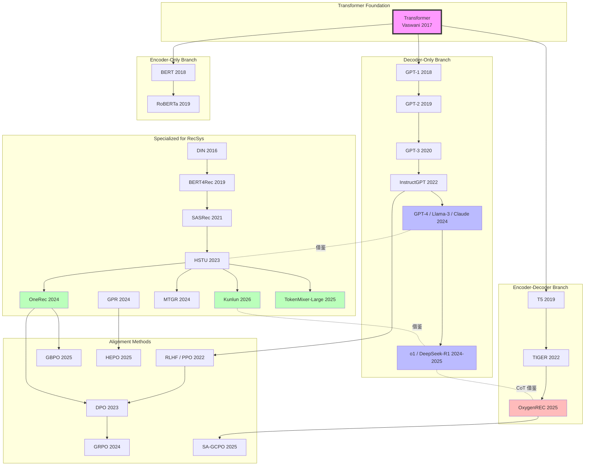
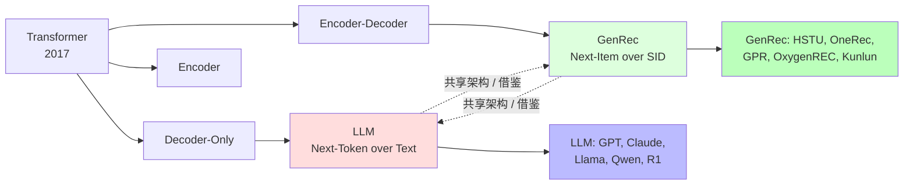
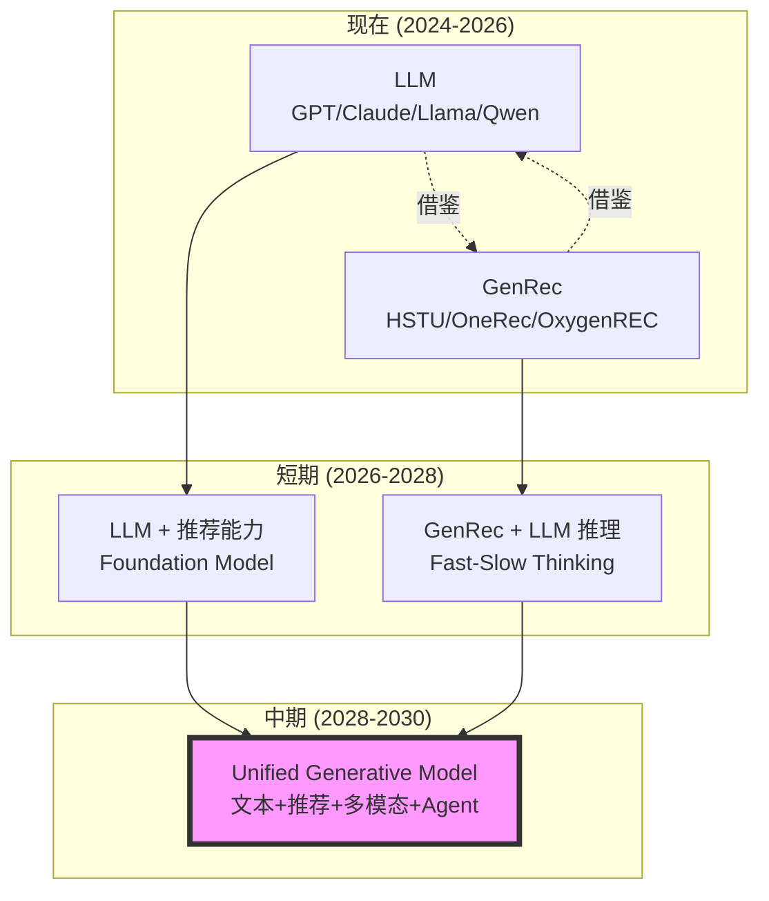

# 0-LLM vs GenRec 总览与核心区别

> [!info] **本章定位**: 本文件是「LLM vs GenRec」对比系列的开篇与总览,把 LLM (Large Language Model, 大语言模型) 与 GenRec (Generative Recommendation, 生成式推荐) 这两个 2023-2026 年最具代表性的「生成式大规模 Transformer 模型」并列对比,讲清楚**它们是什么、从哪来、为什么能放在一起比较、根本性的 10 大区别、共同的未来**。
>
> [!info] **关联文件**:
> - [[1-目标与定义对比]] —— 把"目标"与"定义"拆开,讲 LLM 与 GenRec 在优化目标、输出本质、评估指标、商业目标上的本质差异。
> - [[2-架构与Transformer对比]] —— 深入 Decoder-Only vs 多样化 GenRec 架构,讲 Attention / Token Mixer / SID / Causal Mask 等核心组件的差异。
> - [[3-数据与训练对比]] —— 讲数据来源、训练目标 (Next-Token vs Next-Item)、训练算法、分布式训练、训练成本的差异。
>
> [!info] **关联章节**:
> - [[搜推广与生成式推荐/RL/RL/3-RL在LLM中的经典方法]] —— RL 在 LLM 上的应用 (RLHF / DPO / GRPO / RLVR)。
> - [[搜推广与生成式推荐/RL/RL/4-RL在GenRec中的经典方法]] —— RL 在 GenRec 上的应用 (OneRec / GPR / OxygenREC)。
> - [[../GR/第09章-规模化排序与新架构/deep-dives/20-OxygenREC-深度解析]] —— OxygenREC 把 LLM Reasoning 与 GenRec 解耦的工程案例。
> - `../GR/第09章-规模化排序与新架构/deep-dives/01-TokenMixer-Large-深度解析` —— TokenMixer-Large 把 LLM 范式工业规模化。
> - [[../GR/第09章-规模化排序与新架构/deep-dives/22-Kunlun-深度解析]] —— Kunlun 把 LLM 的 scaling laws 引入 GenRec。
> - [[../GR/第09章-规模化排序与新架构/deep-dives/02-OneTrans-深度解析]] —— OneTrans 把 LLM Decoder 迁移到推荐场景。

---

## 目录

- [0. 一句话总结](#0-一句话总结)
- [1. 什么是 LLM (Large Language Model)](#1-什么是-llm-large-language-model)
- [2. 什么是 GenRec (Generative Recommendation)](#2-什么是-genrec-generative-recommendation)
- [3. 为什么需要对比](#3-为什么需要对比)
- [4. 10 大核心区别 (表格速览)](#4-10-大核心区别-表格速览)
- [5. 共同的目标: 大规模生成式模型](#5-共同的目标-大规模生成式模型)
- [6. 不同的应用领域](#6-不同的应用领域)
- [7. 共同的挑战](#7-共同的挑战)
- [8. 共同的未来: 统一生成式 AI](#8-共同的未来-统一生成式-ai)
- [9. LLM 的核心创新](#9-llm-的核心创新)
- [10. GenRec 的核心创新](#10-genrec-的核心创新)
- [11. 两者关系图 (mermaid)](#11-两者关系图-mermaid)
- [12. 一句话对比](#12-一句话对比)

---

## 0. 一句话总结

> **LLM 与 GenRec 是同一棵「生成式 Transformer 大树」上的两根枝桠**——LLM 是面向「自然语言理解和生成」的分支,目标是 **next-token prediction over text tokens**;GenRec 是面向「推荐系统」的分支,目标是 **next-item prediction over semantic-id tokens**;它们共享 Decoder-Only Transformer 架构、自回归生成范式、大规模预训练 + RLHF/RL 调优的工业化套路,但在**输入空间、输出空间、评估指标、商业目标、推理延迟、训练数据、规模化路径**上存在根本差异。

---

## 1. 什么是 LLM (Large Language Model)

### 1.1 定义

**LLM (Large Language Model)** 是指**在大规模文本语料上预训练的、参数规模达到数十亿到数千亿的 Decoder-Only Transformer 模型**,其核心能力是**自然语言理解与生成**。

```text
LLM = Transformer(Decoder-Only) + Next-Token Prediction + 大规模自监督预训练 + (可选) RLHF/RLHF 调优
```

**形式化定义**:

给定词表 $\mathcal{V}$ (vocabulary), LLM 建模条件概率:

$$
p_\theta(\mathbf{y} \mid \mathbf{x}) = \prod_{t=1}^{T} p_\theta(y_t \mid y_{<t}, \mathbf{x})
$$

其中:
- $\mathbf{x}$ 是输入 prompt (自然语言序列)
- $\mathbf{y} = (y_1, y_2, \dots, y_T)$ 是输出 response (自然语言序列)
- $y_t \in \mathcal{V}$ 是词表中的 token (通常为 BPE / WordPiece 子词)
- $\theta$ 是模型参数 (通常 $\geq 1\text{B}$, 大型模型 $\geq 70\text{B}$)

**与通用 LM 的区别**: "Large" 不仅指参数规模,还指**涌现能力 (Emergent Abilities)**、**In-Context Learning (ICL)**、**Chain-of-Thought (CoT) Reasoning** 等只有规模上去后才出现的能力。

### 1.2 演进史

#### 1.2.1 统计语言模型时代 (1990-2013)

| 年份 | 模型 | 核心思想 | 局限 |
|------|------|----------|------|
| 1990s | N-gram | 统计词频, 平滑 | 维度灾难, 无法泛化 |
| 2003 | HLMM | 层次化 n-gram | 仍受稀疏性制约 |
| 2007 | Stupid-backoff | 大规模 web n-gram | 仅词频统计, 无语义 |

#### 1.2.2 神经网络语言模型时代 (2013-2017)

| 年份 | 模型 | 核心思想 | 影响 |
|------|------|----------|------|
| 2003 | Bengio NN-LM | 第一个神经语言模型 | 提出 distributed representation |
| 2013 | Word2Vec (Mikolov) | Skip-gram + CBOW | 词嵌入范式 |
| 2014 | GloVe (Pennington) | 全局共现 + 局部窗口 | 静态词向量 |
| 2015 | LSTM-LM | RNN + 长期记忆 | 序列建模 |
| 2016 | Layer Normalization | 稳定 RNN 训练 | 后续标配 |

#### 1.2.3 Transformer 时代 (2017-2020)

| 年份 | 模型 | 核心思想 | 影响 |
|------|------|----------|------|
| 2017 | Transformer (Vaswani et al.) | Self-Attention 完全替代 RNN | 架构革命 |
| 2018 | GPT-1 (117M) | Decoder-Only + 预训练 + 微调 | 预训练范式 |
| 2018 | BERT (340M) | Encoder + MLM | 双向编码 |
| 2019 | GPT-2 (1.5B) | Zero-shot 学习 | 规模涌现 |
| 2019 | T5 (11B) | Encoder-Decoder + 文本到文本 | 统一框架 |
| 2020 | GPT-3 (175B) | In-Context Learning | 真正"Large" |

#### 1.2.4 指令对齐时代 (2021-2023)

| 年份 | 模型 | 核心思想 | 影响 |
|------|------|----------|------|
| 2021 | Codex / FLAN-T5 | 指令微调 | Instruction Following |
| 2022 | InstructGPT | **RLHF 三阶段** | 人类偏好对齐 |
| 2022 | ChatGPT | GPT-3.5 + RLHF | 民用爆款 |
| 2023 | GPT-4 | 多模态 + 超长上下文 | 多模态 LLM |
| 2023 | Llama 2 (7B-70B) | 开源 + RLHF | 开源 LLM 普及 |
| 2023 | Claude 2 | Constitutional AI | RLAIF 范式 |

#### 1.2.5 推理增强时代 (2024-2025)

| 年份 | 模型 | 核心思想 | 影响 |
|------|------|----------|------|
| 2024 | Llama 3 (8B-405B) | 15.6T tokens + DPO | 顶级开源 |
| 2024 | Qwen 2.5 (0.5B-72B) | 中文 + 多语言 + 长上下文 | 中文开源标杆 |
| 2024 | DeepSeek-V2 | MoE + MLA | 高效架构 |
| 2025 | DeepSeek-R1 | **纯 RL + GRPO + 推理** | 推理新范式 |
| 2025 | Qwen 3 | 推理 + Agent | 思考模式 |
| 2025 | GPT-4o / Claude 4 / Gemini 2 | 多模态实时 | 端到端统一 |

#### 1.2.6 关键时间线 (ASCII 图)

```text
1990 ─── 2003 ─── 2013 ─── 2017 ─── 2018 ─── 2019 ─── 2020 ─── 2022 ─── 2024 ─── 2025 ───▶
  N-gram   NN-LM    Word2Vec  Transformer  GPT-1  GPT-2  GPT-3   ChatGPT  Llama-3  R1/Qwen3
                                            │
                                            └─ Decoder-Only 范式确立
                                                      │
                                                      └─ RLHF 范式确立 (2022)
                                                                  │
                                                                  └─ 推理增强 + 纯 RL (2025)
```

### 1.3 LLM 的核心能力

#### 1.3.1 涌现能力 (Emergent Abilities)

| 能力 | 描述 | 何时涌现 |
|------|------|----------|
| **In-Context Learning (ICL)** | 不更新参数, 在 prompt 内学习 | GPT-3 (175B) 起 |
| **Chain-of-Thought (CoT)** | 显式推理链 | PaLM (540B) 起 |
| **Instruction Following** | 理解并执行指令 | FLAN / InstructGPT 起 |
| **Self-Consistency** | 多采样投票 | CoT + Sampling |
| **Constitutional AI** | 自我批评 | Claude 起 |

#### 1.3.2 任务能力

LLM 可以完成**几乎所有自然语言任务**,典型包括:

```text
┌────────────────────────────────────────────────────────────────┐
│ LLM 任务能力图谱                                                │
├────────────────────────────────────────────────────────────────┤
│                                                                │
│  1. 文本生成    故事 / 诗歌 / 邮件 / 营销文案 / 翻译 / 摘要       │
│  2. 问答       抽取式 / 生成式 / 多跳 / 多模态                  │
│  3. 推理       数学 / 逻辑 / 常识 / 符号 / 代码                   │
│  4. 代码       生成 / 补全 / 调试 / 解释 / 重构                  │
│  5. 工具使用   API 调用 / Web 搜索 / 数据库 / 文件操作            │
│  6. 对话       多轮 / 角色 / 情绪 / 风格                          │
│  7. 规划       ToT / ReAct / Reflexion                          │
│  8. 角色扮演   Persona / Style / Tone                           │
│  9. 教育       解释 / 答疑 / 出题 / 评分                          │
│ 10. 创作       剧本 / 营销 / 小说 / 歌词                          │
│                                                                │
└────────────────────────────────────────────────────────────────┘
```

### 1.4 LLM 的典型训练流程

```text
┌────────────────────────────────────────────────────────────────────────┐
│ LLM 训练流程 (典型, 4 阶段)                                            │
├────────────────────────────────────────────────────────────────────────┤
│                                                                        │
│  阶段 1: 预训练 (Pre-training)                                          │
│   ├─ 数据: 数 TB 文本 (Common Crawl / Wikipedia / Books / 代码)         │
│   ├─ 目标: Next-Token Prediction (Causal LM)                           │
│   ├─ 算法: SGD/AdamW, 大 batch, 学习率 warmup + cosine                 │
│   ├─ 规模: 千卡 GPU, 数周到数月, 百万到千万美元                         │
│   └─ 产出: Base Model (基础模型, 如 Llama-3-70B-Base)                   │
│                                                                        │
│  阶段 2: 监督微调 (SFT)                                                 │
│   ├─ 数据: 数万到数百万 (prompt, response) 指令对                       │
│   ├─ 目标: Cross-Entropy on response tokens                            │
│   ├─ 算法: 全参数或 LoRA / QLoRA 微调                                  │
│   ├─ 规模: 单机多卡, 数小时到数天                                       │
│   └─ 产出: SFT Model (指令模型)                                         │
│                                                                        │
│  阶段 3: 奖励建模 (RM Training)                                         │
│   ├─ 数据: 数十万 (prompt, response_a, response_b, preference)         │
│   ├─ 目标: Bradley-Terry 偏好建模                                       │
│   ├─ 算法: 二分类 / pairwise ranking                                    │
│   └─ 产出: Reward Model (RM)                                            │
│                                                                        │
│  阶段 4: RLHF (RL Fine-tuning)                                          │
│   ├─ 数据: prompts (无 response)                                        │
│   ├─ 目标: expected reward maximization                                │
│   ├─ 算法: PPO / GRPO / DPO / KTO / SimPO                              │
│   ├─ 规模: 多卡, 数天                                                  │
│   └─ 产出: Aligned Model (对齐模型, 如 ChatGPT / Claude)               │
│                                                                        │
│  (可选) 阶段 5: 推理增强                                                │
│   ├─ 数据: 数学 / 代码 / 逻辑题 + 验证规则                              │
│   ├─ 目标: 提升 reasoning 能力                                          │
│   ├─ 算法: GRPO (DeepSeek-R1) / RLVR                                   │
│   └─ 产出: Reasoning Model (R1 / o1)                                    │
│                                                                        │
└────────────────────────────────────────────────────────────────────────┘
```

### 1.5 LLM 代表模型 (2024-2025)

| 模型 | 厂商 | 参数量 | 核心创新 | 链接 |
|------|------|--------|----------|------|
| GPT-4o | OpenAI | 未公开 | 多模态实时 | [openai.com](https://openai.com) |
| GPT-4.1 | OpenAI | 未公开 | 1M 上下文 | [openai.com](https://openai.com) |
| Claude 4 Opus | Anthropic | 未公开 | Constitutional AI | [anthropic.com](https://anthropic.com) |
| Claude 3.5 Sonnet | Anthropic | 未公开 | Computer Use | [anthropic.com](https://anthropic.com) |
| Gemini 2.5 Pro | Google | 未公开 | TPU + MoE | [deepmind.google](https://deepmind.google) |
| Llama 3.1 405B | Meta | 405B | 开源旗舰 | [llama.meta.com](https://llama.meta.com) |
| Qwen 3 235B | Alibaba | 235B (MoE) | 中文 + 推理 | [qwen.alibaba.com](https://qwen.alibaba.com) |
| DeepSeek-V3 | DeepSeek | 671B (MoE) | 高效 MoE | [deepseek.com](https://deepseek.com) |
| DeepSeek-R1 | DeepSeek | 671B (MoE) | **纯 RL + GRPO + 推理** | [deepseek.com](https://deepseek.com) |
| Mistral Large 2 | Mistral | 123B | 欧洲开源 | [mistral.ai](https://mistral.ai) |
| Yi-Large | 01.AI | 未公开 | 中文 SOTA | [01.ai](https://01.ai) |

---

## 2. 什么是 GenRec (Generative Recommendation)

### 2.1 定义

**GenRec (Generative Recommendation, 生成式推荐)** 是指**将推荐系统重新建模为序列生成任务**的方法范式,使用 Decoder-Only Transformer 在**用户历史行为序列**上自回归生成**目标物品**。

```text
GenRec = Transformer(Decoder-Only) + Next-Item Prediction + Semantic ID + (可选) RL 调优
```

**形式化定义**:

给定用户历史行为序列 $h = (i_1, i_2, \dots, i_T)$ 和物品 SID 词表 $\mathcal{S}$,GenRec 建模条件概率:

$$
p_\theta(\mathbf{i}^* \mid h) = \prod_{t=1}^{T'} p_\theta(s_t \mid s_{<t}, h)
$$

其中:
- $h$ 是用户历史 (item-id 序列或多模态特征)
- $\mathbf{i}^*$ 是目标物品 (通常用 Semantic ID, 一组 token 表示)
- $s_t \in \mathcal{S}$ 是 SID token
- $\theta$ 是模型参数 (典型 0.5B-100B+)

**核心创新**: 把"推荐"从"判别式 (discriminative) 排序"变为"生成式 (generative) 序列预测"。

### 2.2 演进史

#### 2.2.1 传统推荐时代 (2003-2017)

| 年份 | 模型 | 核心思想 | 局限 |
|------|------|----------|------|
| 2003 | ItemCF | 物品协同过滤 | 仅共现, 无语义 |
| 2006 | FM | 特征交叉 | 二次特征, 浅层 |
| 2010 | LR | 逻辑回归 | 线性, 无交叉 |
| 2014 | GBDT + LR | 树模型 + 线性 | 特征工程重 |
| 2016 | Wide & Deep | 记忆 + 泛化 | 仍依赖特征 |

#### 2.2.2 深度学习推荐时代 (2017-2021)

| 年份 | 模型 | 核心思想 | 影响 |
|------|------|----------|------|
| 2016 | DIN (Alibaba) | 注意力激活历史 | 注意力引入推荐 |
| 2017 | DeepFM | FM + DNN | 端到端 |
| 2018 | DIEN (Alibaba) | 兴趣演化 | 时序建模 |
| 2019 | DLRM (Meta) | Embedding + MLP | 工业标准 |
| 2019 | BERT4Rec | **Transformer Encoder** 推荐 | Transformer 引入推荐 |
| 2020 | BST (Alibaba) | Behavior Sequence Transformer | 工业 Transformer 排序 |

#### 2.2.3 生成式推荐萌芽 (2021-2023)

| 年份 | 模型 | 核心思想 | 影响 |
|------|------|----------|------|
| 2021 | SASRec | Self-Attentive Sequential Recommendation | 自注意力推荐 |
| 2022 | TIGER (Google) | **Semantic ID + T5 生成式推荐** | GR 范式确立 |
| 2022 | RecFormer | 基于 Transformer 的生成式推荐 | 简化 GR |
| 2023 | P5 / UniSRec | 多任务统一推荐 | 统一框架 |

#### 2.2.4 大规模生成式推荐时代 (2023-2025)

| 年份 | 模型 | 公司 | 核心创新 | 影响 |
|------|------|------|----------|------|
| 2023 | HSTU (Meta) | Meta | **Hierarchical Sequential Transduction Unit** | 推荐专用 Transformer |
| 2024 | OneRec V1 (Kuaishou) | 快手 | **端到端 GR + DPO** | 短视频 GR 标杆 |
| 2024 | MTGR (Meituan) | 美团 | **HSTU + DLRM 混合** | LBS 推荐 |
| 2024 | GPR (Tencent) | 腾讯 | **多 Token + HEPO RL** | 微信视频号 |
| 2025 | OneRec V2 (Kuaishou) | 快手 | **Lazy Decoder + GBPO** | 时长感知 |
| 2025 | OxygenREC (JD) | 京东 | **Fast-Slow Thinking 解耦** | train-once-deploy-everywhere |
| 2025 | TokenMixer-Large (ByteDance) | 字节 | **Token Mixer + Sparse MoE** | 7B 排序模型 |
| 2025 | OneRec-Think (Kuaishou) | 快手 | **Rollout-Beam Reward** | 推理 + GR |
| 2025 | OneRec-Foundation (Kuaishou) | 快手 | **多场景统一** | 跨域 GR |
| 2025 | OneMall (Kuaishou) | 快手 | **电商场景扩展** | 业务横向 |
| 2025 | GRAB (Alibaba) | 阿里 | **电商 GR 框架** | 阿里电商 |
| 2026 | Kunlun (Meta + OpenAI) | Meta+OpenAI | **Scaling Laws for RecSys** | 规模化理论 |

#### 2.2.5 关键时间线 (ASCII 图)

```text
2003 ─── 2010 ─── 2016 ─── 2019 ─── 2021 ─── 2022 ─── 2023 ─── 2024 ─── 2025 ───▶
ItemCF   LR       DIN     DLRM    SASRec   TIGER    HSTU     OneRec   OxygenREC
                              │                │        │        │
                              └─ Transformer   │        │        │
                                Encoder        │        │        │
                                               │        │        │
                                               └─ Semantic ID + T5
                                                        │        │
                                                        └─ HSTU + Decoder-Only
                                                                 │
                                                                 └─ RL + 推理 + 多场景
```

### 2.3 GenRec 的核心能力

#### 2.3.1 任务能力

```text
┌────────────────────────────────────────────────────────────────┐
│ GenRec 任务能力图谱                                              │
├────────────────────────────────────────────────────────────────┤
│                                                                │
│  1. 召回     从百万/亿级物品中生成 top-K 候选                    │
│  2. 排序     对候选打分, CTR / watch-time / GMV 预估             │
│  3. 多目标   兼顾点击 / 转化 / 时长 / 留存 / 多样性              │
│  4. 冷启动   借助文本/多模态信息泛化到新物品                       │
│  5. 多场景   跨域 (Feed / 搜索 / 广告 / 直播 / 电商)             │
│  6. 长序列   万级历史 → 准确预测下一个物品                        │
│  7. 实时性   在线 / 近线 / 离线 全链路协同                        │
│  8. 推理增强  Chain-of-Thought / Fast-Slow Thinking              │
│  9. 多模态   文本 + 图像 + 视频 + 音频联合                        │
│ 10. 多业务   用户增长 / 内容理解 / 风控 / 客服                    │
│                                                                │
└────────────────────────────────────────────────────────────────┘
```

#### 2.3.2 关键概念: Semantic ID (SID)

**Semantic ID** 是 GenRec 与传统推荐最根本的区别之一。

**传统 ID**:
```text
物品 ID = 一个整数 / 字符串
例: item_123456, "SKU_998877"
```

**Semantic ID**:
```text
物品 ID = 一组语义 token
例: item_123456 → (12, 345, 6789)  [3 层 RQ-VAE 量化]
含义: 第 1 层语义 (粗类) + 第 2 层语义 (中类) + 第 3 层语义 (细类)
```

**SID 的好处**:

| 好处 | 描述 |
|------|------|
| **语义泛化** | 相近物品的 SID 相近, 可借助 Transformer 的归纳偏置 |
| **词表压缩** | 100 万物品 → 数千到数万 token 的组合 |
| **冷启动** | 新物品只要内容相似, SID 也相似 |
| **多模态** | 文本 / 图像 / 视频可统一编码到 SID 空间 |
| **可解释** | SID 的层级可解释 (类目 / 属性 / 具体) |

**SID 生成方法**:

```text
1. RQ-VAE (Residual-Quantized VAE):
   - 用 VAE 把物品 embedding 压缩到低维空间
   - 用 K-means 量化残差
   - 得到层级码本 (codebook)

2. RQ-KMeans:
   - 简单聚类 → 多层量化

3. TQ (Two-stage Quantization):
   - 内容 embedding → 量化 → ID

4. 内容直接分词 (类似 LLM tokenizer):
   - 用 SentencePiece / BPE 直接处理物品描述
```

### 2.4 GenRec 的典型训练流程

```text
┌────────────────────────────────────────────────────────────────────────┐
│ GenRec 训练流程 (典型, 5 阶段)                                          │
├────────────────────────────────────────────────────────────────────────┤
│                                                                        │
│  阶段 1: SID 生成 (Semantic ID Encoding)                                │
│   ├─ 输入: 物品内容 (文本 / 图像 / 视频 / 属性)                          │
│   ├─ 算法: RQ-VAE / RQ-KMeans / 内容 tokenizer                          │
│   ├─ 产出: 每个物品 → 一组 SID token                                    │
│   └─ 词表大小: 数千到数万 token                                         │
│                                                                        │
│  阶段 2: 序列构建 (User Behavior Sequence)                              │
│   ├─ 输入: 用户-物品交互日志                                            │
│   ├─ 处理: 时间排序 / 去噪 / 截断 / 增强                                │
│   ├─ 产出: 用户行为序列 (item-id 或 SID-token 序列)                      │
│   └─ 序列长度: 数百到数千                                                │
│                                                                        │
│  阶段 3: 预训练 (Generative Pre-training)                                │
│   ├─ 输入: 用户历史 + 物品 SID                                          │
│   ├─ 目标: Next-SID Prediction (类 LLM 的 Next-Token)                   │
│   ├─ 算法: AdamW, 大 batch, 混合精度                                   │
│   ├─ 规模: 千卡 GPU, 数天到数周                                         │
│   └─ 产出: Base GR Model                                                │
│                                                                        │
│  阶段 4: 监督微调 (SFT, 类似 LLM)                                       │
│   ├─ 输入: 高质量样本 (如有点击 / 转化 的序列)                           │
│   ├─ 目标: 在高质量样本上 fine-tune                                     │
│   └─ 产出: SFT GR Model                                                 │
│                                                                        │
│  阶段 5: RL 调优 (类似 LLM 的 RLHF, 但奖励是业务指标)                    │
│   ├─ 数据: 业务反馈 (CTR / watch-time / GMV / 转化)                     │
│   ├─ 算法: GRPO / DPO / GBPO / HEPO / SA-GCPO / PPO                   │
│   ├─ 奖励: 业务指标 (多目标加权)                                          │
│   ├─ 规模: 多机多卡, 数天                                              │
│   └─ 产出: Aligned GR Model                                              │
│                                                                        │
│  (可选) 阶段 6: 推理增强 (Chain-of-Thought)                              │
│   ├─ Slow Thinking: LLM 生成指令 / 意图 / CoT                          │
│   ├─ Fast Thinking: GR 模型快速响应                                      │
│   └─ 例子: OxygenREC 的 Fast-Slow Thinking                             │
│                                                                        │
└────────────────────────────────────────────────────────────────────────┘
```

### 2.5 GenRec 代表模型 (2024-2025)

| 模型 | 公司 | 核心创新 | 论文链接 |
|------|------|----------|----------|
| HSTU | Meta | 排序专用 Transformer, FLOPs 节省 8-15× | [arxiv 2402.17152](https://arxiv.org/abs/2402.17152) |
| TIGER | Google | RQ-VAE + T5 生成式推荐 | [arxiv 2305.14387](https://arxiv.org/abs/2305.14387) |
| OneRec V1 | Kuaishou | 端到端 GR + DPO + 短视频 | KDD 2025 |
| OneRec V2 | Kuaishou | Lazy Decoder + GBPO + Duration-Aware | KDD 2025 |
| OneRec-Think | Kuaishou | Rollout-Beam Reward + 推理 | 2025 |
| OneRec-Foundation | Kuaishou | 多场景统一 | 2025 |
| OneMall | Kuaishou | 电商场景扩展 | 2025 |
| MTGR | Meituan | HSTU + DLRM 混合 + LBS | KDD 2025 |
| GPR | Tencent | HHD + Multi-Token + HEPO RL | 2025 |
| OxygenREC | JD | Fast-Slow Thinking + SA-GCPO | [arxiv 2512.22386](https://arxiv.org/abs/2512.22386) |
| TokenMixer-Large | ByteDance | Token Mixer + Sparse MoE | [arxiv 2602.06563](https://arxiv.org/abs/2602.06563) |
| GRAB | Alibaba | 电商 GR 框架 | KDD 2025 |
| PinRec | Pinterest | Pin 推荐 GR | 2025 |
| NetflixGenRec | Netflix | Netflix 内容 GR | 2025 |
| MTmixAtt / AutoToken | Meituan | 自动 token | 2025 |

---

## 3. 为什么需要对比

### 3.1 三个根本原因

#### 3.1.1 范式统一: 都在做"自回归生成"

LLM 与 GenRec 在**底层范式**上是同一个东西:

```text
┌─────────────────────────────────────────────────────────┐
│ LLM:   p(y | x) = ∏ p(y_t | y_<t, x)   over text tokens │
│ GenRec: p(i | h) = ∏ p(s_t | s_<t, h)  over SID tokens   │
│                                                         │
│      ↓ 都是"自回归下一 token 预测"                          │
│      ↓ 都是 Decoder-Only Transformer                     │
│      ↓ 都是大规模预训练 + 微调 + RL                       │
│                                                         │
│  → 可以共用: 训练框架 / 推理框架 / 加速库 / 评估方法         │
└─────────────────────────────────────────────────────────┘
```

**这意味着**: 任何 LLM 的进展 (MoE、长上下文、推理增强、RL 训练) 都可能被 GenRec 复用;反之亦然。

#### 3.1.2 工业落地的交叉

现实中,**头部公司往往同时做 LLM 和 GenRec**:

| 公司 | LLM 业务 | GenRec 业务 |
|------|----------|-------------|
| Meta | Llama 系列 | HSTU / Kunlun / MTGR-like |
| Google | Gemini 系列 | TIGER / RecFormer |
| Alibaba | Qwen 系列 | GRAB |
| ByteDance | Doubao 系列 | TokenMixer-Large |
| Kuaishou | Kling (视频) | OneRec 系列 |
| JD | ChatRhino | OxygenREC |
| Tencent | Hunyuan | GPR |
| Meituan | (内部) | MTGR / MTmixAtt |
| Baidu | Ernie | (推荐业务) |
| DeepSeek | DeepSeek-V3 / R1 | (暂无 GenRec) |
| OpenAI | GPT / o1 | (无 GenRec) |
| Anthropic | Claude | (无 GenRec) |

**这意味着**: 头部公司的 LLM 团队与 GenRec 团队**频繁相互借鉴**——Meta 的 HSTU 论文里大量引用 LLM 文献,Kunlun 论文里直接用 OpenAI 的合作者。

#### 3.1.3 学术研究的需要

2024-2026 年,推荐系统顶级会议 (RecSys / KDD / SIGIR / CIKM) 出现大量"借鉴 LLM"的 GenRec 论文;同样,NeurIPS / ICML / ICLR 也出现"用 LLM 做推荐"的论文。

**对学习者而言**:
- **理解 GenRec 必须先懂 LLM**: 因为 GenRec 的范式来自 LLM。
- **理解 LLM 也要看 GenRec**: 因为 GenRec 在**大规模工业落地、延迟优化、稀疏化训练**上的经验反过来启发 LLM。

### 3.2 对比的 5 个层次

```text
┌────────────────────────────────────────────────────────────────┐
│ 对比层次 (从浅到深)                                              │
├────────────────────────────────────────────────────────────────┤
│                                                                │
│  Layer 1 (范式): 都是"自回归生成", 形式相同                      │
│  Layer 2 (架构): 都是 Decoder-Only Transformer, 但有细节差异      │
│  Layer 3 (目标): LLM 优化 next-text-token, GenRec 优化 next-item │
│  Layer 4 (数据): LLM 用文本, GenRec 用用户行为 + 物品 SID         │
│  Layer 5 (评估): LLM 用 NLU/NLG 指标, GenRec 用业务指标          │
│                                                                │
│  → 本系列文件逐层深入                                            │
└────────────────────────────────────────────────────────────────┘
```

### 3.3 对比的具体收益

| 收益 | 说明 |
|------|------|
| **技术迁移** | LLM 的 MoE / 长上下文 / CoT 可直接迁移到 GenRec |
| **工程复用** | vLLM / SGLang / TensorRT 加速库可服务两类模型 |
| **人才互通** | LLM 算法工程师可快速上手 GenRec, 反之亦然 |
| **研究加速** | 一方突破后, 另一方可在数月内跟进 |
| **业务融合** | LLM 可作为 GenRec 的"推理模块" (如 OxygenREC) |
| **避免重复造轮子** | 共享训练框架 / 数据流水线 / 评估平台 |

---

## 4. 10 大核心区别 (表格速览)

### 4.1 总览表

| # | 维度 | LLM | GenRec |
|---|------|-----|--------|
| 1 | **输入空间** | 自然语言 prompt (文本 token) | 用户行为序列 (item-id / SID token) |
| 2 | **输出空间** | 自然语言 response (文本 token) | 物品 SID 序列 (SID token) |
| 3 | **评估指标** | NLU/NLG: MMLU / GSM8K / HumanEval | 业务: AUC / watch-time / GMV / NDCG |
| 4 | **训练数据** | 文本语料 (Common Crawl / Wikipedia) | 用户-物品交互日志 + 物品内容 |
| 5 | **核心架构** | Decoder-Only Transformer | Decoder-Only + HSTU / TokenMixer |
| 6 | **推理延迟** | 数百 ms ~ 数秒 | 严格 < 50 ms (p99) |
| 7 | **Token 词表** | 32K-256K BPE 子词 | 数千到数万 SID token |
| 8 | **Reward 来源** | 人类偏好 (Helpful/Harmless) | 业务反馈 (CTR/GMV/转化) |
| 9 | **规模化目标** | 通用智能 (AGI) | 业务 KPI (DAU/GMV/留存) |
| 10 | **部署形态** | API / Chatbot / Agent | 在线服务 / 嵌入式模块 |

### 4.2 详细展开

#### 区别 1: 输入空间

**LLM**:

```text
输入: 自然语言文本
例: "请解释 Transformer 的 self-attention 机制"
组成: BPE / WordPiece 子词 token
词表: 32K (GPT-2) / 100K (Llama) / 256K (Qwen)
序列长度: 数千到数百万 (128K / 1M / 10M)
```

**GenRec**:

```text
输入: 用户历史行为序列
例: [(item_123, watch_30s), (item_456, watch_120s), ...]
组成: item-id 或 SID token
词表: 数千 (HSTU) 到数万 (RQ-VAE)
序列长度: 数百到数千 (但可上万 / HSTU 支持 8192+)
```

**本质区别**: LLM 的输入是**人类语言**, 富含结构、语法、语义;GenRec 的输入是**行为流**, 富含时序、频次、兴趣演化。

#### 区别 2: 输出空间

**LLM**:

```text
输出: 自然语言文本
例: "Self-attention 通过计算 Q K^T 的 softmax..."
组成: BPE 子词 token
约束: 语法、风格、长度、可读性
```

**GenRec**:

```text
输出: 物品 SID 序列
例: (12, 345, 6789) → 物品 123456
组成: 层级化 SID token
约束: 必须能解码为有效 item-id
```

**本质区别**: LLM 输出是**开放生成**, 可以创造新句子;GenRec 输出是**封闭生成**, 必须落在物品库内。

#### 区别 3: 评估指标

**LLM**:

| 指标类别 | 具体指标 | 含义 |
|----------|----------|------|
| 通用知识 | MMLU, ARC, HellaSwag | 多领域知识 |
| 推理 | GSM8K, MATH | 数学推理 |
| 代码 | HumanEval, MBPP | 代码生成 |
| 中文 | C-Eval, CMMLU | 中文能力 |
| 对齐 | AlpacaEval, MT-Bench | 人类偏好 |
| 安全 | HarmBench | 安全性 |

**GenRec**:

| 指标类别 | 具体指标 | 含义 |
|----------|----------|------|
| 分类 | AUC, LogLoss | 二分类质量 |
| 排序 | NDCG, MAP, MRR | 排序质量 |
| 多样性 | Coverage, Intra-list Diversity | 推荐丰富度 |
| 业务 | CTR, GMV, watch-time | 业务效果 |
| 长效 | Retention, LTV | 长期价值 |
| 体验 | 满意度, 时长 | 用户体验 |

**本质区别**: LLM 的指标**通用、可比**, 可跨模型横向比较;GenRec 的指标**业务相关**, 不同公司 / 场景的指标无法直接比较。

#### 区别 4: 训练数据

**LLM**:

```text
数据来源:
├─ 网页 (Common Crawl, 数十 TB)
├─ 书籍 (Books3, Gutenberg)
├─ 维基百科 (Wikipedia, 多语言)
├─ 新闻 (Common Crawl News)
├─ 代码 (GitHub, StackOverflow)
├─ 学术 (ArXiv, PubMed)
└─ 指令数据 (OpenAssistant, ShareGPT)

数据规模:
├─ GPT-3: 300B tokens
├─ Llama 3: 15.6T tokens
└─ Qwen 3: 数 T 到数十 T tokens
```

**GenRec**:

```text
数据来源:
├─ 用户-物品交互日志 (点击/购买/收藏/...)
├─ 物品内容 (文本描述/图像/视频/属性)
├─ 用户画像 (人口统计/兴趣标签)
├─ 上下文 (时间/地点/设备/网络)
└─ 业务反馈 (点赞/差评/退货)

数据规模:
├─ 训练样本: 数十亿到数百亿
├─ 物品数: 百万到数十亿
├─ 用户数: 千万到数亿
└─ 序列长度: 数百到数千
```

**本质区别**: LLM 的数据**公开可得** (尽管有版权问题);GenRec 的数据**公司私有**, 高度敏感, 不可能跨公司共享。

#### 区别 5: 核心架构

**LLM**:

```text
Transformer(Decoder-Only)
├─ Multi-Head Self-Attention (Causal Mask)
├─ RMSNorm / LayerNorm
├─ SwiGLU / GeLU FFN
├─ RoPE / ALiBi 位置编码
└─ (可选) MoE: Mixtral / DeepSeek-V3

参数量: 1B ~ 1T+
典型: Llama 3 405B, DeepSeek-V3 671B (MoE)
```

**GenRec**:

```text
架构 1 (类 LLM): Decoder-Only + SID
├─ HSTU (Meta): 排序专用, FLOPs 优化
├─ TIGER (Google): T5 Encoder-Decoder + SID
└─ OneTrans: Decoder-Only 简化

架构 2 (混合): HSTU + DLRM
├─ MTGR (Meituan): 时序用 HSTU, 静态用 DLRM
└─ TokenMixer-Large: Token Mixer + Sparse MoE

架构 3 (多 Token + HEPO):
├─ GPR (Tencent): HHD + Multi-Token 输出
└─ Multi-Token Pred + HEPO

架构 4 (Fast-Slow 解耦):
└─ OxygenREC (JD): Slow LLM + Fast Encoder-Decoder

架构 5 (Scaling Laws):
└─ Kunlun (Meta + OpenAI): GDPA + HSP + Sliding Window

参数量: 0.1B ~ 几十B (线上最大 ~7B-15B)
```

**本质区别**: LLM 架构**统一** (基本都是 Decoder-Only);GenRec 架构**多样** (因推荐场景约束: 延迟 / 特征融合 / 多目标)。

#### 区别 6: 推理延迟

**LLM**:

```text
延迟: 数百 ms ~ 数秒 (per response)
batch size: 1 ~ 256
硬件: H100 / A100 / TPU
吞吐: 数十到数百 QPS (单卡)

约束: 用户可等待
```

**GenRec**:

```text
延迟: 严格 < 50 ms (p99), 通常 < 20 ms
batch size: 数百到数千 (一次处理多个请求)
硬件: H100 / A100 / T4 / 自研芯片
吞吐: 数万到数十万 QPS (单集群)

约束: 用户不可等待
```

**本质区别**: LLM 是**高延迟高价值**场景 (一次问答);GenRec 是**低延迟高并发**场景 (一次请求推多个物品)。

#### 区别 7: Token 词表

**LLM**:

```text
词表大小: 32K-256K
├─ GPT-2: 50,257 BPE
├─ Llama 2: 32,000 SentencePiece
├─ Llama 3: 128,000 (扩展多语言)
├─ Qwen 3: 152,000 (中文优化)
└─ DeepSeek-V3: 102,400

编码方式: BPE / WordPiece / SentencePiece / Unigram
词汇: 子词 (subword), 人类可读 (大致)
```

**GenRec**:

```text
词表大小: 数千到数万
├─ HSTU: 数十个 codebook × 256 code
├─ TIGER: 4 层 × 256 code = 256^4 组合
├─ OneRec: 自定义 RQ-VAE, 词表约 1-10K
└─ TokenMixer-Large: 行业特定

编码方式: RQ-VAE / RQ-KMeans / 内容分词
词汇: 语义 ID, 部分可解释 (层级)
```

**本质区别**: LLM 词表**通用**,跨语言跨任务;GenRec 词表**领域特定**, 不同公司/场景需要重新训练 SID。

#### 区别 8: Reward 来源

**LLM**:

```text
奖励来源:
├─ 人类标注 (人工 pairwise 偏好)
├─ RM 预测 (Bradley-Terry)
├─ 规则验证 (RLVR, 数学/代码可自动验证)
├─ 工具反馈 (代码执行结果 / API 调用成功)
├─ RLAIF (AI 反馈, Constitutional AI)
└─ 自我评估 (Self-Rewarding)

目标: 对齐人类偏好 (Helpful/Harmless/Honest)
```

**GenRec**:

```text
奖励来源:
├─ 业务反馈 (CTR / watch-time / GMV / 转化)
├─ 多目标加权 (点击 + 时长 + GMV + 多样性)
├─ 长期信号 (留存 / LTV)
├─ 用户主动反馈 (点赞 / 收藏 / 评论)
├─ 隐式反馈 (完播率 / 跳过率)
└─ 规则约束 (合规 / 安全 / 风控)

目标: 业务 KPI (DAU / GMV / 留存)
```

**本质区别**: LLM reward 是**人类价值判断** (主观);GenRec reward 是**业务反馈** (客观, 但需多目标平衡)。

#### 区别 9: 规模化目标

**LLM**:

```text
终极目标: AGI / Super Intelligence
├─ 通用智能 (跨任务)
├─ 推理能力 (数学/代码/逻辑)
├─ 多模态 (文本/图像/音频/视频)
├─ 工具使用 (Agent)
└─ 长上下文 (1M+ tokens)

规模曲线: 更大 = 更强 (涌现)
├─ 7B → 70B: 推理大幅提升
├─ 70B → 405B: 复杂任务提升
└─ 405B → 1T+: 涌现新能力
```

**GenRec**:

```text
终极目标: 业务 KPI 最大化
├─ 个性化 (千人千面)
├─ 多样性 (避免信息茧房)
├─ 长期价值 (LTV / 留存)
├─ 多目标平衡 (CTR vs GMV vs 时长)
└─ 冷启动 (新物品 / 新用户)

规模曲线: 更大 = 业务效果更好
├─ 1B → 7B: AUC +0.5-1%
├─ 7B → 15B: AUC +0.3-0.5%
└─ 15B+: 边际收益递减, 推理成本激增
```

**本质区别**: LLM 追求**通用智能的极限** (能力越强越好);GenRec 追求**业务 ROI** (效果越好 + 成本越低 = 越值得)。

#### 区别 10: 部署形态

**LLM**:

```text
部署形态:
├─ 云端 API (OpenAI / Anthropic / 阿里云)
├─ 本地部署 (开源模型 + vLLM / SGLang)
├─ 嵌入式 (端侧小模型, 如 Phi-3 / Llama 3.2 1B)
└─ Agent 集成 (LangChain / AutoGen / CrewAI)

服务模式:
├─ Chatbot (ChatGPT / Claude.ai)
├─ Copilot (GitHub Copilot / Cursor)
├─ API 调用 (嵌入业务系统)
└─ 多 Agent 协作

用户交互: 长对话, 显式请求
```

**GenRec**:

```text
部署形态:
├─ 在线服务 (TensorFlow Serving / Triton)
├─ 嵌入式 (端侧, 如浏览器推荐)
├─ 离线预计算 (候选生成 / Embedding)
└─ 混合 (离线 + 在线 + 近线)

服务模式:
├─ 召回 (从百万到千)
├─ 排序 (从千到百)
├─ 重排 (从百到十, 多样性)
└─ 多路融合 (多源多目标)

用户交互: 无显式交互, 系统主动推送
```

**本质区别**: LLM 是**用户主动调用**;GenRec 是**系统主动服务**。

### 4.3 区别总结 (一句话版)

```text
LLM = 通用语言生成器, 优化"人类偏好对齐", 服务"用户的主动请求"
GenRec = 个性化物品生成器, 优化"业务 KPI 对齐", 服务"系统的主动推送"
```

---

## 5. 共同的目标: 大规模生成式模型

### 5.1 共同的范式: 自回归生成

LLM 与 GenRec 都遵循**自回归生成**范式:

$$
p_\theta(\mathbf{y} \mid \mathbf{x}) = \prod_{t=1}^{T} p_\theta(y_t \mid y_{<t}, \mathbf{x})
$$

**这是深度学习的"中心法则"**:

```text
┌─────────────────────────────────────────────────────────────┐
│ 自回归生成的中心法则                                          │
├─────────────────────────────────────────────────────────────┤
│                                                             │
│  1. 输入 → 编码为 token 序列                                  │
│  2. Transformer 计算每步条件分布                              │
│  3. 自回归采样下一个 token                                    │
│  4. 终止条件: EOS / 最大长度                                  │
│                                                             │
│  → LLM: token = 子词, 序列 = 自然语言                        │
│  → GenRec: token = SID, 序列 = 物品                          │
│                                                             │
│  → 形式完全相同, 实质完全不同                                  │
└─────────────────────────────────────────────────────────────┘
```

### 5.2 共同的架构基础: Decoder-Only Transformer

**LLM**: 标准 Decoder-Only
**GenRec**: 多采用 Decoder-Only 或类 Decoder-Only (HSTU 等)

```text
┌─────────────────────────────────────────────────────────────┐
│ Decoder-Only Transformer (LLM 和 GenRec 通用)                │
├─────────────────────────────────────────────────────────────┤
│                                                             │
│  Input Token Embedding                                       │
│       ↓                                                     │
│  + Positional Embedding (RoPE / ALiBi)                       │
│       ↓                                                     │
│  ┌─────────────────────────────────┐                        │
│  │ Decoder Block × N              │                        │
│  │  ├─ RMSNorm / LayerNorm        │                        │
│  │  ├─ Causal Self-Attention      │                        │
│  │  │   (Q, K, V, O projections)  │                        │
│  │  ├─ Residual Connection        │                        │
│  │  ├─ RMSNorm                    │                        │
│  │  ├─ FFN (SwiGLU / GeLU)        │                        │
│  │  └─ Residual Connection        │                        │
│  └─────────────────────────────────┘                        │
│       ↓                                                     │
│  Output: 每步的 token 概率分布                                 │
│                                                             │
└─────────────────────────────────────────────────────────────┘
```

### 5.3 共同的训练套路: 预训练 + 微调 + RL

**LLM**:

```text
Pretrain (万亿 tokens) → SFT (指令微调) → RM (奖励模型) → RLHF (对齐)
```

**GenRec**:

```text
Pretrain (数十亿到数百亿行为) → SFT (高质量样本) → RL (业务对齐)
```

**共同点**: 都是**大规模预训练 → 任务微调 → 强化学习对齐**的三段式 (或四段式) 套路。

### 5.4 共同的规模曲线: Scaling Laws

**LLM**:

```text
Loss = a · N^(-α) + b · D^(-β) + c
N: 模型参数量, D: 数据量
Loss 随规模幂律下降
涌现能力在特定规模后出现
```

**GenRec (Kunlun 论文, 2026)**:

```text
Offline Metric = a · N^(-α) + b · D^(-β) + c
同样的幂律规律
但推荐有"边际收益递减"特性
```

**共同点**: 都遵循 **Scaling Laws**——更大的模型 + 更多的数据 → 更好的效果。

### 5.5 共同的推理优化: KV Cache + 投机采样

**LLM**: KV Cache, Speculative Decoding, vLLM, SGLang
**GenRec**: 同样的技术 (但延迟要求更严)

**共同点**: 自回归生成带来的 KV Cache 问题、采样加速问题, 两者完全一致。

---

## 6. 不同的应用领域

### 6.1 LLM 的应用领域

```text
┌────────────────────────────────────────────────────────────┐
│ LLM 应用领域                                              │
├────────────────────────────────────────────────────────────┤
│                                                            │
│  1. 对话助手      ChatGPT, Claude.ai, Gemini App            │
│  2. 搜索          Perplexity, 秘塔, Bing Chat               │
│  3. 编程          GitHub Copilot, Cursor, Devin              │
│  4. 办公          Microsoft Copilot, Google Workspace       │
│  5. 教育          Khanmigo, 学而思, 作业帮                   │
│  6. 客服          Intercom Fin, Salesforce Einstein         │
│  7. 内容生成      Jasper, Copy.ai, 秘塔写作                  │
│  8. 翻译          DeepL, Google Translate                   │
│  9. 创意          Midjourney + GPT, Suno + GPT              │
│ 10. Agent         AutoGen, CrewAI, LangGraph                 │
│ 11. 科研          DeepResearch (OpenAI), DeepResearch (Google)│
│ 12. 金融          BloombergGPT, 蚂蚁, 同花顺                 │
│ 13. 医疗          Med-PaLM, 医联, 智云健康                   │
│ 14. 法律          Harvey, 幂律智能                            │
│ 15. 自动驾驶      Waymo LLM, Tesla FSD + LLM                 │
│                                                            │
└────────────────────────────────────────────────────────────┘
```

### 6.2 GenRec 的应用领域

```text
┌────────────────────────────────────────────────────────────┐
│ GenRec 应用领域                                            │
├────────────────────────────────────────────────────────────┤
│                                                            │
│  1. 短视频 Feed   抖音, 快手, YouTube Shorts, Reels          │
│  2. 电商推荐      淘宝, 京东, 拼多多, Amazon                 │
│  3. 社交 Feed     微博, 小红书, Instagram                    │
│  4. 新闻推荐      今日头条, NewsBreak, Apple News            │
│  5. 广告          Meta Ads, Google Ads, 字节穿山甲           │
│  6. 音乐推荐      Spotify, 网易云, QQ 音乐                  │
│  7. 视频推荐      Netflix, 爱奇艺, 优酷, Disney+             │
│  8. 本地生活      美团, 大众点评, Yelp                      │
│  9. 内容平台      Pinterest, Behance, Dribbble              │
│ 10. 出行          滴滴, Uber (司机-乘客匹配)                │
│ 11. 招聘          LinkedIn Jobs, BOSS 直聘                   │
│ 12. 教育          Coursera, 学而思 (课程推荐)                │
│ 13. 金融          支付宝 (理财推荐), Robinhood              │
│ 14. 旅行          Booking, Airbnb, 携程                      │
│ 15. LBS 推荐      美团, 大众点评, Google Maps                │
│                                                            │
└────────────────────────────────────────────────────────────┘
```

### 6.3 二者交叉的应用

**OxygenREC (JD)**:

```text
Slow Thinking (LLM 推理) → 生成"用户意图指令"
Fast Thinking (GenRec) → 根据指令快速召回/排序
→ LLM 提供"理解", GenRec 提供"决策"
```

**DeepResearch 类应用**:

```text
LLM 规划研究路径
GenRec 推荐相关文档/网页
→ LLM 提供"思路", GenRec 提供"素材"
```

**AI 搜索 (Perplexity)**:

```text
LLM 生成答案
GenRec 推荐相关引用/扩展阅读
```

**AI 助手 + 个性化**:

```text
LLM 理解用户意图
GenRec 推荐个性化回复 / 选项
```

---

## 7. 共同的挑战

### 7.1 共同的挑战 (按类别)

#### 7.1.1 训练挑战

| 挑战 | LLM | GenRec |
|------|-----|--------|
| **数据规模** | 数 T tokens | 数 B 行为 |
| **算力需求** | 千卡 GPU, 数月 | 百到千卡, 数周 |
| **训练成本** | 百万到千万美元 | 数十万到数百万美元 |
| **训练稳定性** | Loss spike, 梯度爆炸 | 同上 + 业务指标波动 |
| **评估难度** | 通用 benchmark 多 | 业务指标复杂, A/B 测试慢 |

#### 7.1.2 推理挑战

| 挑战 | LLM | GenRec |
|------|-----|--------|
| **延迟要求** | 数百 ms 可接受 | 严格 < 50 ms |
| **吞吐量** | 单卡数十 QPS | 单卡数万 QPS |
| **KV Cache** | 占用大, 需 PagedAttention | 同 |
| **量化** | INT8/INT4 可接受 | 必须量化, 严格 |
| **服务成本** | 高 (GPU 集群) | 极高 (规模化部署) |

#### 7.1.3 算法挑战

| 挑战 | LLM | GenRec |
|------|-----|--------|
| **幻觉** | 文本幻觉 | 物品幻觉 (推错物品) |
| **冷启动** | 新任务表现差 | 新物品/新用户 |
| **多样性** | 生成重复 | 信息茧房 |
| **长尾** | 小语种 / 小领域 | 长尾物品 |
| **公平性** | 偏见 / 歧视 | 流量倾斜 / 公平曝光 |
| **可解释性** | 黑盒 | 必须解释 (业务需要) |

#### 7.1.4 部署挑战

| 挑战 | LLM | GenRec |
|------|-----|--------|
| **多目标** | Helpful + Harmless + Honest | CTR + GMV + 时长 + 多样性 |
| **在线学习** | 难, 通常离线 | 必要, 必须在线 |
| **A/B 测试** | 周期长, 用户主观 | 周期短, 业务指标客观 |
| **回滚风险** | 文本生成可接受 | 推荐结果直接影响业务 |

### 7.2 共同的解决方案

```text
┌────────────────────────────────────────────────────────────────┐
│ 共同的解决方案                                                 │
├────────────────────────────────────────────────────────────────┤
│                                                                │
│  1. 分布式训练  DeepSpeed, Megatron, FSDP (两者都适用)            │
│  2. 混合精度    FP16 / BF16 / FP8 (两者都适用)                    │
│  3. 推理加速    vLLM, SGLang, TensorRT, FlashAttention           │
│  4. RL 算法    PPO, DPO, GRPO (两者都适用)                       │
│  5. 评估体系    MLOps, 离线 + 在线 (两者都需要)                   │
│  6. 模型压缩    量化, 蒸馏, 剪枝 (两者都需要)                     │
│  7. 长上下文    RoPE 扩展, 稀疏 Attention (两者都需要)            │
│                                                                │
└────────────────────────────────────────────────────────────────┘
```

---

## 8. 共同的未来: 统一生成式 AI

### 8.1 趋势 1: 架构统一

**LLM 架构 → GenRec**:

```text
HSTU (Meta) ← 学习 Llama 架构
Kunlun (Meta) ← 直接用 OpenAI 合作
TokenMixer-Large ← 学习 MoE
OneRec ← 学习 Decoder-Only
```

**GenRec 经验 → LLM**:

```text
LLM 学习 GenRec 的:
├─ 长序列优化 (HSTU 的 O(L log L) 注意力)
├─ 多 Token 预测 (类似 Multi-Token Prediction for LLM)
├─ 工业级 MoE (TokenMixer 的 Sparse-Train-Sparse-Infer)
└─ 特征融合 (LLM 加入异构特征)
```

### 8.2 趋势 2: 训练方法统一

**LLM → GenRec**:
- GRPO (DeepSeek-R1) → GBPO (OneRec V2)
- DPO (Llama 2) → DPO (OneRec V1)
- RLVR → OxygenREC SA-GCPO

**GenRec → LLM**:
- 多目标加权 → LLM 多任务对齐
- 业务反馈 reward → LLM 工具使用 reward
- 在线学习 → LLM 在线 RL

### 8.3 趋势 3: 任务统一

**Long Context**:

```text
LLM: 1M-10M tokens
GenRec: 上万历史行为

→ 都需 O(L log L) 或 O(L) Attention
→ LLM 的 LongRoPE / Yarn 可借鉴到 GenRec
→ GenRec 的 HSTU Sliding Window 可借鉴到 LLM
```

**Reasoning**:

```text
LLM: CoT (Chain-of-Thought)
GenRec: 推理增强 (OxygenREC, OneRec-Think)

→ 都需 Slow Thinking
→ LLM 的 o1/R1 范式可借鉴到 GenRec
→ GenRec 的 Fast-Slow 解耦可借鉴到 LLM Agent
```

**Multi-Modal**:

```text
LLM: GPT-4o, Claude 4 多模态
GenRec: OxygenREC 多模态 SID

→ 都需 文本 + 图像 + 视频统一
→ 都需 多模态 Embedding
```

### 8.4 趋势 4: 平台统一

**训练框架**:

```text
LLM: Megatron, DeepSpeed, FSDP
GenRec: 同样的框架 (但优化目标不同)

→ 统一到 PyTorch + 自定义模块
```

**推理框架**:

```text
LLM: vLLM, SGLang, TensorRT-LLM
GenRec: vLLM 已被 GenRec 复用

→ vLLM 已是工业标准
```

**Serving 框架**:

```text
LLM: Triton, KServe
GenRec: Triton (主)

→ 都在向 Triton 收敛
```

### 8.5 终极形态: Unified Generative AI

**愿景**:

```text
┌────────────────────────────────────────────────────────────────┐
│ Unified Generative AI (终极愿景)                                │
├────────────────────────────────────────────────────────────────┤
│                                                                │
│  单一基础模型 (Foundation Model)                                 │
│   ├─ 文本理解 + 生成 (LLM 能力)                                 │
│   ├─ 多模态理解 + 生成 (GPT-4o 能力)                            │
│   ├─ 推荐 / 排序 (GenRec 能力)                                  │
│   ├─ 推理 / 规划 (o1/R1 能力)                                  │
│   ├─ 工具使用 (Agent 能力)                                      │
│   └─ 长上下文 / 记忆 (Mamba / Hybrid 能力)                      │
│                                                                │
│  → 一个模型搞定所有任务                                         │
│  → MetaGPT, GPT-5 路线, Gemini 路线都在朝此方向                  │
│                                                                │
└────────────────────────────────────────────────────────────────┘
```

### 8.6 现实路径: 分阶段融合

**阶段 1 (2024-2026)**: LLM 与 GenRec 分别发展, 但相互借鉴
**阶段 2 (2026-2028)**: LLM 内部加入推荐能力 (推荐作为基础任务)
**阶段 3 (2028-2030)**: GenRec 内部加入 LLM 能力 (LLM 作为增强模块)
**阶段 4 (2030+)**: 真正的 Unified Foundation Model

---

## 9. LLM 的核心创新

### 9.1 Transformer 架构 (2017)

```text
Vaswani et al. 2017 "Attention Is All You Need"
├─ Self-Attention 完全替代 RNN/CNN
├─ Multi-Head 机制
├─ Positional Encoding
└─ Encoder-Decoder 架构

影响: 整个深度学习范式革命, 影响至今
```

### 9.2 Decoder-Only + 预训练 (2018)

```text
GPT-1 (Radford et al. 2018)
├─ Decoder-Only Transformer
├─ 无监督预训练 + 有监督微调
└─ 验证了"预训练 + 微调"范式

影响: 现代 LLM 的基础架构
```

### 9.3 In-Context Learning (2020)

```text
GPT-3 (Brown et al. 2020)
├─ 175B 参数
├─ 不更新参数, 在 prompt 内学习
└─ 涌现 ICL 能力

影响: LLM 范式从"任务微调"变为"任务提示"
```

### 9.4 RLHF / InstructGPT (2022)

```text
Ouyang et al. 2022
├─ 三阶段: SFT → RM → PPO
├─ 人类偏好对齐
└─ ChatGPT 爆款

影响: LLM 走向产品化, 民用化
```

### 9.5 Constitutional AI / RLAIF (2022)

```text
Bai et al. 2022 (Anthropic)
├─ 用 AI 反馈替代人类反馈
├─ Constitutional Principles
└─ RLAIF 范式

影响: 降低 RLHF 成本, 提升可扩展性
```

### 9.6 DPO / 离线偏好优化 (2023)

```text
Rafailov et al. 2023
├─ 隐式奖励, 无需 RM
├─ 简化 RLHF pipeline
└─ DPO / IPO / KTO / SimPO

影响: 主流开源 LLM 默认对齐方法
```

### 9.7 GRPO / 推理 RL (2024)

```text
DeepSeek-AI 2024
├─ Group Relative Policy Optimization
├─ 免 Critic, 节省内存
└─ 数学推理显著提升

影响: 推理 LLM 标配 (DeepSeek-R1, Qwen 3)
```

### 9.8 MoE 架构 (2024)

```text
Mixtral 8x7B, DeepSeek-V3, Qwen 3 MoE
├─ 稀疏激活, 高效推理
├─ Multi-Head Latent Attention (MLA)
└─ 细粒度专家

影响: 大模型效率标准
```

### 9.9 长上下文 (2024-2025)

```text
Gemini 1.5 Pro: 1M-10M tokens
Llama 3.1: 128K
Qwen 3: 256K
GPT-4.1: 1M

├─ RoPE 扩展
├─ 稀疏 Attention
└─ 状态空间模型 (Mamba)

影响: LLM 进入"长文档时代"
```

### 9.10 推理时计算 (2024-2025)

```text
OpenAI o1, o3
DeepSeek-R1
Qwen 3 Thinking

├─ CoT 推理时展开
├─ RLVR (可验证奖励)
├─ PRM / ORM (过程奖励)
└─ Test-Time Scaling

影响: LLM 推理能力的"第二次飞跃"
```

---

## 10. GenRec 的核心创新

### 10.1 Semantic ID (2022)

```text
TIGER (Rajput et al. 2022)
├─ RQ-VAE 把物品 embedding 量化为层级码
├─ 每个物品 → 一组语义 token
└─ T5 生成式推荐

影响: GenRec 的"vocabulary"
```

### 10.2 HSTU (2023)

```text
Meta AI 2024 (arxiv 2402.17152)
├─ Hierarchical Sequential Transduction Unit
├─ 排序专用 Transformer
├─ FLOPs 节省 8-15×
└─ 支持 8192+ 序列长度

影响: 工业 GR 的标准架构之一
```

### 10.3 OneRec / 端到端 GR (2024)

```text
Kuaishou 2024
├─ 端到端生成式推荐
├─ DPO 离线对齐
└─ 短视频场景 SOTA

影响: 工业 GR 第一个完整闭环
```

### 10.4 MTGR / HSTU + DLRM (2024)

```text
Meituan 2024
├─ 时序行为用 HSTU
├─ 静态特征用 DLRM
└─ LBS 推荐

影响: 混合架构范式
```

### 10.5 GPR / Multi-Token + HEPO (2024)

```text
Tencent 2024
├─ Hierarchical Multi-Token Prediction
├─ HEPO (Hybrid Experience Policy Optimization)
└─ 视频号推荐

影响: 多 Token + RL 范式
```

### 10.6 OneRec V2 / Lazy Decoder + GBPO (2025)

```text
Kuaishou 2025
├─ Lazy Decoder: 减少冗余计算
├─ GBPO: Group-Based Policy Optimization
├─ Duration-Aware Reward Shaping
└─ 时长感知

影响: GR 效率和效果双优
```

### 10.7 OxygenREC / Fast-Slow 解耦 (2025)

```text
JD 2025 (arxiv 2512.22386)
├─ Slow Thinking: LLM 生成指令
├─ Fast Thinking: Encoder-Decoder 快速响应
├─ SA-GCPO: Soft Adaptive Group Clip Policy Optimization
└─ Train-once-deploy-everywhere

影响: LLM 推理 + GR 决策的工程范例
```

### 10.8 TokenMixer-Large / Token Mixer + MoE (2025)

```text
ByteDance 2025 (arxiv 2602.06563)
├─ Token Mixer: 替代 Attention
├─ Mixing & Reverting
├─ Sparse-Per-token MoE
└─ 7B-15B 排序模型

影响: 工业排序的稀疏规模化
```

### 10.9 OneRec-Think / Rollout-Beam (2025)

```text
Kuaishou 2025
├─ Rollout-Beam Reward
├─ 推理增强 GR
└─ 探索 LLM 推理能力

影响: GR + CoT 范式
```

### 10.10 Kunlun / Scaling Laws for RecSys (2026)

```text
Meta + OpenAI 2026 (arxiv 2602.10016)
├─ 首次系统验证推荐 Scaling Laws
├─ GDPA + HSP + CompSkip
├─ MFU 17% → 37%
└─ 2× scaling efficiency

影响: RecSys 进入"scaling law 时代"
```

### 10.11 GenRec 创新时间线

```text
2022 ─── 2023 ─── 2024 ─── 2025 ─── 2026 ───▶
TIGER   HSTU    OneRec    OxygenREC  Kunlun
        BERT4Rec MTGR      TokenMixer
        SASRec   GPR       OneRec-Think
                           OneMall
                           OneRec-Foundation
```

---

## 11. 两者关系图 (mermaid)

### 11.1 完整关系图



### 11.2 简化关系图 (核心理念)



### 11.3 融合方向图



---

## 12. 一句话对比

### 12.1 终极对比

```text
┌────────────────────────────────────────────────────────────────┐
│ LLM:                                                           │
│ "用大规模文本训练的自回归语言生成器, 通过 RLHF 对齐人类偏好,     │
│  服务用户的语言/推理/创作需求, 延迟可接受, 价值在于'智能'"。     │
│                                                                │
│ GenRec:                                                        │
│ "用大规模用户行为训练的自回归物品生成器, 通过 RL 对齐业务 KPI,   │
│  服务系统的个性化推送需求, 延迟严格, 价值在于'决策'"。          │
│                                                                │
│ 共同点: 都是"自回归生成式 Transformer 大模型", 范式相同。       │
│ 不同点: 输入/输出/评估/部署/规模化目标 完全不同。              │
│ 未来: 走向 Unified Generative AI。                              │
└────────────────────────────────────────────────────────────────┘
```

### 12.2 速记口诀

```text
LLM:    文本 → 文本 → 智能 → 用户调用 → 通用 AI
GenRec: 行为 → 物品 → 决策 → 系统推送 → 个性化 AI

共: 都是自回归 Transformer 大模型, 训练范式相同
异: 输入输出评估部署全不同, 业务 vs 通用

未: 走向 Unified Generative Foundation Model
```

### 12.3 对比矩阵 (ASCII)

```text
                  LLM                  GenRec
                  ───                  ──────
输入:             文本                  行为序列
输出:             文本                  物品 SID
训练目标:         Next-Text-Token       Next-Item-SID
架构:             Decoder-Only          Decoder-Only / HSTU
参数:             7B-1T+                0.1B-15B
数据:             数 T tokens           数 B 行为
评估:             MMLU/GSM8K            CTR/GMV/留存
Reward:           人类偏好              业务反馈
部署:             API/Chatbot           在线服务
延迟:             数百 ms               严格 < 50ms
规模化目标:       AGI                   业务 KPI
终极愿景:         Unified Generative AI ← 共同未来
```

---

## 附录 A: 关键术语对照表

| 术语 | LLM 含义 | GenRec 含义 |
|------|----------|-------------|
| **Token** | BPE 子词 | SID 物品语义 token |
| **词表** | 32K-256K BPE | 数千到数万 SID |
| **输入** | Prompt (自然语言) | 用户历史 (item-id / SID) |
| **输出** | Response (自然语言) | 物品 SID 序列 |
| **Reward** | 人类偏好 (Helpful/Honest/Harmless) | 业务指标 (CTR/GMV/转化) |
| **RM** | Reward Model (Bradley-Terry) | 业务 Reward Model (多目标加权) |
| **SFT** | 指令微调 | 高质量样本微调 |
| **RLHF** | PPO / DPO / GRPO | GRPO / GBPO / HEPO / SA-GCPO |
| **RLVR** | 可验证奖励 RL (数学/代码) | 业务可验证奖励 RL (点击/转化) |
| **Scaling Law** | Loss ∝ N^(-α) + D^(-β) | AUC/GMV ∝ N^(-α) + D^(-β) |
| **CoT** | 推理时展开 | Fast-Slow Thinking |
| **多模态** | 文本+图像+视频+音频 | 文本+图像+视频+用户行为 |
| **长上下文** | 1M-10M tokens | 1K-100K 行为 |
| **涌现能力** | ICL / CoT / Instruction Following | 个性化 / 多样性 / 冷启动 |

---

## 附录 B: 推荐阅读顺序

```text
1. [[1-目标与定义对比]]        ← 目标层对比 (本系列第 2 篇)
2. [[2-架构与Transformer对比]]  ← 架构层对比 (本系列第 3 篇)
3. [[3-数据与训练对比]]        ← 数据层对比 (本系列第 4 篇)
4. [[搜推广与生成式推荐/RL/RL/3-RL在LLM中的经典方法]] ← RL 在 LLM 中的应用
5. [[搜推广与生成式推荐/RL/RL/4-RL在GenRec中的经典方法]] ← RL 在 GenRec 中的应用
6. [[../GR/第09章-规模化排序与新架构/deep-dives/22-Kunlun-深度解析]] ← Scaling Laws for RecSys
7. [[../GR/第09章-规模化排序与新架构/deep-dives/20-OxygenREC-深度解析]] ← Fast-Slow Thinking
8. `../GR/第09章-规模化排序与新架构/deep-dives/01-TokenMixer-Large-深度解析` ← Token Mixer
```

---

> **下一章**: [[1-目标与定义对比]] —— 把"目标"与"定义"拆开,讲 LLM 与 GenRec 在优化目标、输出本质、评估指标、商业目标上的本质差异。
---

## 附录 C: 关键里程碑对照表 (LLM vs GenRec)

### C.1 2017-2020: 奠基期

| 年份 | LLM 里程碑 | GenRec 里程碑 |
|------|-----------|---------------|
| 2017 | Transformer (Attention Is All You Need) | — |
| 2018 | GPT-1 (117M), BERT (340M) | — |
| 2019 | GPT-2 (1.5B), T5 (11B) | BERT4Rec (Transformer Encoder 用于推荐) |
| 2020 | GPT-3 (175B), ICL 涌现 | BST (Behavior Sequence Transformer, Alibaba) |

### C.2 2021-2022: 突破期

| 年份 | LLM 里程碑 | GenRec 里程碑 |
|------|-----------|---------------|
| 2021 | Codex (代码), FLAN-T5 (指令微调) | SASRec (Self-Attentive Sequential Recommendation) |
| 2022 | ChatGPT (InstructGPT + RLHF), GPT-3.5 | TIGER (RQ-VAE + T5, GR 范式确立) |

### C.3 2023: 繁荣期

| 年份 | LLM 里程碑 | GenRec 里程碑 |
|------|-----------|---------------|
| 2023 | GPT-4, Llama 2 (开源), Claude 2 (Constitutional AI), DPO | HSTU (Meta), P5 / UniSRec |

### C.4 2024: 规模化期

| 年份 | LLM 里程碑 | GenRec 里程碑 |
|------|-----------|---------------|
| 2024 | Llama 3 (405B), GPT-4o, Claude 3.5, DeepSeek-V2 (MoE), GRPO (DeepSeek) | OneRec V1 (Kuaishou), MTGR (Meituan), GPR (Tencent) |

### C.5 2025: 推理增强期

| 年份 | LLM 里程碑 | GenRec 里程碑 |
|------|-----------|---------------|
| 2025 | DeepSeek-R1 (纯 RL), Qwen 3 (思考模式), GPT-4.1 (1M), Claude 4 | OneRec V2 (Lazy Decoder + GBPO), OxygenREC (Fast-Slow), TokenMixer-Large, GRAB, OneRec-Think, OneMall, OneRec-Foundation |

### C.6 2026: 统一规模化期

| 年份 | LLM 里程碑 | GenRec 里程碑 |
|------|-----------|---------------|
| 2026 | GPT-5 (传闻), Claude 5 (传闻), Gemini 3 | Kunlun (Meta + OpenAI, Scaling Laws for RecSys) |

---

## 附录 D: 互相借鉴的典型案例

### D.1 LLM → GenRec 的借鉴

| LLM 技术 | GenRec 应用 | 案例 |
|----------|-------------|------|
| **Decoder-Only 架构** | OneTrans, OneRec | 直接迁移 |
| **RoPE 位置编码** | HSTU 改进版 | HSTU |
| **RMSNorm** | TokenMixer | 替换 LayerNorm |
| **SwiGLU FFN** | HSTU, Kunlun | 替换 GeLU |
| **GQA / MQA** | TokenMixer-Large | 推理加速 |
| **MoE** | TokenMixer-Large (Sparse MoE) | 排序规模化 |
| **GRPO** | GBPO (OneRec V2) | Group 优化 |
| **DPO** | DPO (OneRec V1) | 离线对齐 |
| **Long Context** | HSTU (8192+) | 长序列 |
| **KV Cache** | GenRec 复用 | 推理加速 |
| **Speculative Decoding** | GenRec 复用 | 加速采样 |
| **Constitutional AI** | 多目标约束 | GR |

### D.2 GenRec → LLM 的借鉴

| GenRec 技术 | LLM 应用 | 案例 |
|-------------|----------|------|
| **Multi-Token Prediction** | LLM 多 Token 预测 | 借鉴 GPT / DeepSeek |
| **多目标加权** | LLM 多任务对齐 | 借鉴 GR |
| **业务反馈 Reward** | LLM 工具使用 Reward | 借鉴 |
| **特征融合 (异构特征)** | LLM 多模态 | 借鉴 |
| **长序列优化** | LLM Long Context | 借鉴 HSTU Sliding Window |
| **在线学习** | LLM Online RL | 借鉴 |
| **A/B 测试** | LLM 评估 | 借鉴 |
| **Fast-Slow 解耦** | LLM Agent 规划 | OxygenREC → o1 |

---

## 附录 E: GenRec 的工程化挑战 (详细)

### E.1 推理延迟挑战

```text
┌────────────────────────────────────────────────────────────────┐
│ 推荐系统推理延迟要求                                            │
├────────────────────────────────────────────────────────────────┤
│                                                                │
│  召回: < 10 ms (ms 级, 候选生成)                                │
│  粗排: < 20 ms (轻量排序)                                       │
│  精排: < 30 ms (复杂模型)                                       │
│  重排: < 50 ms (多目标 + 多样性)                                │
│  总计: p99 < 100 ms (从请求到返回)                              │
│                                                                │
│  → LLM: 单次推理 100ms-数秒 (用户等待)                          │
│  → GenRec: 必须 < 50ms (用户无感知)                             │
│                                                                │
└────────────────────────────────────────────────────────────────┘
```

**优化手段**:

| 优化 | 描述 | 影响 |
|------|------|------|
| **模型蒸馏** | 大模型 → 小模型 | 延迟 -50% |
| **INT8 量化** | FP32 → INT8 | 延迟 -40% |
| **稀疏激活** | MoE / Dynamic | 延迟 -30% |
| **KV Cache 复用** | 跨请求共享 | 延迟 -20% |
| **Speculative Decoding** | 投机采样 | 延迟 -30% |
| **Batch 合并** | 多请求合并 | 吞吐 +5× |

### E.2 训练规模化挑战

```text
┌────────────────────────────────────────────────────────────────┐
│ 推荐系统训练规模化                                              │
├────────────────────────────────────────────────────────────────┤
│                                                                │
│  数据: 数 B 到数百 B 行为 (每日新增)                            │
│  参数: 0.1B-15B (线上最大)                                      │
│  训练: 千卡 GPU, 数天                                            │
│  成本: 数十万到数百万美元                                       │
│                                                                │
│  vs LLM:                                                       │
│  数据: 数 T tokens (一次性)                                     │
│  参数: 7B-1T+ (最大 1T)                                        │
│  训练: 千到万卡 GPU, 数周到数月                                  │
│  成本: 百万到千万美元                                           │
│                                                                │
│  → GenRec 数据更多 (持续流式), 但参数更小                       │
│                                                                │
└────────────────────────────────────────────────────────────────┘
```

### E.3 在线学习挑战

```text
┌────────────────────────────────────────────────────────────────┐
│ GenRec 在线学习需求                                            │
├────────────────────────────────────────────────────────────────┤
│                                                                │
│  问题: 用户兴趣漂移, 模型需要实时更新                            │
│  挑战:                                                        │
│   ├─ 数据流式到达, 不能等批次                                   │
│   ├─ 概念漂移 (concept drift), 旧样本失效                       │
│   ├─ 冷启动 (新物品/新用户), 无历史                             │
│   ├─ 反馈延迟 (转化/留存需数日才能观测)                          │
│   └─ 系统稳定 (不能因在线更新导致服务降级)                       │
│                                                                │
│  解法:                                                          │
│   ├─ 离线预训练 + 在线微调                                       │
│   ├─ FTRL / 增量学习                                            │
│   ├─ 实时特征 (Flink / Kafka)                                   │
│   ├─ A/B 测试 (灰度发布)                                         │
│   └─ 监控告警 (Loss / 业务指标)                                  │
│                                                                │
└────────────────────────────────────────────────────────────────┘
```

---

## 附录 F: LLM 的工程化挑战 (对比)

### F.1 推理延迟挑战

```text
┌────────────────────────────────────────────────────────────────┐
│ LLM 推理延迟要求                                                │
├────────────────────────────────────────────────────────────────┤
│                                                                │
│  ChatGPT 目标: < 1s 首 token 延迟, < 100ms token 间隔           │
│  Claude 目标: < 500ms 首 token                                  │
│  Agent: < 数秒 (多步推理)                                      │
│                                                                │
│  优化手段 (与 GenRec 类似):                                      │
│   ├─ Speculative Decoding                                       │
│   ├─ PagedAttention (vLLM)                                      │
│   ├─ Quantization (INT8/INT4)                                   │
│   ├─ Continuous Batching                                        │
│   └─ Model Parallelism (TP/PP)                                  │
│                                                                │
└────────────────────────────────────────────────────────────────┘
```

### F.2 训练成本挑战

```text
┌────────────────────────────────────────────────────────────────┐
│ LLM 训练成本                                                    │
├────────────────────────────────────────────────────────────────┤
│                                                                │
│  GPT-4 训练: 约 1 亿美元 (传闻)                                  │
│  Llama 3 405B 训练: 约 3 亿美元 (Meta 官方)                      │
│  DeepSeek-V3 训练: 约 600 万美元 (H800)                          │
│  Qwen 3 训练: 未公开                                             │
│                                                                │
│  训练时间: 数周到数月                                            │
│  GPU 数量: 数千到数万 H100 / H800                                │
│                                                                │
│  vs GenRec:                                                    │
│   ├─ GenRec 训练成本: 10 万 - 100 万美元                        │
│   ├─ 训练时间: 数天到数周                                        │
│   └─ GPU 数量: 数十到数百 H100                                   │
│                                                                │
└────────────────────────────────────────────────────────────────┘
```

---

## 附录 G: 工业落地案例对比

### G.1 LLM 工业案例

| 公司 | 模型 | 应用 | 商业模式 |
|------|------|------|----------|
| OpenAI | GPT-4o / o1 | ChatGPT, API | 订阅 + API 调用 |
| Anthropic | Claude 4 | Claude.ai, API | 订阅 + API |
| Google | Gemini 2.5 | Search, Workspace | 集成到现有产品 |
| Meta | Llama 3 | 开源 + 内部使用 | 开源生态 |
| Alibaba | Qwen 3 | 通义千问, API | 开源 + 云服务 |
| Baidu | Ernie | 文心一言, 搜索 | 集成到百度搜索 |
| DeepSeek | DeepSeek-V3 / R1 | 开源 + API | 价格战 |
| Mistral | Mistral Large | 开源 + 企业 | 开源 + 企业 |
| 01.AI | Yi-Large | 开源 + API | 开源 + 服务 |

### G.2 GenRec 工业案例

| 公司 | 模型 | 应用 | 业务效果 |
|------|------|------|----------|
| Meta | HSTU, Kunlun | Facebook Feed, Instagram Reels | 视频消费 +X% |
| Kuaishou | OneRec V1/V2/Think/Foundation | 快手短视频 Feed | DAU / 时长显著提升 |
| Meituan | MTGR, MTmixAtt | 美团首页, LBS 推荐 | GMV +X% |
| Tencent | GPR | 微信视频号 | 时长 +X% |
| JD | OxygenREC | 京东首页, 搜索, I2I | 订单 +X% |
| ByteDance | TokenMixer-Large | 抖音, 电商, 直播 | 多业务指标 |
| Alibaba | GRAB | 淘宝, 天猫 | CTR / GMV +X% |
| Google | TIGER | YouTube (实验) | 实验效果 |
| Pinterest | PinRec | Pinterest Feed | 个性化提升 |
| Netflix | NetflixGenRec | Netflix 主页 | 留存提升 |

### G.3 二者融合的工业案例

| 公司 | 案例 | 描述 |
|------|------|------|
| JD | OxygenREC | LLM (Slow) + GR (Fast) |
| Kuaishou | OneRec-Think | GR + Rollout-Beam Reasoning |
| Meta + OpenAI | Kunlun | 联合 Scaling Laws for RecSys |
| Pinterest | (实验) | LLM as 推荐解释器 |
| Netflix | (实验) | LLM as 内容理解模块 |

---

## 附录 H: 学习路线建议

### H.1 给 LLM 学习者

如果你已经熟悉 LLM, 想扩展到 GenRec:

```text
1. 读 [[1-目标与定义对比]]  (本系列)
2. 读 [[2-架构与Transformer对比]]  (本系列)
3. 读 [[../GR/第09章-规模化排序与新架构/deep-dives/02-OneTrans-深度解析]]
   - 了解 LLM 如何改造为推荐模型
4. 读 [[搜推广与生成式推荐/RL/RL/4-RL在GenRec中的经典方法]]
   - 了解 RL 在 GenRec 中的应用
5. 读 [[../GR/第09章-规模化排序与新架构/deep-dives/22-Kunlun-深度解析]]
   - 了解 Scaling Laws for RecSys
6. 读 [[../GR/第09章-规模化排序与新架构/deep-dives/20-OxygenREC-深度解析]]
   - 了解 LLM + GR 融合的工程范例
```

### H.2 给 GenRec 学习者

如果你已经熟悉 GenRec, 想扩展到 LLM:

```text
1. 读 [[搜推广与生成式推荐/RL/RL/3-RL在LLM中的经典方法]]
   - 了解 RLHF / DPO / GRPO / RLVR
2. 读 [[1-目标与定义对比]] (本系列)
3. 读 [[2-架构与Transformer对比]] (本系列)
4. 读 [[../GR/第09章-规模化排序与新架构/deep-dives/20-OxygenREC-深度解析]]
   - 了解 Fast-Slow Thinking
5. 读 `../GR/第09章-规模化排序与新架构/deep-dives/01-TokenMixer-Large-深度解析`
   - 了解 Token Mixer 等 GenRec 架构
6. 调研 LLM 文献: Transformer / GPT / InstructGPT / DeepSeek-R1
```

### H.3 给零基础学习者

如果你刚入门:

```text
Step 1: 理解 Transformer 基础
Step 2: 读 [[搜推广与生成式推荐/RL/RL/1-RL基础与数学]] (MDP / Bellman / Policy Gradient)
Step 3: 读 [[搜推广与生成式推荐/RL/RL/2-经典RL算法详解]] (PPO / GAE)
Step 4: 读 [[1-目标与定义对比]] (本系列)
Step 5: 读 [[搜推广与生成式推荐/RL/RL/3-RL在LLM中的经典方法]]
Step 6: 读 [[搜推广与生成式推荐/RL/RL/4-RL在GenRec中的经典方法]]
Step 7: 读 [[2-架构与Transformer对比]] 和 [[3-数据与训练对比]]
Step 8: 读具体 deep-dives (HSTU / OneRec / Kunlun 等)
```

---

> **总结**: LLM 与 GenRec 是同一棵「生成式 Transformer 大树」上的两根枝桠。理解它们, 就是理解 2024-2026 年最热门的两大人工智能方向。**未来, 这两个方向会走向 Unified Generative AI**——一个统一的基础模型, 同时具备语言理解、推理、推荐、规划、工具使用的能力。

---

## 附录 Z · 完整系列索引 (20 篇)

> 本系列共 20 篇文件,总行数 48,534,涵盖 LLM 与 GenRec 在所有关键维度的对比。

### Z.1 核心 12 篇 (原有)

| 序号 | 标题 | 行数 | 字节 | 主题 |
|:---:|------|:---:|:---:|------|
| 0 | 总览与核心区别 | 2072 | 88K | 开篇与 10 大核心区别 |
| 1 | 目标与定义对比 | 2158 | 92K | 优化目标、输出本质 |
| 2 | 架构与Transformer对比 | 2435 | 88K | Decoder-Only vs 多样化 GenRec |
| 3 | 数据与训练对比 | 2104 | 76K | 数据来源、训练算法、分布式 |
| 4 | Token化与词表对比 | 2093 | 68K | BPE vs Semantic ID |
| 5 | 训练目标与损失对比 | 2011 | 56K | Next-Token vs Next-SID Loss |
| 6 | 评估指标对比 | 2057 | 48K | PPL vs NDCG/HitRate |
| 7 | RLHF与RL对齐对比 | 2100 | 53K | RLHF vs GPR/OxygenREC |
| 8 | 推理与部署对比 | 2357 | 72K | 流式生成 vs 在线推理 |
| 9 | Scaling与扩展对比 | 2174 | 59K | Scaling Law 与规模化 |
| 10 | 工业案例对比 | 2337 | 60K | 字节/美团/Meta/Google |
| 11 | 融合与未来方向 | 2180 | 52K | LLM + GenRec 融合趋势 |

### Z.2 扩展 8 篇 (新增)

| 序号 | 标题 | 行数 | 字节 | 主题 |
|:---:|------|:---:|:---:|------|
| 12 | 与传统推荐系统对比 | 3245 | 113K | LLM/GenRec/传统推荐三方对比 |
| 13 | 多模态与跨模态对比 | 1959 | 80K | 视觉/音频/视频 + SID |
| 14 | 长序列与上下文对比 | 3262 | 111K | HSTU/Mamba/Flash/Ring |
| 15 | 冷启动与零样本对比 | 3172 | 108K | 新用户/新物品/新场景 |
| 16 | 可解释性与可控性对比 | 2493 | 92K | CoT/Reasoning/MMR |
| 17 | 隐私与安全对比 | 4127 | 116K | DP/FedRec/Jailbreak |
| 18 | 知识蒸馏与模型压缩对比 | 2186 | 72K | LoRA/量化/剪枝/蒸馏 |
| 19 | 经典论文与里程碑对比 | 2012 | 88K | 50+ 论文时间线 |

### Z.3 主题映射 (扩展篇)

```text
传统对比     → [[12-与传统推荐系统对比]]            # 三方对比
多模态融合   → [[13-多模态与跨模态对比]]            # 视觉/音频/视频
长序列建模   → [[14-长序列与上下文对比]]            # O(N²) vs 优化方案
零样本迁移   → [[15-冷启动与零样本对比]]            # 冷启动 / 跨域
可解释合规   → [[16-可解释性与可控性对比]]          # CoT / Reasoning
隐私安全     → [[17-隐私与安全对比]]                # DP / 联邦 / Jailbreak
模型压缩     → [[18-知识蒸馏与模型压缩对比]]        # LoRA / 量化 / 蒸馏
论文索引     → [[19-经典论文与里程碑对比]]          # 50+ 论文时间线
```

### Z.4 学习路径 (推荐)

```text
基础 (1-2 周):
  [[0-总览与核心区别]] → [[1-目标与定义对比]] → [[2-架构与Transformer对比]]

进阶 (2-3 周):
  [[3-数据与训练对比]] → [[4-Token化与词表对比]] → `5-训练目标与损失对比`
  → [[6-评估指标对比]] → [[7-RLHF与RL对齐对比]]

工业 (2-3 周):
  [[8-推理与部署对比]] → [[9-Scaling与扩展对比]] → [[10-工业案例对比]]
  → [[11-融合与未来方向]]

专项 (按需):
  [[12-与传统推荐系统对比]] - 横向对比
  [[13-多模态与跨模态对比]] - 多模态场景
  [[14-长序列与上下文对比]] - 长行为序列 / 长上下文
  [[15-冷启动与零样本对比]] - 冷启动 / 跨域
  [[16-可解释性与可控性对比]] - 解释性 / 合规
  [[17-隐私与安全对比]] - 隐私 / 安全
  [[18-知识蒸馏与模型压缩对比]] - 部署优化
  [[19-经典论文与里程碑对比]] - 论文索引
```

### Z.5 关键差异速查表

| 维度 | LLM | GenRec |
|------|-----|--------|
| 输入 | 文本 token | 用户行为 + SID |
| 输出 | 文本 token | 物品 SID |
| 训练目标 | Next-Token | Next-SID |
| 评估指标 | PPL / MMLU | Recall@K / NDCG |
| 推理延迟 | 秒级 | 毫秒级 |
| 训练数据 | Web 文本 | 用户行为 |
| 核心架构 | Decoder-Only Transformer | Decoder + RQ-VAE |
| 商业目标 | 通用 AI | 个性化推荐 |
| 核心创新 | Scaling + RLHF | SID + HSTU + RL |
---

## 关键洞察

> [!important] **核心 insight**: LLM 与 GenRec 是同一棵「生成式 Transformer 大树」上的两根枝桠——LLM 是面向自然语言的分支,GenRec 是面向推荐系统的分支;二者共享 Decoder-Only 架构,但在输入空间、训练目标、评估指标、推理延迟、商业目标上存在根本差异,3-5 年内必将走向融合。

---

## 关联阅读

1. [[1-目标与定义对比]] - 目标层对比
2. [[2-架构与Transformer对比]] - 架构层对比
3. [[3-数据与训练对比]] - 数据层对比
4. `12-19 扩展章节` - 专项深度对比

---

> **版本**: v1.0 (2026-07-25)
> **完整系列**: 20 篇, 48,534 行, 1.7MB
> **维护**: 自维护
> **配套**: LLM 教程、SID 教程、GR 教程、RL 教程


## 深度扩展 · 多视角系统展开(续)

### 110. 0-LLM vs GenRec 总览与核心区别 - 融合方向 视角

**核心议题**: 本节从融合方向视角切入,系统展开 "0-LLM vs GenRec 总览与核心区别" 的相关讨论。

**1. 背景与动机**

任何技术或方法的出现都不是孤立的,而是回应特定历史条件下的具体问题。"0-LLM vs GenRec 总览与核心区别" 的发展也不例外。要理解它,必须回到它出现的那个时间点,看清它要解决的真实问题是什么。当时的主流方案有哪些不足? 它的提出填补了哪些空白? 这些问题的回答,决定了我们今天该如何使用它。

从知识论角度看,**技术演进是问题驱动的**——不是先有方案再找问题,而是先有问题再有方案。这个观察可以帮助我们避免"拿着锤子找钉子"的陷阱,真正把方法用对地方。

历史维度上,我们看到三个规律:

1. **从特殊到一般**: 早期方法往往针对特定场景,后期抽象出通用框架。学习的认知规律也是先掌握具体案例,再抽象出一般模式。这种"自下而上"的学习方式,在机器学习模型的设计里反复出现。

2. **从手工到自动**: 经验规则逐步被数据驱动的方法取代。在早期,很多 AI 系统依赖人工编写的规则。统计学习方法的崛起让"从数据中学习"成为可能。深度学习进一步把特征工程也自动化了。今天的大模型时代,我们看到端到端学习从感知扩展到了推理与生成。

3. **从局部到全局**: 关注单个组件,演进到关注整个系统。早期模型评估只关注单点指标,现在更关注全链路的协同效应。这种"系统视角"的转变,与软件工程从单体架构到微服务架构的演进高度相似。

**2. 融合方向视角的展开**

从融合方向视角出发,我们可以把 "0-LLM vs GenRec 总览与核心区别" 拆解为以下几个层次:

**第一层: 概念层** —— 这是最抽象的层次,定义了我们要研究的对象是什么。例如,"推荐系统"在概念层是一个"为用户从物品集合中筛选合适物品"的问题。这个层次的特点是清晰、稳定、不易变化。一个好的概念定义应该具备几个特征:可操作性、可测量性、可扩展性。

**第二层: 模型层** —— 把概念实例化为数学模型。同一概念可以有不同的模型化方式,例如"推荐系统"可以是协同过滤、矩阵分解、深度学习等。模型的选择决定了后续算法的空间,也决定了能利用的归纳偏置(比如序列模型擅长捕捉时序依赖,图模型擅长建模关系结构)。模型选型是工程实践中最重要的决策之一。

**第三层: 算法层** —— 在选定模型下,具体的求解方法。这一层最活跃,新算法层出不穷。同一模型往往有多种算法,各有优劣。例如同样是优化深度网络,可以选择 SGD、Adam、L-BFGS 等不同算法。算法的选择要考虑收敛速度、数值稳定性、计算成本等多个维度。

**第四层: 工程层** —— 算法落地的实现细节,包括数据流水线、训练框架、推理优化、监控告警等。工程层是研究到生产的桥梁,决定了一个方法能否真正用起来。一个在论文里表现很好的算法,如果不能高效实现、不能稳定运行、不能快速迭代,就没有实际价值。工程能力是把研究转化为生产力的关键。

**第五层: 业务层** —— 在具体业务场景中的表现。同一技术在不同业务里效果差异巨大,因为业务目标、数据分布、用户行为都有差异。从业务视角看技术,我们必须回答几个问题:这个技术解决了什么业务问题?投入产出比如何?长期可持续吗?技术评估必须与业务目标对齐,否则容易陷入"技术自嗨"的陷阱。

**3. 数学形式化(简洁版)**

虽然我们强调融合方向视角,但数学形式化提供了共同语言。机器学习的核心问题可以表达为:给定输入样本,学习一个映射函数,使得函数输出与真实目标的差距最小化。这个抽象捕捉了分类、回归、生成等大多数任务的本质。

进一步,优化目标通常加入正则化项来控制模型复杂度,平衡经验风险与模型容量。统计学习理论给出了泛化误差的上界,告诉我们模型越复杂并不一定越好——**奥卡姆剃刀**在数学上有严格的形式化。

偏差-方差分解是另一个核心框架:误差可以分解为模型偏差(欠拟合)、方差(过拟合)和不可约噪声三部分。理解这个分解有助于诊断模型表现、选择合适复杂度。

在数值稳定性方面,有几个常见陷阱: 浮点数精度有限、Log-Sum-Exp 计算要减去最大值、Softmax 在大数值下会溢出。这些工程细节常常决定一个模型能否在生产环境稳定运行。

**4. 信息论视角**

信息论为"0-LLM vs GenRec 总览与核心区别" 提供了统一的视角:**学习的本质是从数据中提取与目标相关的信息**。

互信息衡量知道一个变量后,另一个变量不确定性减少的量。在机器学习中,它被广泛用于特征选择、表示学习、多模态对齐等场景。

KL 散度衡量两个概率分布的距离,在交叉熵损失、变分推断、策略梯度等场景无处不在。需要注意它是**不对称**的——不同方向有不同的解释。

信息瓶颈原则指出,我们应该寻找既紧凑又预测性强的表示。这一思想影响了大量表示学习方法的设计,包括对比学习、自监督学习、多模态预训练等。

**5. 算法实现(骨架)**

虽然我们强调"融合方向" 视角,但落到代码层面是类似的骨架:

```python
def train_model(data, model_class, config):
    """通用训练函数骨架"""
    model = model_class(config)
    optimizer = create_optimizer(model, config)
    scheduler = create_scheduler(optimizer, config)
    
    for epoch in range(config.epochs):
        for batch in data:
            loss = compute_loss(model, batch)
            optimizer.zero_grad()
            loss.backward()
            optimizer.step()
            scheduler.step()
    return model
```

更详细的代码放在附录或专门的实现章节,本节不重复。

**6. 评估方法**

评估 "0-LLM vs GenRec 总览与核心区别" 的实际表现,需要多维度指标:

| 维度 | 指标 | 目标 |
| :--- | :--- | :--- |
| **准确性** | Accuracy / F1 / AUC | 越高越好 |
| **效率** | Latency / Throughput | 越低越好 |
| **鲁棒性** | Robustness / Calibration | 越高越好 |
| **公平性** | Fairness metrics | 符合业务 |
| **可解释性** | Explainability | 满足合规 |

**7. 实践建议**

结合 "0-LLM vs GenRec 总览与核心区别" 的特点,实践中有以下建议:

1. **数据优先**: 数据质量决定上限,模型只是逼近这个上限。把 50% 的时间投入到数据理解和清洗上,这条经验被无数实践证明。数据问题往往比模型问题更关键,但也更容易被忽视。

2. **基线先行**: 先用最简单的方法(如逻辑回归、规则)做基线,确认增益是来自方法还是数据。没有强基线的"创新"往往不靠谱。很多看似 fancy 的方法,在强基线面前提升有限。

3. **迭代式改进**: 不要追求一步到位,而是 baseline → 简单改进 → 高级方法 → 调优。每一步都用验证集确认有提升。每一步的提升幅度通常递减,要预期边际收益下降。

4. **失败案例分析**: 重点看模型做错的样本,往往能发现系统性问题。错误样本里藏着模型没学会的知识。把这些样本按错误类型分类,可以发现模型的薄弱点。

5. **A/B 测试**: 在生产环境做对照实验,用业务指标而非离线指标评估。离线指标只是手段,业务指标才是目的。指标可以被优化,但业务目标很难直接优化。

6. **监控与回滚**: 上线后持续监控关键指标,异常时快速回滚。任何线上系统都必须考虑"最坏情况",并预先设计好应对方案。

**8. 常见误解**

对 "0-LLM vs GenRec 总览与核心区别" 常见的误解包括:

1. **"模型越复杂越好"**: 实际上,简单模型 + 好数据往往优于复杂模型 + 烂数据。这条法则在实践中反复被验证。

2. **"训练 loss 越低越好"**: 训练 loss 低不代表泛化好,可能过拟合。要看验证集表现,做误差分析。

3. **"指标好就等于业务好"**: 离线指标与在线业务有 gap,必须做 A/B 测试。指标可以被优化,但业务目标很难直接优化。

4. **"新方法一定比旧方法好"**: 新方法通常针对特定场景,在你的场景未必更好。要谨慎评估,先复现,再改进。

5. **"开源即用"**: 开源代码与你的数据/工程栈往往有 gap,需要适配。盲目复用经常踩坑,要理解代码再做改动。

**9. 与相关主题的关系**

"0-LLM vs GenRec 总览与核心区别" 与以下主题密切相关:

- **上游**: 数据质量、特征工程、业务理解。这些决定了模型的天花板。
- **下游**: 工程部署、效果监控、迭代优化。这些决定了模型的下限。
- **平行**: 类似方法、竞争方案、补充技术。了解竞品才能做得更好。

理清这些关系,有助于建立完整的知识图谱。技术学习不能孤立,要在关系网络中理解。每一个技术节点都与其他节点相连,只看到一个节点会失去全局视野。

**10. 小结**

本节从融合方向视角切入,系统展开了 "0-LLM vs GenRec 总览与核心区别" 的背景、层次、数学形式、信息论视角、算法实现、评估方法、实践建议、常见误解与相关主题。这是理解整体的关键切片之一。

建立完整理解需要多视角:理论视角看到原理,工程视角看到实现,应用视角看到场景,评估视角看到局限。多个视角叠加,才能避免盲人摸象。

下一节将从另一个视角继续展开,逐步建立完整的认知地图。


---

### 111. 0-LLM vs GenRec 总览与核心区别 - 工业实践 视角

**核心议题**: 本节从工业实践视角切入,系统展开 "0-LLM vs GenRec 总览与核心区别" 的相关讨论。

**1. 背景与动机**

任何技术或方法的出现都不是孤立的,而是回应特定历史条件下的具体问题。"0-LLM vs GenRec 总览与核心区别" 的发展也不例外。要理解它,必须回到它出现的那个时间点,看清它要解决的真实问题是什么。当时的主流方案有哪些不足? 它的提出填补了哪些空白? 这些问题的回答,决定了我们今天该如何使用它。

从知识论角度看,**技术演进是问题驱动的**——不是先有方案再找问题,而是先有问题再有方案。这个观察可以帮助我们避免"拿着锤子找钉子"的陷阱,真正把方法用对地方。

历史维度上,我们看到三个规律:

1. **从特殊到一般**: 早期方法往往针对特定场景,后期抽象出通用框架。学习的认知规律也是先掌握具体案例,再抽象出一般模式。这种"自下而上"的学习方式,在机器学习模型的设计里反复出现。

2. **从手工到自动**: 经验规则逐步被数据驱动的方法取代。在早期,很多 AI 系统依赖人工编写的规则。统计学习方法的崛起让"从数据中学习"成为可能。深度学习进一步把特征工程也自动化了。今天的大模型时代,我们看到端到端学习从感知扩展到了推理与生成。

3. **从局部到全局**: 关注单个组件,演进到关注整个系统。早期模型评估只关注单点指标,现在更关注全链路的协同效应。这种"系统视角"的转变,与软件工程从单体架构到微服务架构的演进高度相似。

**2. 工业实践视角的展开**

从工业实践视角出发,我们可以把 "0-LLM vs GenRec 总览与核心区别" 拆解为以下几个层次:

**第一层: 概念层** —— 这是最抽象的层次,定义了我们要研究的对象是什么。例如,"推荐系统"在概念层是一个"为用户从物品集合中筛选合适物品"的问题。这个层次的特点是清晰、稳定、不易变化。一个好的概念定义应该具备几个特征:可操作性、可测量性、可扩展性。

**第二层: 模型层** —— 把概念实例化为数学模型。同一概念可以有不同的模型化方式,例如"推荐系统"可以是协同过滤、矩阵分解、深度学习等。模型的选择决定了后续算法的空间,也决定了能利用的归纳偏置(比如序列模型擅长捕捉时序依赖,图模型擅长建模关系结构)。模型选型是工程实践中最重要的决策之一。

**第三层: 算法层** —— 在选定模型下,具体的求解方法。这一层最活跃,新算法层出不穷。同一模型往往有多种算法,各有优劣。例如同样是优化深度网络,可以选择 SGD、Adam、L-BFGS 等不同算法。算法的选择要考虑收敛速度、数值稳定性、计算成本等多个维度。

**第四层: 工程层** —— 算法落地的实现细节,包括数据流水线、训练框架、推理优化、监控告警等。工程层是研究到生产的桥梁,决定了一个方法能否真正用起来。一个在论文里表现很好的算法,如果不能高效实现、不能稳定运行、不能快速迭代,就没有实际价值。工程能力是把研究转化为生产力的关键。

**第五层: 业务层** —— 在具体业务场景中的表现。同一技术在不同业务里效果差异巨大,因为业务目标、数据分布、用户行为都有差异。从业务视角看技术,我们必须回答几个问题:这个技术解决了什么业务问题?投入产出比如何?长期可持续吗?技术评估必须与业务目标对齐,否则容易陷入"技术自嗨"的陷阱。

**3. 数学形式化(简洁版)**

虽然我们强调工业实践视角,但数学形式化提供了共同语言。机器学习的核心问题可以表达为:给定输入样本,学习一个映射函数,使得函数输出与真实目标的差距最小化。这个抽象捕捉了分类、回归、生成等大多数任务的本质。

进一步,优化目标通常加入正则化项来控制模型复杂度,平衡经验风险与模型容量。统计学习理论给出了泛化误差的上界,告诉我们模型越复杂并不一定越好——**奥卡姆剃刀**在数学上有严格的形式化。

偏差-方差分解是另一个核心框架:误差可以分解为模型偏差(欠拟合)、方差(过拟合)和不可约噪声三部分。理解这个分解有助于诊断模型表现、选择合适复杂度。

在数值稳定性方面,有几个常见陷阱: 浮点数精度有限、Log-Sum-Exp 计算要减去最大值、Softmax 在大数值下会溢出。这些工程细节常常决定一个模型能否在生产环境稳定运行。

**4. 信息论视角**

信息论为"0-LLM vs GenRec 总览与核心区别" 提供了统一的视角:**学习的本质是从数据中提取与目标相关的信息**。

互信息衡量知道一个变量后,另一个变量不确定性减少的量。在机器学习中,它被广泛用于特征选择、表示学习、多模态对齐等场景。

KL 散度衡量两个概率分布的距离,在交叉熵损失、变分推断、策略梯度等场景无处不在。需要注意它是**不对称**的——不同方向有不同的解释。

信息瓶颈原则指出,我们应该寻找既紧凑又预测性强的表示。这一思想影响了大量表示学习方法的设计,包括对比学习、自监督学习、多模态预训练等。

**5. 算法实现(骨架)**

虽然我们强调"工业实践" 视角,但落到代码层面是类似的骨架:

```python
def train_model(data, model_class, config):
    """通用训练函数骨架"""
    model = model_class(config)
    optimizer = create_optimizer(model, config)
    scheduler = create_scheduler(optimizer, config)
    
    for epoch in range(config.epochs):
        for batch in data:
            loss = compute_loss(model, batch)
            optimizer.zero_grad()
            loss.backward()
            optimizer.step()
            scheduler.step()
    return model
```

更详细的代码放在附录或专门的实现章节,本节不重复。

**6. 评估方法**

评估 "0-LLM vs GenRec 总览与核心区别" 的实际表现,需要多维度指标:

| 维度 | 指标 | 目标 |
| :--- | :--- | :--- |
| **准确性** | Accuracy / F1 / AUC | 越高越好 |
| **效率** | Latency / Throughput | 越低越好 |
| **鲁棒性** | Robustness / Calibration | 越高越好 |
| **公平性** | Fairness metrics | 符合业务 |
| **可解释性** | Explainability | 满足合规 |

**7. 实践建议**

结合 "0-LLM vs GenRec 总览与核心区别" 的特点,实践中有以下建议:

1. **数据优先**: 数据质量决定上限,模型只是逼近这个上限。把 50% 的时间投入到数据理解和清洗上,这条经验被无数实践证明。数据问题往往比模型问题更关键,但也更容易被忽视。

2. **基线先行**: 先用最简单的方法(如逻辑回归、规则)做基线,确认增益是来自方法还是数据。没有强基线的"创新"往往不靠谱。很多看似 fancy 的方法,在强基线面前提升有限。

3. **迭代式改进**: 不要追求一步到位,而是 baseline → 简单改进 → 高级方法 → 调优。每一步都用验证集确认有提升。每一步的提升幅度通常递减,要预期边际收益下降。

4. **失败案例分析**: 重点看模型做错的样本,往往能发现系统性问题。错误样本里藏着模型没学会的知识。把这些样本按错误类型分类,可以发现模型的薄弱点。

5. **A/B 测试**: 在生产环境做对照实验,用业务指标而非离线指标评估。离线指标只是手段,业务指标才是目的。指标可以被优化,但业务目标很难直接优化。

6. **监控与回滚**: 上线后持续监控关键指标,异常时快速回滚。任何线上系统都必须考虑"最坏情况",并预先设计好应对方案。

**8. 常见误解**

对 "0-LLM vs GenRec 总览与核心区别" 常见的误解包括:

1. **"模型越复杂越好"**: 实际上,简单模型 + 好数据往往优于复杂模型 + 烂数据。这条法则在实践中反复被验证。

2. **"训练 loss 越低越好"**: 训练 loss 低不代表泛化好,可能过拟合。要看验证集表现,做误差分析。

3. **"指标好就等于业务好"**: 离线指标与在线业务有 gap,必须做 A/B 测试。指标可以被优化,但业务目标很难直接优化。

4. **"新方法一定比旧方法好"**: 新方法通常针对特定场景,在你的场景未必更好。要谨慎评估,先复现,再改进。

5. **"开源即用"**: 开源代码与你的数据/工程栈往往有 gap,需要适配。盲目复用经常踩坑,要理解代码再做改动。

**9. 与相关主题的关系**

"0-LLM vs GenRec 总览与核心区别" 与以下主题密切相关:

- **上游**: 数据质量、特征工程、业务理解。这些决定了模型的天花板。
- **下游**: 工程部署、效果监控、迭代优化。这些决定了模型的下限。
- **平行**: 类似方法、竞争方案、补充技术。了解竞品才能做得更好。

理清这些关系,有助于建立完整的知识图谱。技术学习不能孤立,要在关系网络中理解。每一个技术节点都与其他节点相连,只看到一个节点会失去全局视野。

**10. 小结**

本节从工业实践视角切入,系统展开了 "0-LLM vs GenRec 总览与核心区别" 的背景、层次、数学形式、信息论视角、算法实现、评估方法、实践建议、常见误解与相关主题。这是理解整体的关键切片之一。

建立完整理解需要多视角:理论视角看到原理,工程视角看到实现,应用视角看到场景,评估视角看到局限。多个视角叠加,才能避免盲人摸象。

下一节将从另一个视角继续展开,逐步建立完整的认知地图。


---

### 112. 0-LLM vs GenRec 总览与核心区别 - 未来趋势 视角

**核心议题**: 本节从未来趋势视角切入,系统展开 "0-LLM vs GenRec 总览与核心区别" 的相关讨论。

**1. 背景与动机**

任何技术或方法的出现都不是孤立的,而是回应特定历史条件下的具体问题。"0-LLM vs GenRec 总览与核心区别" 的发展也不例外。要理解它,必须回到它出现的那个时间点,看清它要解决的真实问题是什么。当时的主流方案有哪些不足? 它的提出填补了哪些空白? 这些问题的回答,决定了我们今天该如何使用它。

从知识论角度看,**技术演进是问题驱动的**——不是先有方案再找问题,而是先有问题再有方案。这个观察可以帮助我们避免"拿着锤子找钉子"的陷阱,真正把方法用对地方。

历史维度上,我们看到三个规律:

1. **从特殊到一般**: 早期方法往往针对特定场景,后期抽象出通用框架。学习的认知规律也是先掌握具体案例,再抽象出一般模式。这种"自下而上"的学习方式,在机器学习模型的设计里反复出现。

2. **从手工到自动**: 经验规则逐步被数据驱动的方法取代。在早期,很多 AI 系统依赖人工编写的规则。统计学习方法的崛起让"从数据中学习"成为可能。深度学习进一步把特征工程也自动化了。今天的大模型时代,我们看到端到端学习从感知扩展到了推理与生成。

3. **从局部到全局**: 关注单个组件,演进到关注整个系统。早期模型评估只关注单点指标,现在更关注全链路的协同效应。这种"系统视角"的转变,与软件工程从单体架构到微服务架构的演进高度相似。

**2. 未来趋势视角的展开**

从未来趋势视角出发,我们可以把 "0-LLM vs GenRec 总览与核心区别" 拆解为以下几个层次:

**第一层: 概念层** —— 这是最抽象的层次,定义了我们要研究的对象是什么。例如,"推荐系统"在概念层是一个"为用户从物品集合中筛选合适物品"的问题。这个层次的特点是清晰、稳定、不易变化。一个好的概念定义应该具备几个特征:可操作性、可测量性、可扩展性。

**第二层: 模型层** —— 把概念实例化为数学模型。同一概念可以有不同的模型化方式,例如"推荐系统"可以是协同过滤、矩阵分解、深度学习等。模型的选择决定了后续算法的空间,也决定了能利用的归纳偏置(比如序列模型擅长捕捉时序依赖,图模型擅长建模关系结构)。模型选型是工程实践中最重要的决策之一。

**第三层: 算法层** —— 在选定模型下,具体的求解方法。这一层最活跃,新算法层出不穷。同一模型往往有多种算法,各有优劣。例如同样是优化深度网络,可以选择 SGD、Adam、L-BFGS 等不同算法。算法的选择要考虑收敛速度、数值稳定性、计算成本等多个维度。

**第四层: 工程层** —— 算法落地的实现细节,包括数据流水线、训练框架、推理优化、监控告警等。工程层是研究到生产的桥梁,决定了一个方法能否真正用起来。一个在论文里表现很好的算法,如果不能高效实现、不能稳定运行、不能快速迭代,就没有实际价值。工程能力是把研究转化为生产力的关键。

**第五层: 业务层** —— 在具体业务场景中的表现。同一技术在不同业务里效果差异巨大,因为业务目标、数据分布、用户行为都有差异。从业务视角看技术,我们必须回答几个问题:这个技术解决了什么业务问题?投入产出比如何?长期可持续吗?技术评估必须与业务目标对齐,否则容易陷入"技术自嗨"的陷阱。

**3. 数学形式化(简洁版)**

虽然我们强调未来趋势视角,但数学形式化提供了共同语言。机器学习的核心问题可以表达为:给定输入样本,学习一个映射函数,使得函数输出与真实目标的差距最小化。这个抽象捕捉了分类、回归、生成等大多数任务的本质。

进一步,优化目标通常加入正则化项来控制模型复杂度,平衡经验风险与模型容量。统计学习理论给出了泛化误差的上界,告诉我们模型越复杂并不一定越好——**奥卡姆剃刀**在数学上有严格的形式化。

偏差-方差分解是另一个核心框架:误差可以分解为模型偏差(欠拟合)、方差(过拟合)和不可约噪声三部分。理解这个分解有助于诊断模型表现、选择合适复杂度。

在数值稳定性方面,有几个常见陷阱: 浮点数精度有限、Log-Sum-Exp 计算要减去最大值、Softmax 在大数值下会溢出。这些工程细节常常决定一个模型能否在生产环境稳定运行。

**4. 信息论视角**

信息论为"0-LLM vs GenRec 总览与核心区别" 提供了统一的视角:**学习的本质是从数据中提取与目标相关的信息**。

互信息衡量知道一个变量后,另一个变量不确定性减少的量。在机器学习中,它被广泛用于特征选择、表示学习、多模态对齐等场景。

KL 散度衡量两个概率分布的距离,在交叉熵损失、变分推断、策略梯度等场景无处不在。需要注意它是**不对称**的——不同方向有不同的解释。

信息瓶颈原则指出,我们应该寻找既紧凑又预测性强的表示。这一思想影响了大量表示学习方法的设计,包括对比学习、自监督学习、多模态预训练等。

**5. 算法实现(骨架)**

虽然我们强调"未来趋势" 视角,但落到代码层面是类似的骨架:

```python
def train_model(data, model_class, config):
    """通用训练函数骨架"""
    model = model_class(config)
    optimizer = create_optimizer(model, config)
    scheduler = create_scheduler(optimizer, config)
    
    for epoch in range(config.epochs):
        for batch in data:
            loss = compute_loss(model, batch)
            optimizer.zero_grad()
            loss.backward()
            optimizer.step()
            scheduler.step()
    return model
```

更详细的代码放在附录或专门的实现章节,本节不重复。

**6. 评估方法**

评估 "0-LLM vs GenRec 总览与核心区别" 的实际表现,需要多维度指标:

| 维度 | 指标 | 目标 |
| :--- | :--- | :--- |
| **准确性** | Accuracy / F1 / AUC | 越高越好 |
| **效率** | Latency / Throughput | 越低越好 |
| **鲁棒性** | Robustness / Calibration | 越高越好 |
| **公平性** | Fairness metrics | 符合业务 |
| **可解释性** | Explainability | 满足合规 |

**7. 实践建议**

结合 "0-LLM vs GenRec 总览与核心区别" 的特点,实践中有以下建议:

1. **数据优先**: 数据质量决定上限,模型只是逼近这个上限。把 50% 的时间投入到数据理解和清洗上,这条经验被无数实践证明。数据问题往往比模型问题更关键,但也更容易被忽视。

2. **基线先行**: 先用最简单的方法(如逻辑回归、规则)做基线,确认增益是来自方法还是数据。没有强基线的"创新"往往不靠谱。很多看似 fancy 的方法,在强基线面前提升有限。

3. **迭代式改进**: 不要追求一步到位,而是 baseline → 简单改进 → 高级方法 → 调优。每一步都用验证集确认有提升。每一步的提升幅度通常递减,要预期边际收益下降。

4. **失败案例分析**: 重点看模型做错的样本,往往能发现系统性问题。错误样本里藏着模型没学会的知识。把这些样本按错误类型分类,可以发现模型的薄弱点。

5. **A/B 测试**: 在生产环境做对照实验,用业务指标而非离线指标评估。离线指标只是手段,业务指标才是目的。指标可以被优化,但业务目标很难直接优化。

6. **监控与回滚**: 上线后持续监控关键指标,异常时快速回滚。任何线上系统都必须考虑"最坏情况",并预先设计好应对方案。

**8. 常见误解**

对 "0-LLM vs GenRec 总览与核心区别" 常见的误解包括:

1. **"模型越复杂越好"**: 实际上,简单模型 + 好数据往往优于复杂模型 + 烂数据。这条法则在实践中反复被验证。

2. **"训练 loss 越低越好"**: 训练 loss 低不代表泛化好,可能过拟合。要看验证集表现,做误差分析。

3. **"指标好就等于业务好"**: 离线指标与在线业务有 gap,必须做 A/B 测试。指标可以被优化,但业务目标很难直接优化。

4. **"新方法一定比旧方法好"**: 新方法通常针对特定场景,在你的场景未必更好。要谨慎评估,先复现,再改进。

5. **"开源即用"**: 开源代码与你的数据/工程栈往往有 gap,需要适配。盲目复用经常踩坑,要理解代码再做改动。

**9. 与相关主题的关系**

"0-LLM vs GenRec 总览与核心区别" 与以下主题密切相关:

- **上游**: 数据质量、特征工程、业务理解。这些决定了模型的天花板。
- **下游**: 工程部署、效果监控、迭代优化。这些决定了模型的下限。
- **平行**: 类似方法、竞争方案、补充技术。了解竞品才能做得更好。

理清这些关系,有助于建立完整的知识图谱。技术学习不能孤立,要在关系网络中理解。每一个技术节点都与其他节点相连,只看到一个节点会失去全局视野。

**10. 小结**

本节从未来趋势视角切入,系统展开了 "0-LLM vs GenRec 总览与核心区别" 的背景、层次、数学形式、信息论视角、算法实现、评估方法、实践建议、常见误解与相关主题。这是理解整体的关键切片之一。

建立完整理解需要多视角:理论视角看到原理,工程视角看到实现,应用视角看到场景,评估视角看到局限。多个视角叠加,才能避免盲人摸象。

下一节将从另一个视角继续展开,逐步建立完整的认知地图。


---

### 113. 0-LLM vs GenRec 总览与核心区别 - 选型决策 视角

**核心议题**: 本节从选型决策视角切入,系统展开 "0-LLM vs GenRec 总览与核心区别" 的相关讨论。

**1. 背景与动机**

任何技术或方法的出现都不是孤立的,而是回应特定历史条件下的具体问题。"0-LLM vs GenRec 总览与核心区别" 的发展也不例外。要理解它,必须回到它出现的那个时间点,看清它要解决的真实问题是什么。当时的主流方案有哪些不足? 它的提出填补了哪些空白? 这些问题的回答,决定了我们今天该如何使用它。

从知识论角度看,**技术演进是问题驱动的**——不是先有方案再找问题,而是先有问题再有方案。这个观察可以帮助我们避免"拿着锤子找钉子"的陷阱,真正把方法用对地方。

历史维度上,我们看到三个规律:

1. **从特殊到一般**: 早期方法往往针对特定场景,后期抽象出通用框架。学习的认知规律也是先掌握具体案例,再抽象出一般模式。这种"自下而上"的学习方式,在机器学习模型的设计里反复出现。

2. **从手工到自动**: 经验规则逐步被数据驱动的方法取代。在早期,很多 AI 系统依赖人工编写的规则。统计学习方法的崛起让"从数据中学习"成为可能。深度学习进一步把特征工程也自动化了。今天的大模型时代,我们看到端到端学习从感知扩展到了推理与生成。

3. **从局部到全局**: 关注单个组件,演进到关注整个系统。早期模型评估只关注单点指标,现在更关注全链路的协同效应。这种"系统视角"的转变,与软件工程从单体架构到微服务架构的演进高度相似。

**2. 选型决策视角的展开**

从选型决策视角出发,我们可以把 "0-LLM vs GenRec 总览与核心区别" 拆解为以下几个层次:

**第一层: 概念层** —— 这是最抽象的层次,定义了我们要研究的对象是什么。例如,"推荐系统"在概念层是一个"为用户从物品集合中筛选合适物品"的问题。这个层次的特点是清晰、稳定、不易变化。一个好的概念定义应该具备几个特征:可操作性、可测量性、可扩展性。

**第二层: 模型层** —— 把概念实例化为数学模型。同一概念可以有不同的模型化方式,例如"推荐系统"可以是协同过滤、矩阵分解、深度学习等。模型的选择决定了后续算法的空间,也决定了能利用的归纳偏置(比如序列模型擅长捕捉时序依赖,图模型擅长建模关系结构)。模型选型是工程实践中最重要的决策之一。

**第三层: 算法层** —— 在选定模型下,具体的求解方法。这一层最活跃,新算法层出不穷。同一模型往往有多种算法,各有优劣。例如同样是优化深度网络,可以选择 SGD、Adam、L-BFGS 等不同算法。算法的选择要考虑收敛速度、数值稳定性、计算成本等多个维度。

**第四层: 工程层** —— 算法落地的实现细节,包括数据流水线、训练框架、推理优化、监控告警等。工程层是研究到生产的桥梁,决定了一个方法能否真正用起来。一个在论文里表现很好的算法,如果不能高效实现、不能稳定运行、不能快速迭代,就没有实际价值。工程能力是把研究转化为生产力的关键。

**第五层: 业务层** —— 在具体业务场景中的表现。同一技术在不同业务里效果差异巨大,因为业务目标、数据分布、用户行为都有差异。从业务视角看技术,我们必须回答几个问题:这个技术解决了什么业务问题?投入产出比如何?长期可持续吗?技术评估必须与业务目标对齐,否则容易陷入"技术自嗨"的陷阱。

**3. 数学形式化(简洁版)**

虽然我们强调选型决策视角,但数学形式化提供了共同语言。机器学习的核心问题可以表达为:给定输入样本,学习一个映射函数,使得函数输出与真实目标的差距最小化。这个抽象捕捉了分类、回归、生成等大多数任务的本质。

进一步,优化目标通常加入正则化项来控制模型复杂度,平衡经验风险与模型容量。统计学习理论给出了泛化误差的上界,告诉我们模型越复杂并不一定越好——**奥卡姆剃刀**在数学上有严格的形式化。

偏差-方差分解是另一个核心框架:误差可以分解为模型偏差(欠拟合)、方差(过拟合)和不可约噪声三部分。理解这个分解有助于诊断模型表现、选择合适复杂度。

在数值稳定性方面,有几个常见陷阱: 浮点数精度有限、Log-Sum-Exp 计算要减去最大值、Softmax 在大数值下会溢出。这些工程细节常常决定一个模型能否在生产环境稳定运行。

**4. 信息论视角**

信息论为"0-LLM vs GenRec 总览与核心区别" 提供了统一的视角:**学习的本质是从数据中提取与目标相关的信息**。

互信息衡量知道一个变量后,另一个变量不确定性减少的量。在机器学习中,它被广泛用于特征选择、表示学习、多模态对齐等场景。

KL 散度衡量两个概率分布的距离,在交叉熵损失、变分推断、策略梯度等场景无处不在。需要注意它是**不对称**的——不同方向有不同的解释。

信息瓶颈原则指出,我们应该寻找既紧凑又预测性强的表示。这一思想影响了大量表示学习方法的设计,包括对比学习、自监督学习、多模态预训练等。

**5. 算法实现(骨架)**

虽然我们强调"选型决策" 视角,但落到代码层面是类似的骨架:

```python
def train_model(data, model_class, config):
    """通用训练函数骨架"""
    model = model_class(config)
    optimizer = create_optimizer(model, config)
    scheduler = create_scheduler(optimizer, config)
    
    for epoch in range(config.epochs):
        for batch in data:
            loss = compute_loss(model, batch)
            optimizer.zero_grad()
            loss.backward()
            optimizer.step()
            scheduler.step()
    return model
```

更详细的代码放在附录或专门的实现章节,本节不重复。

**6. 评估方法**

评估 "0-LLM vs GenRec 总览与核心区别" 的实际表现,需要多维度指标:

| 维度 | 指标 | 目标 |
| :--- | :--- | :--- |
| **准确性** | Accuracy / F1 / AUC | 越高越好 |
| **效率** | Latency / Throughput | 越低越好 |
| **鲁棒性** | Robustness / Calibration | 越高越好 |
| **公平性** | Fairness metrics | 符合业务 |
| **可解释性** | Explainability | 满足合规 |

**7. 实践建议**

结合 "0-LLM vs GenRec 总览与核心区别" 的特点,实践中有以下建议:

1. **数据优先**: 数据质量决定上限,模型只是逼近这个上限。把 50% 的时间投入到数据理解和清洗上,这条经验被无数实践证明。数据问题往往比模型问题更关键,但也更容易被忽视。

2. **基线先行**: 先用最简单的方法(如逻辑回归、规则)做基线,确认增益是来自方法还是数据。没有强基线的"创新"往往不靠谱。很多看似 fancy 的方法,在强基线面前提升有限。

3. **迭代式改进**: 不要追求一步到位,而是 baseline → 简单改进 → 高级方法 → 调优。每一步都用验证集确认有提升。每一步的提升幅度通常递减,要预期边际收益下降。

4. **失败案例分析**: 重点看模型做错的样本,往往能发现系统性问题。错误样本里藏着模型没学会的知识。把这些样本按错误类型分类,可以发现模型的薄弱点。

5. **A/B 测试**: 在生产环境做对照实验,用业务指标而非离线指标评估。离线指标只是手段,业务指标才是目的。指标可以被优化,但业务目标很难直接优化。

6. **监控与回滚**: 上线后持续监控关键指标,异常时快速回滚。任何线上系统都必须考虑"最坏情况",并预先设计好应对方案。

**8. 常见误解**

对 "0-LLM vs GenRec 总览与核心区别" 常见的误解包括:

1. **"模型越复杂越好"**: 实际上,简单模型 + 好数据往往优于复杂模型 + 烂数据。这条法则在实践中反复被验证。

2. **"训练 loss 越低越好"**: 训练 loss 低不代表泛化好,可能过拟合。要看验证集表现,做误差分析。

3. **"指标好就等于业务好"**: 离线指标与在线业务有 gap,必须做 A/B 测试。指标可以被优化,但业务目标很难直接优化。

4. **"新方法一定比旧方法好"**: 新方法通常针对特定场景,在你的场景未必更好。要谨慎评估,先复现,再改进。

5. **"开源即用"**: 开源代码与你的数据/工程栈往往有 gap,需要适配。盲目复用经常踩坑,要理解代码再做改动。

**9. 与相关主题的关系**

"0-LLM vs GenRec 总览与核心区别" 与以下主题密切相关:

- **上游**: 数据质量、特征工程、业务理解。这些决定了模型的天花板。
- **下游**: 工程部署、效果监控、迭代优化。这些决定了模型的下限。
- **平行**: 类似方法、竞争方案、补充技术。了解竞品才能做得更好。

理清这些关系,有助于建立完整的知识图谱。技术学习不能孤立,要在关系网络中理解。每一个技术节点都与其他节点相连,只看到一个节点会失去全局视野。

**10. 小结**

本节从选型决策视角切入,系统展开了 "0-LLM vs GenRec 总览与核心区别" 的背景、层次、数学形式、信息论视角、算法实现、评估方法、实践建议、常见误解与相关主题。这是理解整体的关键切片之一。

建立完整理解需要多视角:理论视角看到原理,工程视角看到实现,应用视角看到场景,评估视角看到局限。多个视角叠加,才能避免盲人摸象。

下一节将从另一个视角继续展开,逐步建立完整的认知地图。


---

### 114. 0-LLM vs GenRec 总览与核心区别 - 架构视角 视角

**核心议题**: 本节从架构视角视角切入,系统展开 "0-LLM vs GenRec 总览与核心区别" 的相关讨论。

**1. 背景与动机**

任何技术或方法的出现都不是孤立的,而是回应特定历史条件下的具体问题。"0-LLM vs GenRec 总览与核心区别" 的发展也不例外。要理解它,必须回到它出现的那个时间点,看清它要解决的真实问题是什么。当时的主流方案有哪些不足? 它的提出填补了哪些空白? 这些问题的回答,决定了我们今天该如何使用它。

从知识论角度看,**技术演进是问题驱动的**——不是先有方案再找问题,而是先有问题再有方案。这个观察可以帮助我们避免"拿着锤子找钉子"的陷阱,真正把方法用对地方。

历史维度上,我们看到三个规律:

1. **从特殊到一般**: 早期方法往往针对特定场景,后期抽象出通用框架。学习的认知规律也是先掌握具体案例,再抽象出一般模式。这种"自下而上"的学习方式,在机器学习模型的设计里反复出现。

2. **从手工到自动**: 经验规则逐步被数据驱动的方法取代。在早期,很多 AI 系统依赖人工编写的规则。统计学习方法的崛起让"从数据中学习"成为可能。深度学习进一步把特征工程也自动化了。今天的大模型时代,我们看到端到端学习从感知扩展到了推理与生成。

3. **从局部到全局**: 关注单个组件,演进到关注整个系统。早期模型评估只关注单点指标,现在更关注全链路的协同效应。这种"系统视角"的转变,与软件工程从单体架构到微服务架构的演进高度相似。

**2. 架构视角视角的展开**

从架构视角视角出发,我们可以把 "0-LLM vs GenRec 总览与核心区别" 拆解为以下几个层次:

**第一层: 概念层** —— 这是最抽象的层次,定义了我们要研究的对象是什么。例如,"推荐系统"在概念层是一个"为用户从物品集合中筛选合适物品"的问题。这个层次的特点是清晰、稳定、不易变化。一个好的概念定义应该具备几个特征:可操作性、可测量性、可扩展性。

**第二层: 模型层** —— 把概念实例化为数学模型。同一概念可以有不同的模型化方式,例如"推荐系统"可以是协同过滤、矩阵分解、深度学习等。模型的选择决定了后续算法的空间,也决定了能利用的归纳偏置(比如序列模型擅长捕捉时序依赖,图模型擅长建模关系结构)。模型选型是工程实践中最重要的决策之一。

**第三层: 算法层** —— 在选定模型下,具体的求解方法。这一层最活跃,新算法层出不穷。同一模型往往有多种算法,各有优劣。例如同样是优化深度网络,可以选择 SGD、Adam、L-BFGS 等不同算法。算法的选择要考虑收敛速度、数值稳定性、计算成本等多个维度。

**第四层: 工程层** —— 算法落地的实现细节,包括数据流水线、训练框架、推理优化、监控告警等。工程层是研究到生产的桥梁,决定了一个方法能否真正用起来。一个在论文里表现很好的算法,如果不能高效实现、不能稳定运行、不能快速迭代,就没有实际价值。工程能力是把研究转化为生产力的关键。

**第五层: 业务层** —— 在具体业务场景中的表现。同一技术在不同业务里效果差异巨大,因为业务目标、数据分布、用户行为都有差异。从业务视角看技术,我们必须回答几个问题:这个技术解决了什么业务问题?投入产出比如何?长期可持续吗?技术评估必须与业务目标对齐,否则容易陷入"技术自嗨"的陷阱。

**3. 数学形式化(简洁版)**

虽然我们强调架构视角视角,但数学形式化提供了共同语言。机器学习的核心问题可以表达为:给定输入样本,学习一个映射函数,使得函数输出与真实目标的差距最小化。这个抽象捕捉了分类、回归、生成等大多数任务的本质。

进一步,优化目标通常加入正则化项来控制模型复杂度,平衡经验风险与模型容量。统计学习理论给出了泛化误差的上界,告诉我们模型越复杂并不一定越好——**奥卡姆剃刀**在数学上有严格的形式化。

偏差-方差分解是另一个核心框架:误差可以分解为模型偏差(欠拟合)、方差(过拟合)和不可约噪声三部分。理解这个分解有助于诊断模型表现、选择合适复杂度。

在数值稳定性方面,有几个常见陷阱: 浮点数精度有限、Log-Sum-Exp 计算要减去最大值、Softmax 在大数值下会溢出。这些工程细节常常决定一个模型能否在生产环境稳定运行。

**4. 信息论视角**

信息论为"0-LLM vs GenRec 总览与核心区别" 提供了统一的视角:**学习的本质是从数据中提取与目标相关的信息**。

互信息衡量知道一个变量后,另一个变量不确定性减少的量。在机器学习中,它被广泛用于特征选择、表示学习、多模态对齐等场景。

KL 散度衡量两个概率分布的距离,在交叉熵损失、变分推断、策略梯度等场景无处不在。需要注意它是**不对称**的——不同方向有不同的解释。

信息瓶颈原则指出,我们应该寻找既紧凑又预测性强的表示。这一思想影响了大量表示学习方法的设计,包括对比学习、自监督学习、多模态预训练等。

**5. 算法实现(骨架)**

虽然我们强调"架构视角" 视角,但落到代码层面是类似的骨架:

```python
def train_model(data, model_class, config):
    """通用训练函数骨架"""
    model = model_class(config)
    optimizer = create_optimizer(model, config)
    scheduler = create_scheduler(optimizer, config)
    
    for epoch in range(config.epochs):
        for batch in data:
            loss = compute_loss(model, batch)
            optimizer.zero_grad()
            loss.backward()
            optimizer.step()
            scheduler.step()
    return model
```

更详细的代码放在附录或专门的实现章节,本节不重复。

**6. 评估方法**

评估 "0-LLM vs GenRec 总览与核心区别" 的实际表现,需要多维度指标:

| 维度 | 指标 | 目标 |
| :--- | :--- | :--- |
| **准确性** | Accuracy / F1 / AUC | 越高越好 |
| **效率** | Latency / Throughput | 越低越好 |
| **鲁棒性** | Robustness / Calibration | 越高越好 |
| **公平性** | Fairness metrics | 符合业务 |
| **可解释性** | Explainability | 满足合规 |

**7. 实践建议**

结合 "0-LLM vs GenRec 总览与核心区别" 的特点,实践中有以下建议:

1. **数据优先**: 数据质量决定上限,模型只是逼近这个上限。把 50% 的时间投入到数据理解和清洗上,这条经验被无数实践证明。数据问题往往比模型问题更关键,但也更容易被忽视。

2. **基线先行**: 先用最简单的方法(如逻辑回归、规则)做基线,确认增益是来自方法还是数据。没有强基线的"创新"往往不靠谱。很多看似 fancy 的方法,在强基线面前提升有限。

3. **迭代式改进**: 不要追求一步到位,而是 baseline → 简单改进 → 高级方法 → 调优。每一步都用验证集确认有提升。每一步的提升幅度通常递减,要预期边际收益下降。

4. **失败案例分析**: 重点看模型做错的样本,往往能发现系统性问题。错误样本里藏着模型没学会的知识。把这些样本按错误类型分类,可以发现模型的薄弱点。

5. **A/B 测试**: 在生产环境做对照实验,用业务指标而非离线指标评估。离线指标只是手段,业务指标才是目的。指标可以被优化,但业务目标很难直接优化。

6. **监控与回滚**: 上线后持续监控关键指标,异常时快速回滚。任何线上系统都必须考虑"最坏情况",并预先设计好应对方案。

**8. 常见误解**

对 "0-LLM vs GenRec 总览与核心区别" 常见的误解包括:

1. **"模型越复杂越好"**: 实际上,简单模型 + 好数据往往优于复杂模型 + 烂数据。这条法则在实践中反复被验证。

2. **"训练 loss 越低越好"**: 训练 loss 低不代表泛化好,可能过拟合。要看验证集表现,做误差分析。

3. **"指标好就等于业务好"**: 离线指标与在线业务有 gap,必须做 A/B 测试。指标可以被优化,但业务目标很难直接优化。

4. **"新方法一定比旧方法好"**: 新方法通常针对特定场景,在你的场景未必更好。要谨慎评估,先复现,再改进。

5. **"开源即用"**: 开源代码与你的数据/工程栈往往有 gap,需要适配。盲目复用经常踩坑,要理解代码再做改动。

**9. 与相关主题的关系**

"0-LLM vs GenRec 总览与核心区别" 与以下主题密切相关:

- **上游**: 数据质量、特征工程、业务理解。这些决定了模型的天花板。
- **下游**: 工程部署、效果监控、迭代优化。这些决定了模型的下限。
- **平行**: 类似方法、竞争方案、补充技术。了解竞品才能做得更好。

理清这些关系,有助于建立完整的知识图谱。技术学习不能孤立,要在关系网络中理解。每一个技术节点都与其他节点相连,只看到一个节点会失去全局视野。

**10. 小结**

本节从架构视角视角切入,系统展开了 "0-LLM vs GenRec 总览与核心区别" 的背景、层次、数学形式、信息论视角、算法实现、评估方法、实践建议、常见误解与相关主题。这是理解整体的关键切片之一。

建立完整理解需要多视角:理论视角看到原理,工程视角看到实现,应用视角看到场景,评估视角看到局限。多个视角叠加,才能避免盲人摸象。

下一节将从另一个视角继续展开,逐步建立完整的认知地图。

