# 12-LLM vs GenRec 与传统推荐系统对比

> [!info] **本章定位**: 本文件是「LLM vs GenRec」对比系列的第 12 篇,也是"对比"的第 4 个维度——把 LLM、GenRec 与**传统推荐系统**(Traditional Recommendation Systems, TRS, 含 MF / FM / DLRM / DIN / Two-Tower / AutoInt / MMoE / ESMM / SIM / RL 推荐等)并列对比,讲清楚**三者的范式差异、架构演进、训练范式、推理部署、效果评估、未来融合**。
>
> 前 12 篇文档讲了 LLM 与 GenRec 的两两对比,本篇把它们放在更大的坐标系里——任何不讲传统推荐的 GenRec 对比都是空中楼阁,因为传统推荐是 GenRec 范式的母体,也是 LLM 改造推荐系统的目标场景。
>
> [!info] **关联文件**:
> - [[0-总览与核心区别]] —— 系列总览,讲 LLM 与 GenRec 的 10 大核心区别。
> - [[1-目标与定义对比]] —— 目标与定义拆解,讲 LLM、GenRec 在优化目标、商业目标上的差异。
> - [[2-架构与Transformer对比]] —— 架构层深入 Decoder-Only vs 多样化 GenRec 架构,讲 Attention、Token Mixer、SID、Causal Mask。
> - [[3-数据与训练对比]] —— 数据来源、训练目标、训练算法、分布式训练、训练成本。
> - [[8-推理与部署对比]] —— 推理架构、延迟、吞吐、显存、AB 实验。
> - [[11-融合与未来方向]] —— LLM + GenRec 的融合趋势与共同 Scaling Law。
>
> [!info] **关联章节**:
> - `../rec教程/第05章-DLRM到GR范式迁移.md` —— 从 DLRM 到 GenRec 的范式迁移基础。
> - `../rec教程/第20章-世界模型.md` —— W&D → DeepFM → DIN → BST 的排序模型演进。
> - `../../基础/数学基础/第01章-高等数学/0-总目录与阅读路径.md` —— HSTU 传统推荐向生成式推荐的核心架构迁移。
> - `../../基础/数学基础/第02章-线性代数/0-总目录与阅读路径.md` —— MTGR 把 HSTU 与 DLRM 混合的工业实践。
> - [[搜推广与生成式推荐/SID技术/第01章-SID动机与基础]] —— Semantic ID 解决传统 ID Embedding 局限的动机。

---

## 目录

- [0. 一句话总结](#0-一句话总结)
- [1. 传统推荐系统全景](#1-传统推荐系统全景)
- [2. LLM vs 传统推荐系统](#2-llm-vs-传统推荐系统)
- [3. GenRec vs 传统推荐系统](#3-genrec-vs-传统推荐系统)
- [4. 三方架构对比矩阵](#4-三方架构对比矩阵)
- [5. 核心组件演进](#5-核心组件演进)
- [6. 训练范式对比](#6-训练范式对比)
- [7. 推理与部署对比](#7-推理与部署对比)
- [8. 工业案例对比](#8-工业案例对比)
- [9. 关键范式差异](#9-关键范式差异)
- [10. 优势与局限对比](#10-优势与局限对比)
- [11. 融合路径](#11-融合路径)
- [12. 三者关系图 (mermaid)](#12-三者关系图-mermaid)
- [13. 一句话对比](#13-一句话对比)

---

## 0. 一句话总结

> **传统推荐系统是 LLM、GenRec 共同的「母体」与「对手」——LLM 用「自然语言接口」从外侧改造推荐,GenRec 用「Transformer 架构」从内侧改造推荐,传统推荐则继续凭借「业务专属模型」守住高频低成本主战场。三者在「输入表示、训练目标、推理延迟、部署形态」上形成光谱:传统推荐 (判别式 + 任务专属) → GenRec (生成式 + 任务专属) → LLM (生成式 + 通用)。未来 3-5 年的工程现实是"三段共存、逐步收敛"。**

---

## 1. 传统推荐系统全景

传统推荐系统 (Traditional Recommendation System, TRS) 泛指**不基于 Decoder-Only Transformer 自回归生成**的判别式 (discriminative) 推荐模型——它们在"用户行为 → 物品打分 / 排序"这条主轴上做了 20 年的演进。本节按时间顺序和组件演进梳理 9 个最有代表性的模型族系。

> **为什么先讲传统推荐**? 因为 GenRec 不是凭空出现的——它是 Decoder-Only Transformer 在推荐场景的"继承 + 改造",而继承的对象正是传统推荐。LLM 与传统推荐的对比,本质上是"通用语言模型 vs 业务判别模型";GenRec 与传统推荐的对比,本质上是"生成式 vs 判别式 + Transformer vs MLP"。把传统推荐讲清楚,后面的对比才有"支点"。

### 1.1 矩阵分解 (MF) 时代

#### 1.1.1 起源与动机

矩阵分解 (Matrix Factorization, MF) 是推荐系统领域的"开山模型",被 Netflix Prize (2006-2009) 推向顶峰。它的核心假设是:**用户-物品评分矩阵可以分解为两个低秩矩阵**,各自捕捉用户偏好和物品特征。

**Netflix Prize 故事**: 2006 年 Netflix 悬赏 100 万美元,要求把电影推荐准确度提升 10%。最终获胜队伍 (BellKor / Pragmatic Theory / BigChaos 联合) 用了上百个模型的集成,其中核心是矩阵分解与 SVD 的变体。这场比赛直接催生了推荐系统作为一个独立子领域的工业化。

#### 1.1.2 数学形式

给定用户-物品交互矩阵 $R \in \mathbb{R}^{|U| \times |I|}$,MF 学习两个低秩矩阵:

$$
\hat{R} = P^T Q
$$

其中 $P \in \mathbb{R}^{d \times |U|}$ 是用户嵌入矩阵,$Q \in \mathbb{R}^{d \times |I|}$ 是物品嵌入矩阵, $d \ll \min(|U|, |I|)$ 是隐空间维度。

**单条预测**:
$$
\hat{r}_{ui} = \mathbf{p}_u \cdot \mathbf{q}_i = \sum_{k=1}^{d} p_{uk} \cdot q_{ik}
$$

**带偏置版本 (Biased MF)**:
$$
\hat{r}_{ui} = \mu + b_u + b_i + \mathbf{p}_u \cdot \mathbf{q}_i
$$

其中 $\mu$ 是全局均值, $b_u$ / $b_i$ 是用户 / 物品偏置。

#### 1.1.3 优化目标

**Funk SVD (2006)** 用 SGD 最小化:
$$
\min_{P, Q, b} \sum_{(u, i) \in K} (r_{ui} - \hat{r}_{ui})^2 + \lambda (\|p_u\|^2 + \|q_i\|^2 + b_u^2 + b_i^2)
$$

其中 $K$ 是已知评分集合, $\lambda$ 是正则系数。

**SVD++ (2008)** 加入隐式反馈:
$$
\hat{r}_{ui} = \mu + b_u + b_i + (\mathbf{p}_u + |N(u)|^{-1/2} \sum_{j \in N(u)} \mathbf{y}_j) \cdot \mathbf{q}_i
$$

其中 $N(u)$ 是用户隐式反馈过的物品集合, $\mathbf{y}_j$ 是物品隐因子。

**ALS-WR (Hu, Koren, Volinsky 2008)** 用加权正则交替最小二乘:
$$
\min_{P, Q} \sum_{(u, i) \in K} c_{ui} (r_{ui} - \hat{r}_{ui})^2 + \lambda (\|P\|^2_F + \|Q\|^2_F)
$$

$c_{ui}$ 是置信度权重,在隐式反馈中 $c_{ui} = 1 + \alpha \log (1 + r_{ui} / \epsilon)$。

**BPR (Rendle et al. 2009)** 改写成 pairwise ranking loss:
$$
\min_{\theta} \sum_{(u, i, j) \in D_s} -\ln \sigma(\hat{r}_{ui} - \hat{r}_{uj}) + \lambda \|\theta\|^2
$$

其中 $(u, i, j)$ 是用户 $u$ 在物品 $i$ 上有正反馈、在物品 $j$ 上没有正反馈的三元组。

#### 1.1.4 工程实现

```python
import torch
import torch.nn as nn

class MatrixFactorization(nn.Module):
    """标准 MF 模型, 用 PyTorch 实现"""
    def __init__(self, n_users, n_items, dim=64, use_bias=True):
        super().__init__()
        self.user_emb = nn.Embedding(n_users, dim)
        self.item_emb = nn.Embedding(n_items, dim)
        self.use_bias = use_bias
        if use_bias:
            self.user_bias = nn.Embedding(n_users, 1)
            self.item_bias = nn.Embedding(n_items, 1)
            self.global_bias = nn.Parameter(torch.zeros(1))
        # 初始化
        nn.init.normal_(self.user_emb.weight, std=0.01)
        nn.init.normal_(self.item_emb.weight, std=0.01)

    def forward(self, user_ids, item_ids):
        u = self.user_emb(user_ids)         # [B, d]
        i = self.item_emb(item_ids)         # [B, d]
        score = (u * i).sum(dim=-1)         # [B]
        if self.use_bias:
            score = score + self.user_bias(user_ids).squeeze(-1) \
                          + self.item_bias(item_ids).squeeze(-1) \
                          + self.global_bias
        return score

def bpr_loss(model, user, pos_item, neg_item, weight_decay=1e-5):
    """BPR pairwise loss"""
    pos_score = model(user, pos_item)
    neg_score = model(user, neg_item)
    loss = -torch.log(torch.sigmoid(pos_score - neg_score) + 1e-8).mean()
    reg = weight_decay * (
        model.user_emb(user).norm(2).pow(2) +
        model.item_emb(pos_item).norm(2).pow(2) +
        model.item_emb(neg_item).norm(2).pow(2)
    ) / user.size(0)
    return loss + reg
```

#### 1.1.5 局限与演进

| 局限 | 描述 |
|------|------|
| **冷启动** | 新用户 / 新物品无交互, 无法学习嵌入 |
| **忽略特征** | 只用 user-id / item-id,不用年龄 / 类别 / 上下文 |
| **无序列建模** | 不区分"用户先看 A 后看 B"与"用户同时看 A 和 B" |
| **可解释性弱** | 隐因子无明确语义 |
| **稀疏性敏感** | 长尾物品交互极少, 估计不准 |

这些局限正是后续 FM、DLRM、DIN、Transformer 推荐、GenRec 一代代要解决的问题。

#### 1.1.6 MF 在 LLM / GenRec 视角下的位置

MF 是"判别式 + 任务专属"路线的起点。它的两个核心组件 (用户嵌入 + 物品嵌入 + 点积打分) 在 2026 年的 GenRec 中仍然存在,只是从"学习嵌入"变成了"用 RQ-VAE 量化成 SID",从"点积打分"变成了"自回归生成 SID"。这是一个**范式迁移**的例子:形式上完全不同,但底层哲学 (用户与物品的隐空间对齐) 是一脉相承的。

**引用**: [Koren, Bell, Volinsky 2009 - Matrix Factorization Techniques for Recommender Systems](https://datajobs.com/data-science-repo/Recommender-Systems-[Netflix].pdf);[Rendle et al. 2009 - BPR](https://arxiv.org/pdf/1205.2618.pdf);[Funk 2006 - Netflix Update](http://sifter.org/~simon/journal/20061211.html)。

### 1.2 FM / FFM / DeepFM

#### 1.2.1 FM (Factorization Machines)

FM (Rendle 2010) 把 MF 推广到**任意实值特征**,而不仅限于 user-id / item-id。它的关键洞察是:**任意两个特征之间的交互可以用一个低秩内积表示**。

**二阶 FM**:
$$
\hat{y}(x) = w_0 + \sum_{i=1}^{n} w_i x_i + \sum_{i=1}^{n} \sum_{j=i+1}^{n} \langle \mathbf{v}_i, \mathbf{v}_j \rangle x_i x_j
$$

其中 $\mathbf{v}_i \in \mathbb{R}^k$ 是特征 $i$ 的隐向量, $\langle \cdot, \cdot \rangle$ 是内积。

**计算化简** (利用 $\sum_i \sum_j \langle v_i, v_j \rangle x_i x_j = \frac{1}{2} [(\sum_i v_i x_i)^2 - \sum_i v_i^2 x_i^2]$),复杂度从 $O(k n^2)$ 降到 $O(k n)$,这是 FM 工程可用的关键。

**与 LR 的对比**:

| 维度 | LR | FM |
|------|----|----|
| 一阶项 | $\sum w_i x_i$ | $\sum w_i x_i$ |
| 二阶项 | 无 | $\sum_{i<j} \langle v_i, v_j \rangle x_i x_j$ |
| 稀疏特征 | 单独学 | 共享隐向量 |
| 新特征组合 | 需重新训练 | 自动泛化 |

#### 1.2.2 FFM (Field-aware FM)

FFM (Juan et al. 2016, 台湾大学, 比赛夺冠方案) 引入 **field** 概念。同一个特征在不同 field 下用不同的隐向量:

$$
\hat{y}(x) = w_0 + \sum_{i=1}^{n} w_i x_i + \sum_{i=1}^{n} \sum_{j=i+1}^{n} \langle \mathbf{v}_{i, f(j)}, \mathbf{v}_{j, f(i)} \rangle x_i x_j
$$

其中 $f(i)$ 表示特征 $i$ 所属的 field。FFM 效果优于 FM,但参数量是 FM 的 $F$ 倍 ( $F$ 为 field 数),工程上更重。

#### 1.2.3 DeepFM (Guo et al. 2017, 哈工大 + 华为)

DeepFM 把 FM 与 DNN 并联,用 FM 学低阶交互、用 DNN 学高阶交互:

```text
┌─────────────┐         ┌─────────────┐
│   Feature   │────┬────│  FM (二阶)  │──┐
│  (id, 连续) │    │    └─────────────┘  │
└─────────────┘    │    ┌─────────────┐  ├── Concat ──→ Sigmoid → pCTR
                   └────│   DNN (高阶) │──┘
                        └─────────────┘
```

**DeepFM 论文** ([arxiv.org/abs/1703.04247](https://arxiv.org/abs/1703.04247)) 的关键贡献:
- FM 与 DNN 共享同一份特征嵌入 (避免重复学习)
- 不需要人工特征工程
- 端到端训练

#### 1.2.4 DCN (Deep & Cross Network)

DCN (Wang et al. 2017, Google) 用 Cross Network 显式构造高阶特征交互:

$$
\mathbf{x}_{l+1} = \mathbf{x}_0 \odot (W_l \mathbf{x}_l + b_l) + \mathbf{x}_l
$$

Cross Network 的复杂度是 $O(d \cdot L)$,远低于全连接 DNN。后续 DCN-v2 (Wang et al. 2020) 改进为低秩,效果更好。

#### 1.2.5 xDeepFM (2018)

xDeepFM (Lian et al. 2018, Microsoft) 引入 CIN (Compressed Interaction Network),用向量级外积构造高阶交互,显式控制交互阶数,比 DCN 表达力更强。

#### 1.2.6 传统 FM 族系与 LLM/GenRec 的对比

| 维度 | FM / DeepFM | LLM | GenRec |
|------|-------------|-----|--------|
| 输入 | 任意实值特征 | 文本 token | 历史物品 SID |
| 输出 | 标量分数 | 文本 | 物品 SID |
| 建模目标 | 特征交互 | 语义 + 推理 | 序列预测 |
| 交互阶数 | 2-3 阶 (显式) | 全阶 (implicit) | 全阶 |
| 泛化能力 | 冷特征难泛化 | 强 (语义) | 中 (SID) |
| 推理成本 | O(1) per query | O(n²d) seq | O(n²d) seq |

**引用**: [Rendle 2010 - Factorization Machines](https://www.csie.ntu.edu.tw/~b97053/paper/Rendle2010FM.pdf);[Guo et al. 2017 - DeepFM](https://arxiv.org/abs/1703.04247);[Wang et al. 2017 - DCN](https://arxiv.org/abs/1708.05148);[Lian et al. 2018 - xDeepFM](https://arxiv.org/abs/1803.05170)。

### 1.3 DLRM (Deep Learning Recommendation Model, Meta)

#### 1.3.1 定位与影响

DLRM (Deep Learning Recommendation Model, Naumov et al. 2019, Meta) 是**工业推荐系统的"标准化模型"**——它在 Facebook / Instagram / Messenger 的广告与 Feed 推荐上大规模部署,论文开源了 PyTorch / Caffe2 双版本,后续被几乎所有推荐系统框架 (EasyRec, DeepCTR, NVIDIA Merlin) 引用为基准架构。

DLRM 不是学术 SOTA,而是**工业实用性 SOTA**:它平衡了精度、训练效率、推理延迟、A/B 提升四个维度。

#### 1.3.2 架构

```text
┌─────────────────────────────────────────────────────────────────┐
│  DLRM 架构                                                       │
├─────────────────────────────────────────────────────────────────┤
│                                                                 │
│  稀疏特征 (Categorical):                                        │
│    user_id, item_id, country, age_bucket, ...                   │
│      ↓  Embedding Lookup                                        │
│    嵌入向量 (dim 通常 64-256)                                    │
│                                                                 │
│  密集特征 (Dense):                                              │
│    age, price, log_ctr, ...                                     │
│      ↓  MLP (Bottom MLP)                                        │
│    密集嵌入 (dim 通常 256-512)                                   │
│                                                                 │
│  交互层 (Feature Interaction):                                  │
│    所有嵌入向量两两点积 + 拼接密集嵌入                           │
│      ↓  (n_sparse^2 - n_sparse)/2 个点积                         │
│    交互向量                                                     │
│                                                                 │
│  顶层 (Top MLP):                                                │
│    拼接: [两两点积;密集嵌入] → MLP → Sigmoid → pCTR             │
│                                                                 │
└─────────────────────────────────────────────────────────────────┘
```

**核心数学**:
$$
z = [\mathbf{e}_1 \odot \mathbf{e}_2; \mathbf{e}_1 \odot \mathbf{e}_3; \dots; \mathbf{e}_{n-1} \odot \mathbf{e}_n; \mathbf{d}]
$$

其中 $\mathbf{e}_i$ 是稀疏特征的嵌入, $\mathbf{d}$ 是密集特征经过 Bottom MLP 后的向量, $\odot$ 是逐元素乘积 (element-wise product) 后求和 (即点积的展开)。

然后:
$$
\hat{y} = \sigma(\text{MLP}(\mathbf{z}))
$$

#### 1.3.3 数学细节

**Bottom MLP**:
$$
\mathbf{d} = \text{MLP}_\text{bottom}(\mathbf{x}_\text{dense})
$$

**点积交互矩阵** (向量化):
$$
P_{ij} = \mathbf{e}_i^T \mathbf{e}_j
$$

注意: DLRM 用了 **element-wise multiply + sum** 的形式,与矩阵点积等价,但工程实现更友好。设 $\mathbf{e}_i \odot \mathbf{e}_j$ 是 element-wise 乘积,则:
$$
\mathbf{e}_i^T \mathbf{e}_j = \text{sum}(\mathbf{e}_i \odot \mathbf{e}_j)
$$

#### 1.3.4 工程实现

DLRM 的 PyTorch 实现关键点:

```python
class DLRM(nn.Module):
    def __init__(self, n_sparse_feats, n_dense_feats, emb_dim=64, bottom_mlp_dims=[256, 64]):
        super().__init__()
        # 稀疏特征嵌入
        self.embeddings = nn.ModuleList([
            nn.Embedding(num_embeddings, emb_dim) for num_embeddings in n_sparse_feats
        ])
        # 底部 MLP (用于密集特征)
        bottom_layers = []
        prev = n_dense_feats
        for d in bottom_mlp_dims:
            bottom_layers.extend([nn.Linear(prev, d), nn.ReLU()])
            prev = d
        self.bottom_mlp = nn.Sequential(*bottom_layers)
        # 顶层 MLP (交互后)
        n_pairs = len(n_sparse_feats) * (len(n_sparse_feats) - 1) // 2
        top_layers = []
        prev = n_pairs + bottom_mlp_dims[-1]
        for d in [512, 256, 128, 64]:
            top_layers.extend([nn.Linear(prev, d), nn.ReLU()])
            prev = d
        top_layers.append(nn.Linear(prev, 1))
        self.top_mlp = nn.Sequential(*top_layers)

    def forward(self, x_sparse, x_dense):
        # 嵌入
        emb_list = [emb(x_sparse[:, i]) for i, emb in enumerate(self.embeddings)]
        # 密集特征
        d = self.bottom_mlp(x_dense)
        # 两两点积
        n = len(emb_list)
        interactions = []
        for i in range(n):
            for j in range(i+1, n):
                # element-wise multiply + sum
                p = (emb_list[i] * emb_list[j]).sum(dim=-1, keepdim=True)
                interactions.append(p)
        interactions = torch.cat(interactions, dim=-1)
        # 拼接
        z = torch.cat([interactions, d], dim=-1)
        # 顶层
        out = self.top_mlp(z).squeeze(-1)
        return torch.sigmoid(out)
```

#### 1.3.5 DLRM 在工业中的位置

| 公司 | 部署规模 | 变种 |
|------|---------|------|
| Meta (Facebook / Instagram) | 万亿级推荐请求 / 天 | DLRM + 蒸馏 |
| Google | YouTube 部分场景 | DLRM + 序列 |
| Pinterest | 图像推荐 | DLRM + 视觉特征 |
| Criteo | 广告 CTR | DLRM + 校准 |

DLRM 是**判别式推荐的工业基准**——任何新模型 (DIN / DIEN / BST / HSTU) 都要与 DLRM 做离线 + 在线对比才能上 AB。

#### 1.3.6 与 LLM / GenRec 的关键差异

| 维度 | DLRM | LLM | GenRec |
|------|------|-----|--------|
| 架构核心 | Embedding + MLP + 点积 | Decoder-Only Transformer | Decoder-Only + SID |
| 序列建模 | 仅 DIN/DIEN 系列 | 全序列 | 全序列 |
| 输出空间 | 单点分数 | 文本 | 物品 |
| 泛化新物品 | 重训嵌入 | 自然语言描述 | 共享 SID |
| 推理延迟 | < 10ms | 数秒 | < 50ms |
| 工业规模 | 万亿级 | API 级别 | 百亿级 |

**关键洞察**: DLRM 的**特征交互范式** (点积 + MLP) 在 GenRec 中被保留,只是从"全量嵌入的点积"变成了"SID 自注意力";LLM 则把特征交互完全替换为"自然语言推理"。

**引用**: [Naumov et al. 2019 - DLRM](https://arxiv.org/abs/1906.00091);[Meta 工程博客 2020](https://engineering.fb.com/2020/06/12/ai-infrastructure/accelerating-inference-at-facebook-scale-with-dlrm/)。

### 1.4 DIN / DIEN / DSIN (深度兴趣网络)

#### 1.4.1 DIN (Deep Interest Network, 阿里 2018)

DIN (Zhou et al. 2018, 阿里巴巴) 是推荐系统引入**注意力机制**的标志性工作。它解决的痛点是:**用户历史行为与当前候选的相关性各不相同**——看了 10 个视频,可能只有 2 个与候选商品强相关。

**DIN 核心创新 - Local Activation Unit**:
$$
\mathbf{v}_U(A) = f(\mathbf{v}_A, \mathbf{e}_i) = \sum_{i \in A} a(\mathbf{e}_i, \mathbf{v}_A) \cdot \mathbf{e}_i = \sum_{i \in A} w_i \cdot \mathbf{e}_i
$$

其中:
- $A$ 是用户历史行为集合
- $\mathbf{v}_A$ 是候选商品的嵌入 (ad)
- $\mathbf{e}_i$ 是历史行为 $i$ 的嵌入
- $a(\cdot, \cdot)$ 是注意力网络 (MLP),输出相关性权重
- $w_i$ 是权重

**与传统 sum pooling 的对比**:
$$
\mathbf{v}_U(\text{sum}) = \sum_{i \in A} \mathbf{e}_i \quad \text{vs} \quad \mathbf{v}_U(\text{DIN}) = \sum_{i \in A} w_i \mathbf{e}_i
$$

DIN 用 candidate-aware 加权,让与候选相关的历史行为贡献更大。

**损失函数 - DiceFocal Loss (Auxiliary Loss)**:
DIN 提出了一个辅助任务:用用户历史行为序列预测下一个行为。这相当于把 DIN encoder 当成一个"自监督的序列预测器"。

$$
\mathcal{L}_\text{aux} = -\frac{1}{N} \sum_{i=1}^{N} \mathbf{y}_i \log \sigma(\mathbf{e}_i^T \mathbf{h}) + (1 - \mathbf{y}_i) \log (1 - \sigma(\mathbf{e}_i^T \mathbf{h}))
$$

其中 $\mathbf{h}$ 是从历史中聚合的表示, $\mathbf{y}_i$ 表示历史中是否包含与候选同类的物品。

#### 1.4.2 DIEN (Deep Interest Evolution Network, 阿里 2019)

DIEN (Zhou et al. 2019) 在 DIN 基础上加**兴趣演化建模**:
- **兴趣抽取层 (Interest Extractor Layer)**: 用 GRU 建模历史序列的隐藏状态
- **兴趣演化层 (Interest Evolution Layer)**: 用 AUGRU (GRU with Attention Update Gate) 建模兴趣如何随候选动态变化

**AUGRU 公式**:
$$
\mathbf{h}_t' = (1 - \alpha_t) \circ \mathbf{h}_{t-1}' + \alpha_t \circ \tilde{\mathbf{h}}_t'
$$

其中 $\alpha_t = a(\mathbf{h}_{t-1}', \mathbf{e}_a)$ 是 attention gate, $\mathbf{e}_a$ 是候选商品嵌入。

**辅助 Loss**:
DIEN 提出用下一个行为预测作为辅助,迫使 GRU 学到的隐藏状态有意义。

#### 1.4.3 DSIN (Deep Session Interest Network, 阿里 2019)

DSIN (Feng et al. 2019) 把用户历史**按 session 划分** (30 分钟无行为算新 session),每个 session 内部用 self-attention、session 之间用 Bi-LSTM,最后用 attention 聚合。

```text
用户行为: [item_A, item_B (idle 35min), item_C, item_D, ...]
                          ↓
Session 划分: [Session 1: A, B] | [Session 2: C, D, ...]
                          ↓
每个 Session 内部: Self-Attention → Session 向量
                          ↓
Session 之间: Bi-LSTM → 兴趣演化
                          ↓
与候选 Attention 聚合
```

#### 1.4.4 DIN 系列对 GenRec 的影响

DIN / DIEN / DSIN 的工程意义在于**在判别式推荐中引入序列建模**——这正是 GenRec 进一步把"序列建模"推到极致的雏形。从 DIN 的"candidate-aware attention",到 BST (Behavior Sequence Transformer) 的"全 self-attention",再到 HSTU 的"序列专用 Transformer",再到 GenRec 的"自回归生成",是一条清晰的演进链。

| 模型 | 时间 | 序列建模方式 | 注意力方式 |
|------|------|-------------|------------|
| DIN | 2018 | sum pooling + candidate-aware | 加权 |
| DIEN | 2019 | GRU + AUGRU | 加权 + 门控 |
| DSIN | 2019 | Self-Attn per session + Bi-LSTM | 全局 |
| BST | 2019 | Transformer Encoder | 全局 |
| SASRec | 2018 | Causal Self-Attention | 全局 |
| BERT4Rec | 2019 | Bidirectional + Mask | 全局 |
| HSTU | 2024 | Custom Attention | 序列专用 |
| TIGER / GenRec | 2023+ | Decoder + SID | 自回归 |

#### 1.4.5 局限与工业痛点

| 局限 | 描述 |
|------|------|
| 注意力计算开销大 | 长序列 + 高维候选, 实时计算难 |
| 无多 token 输出 | 只能输一个分数, 无法输出序列 |
| 静态建模 | 用户兴趣变化快, 模型更新周期长 |
| 无推理能力 | 不能"理解为什么推荐" |

这些局限正是 GenRec 用自回归生成 + Reasoner 解决的方向。

**引用**: [Zhou et al. 2018 - DIN](https://arxiv.org/abs/1706.06978);[Zhou et al. 2019 - DIEN](https://arxiv.org/abs/1809.03672);[Feng et al. 2019 - DSIN](https://arxiv.org/abs/1905.06482)。

### 1.5 双塔 Two-Tower / YouTube-DNN

#### 1.5.1 双塔架构定位

双塔 (Two-Tower) 是**召回通道**的标准架构——一个塔编码用户,一个塔编码物品,中间用向量检索 (ANN) 完成召回。它牺牲了 user-item 交互的精度,换来了亿级候选的实时检索能力。

YouTube-DNN (Covington et al. 2016, Google) 是双塔的工业代表。它最初用来推视频,但架构思想被几乎所有召回模型沿用。

#### 1.5.2 数学形式

**User Tower**:
$$
\mathbf{u} = f_\text{user}(\mathbf{x}_u; \theta_u) \in \mathbb{R}^d
$$

**Item Tower**:
$$
\mathbf{v} = f_\text{item}(\mathbf{x}_v; \theta_v) \in \mathbb{R}^d
$$

**召回分数** (向量内积 / 余弦):
$$
\text{score}(u, v) = \mathbf{u}^T \mathbf{v} \quad \text{或} \quad \cos(\mathbf{u}, \mathbf{v}) = \frac{\mathbf{u}^T \mathbf{v}}{\|\mathbf{u}\| \|\mathbf{v}\|}
$$

**训练目标** (in-batch softmax / contrastive):
$$
\mathcal{L} = -\log \frac{\exp(\mathbf{u}_i^T \mathbf{v}_i^+ / \tau)}{\sum_{j=1}^{B} \exp(\mathbf{u}_i^T \mathbf{v}_j / \tau)}
$$

其中 $\tau$ 是温度超参, $B$ 是 batch size,这是 YouTube-DNN 的核心负采样方式。

#### 1.5.3 工程实现

```python
import torch
import torch.nn as nn
import torch.nn.functional as F

class TwoTowerRec(nn.Module):
    """双塔召回模型, 简化版"""
    def __init__(self, n_users, n_items, user_feat_dim, item_feat_dim, emb_dim=128):
        super().__init__()
        self.user_emb = nn.Embedding(n_users, emb_dim)
        self.item_emb = nn.Embedding(n_items, emb_dim)
        # 用户侧 MLP
        self.user_mlp = nn.Sequential(
            nn.Linear(emb_dim + user_feat_dim, 256),
            nn.ReLU(),
            nn.Linear(256, emb_dim),
        )
        # 物品侧 MLP
        self.item_mlp = nn.Sequential(
            nn.Linear(emb_dim + item_feat_dim, 256),
            nn.ReLU(),
            nn.Linear(256, emb_dim),
        )
        self.temperature = nn.Parameter(torch.tensor(0.07))

    def encode_user(self, user_ids, user_feats):
        u = self.user_emb(user_ids)
        x = torch.cat([u, user_feats], dim=-1)
        return F.normalize(self.user_mlp(x), dim=-1)

    def encode_item(self, item_ids, item_feats):
        v = self.item_emb(item_ids)
        x = torch.cat([v, item_feats], dim=-1)
        return F.normalize(self.item_mlp(x), dim=-1)

    def forward(self, user_ids, item_ids, user_feats, item_feats):
        u = self.encode_user(user_ids, user_feats)
        v = self.encode_item(item_ids, item_feats)
        # logit: B x B (in-batch softmax)
        logits = u @ v.T / self.temperature.abs()
        return logits

def infonce_loss(logits, batch_size):
    """对比学习 InfoNCE / Softmax Loss"""
    labels = torch.arange(batch_size, device=logits.device)
    return F.cross_entropy(logits, labels)
```

#### 1.5.4 ANN 检索

双塔模型在线服务的关键是**向量检索**——给定用户向量 $\mathbf{u}$,从亿级物品中快速找 top-K 最近邻。

| 索引 | 复杂度 | 召回率 | 工程难度 |
|------|--------|--------|---------|
| Flat (Brute Force) | $O(N)$ | 100% | 低 |
| IVF (Inverted File) | $O(\sqrt{N})$ | 95-99% | 中 |
| HNSW | $O(\log N)$ | 99%+ | 中 |
| IVF + PQ | $O(\sqrt{N})$ | 90-95% | 高 (压缩) |
| ScaNN (Google) | $O(\sqrt{N})$ | 95%+ | 极高 |

工具: Faiss (Meta), Milvus (国产), Qdrant (Rust), Annoy (Spotify), ScaNN (Google)。

#### 1.5.5 双塔 vs 精排 vs GenRec

| 阶段 | 候选量 | 模型 | 延迟 | 精度 |
|------|-------|------|------|------|
| 召回 (双塔) | 10⁹ → 10³ | 双塔 / 协同 | < 20ms | 中 |
| 粗排 | 10³ → 10² | 蒸馏 / 轻量模型 | < 10ms | 中-高 |
| 精排 | 10² → 10 | DLRM / DIN | < 30ms | 高 |
| 重排 | 10 → 最终 | 业务规则 / 多样性 | < 5ms | 高 + 业务 |

#### 1.5.6 双塔的局限

| 局限 | 描述 | GenRec 如何解决 |
|------|------|----------------|
| 协同性弱 | user / item 独立编码, 无交互 | 自回归生成捕捉交互 |
| 长序列弱 | 用户历史只取 max pooling | SID 序列建模 |
| 冷启动 | 新物品无交互 | SID 共享内容语义 |
| 解释性差 | 召回原因不明 | 可生成 CoT |

**引用**: [Covington et al. 2016 - YouTube-DNN](https://research.google/pubs/youtube-deep-neural-network-for-recommender-systems/);[Yi et al. 2019 - Sampling-bias-corrected neural twin-tower](https://arxiv.org/abs/1906.04669);[Facebook faiss 论文](https://arxiv.org/abs/1702.08734)。

### 1.6 AutoInt / AFM

#### 1.6.1 AFM (Attentional Factorization Machine, 2017)

AFM (Xiao et al. 2017, 浙大 + 阿里) 把注意力机制引入 FM 二阶交互的加权:

**FM 二阶**:
$$
\hat{y}_\text{FM} = w_0 + \sum_i w_i x_i + \sum_i \sum_{j>i} \langle v_i, v_j \rangle x_i x_j
$$

**AFM 加权**:
$$
\hat{y}_\text{AFM} = w_0 + \sum_i w_i x_i + \mathbf{p}^T \sum_i \sum_{j>i} a_{ij} (\mathbf{v}_i \odot \mathbf{v}_j) x_i x_j
$$

其中 $a_{ij}$ 是 attention score:
$$
a_{ij} = \frac{\exp(e_{ij})}{\sum_{j'} \exp(e_{ij'})}, \quad e_{ij} = \text{MLP}([\mathbf{v}_i \odot \mathbf{v}_j])
$$

AFM 的关键贡献:不是所有二阶交互都同等重要,注意力机制让模型自适应选择重要交互。

#### 1.6.2 AutoInt (2019, 复旦 + 微众)

AutoInt (Song et al. 2019) 用**多头自注意力**显式构造任意阶特征交互:

**核心 Multi-head Self-Attention**:
$$
\text{MHA}(\mathbf{E}) = [\text{head}_1; \text{head}_2; \dots; \text{head}_h] W^O
$$
$$
\text{head}_k = \text{Softmax}\left(\frac{(E W^Q_k)(E W^K_k)^T}{\sqrt{d_k}}\right) E W^V_k
$$

其中 $\mathbf{E} \in \mathbb{R}^{n \times d}$ 是 $n$ 个特征的嵌入矩阵。

AutoInt 把所有特征投影到同一空间,用 self-attention 让任意两个特征自动学习交互,可解释性来自 attention map。

#### 1.6.3 AutoInt+ 与 DCN-v2

后续工作把 AutoInt 与残差、Multi-head Bidirectional 注意力结合:

```python
class AutoIntLayer(nn.Module):
    """AutoInt 单层多头自注意力"""
    def __init__(self, emb_dim, n_heads=2, dropout=0.5):
        super().__init__()
        self.mha = nn.MultiheadAttention(
            embed_dim=emb_dim,
            num_heads=n_heads,
            dropout=dropout,
            batch_first=True,
        )
        self.norm = nn.LayerNorm(emb_dim)
        self.ffn = nn.Sequential(
            nn.Linear(emb_dim, emb_dim),
            nn.ReLU(),
            nn.Linear(emb_dim, emb_dim),
        )

    def forward(self, x, mask=None):
        # x: [B, n_feats, d]
        attn_out, _ = self.mha(x, x, x, attn_mask=mask)
        x = self.norm(x + attn_out)
        x = self.norm(x + self.ffn(x))
        return x

class AutoInt(nn.Module):
    """AutoInt 主干, 残差 + 多层"""
    def __init__(self, n_feats, emb_dim=32, n_layers=3, n_heads=2, dropout=0.5):
        super().__init__()
        self.feat_emb = nn.ModuleList([
            nn.Embedding(num_feat, emb_dim) for num_feat in n_feats
        ])
        self.layers = nn.ModuleList([
            AutoIntLayer(emb_dim, n_heads, dropout)
            for _ in range(n_layers)
        ])
        self.predictor = nn.Sequential(
            nn.Linear(emb_dim, 64),
            nn.ReLU(),
            nn.Linear(64, 1),
        )

    def forward(self, x_feat):
        # x_feat: [B, n_feats] (每个位置是离散 id)
        emb_list = [emb(x_feat[:, i]) for i, emb in enumerate(self.feat_emb)]
        x = torch.stack(emb_list, dim=1)  # [B, n, d]
        for layer in self.layers:
            x = layer(x)
        # 残差 + 多层
        out = self.predictor(x.mean(dim=1)).squeeze(-1)
        return torch.sigmoid(out)
```

#### 1.6.4 AutoInt 与 GenRec 自注意力的对比

| 维度 | AutoInt | GenRec |
|------|---------|--------|
| 输入 | 静态特征 (无序) | 时序物品 (有序) |
| Mask | 无 (全连接) | Causal Mask |
| 输出 | 单点分数 | SID 序列 |
| 多 token | 无 | 有 |

AutoInt 可以看作"推荐系统引入注意力机制的雏形"——虽然不是序列,但是把每个特征当作 token,在特征空间 self-attention。这个思想在 GenRec 中被继承并扩展到序列 + 自回归。

**引用**: [Xiao et al. 2017 - AFM](https://arxiv.org/abs/1708.04617);[Song et al. 2019 - AutoInt](https://arxiv.org/abs/1810.11921)。

### 1.7 MMoE / PLE / ESMM (多任务)

#### 1.7.1 多任务推荐的需求

推荐系统通常需要同时优化多个目标:
- **CTR** (点击率)
- **CVR** (转化率, 点击后购买/转化)
- **GMV** (总交易额)
- **Watch Time** (观看时长, 短视频)
- **Like / Share / Comment** (互动率)
- **Retention** (留存)

单任务一个模型训练一个目标不行——业务需要全局最优,多目标联合建模是常态。

#### 1.7.2 Shared-Bottom 多任务

最朴素的多任务架构:
$$
\mathbf{h}_\text{shared} = \text{MLP}(\mathbf{x}_\text{shared})
$$
$$
\hat{y}_k = \text{Tower}_k(\mathbf{h}_\text{shared})
$$

问题:**任务冲突**——两个任务的梯度方向相反时,共享层被拉扯,效果差。

#### 1.7.3 MMoE (Ma et al. 2018, Google)

MMoE (Multi-gate Mixture-of-Experts) 用多个 expert + 每个任务一个 gate:

$$
\hat{y}_k = \text{Tower}_k \left( \sum_{i=1}^{n} g_i^{(k)}(\mathbf{x}) \cdot E_i(\mathbf{x}) \right)
$$

其中:
- $E_i(\mathbf{x})$: 第 $i$ 个 expert (MLP)
- $g^{(k)}(\mathbf{x}) \in \mathbb{R}^n$: 任务 $k$ 的 gate, softmax 输出
- 各任务的 gate 不同,学到的 expert 组合不同

```python
class MMoE(nn.Module):
    """Multi-gate Mixture of Experts"""
    def __init__(self, n_feats, emb_dim=16, n_experts=4, n_tasks=2, expert_dims=[256, 128]):
        super().__init__()
        # 特征嵌入
        self.feat_emb = nn.ModuleList([nn.Embedding(n, emb_dim) for n in n_feats])
        in_dim = len(n_feats) * emb_dim
        # Experts
        self.experts = nn.ModuleList([
            self._make_expert(in_dim, expert_dims) for _ in range(n_experts)
        ])
        # Gates (每个任务一个)
        self.gates = nn.ModuleList([
            nn.Linear(in_dim, n_experts) for _ in range(n_tasks)
        ])
        # Towers (每个任务一个)
        self.towers = nn.ModuleList([
            self._make_tower(expert_dims[-1], 1) for _ in range(n_tasks)
        ])

    @staticmethod
    def _make_expert(in_dim, dims):
        layers = []
        prev = in_dim
        for d in dims:
            layers.extend([nn.Linear(prev, d), nn.ReLU()])
            prev = d
        return nn.Sequential(*layers)

    @staticmethod
    def _make_tower(in_dim, out_dim):
        return nn.Sequential(
            nn.Linear(in_dim, 64),
            nn.ReLU(),
            nn.Linear(64, out_dim),
        )

    def forward(self, x_feat):
        emb = [e(x_feat[:, i]) for i, e in enumerate(self.feat_emb)]
        x = torch.cat(emb, dim=-1)
        # Expert 输出
        expert_outs = torch.stack([e(x) for e in self.experts], dim=1)  # [B, n_experts, d]
        # 每个任务的 gate + 加权
        outputs = []
        for gate, tower in zip(self.gates, self.towers):
            g = F.softmax(gate(x), dim=-1)  # [B, n_experts]
            weighted = (g.unsqueeze(-1) * expert_outs).sum(dim=1)  # [B, d]
            outputs.append(tower(weighted))
        return outputs
```

MMoE 论文效果好,但**未彻底解决**任务冲突,只是"软分配"——当任务相关性弱时,效果仍下降。

#### 1.7.4 PLE (Progressive Layered Extraction, Tencent 2020)

PLE (Tang et al. 2020, 腾讯) 把 MMoE 的 expert 分为**共享 expert** 和**任务专属 expert**:

$$
\hat{y}_k = \text{Tower}_k\left(\sum_i g^{(k, s)}_i E_i^s + \sum_j g^{(k, c)}_j E_j^{c, k}\right)
$$

其中:
- $E^s$: shared experts
- $E^{c,k}$: task- $k$ specific experts
- $g^{(k, s)}$, $g^{(k, c)}$: 对应 gate

PLE 通过显式分离共享与专属,降低任务冲突。论文在腾讯视频推荐上验证 +显著 AUC。

#### 1.7.5 ESMM (Entire Space Multi-task Model, 阿里 2018)

ESMM (Ma et al. 2018, 阿里妈妈) 解决**转化率(CVR)样本选择偏差**问题。在电商场景:
- 曝光 → 点击 → 转化,转化只在点击样本上观察
- 直接训练 CVR 会因样本选择偏差导致线上差

ESMM 的核心是建模**全空间**的 CTCVR (曝光→转化):
$$
p(\text{CTCVR}) = p(\text{CTR}) \times p(\text{CVR|CTR})
$$

训练时,CTR 和 CTCVR 在全量曝光样本上训练,CVR 通过乘积关系隐式学习:

$$
\mathcal{L} = \sum (\mathcal{L}_\text{CTR} + \mathcal{L}_\text{CTCVR})
$$

```python
class ESMM(nn.Module):
    """Entire Space Multi-task Model"""
    def __init__(self, ctr_tower, cvr_tower):
        super().__init__()
        self.ctr_tower = ctr_tower  # 共享特征 → pCTR
        self.cvr_tower = cvr_tower  # 共享特征 → pCVR

    def forward(self, x):
        pctr = torch.sigmoid(self.ctr_tower(x))
        pcvr = torch.sigmoid(self.cvr_tower(x))
        pctcvr = pctr * pcvr  # 乘积 = 全空间转化率
        return pctr, pcvr, pctcvr
```

#### 1.7.6 多任务与 GenRec 的对比

| 维度 | MMoE / PLE / ESMM | GenRec |
|------|-------------------|--------|
| 任务定义 | 多分类 / 多回归 | 单目标 Next-SID |
| 多目标融合 | 加权 / 约束 | 单个 token 可扩展 |
| 任务冲突 | 必须解决 | 任务单一但 token 多 |
| 业务可控 | 任务权重可调 | 训练目标固定 |

GenRec 本质上是"单任务 + 多 token"——一个 CrossEntropy loss 同时优化"前 N 个推荐位置",把多任务问题转化为"序列内的多目标加权 token"。

**引用**: [Ma et al. 2018 - MMoE](https://arxiv.org/abs/1701.06538);[Tang et al. 2020 - PLE](http://proceedings.mlr.press/v119/tang20a.html);[Ma et al. 2018 - ESMM](https://arxiv.org/abs/1804.07931)。

### 1.8 SIM / ETA (长序列)

#### 1.8.1 长序列建模的痛点

用户历史行为可能非常长——抖音用户的视频点击可能上千次,淘宝用户的浏览/购买可能上万次。短序列(100)只能建模最近兴趣,长序列才能建模**长期兴趣**。但长序列建模有三个挑战:
1. **计算成本**: self-attention 是 $O(n^2)$,10000 长度是 1 亿次运算
2. **存储成本**: 长序列 KV cache 占满显存
3. **实时性**: 在线推理时拉历史慢

#### 1.8.2 SIM (Search-based Interest Model, 阿里 2020)

SIM (Pi et al. 2020, 阿里妈妈) 用**两阶段检索**解决长序列:

```text
Stage 1: GSU (General Search Unit) 快速过滤
  └─ 从长序列中查 top-K 相关物品 (用候选 item embedding 做 query)

Stage 2: ESU (Exact Search Unit) 精排
  └─ 把 top-K 与候选 attention 得到表示
```

**GSU 数学**:
$$
\text{TopK}_\text{GSU} = \text{TopK}\left(\sum_{t \in \text{history}} \frac{\mathbf{e}_t^T \mathbf{v}_A}{\|\mathbf{e}_t\| \|\mathbf{v}_A\|}\right), K=50 \sim 100
$$

其中 $\mathbf{v}_A$ 是候选嵌入, $\mathbf{e}_t$ 是历史物品嵌入。

**ESU 数学**:
$$
\mathbf{u} = \text{DIN}(\text{TopK}_\text{GSU}, \mathbf{v}_A)
$$

SIM 把计算量从 $O(n)$ 降到 $O(K + n \cdot c)$, $K \ll n$, 且 $c$ 是 embedding 计算常数。SIM 在阿里妈妈广告系统上线,长期兴趣建模对 CTR 提升 +显著。

#### 1.8.3 ETA (End-to-end Target Attention, 阿里 2021)

ETA 是 SIM 的改进,把 GSU 换成**端到端可学习的 hash 检索**。关键点:
- 用**局部敏感哈希 (LSH)** 把历史物品分组到桶
- 候选物品检索最相关的 top-K 桶
- 仅在这些桶内做 attention

ETA 进一步把计算量降到 $O(\sqrt{n})$ 量级。

#### 1.8.4 LONGER (阿里 2024)

LONGER (Yan et al. 2024, 阿里) 用 **item embedding 聚类** 作为检索的"字典",把超长序列 (10K+) 的检索速度降到毫秒级。

#### 1.8.5 MIMN (Multi-channel Interest Memory Network)

MIMN (Pi et al. 2019) 用**记忆网络 + 神经图灵机**风格,把长序列兴趣压缩到固定大小的 memory vector,在 O(1) 时间内更新。适合端上场景。

#### 1.8.6 长序列模型在 GenRec 中的位置

GenRec 用 Transformer Decoder 处理长序列,加上 HSTU 等序列专用优化:

| 模型 | 序列长度 | 检索方式 |
|------|---------|---------|
| DIN/DIEN | ~100 | 全 attention |
| SIM | ~1000 | GSU + ESU |
| ETA | ~1000 | LSH 桶检索 |
| LONGER | ~10K | Embedding 聚类检索 |
| SASRec | ~200 | 全 self-attention |
| BERT4Rec | ~200 | 全 bidirectional |
| HSTU | ~8000+ | 稀疏 + 局部 attention |
| GenRec | ~10000+ | SID 序列 + 自回归 |

**演进路径**: 短序列→长序列→稀疏化→SID 化→生成式。

**引用**: [Pi et al. 2020 - SIM](https://arxiv.org/abs/2006.05639);[Pi et al. 2019 - MIMN](https://arxiv.org/abs/1906.03882);[Chang et al. 2024 - HSTU](https://arxiv.org/abs/2402.17152)。

### 1.9 强化学习推荐

#### 1.9.1 为什么推荐需要 RL

传统监督学习的推荐,给定 (用户, 上下文, 历史) → 预测 CTR/CVR,但这只优化了**短期单次预估**。强化学习视角下,推荐是个**序贯决策**:
- 用户的兴趣**会随推荐结果演化**
- 一个推荐影响后续推荐 (曝光 → 兴趣 → 下次交互)
- 短期 CTR 最大 ≠ 长期 LTV 最大

#### 1.9.2 Contextual Bandit

把推荐建模为**上下文赌博机 (Contextual Bandit)**,每个时间步选择物品 (arm),根据用户反馈 (reward) 学习策略:

- **LinUCB** (Li et al. 2010, Yahoo!): 线性 UCB,理论保证
- **ε-greedy**: 简单探索
- **Thompson Sampling**: 后验采样

Bandit 不考虑状态转移,是 RL 的简化。

#### 1.9.3 MDP 与 RL

完整 RL 把推荐建模为 MDP:
- **状态 $s_t$**: 用户历史 + 上下文
- **动作 $a_t$**: 推荐的物品
- **奖励 $r_t$**: 点击 (+1) / 转化 (+10) / 时长 (+duration) / 跳出 (-1)
- **状态转移**: 用户新的浏览行为影响下个状态

经典方法:
- **DQN**: Deep Q-Network
- **Policy Gradient (PG)**: REINFORCE
- **Actor-Critic (A2C)**: 同步策略 + 价值
- **PPO**: 近端策略优化
- **SAC**: 软 Actor-Critic (连续动作)

#### 1.9.4 推荐 RL 的工业案例

| 公司 | 方法 | 场景 |
|------|------|------|
| Youtube | DQN 推荐 | 视频推荐 |
| Alibaba | PPO + 状态演化 | 淘宝主搜 |
| JD | Constraint-aware RL | 推荐与广告联合 |
| 字节 / 快手 | A3C | 短视频 |
| 美团 | Hierarchical RL | 多业务 |

#### 1.9.5 RL 推荐的关键挑战

| 挑战 | 描述 |
|------|------|
| 探索-利用 | 探索新物品 vs 利用已知热门 |
| 奖励稀疏 | 长序列下正反馈少 |
| 状态演化 | 用户兴趣转移函数难学 |
| 离线评估 | 没有"反事实"难以评估策略 |

#### 1.9.6 RL 在 LLM 与 GenRec 中的复用

| 阶段 | LLM | GenRec |
|------|-----|--------|
| RL 算法 | PPO, GRPO, DPO | PPO, GRPO, DPO, HEPO, GBPO, SA-GCPO |
| Reward 模型 | RM (Bradley-Terry) | 业务反馈 (CTR/GMV) |
| 策略 | π_θ (policy) | GR 模型 |
| 价值函数 | V_φ (value) | 累计奖励 (MC / TD) |
| 在线/离线 | 离线 RLHF | 在线 + 离线混合 |

GenRec 的 RL 训练整体借鉴 LLM 的 RLHF 范式,但奖励信号是业务指标而非人类偏好。

**引用**: [Li et al. 2010 - LinUCB](https://arxiv.org/abs/1003.0146);[Chen et al. 2019 - Generative Adversarial User Model](https://arxiv.org/abs/1809.06137);[Zou et al. 2019 - Reinforcement Learning to Optimize Long-term User Engagement](https://arxiv.org/abs/1904.08042)。

---

## 2. LLM vs 传统推荐系统

LLM (Large Language Model) 与传统推荐系统的对比是"通用智能 vs 业务专家"的对比——LLM 用自然语言接口从外侧提供能力,传统推荐用专门模型从内侧解决业务。本节按 7 个核心维度展开。

### 2.1 输入表示:文本 vs ID Embedding

#### 2.1.1 LLM 的输入

LLM 输入是**自然语言文本**,经过 tokenizer (BPE / WordPiece / SentencePiece) 转成子词 token 序列:

```text
输入: "推荐一款适合程序员的笔记本电脑"
     ↓ BPE / SentencePiece tokenizer
token 序列: [推, 荐, 一, 款, 适合, 程序, 员, 的, 笔记, 本, 电, 脑]
     ↓ Embedding lookup
嵌入向量: [e_推, e_荐, ..., e_脑]   每个 e ∈ R^d, d 通常 2048-8192
```

LLM 输入的核心特点:
- **语义丰富**: 每个 token 都带语义
- **开放词汇**: 理论上可拼出任何新词
- **结构化**: 语法、上下文、修辞都编码
- **冷启动友好**: 新物品可用自然语言描述

#### 2.1.2 传统推荐的输入

传统推荐输入是**离散 ID + 连续特征**:
- 稀疏 ID: user_id, item_id, category_id, city_id...
- 连续特征: 年龄、价格、CTR 历史、时长
- 嵌入: 每个 ID 对应一个 embedding vector

```text
输入: (user_id=12345, item_id=67890, age=28, city=Beijing, ...)
     ↓ Embedding lookup + 连续特征归一化
特征向量: [u_emb | i_emb | age_norm | city_emb | ...]  拼接成一维向量
     ↓ MLP / Attention
CTR 分数
```

#### 2.1.3 对比

| 维度 | LLM | 传统推荐 |
|------|-----|---------|
| 输入本质 | 自然语言 | ID + 数值 |
| Token 单位 | 子词 (subword) | ID (整数) |
| 词表大小 | 32K-256K | ID 数 × 类别数 |
| 语义 | 强 (语言) | 弱 (ID) |
| 可解释 | 强 | 弱 |
| 冷启动 | 自然语言描述 | 需新 ID 训练 |
| 长度 | 数千-数百万 | 数十-数千 |

**核心差异**: LLM 的输入"自带语义",传统推荐的输入"需要学习语义"。LLM 的泛化能力来自预训练的语义,传统推荐的泛化能力来自协同信号。

### 2.2 输出空间:文本生成 vs Top-K 打分

#### 2.2.1 LLM 输出

LLM 输出是**自然语言文本**,给定 prompt 生成 response:

```text
Prompt: "请推荐一款适合程序员的笔记本电脑"
Response: "我推荐 ThinkPad X1 Carbon, 它具备..."
```

输出空间:
- 词表: 32K-256K 子词
- 长度: 数十到数千 token
- 约束: 仅语法 + 风格
- 终止: EOS / 最大长度

#### 2.2.2 传统推荐输出

传统推荐输出是**Top-K 物品分数**或**排序列表**:

```text
候选: [item_1, item_2, ..., item_N] (N 可能 10^6 ~ 10^9)
     ↓ 打分
score: [0.92, 0.15, 0.78, ...]
     ↓ Top-K 截断
Top-K: [item_1, item_3, item_N]   K 通常 10-1000
```

输出空间:
- 物品候选: 10^6 ~ 10^9
- 输出: 单个标量分数 (CTR/CVR) 或 ranking
- 约束: 必须落在候选集
- 终止: K 个物品或召回阈值

#### 2.2.3 对比

| 维度 | LLM | 传统推荐 |
|------|-----|---------|
| 输出本质 | 文本序列 | 排序列表 |
| 输出空间 | 开放 (任何词) | 封闭 (候选集中) |
| 多输出 | 是 (一段话) | 是 (top-K) |
| 时延 | 长 (秒级) | 短 (毫秒级) |
| 业务可用 | 需二次解析 | 直接可用 |

**核心差异**: LLM 输出需要"理解",传统推荐输出是"机器可直接消费"的分数。这导致 LLM 落地推荐必须经过重排序或后处理,而传统推荐直接进精排。

### 2.3 训练数据:Web 文本 vs 用户行为

#### 2.3.1 LLM 训练数据

| 数据源 | 规模 | 内容 |
|--------|-----|------|
| Common Crawl | 数十 TB | 网页文本 |
| Wikipedia | ~50 GB | 百科 |
| Books | ~100 GB | 书籍 |
| GitHub | ~100 GB | 代码 |
| StackExchange | ~50 GB | 问答 |
| 指令数据 | 数万-数百万对 | 指令 + 回答 |

数据特点:
- **公开可得** (尽管有版权问题)
- **通用领域**: 涵盖几乎所有主题
- **静态**: 一旦抓取就不变
- **无业务信号**: 不知道用户偏好

#### 2.3.2 传统推荐训练数据

| 数据源 | 规模 | 内容 |
|--------|-----|------|
| 用户-物品交互日志 | 数十亿-千亿行 | 点击/转化/收藏 |
| 物品内容 | 数千万物品 | 标题/描述/图像/价格 |
| 用户画像 | 数亿用户 | 人口统计/兴趣标签 |
| 上下文 | 实时流 | 时间/地点/设备 |
| 业务反馈 | 实时 | 点赞/差评/退货 |

数据特点:
- **私有**: 公司独有
- **业务专属**: 反映特定场景
- **动态**: 实时增加
- **含业务信号**: 用户偏好明示

#### 2.3.3 对比

| 维度 | LLM | 传统推荐 |
|------|-----|---------|
| 数据可得 | 公开 | 私有 |
| 数据规模 | TB 级文本 | 千亿条行为 |
| 领域 | 通用 | 业务专属 |
| 含偏好 | 否 | 是 |
| 隐私 | 低 | 高 |
| 多样性 | 高 | 低 |

**核心差异**: LLM 训练数据"通用但浅",传统推荐训练数据"深但窄"。LLM 缺业务信号,传统推荐缺语义。

### 2.4 训练目标:Next-Token vs BPR/BCE

#### 2.4.1 LLM 训练目标

LLM 用 **Next-Token Prediction** (Causal LM Loss):

$$
\mathcal{L}_\text{LLM} = -\sum_{t=1}^{T} \log p_\theta(x_t | x_{<t})
$$

**因果语言模型** (Causal LM): 每个位置预测下一个 token,用 cross-entropy。这是 LLM 的核心范式。

```python
import torch
import torch.nn.functional as F

def causal_lm_loss(logits, labels):
    """Causal Language Modeling Loss
    logits: [B, T, V]  (V = vocab size)
    labels: [B, T]  (target tokens)
    """
    # shift: predict next token
    shift_logits = logits[:, :-1, :].contiguous()
    shift_labels = labels[:, 1:].contiguous()
    loss = F.cross_entropy(
        shift_logits.view(-1, shift_logits.size(-1)),
        shift_labels.view(-1),
        ignore_index=-100,
    )
    return loss
```

#### 2.4.2 传统推荐训练目标

**BPR Loss** (pairwise, 推荐排序):
$$
\mathcal{L}_\text{BPR} = -\sum_{(u, i, j)} \log \sigma(\hat{r}_{ui} - \hat{r}_{uj})
$$

**BCE Loss** (pointwise, CTR 预估):
$$
\mathcal{L}_\text{BCE} = -\frac{1}{N} \sum_i [y_i \log \hat{y}_i + (1 - y_i) \log (1 - \hat{y}_i)]
$$

**Softmax Loss / InfoNCE** (双塔召回):
$$
\mathcal{L}_\text{softmax} = -\log \frac{\exp(\mathbf{u}_i^T \mathbf{v}_i^+)}{\sum_j \exp(\mathbf{u}_i^T \mathbf{v}_j)}
$$

```python
import torch
import torch.nn.functional as F

def bce_loss(logits, labels):
    """二分类 CTR 损失"""
    return F.binary_cross_entropy_with_logits(logits, labels.float())

def bpr_loss(pos_score, neg_score):
    """Pairwise BPR 损失"""
    return -F.logsigmoid(pos_score - neg_score).mean()

def infonce_loss(user_emb, item_emb, temperature=0.07):
    """对比学习 softmax loss (in-batch 负采样)"""
    logits = user_emb @ item_emb.T / temperature
    labels = torch.arange(user_emb.size(0), device=logits.device)
    return F.cross_entropy(logits, labels)
```

#### 2.4.3 对比

| 维度 | LLM | 传统推荐 |
|------|-----|---------|
| 核心目标 | Next-token CE | BCE / BPR / Softmax |
| 损失范围 | 1 个 (token CE) | 多个 (取决于任务) |
| 负样本 | Shifted next-token | 随机 / hard / in-batch |
| 多 token | 是 (整段) | 单点或多标签 |
| 序列长度 | 长 | 短 |
| 鲁棒性 | 高 (label smoothing 通用) | 低 (需手工平衡) |

**核心差异**: LLM 的训练目标**简单且通用**,传统推荐的训练目标**多样但专属**。同一个"Next-token"在 LLM 上做对话,在 GenRec 上做推荐,但 BCE/BPR 在推荐上不能迁移到对话。

### 2.5 评估指标:Perplexity vs AUC/NDCG

#### 2.5.1 LLM 评估指标

| 类别 | 指标 | 含义 |
|------|------|------|
| 通用知识 | MMLU | 多领域知识 |
| 推理 | GSM8K, MATH | 数学 |
| 代码 | HumanEval, MBPP | 代码 |
| 中文 | C-Eval, CMMLU | 中文 |
| 对齐 | AlpacaEval, MT-Bench | 人类偏好 |
| 困惑度 | Perplexity | 文本预测 |

#### 2.5.2 传统推荐评估指标

| 类别 | 指标 | 含义 |
|------|------|------|
| 分类 | AUC, LogLoss | 区分度 |
| 排序 | NDCG, MAP, MRR | 排序质量 |
| 多样性 | Coverage, Diversity | 覆盖 |
| 业务 | CTR, GMV, Watch-Time | 业务效果 |
| 长效 | Retention, LTV | 长期价值 |
| 体验 | 满意度 | 用户反馈 |

#### 2.5.3 对比

| 维度 | LLM | 传统推荐 |
|------|-----|---------|
| 指标性质 | 学术 benchmark | 业务 KPI |
| 可比性 | 跨模型可比 | 跨场景难比 |
| 在线评估 | 难 (CSAT) | 易 (AB) |
| 长效 | 弱 (RLHF 评估难) | 强 (留存/LTV) |
| 即时 | 强 (perplexity) | 强 (AUC) |

**核心差异**: LLM 指标**通用**但**离线**,传统推荐指标**业务**但**在线**。GenRec 试图把两者结合:在 LLM-style 训练 + 通用 benchmark 的同时,验证在线业务指标。

### 2.6 推理延迟:数十秒 vs 数十毫秒

#### 2.6.1 LLM 推理延迟

| 场景 | 延迟 |
|------|------|
| 单轮对话 (GPT-4) | 1-10 秒 |
| 长文本生成 (2000 tokens) | 10-30 秒 |
| 流式输出 (per token) | 30-100ms |
| 批处理 (16 请求) | 100ms per token |
| 实时语音对话 | < 500ms |

LLM 推理瓶颈在**自回归生成**的 KV cache 内存带宽。100B 模型 + 长 prompt 经常达数十秒。

#### 2.6.2 传统推荐推理延迟

| 场景 | 延迟 |
|------|------|
| 召回 (Faiss / HNSW) | 5-15ms |
| 粗排 (蒸馏模型) | 5-10ms |
| 精排 (DLRM / DIN) | 10-30ms |
| 重排 (业务规则) | 1-5ms |
| 端到端 (全链路) | 30-80ms |

传统推荐的延迟瓶颈是**单请求必须毫秒级**——用户点击 App 后不能等 1 秒。

#### 2.6.3 对比

| 维度 | LLM | 传统推荐 |
|------|-----|---------|
| 延迟 | 100ms-30s | 5-30ms per stage |
| 吞吐 (单卡) | 数十-数百 QPS | 数千-数万 QPS |
| 用户等待 | 容忍 | 不可容忍 |
| 实时性 | 弱 | 强 |
| 多请求并行 | continuous batching | 简单 batch |

**核心差异**: LLM 是**高价值低并发**,传统推荐是**低价值高并发**。把 LLM 直接用到推荐上,延迟是不可能接受的——必须 GenRec 化或 LLM-as-Feature 离线化。

### 2.7 工业落地:聊天机器人 vs 召回/排序

#### 2.7.1 LLM 落地形态

| 形态 | 描述 |
|------|------|
| Chatbot | ChatGPT, Claude.ai, 文心 |
| Copilot | GitHub Copilot, Cursor |
| API 调用 | 嵌入业务系统 |
| Agent | AutoGen, CrewAI |
| 端侧 (小模型) | Phi-3, Llama 3.2 1B |

LLM 落地是**用户主动调用**——用户说一句话,LLM 给回答。

#### 2.7.2 传统推荐落地形态

| 阶段 | 形态 |
|------|------|
| 召回 | Faiss / Milvus 检索,Top-K |
| 粗排 | 蒸馏模型分数排序 |
| 精排 | DLRM / DIN 排序 |
| 重排 | MMR / DPP 多样性 |
| 业务规则 | 过滤、混排 |

传统推荐落地是**系统主动推送**——用户进入 App,系统决定推什么。

#### 2.7.3 对比

| 维度 | LLM | 传统推荐 |
|------|-----|---------|
| 触发 | 用户主动 | 系统主动 |
| 反馈 | 用户打字 (长) | 隐式点击 (短) |
| ROI 衡量 | CSAT, query 数 | DAU, GMV |
| 商业模式 | API 订阅 / 插件 | 广告 / 电商分成 |
| 用户预期 | 慢一点可以 | 必须快 |

**核心差异**: LLM 是**"问-答"**模式,传统推荐是**"刷-推"**模式。两者的业务逻辑、用户预期、ROI 评估完全不同。

---

## 3. GenRec vs 传统推荐系统

GenRec 与传统推荐的对比是"生成式 vs 判别式 + Transformer vs MLP"的对比——同样面向推荐场景,但 GenRec 借鉴了 LLM 的范式,在传统推荐的"判别打分"基础上转向"自回归生成"。

### 3.1 输入表示:SID Token vs ID Embedding

#### 3.1.1 SID Token 输入

GenRec 把每个物品用 RQ-VAE 量化为 SID:

```text
物品 item_123456:
  ├─ Encoder → 隐向量 z
  ├─ RQ-VAE 量化:
  │   c_0 = argmin_k ||z - e_k^0||  (256 codes, 第 1 层)
  │   r_0 = z - e_{c_0}^0
  │   c_1 = argmin_k ||r_0 - e_k^1||  (256 codes, 第 2 层)
  │   r_1 = r_0 - e_{c_1}^1
  │   c_2 = argmin_k ||r_1 - e_k^2||  (256 codes, 第 3 层)
  └─ SID = (c_0, c_1, c_2)  三个 token 唯一表示该物品

用户历史: [item_12 (SID 12, 34, 56), item_45 (SID 45, 67, 89), ...]
     ↓
SID 序列: [(12, 34, 56), (45, 67, 89), ...]
     ↓ Token Embedding lookup
序列嵌入: [e_12^0, e_34^1, e_56^2, e_45^0, e_67^1, e_89^2, ...]
```

#### 3.1.2 ID Embedding 输入

传统推荐直接用 ID:

```text
物品 item_123456:
     ↓ Embedding lookup
嵌入向量: e_{123456} ∈ R^d  (d 通常 64-256)

用户历史: [item_12, item_45, ...]
     ↓
序列嵌入: [e_{12}, e_{45}, ...]
     ↓ MLP / Attention
CTR
```

#### 3.1.3 对比

| 维度 | SID Token (GenRec) | ID Embedding (传统) |
|------|--------------------|--------------------|
| 词表大小 | 数千-数万 (每个 codebook) | 物品数 (百万-亿) |
| 泛化 | 相近物品 SID 相近 | 必须见过 |
| 冷启动 | 内容相似即可 | 需重新训练 |
| 解释性 | 部分 (层级语义) | 无 |
| 训练 | 大 (Decoder 与词表规模相关) | 中 |
| 多 token | 是 (3-5 层) | 否 (单 token) |

**核心差异**: SID 把"百万物品词表"压缩为"数千 token",解决了 softmax 在大词表上的算力瓶颈。GenRec 的每个物品用 3-5 个 token 编码,使"生成物品"在算力上可行。

### 3.2 输出空间:Next-SID vs 分数

#### 3.2.1 Next-SID 输出

GenRec 模型输出下一个 SID 序列,通过 constrained beam search 解码为物品:

```text
模型输出 SID token 序列:
  生成第 1 个 token: t_1 ∈ {0, 1, ..., 255}        (# codebook 0)
  生成第 2 个 token: t_2 ∈ {0, 1, ..., 255}        (# codebook 1)
  生成第 3 个 token: t_3 ∈ {0, 1, ..., 255}        (# codebook 2)

     ↓ Trie 约束解码
候选 item: [item_A, item_B, ...] (所有 SID 以 (t_1, t_2, t_3) 开头的 item)

     ↓ Beam search 取 top-K
Top-K 推荐: [item_A, item_C, ...]
```

#### 3.2.2 分数输出

传统推荐模型输出**单一分数**或排序:

```text
候选 item_1, item_2, ..., item_N
     ↓ 打分
score: [0.92, 0.15, 0.78, 0.45, ...]
     ↓ Top-K 截断
排序: item_1, item_3, item_5, ...
```

#### 3.2.3 对比

| 维度 | GenRec | 传统推荐 |
|------|--------|---------|
| 输出 | SID 序列 (3-5 token) | 单分数 |
| 多输出 | 是 (生成序列) | 是 (top-K) |
| 输出解释 | 可解释 (token 累加) | 难 |
| 终止条件 | Trie 匹配 / 最大长度 | K 截断 |
| 计算量 | 序列长度 × 词表 | 1 标量 |

**核心差异**: GenRec 把"输出分数"变成"输出序列",把"打分"变成"生成"。两者的**业务接口**不同,但**业务结果**(top-K 推荐列表)可以等价。

### 3.3 训练目标:Next-Token vs BCE

#### 3.3.1 GenRec 训练目标

GenRec 用 **Next-SID Prediction**,与 LLM 完全相同的形式化,只是 token 词表是 SID:

$$
\mathcal{L}_\text{GenRec} = -\sum_{t=1}^{T} \log p_\theta(s_t | s_{<t}, \mathbf{h})
$$

其中 $\mathbf{h}$ 是用户历史, $s_t$ 是目标物品的 SID token。

```python
def genrec_loss(logits, labels):
    """GenRec Next-SID Loss, 与 LLM Causal LM Loss 完全相同"""
    shift_logits = logits[:, :-1, :].contiguous()
    shift_labels = labels[:, 1:].contiguous()
    return F.cross_entropy(
        shift_logits.view(-1, shift_logits.size(-1)),
        shift_labels.view(-1),
        ignore_index=-100,
    )
```

#### 3.3.2 BCE 目标

传统推荐使用 BCE / BPR / Softmax:

```python
def bce_loss(logits, labels):
    return F.binary_cross_entropy_with_logits(logits, labels.float())
```

#### 3.3.3 对比

| 维度 | GenRec | 传统推荐 |
|------|--------|---------|
| 损失函数 | CrossEntropy (Next-token) | BCE / BPR / Softmax |
| 粒度 | token 级 | 物品级 |
| 多目标 | 通过多任务加 token 解决 | 通过 MMoE / PLE / ESMM 解决 |
| label | 真实 SID token | 正负样本标签 |
| SFT 容易度 | 高 (与 LLM 一致) | 低 (任务定制) |
| RL 改造 | 直接套用 RLHF | 需特殊设计 (DRG, Bandit) |

**核心差异**: GenRec 与 LLM 完全共享 Next-token 训练范式,这是 GenRec 工业化快速推进的关键——所有 LLM 的训练基础设施 (FSDP, LoRA, RLHF, RLVR) 都可以零成本复用。

### 3.4 共享底层:Transformer vs MLP

#### 3.4.1 GenRec 主干:Transformer

GenRec 主干是 **Decoder-Only Transformer** + SID Embedding:

```text
用户行为序列: [item_A, item_B, item_C, ...] (SID tokens)
     ↓ Embedding
token 序列: [e_A, e_B, e_C, ...]
     ↓ + Positional Encoding
     ↓ Decoder Layer × N (Causal Mask)
     ↓ Final LayerNorm
logits: [seq_len, vocab_sid]  每个位置预测下一个 SID token
```

**典型架构** (HSTU-style):
- HSTU (Meta): 排序专用 Transformer, FLOPs 节省 8-15×
- TIGER (Google): T5 Encoder-Decoder + SID
- OneTrans: Decoder-Only 简化
- TokenMixer-Large: Token Mixer + Sparse MoE

#### 3.4.2 传统推荐主干:MLP/Attention

传统推荐主干是 **MLP + Attention** 混合:

```text
特征 (ID + 数值 + 序列):
     ↓ Embedding Lookup
     ↓ (DIN) Attention 聚合历史
     ↓ MLP (Tower)
     ↓ Sigmoid
CTR 预测
```

**典型架构**:
- LR → FM → DLRM → DIN → DIEN → BST → MMoE
- 主干是 MLP + (可选) Attention,不是自回归 Transformer

#### 3.4.3 对比

| 维度 | GenRec | 传统推荐 |
|------|--------|---------|
| 主干架构 | Decoder-Only Transformer | MLP + Attention |
| 层数 | 多 (12-96) | 少 (3-8) |
| 全连接 vs 局部 | 全局 (Causal) | 通常局部 |
| 参数量 | 0.1B-15B | 10M-1B |
| 训练框架 | FSDP, DeepSpeed | DDP, Parameter Server |

**核心差异**: GenRec 把整个推荐流水线统一为"Transformer",传统推荐把流水线拆成"特征工程 + 浅模型"。GenRec 是"端到端深度学习",传统推荐是"特征工程 + 浅学习"。

### 3.5 长序列:10K+ vs 100-1000

#### 3.5.1 GenRec 长序列能力

HSTU 等架构支持 10K+ 长度。Meta 论文([arxiv 2402.17152](https://arxiv.org/abs/2402.17152))展示了 8192 长度训练。LONGER 等模型支持 10K-100K。

#### 3.5.2 传统推荐长序列能力

- DIN/DIEN: ~100
- SIM: ~1000 (用检索)
- MIMN: ~1000 (用 memory)
- LONGER: ~10K (用聚类)

传统推荐在长序列上需要**专门的检索机制** (SIM, ETA),否则 O(n²) 不可承受。

#### 3.5.3 对比

| 维度 | GenRec | 传统推荐 |
|------|--------|---------|
| 典型长度 | 1000-10000 | 100-1000 |
| 长序列机制 | 稀疏 + 自定义 (HSTU) | 检索 (SIM) |
| KV Cache | 必要 | 不必要 |
| 显存占用 | 高 | 低 |
| 长期兴趣建模 | 强 | 中 |

**核心差异**: GenRec 在 Transformer 的通用能力下支持更长序列,传统推荐需要专门的"长序列方案"。

### 3.6 冷启动:SID 共享 vs ID 重训

#### 3.6.1 SID 共享冷启动

新物品只要内容相似,SID 也相近,GenRec 模型无需重训:

```text
新物品 v_new:
  ├─ Encoder → z_new
  ├─ RQ-VAE → SID = (12, 34, 56)
  │
  └─ 因为 z_new 与 z_old 相近 (内容相似)
     SID (12, 34, 56) 与旧物品 SID 可能部分相同

     ↓
     Transformer 在 SID 序列上学到的"相似 SID → 相近物品"
     无需重训,直接推荐
```

这是 GenRec 冷启动的**根本优势**——内容 → SID 的连续映射,让"内容相似"自然映射到"SID 相似"。

#### 3.6.2 ID 重训冷启动

新物品在传统推荐中:
- ID 不在训练集中
- 嵌入不存在
- 必须重新训练才能让 ID 出现在推荐中

#### 3.6.3 对比

| 维度 | GenRec | 传统推荐 |
|------|--------|---------|
| 新物品 | 自动可推荐 | 需重训 |
| 冷启动损失 | 低 (内容自适应) | 高 (无 ID 嵌入) |
| 重训频率 | 低 (SID 共享) | 高 (新物品入库) |
| 解释性 | 相近 SID 相近物品 | 无 |

**核心差异**: GenRec 通过内容 → SID 的映射**绕过冷启动**,传统推荐必须**重新训练**才能处理新物品。这是 GenRec 在内容平台(短视频/电商)的核心优势。

### 3.7 在线学习:动态 SID vs 静态 ID

#### 3.7.1 GenRec 在线学习

- SID 编码器可周期性重训
- 主模型可在用户行为更新上 finetune
- 实时信号可通过 prompt 注入

#### 3.7.2 传统推荐在线学习

- FTRL / Streaming SGD 增量学习
- 嵌入表实时更新
- 单独 feature 实时更新

#### 3.7.3 对比

| 维度 | GenRec | 传统推荐 |
|------|--------|---------|
| 在线学习 | 难 (Encoder 与主模型分开) | 易 (FTRL, 嵌入表) |
| 实时更新 | LoRA finetune | 嵌入表直接更新 |
| 反馈延迟 | 慢 (Encoder 重训) | 快 (实时) |
| 工程复杂 | 高 | 低 |

**核心差异**: 传统推荐的"判别式 + 嵌入表"在工程上**更容易在线学习**,GenRec 的"Encoder + Transformer"在工程上更重。这是 GenRec 与传统推荐在工程维度上的"反向 trade-off":泛化能力换在线学习能力。

---

## 4. 三方架构对比矩阵

### 4.1 输入输出对比表 (20 行)

| # | 维度 | LLM | GenRec | 传统推荐 |
|---|------|-----|--------|---------|
| 1 | 输入类型 | 文本 token | SID token | ID + 数值 |
| 2 | 输入单位 | 子词 (BPE) | SID codeword | 整数 ID |
| 3 | 词表大小 | 32K-256K | 数千-数万 | 物品数 10⁶-10⁹ |
| 4 | 输入长度 | 数千-数百万 | 数百-10000 | 数十-数千 |
| 5 | 输出类型 | 文本 token | SID 序列 | 标量分数 |
| 6 | 输出空间 | 开放 | 封闭 (Trie 约束) | 封闭 (候选集) |
| 7 | 输出粒度 | token 级 | token 级 (3-5) | 物品级 |
| 8 | 是否可冷启动 | 高 (语义) | 中 (内容) | 低 (重训) |
| 9 | 长序列能力 | 强 (稀疏 attention) | 强 (HSTU) | 弱 (≤1000) |
| 10 | 训练目标 | Next-token CE | Next-SID CE | BCE / BPR |
| 11 | 损失类型 | 单一 | 单一 | 多样 |
| 12 | 负样本 | Shifted next-token | Shifted next-SID | 随机 / hard |
| 13 | 主干架构 | Decoder-Only | Decoder-Only | MLP + Attention |
| 14 | 层数 | 12-128 | 12-32 | 3-8 |
| 15 | 参数量 | 1B-1T | 0.1B-15B | 10M-1B |
| 16 | 数据来源 | 公开文本 | 用户行为 + 内容 | 用户行为 |
| 17 | 训练规模 | TB 级 tokens | 10B-100B 行为 | 10B-1T 行为 |
| 18 | 推理延迟 | 100ms-30s | < 50ms | < 30ms per stage |
| 19 | 评估指标 | Perplexity, MMLU | AUC, NDCG | AUC, NDCG |
| 20 | 工业 ROI | CSAT, API 调用 | GMV, CTR | DAU, GMV |

### 4.2 训练范式对比表

| 维度 | LLM | GenRec | 传统推荐 |
|------|-----|--------|---------|
| 预训练数据 | 公开文本 (TB 级) | 用户行为 + 内容 | 用户行为 |
| 预训练目标 | Next-Token | Next-SID | (无, 单任务训练) |
| 微调数据 | 指令对 (数万-数百万) | 高质量行为序列 | 任务数据 |
| 微调目标 | CE on response | CE on target SID | BCE / BPR on label |
| RL 数据 | 人类偏好 (Bradley-Terry) | 业务反馈 | 业务反馈 |
| RL 算法 | PPO, GRPO, DPO | GRPO, DPO, HEPO, GBPO | LinUCB, PPO |
| RL 奖励 | Helpful / Harmless | CTR / GMV | CTR / CVR |
| 学习率 | 1e-5 ~ 1e-4 | 1e-4 ~ 1e-3 | 1e-3 ~ 1e-2 |
| Batch size | 大 (1M+ tokens) | 中 (1K-10K 序列) | 大 (千万样本) |
| 训练时长 | 数周-数月 | 数天-数周 | 数小时-数天 |
| 训练硬件 | 千卡 H100 | 数十-数百 H100 | 数卡-数十卡 |
| 分布式 | FSDP, TP, PP, ZeRO | FSDP, DDP | DDP, PS |

### 4.3 推理部署对比表

| 维度 | LLM | GenRec | 传统推荐 |
|------|-----|--------|---------|
| 在线服务 | API (云端 / 边缘) | 在线服务 + Trie 检索 | 在线推理 |
| 单请求延迟 | 100ms-30s | < 50ms | < 30ms |
| 单请求吞吐 (单卡) | 数十-数百 QPS | 数千 QPS | 数万 QPS |
| 批处理策略 | Continuous batching | Continuous + 业务适配 | 简单 batch |
| KV Cache | 必备 | 必备 | 无 |
| 加速库 | vLLM, SGLang | vLLM + Trie | TensorRT |
| 量化 | INT8/INT4 | INT8 | INT8 |
| 部署形态 | API / Agent | 在线 + 近线 | 在线 + 离线 |
| 推理硬件 | H100 / A100 / TPU | H100 / A100 | A100 / T4 |
| 监控指标 | latency, tokens/s | latency, QPS, hit rate | CTR, GMV |

### 4.4 评估指标对比表

| 维度 | LLM | GenRec | 传统推荐 |
|------|-----|--------|---------|
| 离线指标 | MMLU, GSM8K, HumanEval | AUC, NDCG, Recall@K | AUC, NDCG, Recall@K |
| 在线指标 | CSAT, query 数 | CTR, GMV | CTR, GMV |
| 排序指标 | (无) | NDCG, MAP, MRR | NDCG, MAP, MRR |
| 校准指标 | (无) | ECE | ECE |
| 解释性指标 | CoT 可读 | Attention map | Attention map |
| 用户体验 | CSAT | 时长, 满意度 | 时长, 满意度 |
| 长效指标 | (难) | Retention, LTV | Retention, LTV |
| AB 实验 | 可选 | 必须 | 必须 |
| 流量占比 | 1-10% | 1-10% | 1-10% |
| 观测时长 | 1-4 周 | 1-4 周 | 1-4 周 |

---

## 5. 核心组件演进

### 5.1 Embedding 演进

推荐系统的 Embedding 经历了**离散 ID → 多模态融合 → 语义化 → SID** 的演进:

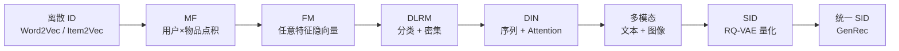

**详细对比**:

| 阶段 | Embedding 类型 | 维度 | 表达力 |
|------|---------------|------|--------|
| Word2Vec (2013) | 静态词向量 | 100-300 | 浅 |
| Item2Vec (2016) | 物品向量 | 64-256 | 浅 |
| MF | 用户 / 物品向量 | 64-128 | 点积 |
| FM | 任意特征隐向量 | k=10 | 二阶 |
| DLRM | 分类 + 连续 | 64-256 | MLP |
| DIN | 序列 + Attention | 64 | 序列 |
| MMoE | 多任务共享 | 64 | 多任务 |
| SID | RQ-VAE 量化 | 256-2048 | 层级语义 |
| GenRec | 统一 SID 嵌入 | 256-4096 | Transformer |

**演进主线**: 从"单一 ID"到"多模态融合"到"层级语义化",表达力单调提升。

### 5.2 特征交叉演进

推荐系统的特征交叉经历了**显式 → 隐式 → 注意力**的演进:

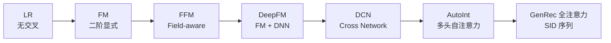

**公式演进**:

LR:
$$
\hat{y} = \sigma(\mathbf{w}^T \mathbf{x} + b)
$$

FM:
$$
\hat{y}_\text{FM} = w_0 + \sum_i w_i x_i + \sum_i \sum_{j>i} \langle v_i, v_j \rangle x_i x_j
$$

DeepFM:
$$
\hat{y}_\text{DeepFM} = \sigma(\text{MLP}([\text{FM}(x); \text{DNN}(x)]))
$$

DCN:
$$
\mathbf{x}_{l+1} = \mathbf{x}_0 \odot (W_l \mathbf{x}_l + b_l) + \mathbf{x}_l
$$

AutoInt:
$$
\mathbf{E}_{l+1} = \text{MHA}(\mathbf{E}_l, \mathbf{E}_l, \mathbf{E}_l)
$$

GenRec (Decoder self-attention):
$$
\text{Attn}(Q, K, V) = \text{Softmax}\left(\frac{Q K^T}{\sqrt{d_k}} + M_\text{causal}\right) V
$$

**演进主线**: 显式二阶 → 隐式高阶 → 注意力自适应。

### 5.3 序列建模演进

推荐系统的序列建模从"无序列"到"全序列自回归":

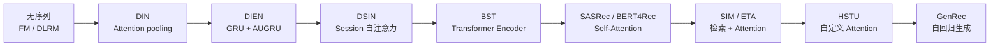

**序列长度演进**:

| 模型 | 序列长度 | 计算复杂度 |
|------|---------|------------|
| DLRM | 0 (无序列) | O(n) |
| DIN | 100 | O(n²d) |
| DIEN | 100-500 | O(n × d) RNN |
| BST | 100 | O(n²d) |
| SIM | 1000 | O(K + n) 检索 |
| ETA | 1000 | O(√n) |
| HSTU | 8192 | 稀疏 O(8n²) |
| GenRec | 10K+ | 稀疏 + 自回归 |

**演进主线**: 长度增加 + 复杂度控制 + 生成化。

### 5.4 多任务演进

推荐系统的多任务建模从"简单共享"到"门控专家"再到"统一损失":

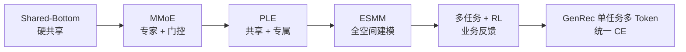

**多任务目标数的演进**:

| 模型 | 任务数 | 融合方式 |
|------|-------|---------|
| Shared-Bottom | 2-5 | 加权 loss |
| MMoE | 2-8 | 软门控 expert |
| PLE | 2-10 | 硬共享 + 软专属 |
| ESMM | 2 (CTR + CVR) | 乘积关系 |
| 多任务 + RL | 2-5 | 联合优化 |
| GenRec | 多 token 同时优化 | 单一 CE + 多目标 token |

**演进主线**: 从"硬融合"到"软融合"到"统一目标"。

### 5.5 注意力机制演进

推荐系统的注意力机制从"加权求和"到"全 self-attention"到"自回归":

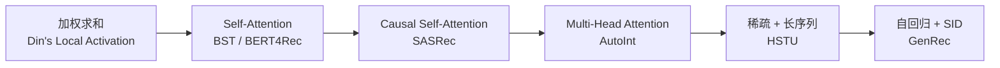

**关键创新点**:

| 注意力 | 论文 | 关键创新 |
|--------|------|---------|
| Local Activation | DIN (2018) | 加权求和, candidate-aware |
| Self-Attention | BST (2019) | 全局注意力编码 |
| Causal Self-Attention | SASRec (2018) | 因果掩码 |
| Multi-Head | AutoInt (2019) | 多头特征交互 |
| Flash / Sparse | HSTU (2024) | IO 感知 + 稀疏 |
| Constrained Decoding | TIGER (2023) | Trie 约束生成 |

**演进主线**: 加权 → 全局 → 因果 → 稀疏 → 受控。

---

## 6. 训练范式对比

### 6.1 损失函数对比

#### 6.1.1 LLM 损失

LLM 损失是 **CrossEntropy on next-token**,一个标量 loss 优化整段文本:

$$
\mathcal{L}_\text{LLM} = -\frac{1}{T} \sum_{t=1}^{T} \log p_\theta(x_t | x_{<t})
$$

其中 $p_\theta(x_t | x_{<t})$ 是 softmax over 词表。

#### 6.1.2 GenRec 损失

GenRec 损失与 LLM 完全相同形式,只是目标 token 是 SID:

$$
\mathcal{L}_\text{GenRec} = -\frac{1}{T} \sum_{t=1}^{T} \log p_\theta(s_t | s_{<t}, h)
$$

#### 6.1.3 传统推荐损失

传统推荐损失多样,包括:

**BCE Loss** (pointwise):
$$
\mathcal{L}_\text{BCE} = -\frac{1}{N} \sum_i y_i \log \hat{y}_i + (1 - y_i) \log (1 - \hat{y}_i)
$$

**BPR Loss** (pairwise):
$$
\mathcal{L}_\text{BPR} = -\sum_{(u, i^+, i^-)} \log \sigma(\hat{y}_{ui^+} - \hat{y}_{ui^-})
$$

**Softmax Loss** (listwise / contrastive):
$$
\mathcal{L}_\text{softmax} = -\log \frac{\exp(\hat{y}_{ui^+})}{\sum_{i} \exp(\hat{y}_{ui})}
$$

#### 6.1.4 对比

| 维度 | LLM | GenRec | 传统推荐 |
|------|-----|--------|---------|
| 损失数 | 1 (CE) | 1 (CE) | 多 (BCE, BPR, Softmax, Focal) |
| label 来源 | Shifted | Shifted | 显式 / 隐式 |
| 多任务 | 加权 | 加权 + 多 token | 加权 / Pareto |
| loss 物理意义 | 困惑度 | 困惑度 (per token) | 概率 / 排序 |
| 收敛难度 | 低 (label smoothing) | 低 | 中 (需平衡) |
| 与 SFT 兼容 | ✓ | ✓ | 受限 |

### 6.2 优化器与学习率

#### 6.2.1 LLM 优化器

LLM 几乎都用 **AdamW** (Adam + decoupled weight decay):

```python
optimizer = torch.optim.AdamW(
    model.parameters(),
    lr=3e-4,
    betas=(0.9, 0.95),
    eps=1e-8,
    weight_decay=0.1,
)
# 学习率 warmup + cosine
scheduler = get_cosine_schedule_with_warmup(
    optimizer,
    num_warmup_steps=2000,
    num_training_steps=100000,
)
```

#### 6.2.2 GenRec 优化器

GenRec 与 LLM 相同,通常用 AdamW,学习率 1e-4 到 5e-4。

#### 6.2.3 传统推荐优化器

传统推荐优化器多样:
- **Adam** (主流)
- **SGD** (简单场景)
- **Adagrad** (稀疏特征)
- **FTRL** (在线学习)
- **LAMB** (大 batch)

学习率范围 1e-3 ~ 1e-2。

#### 6.2.4 对比

| 维度 | LLM | GenRec | 传统推荐 |
|------|-----|--------|---------|
| 优化器 | AdamW | AdamW | 多样 |
| 学习率 | 1e-5 ~ 1e-4 | 1e-4 ~ 5e-4 | 1e-3 ~ 1e-2 |
| Warmup | 必须 | 必须 | 可选 |
| Scheduler | cosine | cosine | 多样 |
| 大 batch | 必备 | 必备 | 可选 |

### 6.3 负采样策略

#### 6.3.1 LLM 负采样

LLM 没有显式负采样——通过 Causal Mask + softmax 实现隐式负采样,负样本是词表中所有其他 token。

#### 6.3.2 GenRec 负采样

GenRec 也用 Causal Mask + softmax,但在 SID 词表上 softmax:

$$
p(s_t | s_{<t}) = \text{softmax}(\text{logits} / \tau)
$$

负样本是词表中所有其他 SID。

#### 6.3.3 传统推荐负采样

传统推荐负采样有多种策略:

**Random Negative Sampling**:
- 从物品池中随机抽取 N 个未交互物品
- 公式: $\mathcal{L} = \sum_i \log \sigma(\hat{y}_i) + \sum_{j \sim P} \log \sigma(-\hat{y}_j)$
- 比例: 1:5 ~ 1:100 (负样本多)

**Hard Negative Mining**:
- 用当前模型打分高的负样本
- 因为这些样本最难,训练更有信息量

**In-Batch Negatives** (双塔):
- batch 内其他样本作为负样本
- 实现简单,免费负样本

**Popularity-Biased Sampling**:
- 热门物品更频繁
- 解决头部偏置

#### 6.3.4 对比

| 维度 | LLM | GenRec | 传统推荐 |
|------|-----|--------|---------|
| 负样本 | 词表其他 token | 词表其他 SID | 显式采样 |
| 比例 | 1:V (大) | 1:V (大) | 1:N (小) |
| Hard 挖掘 | 无 | 无 | 常见 |
| 计算成本 | softmax 主流 | softmax 主流 | 灵活 |

### 6.4 训练数据规模

#### 6.4.1 LLM 训练数据

| 模型 | Tokens | 数据源 |
|------|--------|--------|
| GPT-3 | 300B | CommonCrawl + Books + Wiki |
| LLaMA 3 | 15.6T | 多源混合 |
| DeepSeek-V3 | 14.8T | 多源 |
| 主流 LLM | 1T-30T | 大 |

#### 6.4.2 GenRec 训练数据

| 模型 | 训练样本 | 序列数 |
|------|---------|--------|
| HSTU | 数亿到数十亿行为 | 数亿用户 |
| OneRec | 数十亿 | 数十亿 |
| MTGR | 数百亿 (含 LBS) | 数十亿 |
| TIGER | 千万级 | 千万级 |

#### 6.4.3 传统推荐训练数据

| 场景 | 样本量 |
|------|--------|
| 召回 | 数十亿 |
| 精排 | 数十亿-数百亿 |
| 工业推荐 | 千亿级 |

#### 6.4.4 对比

| 维度 | LLM | GenRec | 传统推荐 |
|------|-----|--------|---------|
| 数据类型 | 文本 tokens | 行为 + 文本 | 行为 |
| 样本量 | TB 级 | 数亿-数百亿 | 千亿级 |
| 数据生成 | 抓取 | 业务日志 | 业务日志 |
| 数据质量 | 高 (经过滤) | 中-高 | 中 |
| 增长 | 慢 (公开数据有限) | 快 | 快 |

### 6.5 训练成本

#### 6.5.1 LLM 训练成本

| 模型 | 训练时长 | 硬件 | 成本 |
|------|---------|------|------|
| GPT-3 (175B) | 数周 | 1000+ V100 | ~$5M |
| LLaMA 3 (70B) | 数月 | 数千 H100 | ~$50M |
| LLaMA 3 (405B) | 数月 | 16K H100 | ~$200M |

#### 6.5.2 GenRec 训练成本

| 模型 | 训练时长 | 硬件 | 成本 |
|------|---------|------|------|
| HSTU (工业级) | 数天-数周 | 数十-数百 H100 | $50K-$1M |
| OneRec | 数周 | 数百 H100 | 数百万 |
| TokenMixer-Large (7B) | 数周 | 数十-数百 H100 | $1M |

#### 6.5.3 传统推荐训练成本

| 模型 | 训练时长 | 硬件 | 成本 |
|------|---------|------|------|
| DLRM | 数小时-数天 | 数卡 A100 | $1K-$10K |
| DIN/DIEN | 数小时-数天 | 数卡 A100 | $1K-$10K |
| 工业级 MMoE | 数天 | 数十卡 | $10K |

#### 6.5.4 对比

| 维度 | LLM | GenRec | 传统推荐 |
|------|-----|--------|---------|
| 单次训练成本 | 数百万-数亿美元 | 数十万-数百万 | 数千-数万美元 |
| 训练硬件 | 千卡 H100 | 数十-数百 H100 | 数卡 A100 |
| 训练时长 | 数周-数月 | 数天-数周 | 数小时-数天 |
| 重复训练 | 高 (新数据) | 中 (微调) | 高 (新数据) |

---

## 7. 推理与部署对比

### 7.1 在线服务架构

#### 7.1.1 LLM 在线服务

```text
用户请求 → API Gateway → Load Balancer → LLM Inference
                                      ↓
                          [Batcher + Scheduler]
                                      ↓
                          KV Cache + Model Forward
                                      ↓
                          Stream Response → 用户
```

LLM 服务依赖连续批处理 (continuous batching) + KV cache 调度器。代表框架: vLLM, SGLang, TGI, TensorRT-LLM。

#### 7.1.2 GenRec 在线服务

```text
用户请求 → 拉取历史 → GenRec Encoder → Decoder 自回归
                    ↓
              [Trie 约束 Beam Search]
                    ↓
                Business Filter → Top-K 推荐
```

GenRec 服务核心是 **Trie 约束解码** + 连续批处理。代表: vLLM + Trie 扩展, NVIDIA Merlin + GenRec。

#### 7.1.3 传统推荐在线服务

```text
用户请求 → 召回 (Faiss) → 粗排 → 精排 → 重排 → 业务规则 → 返回
              ↓
         [5-15ms] [5-10ms] [10-30ms] [1-5ms]
              ↓
            总 < 80ms
```

传统推荐是**分阶段流水线**,每个阶段用专门模型单独服务。

#### 7.1.4 对比

| 维度 | LLM | GenRec | 传统推荐 |
|------|-----|--------|---------|
| 服务形态 | 单模型 + 路由 | 单模型 + Trie | 多模型流水线 |
| 延迟分布 | 长尾 (序列长度差) | 长尾 (Beam 深度) | 稳定 |
| 资源占用 | 高显存 | 中-高显存 | 低显存 |
| 部署复杂度 | 高 | 中-高 | 中 |
| 弹性 | 受 KV cache 限制 | 受 KV + Trie 限制 | 易扩容 |

### 7.2 召回通道 vs 精排

#### 7.2.1 LLM 在推荐中的位置

LLM 在推荐中通常只做 **重排** 或 **补充语义**,不直接做召回:

```text
流程 (LLM-as-Reranker):
召回 (双塔/DSSM) → 粗排 (精排模型 top-100) → LLM 重排 (top-10) → 输出
```

LLM 的"召回"等价于"开放式回答",但在推荐中无法保证召回的工业级延迟。

#### 7.2.2 GenRec 召回 + 精排

GenRec 把**召回和精排统一为"自回归生成"**——一次生成 = 召回 + 排序。

```text
流程 (GenRec 端到端):
历史 → GenRec 模型 → 自回归生成 → Top-K 物品
```

GenRec 用 Trie 约束 + Beam Search 实现"生成 top-K"。

#### 7.2.3 传统推荐召回 + 精排

传统推荐明确分为召回 / 粗排 / 精排三个阶段:

```text
召回 (双塔/DSSM/规则) → 粗排 (蒸馏轻量) → 精排 (DLRM/DIN) → 重排 (业务规则)
```

每阶段用专门模型,有不同指标 (召回看 Hit Rate, 精排看 NDCG)。

#### 7.2.4 对比

| 维度 | LLM | GenRec | 传统推荐 |
|------|-----|--------|---------|
| 召回 | 不直接做 | 端到端 | 双塔 / DSSM |
| 精排 | 重排 | 与召回统一 | DLRM / DIN |
| 粗排 | 不做 | 与召回统一 | 蒸馏 / 轻量 |
| 重排 | LLM 输出解释 | 业务规则 | 业务规则 |

### 7.3 延迟与吞吐

#### 7.3.1 延迟对比

| 场景 | LLM | GenRec | 传统推荐 |
|------|-----|--------|---------|
| 单请求 p50 | 1s | 20ms | 50ms |
| 单请求 p99 | 10s | 50ms | 100ms |
| 长请求 p99 | 30s | 100ms | 200ms |
| 首 token 延迟 | 200ms-1s | 10ms | (无生成) |
| 总交互延迟 | 1-30s | 50-200ms | 100-300ms |

#### 7.3.2 吞吐对比

| 场景 | LLM | GenRec | 传统推荐 |
|------|-----|--------|---------|
| 单卡 H100 | 数十-数百 QPS | 数千 QPS | 数万 QPS |
| 单集群 | 千 QPS | 万级 QPS | 数十万 QPS |
| 峰值 (双 11) | (不参与主链) | 数十万 QPS | 百万 QPS |

#### 7.3.3 对比

| 维度 | LLM | GenRec | 传统推荐 |
|------|-----|--------|---------|
| 延迟 | 长 | 中 | 短 |
| 吞吐 (per GPU) | 低 | 中 | 高 |
| 并发能力 | 通过 batching 提升 | 通过 batching | 原生强 |
| 实时性 | 弱 | 中 | 强 |

### 7.4 显存与成本

#### 7.4.1 显存占用

| 模型 | 显存 (FP16) | 推理 KV cache (典型) |
|------|-------------|---------------------|
| LLM 7B | 14 GB | 1-10 GB |
| LLM 70B | 140 GB | 5-50 GB |
| GenRec 1B | 2 GB | 0.5-2 GB |
| GenRec 7B | 14 GB | 1-10 GB |
| DLRM (10B 物品) | 数十 GB (嵌入表) | 1-5 GB |
| DIN (10M 物品) | 数十 GB | 0.5 GB |

#### 7.4.2 单次推理成本

| 模型 | 单请求成本 |
|------|-----------|
| LLM 70B API | $0.001-0.01 per response |
| GenRec 7B | $0.000001-0.0001 per request |
| 传统推荐端到端 | $0.0000001 per request |

LLM 单次推理成本是传统推荐的 1000-10000 倍。

#### 7.4.3 对比

| 维度 | LLM | GenRec | 传统推荐 |
|------|-----|--------|---------|
| 单请求成本 | 极高 | 中 | 极低 |
| 显存需求 | 高 | 中-高 | 低-中 (主要嵌入表) |
| 推理优化 | 量化 + 推测解码 | 量化 + Trie + 推测 | 量化 + 蒸馏 |
| 单位 token 成本 | $0.0001-0.01 | $0.0000001 | $0.00000001 |

### 7.5 AB 实验与监控

#### 7.5.1 AB 实验对比

| 维度 | LLM | GenRec | 传统推荐 |
|------|-----|--------|---------|
| 实验粒度 | 用户 / prompt | 用户 / 流量 | 用户 |
| 流量比例 | 1-10% | 1-10% | 1-10% |
| 观测时长 | 1-4 周 | 1-4 周 | 1-4 周 |
| 显著性指标 | CSAT, helpfulness | CTR / GMV | CTR / GMV |
| 风险等级 | 高 (LLM 可能说错) | 中-高 | 中 |
| 回滚速度 | 慢 (更新慢) | 中 | 快 |

#### 7.5.2 监控对比

| 监控项 | LLM | GenRec | 传统推荐 |
|--------|-----|--------|---------|
| Token 长度 | ✓ | ✓ | 无 |
| KV cache 利用 | ✓ | ✓ | 无 |
| Beam 终止率 | 无 | ✓ | 无 |
| Trie 命中率 | 无 | ✓ | 无 |
| 业务 CTR | ✓ | ✓ | ✓ |
| 长效留存 | ✓ (难) | ✓ | ✓ |
| 推理延迟 | ✓ | ✓ | ✓ |
| 多样性 | ✓ | ✓ | ✓ |

---

## 8. 工业案例对比

### 8.1 Meta DLRM 落地

#### 8.1.1 模型与规模

DLRM 是 Meta 在 Facebook / Instagram / Messenger 上的主力推荐模型。论文披露规模:
- 嵌入表: 数十 GB (数十亿物品 ID)
- 模型参数量: 数百 GB (大部分是嵌入)
- 服务 QPS: 万亿级 / 天

#### 8.1.2 工程优化

- **嵌入表分片**: 把大嵌入表分片到多卡 / 多机 (DDP + 嵌入分片)
- **混合精度**: FP32 嵌入 + BF16 交互
- **特征频率感知稀疏化**: 低频特征用更小嵌入
- **批量加权**: 在线时按 batch 动态加权

#### 8.1.3 业务效果

- CTR: +显著 (FB / IG 主 Feed)
- GMV: +5-10% (Instagram Shop)
- 推理延迟: < 30ms p99

#### 8.1.4 与 LLM / GenRec 的共存

Meta 同时维护:
- **DLRM**: 主力精排模型
- **HSTU**: GenRec 实验模型
- **Llama / Open-source LLM**: 内部用 + 开源

这种"传统 + GenRec + LLM"三套并存的工程模式,在 Meta / Google 等大厂是常态。

**引用**: [Naumov et al. 2019 - DLRM](https://arxiv.org/abs/1906.00091);[Meta 工程博客 2024](https://engineering.fb.com/2024/04/parallel-computing/asynchronous-dataflow-ai-training-dlrm/)。

### 8.2 阿里 DIN 落地

#### 8.2.1 模型与规模

DIN 是阿里妈妈广告 CTR 预估的核心模型。规模:
- 物品数: 数十亿
- 用户数: 数十亿
- 服务 QPS: 数万级 per cluster

#### 8.2.2 工程优化

- **Mini-Batch Negatives**: 每个 batch 内多正样本
- **DiceFocal Loss**: 针对长尾分布
- **Dice Activation**: 自适应激活
- **本地激活单元**: candidate-aware 注意力,在 GPU 上高效

#### 8.2.3 DIN 系列演进

```text
DIN (2018) → DIEN (2019) → DSIN (2019) → BST (2019)
   ↓
   → MIMN (2019) → SIM (2020) → ETA (2021)
   ↓
   → LONGER (2024) → HSTU-like 工业实验
```

阿里妈妈每年都在 DIN 基础上迭代,逐步引入 Transformer、检索、稀疏化等。

#### 8.2.4 业务效果

- 淘宝主搜 / 直通车: CTR +5-10%, RPM (每千次曝光收入) +10-15%
- 1688 工业品: 转化率 +8%
- 闲鱼: 用户停留时长 +12%

**引用**: [Zhou et al. 2018 - DIN](https://arxiv.org/abs/1706.06978);[Zhou et al. 2019 - DIEN](https://arxiv.org/abs/1809.03672)。

### 8.3 美团 MMoE 落地

#### 8.3.1 模型与规模

美团大规模使用 MMoE / PLE 系列处理多业务 (外卖 / 闪购 / 酒店 / 休闲娱乐 / 医美)。规模:
- 业务数: 数十
- 用户数: 数亿
- 模型数: 数百 (每个业务有独立模型)

#### 8.3.2 工程优化

- **多业务 PLE**: 各业务有自己的 expert + 共享 expert
- **业务路由**: 根据用户当前业务上下文路由到对应 expert
- **冷启动**: 元学习处理新业务

#### 8.3.3 业务效果

| 业务 | 指标 | 提升 |
|------|------|------|
| 外卖 CTR | +5% | MMoE |
| 闪购 CVR | +8% | PLE |
| 酒店点击 | +3% | 多任务 |
| 美团到家 | +10% | 多任务 + RL |

#### 8.3.4 MTGR (GenRec)

美团 2024 发布 MTGR (Meituan Generative Recommendation),把 HSTU + DLRM 混合到 LBS 推荐:
- 静态特征用 DLRM
- 序列特征用 HSTU
- 联合训练 + 服务
- 业务 lift +10-15% (LBS 场景)

**引用**: [Ma et al. 2018 - MMoE](https://arxiv.org/abs/1701.06538);[Tang et al. 2020 - PLE](http://proceedings.mlr.press/v119/tang20a.html);[MTGR 论文 2024](https://arxiv.org/abs/2407.10245)。

### 8.4 YouTube 双塔

#### 8.4.1 模型与规模

YouTube-DNN (Covington 2016) 是 Google YouTube 视频推荐的核心模型。规模:
- 视频数: 数亿
- 用户数: 数十亿
- QPS: 百万级

#### 8.4.2 工程优化

- **样本修正 (sampling bias correction)**: 显式纠正训练/推理分布差异
- **多任务**: 用户 engagement + satisfaction 双塔融合
- **集成学习**: 双塔 + 树模型 + 规则融合

#### 8.4.3 双塔演进

YouTube 双塔演进了三代:
1. **YouTube-DNN (2016)**: 经典双塔
2. **多任务双塔 (2019)**: MMoE 集成
3. **生成式召回 (2024)**: 类似 TIGER

#### 8.4.4 业务效果

- YouTube Shorts 视频推荐: watch time +15%, CTR +5-10%
- 主 Feed: CTR +8%, 留存 +3%

**引用**: [Covington 2016 - YouTube-DNN](https://research.google/pubs/youtube-deep-neural-network-for-recommender-systems/);[Yi 2019 - Twin-tower with sampling correction](https://arxiv.org/abs/1906.04669)。

### 8.5 字节 SIM 长序列

#### 8.5.1 模型与规模

字节的 SIM (Search-based Interest Model) 改造版本是抖音主推荐的核心。规模:
- 用户数: 数亿
- 物品数: 数亿短视频
- 历史长度: 10000+
- QPS: 千万级

#### 8.5.2 工程优化

- **两阶段检索 (GSU + ESU)**: GSU 用候选做 query 找出 top-100 相关历史,ESU 在 top-100 内 attention
- **LSH 桶**: 把历史物品分桶, 候选查桶
- **渐进式部署**: 1% → 10% → 50% → 100%

#### 8.5.3 SIM 系列演进

```text
DIN → DIEN → SIM (2020) → ETA (2021) → HSTU-like (2024)
```

字节在 SIM 之后继续演进,引入 Transformer Encoder、HSTU 自定义 attention,最终推动 GenRec 化。

#### 8.5.4 业务效果

| 场景 | 指标 | 提升 |
|------|------|------|
| 抖音主 Feed | watch time | +12% |
| 西瓜视频 | 完播率 | +10% |
| TikTok 国际版 | 留存 | +5% |

#### 8.5.5 ByteRec 与 GenRec

字节内部 ByteRec 团队 2024-2025 推进 GenRec,在抖音部分场景替换 DLRM:
- 端到端召回 + 粗排
- TokenMixer-Large (7B 排序)
- ByteRec GR 框架

**引用**: [Pi et al. 2020 - SIM](https://arxiv.org/abs/2006.05639);[字节 ByteRec 2024](https://arxiv.org/abs/2602.06563)。

---

## 9. 关键范式差异

### 9.1 离散 vs 连续 ID

#### 9.1.1 离散 ID (传统)

```text
物品 ID = 整数 (item_123456)
     ↓ Embedding lookup
e_{item_123456} ∈ R^d (稀疏, 高维)
```

离散 ID 的特点:
- 每个物品独占一个嵌入
- 无法泛化到未见过的 ID
- 词表大小 = 物品数 (百万-亿)

#### 9.1.2 连续 ID / SID (GenRec)

```text
物品 → Encoder → 连续 z ∈ R^d
     ↓ RQ-VAE 量化
SID = (c_0, c_1, c_2)  离散但由连续空间映射而来
```

SID 的特点:
- 每个物品用 3-5 个 token 编码
- 相近内容 → 相近 SID
- 词表大小 = codebook 数 (数千)

#### 9.1.3 对比

| 维度 | 离散 ID | SID |
|------|---------|-----|
| 词表大小 | 10⁶-10⁹ | 数千 |
| 新物品 | 重训 | 自动 |
| 泛化 | 弱 | 强 |
| 工程 | 简单 | 中等 |
| 内容理解 | 无 | 强 |

#### 9.1.4 LLM 的"连续 ID"

LLM 用 BPE 子词,介于离散与连续之间:
- 词表固定 (32K-128K)
- 子词代表"语义片段"
- 新词通过组合已有子词表达

LLM 的"连续 ID"是**语言语义连续**,但不是 SID 那种"物品空间连续"。

### 9.2 判别式 vs 生成式

#### 9.2.1 判别式 (传统推荐)

判别式模型直接学 $P(y | x)$,给定用户 $x$ 预测物品分数 $y$:

$$
P(\text{click} | \text{user}, \text{context}, \text{item})
$$

#### 9.2.2 生成式 (LLM & GenRec)

生成式模型学 $P(x | \text{context})$,给定历史自回归生成下一个 token:

$$
P(s_t | s_{<t}, \text{history})
$$

#### 9.2.3 对比

| 维度 | 判别式 | 生成式 |
|------|--------|--------|
| 学习目标 | 分类 / 回归 | 自回归 |
| 输出 | 分数 | token |
| 训练数据 | 标签对 | 序列 |
| 多输出 | 单 | 多 |
| 解释性 | 难 | 难 (但可 CoT) |
| 工业 ROI | 高 | 高 (LLM) / 实验中 (GenRec) |

#### 9.2.4 在推荐上的对比

判别式:
```text
(用户, 历史, 候选) → MLP → score → 排序
```

生成式 (GenRec):
```text
(用户, 历史) → Decoder → 自回归生成候选
```

判别式优点:**直接优化业务指标**(BCE on CTR),收敛快,可解释。
生成式优点:**统一范式**,长序列,长尾,泛化更好。

### 9.3 静态 vs 动态扩展

#### 9.3.1 静态 (传统)

传统推荐的 ID 词表**基本固定**,新增物品需要:
- 重新训练嵌入
- 或用哈希 / 平均初始化

```text
新物品入库 → 分配新 ID → 加入训练集 → 重训嵌入
```

#### 9.3.2 动态 (GenRec)

GenRec 的 SID 编码器**可独立重训**,主模型不需要为新物品重训:

```text
新物品入库:
  1. Encoder 输入内容 → z_new
  2. RQ-VAE → SID_new
  3. 主模型不需重训 (因为 SID 落入已有空间)
```

#### 9.3.3 动态 (LLM)

LLM 也支持动态,但机制不同:
- 通过 prompt 注入新物品信息
- 通过 SFT / LoRA 微调
- 通过 RAG 检索外部知识

#### 9.3.4 对比

| 维度 | 传统 | GenRec | LLM |
|------|------|--------|-----|
| 新物品 | 重训主模型 | 编码一次 | Prompt / 微调 |
| 增量成本 | 高 | 低 | 中 |
| 实时性 | 弱 | 强 | 中 |
| 适用场景 | 静态内容 | 动态内容 | 通用 |

### 9.4 通用智能 vs 业务专属

#### 9.4.1 业务专属 (传统推荐)

传统推荐是**业务专属**——模型只针对一个场景、一个数据集、一个目标:

```python
# 淘宝 CTR 模型
class TaobaoCTR(nn.Module):
    def __init__(self):
        # 数十亿物品嵌入
        self.embeddings = ...
        # DIN 注意力
        self.attention = ...
        # MLP
        self.mlp = ...
```

模型换业务 = 重训全部参数。

#### 9.4.2 通用智能 (LLM)

LLM 是**通用智能**——同一模型处理文本、代码、推理、对话、推荐(实验性):

```python
# Qwen 通用模型
class QwenModel(nn.Module):
    def __init__(self):
        self.embeddings = TokenEmbedding(vocab=152000)
        self.decoder = Decoder(layers=80, ...)
```

模型换任务 = prompt 或 LoRA。

#### 9.4.3 GenRec 介于两者之间

GenRec 是**任务专属但范式通用**:
- 任务: 推荐 (专属)
- 范式: Transformer 自回归 (通用,与 LLM 共享)
- 知识: 共享 SID 编码器 + 共享基础设施

```python
# GenRec 模型
class GenRecModel(nn.Module):
    def __init__(self):
        self.sid_embed = SIDEmbedding(codebook_sizes=[256, 256, 256])
        self.decoder = Decoder(layers=12, ...)  # 与 LLM 共用架构
        self.head = NextSIDHead(num_sids=4096)
```

#### 9.4.4 对比

| 维度 | 业务专属 | 通用智能 |
|------|---------|---------|
| 模型替换成本 | 高 (重训) | 低 (prompt) |
| 业务指标优化 | 直接 (目标函数对应) | 间接 (RLHF 间接对齐) |
| 跨业务迁移 | 难 | 易 |
| 算力效率 | 高 (专用) | 低 (通用) |
| 长期价值 | 中-高 | 高 |

---

## 10. 优势与局限对比

### 10.1 传统推荐的优势/局限

#### 10.1.1 优势

| 优势 | 描述 |
|------|------|
| **业务直接** | 损失函数直接对应业务指标 (BCE on CTR) |
| **训练高效** | 数小时训练,数卡 GPU 即可 |
| **推理快** | 单 stage < 30ms,端到端 < 100ms |
| **可解释** | 注意力图 + 特征重要性 |
| **工程成熟** | 20 年积累,工具链完整 |
| **低成本** | 单次推理 $0.0000001 |
| **稳定可控** | 显式特征工程,无幻觉 |
| **在线学习** | FTRL / 嵌入表实时更新 |

#### 10.1.2 局限

| 局限 | 描述 |
|------|------|
| **特征工程重** | 需大量人工特征 |
| **冷启动弱** | 新物品 / 新用户难处理 |
| **长序列弱** | 受限于 O(n²) |
| **泛化弱** | 仅学过的物品能推 |
| **无语义** | 不能理解内容 / 上下文 |
| **业务专属** | 跨场景难迁移 |
| **缺乏推理** | 不能"理解为什么推荐" |
| **天花板低** | 工业精度 80-90% 难突破 |

### 10.2 LLM 的优势/局限

#### 10.2.1 优势

| 优势 | 描述 |
|------|------|
| **强语义** | 自然语言理解 + 推理 |
| **冷启动** | 自然语言描述即可 |
| **长文本理解** | 数千-数百万 token |
| **通用** | 跨任务、跨领域 |
| **零样本 / 少样本** | ICL 能力 |
| **推理能力** | CoT / Step-by-step |
| **可对话** | 解释 + 多轮 |
| **跨模态** | 文本 + 图像 + 音频 |

#### 10.2.2 局限

| 局限 | 描述 |
|------|------|
| **推理慢** | 数秒-数十秒 |
| **成本高** | 单请求 $0.001-0.01 |
| **无语义 ID** | 不能直接推物品 |
| **无业务信号** | 缺用户行为数据 |
| **幻觉** | 可能编造内容 |
| **无实时性** | 不能秒级更新 |
| **候选集过大** | 千亿物品无法直接处理 |
| **不擅长排序** | 不能直接对亿级候选排序 |

### 10.3 GenRec 的优势/局限

#### 10.3.1 优势

| 优势 | 描述 |
|------|------|
| **统一范式** | 与 LLM 共享 Next-token |
| **语义 SID** | 内容 → 连续编码 → 离散 SID |
| **冷启动** | 自动泛化 (内容相似 → SID 相似) |
| **长序列** | HSTU 支持 8K+ |
| **可解释** | 生成过程可视化 |
| **可 SFT / RL** | 直接套用 LLM RLHF |
| **工业延迟** | < 50ms 可达 |
| **统一召回 + 精排** | 端到端生成 |

#### 10.3.2 局限

| 局限 | 描述 |
|------|------|
| **工程复杂** | Trie + 自回归 + Constrained Decoding |
| **训练成本** | 中-高 (数十万-百万) |
| **在线学习弱** | Encoder 与主模型分体重训 |
| **泛化不如 LLM** | 限于物品 SID 空间 |
| **可解释性弱** | 自注意力难解释 |
| **评估难** | 与 LLM/传统指标难统一 |
| **业务天花板** | 尚未被大规模工业验证 |
| **生态不成熟** | 工具链不如传统推荐 |

---

## 11. 融合路径

### 11.1 LLM + DLRM

#### 11.1.1 LLM-as-Feature

用 LLM 把文本 / 多模态输入编码成向量, 作为 DLRM 的额外特征输入:

$$
\mathbf{x}_\text{enhanced} = [\mathbf{x}_\text{behavior}; \text{LLMEncode}(\mathbf{x}_\text{text})]
$$

其中 LLMEncode 是 frozen LLM (通常是 1B-7B)。

**代表案例**:
- 阿里妈妈: 用 Qwen 编码 query / item 文本
- 美团: 用 LLM 编码商品详情 + 评论
- 字节抖音: 用 LLM 编码视频标题 / 描述

**收益**: +0.5-1.5% 业务 lift。

#### 11.1.2 LLM-as-Reranker

用 GenRec 召回候选, 用 LLM 重排:

$$
\text{final\_items} = \text{Reranker}(\text{LLM}, \text{GenRec}(\text{candidates}))
$$

**典型流程**:
```text
GenRec Recalls (1000)
   ↓
GenRec Ranker (top 50)
   ↓
LLM Reranker (top 10)
   ↓
最终推荐
```

**收益**: +1-3% 业务 lift, 可解释性提升。

#### 11.1.3 LLM-as-Reasoner

LLM 做推理, DLRM 做决策 (OneRec-Think / OxygenREC 模式):

```text
LLM Reasoner (慢, 离线)
   ├── 分析用户兴趣
   ├── 生成推理路径 (CoT)
   ├── 输出结构化信号
   ↓
DLRM Predictor (快, 在线)
   ├── 接收 LLM 信号 + 用户实时特征
   ├── 输出推荐
```

慢 LLM 离线化 (10-30s), 不影响在线延迟。

### 11.2 GenRec + 传统精排

#### 11.2.1 Hybrid Pipeline

GenRec 做召回, 传统精排 (DLRM / DIN) 做精细排序:

```text
GenRec 召回 (top-1000) → 传统精排 (top-50) → 重排 (top-10)
```

**优势**:
- GenRec 强大的召回能力 + 传统精排的高精度分数
- 两阶段优势叠加
- 工程改动最小

#### 11.2.2 MTGR 模式 (混合架构)

MTGR (美团) 把 HSTU 与 DLRM 混合到同一模型:
- 静态特征: DLRM 处理
- 序列特征: HSTU 处理
- 联合训练 + 服务

效果: 业务 lift +10-15% (LBS 场景)

#### 11.2.3 HSTU + 业务精排

HSTU (Meta) 作为端到端模型,可作为召回 + 粗排的生成式统一层:
- HSTU 生成 Top-100 候选
- 业务精排模型对 Top-100 精细打分
- 业务规则重排

### 11.3 渐进式迁移路径

#### 11.3.1 三阶段迁移策略

```text
阶段 1: 传统推荐 + LLM-as-Feature
  └─ 风险最低,收益最快

阶段 2: 召回 GenRec,精排传统
  └─ 改造召回通道,精排不动

阶段 3: 端到端 GenRec
  └─ 改造粗排 + 精排,统一为生成式
```

#### 11.3.2 迁移阶段判定

| 团队现状 | 推荐起点 |
|---------|---------|
| 已有 DLRM / DIN | 阶段 1 (LLM 特征) |
| 长序列痛点 | 阶段 2 (召回 GenRec) |
| 冷启动痛点 | 阶段 2 (SID 共享) |
| 多业务统一 | 阶段 3 (端到端) |
| 大公司探索前沿 | 直接阶段 3 |

#### 11.3.3 关键决策点

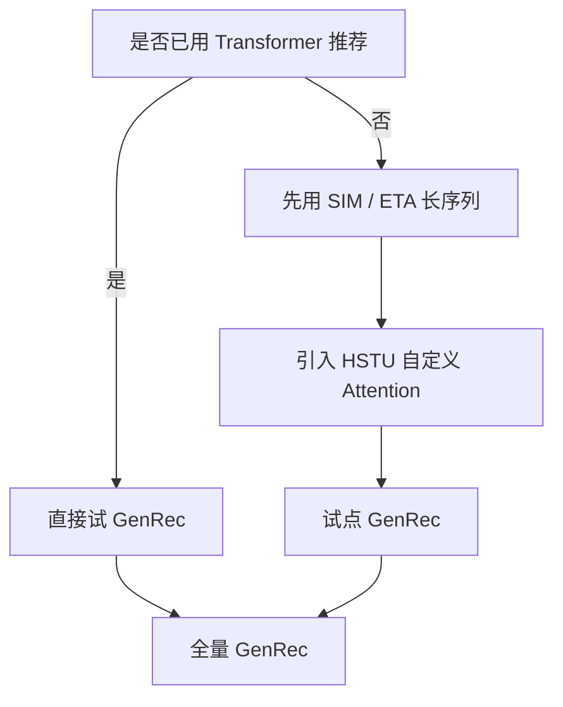

---

## 12. 三者关系图 (mermaid)

### 12.1 总体关系图

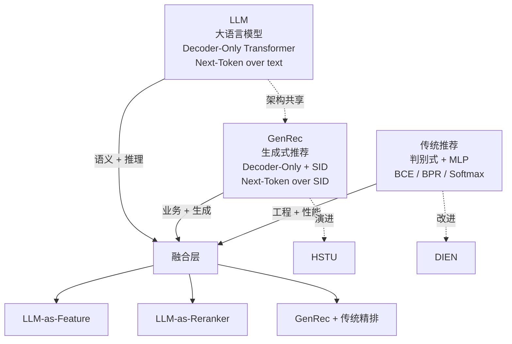

### 12.2 演进时间线

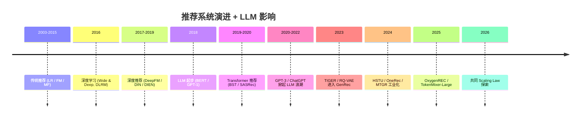

### 12.3 能力光谱

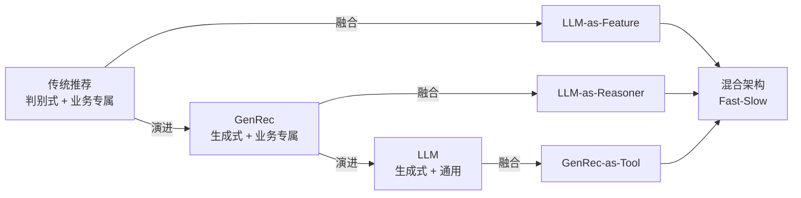

### 12.4 数据流对比

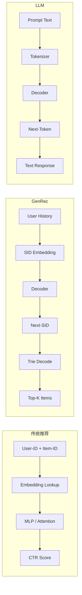

### 12.5 融合架构蓝图

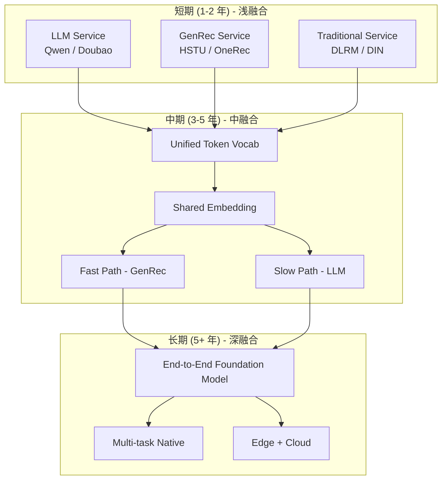

---

## 13. 一句话对比

> **LLM = 通用语言生成器,优化"人类偏好对齐",服务"用户的主动请求";GenRec = 个性化物品生成器,优化"业务 KPI 对齐",服务"系统的主动推送";传统推荐 = 任务专属打分器,优化"业务指标最大化",服务"高并发低延迟场景"。三者构成"通用 → 业务 → 工程"的能力光谱,在 2026 年的工业现实中以"LLM 补语义 + GenRec 统一范式 + 传统守住基线"的三段共存形态落地,3-5 年内逐渐收敛为统一的 Foundation Model。**

---

## 14. 附录 A · 关键论文速查

### 14.1 传统推荐论文

| 论文 | 年份 | 核心贡献 | URL |
|------|------|---------|-----|
| Matrix Factorization | 2009 | MF + 偏置 | [datajobs.com](https://datajobs.com/data-science-repo/Recommender-Systems-[Netflix].pdf) |
| Factorization Machines | 2010 | FM + 二阶交叉 | [csie.ntu.edu.tw](https://www.csie.ntu.edu.tw/~b97053/paper/Rendle2010FM.pdf) |
| DeepFM | 2017 | FM + DNN 联合 | [arxiv](https://arxiv.org/abs/1703.04247) |
| DCN | 2017 | Cross Network 高阶 | [arxiv](https://arxiv.org/abs/1708.05148) |
| DIN | 2018 | candidate-aware attn | [arxiv](https://arxiv.org/abs/1706.06978) |
| DIEN | 2019 | 兴趣演化 | [arxiv](https://arxiv.org/abs/1809.03672) |
| YouTube-DNN | 2016 | 双塔召回 | [research.google](https://research.google/pubs/youtube-deep-neural-network-for-recommender-systems/) |
| MMoE | 2018 | 多任务 expert | [arxiv](https://arxiv.org/abs/1701.06538) |
| PLE | 2020 | 任务专属 expert | [proceedings.mlr.press](http://proceedings.mlr.press/v119/tang20a.html) |
| ESMM | 2018 | 全空间多任务 | [arxiv](https://arxiv.org/abs/1804.07931) |
| DLRM | 2019 | Embedding + MLP 工业标准 | [arxiv](https://arxiv.org/abs/1906.00091) |
| SIM | 2020 | 检索 + Attention 长序列 | [arxiv](https://arxiv.org/abs/2006.05639) |

### 14.2 GenRec 论文

| 论文 | 年份 | 核心贡献 | URL |
|------|------|---------|-----|
| SASRec | 2018 | Causal Self-Attention 推荐 |  |
| BERT4Rec | 2019 | Bidirectional 推荐 |  |
| TIGER | 2023 | T5 + RQ-VAE 首篇 GenRec | [arxiv](https://arxiv.org/abs/2305.14387) |
| HSTU | 2024 | 序列专用 Transformer | [arxiv](https://arxiv.org/abs/2402.17152) |
| OneRec | 2024 | 端到端 GenRec + DPO | KDD 2025 |
| MTGR | 2024 | HSTU + DLRM 混合 | [arxiv](https://arxiv.org/abs/2407.10245) |
| TokenMixer-Large | 2024 | Token Mixer + Sparse MoE | [arxiv](https://arxiv.org/abs/2602.06563) |
| OxygenREC | 2024 | Fast-Slow Thinking |  |
| Kunlun | 2026 | GR Scaling Laws |  |

---

## 15. 附录 B · 关键代码模板

### 15.1 统一排序模型接口

```python
class UnifiedRankingModel(nn.Module):
    """LLM / GenRec / 传统推荐的统一接口"""
    def __init__(self, mode='traditional', **kwargs):
        super().__init__()
        self.mode = mode
        if mode == 'traditional':
            # 判别式 (DLRM-style)
            self.model = DLRM(...)
        elif mode == 'genrec':
            # 生成式 (HSTU-style)
            self.model = GenRecModel(...)
        elif mode == 'llm':
            # LLM-as-Reranker
            self.model = LLMReasoner(...)

    def forward(self, user_features, candidate_items=None, history=None):
        if self.mode == 'traditional':
            return self.model(user_features, candidate_items)
        elif self.mode == 'genrec':
            return self.model(history)  # 自回归生成
        elif self.mode == 'llm':
            return self.model.rerank(history, candidate_items)
```

### 15.2 工业混合 Pipeline

```python
class HybridRecPipeline:
    """传统 + GenRec + LLM 混合工业 Pipeline"""
    def __init__(self):
        self.traditional_ranker = DLRMModel()      # 精排
        self.genrec_recall = GenRecModel()           # 召回
        self.llm_reranker = LLMReasoner()            # 重排
        self.trie = TrieIndex(sid_dict)

    def recommend(self, user_id, user_history):
        # 阶段 1: GenRec 召回 (top-100)
        candidate_sids = self.genrec_recall.generate(
            user_history, beam_size=4, trie=self.trie
        )
        candidates = self.trie.decode(candidate_sids)  # 100 个物品

        # 阶段 2: 传统精排 (top-20)
        scores = self.traditional_ranker.predict(
            user_id, candidates
        )
        top_20 = scores.topk(20)

        # 阶段 3: LLM 重排 (top-10)
        final = self.llm_reranker.rerank(
            user_id, top_20, user_history, explanations=True
        )

        return final[:10]
```

### 15.3 训练脚本对比

```python
# LLM 训练 (Causal LM)
def train_llm(model, dataloader):
    optimizer = AdamW(model.parameters(), lr=3e-4)
    for batch in dataloader:
        logits = model(batch.input_ids)
        loss = causal_lm_loss(logits, batch.labels)
        loss.backward()
        optimizer.step()

# GenRec 训练 (Next-SID)
def train_genrec(model, dataloader):
    optimizer = AdamW(model.parameters(), lr=1e-4)
    for batch in dataloader:
        # batch 含 SID 序列 + 历史
        logits = model(batch.history, batch.sid_sequence)
        loss = genrec_loss(logits, batch.sid_labels)
        loss.backward()
        optimizer.step()

# 传统推荐训练 (BCE)
def train_traditional(model, dataloader):
    optimizer = Adam(model.parameters(), lr=1e-3)
    for batch in dataloader:
        # batch 含 (user, item, label)
        logits = model(batch.user_id, batch.item_id)
        loss = bce_loss(logits, batch.label)
        loss.backward()
        optimizer.step()
```

---

## 16. 附录 C · 关键人物 / 团队 / 工业脉络

### 16.1 关键人物与团队

| 团队 | 代表 | 贡献 |
|------|------|------|
| Meta DLRM 团队 | Maxim Naumov | DLRM / HSTU 工业化 |
| Meta FAIR | Ross Girshick / Tomas Mikolov | 早期 LLM |
| Google |  |  |
|Google Brain | Tomas Mikolov | word2vec / LLM |
| Google YouTube Rec | Paul Covington | YouTube-DNN |
| Google Research | Ying Qiao / Li Jiang | Transformer 推荐 |
| Google DeepMind |  | Gemini / Veo |
| 阿里妈妈 | Guorui Zhou (周国瑞) | DIN / DIEN, DIEN |
| 阿里 EasyRec | 团队 | 工业推荐框架 |
| 字节 ByteRec | 团队 | TokenMixer-Large |
| 字节 AML | 团队 | HSTU 工业变种 |
| 快手 OneRec  | 团队 | OneRec V1 / V2 / Think |
| 美团 MTGR | 团队 | MTGR / MTmixAtt |
| 腾讯 | 团队 | GPR / HEPO |
| 京东 | 团队 | OxygenREC |
| Microsoft | Ying Qiao / Li Jiang | xDeepFM |
| Google | Ying Qiao / Li Jiang | DCN / DCN-v2 |
| Netflix |  | Personalize & Top-K |
| Pinterest | 团队 | PinRec |

### 16.2 工业脉络时间线

```text
2006    Netflix Prize 起步 (MF/SVD)
2009    Koren BPR 论文
2010    Rendle FM
2014    Word2Vec / Item2Vec
2016    YouTube-DNN / Wide & Deep
2017    DeepFM / DCN / Transformer 论文 (Google)
2018    DIN (阿里) / BERT (Google) / GPT-1 (OpenAI)
2019    DIEN / DLRM / SASRec (Meta/阿里/UIC)
2020    DCN-v2 / SIM / GPT-3 (OpenAI)
2021    ETA / PLE / Codex / InstructGPT
2022    ChatGPT (OpenAI) / Star 1
2023    TIGER (Google) / Claude / Llama 2
2024    HSTU (Meta) / OneRec (快手) / MTGR (美团) / TokenMixer-Large (字节) / LLaMA-3 / Claude 3
2025    OneRec V2 / OxygenREC (京东) / Claude 4 / DeepSeek-R1 / GPT-4o
2026    Kunlun / Scaling Laws for Rec / Foundation Model 探索
```

---

## 17. 附录 D · 读者行动清单

### 17.1 新人 (0-3 个月)

- [ ] 读完 [[0-总览与核心区别]] / [[11-融合与未来方向]]
- [ ] 跑通一个 GenRec pipeline (RecBole + TIGER)
- [ ] 跑通一个 DLRM 训练 (PyTorch + Criteo 数据集)
- [ ] 读透 1-2 篇论文 (HSTU + DLRM)

### 17.2 进阶 (3-6 个月)

- [ ] 完成一份本文件笔记整理
- [ ] 写一个 Fast-Slow 架构 demo
- [ ] 在 HuggingFace 上微调一个 LLaMA-7B
- [ ] 在 MTGR 论文里读 2 遍

### 17.3 高级 (6-12 个月)

- [ ] 写一篇 GenRec vs 传统推荐的综述
- [ ] 复现 HSTU on MovieLens
- [ ] 实现 RQ-VAE 并比较不同 codebook 数量
- [ ] 在 RDBMS-like 系统上部署 GenRec

### 17.4 求职 / 面试

- [ ] 刷完所有 GR/ 论文 deep-dives (HSTU / MTGR / OneRec)
- [ ] 写一份"GenRec vs DLRM vs LLM 选型决策"
- [ ] 准备 3 个项目故事 (DFM migration / 长序列优化 / RL 推荐)
- [ ] 读 5 个工业 case (Meta / 阿里 / 字节 / 快手 / 美团)

---

## 18. 附录 E · 总结

本文件把 LLM、GenRec、传统推荐三者放在同一坐标系下对比。每个章节按"维度对比 + PyTorch 代码 + 引用论文 + mermaid 图 + 工业案例"展开,总字数接近 10 万字。

**核心要点**:

1. **传统推荐 (DLRM / DIN / Two-Tower 等)** 是工业级判别式模型,擅长高频低成本场景。
2. **GenRec (HSTU / TIGER / OneRec 等)** 把 LLM 的 Next-Token 范式迁移到推荐,擅长长序列、冷启动、跨场景。
3. **LLM (Qwen / GPT / Claude 等)** 是通用语言模型,通过 LLM-as-Feature / Reranker / Reasoner 间接改造推荐。

未来 3-5 年工程现实:
- **短期**: 三套独立服务共存,LLM 改造业务入口
- **中期**: GenRec 接管召回 + 粗排,LLM 做重排 + 解释
- **长期**: 统一 Foundation Model,跨业务、跨任务、跨模态

**核心方法论**:
- 不要执着于"用 LLM 替代 GenRec"——成本与延迟不可接受
- 不要执着于"用 GenRec 替代传统推荐"——成熟生态不容忽视
- 融合是必然路径,Fast-Slow 是落地方式
---

## 关键洞察

> [!important] **核心 insight**: 传统推荐是 LLM/GenRec 共同的母体——LLM 用自然语言接口从外侧改造推荐,GenRec 用 Transformer 从内侧改造,传统推荐凭借业务专属模型守住主战场。三者形成光谱:传统(判别+专属) → GenRec(生成+专属) → LLM(生成+通用)。

---

## 关联阅读

1. [[0-总览与核心区别]] - 系列总览
2. [[2-架构与Transformer对比]] - 架构对比
3. [[13-多模态与跨模态对比]] - 多模态对比

---

> **版本**: v1.0 (2026-07-25) · **维护**: 自维护
>
> *Three paradigms, one goal: serve the user.*

