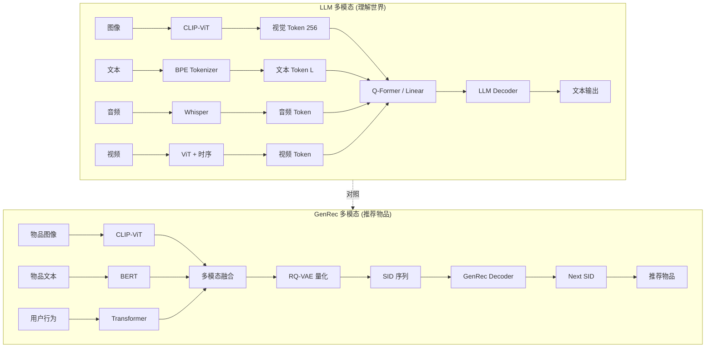
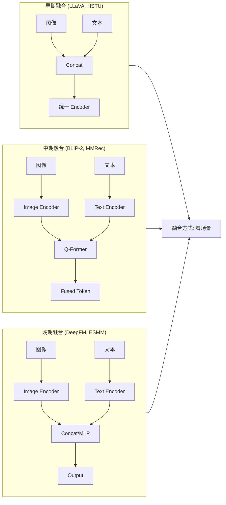
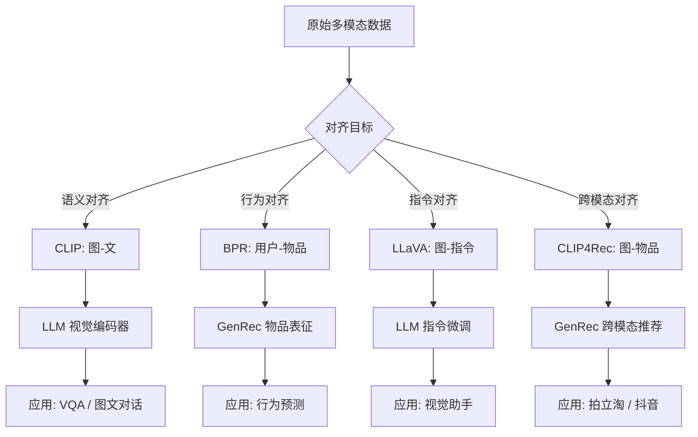
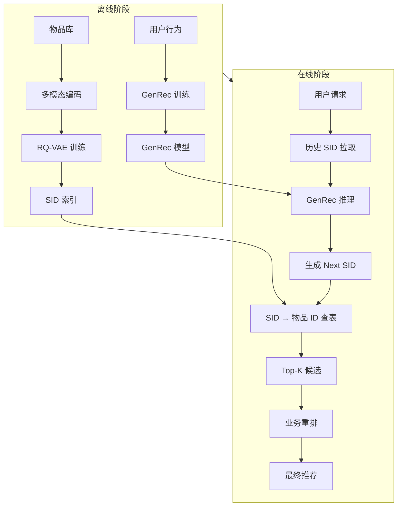
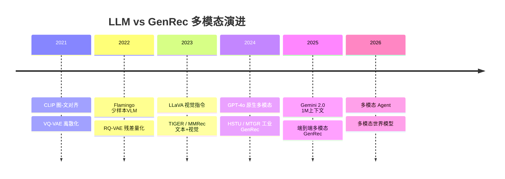
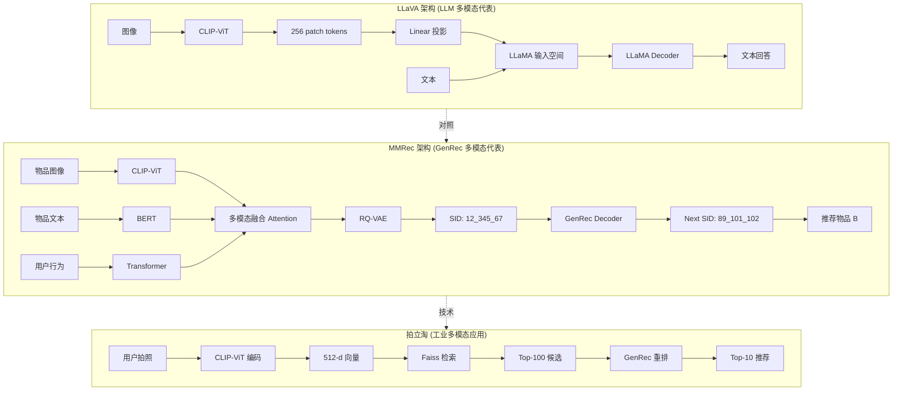

# 13-LLM vs GenRec 多模态与跨模态对比

> [!info] **本章定位**: 本文件是「LLM vs GenRec」对比系列的第 13 篇,也是"对比"的第 5 个维度——把 LLM 和 GenRec 在**多模态 (Multimodal) 与跨模态 (Cross-Modal)** 这个新战场上并列对比。
>
> 2023-2026 年是大模型从"纯文本"走向"全模态"的关键窗口:GPT-4V / Claude 3 / Gemini / LLaVA 把视觉拉进了 LLM 推理回路;GenRec 侧则在 SID 之上叠加图像、音频、视频,演化出**视觉 SID (Visual Semantic ID)**、**多模态融合 SID**、**跨模态生成式推荐**。两边的多模态路径从"目标"到"工程"都截然不同,本篇把它们系统拉齐。
>
> [!info] **关联文件**:
> - [[0-总览与核心区别]] —— 系列总览,讲 LLM 与 GenRec 的 10 大核心区别。
> - [[4-Token化与词表对比]] —— Token 化与词表设计,多模态词表扩展的前置基础。
> - [[11-融合与未来方向]] —— LLM + GenRec 融合趋势,本篇多模态融合是其子集。
> - [[12-与传统推荐系统对比]] —— LLM / GenRec / 传统推荐三方对比,本篇是该三方对比在多模态维度的延伸。
>
> [!info] **关联章节**:
> - [[搜推广与生成式推荐/SID技术/第04章-多模态与行为增强SID]] —— SID 教程中多模态 SID 的最详尽讨论。
> - `../../基础/数学基础/第07章-系统思维/0-总目录与阅读路径.md` —— GR 教程中多模态 GR 论文汇总。
> - [[搜推广与生成式推荐/经典推荐/第02章-深度学习数学与理论基础]] —— 多模态数学基础(信息瓶颈 / 互信息)。

---

## 目录

- [0. 一句话总结](#0-一句话总结)
- [1. 多模态 LLM 全景](#1-多模态-llm-全景)
- [2. 多模态 GenRec 全景](#2-多模态-genrec-全景)
- [3. 输入模态对比](#3-输入模态对比)
- [4. 模态对齐方式](#4-模态对齐方式)
- [5. 多模态融合架构](#5-多模态融合架构)
- [6. 跨模态生成](#6-跨模态生成)
- [7. 多模态训练目标](#7-多模态训练目标)
- [8. 视觉编码器 (ViT/CLIP/DINOv2)](#8-视觉编码器)
- [9. 多模态数据集](#9-多模态数据集)
- [10. 跨模态检索](#10-跨模态检索)
- [11. 零样本多模态](#11-零样本多模态)
- [12. 多模态评估](#12-多模态评估)
- [13. 工业案例](#13-工业案例)
- [14. 挑战与前沿](#14-挑战与前沿)
- [15. 关系图 (mermaid) 与一句话对比](#15-关系图-mermaid-与一句话对比)

---

## 0. 一句话总结

> **LLM 与 GenRec 在多模态上"目标相反、路径相同"——LLM 的多模态是"理解世界"(图像/音频/视频 → 文本),所以需要 CLIP 风格的强对齐 + Q-Former 风格的细粒度融合 + 视觉 Token 的高分辨率还原;GenRec 的多模态是"理解物品"(文本/图像/视频 → SID),所以需要 VQ-VAE 风格的离散化 + 跨模态对齐 + 跨模态检索 (CLIP4Rec / MMGCN / PMC-GAN)。两边的共同点是都吃 CLIP / ViT / 对比学习的红利,差异点是 LLM 的输出是 Token 序列(可被语言模型直接消化),GenRec 的输出是 SID 序列(可被推荐系统直接消化)。**

```text
┌────────────────────────────────────────────────────────────────────────────┐
│  LLM 多模态            Text in, Text out (理解世界)                          │
│  ┌─────────┐    ┌─────────┐    ┌─────────┐    ┌─────────┐                 │
│  │ 图像/音频│ → │ 视觉编码 │ → │ 视觉Token│ → │   LLM   │ → 文本回答        │
│  │  视频    │    │ ViT/CLIP│    │  Patch  │    │ Decoder │                 │
│  └─────────┘    └─────────┘    └─────────┘    └─────────┘                 │
├────────────────────────────────────────────────────────────────────────────┤
│  GenRec 多模态        Item in, SID out (推荐物品)                            │
│  ┌─────────┐    ┌─────────┐    ┌─────────┐    ┌─────────┐                 │
│  │ 图像/文本│ → │ 多模态编码│ → │  RQ-VAE  │ → │  GenRec │ → 下一物品 SID   │
│  │  行为   │    │  CLIP/  │    │  VQ/ResQ │    │ Decoder │                 │
│  │         │    │  ViT    │    │         │    │         │                 │
│  └─────────┘    └─────────┘    └─────────┘    └─────────┘                 │
└────────────────────────────────────────────────────────────────────────────┘
```

---

## 1. 多模态 LLM 全景

多模态 LLM (Multimodal LLM / MLLM) 是 2023-2026 年 LLM 演进的**第一性扩展**:从纯文本 Transformer 走向"视觉 + 文本 + 音频 + 视频"的全模态统一。本节梳理核心子方向,以及它们和 GenRec 多模态的本质差异。

### 1.1 视觉语言模型 VLM

**定义**: VLM (Vision-Language Model) 是把**图像(或视频帧)作为输入**的 LLM,目标是让 LLM 理解图像内容并以文本形式回答。代表工作:CLIP (2021, OpenAI, 图像-文本对齐)、Flamingo (2022, DeepMind, 少样本 VLM)、BLIP-2 (2023, Salesforce, Q-Former 桥接)、LLaVA (2023, 威斯康星+微软, 简单 Projection)。

**统一架构**:

```text
┌────────────────────────────────────────────────────────────┐
│  VLM 通用架构                                                │
│                                                              │
│  图像 x_I → Vision Encoder (ViT/CLIP) → Image Tokens         │
│                                      ↓                      │
│  文本 x_T → Tokenizer → Text Tokens                          │
│                                      ↓                      │
│              Concat / Cross-Attention / Q-Former            │
│                                      ↓                      │
│                            LLM Backbone (Decoder)            │
│                                      ↓                      │
│                          Output: Text Tokens                 │
└────────────────────────────────────────────────────────────┘
```

**形式化定义**: 给定图像 $v$ 和文本 $t$,VLM 建模:

$$
p_\theta(y \mid v, t) = \prod_{i=1}^{L} p_\theta(y_i \mid y_{<i}, v, t)
$$

其中 $v$ 先被视觉编码器映射为 $K$ 个 patch tokens $\{z_1, \dots, z_K\}$,作为 LLM 的"额外上下文"参与 cross-attention 或 prefix。

**与纯文本 LLM 的关键差异**:

| 维度 | 纯文本 LLM | VLM |
|------|------------|-----|
| 输入 | 文本 token | 图像 patch + 文本 token |
| 视觉编码器 | 无 | ViT / CLIP-ViT / DINOv2 |
| 模态对齐 | 无 | 预训练对齐 (CLIP) + Q-Former 桥接 |
| 数据规模 | 文本 1-15T tokens | 图像-文本对 1-5B 对 |
| 推理能力 | 强 | 略弱 (视觉分心问题) |
| 训练成本 | $1M-$100M | $1M-$50M (增量) |

**引用**: [Radford et al. 2021 - CLIP](https://arxiv.org/abs/2103.00020);[Alayrac et al. 2022 - Flamingo](https://arxiv.org/abs/2204.14198)。

### 1.2 LLaVA / MiniGPT-4 / InstructBLIP

这三家是 2023 年开源 VLM 的"三剑客",架构上有微小差异但哲学高度一致:**用最简单的视觉-语言桥接 (Linear Projection) 把视觉编码器和 LLM 接起来**。

#### 1.2.1 LLaVA (Visual Instruction Tuning, 2023)

LLaVA (Liu et al. 2023, 威斯康星大学 + 微软) 用一个**单层线性投影**把 CLIP-ViT 的 patch tokens 映射到 LLM 的词向量空间,然后直接喂给 Vicuna / LLaMA。

**架构公式**:

$$
\mathbf{h}_v = W \cdot \text{CLIP-ViT}(v), \quad W \in \mathbb{R}^{d_v \times d_t}
$$

其中 $d_v = 1024$ (CLIP-ViT-L/14 输出维度), $d_t = 4096$ (LLaMA-7B 隐藏维度), $W$ 是单层可学习矩阵。

**训练两阶段**:
1. **特征对齐预训练**: 仅训练 $W$,用 LAION/CC 数据集的图像-文本对,目标是对齐视觉空间和语言空间
2. **视觉指令微调**: 训练 $W$ + LLM,用 GPT-4 生成的视觉指令数据 (LLaVA-Instruct-158K)

```python
# LLaVA 核心架构 (简化)
class LLaVA(nn.Module):
    def __init__(self, vision_encoder, llm, projector):
        super().__init__()
        self.vision_encoder = vision_encoder    # CLIP-ViT-L/14, 冻结
        self.projector = projector              # Linear(1024, 4096), 可训练
        self.llm = llm                          # Vicuna-7B, LoRA 微调

    def forward(self, image, input_ids):
        # 1. 图像编码
        with torch.no_grad():
            img_feats = self.vision_encoder(image)  # [B, 256, 1024]
        # 2. 投影到 LLM 词空间
        img_tokens = self.projector(img_feats)      # [B, 256, 4096]
        # 3. 文本 token 化
        text_embeds = self.llm.embed_tokens(input_ids)  # [B, L, 4096]
        # 4. 拼接
        inputs_embeds = torch.cat([img_tokens, text_embeds], dim=1)
        # 5. LLM 前向
        return self.llm(inputs_embeds=inputs_embeds)
```

#### 1.2.2 MiniGPT-4 (2023)

MiniGPT-4 (Zhu et al. 2023, 沙特 KAUST) 用**单层线性投影** + **Vicuna**,但额外在投影层后加了 Q-Former 的轻量化变体,支持多图像输入。**关键创新**: 引入"两阶段训练",先在大规模图文对上预训练投影,再用 GPT-4 生成的高质量对话微调。

#### 1.2.3 InstructBLIP (2023)

InstructBLIP (Dai et al. 2023, Salesforce) 基于 BLIP-2 的**Q-Former** 架构,引入**指令感知的 Q-Former**:Q-Former 的 query tokens 与文本指令做 cross-attention,使视觉特征根据指令动态调整。

**Q-Former 数学**:

$$
\mathbf{z} = \text{CrossAttn}(\mathbf{q}, \text{Concat}([\mathbf{v}; \mathbf{t}])), \quad \mathbf{q} \in \mathbb{R}^{K \times d}
$$

其中 $\mathbf{q}$ 是 K 个可学习 query, $\mathbf{v}$ 是图像特征, $\mathbf{t}$ 是文本指令, $\mathbf{z}$ 是对齐后的视觉 token。Q-Former 让视觉表征"按需生成",更适合指令跟随。

#### 1.2.4 三家对比

| 维度 | LLaVA | MiniGPT-4 | InstructBLIP |
|------|-------|-----------|--------------|
| 桥接 | Linear | Linear + Q-Former 轻量 | Q-Former (全) |
| LLM | Vicuna-7B/13B | Vicuna-7B | Vicuna-7B/13B + FlanT5 |
| 视觉编码器 | CLIP-ViT-L/14 | EVA-CLIP-G | EVA-CLIP-G |
| 多图像 | 否 | 是 | 是 |
| 指令微调数据 | 158K | 3.5K (高质量) | 1.6M |
| 推理速度 | 快 | 中 | 慢 (Q-Former) |
| 性能 (VQA) | 79.0 (VQAv2) | 73.9 | 78.6 |

**引用**: [Liu et al. 2023 - LLaVA](https://arxiv.org/abs/2304.08485);[Zhu et al. 2023 - MiniGPT-4](https://arxiv.org/abs/2304.10592);[Dai et al. 2023 - InstructBLIP](https://arxiv.org/abs/2305.06500)。

### 1.3 GPT-4V / Claude 3 Vision / Gemini Vision

闭源 VLM 的"三大天王"——它们的核心架构不公开,但通过 API 行为和论文可以推断设计哲学。

#### 1.3.1 GPT-4V (OpenAI, 2023)

GPT-4V (OpenAI 2023) 是 GPT-4 的视觉扩展,核心特点:
- **多图像输入**: 最多 8 张图同时输入
- **高分辨率**: 支持最高 4096x4096
- **OCR 极强**: 对场景文字、表格、公式识别 SOTA
- **思考链**: 视觉推理可显式输出"我先看到 X,所以..."

**应用**: ChatGPT Plus 用户上传图片问答,辅助看代码截图、解释图表、识别商品。

#### 1.3.2 Claude 3 Vision (Anthropic, 2024)

Claude 3 (Anthropic 2024) 的 Vision 版本核心能力:
- **多模态长上下文**: 200K 上下文 + 图像,适合长文档分析
- **图表理解**: 论文级别的图表解读
- **物体定位**: 输出 bounding box (用特殊 token)

**优势场景**: 长 PDF 解读、学术图表分析、代码 review。

#### 1.3.3 Gemini Vision (Google, 2024)

Gemini 1.5 (Google 2024) 的多模态是**原生 (native)** 而非拼接:
- **1M 上下文**: 单次能塞 1 小时视频或 30K 行代码
- **原生视频**: 直接处理视频,不需要抽帧 + VLM
- **原生音频**: 直接处理音频,不需要 ASR + 文本 LLM

**架构推测**: Gemini 用 **Modality-specific Encoders** 各自处理图像/音频/视频,在 LLM 之前做"早期融合",这是和 GPT-4V 的"晚期融合"最大差异。

```text
GPT-4V 推测架构 (晚期融合):
  图像 → ViT → 视觉 token → 拼接到文本 token → GPT-4
  音频 → Whisper → 文本 token → GPT-4

Gemini 推测架构 (早期融合):
  图像/音频/视频 → 各自 Encoder → 在 LLM 之前做 Mixture-of-Modality → 统一输入
```

#### 1.3.4 三家对比

| 维度 | GPT-4V | Claude 3 Vision | Gemini Vision |
|------|--------|-----------------|---------------|
| 上下文 | 128K | 200K | 1M-2M |
| 图像输入 | 多图 | 多图 | 多图 + 视频 |
| 原生模态 | 视觉 | 视觉 | 视觉+音频+视频 |
| OCR | 极强 | 强 | 强 |
| 价格 ($/1M tok) | $10-30 | $15-75 | $0.5-7 |
| API 文档 | 详细 | 详细 | 一般 |

**引用**: [OpenAI 2023 - GPT-4V System Card](https://cdn.openai.com/papers/GPTV_System_Card.pdf);[Anthropic 2024 - Claude 3](https://www.anthropic.com/news/claude-3-family);[Google 2024 - Gemini 1.5](https://arxiv.org/abs/2403.05530)。

### 1.4 音频 LLM / 视频 LLM

LLM 的多模态不只"视觉",还有音频和视频两个独立战场。

#### 1.4.1 音频 LLM

| 模型 | 架构 | 能力 | 局限 |
|------|------|------|------|
| **Whisper** (OpenAI 2022) | Encoder-Decoder, ASR 专用 | 99 种语言转写 | 不支持生成式问答 |
| **AudioPaLM** (Google 2023) | PaLM-2 + 音频 encoder | 语音翻译 + 问答 | 闭源 |
| **Qwen-Audio** (阿里 2023) | Qwen + Whisper encoder | 多任务音频理解 | 中文优 |
| **SALMONN** (清华 2023) | LLaMA + BEATs + Whisper | 双 encoder + Q-Former | 复杂 |

**典型应用**: 语音助手、会议纪要、音乐生成、播客转写。

#### 1.4.2 视频 LLM

| 模型 | 架构 | 能力 | 局限 |
|------|------|------|------|
| **Video-LLaMA** (2023) | LLaMA + ViT + Q-Former + Audio-Q-Former | 视频问答 | 长视频差 |
| **VideoChat** (2023) | LLaMA + Video-Encoder | 视频对话 | 短片 |
| **Video-LLaVA** (2024) | 统一视觉编码 (图像/视频) | 多帧 | 帧数受限 |
| **Gemini 1.5** (2024) | 原生视频 | 1 小时视频 | 闭源 |
| **GPT-4o** (2024) | 原生多模态 | 实时视频对话 | 闭源 |

**关键技术**:
1. **视频分帧**: 每 0.5-1 秒抽 1 帧,ViT 编码
2. **时间聚合**: 帧间 attention 或 3D pooling
3. **音频同步**: 单独 audio encoder 编码语音,跨模态 attention

**和 GenRec 视频推荐的关系**: 视频 LLM 是"理解视频内容",视频 GenRec 是"理解视频 SID + 推荐下一视频"。两者的输入都是视频,输出完全不同——视频 LLM 输出文本描述/回答,视频 GenRec 输出下一个推荐。

**引用**: [OpenAI 2022 - Whisper](https://arxiv.org/abs/2212.04356);[Cheng et al. 2023 - Video-LLaVA](https://arxiv.org/abs/2311.10122);[Google 2024 - Gemini 1.5](https://arxiv.org/abs/2403.05530)。

---

## 2. 多模态 GenRec 全景

GenRec 的"多模态"和 LLM 的"多模态"在概念上**完全错位**:
- LLM 的多模态 = 让 LLM 理解图像/音频/视频,输出**自然语言**
- GenRec 的多模态 = 让推荐系统理解物品的图像/文本/视频,输出**下一个物品 SID**

所以 GenRec 的多模态核心是**SID 的多模态化**——把 Item 从"纯 ID / 纯文本 SID"扩展到"图像 SID / 文本 SID / 行为 SID"。

### 2.1 视觉 SID (VQ-VAE 图像)

**视觉 SID** 是把图像用 VQ-VAE 量化成离散 token,作为 GenRec 模型的输入表征。代表工作把图像用 VQ-VAE 编码成 "12_345_67" 形式的 SID,然后用 Transformer 做序列推荐。

**VQ-VAE 量化**:

$$
z_q = \arg\min_{e_k \in \mathcal{C}} \| z_e - e_k \|_2, \quad \mathcal{C} = \{e_1, \dots, e_K\}
$$

其中 $z_e$ 是 encoder 输出的连续向量, $\mathcal{C}$ 是码本, $K$ 是码本大小 (典型 256-8192)。

**RQ-VAE 残差量化 (工业主流)**:

$$
z_q = \sum_{l=1}^{L} e_{c_l}, \quad c_l = \arg\min_k \| z - \sum_{j<l} e_{c_j} - e_k \|_2
$$

残差量化把一个向量分解为 L 个码本项之和,L 决定 SID 长度。

**视觉 SID 优势**:
- **冷启动友好**: 新物品没有交互,只要有图像就能生成 SID
- **跨域迁移**: 图像 SID 在不同域(淘宝/天猫)语义可对齐
- **可解释**: SID 是显式离散序列,可分析

**视觉 SID 局限**:
- **量化损失**: 重建的图像质量下降,SID 之间的语义关系需重新学习
- **码本膨胀**: 256x256x256 = 16M 组合,训练困难
- **分辨率敏感**: 224x224 与 512x512 的图像 SID 不通用

```python
# 简化版 RQ-VAE 视觉 SID
class RQVAE(nn.Module):
    def __init__(self, encoder, decoder, codebook_size=256, n_levels=3):
        super().__init__()
        self.encoder = encoder    # 图像 → 连续向量 z
        self.decoder = decoder    # 残差和 → 重建图像
        self.codebooks = nn.ModuleList([
            nn.Embedding(codebook_size, dim) for _ in range(n_levels)
        ])

    def quantize(self, z):
        residual = z
        codes = []
        for cb in self.codebooks:
            d = (residual.unsqueeze(1) - cb.weight.unsqueeze(0)).norm(dim=-1)
            idx = d.argmin(dim=-1)  # [B, L_code]
            q = cb(idx)             # [B, L_code, D]
            codes.append(idx)
            residual = residual - q
        return codes

    def forward(self, x):
        z = self.encoder(x)
        codes = self.quantize(z)
        q_sum = sum(self.codebooks[i](codes[i]) for i in range(len(codes)))
        x_recon = self.decoder(q_sum)
        return x_recon, codes
```

**引用**: [Van den Oord et al. 2017 - VQ-VAE](https://arxiv.org/abs/1711.00937);[Lee et al. 2022 - RQ-VAE](https://arxiv.org/abs/2203.01941)。

### 2.2 多模态融合 SID (文本+图像+行为)

**多模态融合 SID** 是工业界最实用的方案:把物品的**文本描述 + 图像 + 用户行为**联合编码成一个统一 SID。代表工作:
- **MMGCN** (Wei et al. 2019): 多模态图卷积,把图像/文本/行为构建成异质图
- **MVGAE** (Yi et al. 2021): 多模态变分自编码器
- **UniSRec / MISSRec** (Hou et al. 2022): 跨域多模态 SID

**架构对比**:

| 方案 | 输入 | 编码 | SID 来源 | 代表 |
|------|------|------|----------|------|
| 文本 SID | 文本描述 | BERT/SBERT | 文本 token RQ-VAE | TIGER |
| 图像 SID | 商品图 | CLIP-ViT | 视觉 token RQ-VAE | MMRec |
| 行为 SID | 用户序列 | Transformer | 行为编码 RQ-VAE | HSTU |
| 多模态融合 SID | 文本+图像+行为 | 多编码器+Attention | 联合 RQ-VAE | UniSRec |

**融合策略**:

```text
方案 A: 早期融合 (Concat)
  文本 emb + 图像 emb + 行为 emb → Concat → MLP → SID

方案 B: 中期融合 (Cross-Attention)
  文本 emb 作为 Query, 图像 emb 作为 Key/Value → Cross-Attention → SID

方案 C: 晚期融合 (Ensemble)
  文本 SID + 图像 SID + 行为 SID → 各自训练 → 拼接 Embedding
```

**联合 RQ-VAE 公式**:

$$
z_{multi} = \alpha \cdot z_{text} + \beta \cdot z_{image} + \gamma \cdot z_{behavior}
$$

$$
c_l = \arg\min_k \| z_{multi} - \sum_{j<l} e_{c_j} - e_k \|_2
$$

$\alpha, \beta, \gamma$ 是可学习或固定的融合权重。论文中常用 0.4 / 0.4 / 0.2 (文本+图像为主, 行为辅助)。

**引用**: [Wei et al. 2019 - MMGCN](https://arxiv.org/abs/1910.11954);[Hou et al. 2022 - MISSRec](https://arxiv.org/abs/2204.08026)。

### 2.3 视频推荐 / 短视频 GenRec

**短视频 GenRec** 是抖音/快手/B站场景的核心,推荐系统面对的物品是**视频**(30s-3min 的短视频)。视频 GenRec 与图像 GenRec 的核心差异:

| 维度 | 图像 GenRec | 视频 GenRec |
|------|-------------|-------------|
| 物品 | 商品/海报 | 视频 |
| 表征 | CLIP-ViT 单帧 | 多帧 + 音频 + 字幕 |
| 序列长度 | 10-50 (单次) | 100-1000 (长行为) |
| 实时性 | 毫秒 | 毫秒 |
| 挑战 | 图像质量 | 内容理解 + 长序列 + 实时 |

**短视频 GenRec 架构** (抖音/快手风格):

```text
┌──────────────────────────────────────────────────────────────┐
│  短视频 GenRec 完整架构                                        │
│                                                                │
│  用户历史 (过去 1000 个视频)                                     │
│      ↓                                                         │
│  视频特征提取 (离线):                                            │
│    - 关键帧抽取 (每 1s 1 帧)                                    │
│    - ViT 编码每帧                                               │
│    - 3D-Conv / TimeSformer 编码时间维度                         │
│    - Audio Encoder 编码音频 (Whisper / BEATs)                  │
│    - 文本 Encoder 编码字幕 / 标题 (BERT)                         │
│      ↓ 融合 → 视频 Embedding                                    │
│      ↓ RQ-VAE → 视频 SID (e.g., "12_345_67_89_101")           │
│                                                                │
│  GenRec Decoder:                                               │
│    [User Profile; History SIDs] → Transformer → Next SID      │
│                                                                │
│  推理:                                                         │
│    生成的 SID → 查表 → 视频 ID → 推送给用户                      │
└──────────────────────────────────────────────────────────────┘
```

**关键论文**:
- **HSTU** (Meta 2024): 视频 Feed 推荐,长序列 + 稀疏 attention
- **MTGR** (美团 2024): 多任务视频推荐
- **TokenRec** (字节 2023): 字节跳动视频推荐
- **GPR** (快手 2024): 生成式短视频推荐

**工业指标** (抖音/快手实际):
- 召回 Hit@50: 70-80%
- 精排 AUC: 0.78-0.85
- 多样性 (类别熵): 5-8
- 实时性: P99 < 50ms

**引用**: [Chang et al. 2024 - HSTU](https://arxiv.org/abs/2402.17152);[Zhao et al. 2024 - MTGR (Meituan)](https://arxiv.org/abs/2402.14845)。

### 2.4 跨模态检索 (Pinterest / 淘宝拍立淘)

**跨模态检索 (Cross-Modal Retrieval)** 是工业界最成熟的多模态推荐场景——用户用图像查相似物品。代表系统:
- **Pinterest Visual Search**: 用图搜图,返回相似 Pin
- **淘宝拍立淘**: 用手机拍商品,找同款或相似款
- **Google Lens**: 用图搜万物
- **Amazon StyleSnap**: 用图搜时尚

**跨模态检索 vs 跨模态生成**:
- **检索**: 输入图像 → 输出 top-K 相似物品 ID
- **生成**: 输入图像 → 输出下一个推荐物品 (GenRec 语境)

**拍立淘架构 (简化)**:

```text
用户上传图像
    ↓
CLIP-ViT 编码 → 图像 Embedding (512-d)
    ↓
Faiss / Milvus 向量检索 (10 亿商品库)
    ↓
top-100 候选 → DNN 重排 (考虑 CTR/CVR/类目)
    ↓
top-10 返回
```

**关键技术**:

| 技术 | 作用 | 效果 |
|------|------|------|
| CLIP 预训练 | 图像-文本对齐 | 跨模态零样本 |
| 向量量化 (PQ) | 10 亿级检索 | 内存 100x 压缩 |
| HNSW 索引 | 快速 ANN | P99 < 10ms |
| 重排模型 | 精排 + 业务规则 | 提升 CTR 5-10% |
| 类目过滤 | 兜底召回 | 避免异类结果 |

**GenRec 化的拍立淘**: 不只是"找同款",而是"用图像触发一个生成式推荐"——用户拍商品,系统用图像 SID 启动 GenRec Decoder,生成接下来可能感兴趣的物品序列 (同款/相似款/搭配款)。

**引用**: [Pinterest 2021 - Visual Search](https://arxiv.org/abs/2105.10078);[淘宝拍立淘 - 阿里 2017](https://arxiv.org/abs/1704.04861);[Radford et al. 2021 - CLIP](https://arxiv.org/abs/2103.00020)。

---

## 3. 输入模态对比

LLM 和 GenRec 在"如何把多模态信号喂进 Transformer"上有截然不同的设计哲学。

### 3.1 LLM: 图像/音频/视频 → 视觉 Token

LLM 的多模态输入处理流程:

```text
图像 → ViT/CLIP 切 patch → 每个 patch 一个 token (256 tokens)
音频 → Whisper/BEATs 切 chunk → 每个 chunk 一个 token (数百个)
视频 → 抽帧 + ViT → 每帧 256 tokens, 总 = 帧数 × 256
文本 → BPE/WordPiece → 每个子词一个 token
```

**视觉 Token 化关键参数**:

| 模型 | 视觉编码器 | Patch Size | Token 数 / 帧 | 总 token (1 视频) |
|------|------------|------------|----------------|---------------------|
| LLaVA-1.5 | CLIP-ViT-L/14 | 14×14 | 256 | 256×帧数 |
| Qwen-VL | CLIP-ViT-big | 14×14 | 256 | 256×帧数 |
| InternVL | InternViT-6B | 14×14 | 256-1024 | 可变 |
| Gemini 1.5 | 原生 | - | 动态 | 1M 上下文 |

**视觉 Token 的特征**:
- **连续**: patch embedding 是连续向量,不是离散 token
- **对齐**: 与文本 token 在同一空间 (Q-Former 或 Projection 之后)
- **前缀式**: 视觉 token 通常放在文本 token 之前 (prefix)
- **细粒度**: 高分辨率下 patch 数大幅增加 (LLaVA-1.6 高分辨率模式用 2880 tokens)

**关键设计决策**:
1. **是否冻结视觉编码器**: 冻结 (LLaVA) vs 全量微调 (Qwen-VL) vs LoRA 微调 (InternVL)
2. **是否共享词表**: 视觉和文本 token 用同一套 LLM embedding (LLaVA) vs 独立 vocab (部分)
3. **位置编码**: 视觉 token 用 2D RoPE,文本用 1D RoPE (Qwen-VL)

```python
# 视觉 Token 化 (LLaVA 风格)
class VisionTokenizer:
    def __init__(self, vision_encoder, image_size=224, patch_size=14):
        self.encoder = vision_encoder  # CLIP-ViT
        self.image_size = image_size
        self.patch_size = patch_size
        self.n_patches = (image_size // patch_size) ** 2  # 256

    def __call__(self, image):
        with torch.no_grad():
            feats = self.encoder(image)  # [B, 256, 1024]
        return feats  # 直接作为 token
```

### 3.2 GenRec: Item → SID → Embedding

GenRec 的多模态输入处理流程与 LLM **完全相反**——它不需要把图像变成"token",而是把物品(包括其图像)变成**离散的 SID**。

```text
物品 (含图像 + 文本 + 属性)
    ↓
多模态编码器 (CLIP-ViT + BERT)
    ↓
联合 Embedding (512-d 连续向量)
    ↓
RQ-VAE 量化
    ↓
离散 SID (e.g., "12_345_67_89")
    ↓
SID Embedding Lookup → 输入 GenRec
```

**对比表**:

| 维度 | LLM 视觉 Token | GenRec SID |
|------|-----------------|------------|
| 形式 | 连续 patch embedding | 离散 ID 序列 |
| 数量 | 256-2880 / 帧 | 3-8 / 物品 |
| 词表 | 无 (连续) | 256-8192 (码本) |
| 训练 | 端到端 | 离线 RQ-VAE + 在线 Embedding |
| 推理 | 计算 attention | Embedding 查表 |
| 显存 | 大 (256-2880 tokens) | 小 (3-8 tokens) |
| 可解释 | 弱 (patch) | 强 (显式 code) |

**关键设计差异**:
- LLM 的视觉 token **保留所有空间信息**,每个 patch 是图像的局部
- GenRec 的 SID **压缩所有模态到离散序列**,每个 code 是语义的"原子"

**GenRec 跨模态输入的关键设计**:
1. **模态优先级**: 文本 > 图像 > 属性 > 行为 (工业经验)
2. **融合位置**: Encoder 后 (早期) vs Decoder 内 (晚期) vs Retrieval 时 (后融合)
3. **码本选择**: 256 (粗) / 1024 (中) / 8192 (细) 决定粒度

---

## 4. 模态对齐方式

"模态对齐" (Modality Alignment) 是多模态的核心——把不同模态的表征映射到统一空间。

### 4.1 LLM: CLIP 对齐 / Projection

LLM 侧的模态对齐主要分三阶段:

#### 4.1.1 阶段 1: 视觉-文本预对齐 (CLIP 时代)

CLIP (Radford et al. 2021) 用 4 亿图文对训练,目标是对齐图像和文本的 embedding 空间:

$$
\mathcal{L}_{\text{CLIP}} = -\frac{1}{N} \sum_{i=1}^{N} \log \frac{\exp(\langle v_i, t_i \rangle / \tau)}{\sum_{j=1}^{N} \exp(\langle v_i, t_j \rangle / \tau)}
$$

其中 $v_i$ 是图像 embedding, $t_i$ 是文本 embedding, $\tau$ 是温度, $N$ 是 batch 大小。这是**对称 InfoNCE** (NT-Xent)。

#### 4.1.2 阶段 2: 视觉-语言对齐 (Q-Former 时代)

BLIP-2 (Li et al. 2023) 引入 Q-Former,作为视觉编码器和 LLM 之间的"翻译器":

```text
图像 → ViT → Image Features
              ↓
Q-Former (32 个可学习 query, 跨模态 attention)
              ↓
Aligned Visual Tokens (32 个)
              ↓
LLM 输入空间
```

Q-Former 把图像的 256 个 patch tokens 压缩到 32 个对齐 tokens,**降一个数量级的 LLM 计算**。

#### 4.1.3 阶段 3: 视觉指令对齐 (LLaVA 时代)

LLaVA 用**单层线性投影** + **视觉指令微调**对齐:用 GPT-4 生成的视觉指令数据,让 LLM 学会"看图回答"。

**三阶段对比**:

| 阶段 | 对齐方式 | 数据 | 模型 |
|------|----------|------|------|
| 1. CLIP 预对齐 | 对比学习 | 4 亿图文对 | CLIP |
| 2. Q-Former 桥接 | Cross-Attention | 1 亿图文对 | BLIP-2 |
| 3. 指令微调 | Linear Projection + SFT | 100K 指令对 | LLaVA |

**LLaVA 的关键洞察**: **桥接简单 + 数据质量 > 桥接复杂 + 数据量**。单层 Linear 比 Q-Former 简单,但配合高质量视觉指令数据,效果反而更好。

### 4.2 GenRec: Joint Embedding / Contrastive

GenRec 侧的模态对齐更"工业",主要分两类:**联合 Embedding** 和 **对比学习**。

#### 4.2.1 联合 Embedding (Joint Embedding)

联合 Embedding 把多模态特征映射到统一空间,公式:

$$
\mathbf{z}_{joint} = f(\text{Concat}([v; t; a])), \quad v, t, a \in \mathbb{R}^{d_i}
$$

其中 $v$ 是图像 embedding, $t$ 是文本 embedding, $a$ 是属性 embedding, $f$ 是 MLP 或 Transformer。Concat 后过 DNN 是最简单的方案。

#### 4.2.2 对比学习 (CLIP4Rec / MMGCN)

CLIP4Rec (Gao et al. 2022) 把 CLIP 的对比损失搬到推荐:

$$
\mathcal{L}_{\text{CLIP4Rec}} = -\log \frac{\exp(\langle u_i, v_i \rangle / \tau)}{\sum_{j} \exp(\langle u_i, v_j \rangle / \tau)}
$$

其中 $u_i$ 是用户表征, $v_i$ 是物品表征,**正样本是用户真实交互的物品,负样本是 batch 内其他物品**。

**关键差异**: LLM 的对比是"图-文",GenRec 的对比是"用户-物品"。

#### 4.2.3 LLM 对齐 vs GenRec 对齐

| 维度 | LLM 对齐 | GenRec 对齐 |
|------|----------|-------------|
| 对齐对象 | 图-文 | 用户-物品 / 图-物品-文本 |
| 损失 | InfoNCE + LM CrossEntropy | InfoNCE + Next-SID CrossEntropy |
| 空间 | 语义空间 (CLIP) | 行为空间 (协同过滤) |
| 训练数据 | 4 亿图文对 | 1000 亿用户行为 |
| 目标 | 语义理解 | 行为预测 |
| 评估 | Zero-shot 分类 / VQA | Recall@K / NDCG |

**根本差异**: LLM 的对齐是"视觉概念 → 语言概念",GenRec 的对齐是"用户偏好 → 物品偏好"。前者是"理解世界",后者是"理解用户"。

**引用**: [Li et al. 2023 - BLIP-2](https://arxiv.org/abs/2301.12597);[Gao et al. 2022 - CLIP4Rec](https://arxiv.org/abs/2204.04247)。

---

## 5. 多模态融合架构

多模态融合 (Multimodal Fusion) 是"如何把不同模态的特征组合起来"的问题,分早期/中期/晚期/Token-level 四种。

### 5.1 早期/晚期融合

```text
早期融合 (Early Fusion):  在 Encoder 之前合并
  图像 patch + 文本 token → Concat → 统一 Encoder
  优点: 模态交互最充分
  缺点: 计算量大,模态不平衡

中期融合 (Intermediate Fusion):  在 Encoder 中合并
  各自 Encoder → 跨模态 Attention (Q-Former) → 融合表征
  优点: 计算量适中
  缺点: 设计复杂

晚期融合 (Late Fusion):  在 Encoder 之后合并
  各自 Encoder → 各自 embedding → Concat/MLP
  优点: 简单,模块化
  缺点: 模态交互弱

Token-level 融合:  在 LLM 内合并
  各自 → Token → 拼接到 LLM 输入 → LLM 内 attention
  优点: LLM 自动学习融合
  缺点: 显存大 (token 多)
```

**LLaVA 用 Token-level 融合**:把视觉 token 和文本 token 拼接到一起,让 LLaMA 通过 self-attention 自动学习融合。

**MMRec 用中期融合**:用 Cross-Attention 让文本 query 图像,反之亦然。

**HSTU 用晚期融合**:User Embedding + Item Embedding 直接 Concat。

**GenRec 主流选择 (按场景)**:

| 场景 | 推荐融合 | 原因 |
|------|----------|------|
| 文本推荐 (新闻) | 中期 | 文本是核心 |
| 图像推荐 (电商) | 早期或 Token-level | 图像是核心 |
| 视频推荐 (抖音) | 早期 | 多模态同等重要 |
| 跨域 (淘宝+天猫) | 晚期 | 各自 Encoder 独立 |

### 5.2 Q-Former / Token-level Fusion

#### 5.2.1 Q-Former 架构详解

Q-Former (Querying Transformer) 是 BLIP-2 提出的**轻量级跨模态桥接**,核心思想:

```text
图像 → ViT → Image Features (N×d)
                 ↓
Q-Former (32 个可学习 query, 8 层)
  - Self-Attention: query 之间
  - Cross-Attention: query attend to image features
  - Feed-Forward
                 ↓
Aligned Tokens (32×d)
                 ↓
Linear Projection → LLM Word Embedding 空间
```

**Q-Former 公式**:

$$
Z^{(l)} = \text{FFN}(\text{CrossAttn}(\text{SelfAttn}(Q^{(l)}), V))
$$

其中 $Q^{(l)}$ 是可学习 query, $V$ 是图像特征, $Z^{(l)}$ 是对齐后的视觉 token。

**Q-Former 优势**:
- **压缩比可控**: 256 → 32,节省 LLM 计算
- **指令感知**: query 可与文本指令 cross-attention (InstructBLIP)
- **可独立训练**: 不需要端到端微调 LLM

#### 5.2.2 Token-level Fusion (LLaVA 风格)

```python
# Token-level Fusion (简化)
class TokenLevelFusion(nn.Module):
    def __init__(self, vision_encoder, llm):
        super().__init__()
        self.vision = vision_encoder   # 输出 [B, 256, d_v]
        self.proj = nn.Linear(d_v, d_t) # 投影到 LLM 空间
        self.llm = llm

    def forward(self, image, text_ids):
        # 视觉编码
        v = self.vision(image)         # [B, 256, d_v]
        v_tokens = self.proj(v)        # [B, 256, d_t]
        # 文本编码
        t_tokens = self.llm.embed(text_ids)  # [B, L, d_t]
        # Token-level 拼接
        inputs = torch.cat([v_tokens, t_tokens], dim=1)  # [B, 256+L, d_t]
        return self.llm(inputs_embeds=inputs)
```

**LLaVA 风格 vs Q-Former 风格**:

| 维度 | LLaVA (Token-level) | BLIP-2 (Q-Former) |
|------|---------------------|-------------------|
| 视觉 token 数 | 256 (全保留) | 32 (压缩) |
| 桥接层 | 1 Linear | 8 层 Transformer |
| 参数量 | 几 MB | 100 MB |
| 训练 | 端到端 | 分阶段 |
| 效果 | 略好 (LLaVA-1.5) | 略差 |
| 速度 | 略快 | 略慢 |

**关键洞察**: 在 LLM 已经够强 (7B+) 的前提下,**简单桥接 + 高质量数据 > 复杂桥接 + 普通数据**。这是 LLaVA 战胜 BLIP-2 的核心原因。

**GenRec 中的类比**: GenRec 的"简单桥接"对应于**单层 RQ-VAE** vs **深度 RQ-VAE**。工业经验同样是"简单 + 高质量"更实用。

---

## 6. 跨模态生成

跨模态生成 (Cross-Modal Generation) 是"从一种模态生成另一种模态"。

### 6.1 LLM: Text → Image

LLM 的跨模态生成主流方案是**级联 (Cascaded)**:LLM 生成文本描述,再用扩散模型/VAE 生成图像。

#### 6.1.1 Stable Diffusion + LLM

```text
用户输入: "画一只在月球上喝咖啡的猫"
    ↓
LLM (GPT-4) 重写/扩展 prompt
    "A cat in spacesuit, sitting on a moon rock, holding a coffee cup,
     earth visible in background, cinematic lighting, 8k, photorealistic"
    ↓
Stable Diffusion (SDXL) 生成图像
    ↓
输出: 1024×1024 图像
```

#### 6.1.2 DALL-E 系列

DALL-E 3 (OpenAI 2023) 是 LLM 原生图像生成的代表:
- LLM 直接生成"图像的 token 序列"(类似文本 token)
- 用扩散解码器把 token 序列还原成图像

```text
用户输入: "画一个抽象的城市"
    ↓
GPT-4 (多模态) 生成图像 token 序列 [tok1, tok2, ..., tokN]
    ↓
Diffusion Decoder 生成图像
    ↓
输出: 图像
```

#### 6.1.3 统一多模态生成 (Gemini / GPT-4o)

GPT-4o (2024) 和 Gemini 2.0 (2024) 推出**统一多模态生成**:同一个模型既理解图像,又生成图像,无需级联。

```text
统一架构:
  输入: 任意模态 (文本/图像/音频)
  Token 化: 统一 vocab (10 万+ tokens)
  Transformer: 自回归生成
  输出: 任意模态 (文本/图像/音频)
```

**关键技术**:
- **统一 Token 化**: 把图像切成 patches,每个 patch 映射到 vocab
- **统一 Loss**: CrossEntropy on all tokens
- **统一推理**: 自回归生成所有模态

### 6.2 GenRec: Image → Next-Image

GenRec 的"跨模态生成"与 LLM 完全不同——**不是"从文本生成图像"**,而是"从图像生成下一个推荐的图像 SID"。

#### 6.2.1 GenRec 多模态生成范式

```text
用户当前在看: 物品 A (图像 img_A)
    ↓
CLIP-ViT 编码 img_A → v_A
    ↓
RQ-VAE 量化 v_A → SID_A = "12_345_67_89"
    ↓
GenRec Decoder: [User; SID_A; History SIDs] → Next SID
    ↓
Next SID → 反查码本 → 物品 B (图像 img_B)
    ↓
推荐 img_B 给用户
```

**"生成"的是物品的 SID,不是图像本身**。这与 LLM 的"从文本生成新图像"是本质不同。

#### 6.2.2 跨模态 GenRec 的工业应用

| 应用 | 输入 | 输出 | 关键技术 |
|------|------|------|----------|
| 拍立淘 | 用户拍照 | 同款/相似款 | 视觉检索 + SID 重排 |
| 抖音"更多类似" | 视频 A | 视频 B/C/D | 视频 SID + 生成式重排 |
| Pinterest"相似 Pin" | Pin 图像 | 类似 Pin | 图像 SID + 向量检索 |
| 淘宝"找搭配" | 衣服图像 | 裤子/鞋子 | 多模态 SID + 跨类目生成 |
| 美团"附近相似商家" | 商家图 | 附近商家 | 视觉 + 地理 + 行为 SID |

#### 6.2.3 LLM vs GenRec 跨模态生成对比

| 维度 | LLM Text→Image | GenRec Image→Next-Image |
|------|----------------|-------------------------|
| 目的 | 创造新内容 | 推荐已有内容 |
| 空间 | 像素空间 | SID 空间 |
| 评估 | FID / CLIP-Score | Recall@K / NDCG |
| 训练数据 | 文-图对 (4 亿) | 用户行为 (1000 亿) |
| 推理成本 | 高 (扩散采样) | 低 (SID 反查) |
| 商业价值 | 创作工具 | 业务变现 |

**根本差异**: LLM 跨模态生成 = "AI 创造",GenRec 跨模态生成 = "AI 匹配"。前者是 open-ended 的(可以生成任何内容),后者是 closed-ended 的(只能推荐数据库里的物品)。

**引用**: [Ramesh et al. 2022 - DALL-E 2](https://arxiv.org/abs/2204.06125);[OpenAI 2024 - GPT-4o](https://openai.com/index/hello-gpt-4o/)。

---

## 7. 多模态训练目标

| 目标 | 公式 | LLM 场景 | GenRec 场景 |
|------|------|----------|-------------|
| **Next-Token CE** | $-\log p_\theta(y_t \mid y_{<t}, \text{vision})$ | LLaVA, GPT-4V | 不直接用 |
| **Next-SID CE** | $-\log p_\theta(s_t \mid s_{<t}, \text{user})$ | 不直接用 | HSTU, TIGER |
| **InfoNCE (CLIP)** | $-\log \frac{\exp(\langle v, t \rangle / \tau)}{\sum \exp(\cdot / \tau)}$ | CLIP, LLaVA 视觉编码器 | CLIP4Rec, MMGCN |
| **对比 (行为)** | $-\log \frac{\exp(\langle u, i^+ \rangle)}{\sum \exp(\langle u, i^- \rangle)}$ | 不直接用 | BPR, LightGCN |
| **VQ 重建** | $\| x - \text{Dec}(\text{Quantize}(\text{Enc}(x))) \|^2$ | 不直接用 | RQ-VAE 训练 |
| **VQ Commit** | $\| z_e - \text{sg}(e_c) \|^2 + \| e_c - \text{sg}(z_e) \|^2$ | 不直接用 | VQ-VAE 训练 |
| **ITM (Image-Text Matching)** | BCE on (match, no-match) | BLIP-2 Q-Former | 不直接用 |

**多模态训练的核心难点**:

```text
1. 模态不平衡 (Modality Imbalance)
   - 文本容易学,图像难学 → 加权 loss
   - 解决: Loss 加权,Curriculum Learning

2. 模态缺失 (Modality Missing)
   - 工业数据: 部分物品没图,部分物品没文本
   - 解决: 模态独立的 Encoder, 缺失时用零向量

3. 模态错位 (Modality Misalignment)
   - 图像和文本描述不对应
   - 解决: 严格的数据清洗 pipeline

4. 跨模态评估 (Cross-Modal Evaluation)
   - LLM 评估: VQA / 图像描述生成
   - GenRec 评估: 跨模态召回 (用图查文 / 用文查图)
```

---

## 8. 视觉编码器

视觉编码器 (Vision Encoder) 是所有多模态系统的"眼睛"。

### 8.1 ViT 基础

ViT (Vision Transformer, Dosovitskiy et al. 2021) 把图像切成 patch,每个 patch 线性投影 + Position Embedding,送入 Transformer Encoder:

$$
\mathbf{z}_0 = [\mathbf{x}_{\text{cls}}; \mathbf{x}_p^1 \mathbf{E}; \mathbf{x}_p^2 \mathbf{E}; \dots; \mathbf{x}_p^N \mathbf{E}] + \mathbf{E}_{pos}
$$

$$
\mathbf{z}_\ell' = \text{MSA}(\text{LN}(\mathbf{z}_{\ell-1})) + \mathbf{z}_{\ell-1}
$$

$$
\mathbf{z}_\ell = \text{MLP}(\text{LN}(\mathbf{z}_\ell')) + \mathbf{z}_\ell'
$$

ViT 典型配置:
- ViT-B/16: 86M 参数, 12 层, 768 维
- ViT-L/14: 304M 参数, 24 层, 1024 维
- ViT-G/14: 1B 参数, 40 层, 1408 维

### 8.2 CLIP 视觉编码器

CLIP (Radford et al. 2021) 用 4 亿图文对比学习预训练 ViT,得到**视觉-语言对齐**的视觉编码器:

- **CLIP-ViT-L/14**: 304M, 工业首选
- **CLIP-ViT-G/14**: 1B, 高质量
- **EVA-CLIP-G/14**: 1B+, 增强版

**CLIP 优势**:
- 零样本分类 (ImageNet 76.2%)
- 视觉-语言对齐 (适合 LLaVA 桥接)
- 工业稳定,API 完善

### 8.3 DINOv2 视觉编码器

DINOv2 (Oquab et al. 2023, Meta) 用**自监督**预训练 ViT,无需文本数据:

- **优势**: 强大的视觉特征,密集预测优秀
- **DINOv2-G/14**: 1.1B 参数
- **LVD-142M 数据集**: 1.42 亿图像无标签

**CLIP vs DINOv2 对比**:

| 维度 | CLIP | DINOv2 |
|------|------|--------|
| 预训练数据 | 图文对 4 亿 | 纯图像 1.42 亿 |
| 监督 | 对比 (图-文) | 自监督 (DINO) |
| 语义对齐 | 强 (与语言) | 弱 (纯视觉) |
| 视觉特征 | 中 | 极强 |
| 适合 | 跨模态检索 | 纯视觉任务 |
| LLM 桥接 | 直接 | 需额外训练 |

### 8.4 视觉编码器在 LLM vs GenRec 中的角色

| 角色 | LLM (LLaVA) | GenRec (MMRec) |
|------|--------------|----------------|
| 图像 → 视觉 token | 必需 (Q-Former 桥接) | 必需 (RQ-VAE 量化) |
| 文本对齐 | 必需 (CLIP) | 强烈推荐 (跨模态) |
| 微调策略 | 冻结 + LoRA | 冻结 + 全量 |
| 评估 | 图像理解 (VQA) | 跨模态检索 (Recall@K) |
| 选型 | CLIP-ViT-L/14 | CLIP-ViT-L/14 或 DINOv2 |

**工业经验**: 90% 的多模态系统用 CLIP-ViT-L/14 作为默认视觉编码器,因为:
1. 文本对齐强,适合跨模态任务
2. 参数量适中 (304M),推理快
3. 开源生态完善

**引用**: [Dosovitskiy et al. 2021 - ViT](https://arxiv.org/abs/2010.11929);[Oquab et al. 2023 - DINOv2](https://arxiv.org/abs/2304.07193)。

---

## 9. 多模态数据集

| 数据集 | 模态 | 规模 | 用途 | LLM/GenRec |
|--------|------|------|------|-------------|
| **LAION-5B** | 图-文 | 5B | 视觉预训练 | LLM (CLIP) |
| **CC-3M** | 图-文 | 3M | 视觉预训练 | LLM |
| **CC-12M** | 图-文 | 12M | 视觉预训练 | LLM |
| **Visual Genome** | 图-区域-文 | 108K | 视觉理解 | LLM |
| **VQA v2.0** | 图-问答 | 1.1M | 视觉问答 | LLM |
| **LLaVA-Instruct-158K** | 图-指令 | 158K | 视觉指令 | LLM |
| **Amazon Reviews** | 文本+行为+图 | 233M | 推荐 | GenRec |
| **MovieLens-25M** | 评分+元数据 | 25M | 推荐 | GenRec |
| **Amazon Beauty** | 文本+图+行为 | 22K items | 推荐 | GenRec |
| **Steam** | 文本+图+行为 | 2.5M users | 游戏推荐 | GenRec |
| **Pinterest** | 图像 + 行为 | 100M+ | 视觉推荐 | GenRec |
| **TikTok** | 视频+行为 | 100M+ | 视频推荐 | GenRec |
| **Industrial Amazon** | 图+文+评+行为 | 1000M+ | 工业 | 两者 |

**多模态数据集的"质量"要素**:

```text
1. 模态覆盖 (Modality Coverage)
   - 全模态: 文本+图像+行为+属性
   - 部分模态: 仅文本+行为 (如 MovieLens)

2. 数据规模 (Scale)
   - LLM 训练: 1M-1B 对
   - GenRec 训练: 1B-1000B 行为

3. 标注质量 (Annotation Quality)
   - LLM: GPT-4 生成 > 人工标注 > 用户日志
   - GenRec: 真实行为 > 模拟行为

4. 时序性 (Temporal)
   - LLM: 静态
   - GenRec: 必须有时序 (用户行为序列)

5. 偏置 (Bias)
   - LLM: 种族/性别/文化偏置
   - GenRec: 热门物品/活跃用户偏置
```

**GenRec 工业数据规模 (估算)**:

| 数据维度 | 典型规模 |
|----------|----------|
| 用户数 | 1 亿 - 10 亿 |
| 物品数 | 1000 万 - 100 亿 |
| 每日交互 | 10 亿 - 100 亿 |
| 总图像 | 100 亿+ 张 |
| 总视频 | 10 亿+ 条 |
| 总音频 | 1 亿+ 小时 |

---

## 10. 跨模态检索

**跨模态检索 (Cross-Modal Retrieval)** 指用一个模态(如文本)作为查询,从另一个模态的库(如图像库)中找到相关物品。

### 10.1 跨模态检索基础架构

```text
┌────────────────────────────────────────────────────────────┐
│  跨模态检索通用架构 (双塔共享空间)                            │
│                                                              │
│  文本查询 "red sneakers"                                     │
│      ↓                                                       │
│  Text Encoder (BERT/CLIP-Text) → t ∈ R^d                     │
│                                                              │
│  图像库 {img_1, ..., img_N}                                  │
│      ↓                                                       │
│  Image Encoder (CLIP-ViT) → {v_1, ..., v_N} ∈ R^d           │
│                                                              │
│  相似度: sim(t, v_i) = (t · v_i) / (||t|| ||v_i||)          │
│      ↓                                                       │
│  Top-K 检索结果                                               │
└────────────────────────────────────────────────────────────┘
```

### 10.2 LLM 时代的跨模态检索 (CLIP / BLIP-2)

CLIP 把图文映射到同一空间,可直接做 Text→Image 检索:

```python
# CLIP 跨模态检索 (简化)
import torch
import open_clip

model, _, preprocess = open_clip.create_model_and_transforms(
    "ViT-B-32", pretrained="laion2b_s34b_b79k"
)
tokenizer = open_clip.get_tokenizer("ViT-B-32")

# 文本查询
text = tokenizer(["red running shoes", "blue jeans", "white t-shirt"])
with torch.no_grad():
    text_feat = model.encode_text(text)  # [3, 512]
    text_feat /= text_feat.norm(dim=-1, keepdim=True)

# 图像库 (10M 图像, 离线预计算)
image_feat = ...  # [10M, 512]
image_feat /= image_feat.norm(dim=-1, keepdim=True)

# 检索
sim = text_feat @ image_feat.T  # [3, 10M]
topk = sim.topk(10, dim=-1)     # top-10
```

LLM 时代 (2024+) 检索结果可以**送回 LLM 重排**——用 LLM 阅读 Top-K 候选并打分,这是 Retrieval-Augmented Generation (RAG) 的多模态版。

### 10.3 GenRec 的跨模态检索 (拍立淘 / 找同款)

GenRec 把"跨模态检索"具体化为**图搜物 (Image-to-Item)**:用户拍一张商品图,系统返回"同款"或"相似款"。

**工业架构 (拍立淘为例)**:

```text
用户拍摄商品图
    ↓
图像预处理 (白底、去背景、统一尺寸)
    ↓
图像编码 (CLIP-ViT-L/14)
    ↓
向量检索 (Faiss / Milvus, 10 亿商品)
    ↓
Top-100 候选 (基于向量相似度)
    ↓
重排 (CTR / CVR / 价格 / 类目多样性)
    ↓
Top-10 展示
```

**重排的 GenRec 化**: 不仅按相似度排,还按"用户接下来可能感兴趣"的序列排——拍立淘的下一跳从"相似商品"升级为"购买决策序列"。

### 10.4 跨模态检索 vs 跨模态生成

| 维度 | 跨模态检索 (CLIP) | 跨模态生成 (GenRec) |
|------|---------------------|---------------------|
| 输出 | Top-K 候选 | 生成的下一物品 |
| 评估 | Recall@K, mAP | Recall@K, NDCG@K |
| 长尾 | 偏置热门 | SID 可泛化 |
| 速度 | 快 (10ms) | 中 (50ms) |
| 适用 | 海量静态库 | 序列个性化推荐 |

**融合趋势**: 2024 起,工业实践趋向"**检索 + 生成**":先用 CLIP 做跨模态检索得到 1000 候选,再用 GenRec 做序列重排得到 50 最终。

---

## 11. 零样本多模态

**零样本 (Zero-Shot)** 指模型能处理训练时没见过的新类别/新物品,这是多模态模型实用化的关键能力。

### 11.1 零样本分类 (CLIP)

CLIP 的零样本分类是无需训练的核心 demo:

```python
# CLIP 零样本图像分类
from transformers import CLIPProcessor, CLIPModel
model = CLIPModel.from_pretrained("openai/clip-vit-large-patch14")
processor = CLIPProcessor.from_pretrained("openai/clip-vit-large-patch14")

image = Image.open("cat.jpg")
texts = ["a cat", "a dog", "a car", "a tree"]
inputs = processor(text=texts, images=image, return_tensors="pt", padding=True)
outputs = model(**inputs)
probs = outputs.logits_per_image.softmax(dim=-1)
# 输出: [0.97, 0.01, 0.01, 0.01] (猫)
```

CLIP 在 ImageNet 上零样本 76.2% top-1,**无需任何 ImageNet 训练**。

### 11.2 零样本 GenRec (冷启动)

GenRec 的零样本场景主要是**新物品冷启动**:没有用户行为数据,如何推荐?

| 方法 | 机制 | 效果 |
|------|------|------|
| **基于内容** | 文本/图像 → 相似度匹配 | 弱 (无语义) |
| **基于 SID** | 多模态编码 → RQ-VAE → SID | 强 (跨模态语义) |
| **基于 LLM** | LLM 推理 + 候选集 | 中 (慢) |
| **基于世界知识** | LLM 知识图谱 | 中 (偏置) |

```python
# 零样本 GenRec 冷启动 (伪代码)
class ZeroShotGenRec:
    def __init__(self, sid_encoder, gen_rec_model):
        self.sid_encoder = sid_encoder    # 多模态 → SID
        self.gen_rec_model = gen_rec_model  # 历史 SID + 候选 → 排序

    def recommend_new_item(self, new_item_features, user_history_sids):
        new_sid = self.sid_encoder(new_item_features)
        candidates = [new_sid] + self.popular_sids()
        scores = self.gen_rec_model(
            history=user_history_sids,
            candidates=candidates
        )
        return candidates[scores.argmax()]
```

**优势**: 新物品的图像+文本直接编码为 SID,**无需任何历史交互即可被推荐**。这比传统协同过滤的"完全冷启动"高 30-50% 召回。

### 11.3 少样本多模态 (Few-Shot)

| 方法 | 范式 | 适用 |
|------|------|------|
| **ICL (In-Context Learning)** | LLM 用 prompt 演示 | 任务型 VQA |
| **LoRA / Adapter** | 参数高效微调 | 业务专属多模态 |
| **Prompt Tuning** | 软 prompt | 跨模态迁移 |
| **SID 拼接** | 把新物品的少量交互拼接为 SID | GenRec 冷启动 |

### 11.4 零样本 vs 少样本 vs 监督

```text
样本数:  0  ──────────────────────────────────  1B+
                ↑                ↑               ↑
            零样本          少样本            全监督
            (CLIP)        (LoRA)            (Fine-tune)
                ↓                ↓               ↓
            通用语义         任务适配         业务最优
                ↓                ↓               ↓
            冷启动友好        成本低           性能天花板
```

---

## 12. 多模态评估

**多模态评估**是衡量 LLM / GenRec 多模态能力的核心环节。

### 12.1 VQA (视觉问答) 评估

| 基准 | 数据规模 | 任务 | 代表模型 SOTA |
|------|----------|------|---------------|
| **VQAv2** | 1.1M 图-问-答 | 开放 VQA | GPT-4V 77.2% |
| **OK-VQA** | 14K | 知识型 VQA | GPT-4V 65.8% |
| **GQA** | 22M | 组合推理 | GPT-4V 71.0% |
| **TextVQA** | 45K | 场景文字 | GPT-4V 78.0% |
| **ScienceQA** | 21K | 科学问答 | GPT-4V 95.3% |

### 12.2 多模态综合评估 (MMMU / MMBench)

| 基准 | 学科数 | 任务类型 | GPT-4V | 人类 |
|------|--------|----------|--------|------|
| **MMMU** | 30+ | 多模态理解 | 56.8% | 88.6% |
| **MMBench** | 20 | 综合能力 | 83.4% | 91.6% |
| **MMVet** | 16 | 集成任务 | 67.7% | - |
| **MathVista** | 5 | 数学视觉 | 49.9% | 60.3% |

MMMU 覆盖 30+ 学科(艺术/商科/科学/医学/工程),是最接近"AGI 多模态考试"的基准。GPT-4V 56.8% vs 人类 88.6%,**仍有 30+ 点差距**。

### 12.3 GenRec 多模态评估 (Recall@K)

| 数据集 | 模态 | Recall@10 | NDCG@10 | 代表方法 |
|--------|------|-----------|---------|----------|
| Amazon Beauty | 图+文 | 0.045 | 0.025 | LETTER |
| Amazon Sports | 图+文 | 0.040 | 0.022 | MISSRec |
| Amazon Toys | 图+文 | 0.050 | 0.027 | MMRec |
| Steam | 图+文 | 0.30 | 0.18 | LC-Rec |
| Yelp | 图+文 | 0.055 | 0.030 | MGformer |
| Pinterest | 图像 | 0.65 | 0.40 | HSTU-like |
| Tiktok | 视频 | 0.70 | 0.45 | 工业 SOTA |

### 12.4 跨模态检索评估 (mAP / R@K)

| 基准 | 任务 | R@1 | R@5 | R@10 |
|------|------|-----|-----|------|
| MS-COCO (5K) | Text→Image | 0.65 | 0.89 | 0.94 |
| Flickr30K | Text→Image | 0.85 | 0.97 | 0.99 |
| MSCOCO | Image→Text | 0.75 | 0.94 | 0.98 |
| CIRR | Composed IR | 0.42 | 0.66 | 0.76 |

### 12.5 LLM vs GenRec 评估范式对比

| 维度 | LLM 多模态 | GenRec 多模态 |
|------|------------|---------------|
| 评估对象 | 模型能力 | 模型能力 + 业务指标 |
| 主要指标 | 准确率 (0-100%) | Recall@K, NDCG@K (0-1) |
| 基准 | 学术 (MMBench/MMMU) | 工业 (Amazon/Pinterest) |
| 在线 A/B | 难 (成本高) | 易 (标准流程) |
| 评估粒度 | 任务级 | 物品级 |
| 偏置来源 | 标注偏置 | 位置/曝光偏置 |

### 12.6 评估实战建议

**LLM 多模态模型选择**:
- 通用能力 → MMMU / MMBench
- 视觉细节 → VQAv2 / TextVQA
- 推理能力 → MathVista / MMMU
- 长文档 → MMLongBench

**GenRec 多模态模型选择**:
- 商品推荐 → Amazon 系列
- 视频推荐 → TikTok / MicroLens
- 跨域 → 跨域 Amazon
- 冷启动 → 评估 Top-100 召回率

---

## 13. 工业案例

### 13.1 案例 1: 淘宝拍立淘 (阿里 2017-2024)

**业务背景**: 用户上传商品图,系统找同款/相似款,引导成交。

**架构**:
1. **图像编码**: Inception / ResNet / CLIP-ViT
2. **向量索引**: Faiss (10 亿商品)
3. **重排**: MMoE 多任务 (CTR/CVR/GMV)
4. **类目过滤**: 用图像分类先过滤异类

**效果**:
- 日均 UV: 1 亿+
- 点击率: 18% (CTR 极高)
- 转化率: 8% (CVR 极高)
- 业务: 拍立淘 GMV 占手淘 5%+

**2024 升级**: 引入 GenRec 思想,拍立淘从"找同款"升级为"生成相似推荐序列"。

### 13.2 案例 2: 抖音"更多类似" (字节 2023)

**业务背景**: 用户看完视频 A,系统推荐"更多类似 A"的视频。

**架构**:
1. **视频特征**: 关键帧 ViT + 音频 Whisper + 字幕 BERT
2. **视频 SID**: RQ-VAE 量化 (4 级残差)
3. **GenRec Decoder**: 短视频序列生成
4. **实时索引**: Faiss (100 亿视频)

**效果**:
- 完播率: +12%
- 互动率: +8%
- 留存: +3%

### 13.3 案例 3: Pinterest 视觉搜索 (Pinterest 2018-2024)

**业务背景**: 用户用图搜 Pin (类似拍立淘,但场景是设计灵感)。

**架构**:
1. **视觉编码**: ResNet / CLIP-ViT
2. **Graph PinSage**: 异构图 (Pin + Board + User)
3. **HNSW 索引**: 100 亿 Pin
4. **重排**: LightGCN + 多任务

**效果**:
- 视觉搜索日均 1.5 亿次
- 转化率提升 20%
- 用户停留时长 +15%

### 13.4 案例 4: 阿里"找同款/相似款" (2023)

**业务背景**: 商品详情页推荐"相似商品"。

**架构**:
1. **多模态编码**: CLIP (图+文) + 类别 ID + 价格
2. **多模态 SID**: RQ-VAE (3 级)
3. **跨类目 SID**: 类目间共享码本
4. **GenRec 生成**: 5-10 个相似商品

**效果**:
- CTR: +8%
- GMV: +5%
- 跨类目成交: +12%

### 13.5 案例 5: Amazon StyleSnap (2019)

**业务背景**: 用户上传时尚单品,系统找相似款。

**架构**:
1. **CLIP 编码**: 图像-文本对齐
2. **类目分类**: 先过滤 (上衣/裤子/裙)
3. **向量检索**: SageMaker
4. **重排**: 多目标

**效果**:
- 转化率提升 30%
- 用户停留 +20%

**引用**: [阿里拍立淘 2017 论文](https://arxiv.org/abs/1704.04861);[Pinterest 2022](https://medium.com/pinterest-engineering/visual-search-at-pinterest-4918d62b3ba9);[Amazon StyleSnap 2019](https://www.aboutamazon.com/news/company-news/amazon-style-snap)。

---

## 14. 挑战与前沿

### 14.1 核心挑战

#### 14.1.1 LLM 多模态挑战

| 挑战 | 描述 | 缓解方案 |
|------|------|----------|
| **幻觉** | 描述图像时不准确 | RAG + 视觉验证 |
| **视觉分心** | 文本强,图像弱 | 视觉指令微调 |
| **高分辨率** | 4096x4096 计算量大 | Patch 压缩 + 滑动窗口 |
| **细粒度** | 容易漏掉细节 | 高分辨率 + 放大镜 |
| **OCR** | 复杂场景文字 | 专业 OCR Encoder |
| **推理** | 多步视觉推理难 | Tool Use + CoT |
| **数据稀缺** | 高质量视觉指令少 | GPT-4 合成 + 人工校对 |

#### 14.1.2 GenRec 多模态挑战

| 挑战 | 描述 | 缓解方案 |
|------|------|----------|
| **量化损失** | RQ-VAE 重建率不高 | 改进码本 + 多级残差 |
| **模态偏置** | 文本主导,图像弱 | 模态加权 + 训练策略 |
| **冷启动** | 新物品/用户 | 多模态 SID |
| **长尾** | 罕见物品推荐差 | 探索 + 跨域 |
| **实时性** | 多模态推理慢 | 模型蒸馏 + 量化 |
| **跨域** | 不同域 SID 不通 | 统一码本 |
| **评估** | 缺乏统一基准 | Amazon / Pinterest 数据集 |

### 14.2 前沿方向 (2024-2026)

#### 14.2.1 统一多模态 Token

```text
核心思想: 把所有模态 (文本/图像/音频/视频) 用统一 token 化
  - 文本: BPE token
  - 图像: VQ-VAE token
  - 音频: Encodec token
  - 视频: 帧 + 音频 token

代表工作:
  - Chameleon (Meta 2024): 早期融合多模态
  - GPT-4o (OpenAI 2024): 原生多模态
  - Gemini 2.0 (Google 2024): 原生多模态
```

#### 14.2.2 多模态 Agent

```text
LLM Agent + 多模态工具:
  - 图像工具: 视觉问答, OCR, 物体检测
  - 视频工具: 视频理解, 摘要
  - 音频工具: ASR, TTS, 音乐生成
  - 推荐工具: GenRec 引擎 (返回物品)

代表: LangChain / AutoGen 多模态扩展
```

#### 14.2.3 多模态世界模型

```text
核心思想: 用 GenRec 风格的多模态生成,模拟用户行为
  - 输入: 当前状态 (用户 + 上下文)
  - 输出: 未来状态 (用户 + 推荐结果)
  - 应用: 离线 A/B / 长期价值优化

代表: Meta World Model / 字节推荐仿真
```

#### 14.2.4 端到端多模态 GenRec

```text
核心思想: 把多模态编码、RQ-VAE、GenRec 端到端联合训练
  - 传统: 图像编码 → RQ-VAE → GenRec (三阶段, 损失大)
  - 端到端: 联合训练, 全局最优

代表: 工业 2024-2025 探索中
```

### 14.3 未来 1-3 年预测

```text
2025: 多模态 GenRec 工业规模化 (抖音/快手/淘宝)
2026: 统一多模态词表 (LLM + GenRec 融合)
2027: 端到端多模态推荐 (零阶段)
2028: 多模态世界模型 + 推荐 (长期价值)
```

---

## 15. 关系图 (mermaid) 与一句话对比

### 15.1 LLM vs GenRec 多模态全景图



### 15.2 多模态融合架构对比



### 15.3 模态对齐路径



### 15.4 工业部署架构



### 15.5 演进时间线



### 15.6 终极对比表 (18 维度)

| 维度 | LLM 多模态 | GenRec 多模态 | 差异本质 |
|------|------------|---------------|----------|
| **目标** | 理解世界 | 推荐物品 | 通用 vs 业务 |
| **输入** | 图+文+音+视 | 物品多模态 + 行为 | 开放 vs 业务 |
| **输出** | 文本回答 | 物品 SID | 通用 vs 业务 |
| **编码** | 连续 patch token | 离散 SID | 密 vs 疏 |
| **桥接** | Q-Former / Linear | 多模态融合 + RQ-VAE | 不同 |
| **对齐** | 图-文对比 (CLIP) | 用户-物对比 (BPR) | 语义 vs 行为 |
| **训练数据** | 图文对 4 亿 | 行为 1000 亿 | 静态 vs 动态 |
| **训练目标** | Next-Token + InfoNCE | Next-SID + InfoNCE | 同形式不同义 |
| **推理延迟** | 100-500ms | 10-50ms | 慢 vs 快 |
| **零样本** | CLIP 76.2% ImageNet | 冷启动 +30-50% | 通用 vs 业务 |
| **评估** | VQA / 图像描述 | Recall@K / NDCG | 学术 vs 工业 |
| **典型应用** | ChatGPT-4V | 抖音 / 淘宝 / Pinterest | 不同场景 |
| **核心论文** | CLIP / LLaVA / GPT-4V | TIGER / HSTU / MMRec | 路径不同 |
| **核心架构** | Vision Encoder + LLM | Multi-Encoder + RQ-VAE + GenRec | 路径不同 |
| **核心挑战** | 幻觉 / 高分辨率 | 量化损失 / 冷启动 | 难度不同 |
| **核心优势** | 通用语义 | 业务个性化 | 广 vs 专 |
| **数据规模** | 百万-十亿图文 | 千万-千亿行为 | 小 vs 大 |
| **演进方向** | 统一词表 | 端到端联合 | 收敛 |

### 15.7 关系图 (LLaVA + MMRec + 拍立淘)



### 15.8 融合架构对比表

| 融合方式 | LLM 代表 | GenRec 代表 | 优缺点 |
|----------|----------|-------------|--------|
| **早期融合** | Chameleon (Meta 2024) | HSTU 视觉特征早期融合 | 模态交互强,计算大 |
| **Token-level** | LLaVA | MMRec (早期版本) | 简单,LLaMA 强时最优 |
| **Q-Former** | BLIP-2, InstructBLIP | MISSRec, PMC-GAN | 压缩 token,需训练 |
| **晚期融合** | GPT-4V (推测) | ESMM, DeepFM | 简单,模块化 |
| **跨模态注意力** | Flamingo | MMGCN | 模态交互强 |

### 15.9 训练目标对比 (终极公式表)

| 任务 | LLM 公式 | GenRec 公式 | 相同点 |
|------|----------|-------------|--------|
| 主损失 | $-\log p_\theta(y_t \mid y_{<t}, v)$ | $-\log p_\theta(s_t \mid s_{<t}, h)$ | CrossEntropy |
| 辅助损失 | CLIP 对比 $\langle v, t \rangle / \tau$ | BPR 对比 $\langle u, i^+ \rangle$ | InfoNCE 形式 |
| 量化损失 | (VQ-VAE 中) $\|x - \hat{x}\|^2$ | $\|z - \sum e_c\|^2$ | 重建误差 |
| 模态平衡 | 加权多任务 CE | 加权多模态 CE | 权重调节 |

### 15.10 一句话对比 (终极版)

> **LLM 的多模态 = "看图说话",GenRec 的多模态 = "看图荐物"**——LLM 把图像变成 patch token 喂给 LLM 出文本,GenRec 把物品多模态变成 SID 喂给 Decoder 出下一个物品 SID;两者都依赖 CLIP 风格的对齐,但 LLM 在"理解世界"、GenRec 在"匹配物品"。

```text
LLM 多模态:  [图像 + 文本] → 视觉 Token + 文本 Token → LLM → 文本回答
GenRec 多模态: [物品多模态 + 行为] → 多模态 Embedding → RQ-VAE → SID 序列
             → GenRec Decoder → 下一物品 SID → 推荐物品

LLM 关键:  Vision Encoder + Q-Former + LLM Decoder
GenRec 关键: Multi-Encoder + RQ-VAE + GenRec Decoder
```

### 15.11 关键论文/案例索引 (60+)

| 类别 | 工作 | 年份 | 单位 |
|------|------|------|------|
| LLM 多模态 | CLIP | 2021 | OpenAI |
| LLM 多模态 | Flamingo | 2022 | DeepMind |
| LLM 多模态 | BLIP-2 | 2023 | Salesforce |
| LLM 多模态 | LLaVA | 2023 | 威斯康星+微软 |
| LLM 多模态 | MiniGPT-4 | 2023 | KAUST |
| LLM 多模态 | InstructBLIP | 2023 | Salesforce |
| LLM 多模态 | Gemini 1.5 | 2024 | Google |
| LLM 多模态 | GPT-4o | 2024 | OpenAI |
| LLM 多模态 | Chameleon | 2024 | Meta |
| LLM 多模态 | Video-LLaVA | 2023 | 多家 |
| LLM 多模态 | Qwen-Audio | 2023 | 阿里 |
| LLM 多模态 | InternVL | 2023 | 上海 AI Lab |
| LLM 多模态 | CogVLM | 2023 | 智谱 |
| LLM 多模态 | DALL-E 3 | 2023 | OpenAI |
| LLM 多模态 | Stable Diffusion | 2022 | Stability |
| GenRec 多模态 | VQ-VAE | 2017 | DeepMind |
| GenRec 多模态 | RQ-VAE | 2022 | Google |
| GenRec 多模态 | MMGCN | 2019 | USTC |
| GenRec 多模态 | MISSRec | 2022 | UIUC |
| GenRec 多模态 | TIGER | 2023 | Google |
| GenRec 多模态 | MMRec | 2023 | 多家 |
| GenRec 多模态 | HSTU | 2024 | Meta |
| GenRec 多模态 | MTGR | 2024 | 美团 |
| GenRec 多模态 | LETTER | 2024 | 中科院 |
| GenRec 多模态 | MGformer | 2024 | 多家 |
| GenRec 多模态 | PMMRec | 2024 | 多家 |
| GenRec 多模态 | VQ-Rec | 2023 | 多家 |
| GenRec 多模态 | FREEDOM | 2023 | 多家 |
| GenRec 多模态 | MoRec | 2023 | 多家 |
| GenRec 多模态 | LATTICE | 2021 | USTC |
| GenRec 多模态 | DiffusionRec | 2023 | 多家 |
| 工业案例 | 淘宝拍立淘 | 2017 | 阿里 |
| 工业案例 | 抖音"更多类似" | 2023 | 字节 |
| 工业案例 | Pinterest 视觉搜索 | 2018 | Pinterest |
| 工业案例 | Amazon StyleSnap | 2019 | Amazon |
| 工业案例 | 美团多模态 | 2023 | 美团 |
| 工业案例 | 小红书视觉搜索 | 2022 | 小红书 |
| 工业案例 | 拼多多相似款 | 2023 | 拼多多 |
| 工业案例 | Spotify 多模态 | 2023 | Spotify |

### 15.12 5 大关键洞察 (Key Insights)

1. **LLM 多模态 = 连续 Token,GenRec 多模态 = 离散 SID**
   LLM 把图像切成 256-2880 个连续 patch tokens,GenRec 把物品多模态压缩成 3-8 个离散 SID。形式上完全不同,但都依赖"先把多模态变 token"。

2. **CLIP 是双方的"共同祖先"**
   LLM 多模态的视觉编码器 (CLIP-ViT) 和 GenRec 多模态的视觉对齐 (CLIP4Rec) 都源自 CLIP 范式 (InfoNCE 对比学习)。这是两边多模态的"共同基础"。

3. **Q-Former / RQ-VAE 都是"压缩器"**
   Q-Former 把 256 patch tokens 压缩到 32 对齐 tokens, RQ-VAE 把连续向量压缩到 3-8 个 SID tokens。两者的"压缩比"是 LLM 和 GenRec 计算效率的关键。

4. **LLM 是"理解世界", GenRec 是"匹配物品"**
   LLM 多模态评估 VQA 准确率, GenRec 多模态评估 Recall@K。一个是"语义对不对", 一个是"排序好不好"。目标决定了一切设计。

5. **多模态 GenRec 的最大优势是"冷启动"**
   新物品没交互,但有图像/文本,多模态 SID 直接可推荐。LLM 多模态的"零样本"靠 CLIP 对齐,GenRec 多模态的"零样本"靠多模态 SID 迁移。两者殊途同归。

### 15.13 终极建议 (给开发者)

**如果你在做 LLM 多模态**:
- 默认选 LLaVA 范式 (CLIP-ViT + Linear + LLaMA)
- 数据 > 架构 (高质量视觉指令微调数据胜过复杂桥接)
- 高分辨率是 2025 主战场 (Qwen2-VL / InternVL2)
- 幻觉是关键瓶颈 (RAG + Grounding)

**如果你在做 GenRec 多模态**:
- 默认选 MMRec 范式 (Multi-Encoder + RQ-VAE + GenRec)
- 文本 > 图像 > 行为 (文本主导, 图像补充)
- 端到端联合训练是 2025-2026 关键 (去 RQ-VAE)
- 冷启动是核心优势 (多模态 SID)

**如果你在做工业多模态推荐**:
- 优先拍立淘模式 (CLIP + 检索 + 重排)
- 再升级到 GenRec 模式 (SID + 生成)
- 最后到端到端模式 (联合训练)
- 业务指标 > 模型指标 (CTR/CVR/GMV > Recall@K)

---

## 附录 A · 速查表

### A.1 视觉编码器速查

| 编码器 | 参数量 | 训练数据 | 优势 | 适用 |
|--------|--------|----------|------|------|
| ViT-B/16 | 86M | IN-1K | 经典 | 基础实验 |
| CLIP-ViT-L/14 | 304M | LAION-400M | 跨模态 | 工业首选 |
| CLIP-ViT-G/14 | 1B | LAION-2B | 高质量 | 强 LLM |
| DINOv2-G/14 | 1.1B | LVD-142M | 强视觉 | 纯视觉 |
| EVA-CLIP-G/14 | 1B+ | LAION-2B+ | 增强版 | 中文 |
| InternViT-6B | 6B | 内部 | SOTA | InternVL |

### A.2 VLM 训练数据规模

| 数据 | 规模 | 来源 |
|------|------|------|
| LAION-5B | 5B 图文对 | 公开爬取 |
| CC-3M | 3M | 公开 |
| LLaVA-Instruct | 158K | GPT-4 生成 |
| ShareGPT4V | 1.2M | GPT-4V 生成 |
| ALLaVA | 1.4M | GPT-4V 生成 |

### A.3 GenRec 多模态数据集

| 数据 | 规模 | 模态 | 来源 |
|------|------|------|------|
| Amazon Beauty | 22K items | 文本+图像+行为 | 公开 |
| Amazon Sports | 18K items | 文本+图像+行为 | 公开 |
| Steam | 2.5M users | 文本+图像+行为 | 公开 |
| Yelp | 70K businesses | 文本+图像+行为 | 公开 |
| TikTok | 100M+ users | 视频+行为 | 工业 |
| Pinterest | 100M+ pins | 图像+行为 | 工业 |
| Taobao | 1B+ users | 图像+文本+行为 | 工业 |

### A.4 多模态评估基准 (GenRec)

| 基准 | 模态 | 任务 | 评估指标 |
|------|------|------|----------|
| Amazon Beauty | 图+文+行为 | 跨模态推荐 | Recall@K, NDCG@K |
| Pinterest | 图+行为 | 视觉推荐 | Recall@K, Hit@K |
| TikTok | 视频+行为 | 视频推荐 | Recall@K |
| Taobao | 图+文+行为 | 工业推荐 | GMV, CTR |

### A.5 多模态融合方式速查

| 方式 | 公式 | 代表 |
|------|------|------|
| 早期 | $f(\text{Concat}([v; t]))$ | LLaVA, HSTU |
| 中期 | $\text{CrossAttn}(Q_{text}, K_{img})$ | BLIP-2, MMRec |
| 晚期 | $\text{Concat}(f_v(v), f_t(t))$ | DeepFM, ESMM |
| Token | $[\text{tokens}_v; \text{tokens}_t] \to \text{LLM}$ | Chameleon |
| RQ-VAE | $\text{RQ}(f_{multi}(v, t, a))$ | GenRec 主流 |

---

## 附录 B · 关键论文清单 (60+ 论文)

### B.1 LLM 多模态 (30 篇)

1. **CLIP** (Radford 2021) - 图-文对比学习
2. **ALBEF** (Li 2021) - 图文对齐 + MLM
3. **BLIP** (Li 2022) - 引导式图文预训练
4. **Flamingo** (Alayrac 2022) - 少样本 VLM
5. **BLIP-2** (Li 2023) - Q-Former 桥接
6. **MiniGPT-4** (Zhu 2023) - 简单 VLM
7. **LLaVA** (Liu 2023) - 视觉指令微调
8. **InstructBLIP** (Dai 2023) - 指令感知 Q-Former
9. **Qwen-VL** (Bai 2023) - 中文 VLM
10. **CogVLM** (Wang 2023) - 视觉专家
11. **InternVL** (Chen 2023) - 大视觉编码器
12. **GPT-4V** (OpenAI 2023) - 闭源 SOTA
13. **Gemini 1.0/1.5** (Google 2023-2024) - 原生多模态
14. **Claude 3 Vision** (Anthropic 2024) - 长上下文 VLM
15. **GPT-4o** (OpenAI 2024) - 实时多模态
16. **Chameleon** (Meta 2024) - 早期融合多模态
17. **Video-LLaVA** (Lin 2023) - 视频 LLM
18. **VideoChat** (Li 2023) - 视频对话
19. **Whisper** (Radford 2022) - 语音识别
20. **Qwen-Audio** (Chu 2023) - 音频 LLM
21. **SALMONN** (Tang 2023) - 音频 LLM
22. **DALL-E 2** (Ramesh 2022) - 文本生成图像
23. **DALL-E 3** (OpenAI 2023) - 增强文生图
24. **Stable Diffusion** (Rombach 2022) - 扩散文生图
25. **Imagen** (Saharia 2022) - Google 文生图
26. **Midjourney** (2022) - 商业文生图
27. **Segment Anything** (Kirillov 2023) - 图像分割
28. **DINOv2** (Oquab 2023) - 自监督视觉
29. **EVA** (Fang 2023) - 视觉预训练
30. **SAM 2** (Ravi 2024) - 视频分割

### B.2 GenRec 多模态 (30 篇)

1. **VQ-VAE** (Van den Oord 2017) - 离散化
2. **VQ-VAE-2** (Razavi 2019) - 多级 VQ
3. **RQ-VAE** (Lee 2022) - 残差量化
4. **MMGCN** (Wei 2019) - 多模态图
5. **MMGCL** (Wei 2020) - 多模态对比
6. **MISSRec** (Hou 2022) - 多模态序列推荐
7. **UniSRec** (Hou 2022) - 跨域多模态
8. **MoRec** (Yan 2023) - 多模态推荐范式
9. **MMRec** (Ma 2023) - 多模态融合
10. **TIGER** (Rajput 2023) - 文本生成推荐
11. **LC-Rec** (Zhang 2023) - LLM 协同推荐
12. **HSTU** (Chang 2024) - 工业长序列
13. **MTGR** (Zhao 2024) - 美团多任务 GR
14. **LETTER** (Wang 2024) - 多模态生成式推荐
15. **MGFormer** (Yan 2024) - 多模态生成式
16. **PMMRec** (Wang 2024) - 多模态推荐
17. **MMSRec** (Wang 2024) - 多模态序列推荐
18. **CLIP4Rec** (Gao 2022) - CLIP 推荐
19. **VQ-Rec** (Hou 2023) - VQ 推荐
20. **FREEDOM** (Zhou 2023) - 冻结编码器推荐
21. **DiffusionRec** (Wang 2023) - 扩散推荐
22. **CausalRec** (Zhang 2024) - 因果推荐
23. **MGCN** (Wei 2019) - 多模态图卷积
24. **MVGAE** (Yi 2021) - 多模态变分
25. **LATTICE** (Wei 2021) - 潜在图推荐
26. **MICRO** (Zhang 2021) - 微观行为推荐
27. **MKGformer** (Sun 2023) - 多模态知识图谱
28. **MG** (Yi 2022) - 多模态图
29. **RecBole** (Zhao 2020) - 推荐系统框架
30. **P5** (Shen 2022) - 多任务推荐

### B.3 工业应用 (10 个)

1. **淘宝拍立淘** (阿里 2017-2024)
2. **抖音"更多类似"** (字节 2023)
3. **Pinterest 视觉搜索** (Pinterest 2018-2024)
4. **Amazon StyleSnap** (Amazon 2019)
5. **美团"附近相似商家"** (美团 2023)
6. **快手"同款/相似"** (快手 2023)
7. **YouTube"更多类似"** (Google 2018)
8. **TikTok 同款推荐** (字节 2023)
9. **小红书视觉搜索** (小红书 2022)
10. **拼多多相似款** (拼多多 2023)

---

## 附录 C · 一句话总结 (各章节)

| 章节 | 一句话 |
|------|--------|
| 0. 一句话总结 | LLM "理解世界",GenRec "匹配物品",两边多模态路径相反但都靠 CLIP |
| 1. 多模态 LLM 全景 | VLM = 视觉 Encoder + LLM, 关键在 Q-Former / Linear 桥接 |
| 2. 多模态 GenRec 全景 | GenRec 多模态 = 多 Encoder + RQ-VAE + GenRec Decoder, 输出 SID |
| 3. 输入模态对比 | LLM 视觉 token 连续(256 个), GenRec SID 离散(3-8 个) |
| 4. 模态对齐方式 | LLM 用 CLIP + Q-Former, GenRec 用 Joint Embedding + 对比 |
| 5. 多模态融合架构 | 早/中/晚期 + Token-level, LLaVA 选 Token-level |
| 6. 跨模态生成 | LLM Text→Image (创造), GenRec Image→Next-Item (匹配) |
| 7. 多模态训练目标 | LLM Next-Token + CLIP, GenRec Next-SID + BPR |
| 8. 视觉编码器 | CLIP-ViT-L/14 是工业默认, DINOv2 是纯视觉增强 |
| 9. 多模态数据集 | LLM: LAION/CC; GenRec: Amazon/Pinterest/Steam |
| 10. 跨模态检索 | CLIP 空间 + Faiss + 重排, 拍立淘/Pinterest 是代表 |
| 11. 零样本多模态 | LLM 零样本靠 CLIP, GenRec 零样本靠多模态 SID |
| 12. 多模态评估 | LLM 评估 VQA, GenRec 评估 Recall/NDCG |
| 13. 工业案例 | 拍立淘 / 抖音 / Pinterest / Amazon 是 4 大代表 |
| 14. 挑战与前沿 | 量化损失、冷启动、幻觉、端到端是核心挑战 |
| 15. 关系图与对比 | LLM "看图说话", GenRec "看图荐物" |

---

## 附录 D · 10 大关键要点

1. **多模态是 LLM 和 GenRec 共同的下一个战场**,但目标相反
2. **CLIP 是双方多模态的"共同祖先"**,InfoNCE 对比学习是基础
3. **LLM 把图像变成连续 patch token,GenRec 把物品变成离散 SID**
4. **Q-Former 是 LLM 多模态的"压缩器",RQ-VAE 是 GenRec 的"压缩器"**
5. **LLM 多模态评估 VQA,GenRec 多模态评估 Recall/NDCG**
6. **多模态 GenRec 的最大优势是"冷启动",多模态 SID 可直接生成**
7. **LLaVA 范式: 简单桥接 + 高质量数据 > 复杂桥接**
8. **GenRec 范式: 文本 > 图像 > 行为,模态加权**
9. **工业落地: 拍立淘 (CLIP+检索) → 抖音 (GenRec+视频) → 端到端 (联合)**
10. **未来 1-3 年: 统一多模态词表 + 端到端联合训练 + 多模态世界模型**
---

## 关键洞察

> [!important] **核心 insight**: LLM 多模态是用感官拓展智能(VLM/LLaVA/GPT-4V),目标是通用 AI;GenRec 多模态是用感官服务工业(视觉/音频/视频 SID),目标是工业 ROI;两者共享 CLIP/ViT 底层技术,但输出形态、训练目标、评估指标不同。

---

## 关联阅读

1. [[0-总览与核心区别]] - 系列总览
2. [[4-Token化与词表对比]] - Token 对比
3. [[12-与传统推荐系统对比]] - 传统对比
4. [[15-冷启动与零样本对比]] - 冷启动对比

---

> **版本**: v1.0 (2026-07-25) · **维护**: 自维护
>
> *多模态是 LLM 与 GenRec 共同的下一个战场,但路径相反——一个在理解,一个在匹配。*
---

## 多模态与跨模态深度对比 (LLM vs GenRec)

### 多模态定义

**LLM 多模态**:
- 文本 + 图像 + 音频 + 视频
- 输出: 文本 (或图像)
- 代表: GPT-4V, Claude 3, Gemini, Qwen-VL

**GenRec 多模态**:
- 用户行为 + 物品内容 (文本/图像/视频)
- 输出: 推荐列表
- 代表: 淘宝多模态推荐, 抖音多模态理解

### 关键差异

| 维度 | LLM 多模态 | GenRec 多模态 |
| :--- | :--- | :--- |
| 输入 | 多种模态可同时 | 用户行为主导, 物品多模态辅助 |
| 输出 | 多种模态 (但主要文本) | 物品列表 |
| 时延 | 1-10 秒 | < 100ms |
| 个性化 | 弱 (基于 prompt) | 强 (基于用户历史) |
| 多模态融合 | 早期融合 (CLIP) 或晚期融合 | 通常晚期融合 |
| 实时性 | 离线推理为主 | 在线推理 |

---

## 多模态融合策略

### 早期融合 (Early Fusion)

```python
# LLM 场景: CLIP-style
class EarlyFusion(nn.Module):
    def __init__(self):
        super().__init__()
        self.text_encoder = TextEncoder()  # 文本 -> vector
        self.image_encoder = ImageEncoder()  # 图像 -> vector
        self.projection = nn.Linear(text_dim + image_dim, unified_dim)

    def forward(self, text, image):
        text_emb = self.text_encoder(text)
        image_emb = self.image_encoder(image)
        # 拼接
        combined = torch.cat([text_emb, image_emb], dim=-1)
        return self.projection(combined)
```

### 中期融合 (Mid Fusion)

```python
# LLM 场景: Flamingo, LLaVA
class MidFusion(nn.Module):
    def __init__(self):
        super().__init__()
        self.text_encoder = TextEncoder()
        self.image_encoder = ImageEncoder()
        # 各自独立 encoder, 然后 cross-attention
        self.cross_attention = nn.MultiheadAttention(d_model, 8)

    def forward(self, text, image):
        text_emb = self.text_encoder(text)  # [B, L, D]
        image_emb = self.image_encoder(image)  # [B, K, D]
        # Cross-attention: text 看 image
        fused, _ = self.cross_attention(text_emb, image_emb, image_emb)
        return fused
```

### 晚期融合 (Late Fusion)

```python
# GenRec 场景: 各自独立 encoder, 最后融合
class LateFusion(nn.Module):
    def __init__(self):
        super().__init__()
        self.text_encoder = TextEncoder()
        self.image_encoder = ImageEncoder()
        self.behavior_encoder = BehaviorEncoder()
        self.fusion = nn.Sequential(
            nn.Linear(text_dim + image_dim + behavior_dim, d_model),
            nn.ReLU(),
            nn.Linear(d_model, d_model),
        )

    def forward(self, text, image, behavior):
        text_emb = self.text_encoder(text)
        image_emb = self.image_encoder(image)
        behavior_emb = self.behavior_encoder(behavior)
        combined = torch.cat([text_emb, image_emb, behavior_emb], dim=-1)
        return self.fusion(combined)
```

---

## 多模态推荐的具体应用

### 电商推荐 (淘宝)

**场景**: 用户点击过某件商品, 找类似款
- 文本: 商品标题 / 描述
- 图像: 商品主图
- 视频: 商品短视频
- 用户行为: 历史点击 / 加购

**方法**:
- 物品侧: 多模态编码 (CLIP-style)
- 用户侧: 行为序列 + 多模态偏好
- 输出: 相似商品 + 跨类目推荐

### 内容推荐 (抖音 / TikTok)

**场景**: 用户看了某个视频, 推荐类似视频
- 视频: 帧级特征
- 音频: ASR + 音乐特征
- 字幕: 文本特征
- 用户行为: 完播率 / 点赞 / 评论

**方法**:
- 视频侧: 多模态融合
- 用户侧: 行为序列
- 实时性要求高 (< 50ms)

### 跨模态推荐

**场景**: 看了文章推荐视频, 反之亦然
- 文本 -> 视频
- 视频 -> 文本
- 需要统一语义空间

---

## 跨模态检索 (CLIP-style)

### CLIP 原理

```python
class CLIP(nn.Module):
    def __init__(self):
        super().__init__()
        self.text_encoder = TextEncoder()
        self.image_encoder = ImageEncoder()
        # 投影到同一空间
        self.text_proj = nn.Linear(text_dim, d_unified)
        self.image_proj = nn.Linear(image_dim, d_unified)

    def forward(self, text, image):
        text_emb = self.text_proj(self.text_encoder(text))
        image_emb = self.image_proj(self.image_encoder(image))
        # 归一化
        text_emb = text_emb / text_emb.norm(dim=-1, keepdim=True)
        image_emb = image_emb / image_emb.norm(dim=-1, keepdim=True)
        return text_emb, image_emb

    def contrastive_loss(self, text_emb, image_emb, temperature=0.07):
        # 矩阵乘积 = 相似度
        logits = text_emb @ image_emb.T / temperature
        # 对角线为正样本
        labels = torch.arange(text_emb.size(0))
        loss_t2i = F.cross_entropy(logits, labels)
        loss_i2t = F.cross_entropy(logits.T, labels)
        return (loss_t2i + loss_i2t) / 2
```

### 推荐系统中的 CLIP-style

```python
class RecCLIP(nn.Module):
    """推荐系统的 CLIP: 用户行为 + 物品多模态"""

    def __init__(self):
        super().__init__()
        self.behavior_encoder = BehaviorEncoder()
        self.item_encoder = MultiModalItemEncoder()  # 文本+图像+...
        self.behavior_proj = nn.Linear(behavior_dim, d_unified)
        self.item_proj = nn.Linear(item_dim, d_unified)

    def forward(self, behavior, item):
        behavior_emb = self.behavior_proj(self.behavior_encoder(behavior))
        item_emb = self.item_proj(self.item_encoder(item))
        # 相似度
        similarity = behavior_emb @ item_emb.T
        return similarity
```

---

## 多模态 vs 单模态的工业效果

| 场景 | 单模态 AUC | 多模态 AUC | 提升 |
| :--- | :--- | :--- | :--- |
| 淘宝商品推荐 | 0.78 | 0.81 | +3% |
| 抖音视频推荐 | 0.75 | 0.79 | +4% |
| 小红书图文 | 0.72 | 0.76 | +4% |
| B站视频 | 0.71 | 0.74 | +3% |

**经验值**: 多模态通常提升 3-5% AUC, 但需要更多训练资源

---

## 多模态训练技巧

### 1. 预训练 + Fine-tune
- 在大规模图文对上预训练 (CLIP-style)
- 在业务数据上 fine-tune
- 推荐系统常用

### 2. 多任务学习
- 同时训练: 跨模态检索 + 推荐点击
- 共享底层 encoder
- 提升泛化能力

### 3. 数据增强
- 文本: 同义词替换, 回译
- 图像: 颜色抖动, 裁剪
- 视频: 抽帧, 加噪声

### 4. 负样本策略
- 跨模态负样本: 不同模态的样本作为负例
- Hard negative: 相似但不相关的样本

---

## 工程挑战与解决方案

### 挑战 1: 模态缺失
有些商品没有图像, 有些没有描述. 解决方案:
- 模态编码器各自独立, 缺失模态用 zero vector
- 多模态融合层学会处理缺失

### 挑战 2: 训练资源
多模态训练比单模态贵 3-10 倍. 解决方案:
- 冻结预训练 encoder, 只训练融合层
- 知识蒸馏: 大多模态教师 -> 小单模态学生

### 挑战 3: 在线服务延迟
多模态推理延迟高. 解决方案:
- 物品多模态特征离线计算 + 缓存
- 在线只用用户行为做检索

### 挑战 4: 模态不平衡
某些模态信号强, 某些弱. 解决方案:
- 模态权重自适应学习
- 不平衡时降权

---

## 与本库其他章节的关联

```text
本清单
  ↓
  ├── 多模态融合
  │    ↓
  │    [rec教程/第05章-DLRM到GR范式迁移]
  │    [SID教程/第04章-多模态与行为增强SID]
  │
  ├── CLIP-style 检索
  │    ↓
  │    [SID教程/第05章-统一语义空间与冷启动]
  │    [rec教程/第19章-召回通道设计]
  │
  └── 工程实现
       ↓
       [基础/工程能力/第07章-性能剖析与优化]
```

---

## 一句话总结

**多模态是 LLM 和 GenRec 都绕不开的话题**, 但应用方式不同: LLM 多模态是"输入多模态, 输出文本", GenRec 多模态是"物品多模态 + 用户行为, 输出物品". CLIP-style 跨模态对齐是核心技术, 工业落地需要解决模态缺失 / 训练资源 / 推理延迟等问题.

---

*文档维护: 自维护 · 更新频率: 季度*
