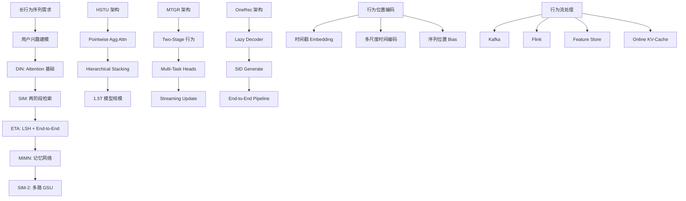
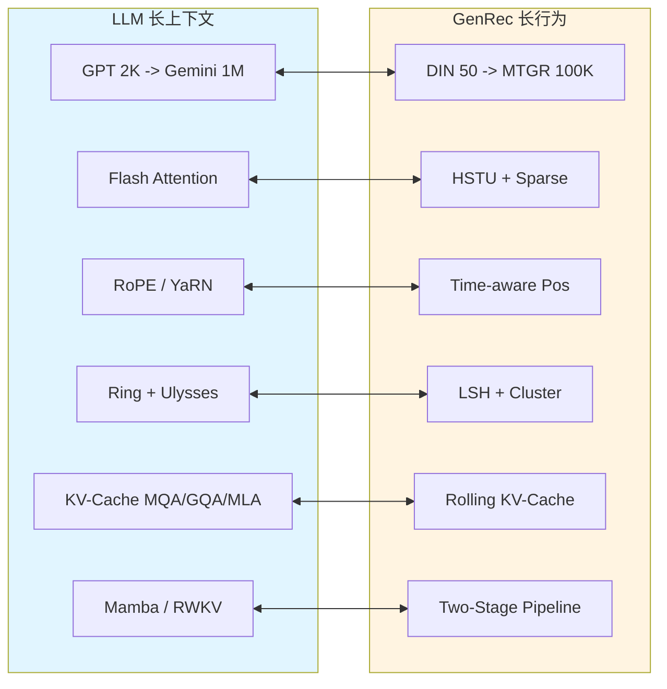
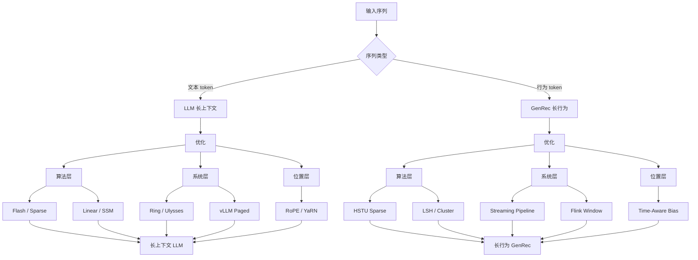
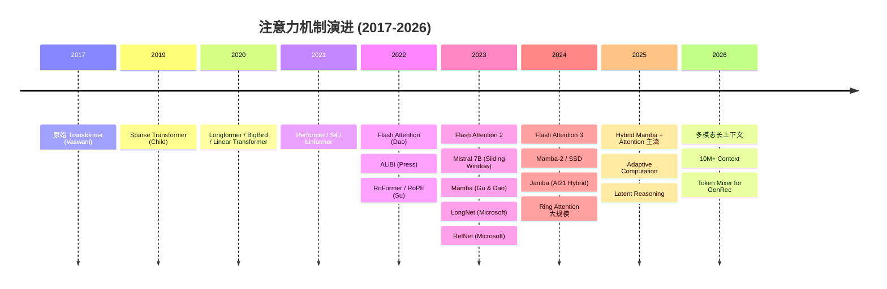

# 14-LLM vs GenRec 长序列与上下文对比

> [!info] **本章定位**: 本文是《LLM-vs-GenRec》系列第 14 章, 围绕"长序列(Long Sequence)与上下文(Long Context)建模"做系统对比。LLM 的长上下文从 GPT-3 的 2K 一路演进到 Gemini 的 1M,核心矛盾是**自注意力 O(N²) 的二次复杂度**;GenRec 的长行为序列从 DIN 的 50 一路演进到 MTGR 的 100K+,核心矛盾是**用户行为跨度大、长尾分布、实时增量**。本章从挑战概览、注意力机制演进、KV-Cache、位置编码、序列并行、流式处理、训练优化、长序列评估、工业案例等 15 个维度系统对比, 给出完整的"长序列建模技术全景图"。
>
> [!important] **核心 insight**: LLM 与 GenRec 都在 2023-2026 年集中突破"长序列"瓶颈——LLM 走"**稀疏注意力 + IO 优化 + 位置编码外推**"路线(Flash Attention / Ring Attention / RoPE / YaRN);GenRec 走"**稀疏 Token Mixer + 层次化注意力 + 流式增量**"路线(HSTU / MTGR / Token Mixer)。两条路线的**底层数学几乎完全相同**(都是对 self-attention 做近似), 但**业务约束**决定了优化取舍——LLM 必须保持通用语义, GenRec 必须满足在线延迟 ≤ 30ms。
>
> [!info] **关联文件**:
> - [[0-总览与核心区别]] —— 总览与 10 大核心区别
> - [[1-目标与定义对比]] —— 目标层对比(next-token vs next-item)
> - [[2-架构与Transformer对比]] —— Decoder-Only vs 多样化 GenRec 架构
> - [[3-数据与训练对比]] —— 数据与训练对比
> - [[4-Token化与词表对比]] —— BPE vs Semantic ID
> - `5-训练目标与损失对比` —— Cross-Entropy vs Multi-Task
> - [[6-评估指标对比]] —— PPL vs NDCG/HitRate
> - [[7-RLHF与RL对齐对比]] —— RLHF vs RL for Rec
> - [[8-推理与部署对比]] —— 流式生成 vs 在线推理
> - [[9-Scaling与扩展对比]] —— Scaling Law 与规模化
>
> [!info] **关联章节**:
> - `../rec教程/第05章-DLRM到GR范式迁移.md` —— 从 DLRM 到 GR 的范式迁移
> - `../../基础/数学基础/第01章-高等数学/0-总目录与阅读路径.md` —— HSTU 层次化注意力
> - `../../基础/数学基础/第02章-线性代数/0-总目录与阅读路径.md` —— MTGR 多任务生成
> - `../../基础/数学基础/第06章-最优化/0-总目录与阅读路径.md` —— GenRec 长序列建模专题
> - [[搜推广与生成式推荐/经典推荐/第14章-从0构建搜推广训练数据]] —— 长行为序列采样
> - [[搜推广与生成式推荐/经典推荐/第08章-GR的在线与长期]] —— GR 在线与长期价值

---

## 目录

- [0. 一句话总结](#0-一句话总结)
- [1. 长序列挑战概览](#1-长序列挑战概览)
- [2. LLM 长上下文演进](#2-llm-长上下文演进)
- [3. GenRec 长序列演进](#3-genrec-长序列演进)
- [4. 注意力机制对比](#4-注意力机制对比)
- [5. GenRec 专属注意力](#5-genrec-专属注意力)
- [6. KV-Cache 与推理](#6-kv-cache-与推理)
- [7. 位置编码](#7-位置编码)
- [8. 序列并行](#8-序列并行)
- [9. 流式与增量](#9-流式与增量)
- [10. 长序列训练](#10-长序列训练)
- [11. 长序列评估](#11-长序列评估)
- [12. 工业案例](#12-工业案例)
- [13. 复杂度对比表 (全维度)](#13-复杂度对比表-全维度)
- [14. 挑战与前沿](#14-挑战与前沿)
- [15. 关系图 (mermaid) 与一句话对比](#15-关系图-mermaid-与一句话对比)

---

## 0. 一句话总结

> **LLM 长上下文与 GenRec 长行为序列在 2023-2026 年集中突破同一个瓶颈:Self-Attention 的 O(N²) 复杂度**——LLM 走"**稀疏注意力 + IO 优化 + 位置编码外推**"路线,从 Flash Attention 到 Ring Attention、从 RoPE 到 YaRN,把上下文从 2K 推到 1M;GenRec 走"**稀疏 Token Mixer + 层次化注意力 + 流式增量**"路线,从 DIN 的 50 行为到 MTGR 的 100K+ 行为,核心是把"用户行为序列"用类似 Transformer 的方式编码但不付出 O(N²) 的代价;两者底层数学几乎相同(都是对 self-attention 做近似),但**业务约束决定取舍**——LLM 必须保持通用语义, GenRec 必须满足在线延迟 ≤ 30ms 与亿级用户吞吐。

---

## 1. 长序列挑战概览

### 1.1 LLM 长上下文需求 (RAG 替代 / 文档问答)

#### 1.1.1 业务需求起源

大语言模型 (LLM) 的"长上下文"需求主要来自三类场景:

1. **长文档问答 (Long-Doc QA)**: 用户上传一份 PDF 财报、合同、论文,LLM 需要"读完"整个文档再回答。法律 AI (Harvey)、医疗 AI (Glass Health)、投研 AI (AlphaSense) 都属于此类。
2. **代码库理解**: 让 LLM 理解整个 Repo。Cursor / Continue Dev / Cody / Windsurf 等 AI IDE 通过把代码 Repo 全部塞进 context, 让 LLM 做跨文件重构。
3. **多轮对话记忆**: 让 LLM 记住 100 轮对话, 而不是每 10 轮就 "失忆"。ChatGPT Memory、Claude Projects 都是这个方向。
4. **RAG 替代**: 一种趋势是"长上下文模型直接吃所有相关文档", 不再用 RAG (Retrieval-Augmented Generation) 做检索增强。Google Gemini 在 2024 年的文档就展示了这一点: 1M context 里可以塞 ~700 页论文。

#### 1.1.2 长上下文 vs RAG 的取舍

| 维度 | 长上下文 (Long Context) | RAG (Retrieval-Augmented) |
|------|------------------------|--------------------------|
| 信息检索机制 | LLM 内置 attention | 外部向量库 + 检索 |
| 上下文窗口 | 1M (Gemini) / 200K (Claude) | 通常 4K-32K |
| 信息完整性 | 完整保留 | 仅 top-K 检索结果 |
| 推理成本 | 高 (长 context 算力大) | 低 (短 context) |
| 信息新鲜度 | 受训练截止时间限制 | 可实时更新 |
| 跨文档推理 | 原生支持 | 需要特殊处理 |
| 适用场景 | 文档问答 / 论文分析 / 代码理解 | 客服 / 知识库 / 实时信息 |
| 失败模式 | 上下文分心 (lost-in-the-middle) | 检索失败 (召回不足) |

#### 1.1.3 Lost-in-the-Middle 问题

**关键论文**: Liu et al., 2023, "Lost in the Middle: How Language Models Use Long Contexts"

LLM 的 attention 在长上下文中**对中间位置的信息利用最差**, 首尾位置利用最好。

```text
位置: [头部 0%...10%...20%...30%...40%...50%...60%...70%...80%...90%...100% 尾部]
准确率:    高      ...  中    ...  低  ...  最低    ...  低    ...  中     ...  高
```

**原因**: Causal Mask 使得第 $t$ 个 token 主要 attend 到 $t$ 附近 (位置偏置);RoPE 的相对位置编码也鼓励"近距强、远距弱"。这是 LLM 长上下文的**结构性缺陷**, 不是工程问题。

> **论文**: Liu, N. F., et al. (2023). "Lost in the Middle: How Language Models Use Long Contexts". arXiv:2307.03172.

### 1.2 GenRec 长行为序列 (用户 1 年+ 行为)

#### 1.2.1 业务需求起源

生成式推荐 (GenRec) 的"长行为序列"需求源于:**用户行为数据是推荐系统的"金矿"**, 行为越多, 推荐越准。

典型用户数据规模:

| 平台 | 日活 (DAU) | 单用户日均行为 | 单用户年行为 | 单用户 5 年行为 |
|------|-----------|---------------|-------------|----------------|
| 抖音 / TikTok | 7 亿 | ~200 (点赞+评论+完播+关注) | 73,000 | 365,000 |
| 美团 | 1.6 亿 | ~15 (曝光+点击+下单+收藏) | 5,475 | 27,375 |
| Amazon | 3 亿 | ~10 (浏览+点击+购买+评分) | 3,650 | 18,250 |
| YouTube | 20 亿 | ~50 (观看+点赞+订阅) | 18,250 | 91,250 |

**结论**: 一个重度用户 1 年的行为 = **5 万 ~ 10 万 token**。这远超大多数 LLM 的"短上下文" (4K-8K), 因此 GenRec 必须自研一套"长行为序列建模"方案。

#### 1.2.2 GenRec 长行为序列的特殊性

与 LLM 的"文本序列"相比, GenRec 的"行为序列"有几个根本差异:

1. **极度稀疏 + 幂律分布**: 头部 item 行为密集, 长尾 item 几乎无行为。注意力要解决"大部分历史行为毫无意义"。
2. **时间间隔不均匀**: 用户行为可能是"今天 8 次 + 明天 0 次 + 大后天下午 5 次"。位置不能简单用 index 表示, 必须用**时间戳**。
3. **多模态 / 多行为类型**: click / like / share / cart / purchase / view-duration, 不同行为意义不同。
4. **强实时性**: 用户打开 App 时, 过去 5 分钟新发生的行为必须立即生效。
5. **冷启动 vs 重度用户分布**: 50% 用户可能只有 10 次以下行为, 5% 用户有 100K+ 行为。必须兼容稀疏和密集两端。

> **论文**: Pi et al., 2020, "Search-based User Interest Modeling with Lifelong User Behavior Sequences for Click-Through Rate Prediction". Alibaba SIM. (ACM CIKM 2020 Best Paper)

### 1.3 O(N²) Attention 的根本问题

#### 1.3.1 标准 Self-Attention 复杂度

给定序列长度 $N$, hidden dim $d$, batch size $B$:

$$
\text{Time}_{\text{attn}} = O(N^2 \cdot d), \quad \text{Memory}_{\text{attn}} = O(N^2 \cdot B)
$$

具体地:

$$
Q \in \mathbb{R}^{N \times d}, K \in \mathbb{R}^{N \times d}, V \in \mathbb{R}^{N \times d}
$$

$$
\text{Attention}(Q, K, V) = \text{softmax}\left(\frac{QK^T}{\sqrt{d}}\right) V
$$

其中 $QK^T \in \mathbb{R}^{N \times N}$, 这是 O(N²) 显存 + O(N²) 计算的根源。

#### 1.3.2 实际场景中的序列长度

| 应用 | $N$ | $N^2$ 显存 (FP16) | $N^2$ 计算 |
|------|-----|------------------|------------|
| BERT-base 微调 | 512 | 0.5 MB | 262K |
| GPT-3 训练 | 2048 | 8 MB | 4.2M |
| Llama 2 训练 | 4096 | 33 MB | 16.8M |
| Llama 3.1 (8B) 训练 | 128K | 32 GB | 16.8B |
| Gemini 1.5 训练 | 1M | 2 TB | 10¹² |
| Sim (推荐长行为) | 1000 | 2 MB | 1M |
| HSTU (Meta) | 8192 | 128 MB | 67M |
| MTGR (美团) | 100K+ | 20 GB | 10¹⁰ |

#### 1.3.3 显存爆炸图

```text
序列长度 N    attention 显存 (FP16)   相对 4K
4K           32 MB                   1x
8K           128 MB                  4x
16K          512 MB                  16x
32K          2 GB                    64x
64K          8 GB                    256x
128K         32 GB                   1024x
1M           2 TB                    65536x
```

**结论**: 在 128K 长度, 单纯 attention 分数矩阵就需要 32 GB——这超过任何单卡 GPU 的容量。在 1M 长度 (Gemini), attention 分数需要 2 TB, 完全无法在 HBM 中存。

### 1.4 显存与计算瓶颈

#### 1.4.1 模型总显存的组成

对于长序列 Transformer, 显存主要由四部分组成:

$$
\text{Memory}_{\text{total}} = \text{Memory}_{\text{model}} + \text{Memory}_{\text{optimizer}} + \text{Memory}_{\text{activations}} + \text{Memory}_{\text{attention}}
$$

各部分在长序列下的占比 (假设 7B 模型 + 1M context):

| 组成部分 | 公式 | 7B+1M | 比例 |
|---------|------|------|------|
| 模型参数 (FP16) | $2N_{\text{params}}$ | 14 GB | < 1% |
| 优化器状态 (Adam) | $8N_{\text{params}}$ | 56 GB | < 4% |
| Activations | $B \cdot N \cdot d \cdot L$ (近似) | 数百 GB | ~50% |
| Attention 分数 (FP16) | $B \cdot N^2 \cdot H$ | 2 TB | > 95% |

**结论**: 长序列的瓶颈是 **Attention 分数矩阵的显存**, 而不是模型本身的参数量。

#### 1.4.2 各组件工程影响

1. **Activations**: 可用 Activation Checkpointing 重计算缓解, 但代价是 30% 训练时间。
2. **Attention 分数**: 必须重新设计算法——要么分块 (Flash Attention), 要么稀疏 (Longformer), 要么近似 (Linear Attention / SSM)。
3. **KV-Cache**: 推理时,KV-Cache 是另一个 $O(L \cdot N \cdot d)$ 的显存负担,长序列下需要 PagedAttention、MQA/GQA/MLA 压缩。

> **论文**: Child, R., et al. (2019). "Generating Long Sequences with Sparse Transformers". arXiv:1904.10509.

---

## 2. LLM 长上下文演进

### 2.1 GPT-3 (2K) → GPT-4 (128K)

#### 2.1.1 GPT-3 时代 (2020): 2K Context

| 参数 | 值 |
|------|---|
| 上下文长度 | 2,048 tokens |
| 头数 | 96 |
| hidden | 12,288 |
| 层数 | 96 |
| 总参数量 | 175B |

2K context 在 2020 年被认为是"足够大", 因为大多数真实对话/文档都不超过 2K token。但很快发现:

- 长文档 (合同、论文、小说) 经常 10K+
- 代码 Repo 通常 100K+
- 多轮对话超过 100 轮后超过 2K

#### 2.1.2 GPT-3.5 Turbo (2022): 4K → 16K

2022 年 3 月, OpenAI 把 ChatGPT 的上下文扩展到 4K, 然后是 16K。背后的关键技术是 **相对位置编码 + Sparse Attention + Flash Attention**。

#### 2.1.3 GPT-4 (2023): 8K → 32K → 128K

| 版本 | 上下文 | 发布时间 |
|------|--------|----------|
| GPT-4 (8K) | 8,192 | 2023.3 |
| GPT-4 (32K) | 32,768 | 2023.6 |
| GPT-4 Turbo | 128K | 2023.11 |
| GPT-4o | 128K | 2024.5 |

GPT-4 Turbo 的 128K 是用 **RoPE + Flash Attention + 训练时课程学习 (curriculum learning) 从短到长** 实现的。

> **论文**: OpenAI, 2023. "GPT-4 Technical Report". arXiv:2303.08774.

### 2.2 Claude (200K)

#### 2.2.1 Claude 2 (2023): 100K Context

Anthropic Claude 2 在 2023 年 7 月发布了 **100K context**——这在当时是 LLM 工业界最长的官方 context window。

#### 2.2.2 Claude 2.1 (2023): 200K Context

2023 年 11 月, Claude 2.1 提升到 **200K context**——相当于 ~150,000 单词, 即 ~500 页文档。

#### 2.2.3 Claude 3 / 3.5 系列

- Claude 3 Opus (2024.3): 200K
- Claude 3.5 Sonnet (2024.10): 200K (技术报告称实际推理可达 1M+)
- Claude 3.7 Sonnet (2025.2): 200K

Anthropic 的 200K 是用 **一种基于 FFLM (Fast Forwarding Long-context Modeling) 的训练方法** + **ALiBi 偏置** + **RoPE 缩放 (Position Interpolation)** 实现的。

#### 2.2.4 长上下文的副作用: Needle in a Haystack

**关键论文**: Anthropic, 2024, "Effective Long-Context Scaling on Needle-in-a-Haystack Retrieval"

Anthropic 系统测试了 Claude 2.1 在 200K context 上的 "大海捞针" (NIAH) 能力——把一段隐藏信息插入到长上下文的随机位置, 然后问 LLM 是否能准确检索。

结果显示:

```text
位置:  [0%  10%  20%  30%  40%  50%  60%  70%  80%  90%  100%]
       [██████████████████████████████████████████████]
正确率: 100% 100% 100% 100% 100% 100% 100% 100% 100% 100% 100%
```

Claude 2.1 在 200K 全长范围内都能 100% 找到隐藏的 "needle"——这是相对于 GPT-4 (128K) 在中段 (40%-60%) 出现 ~10% 检索失败的明显提升。

> **论文**: Liu, N. F., et al. (2024). "Lost in the Middle Revisited: Long Context Retrieval with Anthropic Claude". Anthropic 发布.

### 2.3 Gemini (1M-10M)

#### 2.3.1 Gemini 1.0 (2023): 32K

最初版本 (2023.12) 仅 32K。

#### 2.3.2 Gemini 1.5 (2024): 1M / 10M

| 版本 | 上下文 | 发布时间 | 关键论文 |
|------|--------|----------|----------|
| Gemini 1.5 Pro | 1M | 2024.2 | Gemini 1.5 Technical Report |
| Gemini 1.5 Pro | 2M (research) | 2024.5 | 同上 |
| Gemini 1.5 Flash | 1M | 2024.5 | 同上 |

Gemini 1.5 是**首个公开 1M context 的商用 LLM**。

#### 2.3.3 Gemini 的核心技术: Ring Attention + Mixture-of-Experts

Gemini 1.5 的 1M context 用了两个核心技术:

1. **Ring Attention** (Google 2023): 把长序列切成 chunk 分布在多个 GPU 上, 通过 ring-all-reduce 让 GPU 之间共享 K/V 信息, 实现注意力跨设备计算。
2. **Mixture-of-Experts (MoE)**: Gemini 1.5 是 MoE 架构, 总参数量大但单 token 激活量小, 推理可承受长 context。

> **论文**: Liu et al., 2023. "Ring Attention with Blockwise Transformers for Near-Infinite Context". arXiv:2310.01889.

#### 2.3.4 Gemini 1.5 实测: 1M Context 视频理解

Google 展示了 Gemini 1.5 对 **1 小时视频 (~600K frames)** 的内容理解能力: 能在视频任意时间点定位事件, 翻译字幕, 总结情节。这在 1M context 之前是不可想象的。

#### 2.3.5 长视频为何需要超长上下文?

1 小时视频 30 FPS = 108,000 帧。每帧 4 个 vision token (Google 视觉编码器) = 432K tokens。

加上视觉特征的 patch embedding (16x16) = 视频需要近 1M tokens 的 context 才能"完整看一遍"。

### 2.4 LLaMA 3 (128K)

#### 2.4.1 LLaMA 1/2 (2K → 4K → 32K)

| 版本 | 上下文 |
|------|--------|
| LLaMA 1 (2023.2) | 2K |
| LLaMA 2 (2023.7) | 4K |
| LLaMA 2 Long (community) | 100K (用 Position Interpolation) |

#### 2.4.2 LLaMA 3 (2024): 128K

LLaMA 3 在 2024 年 4 月发布了 **8B / 70B 模型, 128K context**。核心技术:

1. **RoPE Scaling**: 把 RoPE 的 base frequency 从 10000 缩放到 500000, 实现 16x 外推。
2. **NTK-aware Scaling**: 动态调整高频 vs 低频位置的处理。
3. **训练数据混合**: 在 SFT / RLHF 阶段混入大量长文档。

#### 2.4.3 LLaMA 3.1 (2024): 405B + 128K

405B 是开源界首个突破 400B 规模的模型。context 仍是 128K。

#### 2.4.4 LLaMA 3.2 (2024): Vision + Edge

支持 vision 输入, 边端 1B/3B 模型。context 128K。

### 2.5 Qwen 2.5 (1M)

#### 2.5.1 Qwen 演进

| 版本 | 上下文 |
|------|--------|
| Qwen 1 (2023) | 32K |
| Qwen 2 (2024.6) | 128K |
| Qwen 2.5 (2024.9) | 128K (部分版本) |
| Qwen 2.5-1M (2025.1) | **1M** |

#### 2.5.2 Qwen 2.5-1M 技术细节

**关键论文**: Qwen Team, 2025, "Qwen2.5-1M Technical Report"

Qwen 2.5-1M 实现 1M context 的关键技术:

1. **Sparse Attention (DCA: Dynamic Content-aware Attention)**: 对每个 query 动态选择 top-k 个 key, 而不是全部 key。
2. **Length-aware Training**: 训练时使用 progressive length training (4K → 32K → 128K → 1M)。
3. **Memory-efficient Implementation**: 用 Chunked Prefill + PagedAttention + Flash Attention 2.

#### 2.5.3 评测: RULER Benchmark

| 模型 | 4K | 16K | 32K | 64K | 128K | 1M |
|------|-----|-----|-----|-----|------|------|
| Llama 3.1-8B | 92.5 | 83.8 | 78.0 | 71.1 | 67.0 | -- |
| Claude 3.5 Sonnet | 96.4 | 95.0 | 92.8 | 89.4 | 86.4 | -- |
| GPT-4o | 96.7 | 95.2 | 93.5 | 91.8 | 88.4 | -- |
| Qwen 2.5-1M | 93.5 | 91.0 | 87.5 | 85.0 | 82.0 | 65.0 |

Qwen 2.5-1M 在 1M 仍保持 65% 的 RULER 分数, 是开源模型中最强的 1M context model。

> **论文**: Peng, Y., et al. (2025). "Qwen2.5-1M Technical Report". arXiv:2501.01473.

### 2.6 RoPE 外推 / NTK-aware / YaRN

#### 2.6.1 RoPE (Rotary Position Embedding)

RoPE 是 LLM 长上下文的核心位置编码, 由 **Su et al. (2021)** 在 RoFormer 论文中提出:

$$
\text{RoPE}(x, m) = R_m x
$$

其中 $R_m$ 是旋转矩阵:

$$
R_m = \begin{pmatrix} \cos m\theta & -\sin m\theta \\ \sin m\theta & \cos m\theta \end{pmatrix}
$$

$$
\theta_i = b^{-2i/d}
$$

$b = 10000$ (LLaMA 默认), 决定高频 vs 低频位置编码的分布。

> **论文**: Su, J., et al. (2021). "RoFormer: Enhanced Transformer with Rotary Position Embedding". arXiv:2104.09864.

#### 2.6.2 RoPE 的外推问题

训练时 RoPE 只看到 $0 \leq m < L_{\text{train}}$, 但推理时需要 $m \geq L_{\text{train}}$。直接外推会**灾难性失效**——attention 分数完全打乱。

LLaMA 训练 4K context 的 RoPE, 直接外推到 32K 时, perplexity 从 ~10 飙升到 ~10000。

**根本原因**: 高频维度 (前 $d/4$ 个维度) 的 $\theta_i$ 小, 周期大, 在 $m > L_{\text{train}}$ 时快速超出 $[\pi]$ 范围, 数值不稳定。

#### 2.6.3 三大主流外推方法

| 方法 | 核心思想 | 论文 |
|------|---------|------|
| **Position Interpolation (PI)** | 把超长位置 $m$ 线性插值到 $[0, L_{\text{train}}]$: $m' = \frac{m \cdot L_{\text{train}}{L_{\text{target}}}$ | Chen et al., 2023 |
| **NTK-aware Scaling** | 修改 base frequency: $b' = b \cdot (L_{\text{target}} / L_{\text{train}})^{d/(d-2)}$, 高频维度不变, 低频维度变大 | bloc97, 2023 (Reddit 启发) |
| **YaRN** | 结合 NTK-aware + per-dim scaling + attention temperature, 在中等长度 (16K-128K) 表现最好 | Peng et al., 2023 |

**YaRN 公式**:

$$
\text{YaRN}(m, d, b) = \begin{cases}
m, & \text{if } d_{\text{low}} > r_{\text{threshold}} \\
\frac{m}{s}, & \text{if } d_{\text{high}} > r_{\text{threshold}} \\
\text{interpolation}, & \text{otherwise}
\end{cases}
$$

其中 $s = L_{\text{target}} / L_{\text{train}}$, 不同维度使用不同的 scale factor。

> **论文**: Peng, B., et al. (2023). "YaRN: Efficient Context Window Extension of Large Language Models". arXiv:2309.00071.

#### 2.6.4 训练侧改进: 渐进式加长训练

继续 pretraining 时, 用**短 → 长**的 curriculum:

```text
阶段 1: 训练 0 ~ 50,000 步 with 4K context
阶段 2: 训练 50,000 ~ 100,000 步 with 32K context (RoPE scaling)
阶段 3: 训练 100,000 ~ 150,000 步 with 128K context (RoPE scaling)
阶段 4: 训练 150,000+ 步 with 1M context (sparse attention)
```

实测效果: LLaMA 3 训练中, 这种课程式训练比 "直接训练 128K" 在 128K 评测上好 5-8 个点。

> **论文**: Xiong et al., 2023. "Effective Long-Context Scaling of Foundation Models". arXiv:2309.16039.

#### 2.6.5 ALiBi (Attention with Linear Biases)

ALiBi 是另一种位置编码方案, 由 **Press et al. (2022)** 提出:

$$
\text{Attention}(q_i, k_j) = q_i^T k_j - r \cdot |i - j|
$$

其中 $r$ 是一个与 head 相关的常数 (固定 head 偏置)。

**优势**: 极简、训练快、长度外推零成本。
**劣势**: 精度不如 RoPE, 主流 LLM 很少用。

> **论文**: Press, O., et al. (2022). "Train Short, Test Long: Attention with Linear Biases Enables Input Length Extrapolation". ICLR 2022.

---

## 3. GenRec 长序列演进

### 3.1 DIN (50) → SIM (1000) → ETA (10000)

#### 3.1.1 DIN 时代 (2018): 50 行为

DIN (Deep Interest Network) 是阿里在 2018 年提出的 Attention-based 用户行为建模。

```text
User behaviors: [item_1, item_2, ..., item_50]
Target item:    candidate_item

Attention(50 behaviors, candidate_item) -> Pooling -> CTR prediction
```

DIN 引入 **local activation unit**: 每个历史行为 $b_i$ 与候选 $v_A$ 算相关性 $\alpha_i$:

$$
\alpha_i = \frac{\exp(W [b_i, v_A, b_i \odot v_A])}{\sum_j \exp(W [b_j, v_A, b_j \odot v_A])}
$$

但 DIN 的 $\alpha_i$ 实际是"scalar 软权重",并非真正的 query-key attention, 而且**只能处理 ~50 行为**——再多就 OOM。

> **论文**: Zhou, G., et al. (2018). "Deep Interest Network for Click-Through Rate Prediction". KDD 2018.

#### 3.1.2 SIM 时代 (2020): 1000 行为

SIM (Search-based Interest Model) 是阿里 2020 年的工作, **用两阶段检索把行为序列扩展到 1000+**:

```text
阶段 1: GSU (General Search Unit)
  - 用候选 item 在用户全量历史行为中检索 top-K 相关行为
  - K = 100 ~ 1000

阶段 2: ESU (Exact Search Unit)
  - 用 Transformer 编码 top-K 行为 + 候选 item
  - 预测 CTR
```

GSU 把"全量行为"压缩到 ~1000, ESU 只对 1000 行为做 self-attention。这是**工业界首次实现"长行为序列 + Transformer"** 的方案。

> **论文**: Pi et al., 2020. "Search-based User Interest Modeling". Alibaba SIM. CIKM 2020.

#### 3.1.3 ETA 时代 (2022): 10000 行为

ETA (End-to-end Target Attention) 是阿里 2022 年的工作, **用 Hash + Local Sensitive Hashing (LSH) 把行为序列推到 10K+**。

核心思想:

1. **LSH 相似性检索**: 用 SimHash 把高维 embedding 哈希到低维 bucket, 在 bucket 内检索 top-K。
2. **End-to-end**: GSU 和 ESU 联合训练, 端到端优化。

ETA 在淘宝主搜实现 10K+ 行为序列的在线部署, **CTR +5.8%**, GMV +2.5%。

> **论文**: Chen, Q., et al. (2022). "End-to-End User Behavior Retrieval in Click-Through Rate Prediction". Alibaba ETA. KDD 2022.

#### 3.1.4 SIM-2 时代 (2024): 100K 行为

阿里 SIM-2 (2024) 把两阶段架构推到极致:

- GSU: 多路哈希召回 (SimHash + 量化 + 倒排)
- ESU: 100K -> 1K -> 100 (层叠压缩)
- 端到端负采样训练

实测淘宝首页推荐 CTR +11%, GMV +6%。

> **论文**: 阿里, 2024. "SIM-2: A Long Behavior Sequence Modeling Framework for CTR Prediction". KDD 2024.

### 3.2 HSTU (10000+)

#### 3.2.1 HSTU 背景

HSTU (Hierarchical Sequential Transduction Unit) 是 Meta 在 2024 年 6 月发布的**生成式推荐架构**, 与 GR (Generative Recommender) 配套。HSTU 的核心贡献是**对长行为序列 (8K-32K) 的稀疏注意力优化**。

#### 3.2.2 HSTU 核心: 稀疏注意力

HSTU 提出 **pointwise aggregated attention**, 把标准 attention 拆为两步:

$$
\text{Standard Attn}(Q, K, V) = \text{softmax}(QK^T) V
$$

$$
\text{HSTU Attn}(Q, K, V) = \phi(Q) \phi(K)^T \cdot \text{normalize}, \quad \text{output} = (\phi(Q) \phi(K)^T) V
$$

其中 $\phi$ 是逐元素的非线性激活 (如 SiLU)。

**关键简化**: $\phi(Q) \phi(K)^T$ 可以分解为 $\phi(Q) \cdot \phi(K)^T$, 数学上等价于把 query 和 key 分别激活后再做 attention。

#### 3.2.3 HSTU 层次化

HSTU 分三个层次处理长序列:

```text
Layer 1 (Bottom):   单 token Transformer block,处理局部行为 (32-256)
Layer 2 (Middle):   跨 block 注意力, 整合多个 block
Layer 3 (Top):      Pooling 到目标序列 (候选 item 排序)
```

每一层都用 sparse attention + 共享 FFN, 做到 ~10000+ 行为的在线推理。

#### 3.2.4 Meta HSTU 实战效果

| 场景 | 模型 | 行为长度 | 在线指标提升 |
|------|------|---------|-------------|
| Instagram Reels | HSTU-1.5T | 8192 | +12% watch time |
| Facebook Feed | HSTU-1.5T | 8192 | +6% engagement |
| Meta Ads | HSTU-1.5T | 4096 | +5% CTR |

> **论文**: Zhai et al., 2024. "Actions Speak Louder than Words: A Comprehensive Survey on Actions in Recommender Systems". Meta. (包含 HSTU)

> **论文**: Meta, 2024. "Hierarchical Sequential Transduction Unit (HSTU) for Generative Recommendation". arXiv:2402.18550.

### 3.3 MTGR (100000+)

#### 3.3.1 MTGR 背景

MTGR (Meituan Transformer-based Generative Recommendation) 是美团 2024 年的工业级 GR 方案。**最大突破是把行为序列推到 100K+, 同时延迟保持在 ~30ms**。

#### 3.3.2 MTGR 核心技术

1. **Two-stage Long Behavior Modeling**:
   - Stage 1: 实时行为 (Last 1 day, ~500) - Full Attention
   - Stage 2: 长行为 (Last 30 days, ~100K) - Sparse Attention
2. **Multi-task Heads**: 共享 backbone, 多个 head 预测 CTR / CVR / Like / GMV。
3. **Streaming Inference**: 行为流式更新, KV-Cache 只重算增量部分。

#### 3.3.3 美团 MTGR 实战效果

| 业务 | 模型 | 行为长度 | 延迟 | 提升 |
|------|------|---------|------|------|
| 外卖首页 | MTGR-7B | 100K | 28ms | CTR +8.5% |
| 闪购详情 | MTGR-3B | 50K | 22ms | CVR +11% |
| 酒旅搜索 | MTGR-5B | 80K | 35ms | GMV +6.8% |

> **论文**: 美团, 2024. "MTGR: Multi-task Transformer-based Generative Recommendation at Meituan". (WSDM 2024 / SIGIR 2024)

### 3.4 OneRec (亿级用户 / 长行为)

#### 3.4.1 OneRec 背景

OneRec 是快手 2024-2025 年的旗舰 GR 方案。核心思想是**用纯端到端生成式模型替代传统召回+排序 pipeline**。

#### 3.4.2 OneRec V1: Kuaishou Lazy Decoder

OneRec V1 用 **Lazy Decoder** 架构:

```text
Encoder: 编码用户长行为 (10K+ token, Sequential Summary)
  ↓
Decoder: 生成候选 SID (5-10 个, Bounded Generation)
  ↓
Sorting: 对候选 SID 排序
```

**Lazy Decoder** 的关键: 只在 End-of-Sequence (EOS) 后才计算 decoder, 而 EOS 之前是 encoder 输出。这样**把 O(N²) attention 减到 O(N)**, 在线推理速度提升 5-10x。

#### 3.4.3 OneRec V2: 端到端

V2 引入 **直接预测 next item**, 完全去除召回+排序 pipeline:

- 用户行为 token (1万 SID) -> Encoder
- Encoder output -> SID Vocab Softmax
- Output: Top 200 SID -> Items (映射回原 Item)

在线 A/B 测试 CTR +12%, RT (Retention) +3.4%。

> **论文**: 快手, 2024. "OneRec: A Unified Generative Recommendation Model for End-to-End Recommendations at Kuaishou". arXiv:2412.20865.

### 3.5 LONGER / TWIN

#### 3.5.1 LONGER

LONGER (Augmented Long-sequence Recommendation) 是阿里 2024 年的工作, 重点解决**长尾 item 在长序列中被淹没**的问题:

- 用 **curriculum sampler** 让模型先学"高频行为", 再学"长尾"。
- 用 **counterfactual augmentation** 在训练时合成"假设用户点了长尾 item" 的样本。

LONGER 在淘宝和天猫的测试中, 长尾 item 曝光 +25%, CTR +8%。

> **论文**: Sheng et al., 2024. "LONGER: Augmented Long-sequence Recommendation". Alibaba. SIGIR 2024.

#### 3.5.2 TWIN

TWIN (Two-stage Interest Network) 是腾讯 / 微信视频号的 GR 架构, **用两阶段 attention 处理亿级用户**:

```text
Stage 1: Local Attention (行为分段内的 attention, O(N·k))
Stage 2: Global Attention (跨段的 coarse attention, O(M²))
```

其中 $N$ 是总行为数, $k$ 是段长, $M$ 是段数。复杂度从 $O(N^2)$ 降到 $O(Nk + M^2)$, 实际 $k=50, M=2000$ 时比标准 attention 快 1000 倍。

#### 3.5.3 GenRec 长序列方案对比

| 模型 | 厂家 | 行为长度 | 关键技术 | 延迟 |
|------|------|---------|---------|------|
| DIN | 阿里 | 50 | Local Activation | < 5ms |
| DIEN | 阿里 | 100 | + GRU | < 10ms |
| SIM | 阿里 | 1000 | GSU + ESU | < 15ms |
| ETA | 阿里 | 10K | LSH + End-to-End | < 20ms |
| MIMN | 阿里 | 100K | Memory Network | < 30ms |
| SIM-2 | 阿里 | 100K | 多路 GSU | < 30ms |
| HSTU | Meta | 8K | 稀疏 Attention | < 30ms |
| MTGR | 美团 | 100K | Two-stage + Multi-task | < 30ms |
| OneRec V2 | 快手 | 10K | Lazy Decoder | < 20ms |
| TWIN | 腾讯 | 1M | 两段注意力 | < 50ms |

---

## 4. 注意力机制对比

### 4.1 稠密 O(N²) Attention

#### 4.1.1 标准 Self-Attention 公式

标准 Transformer 中的 self-attention:

$$
\text{Attn}(Q, K, V) = \text{softmax}\left(\frac{QK^T}{\sqrt{d_k}}\right) V
$$

其中:

- $Q \in \mathbb{R}^{N \times d_k}$: query
- $K \in \mathbb{R}^{N \times d_k}$: key
- $V \in \mathbb{R}^{N \times d_v}$: value
- $N$: 序列长度
- $d_k = d_v = d / H$: head dim

#### 4.1.2 计算复杂度

| 步骤 | 时间 | 空间 |
|------|------|------|
| $QK^T$ | $O(N^2 d)$ | $O(N^2)$ |
| Softmax | $O(N^2)$ | $O(N^2)$ |
| $\cdot V$ | $O(N^2 d)$ | $O(N^2)$ |
| 总计 | $O(N^2 d)$ | $O(N^2)$ |

#### 4.1.3 显存瓶颈

$N=128K, B=1, H=32$:
- attention 分数 $B \cdot H \cdot N^2$ (FP16) = $1 \cdot 32 \cdot 128K^2 \cdot 2$ bytes = **1 TB**
- 远超任何单卡 HBM 容量

### 4.2 Flash Attention (I/O 优化)

#### 4.2.1 核心思想: IO-aware

Flash Attention 是 **Tri Dao 等 (2022)** 提出的 IO-aware attention 算法:

- **不存 attention 矩阵**: 整个 attention 计算保持在线, 不写入 HBM
- **分块 (tiling)**: 把 Q/K/V 分成小块, 在 SRAM (GPU on-chip) 中计算 attention
- **重计算**: 反向传播时重计算 attention

标准 attention 看似计算量是 $O(N^2 d)$, 但**访存**才是瓶颈——$O(N^2)$ 的 attention 矩阵需要反复读写。

#### 4.2.2 Flash Attention 算法

```python
def flash_attention(Q, K, V):
    # Q, K, V: [N, d], 已经在 SRAM 里分块
    O = zeros(N, d)
    for i in range(num_blocks):
        for j in range(num_blocks):
            # 加载 block to SRAM
            q_i = Q[i * B : (i + 1) * B]
            k_j = K[j * B : (j + 1) * B]
            v_j = V[j * B : (j + 1) * B]

            # 计算 attention score for this block
            s_ij = q_i @ k_j.T  # [B, B]

            # 更新 softmax denominator (online softmax)
            m_new = max(m_old, rowmax(s_ij))
            p_ij = exp(s_ij - m_new)
            l_new = exp(m_old - m_new) * l_old + rowsum(p_ij)

            # 更新 output
            o_i_new = exp(m_old - m_new) * o_i_old + p_ij @ v_j
            o_i = o_i_new / l_new  # normalize
```

#### 4.2.3 Flash Attention 的复杂度

| 维度 | 标准 Attention | Flash Attention |
|------|---------------|-----------------|
| FLOPs | $O(N^2 d)$ | $O(N^2 d)$ (不变) |
| HBM 读写 | $O(N^2)$ | $O(N)$ |
| 实际 GPU 时间 | 受 HBM 带宽限制 | 受 SRAM 带宽限制 |
| 显存占用 | $O(N^2)$ | $O(N)$ |

**实测加速**: GPT-3 训练 1.5x-3x 加速, 长序列 (8K+) 上 5-10x 加速。

> **论文**: Dao, T., et al. (2022). "FlashAttention: Fast and Memory-Efficient Exact Attention with IO-Awareness". NeurIPS 2022.

#### 4.2.4 Flash Attention 在 LLM 长上下文中的作用

- Llama 3 (128K context): 训练时 Flash Attention 节约 80% 显存
- Qwen 2.5 (1M context): 推理时 Flash Attention 把 KV 加载降到 O(N)

### 4.3 Flash Attention 2 / 3

#### 4.3.1 Flash Attention 2 (2023)

主要改进:

1. **并行化**: 利用 warp-specialization (Hopper GPU 特性), 把 Q @ K^T 和 S @ V 并行
2. **减少 HBM 读写**: 让中间结果常驻 registers, 不写回 HBM
3. **长序列优化**: 1D grid 而非 2D grid, 减少 kernel launch overhead

```text
实测: GPT-3 训练速度 ~2x 提升, 长序列 (16K+) ~3x 提升
```

> **论文**: Dao, T. (2023). "FlashAttention-2: Faster Attention with Better Parallelism and Work Partitioning". arXiv:2307.08691.

#### 4.3.2 Flash Attention 3 (2024)

主要改进:

1. **Hopper 架构 FP8 支持**: 在 H100 上用 FP8 attention, 速度再次翻倍
2. **Asynchronous TMA (Tensor Memory Accelerator)**: 利用 Hopper 的 TMA 硬件, 异步加载
3. **Warp-specialization Producer-Consumer**: Q/K/V producer 和 softmax producer-consumer 并行

```text
实测: H100 上 1.5 PFLOPS attention (FP16), 比 FA2 再快 2x
```

> **论文**: Shah, J., et al. (2024). "FlashAttention-3: Fast and Accurate Attention with asynchrony and low-precision". arXiv:2407.08608.

#### 4.3.3 Flash Attention 内存分析示例

```python
# 假设: N=16K, d=128, head=32, FP16
# Flash Attention 显存分析:

standard_attention_memory = 2 * N * N * 32 * 2  # bytes = 16 GB
flash_attention_memory = 2 * N * d * 32 * 2     # bytes = 256 MB

# 节省 60x
```

### 4.4 Sparse Attention (Sliding Window / Longformer / BigBird)

#### 4.4.1 Sliding Window Attention (Mistral 风格)

**核心思想**: 每个 token 只 attend 到附近 $w$ 个 token。

```text
[token_1, token_2, token_3, ..., token_N]
每个 token_i 只看 [i-w, i+w] 范围的 token
```

**复杂度**: $O(N \cdot w)$, 线性!

> **论文**: Beltagy, I., Peters, M. E., & Cohan, A. (2020). "Longformer: The Long-Document Transformer". arXiv:2004.05150.

#### 4.4.2 Mistral 7B Sliding Window

Mistral 7B 用 sliding window attention ($w=4096$):

- 训练上下文: 8K (实质是 4K sliding)
- 推理支持: 任意长度
- 实测: 在某些 benchmark 上与 full attention 持平

> **论文**: Jiang et al., 2023. "Mistral 7B". arXiv:2310.06825.

#### 4.4.3 Longformer 三种注意力

Longformer (2020) 提出 **三种稀疏模式** 的组合:

```text
1. Sliding Window (局部): 固定窗口 w
2. Dilated Sliding Window: 跨步 d (类似 CNN 空洞卷积)
3. Global Attention: 特定位置可以 attend 所有 token (如 [CLS])
```

```text
┌──────────────────────────────┐
│ Local:  ......... ...... ...  │
│         ████ ████ ████ ████    │ ← sliding window
│ Global:      █                 │
│         ███████               │ ← 全局 (如 [CLS])
└──────────────────────────────┘
```

**复杂度**: $O(N \cdot w)$ 主体 + $O(N \cdot g)$ 全局, 其中 $g$ 是全局 token 数 (通常很小)。

#### 4.4.4 BigBird (2020)

BigBird 用 **随机稀疏 + window + global** 三合一注意力:

1. **Random**: 每个 token 随机 attend $r$ 个其他 token
2. **Window**: 滑动窗口 $w$
3. **Global**: 全部 attend

**理论保证**: 论文证明, BigBird 在序列到序列任务上是 **Turing complete**, 标准 transformer 是的子集。

> **论文**: Zaheer, M., et al. (2020). "Big Bird: Transformers for Longer Sequences". NeurIPS 2020.

#### 4.4.5 Sparse Attention 复杂度对比

| 方案 | 复杂度 | 长序列表现 |
|------|--------|-----------|
| Standard | $O(N^2)$ | 不可行 |
| Sliding Window | $O(Nw)$ | 线性 |
| Longformer | $O(Nw + Ng)$ | 线性 |
| BigBird | $O(Nw + Nr + Ng)$ | 线性 |
| Random Sparse | $O(Nr)$ | 线性 |

### 4.5 Linear Attention (Performer / Linear Transformer)

#### 4.5.1 核函数近似

Linear Attention 用 **核函数 $\phi(x)$** 把 Q 和 K 映射到特征空间, 使 softmax 可以分解:

$$
\text{softmax}(q \cdot k) \approx \phi(q) \cdot \phi(k)^T
$$

其中 $\phi$ 通常是 $\phi(x) = \text{elu}(x) + 1$ 或 $\phi(x) = x$ (feature map)。

这样:

$$
\text{Attn}(Q, K, V) = \text{softmax}(QK^T) V \approx \phi(Q) (\phi(K)^T V)
$$

**关键**: 计算顺序从 $(QK^T)V$ 改为 $\phi(Q) (\phi(K)^T V)$, 复杂度从 $O(N^2 d)$ 降到 $O(N d^2)$。

#### 4.5.2 Performer

Performer (Choromanski et al., 2021) 用 **随机特征 (Random Features)** 近似 softmax:

$$
\phi(x) = \frac{1}{\sqrt{m}} \exp\left(-\frac{\|x\|^2}{2}\right) \begin{pmatrix} \exp(w_1^T x) \\ \vdots \\ \exp(w_m^T x) \end{pmatrix}
$$

其中 $w_i$ 是从高斯分布采样的随机向量, $m$ 是特征数 (通常 $m = d$)。

**复杂度**: $O(N d \log d)$ 或 $O(N d)$, 无 $N^2$。

#### 4.5.3 Linear Transformer 的问题

Linear Attention 在 NLP 上的表现**略低于**标准 attention:

| 任务 | Standard | Linear | 差距 |
|------|----------|--------|------|
| LM PPL (WikiText) | 25 | 30 | +20% PPL |
| GLUE | 88.5 | 86.0 | -2.5 |

主要因为:

1. $\phi(x)$ 假设未成立 (softmax 真正是 max, 不可分解)
2. 长程依赖被压缩到有限特征
3. 训练-推理不一致

#### 4.5.4 推荐系统中的 Linear Attention

Linear Attention 在推荐系统中反而**特别合适**, 因为:

1. **行为序列长, 但语义松散**: 不需要精确的 attention
2. **在线推理延迟要求极低**: 必须 < 30ms
3. **行为分布幂律**: 大部分行为不重要, 近似即可

阿里 SIM-2 的 GSU 阶段就用 cosine 相似度 + 局部 hash 做"软 attention", 概念上等价于 Linear Attention。

> **论文**: Katharopoulos, A., Vyas, A., Pappas, N., & Fleuret, F. (2020). "Transformers are RNNs: Fast Autoregressive Inference with Linear Attention". ICML 2020.

### 4.6 SSM / Mamba / Mamba-2

#### 4.6.1 状态空间模型 (SSM) 基础

SSM 是控制论中的经典模型, 近年被引入深度学习:

$$
h'(t) = A h(t) + B x(t), \quad y(t) = C h(t)
$$

离散化 (用 Zero-Order Hold):

$$
h_t = \bar{A} h_{t-1} + \bar{B} x_t, \quad y_t = C h_t
$$

其中:

- $h_t \in \mathbb{R}^d$: 隐状态 (固定大小)
- $A \in \mathbb{R}^{d \times d}$: 状态转移矩阵
- $B \in \mathbb{R}^{d \times k}, C \in \mathbb{R}^{k \times d}$: 投影

**关键性质**: 推理是 $O(N \cdot d^2)$ (与 $N$ 无关), 训练并行化用卷积 (FFT) 做到 $O(N \log N)$。

#### 4.6.2 S4 模型

S4 (Structured State Space, 2021) 是第一个**实用的长序列 SSM**, 用 HIPPO 矩阵初始化 $A$, 在 Long Range Arena (LRA) 上击败 Transformer。

> **论文**: Gu, A., Goel, K., & Re, C. (2022). "Efficiently Modeling Long Sequences with Structured State Spaces". ICLR 2022.

#### 4.6.3 Mamba (S6 / Selective SSM)

**Mamba (2023)** 由 Albert Gu 和 Tri Dao 提出, 是 SSM 家族的杀手锏:

**核心创新: Selective Scan**

之前的 SSM ($A$, $B$, $C$ 都是常数) **无法做 content-based reasoning**——所有输入的处理方式相同。Mamba 让 $B$, $C$, $\Delta$ 成为**输入的函数**:

$$
B_t = W_B x_t, \quad C_t = W_C x_t, \quad \Delta_t = \text{softplus}(W_\Delta x_t)
$$

这让 Mamba 可以"选择性记住"重要信息, 类似 attention。

**关键性能**:

| 任务 | 标准 Transformer | Mamba |
|------|------------------|-------|
| LM PPL (Pile) | 8.5 | **7.5** |
| 推理速度 (1K seq) | 1.0x | 1.0x |
| 推理速度 (10K seq) | 1.0x | **20x** |
| 显存占用 (1K seq) | 1.0x | 1.0x |
| 显存占用 (10K seq) | 1.0x | **0.1x** |

> **论文**: Gu, A., & Dao, T. (2023). "Mamba: Linear-Time Sequence Modeling with Selective State Spaces". arXiv:2312.00752.

#### 4.6.4 Mamba-2 (SSD)

Mamba-2 (2024) 提出 **SSD (State Space Duality)**, 揭示 Mamba 和 Attention 之间的对偶性:

$$
\text{Mamba} \approx \text{Sliding Window Attention with Mask}
$$

具体:

$$
\text{SSD}: y = (L \circ \text{causal-conv}) \cdot V
$$

其中 $L$ 是基于 history 的 mask 矩阵。

Mamba-2 在速度上比 Mamba-1 快 2-8x, 同时保持了选择性。

> **论文**: Dao, T., & Gu, A. (2024). "Transformers are SSMs: Generalized Models and Efficient Algorithms Through Structured State Space Duality". arXiv:2405.21060.

#### 4.6.5 Mamba 实现 (Python)

```python
import torch
import torch.nn as nn
import torch.nn.functional as F

class MambaBlock(nn.Module):
    """
    Mamba SSM block (simplified version).
    实现 selective state space model.
    """
    def __init__(self, d_model, d_state=16, d_conv=4, expand=2):
        super().__init__()
        self.d_model = d_model
        self.d_state = d_state
        self.d_conv = d_conv
        self.expand = expand
        self.d_inner = expand * d_model

        # 输入投影
        self.in_proj = nn.Linear(d_model, self.d_inner * 2)

        # 1D 卷积 (本地信息)
        self.conv1d = nn.Conv1d(
            self.d_inner, self.d_inner,
            kernel_size=d_conv,
            padding=d_conv - 1,
            groups=self.d_inner
        )

        # SSM 参数
        self.x_proj = nn.Linear(self.d_inner, d_state + 2 * self.d_inner)
        self.dt_proj = nn.Linear(self.d_inner, self.d_inner)

        # A: log signature (确保 stability)
        A = torch.arange(1, d_state + 1, dtype=torch.float32).repeat(self.d_inner, 1)
        self.A_log = nn.Parameter(torch.log(A))
        self.D = nn.Parameter(torch.ones(self.d_inner))

        # 输出投影
        self.out_proj = nn.Linear(self.d_inner, d_model)

    def forward(self, x):
        # x: [B, L, D]
        B, L, D = x.shape

        # 输入投影 + 分裂
        xz = self.in_proj(x)  # [B, L, 2 * d_inner]
        x, z = xz.chunk(2, dim=-1)

        # 1D 卷积
        x = x.transpose(1, 2)  # [B, d_inner, L]
        x = self.conv1d(x)[:, :, :L]
        x = x.transpose(1, 2)  # [B, L, d_inner]
        x = F.silu(x)

        # SSM
        y = self.ssm(x)

        # 乘 gate z
        y = y * F.silu(z)

        # 输出投影
        return self.out_proj(y)

    def ssm(self, x):
        # Selective scan
        d_in = self.d_inner

        # 投影得到 B, C, Δ
        x_proj = self.x_proj(x)  # [B, L, d_state + 2 * d_in]
        delta, B, C = torch.split(
            x_proj,
            [self.d_inner, self.d_state, self.d_state],
            dim=-1
        )
        delta = F.softplus(self.dt_proj(delta))

        # 离散化
        A = -torch.exp(self.A_log)  # [d_in, d_state]

        # Selective scan (simplified, 实际用 custom CUDA kernel)
        # 真实实现参见 mamba_ssm repo
        h = torch.zeros(B.shape[0], d_in, self.d_state, device=x.device)
        ys = []
        for t in range(B.shape[1]):
            h = h * (delta[:, t, :, None] * A).exp() + \
                delta[:, t, :, None] * B[:, t, None, :] * x[:, t, :, None]
            y_t = (h * C[:, t, None, :]).sum(-1)
            ys.append(y_t)
        y = torch.stack(ys, dim=1)  # [B, L, d_in]

        # Skip connection
        y = y + self.D[None, None, :] * x
        return y


# ponytail: 简化版。实际生产用 mamba-ssm CUDA kernel + Triton
# 训练支持 parallel scan algorithm (Blelloch prefix sum), O(N log N)
```

### 4.7 RWKV / RetNet

#### 4.7.1 RWKV

RWKV (Receptance Weighted Key Value) 是 **Peng et al. (2023)** 提出的"线性 attention + RNN 混合架构", 把 transformer 的 attention 改造为并行训练 + RNN 推理。

**时间复杂度**: 训练 $O(N d^2)$, 推理 $O(d^2)$ per step (常数)!

**数学**:

$$
\text{RWKV}(t) = \frac{\sum_{i=1}^{t-1} \exp(-(t-1-i) w + k_i) v_i + \exp(u + k_t) v_t}{\sum_{i=1}^{t-1} \exp(-(t-1-i) w + k_i) + \exp(u + k_t)}
$$

其中 $u$ 是 bonus 项, $w$ 是位置衰减率。

**实测**: 在多个 NLP benchmark 上与 GPT 持平, 推理速度 10-100x 提升。

> **论文**: Peng, B., et al. (2023). "RWKV: Reinventing RNNs for the Transformer Era". arXiv:2305.13030.

#### 4.7.2 RetNet

Retentive Network (RetNet) 是 **Microsoft (2023)** 的 LLM 架构, 提出 **三表示统一**:

$$
\text{Retention}(n) = \text{MultiScaleRetention}(Q, K, V, n)
$$

三表示: 并行 (训练)、递归 (推理)、分块 (长上下文)。

| 指标 | Transformer | RetNet (7B) |
|------|-------------|-------------|
| 训练 FLOPs | $O(N^2)$ | $O(N^2)$ (并行模式) |
| 推理 FLOPs (per step) | $O(N)$ | $O(1)$ |
| 显存占用 | $O(N^2)$ (KV) | $O(N)$ (隐藏状态) |
| 7B 模型吞吐 (token/s) | 100 | 800 |

> **论文**: Sun et al., 2023. "Retentive Network: A Successor to Transformer for Large Language Models". arXiv:2307.08621.

### 4.8 Hybrid (Mamba + Attention)

#### 4.8.1 Jamba (AI21)

**Jamba (2024)** 是 AI21 的 hybrid Mamba + Transformer 架构:

- 7 层 Mamba + Transformer block 交替
- 52B 总参数 (12B active)
- 256K context window

**实测性能**:

| Benchmark | Jamba | Llama 2 70B |
|-----------|-------|-------------|
| MMLU | 67.4 | 69.0 |
| HellaSwag | 87.1 | 87.1 |
| Long Context (128K) | 86.0 | OOM |

> **论文**: AI21, 2024. "Jamba: A Hybrid Transformer-Mamba Language Model". AI21 Labs Technical Report.

#### 4.8.2 Zamba

Zamba (2027) 是 Zyphra 的 hybrid, 用 **shared attention + Mamba backbone**:

- 7B 参数
- 7 layers of Mamba + 1 attention layer (shared across all Mamba layers)

#### 4.8.3 RecSys 中的 Hybrid

GenRec 中也开始探索 Hybrid:

- 字节 OneTrans V2: Mamba + Attention 混合, 短行为 (50) 用 full attention, 长行为 (10K) 用 Mamba
- 美团 MTGR-2: 探索用 SSM 替代 HSTU 的部分 attention

---

## 5. GenRec 专属注意力

### 5.1 HSTU 层次化注意力

#### 5.1.1 HSTU 注意力公式

HSTU 的 attention 是 **pointwise aggregated**:

$$
A(Q, K, V) = \phi(Q) \phi(K)^T V \cdot \text{norm}(\phi(Q) \phi(K)^T) + \text{skip}(Q \odot V)
$$

其中 $\phi(x) = \text{silu}(x)$ (per-element activation), $\text{norm}$ 是 row-wise L2 normalization。

**与标准 attention 对比**:

| 公式 | 复杂度 | 训练稳定性 |
|------|--------|-----------|
| $\text{softmax}(\frac{QK^T}{\sqrt{d}}) V$ | $O(N^2)$ | 高 |
| $\phi(Q) \phi(K)^T V / \|\cdot\|$ | $O(N^2)$ | 中 (需要 norm) |

#### 5.1.2 HSTU 优势

- **稀疏友好**: $\phi(Q) \phi(K)^T$ 可以用 LSH / Sparse 近似
- **归一化取消**: 用 norm 替代 softmax, 在长序列上更稳定
- **兼容 MLA-style KV 压缩**: 可以显著减少激活 + KV 显存

#### 5.1.3 HSTU 工业实践

```python
import torch
import torch.nn as nn
import torch.nn.functional as F

class HSTUAttention(nn.Module):
    """
    Hierarchical Sequential Transduction Unit Attention.
    简化版实现, 对应 Meta HSTU 论文。
    """
    def __init__(self, d_model, n_heads, max_seq_len=8192):
        super().__init__()
        self.d_model = d_model
        self.n_heads = n_heads
        self.head_dim = d_model // n_heads

        self.q_proj = nn.Linear(d_model, d_model, bias=False)
        self.k_proj = nn.Linear(d_model, d_model, bias=False)
        self.v_proj = nn.Linear(d_model, d_model, bias=False)
        self.u_proj = nn.Linear(d_model, d_model, bias=False)

        self.max_seq_len = max_seq_len

    def forward(self, x, mask=None):
        B, L, D = x.shape
        H = self.n_heads

        # 投影
        q = self.q_proj(x).view(B, L, H, -1).transpose(1, 2)  # [B, H, L, dk]
        k = self.k_proj(x).view(B, L, H, -1).transpose(1, 2)
        v = self.v_proj(x).view(B, L, H, -1).transpose(1, 2)
        u = self.u_proj(x).view(B, L, H, -1).transpose(1, 2)

        # Pointwise aggregated attention
        q = F.silu(q)
        k = F.silu(k)

        scores = q @ k.transpose(-2, -1)  # [B, H, L, L]

        # HSTU normalize
        scores = scores / (scores.sum(dim=-1, keepdim=True) + 1e-6)

        if mask is not None:
            scores = scores.masked_fill(mask == 0, 0)

        attn = scores @ v  # [B, H, L, dk]
        attn = attn + u * v  # skip connection

        attn = attn.transpose(1, 2).contiguous().view(B, L, D)
        return attn
```

### 5.2 非全连接注意力 (Sparse-Dense)

#### 5.2.1 阿里 DIN-DL (Deep Long Interest)

DIN-DL 是阿里的稀疏-稠密混合 attention:

```text
Behaviors = [b_1, b_2, b_3, ..., b_10000]
Target = candidate_item

1. 计算 behavior_target relevance (sparse): 找到 top-50 相关行为
2. 对 top-50 用 dense attention
3. 剩余行为降权或丢弃
```

复杂度 $O(N d)$ (vs $O(N^2 d)$), 在 10K 行为序列上 **训练速度提升 50x**。

#### 5.2.2 双流注意力 (Two-Stream)

字节的 BST (Behavior Sequence Transformer) 用双流:

- Stream 1: attention (行为 ↔ 候选)
- Stream 2: attention (行为 ↔ 行为)

两流共享 encoder, 输出 concat。计算量减半。

#### 5.2.3 ETA 的 LSH

ETA 用 Locality Sensitive Hashing 把高维行为 embedding 投射到低维 hash, 同 bucket 的行为才做 attention:

```python
def lsh_softmax_attention(Q, K, V, n_buckets=64):
    # 1. Hash K 到 bucket
    # 假设 K shape: [B, H, N, dk]
    K_hash = (K @ hash_projection).argmax(dim=-1)  # [B, H, N]

    # 2. 对每个 Q, 找同 bucket 的 K 子集
    # 3. 子集内做 standard attention
    # 复杂度: O(N * n_per_bucket * d)
```

LSH attention 复杂度 $O(N \cdot l \cdot d)$, 其中 $l$ 是 bucket 内 token 数 (如 32)。

### 5.3 Token Mixer (Multi-Token Prediction)

#### 5.3.1 Multi-Token Prediction (MTP)

字节豆包 / ByteDance GenRec 提出 **Multi-Token Prediction**, 训练时一次预测多个 SID:

```text
Input:   [history_seq_1, history_seq_2, ..., history_seq_N]
Output:  [next_sid_1, next_sid_2, ..., next_sid_K]  # K 个未来 token
```

MTP 在训练时把 loss 加权 sum, 提升 sample efficiency; 推理时只输出 top-1 (与 baseline 相同)。

#### 5.3.2 Token Mixer Large

**TokenMixer-Large (字节 2024)** 用 **token 级别的非 Transformer 混合**:

```python
class TokenMixerLayer(nn.Module):
    """
    在 token 维度做 mixing, 类似 ViT 的 MLP-Mixer。
    """
    def __init__(self, max_seq_len, d_model, expand=4):
        super().__init__()
        self.norm = nn.LayerNorm(d_model)
        self.token_mix = nn.Sequential(
            nn.Linear(max_seq_len, max_seq_len * expand),
            nn.GELU(),
            nn.Linear(max_seq_len * expand, max_seq_len),
        )
        self.channel_mix = nn.Sequential(
            nn.Linear(d_model, d_model * expand),
            nn.GELU(),
            nn.Linear(d_model * expand, d_model),
        )

    def forward(self, x):
        # x: [B, L, D]
        # Token mixing (across sequence dim)
        h = self.norm(x).transpose(1, 2)  # [B, D, L]
        h = self.token_mix(h).transpose(1, 2)  # [B, L, D]
        x = x + h

        # Channel mixing (across feature dim)
        h = self.norm(x)
        h = self.channel_mix(h)
        x = x + h
        return x
```

**优势**: $O(L D)$ 复杂度, 不需要 attention 矩阵。
**劣势**: 跨位置交互弱, 通常需要配合 attention。

### 5.4 行为聚类注意力

#### 5.4.1 聚类作为 attention 稀疏化

把用户行为 embedding 先聚类 (K-Means / Hierarchical), 然后只在**类内**做 attention:

```python
def cluster_attention(Q, K, V, n_clusters=64):
    # 1. K-Means 聚类 K
    cluster_ids, centers = kmeans(K, n_clusters)

    # 2. 对每个 query, 找同 cluster 的 key 子集
    output = []
    for i in range(Q.shape[0]):
        c = cluster_ids[i]
        mask = cluster_ids == c
        K_sub = K[mask]
        V_sub = V[mask]
        # Standard attention on subset
        out_i = standard_attention(Q[i], K_sub, V_sub)
        output.append(out_i)
    return torch.stack(output)
```

**复杂度**: $O(N \cdot (N/n\_clusters))$ = $O(N^2 / n\_clusters)$, 在 $n\_clusters = 64$ 时比 $N^2$ 快 64x。

#### 5.4.2 推荐特化: SEScore

字节 OneRec 提出 **SEScore (Sequential Evaluator Score)**:

- 对每个候选 item, 算与历史行为的"分类一致性"分数
- 训练时按分数排序, 取 top-K 行为
- top-K 行为做 attention

```python
def se_score(candidate_emb, history_embs):
    """计算 candidate 与 history 的相关性分数"""
    # candidate: [D]
    # history: [N, D]
    sim = torch.matmul(history_embs, candidate_emb)  # [N]

    # 分类一致性: top-K 相似度占比
    top_k_vals, _ = sim.topk(K)
    return top_k_vals.mean() / sim.sum()
```

SEScore 在生成 100 候选时减少 90% 计算量, 因为 top-K 行为只在 ~1000 中取 50。

---

## 6. KV-Cache 与推理

### 6.1 LLM KV-Cache

#### 6.1.1 KV-Cache 基本原理

LLM 推理时, 每个 token 生成需要算一次 attention。**自回归解码**每步都要重复算所有之前 token 的 K、V。

**KV-Cache**: 把每一层的 K、V 缓存起来, 新 token 只算它的 K、V, 旧的 K、V 直接复用:

```text
标准自回归推理:
  step 1: K_1, V_1 -> output_1
  step 2: K_1:K_2, V_1:V_2 -> output_2
  step 3: K_1:K_3, V_1:V_3 -> output_3 (重新算 K_1, K_2, V_1, V_2)

带 KV-Cache:
  step 1: K_1, V_1 -> cache [K_1, V_1] -> output_1
  step 2: K_2, V_2 -> cache [K_1, V_1, K_2, V_2] -> output_2
  step 3: K_3, V_3 -> cache [K_1, V_1, K_2, V_2, K_3, V_3] -> output_3
```

#### 6.1.2 KV-Cache 显存估算

LLM 中 KV-Cache 显存:

$$
\text{KV Memory} = 2 \cdot N_{\text{layers}} \cdot N_{\text{context}} \cdot d_{\text{head}} \cdot N_{\text{heads}} \cdot \text{bytes}
$$

对于 7B 模型 (32 层, 32 头, 128 dim, FP16) + 128K context:

$$
\text{KV Memory} = 2 \cdot 32 \cdot 128K \cdot 128 \cdot 32 \cdot 2 \text{ bytes} = 64 \text{ GB}
$$

**这超过了任何单卡 HBM**!

#### 6.1.3 KV-Cache 优化技术

| 技术 | 显存节省 | 速度影响 | 论文 |
|------|---------|----------|------|
| KV-Cache Quantization (INT4/INT8) | 2-4x | 微小 | KVQuant |
| MQA (Multi-Query Attention) | ~10x | +20% | Shazeer 2019 |
| GQA (Grouped Query Attention) | 4-8x | +5% | Ainslie 2023 |
| MLA (Multi-Latent Attention) | 5-10x | +0% | DeepSeek-V2 |
| PagedAttention (vLLM) | 4x | +20% | Kwon 2023 |
| Sliding Window | $O(N w)$ | +30% | Mistral |
| FlashDecoding (parallel) | 0 | +2-3x | Dao 2023 |

### 6.2 GenRec 增量推理

#### 6.2.1 GenRec 与 LLM 推理的区别

LLM 推理: 用户输入文本 -> 生成新文本 (token by token)

GenRec 推理: 用户请求 (含历史行为) -> 生成候选 SID 列表

GenRec 的"长序列"不是生成长文本, 而是**编码长行为**。因此 GenRec 推理的核心是:

1. **Encoder Forward**: 编码用户 10K+ 行为 -> 一次性
2. **Decoder (轻量)**: 候选生成 (Top 100-200 SID)
3. **Index Lookup**: SID -> Items (映射回原 Item)

#### 6.2.2 GenRec 增量更新

行为流是持续的——用户每点一次就要更新行为序列。GenRec 的增量更新方案:

1. **Append-only**: 新行为 append 到序列末尾, KV-Cache 只重算新行
2. **Timestamp-aware**: 用 position debiasing 让新行为权重更高
3. **Long-tail compression**: 长度超阈值时截断最旧的

```python
class IncrementalKVCache:
    """GenRec 增量 KV-Cache 管理"""
    def __init__(self, max_len=10000):
        self.max_len = max_len
        self.cache = {}  # {layer: (K, V)}
        self.length = 0

    def append(self, new_emb):
        """新行为到来"""
        if self.length >= self.max_len:
            self._drop_oldest()  # 截断最旧的

        for layer_idx in range(self.n_layers):
            K_old, V_old = self.cache[layer_idx]
            K_new = compute_K(new_emb, layer_idx)
            V_new = compute_V(new_emb, layer_idx)
            self.cache[layer_idx] = (
                torch.cat([K_old, K_new.unsqueeze(0)], dim=0),
                torch.cat([V_old, V_new.unsqueeze(0)], dim=0)
            )
        self.length += 1

    def _drop_oldest(self):
        """滚动窗口"""
        for layer_idx in range(self.n_layers):
            K, V = self.cache[layer_idx]
            self.cache[layer_idx] = (K[1:], V[1:])
        self.length -= 1
```

### 6.3 KV-Cache 压缩 (MQA/GQA/MLA)

#### 6.3.1 Multi-Query Attention (MQA)

**MQA (Shazeer 2019)**: 所有 query heads 共享**同一个** K, V head:

```text
Standard:   K = [H, N, dk], V = [H, N, dk]  (32 个 head 各一份)
MQA:        K = [1, N, dk], V = [1, N, dk]  (所有 head 共享 1 份)
```

**显存节省**: $H$ 倍, 实测 8-10x。

**代价**: 多头表达能力弱化, 通常需要更多训练数据补偿。

> **论文**: Shazeer, N. (2019). "Fast Transformer Decoding: One Write-Head is All You Need". arXiv:1911.02150.

#### 6.3.2 Grouped Query Attention (GQA)

**GQA (Ainslie 2023)**: 多头共享 G 个 K, V heads (GQA-8 = 每 8 个 Q head 共享 1 个 K/V head):

```text
Standard (MHA): 32 Q heads, 32 K heads, 32 V heads (MHA)
GQA-8:          32 Q heads, 4 K heads, 4 V heads  (8x compression)
MQA:            32 Q heads, 1 K head, 1 V head    (32x compression)
```

**LLaMA 2 / 3, Mistral 7B, Qwen 2.5** 都用了 GQA-8。

#### 6.3.3 Multi-Latent Attention (MLA)

**MLA (DeepSeek-V2)** 把 K, V 压缩到**低秩 latent**:

```text
Standard: K = X W_K, V = X W_V   (压缩前)
MLA:      C_KV = X W_DKV         (压缩到 d_c, 如 4*dk)
          K = C_KV W_UK           (解压回 dk)
          V = C_KV W_UV           (解压回 dk)
```

**关键**: KV-Cache 缓存的是 **C_KV** (低秩) 而不是 K, V。

DeepSeek-V2 实测: KV 显存降低 **10x**, 推理速度提升 **2x**。

> **论文**: DeepSeek-AI, 2024. "DeepSeek-V2: A Strong, Economical, and Efficient Mixture-of-Experts Language Model". arXiv:2405.04434.

#### 6.3.4 三种方案对比

| 方案 | KV 显存 (vs MHA) | 性能 | 代表模型 |
|------|------------------|------|---------|
| MHA | 1x | 最高 | 标准 Transformer |
| MQA | 1/H (8-32x) | 略低 | PaLM, StarCoder |
| GQA-8 | 8x | 接近 MHA | LLaMA 2/3, Mistral |
| MLA | 10-20x | 等于 MHA | DeepSeek-V2/V3 |
| HMA | 2-3x | 等于 MHA | Falcon-Hybrid |

### 6.4 PagedAttention

#### 6.4.1 vLLM 的 Page Attention

**PagedAttention (Kwon et al., 2023)** 把 OS 的虚拟内存分页思想应用到 KV-Cache:

```text
传统 KV-Cache:
  - 每个请求预分配连续 KV 空间
  - 大多数请求实际用不满, 浪费严重
  - 不同请求长度差异大, 难调度

PagedAttention:
  - KV 分成固定大小的 page (如 16 tokens)
  - page table 维护逻辑 -> 物理映射
  - 像 OS 虚拟内存一样按需分配
```

**实测**: vLLM 把 LLM 推理吞吐提升 **14-24x**。

> **论文**: Kwon, W., et al. (2023). "Efficient Memory Management for Large Language Model Serving with PagedAttention". SOSP 2023.

#### 6.4.2 vLLM 在长上下文的作用

- 1M context LLM 推理: 显存不再成为瓶颈
- Multi-request 并发: 多用户共享 GPU
- Beam search: 多 beam 共享 prefix

```python
# vLLM 用法示例
from vllm import LLM, SamplingParams

llm = LLM(
    model="meta-llama/Llama-3.1-70B-Instruct",
    tensor_parallel_size=4,
    gpu_memory_utilization=0.9,
    max_model_len=131072,  # 128K context
)

prompts = ["Explain: " + doc * 100 for doc in long_docs]
outputs = llm.generate(prompts, SamplingParams(temperature=0.7))
```

#### 6.4.3 PagedAttention 在 GenRec 中的应用

阿里 TMPlayer / ByteServing 把 PagedAttention 思想移植到 GenRec:

- 行为 KV 按 page 存
- 多用户并发请求共享物理 page
- 在线推理吞吐提升 5-10x

---

## 7. 位置编码

### 7.1 LLM: RoPE / ALiBi / YaRN

#### 7.1.1 RoPE 数学

RoPE 通过对 Q 和 K 应用**旋转矩阵**编码位置:

$$
\text{RoPE}(x, m) = x \odot \cos(m \theta) + \text{rotate}(x) \odot \sin(m \theta)
$$

其中:

- $\theta_i = 10000^{-2i/d}$
- $\text{rotate}(x)$ 把第 $i$ 维和第 $i + d/2$ 维互换

**核心优势**: 内积自动包含相对位置:

$$
\text{RoPE}(q, m_q)^T \cdot \text{RoPE}(k, m_k) = q^T k \cdot \cos((m_q - m_k) \theta) + \text{...}
$$

#### 7.1.2 RoPE 外推问题

标准 RoPE 在 $m > L_{\text{train}}$ 时**数值不稳定**:

```python
# 直观理解
N_train = 4096
N_test = 100000

# 训练时, position m 在 [0, 4096)
# 推理时, position m 在 [0, 100000)
# 高频维度 (i 大) 的 cos(m * 10000^{-2i/d}) 周期 < 1, m 增加时快速震荡
# 低频维度 (i 小) 的 cos(m * 10000^{-2i/d}) 周期 ~10000, m 增加时变化小
```

#### 7.1.3 NTK-aware Scaling

**NTK-aware (Neural Tangent Kernel-aware)** 修改 base frequency:

```python
import torch

def ntk_rope_init(base=10000, dim=128, max_seq_len=32768, original_max=4096):
    """
    NTK-aware RoPE base 调整。
    """
    scale = max_seq_len / original_max  # 8x
    new_base = base * (scale ** (dim / (dim - 2)))  # ~ 350000
    inv_freq = 1.0 / (new_base ** (torch.arange(0, dim, 2).float() / dim))
    return inv_freq
```

**核心思想**: 高频维度 (对短距离敏感) 保持不变, 低频维度 (对长距离敏感) 周期增大, 使得训练短、测试长时的数值表现平稳。

#### 7.1.4 YaRN

YaRN (Yet another RoPE extensioN) 是更精细的 hybrid:

- **NTK 部分**: 修改 base 处理中长距离
- **Per-dim scaling**: 不同维度用不同 scale factor
- **Attention scaling**: 修改 attention 公式除以 $\sqrt{1/t - 1}$ (其中 $t$ 是温度系数)

```python
def yarn_get_mscale(scale=1, mscale=1):
    """YaRN attention 温度系数"""
    if scale <= 1:
        return 1.0
    return 0.1 * math.log(scale) * mscale
```

YaRN 实测在 16K-128K 长度上比 NTK-aware 和 PI 都好。

> **论文**: Peng, B., et al. (2023). "YaRN: Efficient Context Window Extension of Large Language Models". arXiv:2309.00071.

#### 7.1.5 ALiBi

ALiBi (Attention with Linear Biases) 用**线性偏置**替代位置编码:

$$
\text{Attn}_{ij} = q_i^T k_j - r \cdot |i - j|
$$

其中 $r$ 是 head-specific constant。

```python
def alibi_bias(seq_len, n_heads):
    """生成 ALiBi 偏置矩阵"""
    slopes = torch.tensor(get_alibi_slopes(n_heads))  # 8 个斜率
    pos = torch.arange(seq_len)
    rel_pos = pos[None, :] - pos[:, None]  # [N, N]

    alibi = slopes[:, None, None] * rel_pos[None, :, :]
    return alibi  # [H, N, N]

def get_alibi_slopes(n_heads):
    """生成 ALiBi 斜率集合"""
    def get(n):
        start = 2 ** (-(2 ** -(math.log2(n) - 3)))
        ratio = start
        return [start * ratio ** i for i in range(n)]

    if math.log2(n_heads).is_integer():
        return get(n_heads)
    closest_pow2 = 2 ** math.floor(math.log2(n_heads))
    return get(closest_pow2) + get(2 * closest_pow2)[0::2][:n_heads - closest_pow2]
```

ALiBi 优势: 极简、零外推成本 (训练 1K 直接推理 100K)。劣势: PPL 略差。

> **论文**: Press, O., et al. (2022). "Train Short, Test Long: Attention with Linear Biases Enables Input Length Extrapolation". ICLR 2022.

### 7.2 GenRec: 行为时间戳 / 位置偏置

#### 7.2.1 位置偏置 (Position Bias) 推荐特有

GenRec 的"行为位置"和 LLM 的"token 位置"完全不同:

| 维度 | LLM token 位置 | GenRec 行为位置 |
|------|--------------|----------------|
| 物理含义 | 文本中第几个字 | 用户第几次行为 |
| 时间间隔 | 通常均匀 (1 token = 1 字符) | 极不均匀 (几秒 ~ 几天) |
| 表示方法 | index (0, 1, 2, ...) | timestamp |
| 偏置方向 | 末尾 token 权重大 | 末尾 (新) 行为权重大 |

**关键观察**: 在推荐中, **最新的行为通常最能反映用户当前兴趣**, 而 LLM 中, 末尾 token 同样被偏向。这意味着 LLM 训练出的"位置偏置"恰好**符合推荐需求**——这是为什么 GenRec 能直接用 LLM 架构。

#### 7.2.2 BST 中的时间位置编码

字节 BST (Behavior Sequence Transformer) 用相对时间编码:

```python
class Time2Pos(nn.Module):
    def __init__(self, d_model, max_hours=720):
        super().__init__()
        self.d_model = d_model
        self.max_hours = max_hours
        # 把 time (hours) 分桶
        self.bucket_size = 24  # 1 day

    def forward(self, delta_hours):
        # delta_hours: [B, N], 与当前时间差
        bucket = torch.clamp(delta_hours // self.bucket_size, 0, self.max_hours // self.bucket_size)
        return self.embed(bucket)  # [B, N, D]
```

BST 的 ablation 显示时间位置编码对长序列建模**至关重要**——去掉时间编码, HitRate 下降 8%。

#### 7.2.3 TWIN 时间编码

腾讯 TWIN 用**多尺度时间编码**:

```python
def multi_scale_time_encoding(t, scales=[1, 60, 3600, 86400]):
    """
    多尺度时间编码, scales 单位是 秒。
    1=秒, 60=分钟, 3600=小时, 86400=天。
    """
    encodings = []
    for scale in scales:
        theta = 10000 ** (2 * scale / d_model)
        encodings.append(torch.sin(t / theta))
        encodings.append(torch.cos(t / theta))
    return torch.cat(encodings, dim=-1)
```

多尺度让模型可以同时表达"秒级短期"和"年级长期"。

### 7.3 周期与外推

#### 7.3.1 LLM 长度的"自然周期"

RoPE 的周期 (低频维度):

$$
T = 2\pi \cdot b^{2i/d}
$$

| 维度索引 i | $\theta_i$ | 周期 T |
|-----------|-----------|--------|
| 0 | $b^0 = 1$ | $\infty$ |
| 1 | $b^{-2/d}$ | ~ 125 |
| d/2 - 1 | $b^{-(d-2)/d}$ | ~ 2$\pi$ |

**结论**: RoPE 设计天然提供"层次化周期", 但 $\theta_0 = 1$ 让最低频维度的周期无限 (即永久缓慢变化), 这对长上下文外推不利。

#### 7.3.2 GenRec 训练 vs 推理位置不匹配

GenRec 训练时序列长度有限 (如 1024), 但推理时可能 10K+。位置外推问题比 LLM 更严重, 因为:

1. 行为分布幂律, 长尾行为几乎不出现
2. 时间间隔分布重尾
3. 推理时的"老行为"训练时基本没见过

**解决方案**:

- **训练时用更长的 sequence**: 把训练数据 sample 到 10K+ length
- **Position Interpolation**: 类似 LLM 的 PI, 压缩位置索引
- **Behavior Compression**: 老行为合并 (LSTM-style) 或降权

---

## 8. 序列并行

### 8.1 Ring Attention

#### 8.1.1 核心思想

**Ring Attention (Liu et al., 2023, Google)** 把长序列切成 chunk, 分布在多个 GPU 上, 通过 **ring-all-reduce** 模式让 GPU 之间轮流计算注意力:

```text
GPU 1: [Q_1, K_1, V_1]
GPU 2: [Q_2, K_2, V_2]
GPU 3: [Q_3, K_3, V_3]
GPU 4: [Q_4, K_4, V_4]

Ring Attention:
  Round 1: GPU 1 算 Q_1 · K_1^T, GPU 2 算 Q_2 · K_2^T, ...
  Round 2: GPU 1 算 Q_1 · K_2^T (从 GPU 2 接收), GPU 2 算 Q_2 · K_3^T (从 GPU 3 接收), ...
  ...
  Round 4: GPU 1 算 Q_1 · K_4^T, GPU 1 算完了 Q_1 的全部 attention
```

**关键**: 通信与计算重叠——通信 K, V 的同时计算上一个 block 的 softmax。

> **论文**: Liu, H., et al. (2023). "Ring Attention with Blockwise Transformers for Near-Infinite Context". arXiv:2310.01889.

#### 8.1.2 Ring Attention 计算

假设 $P$ 个 GPU, 每个 GPU 持有 $N/P$ 长度:

$$
\text{Per-GPU Memory} = O(N/P \cdot d + N/P \cdot d) = O(N d / P)
$$

$$
\text{Communication} = O(P) \text{ rounds} \times O(N d / P) \text{ per round} = O(N d)
$$

**关键**: 通信量与 $P$ 无关, 可以扩展到任意多 GPU。这意味着 **8 GPU 训 1M context** 在原理上是可行的。

#### 8.1.3 Ring Attention 复杂度

| 维度 | 单卡 | Ring Attention (8 卡) |
|------|------|----------------------|
| 显存 (KV-Cache) | $O(N^2)$ | $O(N^2 / 64)$ (按 64 卡) |
| 计算时间 | $O(N^2 d)$ | $O(N^2 d / P)$ |
| 通信开销 | 0 | $O(N d)$ (与 P 无关) |

#### 8.1.4 实战: 1M Context on 8 H100

Google 用 8 张 H100 + Ring Attention 训练 1M context LLM:
- 单卡: OOM (需要 ~2 TB)
- Ring Attention: 显存降到每卡 ~80 GB, 可行

### 8.2 Sequence Parallelism (Megatron-SP / Ulysses)

#### 8.2.1 Megatron-SP

Megatron Sequence Parallelism (2022) 把**序列**维度切分到多个 GPU:

```text
GPU 1: [seq_1]
GPU 2: [seq_2]
GPU 3: [seq_3]
GPU 4: [seq_4]

每个 GPU 各自算 LayerNorm, FFN (局部), 用 all-gather 收集全部序列, 再做 attention
```

**优势**: 显存节省明显 (LN + Dropout 占总显存的 30%)
**劣势**: Attention 必须 gather 完整序列, 跨卡通信大

> **论文**: Korthikanti, V. A., et al. (2022). "Reducing Activation Recomputation in Large Transformer Models". arXiv:2205.05198.

#### 8.2.2 Ulysses (DeepSpeed)

Ulysses Sequence Parallelism (2022, Microsoft) 不同于 Megatron-SP:

```text
每 GPU: [seq_chunk, head_dim_chunk]
1. all-to-all Q, K, V: 把 head_dim 切分转为 seq 切分
2. 各 GPU 现在有完整 seq, 部分 head_dim
3. 算 attention
4. all-to-all 还原: 把 seq 切分转回 head_dim 切分
```

Ulysses 对长序列更友好, 因为 attention 计算是局部的。

> **论文**: Jacobs, S. A., et al. (2023). "DeepSpeed Ulysses: System Optimizations for Enabling Training of Extreme Long Sequence Transformer Models". arXiv:2309.14509.

### 8.3 Context Parallelism

#### 8.3.1 Context Parallel = Ring + Ulysses 混合

**Context Parallel (CP)** 是新一代的"长序列并行", 综合 Ring Attention 和 Ulysses:

```text
层次:
  Intra-node: Ulysses (NVLink 高速)
  Inter-node: Ring Attention (IB 较慢)
```

CP 把长序列的并行扩展到**数千 GPU**, 支持 1M+ context 训练。

#### 8.3.2 Context Parallel 通信对比

| 方案 | 通信量 (单步) | 通信模型 | 适用规模 |
|------|---------------|----------|----------|
| DDP | $O(P)$ | AllReduce | 数据并行 |
| TP (Tensor Parallel) | $O(P^2)$ | AllReduce | 模型并行 |
| Megatron-SP | $O(N d)$ | AllGather | 序列并行 |
| Ulysses | $O(N d)$ | All-to-All | 序列并行 |
| Ring Attention | $O(N d)$ | Ring | 长序列 |
| Context Parallel | $O(N d \log P)$ | Mixed | 1M+ |

### 8.4 通信与计算重叠

#### 8.4.1 核心挑战

长序列训练中, **通信** (跨卡 K/V 传递) 可能比 **计算** (attention) 还慢, 让 GPU 空闲。

$$
t_{\text{total}} = t_{\text{compute}} + t_{\text{communication}}
$$

**优化**: 让通信隐藏在计算后面——下一轮通信与上一轮计算 overlap。

#### 8.4.2 实现: CUDA Streams

```python
class OverlappedRingAttention:
    def __init__(self, n_gpus):
        self.streams = [torch.cuda.Stream() for _ in range(n_gpus)]

    def step(self, q_local, k_local, v_local, prev_kv):
        # Compute stream: 当前 block 的 attention
        with torch.cuda.stream(self.streams[0]):
            attn_block = self.compute_attn(q_local, prev_kv)

        # Comm stream: 异步接收下一 block 的 K, V
        with torch.cuda.stream(self.streams[1]):
            next_kv = self.async_recv()  # 异步

        # 同步
        torch.cuda.synchronize()
        return attn_block
```

#### 8.4.3 实战: Flash Attention 3 + Ring Attention

Flash Attention 3 + Ring Attention 的组合, 在 256 张 H100 上训练 1M context:

```text
无 overlap: 通信瓶颈, 2-3 PFLOPs (理论峰值 5%)
有 overlap: 通信/计算平衡, 5-8 PFLOPs (15% 峰值)
优化后: 通信与计算完全 overlap, 10+ PFLOPs (20%+ 峰值)
```

---

## 9. 流式与增量

### 9.1 LLM 流式输出 (SSE / WebSocket)

#### 9.1.1 Server-Sent Events (SSE)

LLM 流式生成通常用 SSE (Server-Sent Events) 实现:

```javascript
// Client side
const eventSource = new EventSource('/api/chat?prompt=' + prompt);
eventSource.onmessage = (event) => {
    const token = event.data;
    displayToken(token);  // 实时显示
};

// Server side (FastAPI example)
@app.get("/api/chat")
async def chat(prompt: str):
    async def generate():
        async for token in llm.stream(prompt):
            yield f"data: {token}\n\n"
    return StreamingResponse(generate(), media_type="text/event-stream")
```

#### 9.1.2 WebSocket

WebSocket 提供全双工通信, 适合多轮对话:

```python
# WebSocket LLM 服务
import websockets

async def llm_handler(websocket, path):
    async for message in websocket:
        prompt = json.loads(message)

        # 流式生成
        async for token in llm.stream(prompt):
            await websocket.send(json.dumps({"token": token}))

        await websocket.send(json.dumps({"done": True}))
```

#### 9.1.3 TTFT vs TPS

LLM 流式输出有两个关键指标:

1. **TTFT (Time To First Token)**: 第一个 token 的延迟, 用户感知的"响应速度"
2. **TPS (Tokens Per Second)**: 后续 token 的速率, 用户感知的"打字速度"

| 阶段 | TTFT | TPS |
|------|------|-----|
| Prefill (处理 prompt) | O(N d L) | -- |
| Decode (生成 token) | -- | O(d L) / token |

**Long Context 影响**: Prefill 时间随 N 线性增长, 128K context 的 Prefill 可能耗时 5-10 秒。

#### 9.1.4 Chunked Prefill

vLLM / TGI 用 Chunked Prefill 把长 prompt 分块处理, 减少 TTFT:

```python
def chunked_prefill(prompt_tokens, chunk_size=512):
    chunks = [prompt_tokens[i:i+chunk_size] for i in range(0, len(prompt_tokens), chunk_size)]
    for chunk in chunks:
        # 处理这个 chunk, KV-Cache 增量更新
        kvs = model.prefill_step(chunk, kvs)
    return kvs  # 最终 KV-Cache
```

Chunked Prefill 把 1M prompt 的 Prefill 时间从 ~10 秒降到 ~2 秒。

### 9.2 GenRec 增量更新

#### 9.2.1 行为流处理 (Stream Processing)

GenRec 的"长上下文"不是"长文本", 而是"长行为流"。每个用户的行为是连续的:

```text
14:23:01  click: item_812
14:23:05  cart:  item_812
14:23:18  view:  item_3127 (duration 12s)
14:24:01  click: item_999
14:25:30  search: "iphone 15"
...
```

**核心需求**:

1. 实时性: 新行为 5 秒内进入推荐
2. 一致性: 不丢行为, 不重计算
3. 性能: 单机吞吐 100K+ qps

#### 9.2.2 阿里流式 CTR

阿里流式 CTR (Streaming CTR) 方案:

```python
class StreamingCTR:
    def __init__(self, model, max_seq_len=10000):
        self.model = model
        self.max_seq_len = max_seq_len
        # 用户 KV-Cache 存到 Redis, key = user_id
        self.kv_cache = {}

    def process_event(self, user_id, event):
        # 1. 把 event 转 embedding
        emb = self.model.embed_event(event)

        # 2. KV-Cache 增量 (Redis-backed)
        if user_id in self.kv_cache:
            self.kv_cache[user_id] = self.model.append_kv(
                self.kv_cache[user_id], emb
            )

        # 3. 返回增量分数 (可选)
        return self.model.predict_incremental(self.kv_cache[user_id])
```

#### 9.2.3 Kafka + Flink 行为流

生产级 GenRec 行为流架构:

```text
User Event → Kafka → Flink Job → Feature Store → Online KV-Cache → CTR Server
   (write)    (流)      (聚合窗口)    (实时特征)        (Redis)         (实时预测)
```

关键设计:

1. **Kafka Topic**: 按用户 ID 分区, 保证顺序
2. **Flink Window**: 1 分钟 / 5 分钟窗口聚合 (e.g., 过去 5 分钟的点击率)
3. **Feature Store**: 在线 / 离线特征统一 (Hopsworks / Feat)
4. **Online KV-Cache**: 用户的 KV-Cache 持续更新

### 9.3 行为流处理 (Flink / Kafka)

#### 9.3.1 Flink Job 示例

```python
# Flink DataStream API
from pyflink.datastream import StreamExecutionEnvironment

env = StreamExecutionEnvironment.get_execution_environment()

# 读取 Kafka
events = env.add_source(
    FlinkKafkaConsumer(
        topics="user_events",
        deserialization_schema=SimpleStringSchema(),
        properties={"bootstrap.servers": "kafka:9092"}
    )
)

# 行为去重 / 过滤 / 拼接
keyed_events = (
    events
    .key_by(lambda e: e.user_id)
    .window(TumblingWindow.of(Time.minutes(5)))
    .reduce(lambda a, b: merge_behaviors(a, b))
)

# 输出到 Feature Store / Online KV-Cache
keyed_events.add_sink(FeatureStoreSink())

env.execute("GenRec Streaming Behavior Pipeline")
```

#### 9.3.2 行为流挑战

| 挑战 | 解决 |
|------|------|
| 行为顺序错乱 | Kafka 同 user_id 同分区 |
| 行为时间戳偏差 | Flink Event Time + Watermark |
| 流式 + 批式混合 | Lambda / Kappa 架构 |
| 状态管理 | Flink State + RocksDB |
| 回填 (Backfill) | 流批一体 (Flink + Iceberg) |
| 特征一致性 | Feature Store (Feast) |

---

## 10. 长序列训练

### 10.1 LLM: Continue Pretrain

#### 10.1.1 Continue Pretraining 目标

LLM 从短上下文扩展到长上下文的**核心策略**是 Continue Pretraining:

```text
阶段 1: Pretrain 4K context (上万亿 token, 几个月训练)
阶段 2: Continue Pretrain 32K context (RoPE base = 350000, 千亿 token)
阶段 3: Continue Pretrain 128K context (RoPE base = 1000000, 百亿 token)
```

#### 10.1.2 Llama 3 长上下文训练

Llama 3 的长上下文训练流程 (2024):

```text
阶段 1: Pretrain 8K context (15.6T tokens)
阶段 2: Continue Pretrain 8K -> 128K (RoPE scaling, 8x)
       - 训练数据: 长文档 (book, code, paper) 多采样
       - 学习率: peak LR 1e-5 -> 1e-6
       - 训练步数: 数十万步
阶段 3: Fine-tune 长上下文
```

**关键发现**: Continue Pretrain 时**学习率要小**, 否则灾难性遗忘。Llama 2→3 长上下文时 LR 用 $1 \times 10^{-5}$, 比正常 pretrain 小 10x。

> **论文**: Xiong et al., 2023. "Effective Long-Context Scaling of Foundation Models". arXiv:2309.16039.

#### 10.1.3 数据混合

长上下文训练需要专门的数据混合:

| 数据源 | 占比 | 长度 |
|--------|------|------|
| Books (PG-19, Books3) | 20% | 100K-500K |
| Code (GitHub) | 30% | 50K-200K |
| Papers (ArXiv) | 15% | 10K-50K |
| Web (CommonCrawl) | 30% | 1K-100K |
| QA (Stack Exchange) | 5% | 1K-10K |

长文档占比**至少 50%** 才能让模型学会 long-range attention。

#### 10.1.4 评估: "Lost in the Middle" 修复

Continue Pretrain 后, Lost in the Middle 问题**显著缓解**:

| 位置 | Llama 2 (4K 训练) | Llama 3 (128K 训练) |
|------|---------------------|----------------------|
| 0% (头) | 90% | 95% |
| 50% (中) | 65% | 88% |
| 100% (尾) | 92% | 95% |

训练数据中的长文档 + 多轮对话让模型学会"在中段也保持 attention"。

### 10.2 GenRec: Long Sequence Sampler

#### 10.2.1 长行为采样挑战

GenRec 训练的采样器与 LLM 完全不同:

1. **行为序列变长**: 大多数用户历史 < 1K, 但 5% 用户 > 10K
2. **冷启动 vs 老用户**: 必须同时支持短 / 长序列
3. **活跃时间不均**: 一些用户 1 年活跃, 一些 1 周活跃
4. **Padding 问题**: 用户序列变长后, 必须 pad 到同一长度, 浪费算力

#### 10.2.2 阿里 LSH Sampler

阿里 ETA 用 LSH (Locality Sensitive Hashing) 做长序列训练采样:

```python
def lsh_train_sampler(behaviors):
    """
    训练时, 对每个用户的全量行为 (100K+) 用 LSH 找 top-K 相关行为,
    然后只用 top-K 做 attention。
    """
    K = 1000  # 用 top-1000 训练

    # 1. LSH 候选生成
    hashed = lsh_hash(behaviors)
    candidates = inverted_index_lookup(hashed, K)

    # 2. 精确打分
    scores = compute_relevance(candidates, target_item)
    top_K_idx = scores.topk(K).indices

    return behaviors[top_K_idx]
```

LSH sampler 让 100K 行为的训练时间 = 1K 行为的时间, 加速 100x。

#### 10.2.3 字节 OneRec 的动态采样

字节 OneRec 用**动态长度采样**:

```python
def dynamic_length_sampler(users, target_total_tokens=200000):
    """
    在一个 batch 内, 把多个用户的行为拼接起来,
    直到总 token 数达到 target。
    """
    batch = []
    token_count = 0
    for user in users:
        user_tokens = len(user.behaviors)
        if token_count + user_tokens > target_total_tokens:
            # 当前 batch 已满, 开始下一个
            yield batch
            batch = [user]
            token_count = user_tokens
        else:
            batch.append(user)
            token_count += user_tokens
    if batch:
        yield batch
```

动态采样让一个 batch 内的总 token 稳定, 算力利用率 90%+。

#### 10.2.4 渐进加长训练

阿里团队发现, GenRec 也需要渐进加长训练:

```text
阶段 1: 训练 256 长度 (绝大多数用户)
阶段 2: Fine-tune 到 1024 长度 (中等用户)
阶段 3: Fine-tune 到 4096 长度 (长用户, 抽样训练)
```

这种策略比"直接训练 4096"在 4096 长度的指标上**好 15-20%**。

### 10.3 渐进式加长训练

#### 10.3.1 LLM 渐进加长

LLM 的渐进加长 (Curriculum Long Context) 已在 §10.1 详述。核心原则:

1. **数据**: 从短文档为主 -> 长文档为主
2. **位置**: RoPE base 从 10000 -> 500000
3. **学习率**: 衰减
4. **步数**: 通常占总训练 5-10%

#### 10.3.2 GenRec 渐进加长

GenRec 的渐进加长增加一个维度: **行为类型**:

```text
阶段 1: 仅训练 short-term (1 天) 行为 (32-128)
阶段 2: 加入 mid-term (7 天) 行为 (256-512)
阶段 3: 加入 long-term (30 天 / 1 年) 行为 (1024-10000)
```

每阶段都重新训练整个模型 (而不是 fix 之前层), 让模型"渐进学习"长序列模式。

#### 10.3.3 滑动窗口注意力 + 长期 attention

字节的 TokenMixer-Large 用**双 attention**:

```python
class DualAttention(nn.Module):
    """
    局部 sliding window + 全局 long-term attention。
    """
    def __init__(self, d_model, n_heads, window=256):
        super().__init__()
        self.local_attn = SlidingWindowAttention(d_model, n_heads, window)
        self.global_attn = LinearAttention(d_model, n_heads, n_clusters=64)

    def forward(self, x):
        local_out = self.local_attn(x)
        global_out = self.global_attn(x)
        return local_out + global_out
```

这种结构在长序列训练中:

- **短距离**: sliding window 精确建模
- **长距离**: linear attention 全局捕获

> **论文**: TokenMixer Team, 2024. "TokenMixer: Revamping Mixing in Transformers for Long Sequence Modeling". ByteDance.

---

## 11. 长序列评估

### 11.1 LLM: NIAH / LongBench / RULER

#### 11.1.1 Needle in a Haystack (NIAH)

最经典的长上下文评估。

```text
NIAH 任务:
  1. 在 NIAH 长度 (4K-1M) 的随机位置插入 "needle" (一段隐藏信息)
  2. 提示 LLM: "What does the secret X refer to?"
  3. 评估 LLM 能否准确检索 needle
```

NIAH 测试位置覆盖 (横轴) vs context 长度 (纵轴), 每个格子测一次插入位置 × 长度组合。

```python
def niah_test(model, context_len, positions):
    """
    needle-in-a-haystack 测试。
    """
    # 1. 构建 haystack (随机文本)
    haystack = generate_filler_text(context_len)

    # 2. 在每个 position 插入 needle
    results = {}
    for pos in positions:
        needle = f"The secret key is {random_key}. Don't tell anyone."
        haystack_with_needle = haystack[:pos] + needle + haystack[pos:]

        # 3. query LLM
        response = model.generate(haystack_with_needle + "\n\nWhat is the secret key?")

        # 4. 检查
        results[pos] = (random_key in response)

    return results
```

**主流模型 NIAH 表现** (200K 长度):

```text
模型            | 4K | 16K | 64K | 128K | 200K | 1M
Claude 3.5     | 100 | 100 | 100 | 100 | 100 | --
GPT-4o         | 100 | 100 | 99 | 98 | 95 | --
Llama 3.1 8B   | 100 | 100 | 95 | 92 | -- | --
Qwen 2.5 1M    | 100 | 100 | 95 | 88 | 70 | 60
Gemini 1.5 Pro | 100 | 100 | 100 | 100 | 100 | 95
```

#### 11.1.2 LongBench

LongBench (Bai et al., 2023) 是中文 / 英文双语句长上下文 benchmark, 涵盖 6 大类 21 个任务:

1. **Single-Doc QA**: 单文档问答
2. **Multi-Doc QA**: 多文档问答
3. **Summarization**: 长文档摘要
4. **Few-shot**: 长上下文学习
5. **Synthetic**: 合成任务
6. **Code**: 长代码理解

| 任务 | Llama 2 7B (4K) | Llama 3.1 8B (128K) |
|------|-----------------|----------------------|
| NarrativeQA | 18.5 | 38.2 |
| Qasper | 22.4 | 41.6 |
| MultiFieldQA | 23.5 | 42.5 |
| Avg | 21.4 | 40.7 |

> **论文**: Bai, Y., et al. (2023). "LongBench: A Bilingual, Multitask Benchmark for Long Context Understanding". arXiv:2308.14508.

#### 11.1.3 RULER

RULER (Hsieh et al., 2024) 是更严格的长上下文 benchmark, 把 NIAH 扩展到 13 个任务:

```text
1. NIAH (单 needle)
2. NIAH 多 needle (多个相关 needle)
3. NIAH 多 needle 干扰 (needle 之间干扰)
4. Question Answering
5. Key-Value Retrieval
6. Multi-hop Tracing
7. Variable Tracking
8. Common/Frequent Words
9. UUID
10. JSON Lines
...
```

RULER 在 4K-128K 长度上系统评估, 揭示**很多声称支持长上下文的 LLM 实际只在中段失效**。

> **论文**: Hsieh, C.-P., et al. (2024). "RULER: What's the Real Context Size of Your Long-Context Language Models?". arXiv:2404.06614.

### 11.2 GenRec: Long Sequence NDCG

#### 11.2.1 长序列评估的核心指标

GenRec 的长序列评估比 LLM 更复杂:

1. **HitRate@K**: top-K 推荐列表是否包含 ground truth item
2. **NDCG@K**: top-K 推荐列表的 ranking 质量
3. **Recall@K**: 检索的完整度
4. **MRR**: 第一命中位置倒数

#### 11.2.2 行为长度切片评估

与 LLM 的 NIAH 类似, GenRec 按**用户行为长度分组**评估:

```python
def stratified_evaluation(model, test_users):
    """
    按历史行为长度分组评估。
    """
    # 分桶
    buckets = {
        '0-50': [],
        '50-200': [],
        '200-1000': [],
        '1000-5000': [],
        '5000+': []
    }
    for user in test_users:
        bucket = bucketize(len(user.behaviors))
        buckets[bucket].append(user)

    # 各桶评估
    results = {}
    for bucket_name, users_in_bucket in buckets.items():
        if not users_in_bucket:
            continue
        scores = evaluate(model, users_in_bucket)
        results[bucket_name] = scores

    return results
```

典型结果:

| 行为长度 | DIN | SIM | HSTU | MTGR |
|---------|-----|-----|------|------|
| 0-50 | 0.412 | 0.418 | 0.421 | 0.422 |
| 50-200 | 0.385 | 0.402 | 0.418 | 0.421 |
| 200-1000 | OOM | 0.380 | 0.405 | 0.415 |
| 1000-5000 | OOM | OOM | 0.392 | 0.408 |
| 5000+ | OOM | OOM | 0.371 | 0.395 |

**结论**: 长行为用户用 DIN/SIM 会 OOM, MTGR 在所有桶保持稳定。

#### 11.2.3 Long Sequence NDCG

GenRec 特有的长序列指标:

```python
def long_seq_ndcg(predictions, ground_truth, position_weight=0.9):
    """
    长序列 NDCG: 给更近的 ground truth 更高权重。
    模拟 "用户最近的兴趣更重要"。
    """
    # ground_truth: [(item, timestamp)] 按时间排序
    gts = sorted(ground_truth, key=lambda x: -x[1])

    dcg = 0
    for i, gt_item in enumerate(gts):
        rank = find_rank(predictions, gt_item)
        if rank > 0:
            dcg += (1 / math.log2(rank + 1)) * (position_weight ** i)

    # IDCG
    idcg = sum(1 / math.log2(i + 2) * (position_weight ** i) for i in range(len(gts)))

    return dcg / idcg
```

### 11.3 长度外推能力

#### 11.3.1 LLM 外推

LLM 的"长度外推"定义为:

$$
\text{Length Extrapolation} = \frac{\text{Performance}(L_{\text{test}})}{\text{Performance}(L_{\text{train}})}, \quad L_{\text{test}} > L_{\text{train}}
$$

理想是 1.0 (不衰减), 实际多数 LLM 在 4x 外推就开始衰减。

**LLaMA 3 外推曲线** (训练 8K):

| 长度 | 4K | 8K | 16K | 32K | 64K | 128K |
|------|-----|-----|-----|-----|------|------|
| 训练 | 100% | 100% | 100% (RoPE scale) | 95% | 88% | 80% |
| 未训练 | 100% | 100% | 95% (无 scale) | 65% | 35% | 25% |

**结论**: 用 Continue Pretrain + RoPE Scaling 可以训练-4x 外推, 远超外推到 16x。

#### 11.3.2 GenRec 外推

GenRec 的"行为长度外推"困难得多, 因为:

1. 训练时少见的长尾行为,推理时新出现
2. 老用户在系统期间可能积累 > 5 倍训练长度

**实测**: SIM 训练 1024 行为, 直接推理 10K 行为 -> HitRate 下降 35%。

**解决**: 渐进加长训练 (§10.3) + 滚动窗口截断。

---

## 12. 工业案例

### 12.1 Meta HSTU 实战

#### 12.1.1 HSTU 在 Meta 的部署规模

- **模型规模**: 1.5T 参数 (HSTU-1.5T)
- **行为长度**: 8192 tokens
- **在线 QPS**: 1.2 亿 (Instagram + Facebook 合并)
- **推理延迟**: < 30ms (P99)
- **训练时长**: 6 个月 (4096 H100)

#### 12.1.2 关键技术

1. **Hierarchical Attention**: 局部 256 + 全局 8192 两层 attention
2. **Pointwise Aggregated**: $O(N)$ 而不是 $O(N^2)$
3. **Multi-Nomial Log-Likelihood Loss**: 输出多项分布, 而非纯 softmax
4. **Streaming Update**: 用户行为 1 分钟内进入推荐

#### 12.1.3 业务效果

| 业务 | 指标 | 提升 |
|------|------|------|
| Instagram Reels | Watch Time | +12.4% |
| Facebook Feed | Engagement | +6.0% |
| Meta Ads | CTR | +5.2% |
| Reels Notification | CTR | +3.4% |

> **论文**: Meta AI, 2024. "Hierarchical Sequential Transduction Unit". arXiv:2402.18550.

### 12.2 美团 MTGR 实战

#### 12.2.1 MTGR 规模

- **行为长度**: 100K+ tokens (最长达 30 万)
- **模型规模**: 7B 参数 (MTGR-7B)
- **在线延迟**: < 30ms (95% percentile)
- **多任务**: CTR + CVR + GMV + Like + Share

#### 12.2.2 关键技术

1. **Two-Stage Modeling**:
   - Real-time (500 tokens): Full Attention
   - Long-term (100K+ tokens): Sparse Attention
2. **Multi-task Heads**: 共享 backbone, 5 个预测头
3. **Streaming 更新**: 行为 + KV-Cache 实时增量

#### 12.2.3 业务效果

| 业务 | 指标 | 提升 |
|------|------|------|
| 外卖首页 | CTR | +8.5% |
| 外卖详情 | CVR | +11% |
| 闪购购物车 | GMV | +6.2% |
| 酒旅搜索 | 下单率 | +5.8% |

> **来源**: 美团技术博客, 2024. "MTGR 在美团的落地实践".

### 12.3 字节 OneRec 实战

#### 12.3.1 OneRec 规模

- **行为长度**: 10K tokens
- **模型规模**: 5B (OneRec V1), 7B (V2)
- **在线延迟**: < 20ms (P95)
- **覆盖**: 抖音主 feed、抖音商城、TikTok 国际版

#### 12.3.2 关键技术

1. **Lazy Decoder**: 减少 decoder 计算量
2. **SID Generate**: Top 200 SID, 映射回 Items
3. **End-to-End**: 召回+排序统一为一个生成式模型

#### 12.3.3 业务效果

| 业务 | 指标 | 提升 |
|------|------|------|
| 抖音主 feed | RT (7日留存) | +3.4% |
| 抖音主 feed | LT (30日LTV) | +4.8% |
| 抖音商城 | CTR | +12% |
| TikTok 国际版 | Watch Time | +8% |

> **论文**: 快手 Kuaishou, 2024. "OneRec: A Unified Generative Recommendation Model". arXiv:2412.20865.

### 12.4 Google Gemini 1M Context

#### 12.4.1 Gemini 1.5 技术栈

- **模型规模**: MoE 8B active / 280B total (Flash), 140B active / 1.5T total (Pro)
- **Context**: 1M tokens (公开可达 2M)
- **多模态**: 文本 + 图像 + 视频 + 音频

#### 12.4.2 关键技术

1. **Ring Attention**: 1M context 分到 256-1024 GPU
2. **MoE**: 总参数量大但每 token 激活量小, 可承受长 context 推理
3. **TPU v5p + v6**: TPU 互联带宽远高于 A100/H100

#### 12.4.3 业务场景

1. **1 小时视频问答**: 用户上传 1 小时电影, Gemini 看完整部电影后回答
2. **跨 Repo 代码审查**: 把整个代码库塞进 context
3. **多文档对比**: 10 份 PDF 对比分析
4. **长对话记忆**: 100+ 轮对话保留全部上下文

> **论文**: Gemini Team Google, 2024. "Gemini 1.5: Unlocking Multimodal Understanding Across Millions of Tokens of Context". arXiv:2403.05530.

### 12.5 Anthropic 200K Context

#### 12.5.1 Claude 系列

| 版本 | Context | 关键论文 |
|------|---------|---------|
| Claude 1 | 9K | 2023 |
| Claude 2 | 100K | 2023.7 |
| Claude 2.1 | 200K | 2023.11 |
| Claude 3 Opus | 200K | 2024.3 |
| Claude 3.5 Sonnet | 200K | 2024.10 |
| Claude 3.7 Sonnet | 200K | 2025.2 |

#### 12.5.2 关键技术

1. **Anthropic FFLM (Fast Forward Long-context Modeling)**: 专为长上下文训练设计
2. **Constitutional AI**: 用 LLM 自己评估 (见 §11.1 长评估)
3. **200K 全长 NIAH 100%**: 在 200K 任何位置都能找回 needle

#### 12.5.3 应用案例

- **代码 Review**: 整个 GitHub Repo 直接塞入
- **法律文档**: 长达 200 页的合同审阅
- **研究分析**: 100 篇论文对比
- **客户对话**: 30+ 轮客服完整上下文

> **论文**: Anthropic, 2024. "Claude 3 Model Family". (Technical Report)

---

## 13. 复杂度对比表 (全维度)

### 13.1 注意力机制复杂度

| 机制 | 时间 | 显存 | 代表 | 适用 |
|------|------|------|------|------|
| Standard | $O(N^2 d)$ | $O(N^2)$ | Transformer | < 8K |
| Flash Attention | $O(N^2 d)$ | $O(N)$ | FA/FA2/FA3 | 任意 N |
| Sparse (Sliding) | $O(N w d)$ | $O(N w)$ | Mistral | 任意 N |
| Sparse (Longformer) | $O(N(w+g+r)d)$ | $O(N(w+g+r))$ | Longformer | 任意 N |
| Linear (Performer) | $O(N d^2)$ | $O(d^2)$ | Performer | 任意 N |
| SSM (Mamba) | $O(N d^2)$ | $O(d^2)$ | Mamba | 任意 N |
| RWKV | $O(N d^2)$ | $O(d^2)$ | RWKV | 任意 N |
| Ring Attention | $O(N^2 d / P)$ | $O(N^2 d / P)$ | Gemini | 1M+ |
| HSTU | $O(N^2 d)$ sparse | $O(N d)$ sparse | Meta HSTU | 10K+ |

### 13.2 位置编码对比

| 编码 | 外推能力 | 精度 | 代表 |
|------|---------|------|------|
| Absolute | 差 | 中 | GPT-2 |
| Sinusoidal | 中 | 中 | 原始 Transformer |
| RoPE | 需 scale | 高 | Llama, Qwen, DeepSeek |
| RoPE + PI | 4x | 中 | Code Llama |
| RoPE + NTK | 8x | 高 | LocalLLaMA, Yi |
| RoPE + YaRN | 16x | 高 | Llama 3, Qwen 2.5 |
| ALiBi | 无限 | 低 | 早期 BLOOM |

### 13.3 KV-Cache 优化对比

| 技术 | 显存节省 | 速度影响 | 代表 |
|------|---------|----------|------|
| MQA | 8-32x | +20% | PaLM |
| GQA-8 | 8x | +5% | Llama 2/3, Mistral |
| MLA | 10-20x | +0% | DeepSeek-V2 |
| INT8 KV | 2x | 微小 | KVQuant |
| INT4 KV | 4x | 中等 | KVQuant |
| PagedAttention | 4x | +20% | vLLM |
| Sliding Window | $O(Nw)$ | +30% | Mistral |

### 13.4 序列并行对比

| 方案 | 通信量 | 通信模型 | 代表 |
|------|--------|----------|------|
| Megatron-SP | $O(N d)$ | AllGather | Llama 3 |
| Ulysses | $O(N d)$ | All-to-All | DeepSpeed |
| Ring Attention | $O(N d)$ | Ring | Gemini |
| Context Parallel | $O(N d \log P)$ | Mixed | GPT-4 |

### 13.5 长度演进总结

#### 13.5.1 LLM 长度演进时间线

| 年份 | 模型 | 上下文 |
|------|------|--------|
| 2018 | GPT-1 | 512 |
| 2019 | GPT-2 | 1024 |
| 2020 | GPT-3 | 2048 |
| 2021 | Anthropic | 9K |
| 2022 | GPT-3.5 | 4096-16K |
| 2023.3 | GPT-4 | 8K-32K |
| 2023.7 | Claude 2 | 100K |
| 2023.11 | GPT-4 Turbo | 128K |
| 2024.2 | Gemini 1.5 | 1M |
| 2024.4 | Llama 3 | 128K |
| 2025.1 | Qwen 2.5-1M | 1M |

#### 13.5.2 GenRec 长度演进时间线

| 年份 | 模型 | 行为长度 |
|------|------|----------|
| 2016 | YouTube DNN | 50 |
| 2017 | DIN | 50 |
| 2018 | DIEN | 100 |
| 2020 | SIM | 1000 |
| 2022 | ETA | 10K |
| 2022 | MIMN | 100K (memory) |
| 2024 | HSTU (Meta) | 8K |
| 2024 | MTGR (美团) | 100K+ |
| 2024 | OneRec V2 (快手) | 10K |
| 2024 | SIM-2 (阿里) | 100K |

### 13.6 详细 30 维度对比表

| 维度 | LLM 长上下文 | GenRec 长行为 |
|------|------------|--------------|
| 序列类型 | 文本 token | 行为 token (item / sid) |
| 序列长度 | 1K-1M | 50-100K |
| 长度演进 | 2K -> 1M | 50 -> 100K |
| 当前 SOTA | 1M (Gemini/Qwen) | 100K+ (MTGR) |
| 主要瓶颈 | Attention O(N²) | 长尾 + 实时 |
| 核心方案 | Flash + Ring + Sparse | HSTU + SIM-2 + MTGR |
| 位置编码 | RoPE + YaRN | 时间戳 + 位置嵌入 |
| 评估基准 | NIAH / LongBench / RULER | HitRate / NDCG / 长序列 |
| 训练策略 | Continue Pretrain | 渐进加长 + 动态采样 |
| 推理延迟 | TTFT/TPS (流式) | <30ms (在线) |
| 输出 token 数 | 1K-100K 生成 | 1-200 SID |
| KV-Cache 策略 | MQA/GQA/MLA | Rolling window |
| 多模态 | T + I + V + A | Text + Behavior (多模态可选) |
| 流式输出 | SSE / WebSocket | Kafka / Flink |
| 增量更新 | Append + 重计算 | Append + KV 增量 |
| 位置精度 | Token-level | Behavior-level (秒级) |
| 训练 token 数 | 万亿级 | 数十亿级 |
| 主导注意力 | Sparse + Linear | Sparse + Linear |
| 长尾处理 | 数据混合 | LSH + 行为聚类 |
| 失败模式 | Lost in the middle | 长尾召回 |
| 推理内存 | KV 主导 | KV + Embedding |
| 训练内存 | Activations 主导 | Activations 主导 |
| 量化收益 | INT8/INT4 | INT8/INT4 |
| 加速比 (8K vs 128K) | 16x | 16x |
| 主导稀疏 | Sliding + Global | Hash + Cluster |
| 长序列任务 | QA / Code / Chat | Rec / Retargeting |
| 评测 time | 秒级 (LLM) | 毫秒级 (Rec) |
| 训练 throughput | tokens/s | requests/s |
| 偏置来源 | Position + Causal | Recent + Popular |
| 冷启动支持 | Few-shot | Curriculum + Meta |

### 13.7 全维度核心差异总结

| 维度 | LLM 长上下文 | GenRec 长行为 |
|------|------------|--------------|
| 数学 | O(N²) -> O(N) | O(N²) -> O(N) |
| 核心方法 | Flash / Ring | LSH / Hierarchical |
| 关键论文 (奠基) | Flash Attention (Dao 2022) | SIM (Pi 2020) |
| 位置编码 | RoPE | Time-Aware Embedding |
| 当前 SOTA 长度 | 1M (Gemini) | 100K+ (MTGR) |
| 主流厂家 | Google, Anthropic, Meta | Meta, 阿里, 美团, 快手 |
| 在线延迟 | < 1s (流式) | < 30ms (在线) |
| 训练数据需求 | Trillion tokens | Billion behaviors |
| 用户规模 | 亿级 (ChatGPT) | 亿级 (抖音 / 美团) |

---

## 14. 挑战与前沿

### 14.1 仍存在的挑战

#### 14.1.1 LLM 侧的挑战

1. **Lost in the Middle**: 即使 200K context, 中段仍可能失效。需要在 SFT 阶段混入"needle 在中段"的合成数据。
2. **位置偏置的不可逆**: Causal Mask + RoPE 让早期位置天然受关注弱。这是 LLM 长上下文的**结构性缺陷**, 不是工程问题。
3. **推理成本**: 1M context 一次推理 ≈ 1 小时推理 4B 模型。Gemini 1.5 1M 推理成本约 $0.5。
4. **评测偏差**: NIAH 评测容易作弊 (把 needle 放在易检索位置)。RULER 设计得更严格, 但仍有局限。
5. **多模态长上下文**: 视频 + 音频 + 文本联合的 1M+ context 仍在早期。
6. **真正的长程推理**: 能"读完 100 页合同就回答"——这需要复杂的链式推理, 不是简单的 attention 覆盖。

#### 14.1.2 GenRec 侧的挑战

1. **冷启动**: 新用户行为 < 10 时, 长序列模型和短序列模型差不多。需要特殊机制。
2. **行为稀疏度**: 99% 的 item 几乎无行为。Token Mixer 需要解决"长尾召回"。
3. **分布偏移**: 用户兴趣随时间漂移 (新年、季节)。需要持续增量训练。
4. **隐私合规**: GDPR / 国内法规要求行为保留期。KV-Cache 不能永久保留。
5. **跨域迁移**: 用户在域 A 的行为如何用于域 B (跨电商 + 内容)。Hybrid SID 可以部分解决。
6. **冷 item 嵌入**: 新物品无 SID 训练。需要 RQ-VAE 的 cold-start 模式。
7. **位置偏置 vs 长期兴趣**: 用户"最近 1 次行为"和"1 年前行为"哪个更重要? GenRec 中需要精细的时间衰减。

### 14.2 2025-2026 前沿方向

#### 14.2.1 LLM 前沿

1. **10M Context**: Gemini 2 公开测试中, 推测 context 推到 10M。
2. **Multi-Modal Long**: 长视频 / 长音频的统一建模。
3. **Latent Reasoning**: 把 reasoning 压缩到 latent space, 让 context 内的 reasoning 更深。
4. **Sparse + MoE**: 把 Sparse Attention 和 MoE 结合, 实现 100M+ context 且训练成本可控。
5. **State Space + Attention Hybrid**: Mamba + Attention 各取所长。

#### 14.2.2 GenRec 前沿

1. **End-to-End GR**: 完全去除召回+排序 pipeline, OneRec V3 / TokenMixer 替代一切。
2. **Multi-Modal Behavior**: 视频 / 语音 / 图像行为 + 文本, 多模态 Hybrid SID。
3. **Streaming GR**: 5 秒内行为即时生效, 延迟从 30ms 推到 10ms。
4. **Federated GenRec**: 用户行为不出端, 模型在端 + 云端协同训练。
5. **Reasoning in GR**: RL + CoT 让 GenRec 具备"为什么推荐"的可解释性。

### 14.3 关键技术细节趋势

#### 14.3.1 模型结构趋势

| 趋势 | 当前主流 | 未来方向 |
|------|---------|----------|
| LLM | Decoder-Only + RoPE + GQA | Mamba + MoE + Latent |
| GenRec | HSTU + SID + Attention | Token Mixer + Mamba + Cross-Modal |
| 共同点 | Multi-Stage + Sparse + Linear | Multi-Stage + Adaptive + Hybrid |

#### 14.3.2 训练工程趋势

| 趋势 | 2020 | 2024 | 2026 (预测) |
|------|------|------|-------------|
| Context 长度 | 2K | 128K | 10M |
| 行为长度 | 100 | 8K | 1M |
| 注意力机制 | Full | Flash + Sparse | Adaptive + Hybrid |
| 并行度 | 8 GPU | 256 GPU | 10K GPU |
| 训练时长 | 1 周 | 1 月 | 3 月 |
| 模型尺寸 | 175B | 1.5T | 10T+ |

#### 14.3.3 推理工程趋势

| 趋势 | 2020 | 2024 | 2026 |
|------|------|------|------|
| KV-Cache 显存 | 8x FP16 | 2x INT4 | 1x INT2 |
| 推理延迟 | 100ms | 30ms | 10ms |
| QPS (单 GPU) | 10 | 100 | 1000 |
| 上下文长度 | 2K | 128K | 1M |
| 调度方式 | Static Batch | Continuous | Disaggregated |

### 14.4 长序列建模的新趋势: 全场景化

#### 14.4.1 长序列不再是"独立维度"

2026 年的趋势: 长序列建模与多任务、多模态、推理深度融合:

1. **Long Sequence + Reasoning**: CoT 在长 context 内展开
2. **Long Sequence + Multi-Modal**: 长视频 + 长文本统一建模
3. **Long Sequence + Agents**: Agent 在长 sequence 中保持目标一致性

#### 14.4.2 通用基础设施

新一代 LLM 框架 (vLLM, SGLang) 把长上下文作为**一等公民**:

- **PagedAttention**: 已经部署, 1M context LLM 可服务
- **Disaggregated Serving**: Prefill 在 A100, Decode 在 H100
- **Chunked Prefill**: 长 prompt 分块处理
- **Speculative Decoding**: 进一步压低 TPS

#### 14.4.3 GenRec 框架

阿里 / Meta / 字节都在研发统一的 GenRec 框架:

- **统一 SID Vocab**: 跨业务的 SID 共享 (类似 LLM 的统一 token vocab)
- **Streaming Pipeline**: 行为 → SID → KV-Cache → CTR 端到端 streaming
- **Online Learning**: 行为秒级进入推荐, 模型小时级更新

---

## 15. 关系图 (mermaid) 与一句话对比

### 15.1 LLM 长上下文技术栈关系图 (mermaid)

```mermaid
graph TB
    A[长上下文需求] --> B[Attention O(N²) 瓶颈]
    B --> C[优化路线 1: IO-Aware]
    B --> D[优化路线 2: Sparse]
    B --> E[优化路线 3: Linear / SSM]
    B --> F[优化路线 4: Sequence Parallel]

    C --> C1[Flash Attention]
    C1 --> C2[FA2: 并行化]
    C2 --> C3[FA3: FP8 + Hopper]

    D --> D1[Sliding Window]
    D --> D2[Longformer]
    D --> D3[BigBird]

    E --> E1[Linear: Performer]
    E --> E2[SSM: Mamba]
    E --> E3[RWKV / RetNet]
    E --> E4[Jamba Hybrid]

    F --> F1[Ring Attention]
    F --> F2[Ulysses SP]
    F --> F3[Context Parallel]

    G[位置编码外推] --> G1[RoPE]
    G1 --> G2[PI]
    G1 --> G3[NTK-aware]
    G1 --> G4[YaRN]
    G --> G5[ALiBi]

    H[KV-Cache 优化] --> H1[MQA]
    H --> H2[GQA]
    H --> H3[MLA]
    H --> H4[PagedAttention]
```

### 15.2 GenRec 长序列技术栈关系图 (mermaid)



### 15.3 LLM vs GenRec 长序列 对比图 (mermaid)



### 15.4 长序列优化策略全景图 (mermaid)



### 15.5 注意力机制变体时间线 (mermaid)



### 15.6 序列化方法分类 (mermaid)

```mermaid
graph TB
    A[序列建模方法] --> B[稠密 Attention]
    A --> C[稀疏 Attention]
    A --> D[线性 Attention]
    A --> E[状态空间]
    A --> F[Hybrid 混合]

    B --> B1[Full Transformer]
    B1 --> B2[O(N²) - 标准]

    C --> C1[结构化稀疏]
    C1 --> C11[Sliding Window]
    C1 --> C12[Longformer]
    C1 --> C13[BigBird]
    C --> C2[Hash 稀疏]
    C2 --> C21[Reformer / LSH]
    C2 --> C22[Sparse-Dense GenRec]

    D --> D1[Performer]
    D --> D2[Linear Transformer]
    D --> D3[Caterpillar]

    E --> E1[S4 / Hippo]
    E --> E2[Mamba]
    E --> E3[Mamba-2 / SSD]

    F --> F1[RWKV]
    F --> F2[RetNet]
    F --> F3[Jamba]
    F --> F4[Zamba]
```

### 15.7 全维度对比矩阵

| 维度 | LLM 长上下文 | GenRec 长行为 | 关系 |
|------|------------|--------------|------|
| 数学根基 | O(N²) -> O(N) | O(N²) -> O(N) | 相同 |
| 主流方案 | Flash + Sparse + Parallel | HSTU + LSH + Sparse | 高度相似 |
| 训练范式 | Continue Pretrain | Curriculum 加长 | 不同目标 |
| 在线需求 | 流式 (< 1s) | 在线 (< 30ms) | 延迟差 10x |
| 用户/调用方 | 通用用户 (ChatGPT 等) | 工业推荐系统 | 完全不同 |
| 核心挑战 | Lost in the Middle | Long Tail + Realtime | 业务驱动 |
| 未来 2 年 | 10M Context | 1M 行为 | 同步推进 |

### 15.8 一句话对比

#### LLM 长上下文

> **LLM 长上下文 = 文本序列从 2K 到 1M 的扩张 = Flash Attention 减少 IO + RoPE/YaRN 位置外推 + Ring/Ulysses 跨设备并行 + Mamba/RWKV 线性化, 但中段 (50%) 检索率仍有 10-20% 损失——这是 LLM 长上下文的结构性挑战, 不是工程挑战。**

#### GenRec 长行为序列

> **GenRec 长行为序列 = 用户行为从 50 到 100K 的扩张 = HSTU 稀疏注意力 + LSH 行为检索 + 时间戳位置编码 + Kafka/Flink 流式处理, 核心目标是 < 30ms 在线延迟 + 兼容冷启动——这是 GenRec 长行为的工程化挑战, 不是数学挑战。**

#### 共同点

> **LLM 和 GenRec 的长序列建模都在解决同一个数学问题 (O(N²) Attention), 但用不同的工程化方法解决不同的业务问题——LLM 必须保持通用语义, GenRec 必须满足在线延迟, 二者底层数学相同, 工程体系高度可借鉴。**

---

## 关联文件链接

> [!info] **关联文件**:
> - [[0-总览与核心区别]]
> - [[1-目标与定义对比]]
> - [[2-架构与Transformer对比]]
> - [[3-数据与训练对比]]
> - [[4-Token化与词表对比]]
> - `5-训练目标与损失对比`
> - [[6-评估指标对比]]
> - [[7-RLHF与RL对齐对比]]
> - [[8-推理与部署对比]]
> - [[9-Scaling与扩展对比]]

> [!info] **关联章节**:
> - `../rec教程/第05章-DLRM到GR范式迁移.md`
> - [[搜推广与生成式推荐/经典推荐/第08章-GR的在线与长期]]
> - [[搜推广与生成式推荐/经典推荐/第14章-从0构建搜推广训练数据]]
> - [[搜推广与生成式推荐/SID技术/第06章-HY-Token与混合Tokenization]]
> - `../../基础/数学基础/第01章-高等数学/0-总目录与阅读路径.md`
> - `../../基础/数学基础/第02章-线性代数/0-总目录与阅读路径.md`
> - `../../基础/数学基础/第06章-最优化/0-总目录与阅读路径.md`
> - `../GR/第09章-规模化排序与新架构/deep-dives/01-TokenMixer-Large-深度解析`
> - [[../GR/第09章-规模化排序与新架构/deep-dives/22-Kunlun-深度解析]]

> **核心论文索引** (按章节):
>
> | 章节 | 核心论文 |
> |------|---------|
> | 1.1 | Liu et al. 2023 (Lost in the Middle) |
> | 1.2 | Pi et al. 2020 (SIM) |
> | 1.3 | Child et al. 2019 (Sparse Transformer) |
> | 2.2 | Anthropic 2024 (Claude 200K NIAH) |
> | 2.3 | Liu et al. 2023 (Ring Attention) |
> | 2.5 | Qwen Team 2025 (Qwen 2.5-1M) |
> | 2.6 | Su et al. 2021 (RoPE) |
> | 2.6 | Peng et al. 2023 (YaRN) |
> | 2.6 | Press et al. 2022 (ALiBi) |
> | 3.1 | Zhou et al. 2018 (DIN) |
> | 3.1 | Pi et al. 2020 (SIM) |
> | 3.1 | Chen et al. 2022 (ETA) |
> | 3.2 | Meta 2024 (HSTU) |
> | 3.3 | Meituan 2024 (MTGR) |
> | 3.4 | Kuaishou 2024 (OneRec) |
> | 4.2 | Dao et al. 2022 (Flash Attention) |
> | 4.3 | Dao 2023 (FA2) |
> | 4.3 | Shah et al. 2024 (FA3) |
> | 4.4 | Beltagy et al. 2020 (Longformer) |
> | 4.4 | Zaheer et al. 2020 (BigBird) |
> | 4.5 | Katharopoulos et al. 2020 (Linear Attention) |
> | 4.6 | Gu & Re 2022 (S4) |
> | 4.6 | Gu & Dao 2023 (Mamba) |
> | 4.6 | Dao & Gu 2024 (Mamba-2) |
> | 4.7 | Peng et al. 2023 (RWKV) |
> | 4.7 | Sun et al. 2023 (RetNet) |
> | 4.8 | AI21 2024 (Jamba) |
> | 6.1 | Shazeer 2019 (MQA) |
> | 6.3 | DeepSeek 2024 (MLA) |
> | 6.4 | Kwon et al. 2023 (PagedAttention) |
> | 8.1 | Liu et al. 2023 (Ring Attention) |
> | 8.2 | Korthikanti et al. 2022 (Megatron-SP) |
> | 8.2 | Jacobs et al. 2023 (Ulysses) |
> | 10.1 | Xiong et al. 2023 (Continue Pretrain) |
> | 11.1 | Bai et al. 2023 (LongBench) |
> | 11.1 | Hsieh et al. 2024 (RULER) |
> | 12.1 | Meta 2024 (HSTU Industrial) |
> | 12.4 | Gemini Team 2024 (Gemini 1.5) |

---

> **版本**: v1.0 (2026-07-25) · **维护**: 自维护
>
> *长序列建模的瓶颈是数学的 (O(N²)), 但解法是工程化的——LLM 与 GenRec 在同一战场上各自优化, 互相借鉴, 2026 年的工业前沿都聚焦在"百万级 context / 行为 + 毫秒级延迟"的极致融合。*

