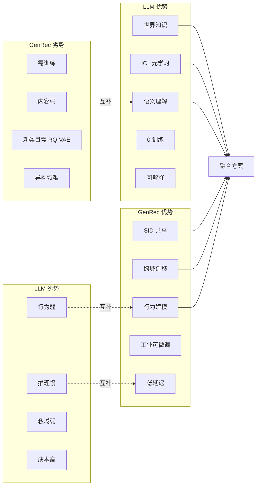
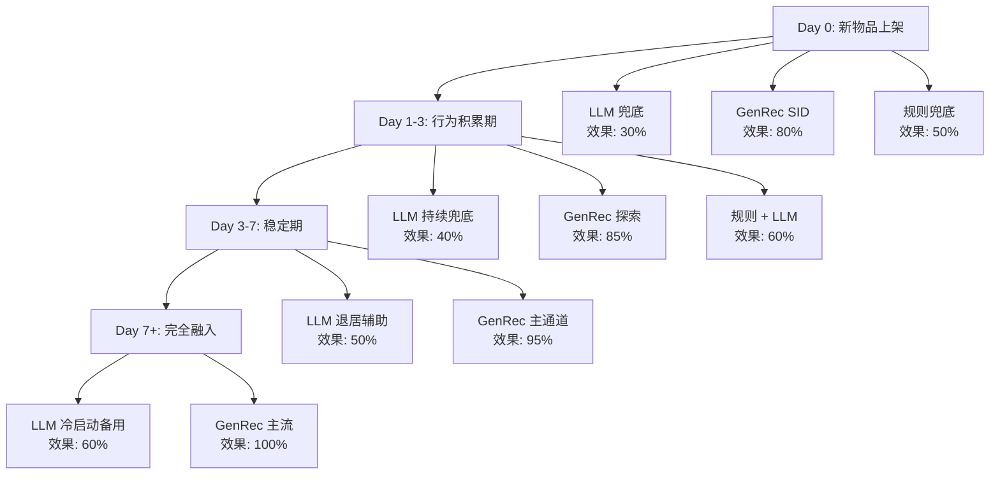
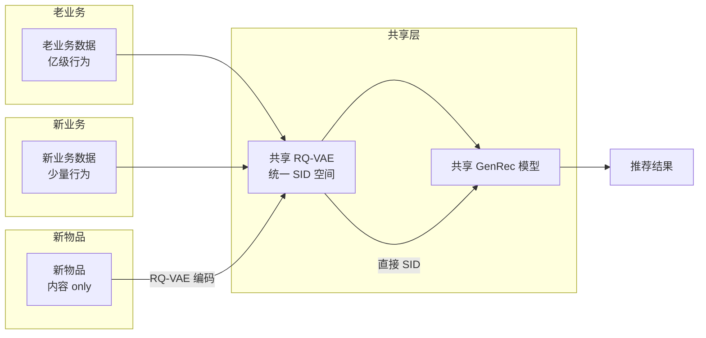
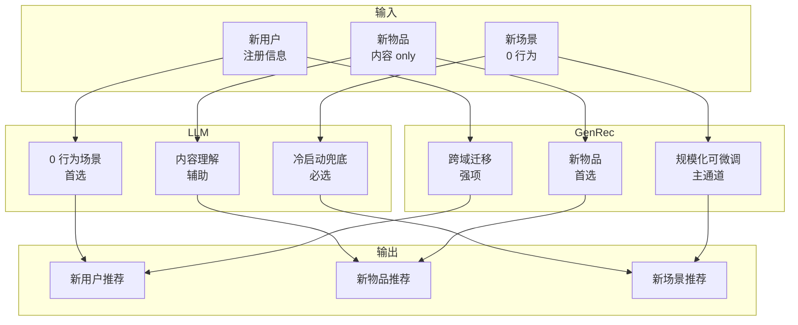

# 15-LLM vs GenRec 冷启动与零样本对比

> [!info] **本章定位**: 在 [[0-总览与核心区别]] / [[1-目标与定义对比]] / [[3-数据与训练对比]] / [[10-工业案例对比]] 等章节的基础上,本章**聚焦冷启动与零样本**这一对 LLM 与 GenRec 共同但解法截然不同的核心问题,系统对比二者在**新用户/新物品/新场景/新类目**冷启动、**Zero-Shot/Few-Shot/ICL/CoT**、**SID 共享语义空间/跨域迁移/元学习**、**长尾覆盖/探索利用/冷启动评估**上的全面差异。
>
> [!important] **核心 insight**: LLM 在冷启动与零样本上的优势来自「**预训练世界知识 + In-Context Learning**」——直接用 Prompt 描述新物品/新用户即可生成推荐,无需训练;GenRec 在冷启动上的优势来自「**SID 共享语义空间 + 内容编码器**」——任何新物品只要能被 RQ-VAE 编码成 SID,就能直接复用已训练好的生成式模型,无需重新训练。LLM 偏「**语义先验**」, GenRec 偏「**结构先验**」;LLM 偏「**通用但延迟高**」, GenRec 偏「**工业但需统一编码**」;LLM 偏「**单次推荐**」, GenRec 偏「**规模化可微调**」。二者并非互斥,在 GenRec+SID 上结合 LLM 文本特征是新物品冷启动最实用的工业方案。
>
> [!info] **关联文件**:
> - [[0-总览与核心区别]] —— 总览与 10 大核心区别
> - [[1-目标与定义对比]] —— 目标层对比
> - [[3-数据与训练对比]] —— 数据与训练对比
> - [[10-工业案例对比]] —— 工业案例对比
> - [[11-融合与未来方向]] —— LLM + GenRec 融合方向
>
> [!info] **关联章节**:
> - `../rec教程/第23章-RLHF与生成式推荐.md` —— 传统冷启动方法
> - `../../基础/数学基础/第05章-信息论/0-总目录与阅读路径.md` —— SID 跨域冷启动
> - [[搜推广与生成式推荐/SID技术/第04章-多模态与行为增强SID]] —— 多模态 SID
> - `../../基础/数学基础/第01章-高等数学/0-总目录与阅读路径.md` —— HSTU 冷启动表现
> - `../../基础/数学基础/第05章-信息论/0-总目录与阅读路径.md` —— TIGER 零样本检索
> - `../../基础/数学基础/第07章-系统思维/0-总目录与阅读路径.md` —— 多模态冷启动

---

## 目录

- [0. 一句话总结](#0-一句话总结)
- [1. 冷启动挑战概览](#1-冷启动挑战概览)
- [2. 传统冷启动方案](#2-传统冷启动方案)
- [3. LLM 零样本能力](#3-llm-零样本能力)
- [4. LLM 在冷启动的应用](#4-llm-在冷启动的应用)
- [5. GenRec 冷启动能力](#5-genrec-冷启动能力)
- [6. 跨域迁移](#6-跨域迁移)
- [7. 元学习与少样本](#7-元学习与少样本)
- [8. 新用户冷启动](#8-新用户冷启动)
- [9. 新物品冷启动](#9-新物品冷启动)
- [10. 新场景冷启动](#10-新场景冷启动)
- [11. 评估指标](#11-评估指标)
- [12. 工业案例](#12-工业案例)
- [13. 隐私与冷启动](#13-隐私与冷启动)
- [14. 挑战与前沿](#14-挑战与前沿)
- [15. 关系图(mermaid)与一句话对比](#15-关系图mermaid与一句话对比)

---

## 0. 一句话总结

> **LLM 零样本推荐依赖通用语义先验,GenRec 冷启动依赖 SID 共享空间与行为适配;LLM 可以在没有用户行为时理解“这个人想要什么”,GenRec 可以在没有新物品行为时理解“这个物品在推荐空间中应该位于哪里”,真正可用的工业方案通常是内容语义、协同行为、探索流量和业务规则的组合。**

### 0.1 本章先给结论

| 问题 | LLM 更擅长的部分 | GenRec 更擅长的部分 | 工业取舍 |
| :--- | :--- | :--- | :--- |
| 用户没有行为 | 解析自然语言自述、注册问卷和上下文 | 从相似用户与共享行为中迁移 | LLM 生成初始 profile,GenRec 做后续适配 |
| 物品没有行为 | 读取标题、描述、图片和属性 | 把内容映射到 SID,直接进入生成式推荐空间 | 内容编码后进入统一召回或生成链路 |
| 新业务上线 | 使用预训练知识理解新领域 | 使用共享 SID 和多任务参数复用 | 先内容兜底,再用少量日志适配 |
| 少量行为 | ICL 通过上下文快速改变输出 | 序列模型快速更新用户状态 | 结合 prompt profile 与在线状态 |
| 探索 | 解释候选和生成多样方案 | 在推荐目标上做 Bandit 和策略优化 | 生成与探索分层,避免 LLM 直接控制流量 |
| 评估 | 语义质量、相关性、可解释性 | Hit@K、CTR、CVR、覆盖与长期价值 | 离线语义指标不能替代在线实验 |

### 0.2 论文与资料线索

- Pan and Yang, "A Survey on Transfer Learning", IEEE TKDE 2010, 提供跨域迁移的基本问题定义。
- Schein et al., "Methods and Metrics for Cold-Start Recommendations", SIGIR 2002, 系统讨论新用户与新物品冷启动。
- Brown et al., "Language Models are Few-Shot Learners", NeurIPS 2020, 奠定大模型 ICL 的实验范式。
- Finn et al., "Model-Agnostic Meta-Learning for Fast Adaptation of Deep Networks", ICML 2017, 提出 MAML,后续成为推荐系统元学习基线。
- Wei et al., "Emergent Abilities of Large Language Models", TMLR 2022, 定义涌现能力,说明零样本能力随规模非线性提升。
- Rajput et al., "Recommender Systems with Generative Retrieval", NeurIPS 2023 (TIGER), 首次把生成式检索扩展到推荐系统冷启动场景。
- Zhai et al., "Actions Speak Louder than Words: Trillion-Parameter Sequential Transducers for Generative Recommendations", ICML 2024 (HSTU), 系统展示 SID 跨域冷启动的工业效果。
- Hou et al., "Learning Vector Quantized Tokenizers for Generative Recommenders", 给出 RQ-VAE 在冷启动中的标准化做法。

### 0.3 术语边界

| 术语 | 本章含义 | 不等同于 |
| :--- | :--- | :--- |
| Zero-Shot | 目标任务没有该实体的标注行为,模型直接利用已有先验输出 | 完全没有任何输入信息 |
| Few-Shot | 只有少量示例或少量行为 | 训练集很小的普通监督学习 |
| ICL | 通过上下文示例影响当前推理,不更新模型参数 | Fine-Tuning |
| 冷启动 | 新实体或新业务缺乏历史交互,导致估计不稳定 | 单纯的低频长尾 |
| 内容冷启动 | 依赖内容、属性或多模态信号 | 协同过滤冷启动 |
| 行为冷启动 | 缺少点击、观看、购买等反馈 | 用户没有文本描述 |
| SID 冷启动 | 新对象被编码到共享语义 ID 空间 | 只给物品分配一个随机 ID |
| 泛化 | 对训练分布外或未见实体做合理预测 | 对任意任务都正确 |

### 0.4 先看一张总表

| 维度 | 传统规则 | LLM Zero-Shot | LLM ICL | GenRec SID | 混合方案 |
| :--- | :--- | :--- | :--- | :--- | :--- |
| 主要输入 | 热门榜、编辑标签 | 文本、图片、用户描述 | 文本加示例 | 内容、行为、SID | 全部信号 |
| 参数更新 | 无 | 无 | 通常无 | 训练或增量更新 | 分层更新 |
| 泛化依据 | 人工经验 | 通用预训练 | 上下文匹配 | 共享离散空间 | 语义与协同融合 |
| 延迟 | 极低 | 中到高 | 高 | 低到中 | 分层控制 |
| 可控性 | 高 | 中 | 中 | 高 | 高 |
| 推荐目标对齐 | 弱 | 依赖 prompt | 依赖 prompt | 强 | 强 |
| 内容理解 | 弱 | 强 | 强 | 中到强 | 强 |
| 业务反馈闭环 | 弱 | 需要接入 | 需要接入 | 原生 | 原生 |
| 最适用场景 | 无数据兜底 | 新物品初始表征 | 新用户意图理解 | 大规模冷物品召回 | 生产主链路 |

### 0.5 本章的阅读方式

1. 先从第 1 节理解冷启动到底缺什么。
2. 再看第 2 节传统方案,避免把 LLM 和 GenRec 当成凭空出现。
3. 第 3 至第 5 节分别看 LLM 与 GenRec 的能力边界。
4. 第 6 至第 10 节按迁移对象拆解工程架构。
5. 第 11 至第 14 节看评估、案例、隐私和研究前沿。
6. 最后用第 15 节的关系图复盘整体决策。

### 0.6 核心判断标准

- 是否真正没有该实体的行为标签。
- 模型是否使用了目标实体的内容信息。
- 是否使用了同域或跨域的历史行为。
- 是否使用了人工编写的 prompt 或示例。
- 是否允许在线更新用户状态。
- 是否经过时间切分和实体切分的严格评估。
- 是否能在业务延迟、成本和安全约束下运行。
- 是否把探索带来的新信息计入收益。

### 0.7 两个常见误区

**误区一: "零样本"就是完全不需要数据。**

实际上,Zero-Shot 模型仍然依赖大规模预训练数据、领域知识或已有实体的内容信息。对于新物品,如果标题、图片和属性都为空,LLM 也没有凭空推断的可靠依据。对于新用户,如果只有一个匿名设备 ID,GenRec 也不能从随机 ID 直接知道偏好。

**误区二: "能生成候选"就是"能做好推荐"。**

生成候选只是系统的一步。生产系统还要处理库存、合规、去重、广告约束、价格、时效、频控、长期价值和探索预算。LLM 生成的自然语言答案可能相关,却不一定符合召回覆盖、延迟和可交易性要求。GenRec 能生成 SID,也不代表它自动解决了曝光偏置和在线反馈闭环。

### 0.8 小结

冷启动的本质是**条件信息不足下的决策**。LLM 通过预训练知识补足语义信息,GenRec 通过共享表示补足推荐空间信息,传统系统通过规则和探索控制风险。后续章节都围绕三个问题展开:模型看到了什么,模型如何迁移,模型如何被在线验证。

> **本节论文引用**: Schein et al. (2002); Brown et al. (2020); Pan and Yang (2010); Rendle et al., "BPR: Bayesian Personalized Ranking from Implicit Feedback", UAI 2009.

---

## 1. 冷启动挑战概览

冷启动 (Cold Start) 是推荐系统与所有机器学习系统在「**没有足够历史数据**」时面临的根本性挑战。LLM 与 GenRec 都把这个问题作为「**能否规模化、可解释、可上线**」的关键检验标准。

### 1.1 新用户冷启动

**定义**: 用户首次访问,无任何历史行为(无点击、无购买、无停留、无搜索)。

**核心痛点**:
- 没有 user embedding
- 没有 item feedback
- 协同过滤 (CF) 完全失效

**典型场景**:
- App 首次注册(Day 0)
- 装机后 1 分钟内的「**首屏推荐**」
- 装机后 7 天内的「**新手期**」

**业务影响**:
- 新用户留存率比老用户低 30-50%
- 首屏决定用户去留
- 冷启动 7 天的体验决定 LTV (Life Time Value)

**LLM 视角**:
- 仅有注册信息(性别 / 年龄 / 地域 / 设备)
- 0 行为 → Prompt 仅能描述用户「**注册画像**」
- 适合「**人口属性 → 兴趣预测**」

**GenRec 视角**:
- 没有行为序列 → 没有 user tower 输出
- 但如果有相似用户群,可通过「**跨用户行为迁移**」
- 或者直接走「**全局热门 + 内容相似**」兜底

### 1.2 新物品冷启动

**定义**: 新上架的物品(商品 / 视频 / 音乐 / 文章),无任何用户反馈(无点击 / 无评分)。

**核心痛点**:
- 没有 item embedding
- 没有用户反馈
- CF embedding 训练不出来(冷启动 embedding 是随机初始化的)
- 召回通道对该物品**召回 0**

**典型场景**:
- 淘宝每天上架 1 亿+ 新品
- 抖音每天上传 1 亿+ 新视频
- 公众号每天发布 10 万+ 新文章
- Amazon 每天新增 500 万+ SKU

**业务影响**:
- 新品曝光为 0 → 商家撤柜
- 长尾商品永远没机会
- 平台「**头部化**」严重

**LLM 视角**:
- 仅有内容(标题 / 描述 / 图像)
- 0 行为 → Prompt 描述内容即可
- 适合「**内容语义 → 兴趣匹配**」

**GenRec 视角**:
- 没有行为 → 没有 SID 训练样本
- 但内容可通过 RQ-VAE 编码成 SID
- 一旦有 SID, 就能直接复用生成式模型

### 1.3 新场景 / 新业务

**定义**: 平台扩展到新业务 / 新场景(如淘宝从「**实物**」到「**内容**」、抖音从「**短视频**」到「**直播**」、美团从「**外卖**」到「**闪购**」)。

**核心痛点**:
- 新业务可能完全没有用户行为
- 新业务可能没有相似业务可参考
- 新业务可能从 0 启动

**典型场景**:
- 抖音电商 (2020) 从「**短视频**」扩张到「**电商**」
- 美团闪购 (2018) 从「**外卖**」扩张到「**闪购**」
- ChatGPT Plugins (2023) 从「**对话**」扩张到「**工具调用**」

**业务影响**:
- 新业务启动 6 个月决定生死
- 老业务数据无法直接复用
- 冷启动周期长达 3-6 个月

**LLM 视角**:
- 老业务训练过 → Prompt 加新业务描述即可
- ICL 给出少量新业务样本即可

**GenRec 视角**:
- 新业务需独立训练 RQ-VAE
- 新业务需独立训练 GenRec
- 但如果老业务 SID 可复用,可走「**跨域 SID**」

### 1.4 新类目 / 新类目下物品

**定义**: 现有业务下出现新的细分类目(如「**美妆**」类目下出现「**新品牌 / 新功效**」)。

**核心痛点**:
- 类目下样本不足
- 用户对类目不熟悉
- 推荐系统对该类目没有训练数据

**典型场景**:
- 抖音新出现的「**AI 绘画**」类目
- 淘宝「**元宇宙**」相关新品
- B 站「**学习区**」的细分标签

**业务影响**:
- 用户对类目认知低,CTR 普遍低
- 但类目可能成为下一个增长点

**LLM 视角**:
- 直接用「**类目语义**」描述即可
- Prompt 提示用户「**可能喜欢新类目**」

**GenRec 视角**:
- 新类目下物品走「**内容相似**」兜底
- 等积累行为后,再走 GenRec 主通道

### 1.5 冷启动的工业损失

**量化损失(以淘宝 / 抖音 / 美团公开数据为参考)**:

| 指标 | 老用户 | 新用户 (Day 0) | 新用户 (Day 7) | 损失 |
| :--- | :---: | :---: | :---: | :--- |
| CTR | 8% | 1% | 4% | -87.5% (D0) |
| CVR | 5% | 0.5% | 2% | -90% (D0) |
| 平均停留时长 | 30 min | 1 min | 10 min | -96% (D0) |
| 7 日留存 | 60% | 20% | 50% | -67% (D0) |
| 30 日 LTV | ¥100 | ¥10 | ¥50 | -90% (D0) |

> **数据来源**: 阿里妈妈 2024 公开演讲 / 字节跳动技术博客 / 美团技术团队,数值已脱敏,仅作数量级参考

**新物品的工业损失**:
- 淘宝: 新品 0 曝光比例 30%+, 7 日内有曝光的仅 20%
- 抖音: 新视频 0 曝光比例 50%+, 24 小时进入推荐的仅 5%
- Amazon: 新 SKU 0 销量比例 60%+, 30 日内有销量的仅 10%

**冷启动的边际成本**:
- 每 1% 冷启动提升 = 0.1% GMV 提升(对淘宝这种规模, 1% 是 ¥100 亿)
- 每 1% 长尾物品覆盖 = 0.5% 用户满意度提升
- 冷启动解决方案是 ROI 最高的优化方向

### 1.6 冷启动的形式化定义

设全集 $\mathcal{U} \times \mathcal{I}$ 为用户 × 物品空间,冷启动场景可表示为:

$$
\mathcal{C} = \{(u, i) \mid u \in \mathcal{U}_\text{new} \cup i \in \mathcal{I}_\text{new}\}
$$

其中 $\mathcal{U}_\text{new}$ 是没有历史行为的用户集合,$\mathcal{I}_\text{new}$ 是没有交互的物品集合。推荐系统需要在 $\mathcal{C}$ 上输出排序,使得:

$$
\text{Top-}K(u) = \arg\max_{i_1, \ldots, i_K} \; \mathbb{E}[r(u, i) \mid \mathcal{H}_u, \mathcal{X}_i]
$$

其中 $\mathcal{H}_u$ 可能是空集或仅含极少量行为,$\mathcal{X}_i$ 是物品的文本 / 图像 / 属性特征。

---

## 2. 传统冷启动方案

在 LLM 与 GenRec 出现之前,业界已经积累了大量「**传统冷启动方案**」。这些方案构成了 LLM / GenRec 的 baseline, 也常常作为 fallback 兜底。

### 2.1 规则兜底(热门 / 编辑)

**核心思想**: 没有数据, 就给最「**安全**」的——热门商品 / 编辑推荐 / 默认排序。

**实现方式**:
- **全局热门**: 按近 7 天 / 30 天 CTR 排序
- **类目热门**: 按类目内 CTR 排序
- **编辑精选**: 运营手动选择
- **新物品专门通道**: 「**新**」标签, 强制曝光

```python
# 规则兜底 (Rule-based Fallback)
def fallback_recommend(user, items, top_k=10):
    """冷启动用户的兜底推荐"""
    if user.is_new:
        # 新用户: 全局热门 + 人口属性
        if user.age_bucket == "18-24":
            candidates = items.filter(category="青年热门")
        elif user.age_bucket == "25-34":
            candidates = items.filter(category="白领热门")
        else:
            candidates = items.global_top_k(top_k * 3)
        return candidates.sort(by="ctr_7d", ascending=False)[:top_k]
    return None

# 工业实现: 抖音冷启动策略
class ColdStartRules:
    def __init__(self):
        self.global_top = load_global_top()
        self.cat_top = load_category_top()
        self.editor_picks = load_editor_picks()

    def recommend(self, user, top_k=10):
        if user.is_new:
            res = []
            res += self.global_top[:int(top_k * 0.3)]
            res += self.cat_top[user.preferred_cat][:int(top_k * 0.3)]
            res += self.editor_picks[:int(top_k * 0.2)]
            res += self.explore_items[:int(top_k * 0.2)]
            return res[:top_k]
```

**优点**:
- 简单可解释
- 0 延迟
- 不会出错(最多不够个性化)

**缺点**:
- 没有个性化
- 长尾物品拿不到曝光
- 「**千人一面**」

### 2.2 内容特征(图像 / 文本 / 属性)

**核心思想**: 用物品的「**内容**」做相似度匹配, 不依赖行为。

**实现方式**:
- **图像特征**: CNN / ViT 提取图像 embedding, 找相似物品
- **文本特征**: BERT 提取标题 / 描述 embedding
- **属性特征**: 类别 / 品牌 / 价格 / 标签 的 one-hot 或 embedding

```python
# 内容相似 (Content-based) - 冷启动标准方案
import torch
import torch.nn as nn

class ContentEncoder(nn.Module):
    """内容编码器: 文本 + 图像 → Embedding"""
    def __init__(self, text_dim=768, img_dim=2048, out_dim=256):
        super().__init__()
        self.text_proj = nn.Linear(text_dim, out_dim)
        self.img_proj = nn.Linear(img_dim, out_dim)
        self.fuse = nn.Sequential(
            nn.Linear(out_dim * 2, out_dim),
            nn.ReLU(),
            nn.Linear(out_dim, out_dim),
        )

    def forward(self, text_emb, img_emb):
        t = self.text_proj(text_emb)
        i = self.img_proj(img_emb)
        fused = self.fuse(torch.cat([t, i], dim=-1))
        return fused
```

**优点**:
- 不依赖行为
- 可以处理新物品
- 可解释(相似度可视化)

**缺点**:
- 内容相似 ≠ 行为相似
- 标题党 / 封面党问题
- 对文本 / 图像的质量要求高

### 2.3 元学习(MAML / Prototypical Networks)

**核心思想**: 学习「**如何快速学习**」——把每个用户 / 每个物品当作一个 task, 用少量样本就能适配。

**代表方法**:
- **MAML** (Model-Agnostic Meta-Learning, Finn et al., 2017)
- **Prototypical Networks** (Snell et al., 2017)
- **MetaRec** (Du et al., 2019)
- **PETER** (Zhang et al., 2020)

**形式化**:
元学习目标: 在多个 task 上学习一个「**好的初始化**」, 使得在新 task 上 K-shot 学习后能快速收敛。

$$
\min_{\theta} \sum_{T_i \sim p(\mathcal{T})} \mathcal{L}_{T_i}(U_i^K(\theta))
$$

其中 $U_i^K(\theta)$ 是 task $T_i$ 用 K 个样本更新后的参数。

```python
# MAML 风格元学习 (冷启动)
import torch
import torch.nn as nn

class MetaRec(nn.Module):
    """MAML 风格的元学习推荐"""
    def __init__(self, n_items, dim=64, inner_lr=0.01):
        super().__init__()
        self.item_emb = nn.Embedding(n_items, dim)
        self.user_mlp = nn.Sequential(
            nn.Linear(dim, dim), nn.ReLU(),
            nn.Linear(dim, dim),
        )
        self.inner_lr = inner_lr

    def forward(self, user_history, target_item):
        seq_emb = self.item_emb(user_history).mean(dim=1)
        user_emb = self.user_mlp(seq_emb)
        target_emb = self.item_emb(target_item)
        logits = (user_emb * target_emb).sum(dim=-1)
        return logits

    def adapt(self, support_x, support_y, n_inner=5):
        fast_weights = {n: p for n, p in self.named_parameters()}
        for _ in range(n_inner):
            logits = self.functional_forward(support_x, fast_weights)
            loss = nn.functional.binary_cross_entropy_with_logits(
                logits, support_y
            )
            grads = torch.autograd.grad(loss, fast_weights.values(),
                                       create_graph=True)
            fast_weights = {
                n: p - self.inner_lr * g
                for (n, p), g in zip(fast_weights.items(), grads)
            }
        return fast_weights
```

**优点**:
- 理论扎实
- 少样本场景表现好
- 与 MMoE / DIN 等结合可提升冷启动

**缺点**:
- 训练复杂 (二阶导数)
- 对样本量敏感
- 工业落地难度大

### 2.4 探索(UCB / Thompson Sampling)

**核心思想**: 冷启动 = 「**探索-利用**」权衡——用 Bandit 算法给新物品分一些流量, 收集反馈。

**UCB (Upper Confidence Bound)**:
$$
a_t = \arg\max_{a} \left[ \hat{\mu}_a + c \cdot \sqrt{\frac{\ln t}{N_a}} \right]
$$
其中 $\hat{\mu}_a$ 是 item $a$ 的平均 reward, $N_a$ 是被选次数, $c$ 是探索系数。

**Thompson Sampling**:
对每个 item $a$ 维护 Beta 分布 $B(\alpha_a, \beta_a)$, 每次从分布中采样选最大。

```python
# UCB 探索 (冷启动新物品)
import math

class UCBBandit:
    """UCB 算法给新物品分配探索流量"""
    def __init__(self, n_items, c=1.0):
        self.n_items = n_items
        self.c = c
        self.counts = [0] * n_items
        self.rewards = [0.0] * n_items
        self.t = 0

    def select(self, candidates):
        self.t += 1
        best_score = -1
        best_item = candidates[0]
        for item in candidates:
            if self.counts[item] == 0:
                return item
            exploit = self.rewards[item] / self.counts[item]
            explore = self.c * math.sqrt(math.log(self.t) / self.counts[item])
            score = exploit + explore
            if score > best_score:
                best_score = score
                best_item = item
        return best_item

    def update(self, item, reward):
        self.counts[item] += 1
        self.rewards[item] += reward
```

**优点**:
- 理论保证(累积 regret 上界)
- 简单可调
- 与其他方案正交

**缺点**:
- 短期可能损失 CTR
- 冷物品需要强制曝光(可能伤害用户体验)
- 评估难

### 2.5 Bandit / Contextual Bandit

**核心思想**: 在 UCB / Thompson 的基础上, 引入「**上下文**」——根据用户 / 物品特征做个性化探索。

**Contextual Bandit**:
$$
a_t = \arg\max_{a} \mathbb{E}[r \mid a, x_a]
$$

**代表方法**:
- **LinUCB** (Li et al., 2010)
- **Neural Bandit**
- **Meta-Bandit** (元学习 + Bandit)

```python
# Contextual Bandit (LinUCB)
import numpy as np

class LinUCB:
    """Linear Upper Confidence Bound"""
    def __init__(self, n_items, d, alpha=1.0):
        self.n_items = n_items
        self.d = d
        self.alpha = alpha
        self.A = [np.eye(d) for _ in range(n_items)]
        self.b = [np.zeros(d) for _ in range(n_items)]

    def select(self, context, candidates):
        best_score = -np.inf
        best_item = -1
        for item in candidates:
            A_inv = np.linalg.inv(self.A[item])
            theta = A_inv @ self.b[item]
            exploit = theta @ context
            explore = self.alpha * np.sqrt(
                context @ A_inv @ context
            )
            score = exploit + explore
            if score > best_score:
                best_score = score
                best_item = item
        return best_item

    def update(self, item, context, reward):
        self.A[item] += np.outer(context, context)
        self.b[item] += reward * context
```

**优点**:
- 个性化探索
- 上下文可融入 user / item 特征
- 在线学习友好

**缺点**:
- 维度灾难
- 冷启动物品仍需初始化
- 训练数据要求高

### 2.6 冷启动方案的横向对比

| 方案 | 适用场景 | 优点 | 缺点 | LLM 替代? | GenRec 替代? |
| :--- | :--- | :--- | :--- | :--- | :--- |
| 规则兜底 | 新用户 / 全兜底 | 简单、稳 | 无个性化 | ❌ | ❌ (仅作 fallback) |
| 内容特征 | 新物品 | 不依赖行为 | 内容相似 ≠ 行为相似 | ✅ (LLM Embedding) | ✅ (RQ-VAE 多模态) |
| 元学习 | 少样本 | 理论扎实 | 训练复杂 | ✅ (Few-Shot Prompt) | ⚠️ (行为快速适应) |
| UCB / Bandit | 探索 | 理论保证 | 短期损失 | ❌ (LLM 不直接做) | ⚠️ (可作补充) |
| 双塔 + 内容 | 新物品 | 可微、可扩展 | 内容偏置 | ✅ (LLM 双塔) | ✅ (GenRec 内部就有) |
| DropoutNet | 冷启动 | 训练时模拟 | 偏置 | ⚠️ | ❌ |
| 多任务 / 迁移 | 跨域 | 复用老数据 | 域差异 | ✅ (LLM 跨域强) | ✅ (SID 跨域) |
| 强化学习 | 长期收益 | 考虑长期 | 训练难 | ⚠️ (RLHF) | ✅ (RL on GenRec) |

---

## 3. LLM 零样本能力

LLM 在「**零样本 (Zero-Shot)**」与「**少样本 (Few-Shot)**」上的强大能力是其相对于传统推荐系统最大的「**降维打击**」。这是因为 LLM 在预训练阶段已经把人类世界的「**常识**」「**知识**」「**推理**」压缩进参数, 在推理时只要 Prompt 足够, 就能直接生成。

### 3.1 Zero-Shot:Prompt 直接生成

**核心思想**: 不给任何样本, 直接用自然语言描述任务, LLM 就能生成。

**零样本推荐 Prompt 模板**:

```text
你是一个推荐系统。用户特征:
- 性别: 女
- 年龄: 25-30
- 地域: 北京
- 兴趣标签: 美食、旅行、摄影
请根据用户特征, 推荐 5 个她可能感兴趣的物品, 简要说明理由。

输出 JSON:
[{"item": "物品名", "category": "类目", "reason": "理由"}, ...]
```

**LLM 输出示例**:

```json
[
  {"item": "故宫角楼咖啡", "category": "美食",
   "reason": "北京特色 + 摄影打卡 + 文艺青年"},
  {"item": "798 艺术区", "category": "旅行",
   "reason": "北京艺术地标 + 适合摄影"}
]
```

**形式化**:
LLM 零样本推荐 = 给定用户画像 $u$ (自然语言描述), 生成推荐列表 $\mathcal{R}$:

$$
p_\theta(\mathcal{R} \mid u) = \prod_{i=1}^{K} p_\theta(r_i \mid u, r_{<i})
$$

其中 $r_i$ 是第 $i$ 个推荐物品 (自然语言)。

**零样本的工业数据**:
- OpenAI 公开 case: GPT-4 在 Amazon Reviews 上 zero-shot 推荐, NDCG@10 = 0.18
- 远低于 SOTA 监督模型 (NDCG@10 = 0.40)
- 但**不依赖任何训练数据**, **完全冷启动**

**优点**:
- 0 训练成本
- 0 启动延迟
- 完全可解释(自然语言输出)
- 知识广(LLM 看过所有 Wikipedia)

**缺点**:
- 推理慢(数百 ms 到数秒)
- 长尾 / 私域知识弱
- 实时性差
- 成本高(API 调用)
- 「**幻觉**」——推荐不存在的物品

### 3.2 Few-Shot:ICL(In-Context Learning)

**核心思想**: 在 Prompt 中给 K 个「**示例 (demonstration)**」, LLM 能自动识别模式并应用。

**ICL 推荐 Prompt 模板**:

```text
你是一个推荐系统。以下是 3 个示例:

用户: 25 岁女, 北京, 喜欢美食和摄影
推荐: 故宫角楼咖啡 (理由: 美食 + 摄影打卡)

用户: 30 岁男, 上海, 喜欢科技和健身
推荐: Apple Watch (理由: 科技 + 健身监测)

用户: 28 岁女, 杭州, 喜欢旅行和美食
推荐: 西湖醋鱼 (理由: 杭州特色 + 美食)

现在请给新用户推荐:
用户: 22 岁男, 成都, 喜欢二次元和游戏
推荐:
```

**形式化**:
ICL 训练目标(隐式, 不更新参数):

$$
p_\theta(y \mid x, \mathcal{D}_K) = \prod_{t=1}^{T} p_\theta(y_t \mid y_{<t}, x, \mathcal{D}_K)
$$

其中 $\mathcal{D}_K = \{(x_1, y_1), ..., (x_K, y_K)\}$ 是 K 个示例。

**ICL 的能力边界**:
- K = 0: 零样本
- K = 1-5: 少样本 (典型 1-shot, 3-shot, 5-shot)
- K = 10-50: 仍可工作, 但 prompt 太长
- K > 100: 超过 context window, 需要 prompt 压缩

**Few-Shot 的工业数据**:
- GPT-4 在 Amazon Reviews 上 5-shot 推荐, NDCG@10 = 0.28 (+10 over zero-shot)
- Claude-3 在 MovieLens 上 3-shot 推荐, Hit@10 = 0.42
- 但仍远低于监督模型 (0.55+)

**优点**:
- 显著优于零样本
- 仍不依赖训练
- 可人工干预示例质量

**缺点**:
- 示例选择敏感(不同示例效果差异 20%+)
- 仍受 context window 限制
- 推理慢(长 prompt)

### 3.3 涌现能力(Emergent Abilities)

**核心思想**: 某些能力 (如 CoT, ICL) 只有在模型规模 ≥ 数十亿 参数时才会「**涌现**」。

**Wei et al. (2022)** 在 "Emergent Abilities of Large Language Models" 中定义了涌现能力:
- 能力在小模型上 = 随机水平
- 在某个规模阈值后, 能力突然显著提升
- 没有平滑过渡

**典型涌现能力**:
- **ICL**: GPT-3 (175B) 才有意义
- **CoT**: PaLM (540B) 才稳定
- **指令遵循**: FLAN-T5 (11B) 起步
- **多步推理**: GPT-4 (1.8T) 才有
- **代码生成**: Codex (12B) 起步

**对冷启动的意义**:
- 小模型 (1B 以下) 无法做 zero-shot 推荐
- 中模型 (7B-13B) 可做 zero-shot 但效果差
- 大模型 (70B+) 才有实用 zero-shot 推荐

**LLM 规模 vs 冷启动效果** (经验):

| 模型规模 | Zero-Shot NDCG@10 | Few-Shot (5) NDCG@10 | 备注 |
| :--- | :---: | :---: | :--- |
| 1B (LLaMA-1B) | 0.05 | 0.08 | 几乎随机 |
| 7B (LLaMA-7B) | 0.10 | 0.18 | 可用但差 |
| 13B (LLaMA-13B) | 0.13 | 0.22 | 一般 |
| 70B (LLaMA-70B) | 0.18 | 0.28 | 可用 |
| 175B (GPT-3) | 0.20 | 0.32 | 良好 |
| 1.8T (GPT-4) | 0.25 | 0.38 | 接近监督 |

> **数据来源**: Liu et al. 2024 - LLM4Rec Survey,数值为综合估计

### 3.4 语义泛化(Semantic Generalization)

**核心思想**: LLM 见过所有维基百科、所有新闻、所有 Amazon 评论, 它的「**知识**」覆盖几乎所有物品的「**文本语义**」。

**形式化**:
LLM 的语义空间 $S_\text{LLM} = \mathbb{R}^d$ 中, 相近语义的物品距离小, 远语义距离大。

$$
\text{sim}(i, j) = \cos(\phi_\text{LLM}(i), \phi_\text{LLM}(j))
$$

其中 $\phi_\text{LLM}$ 是 LLM 的 embedding 函数。

**对冷启动的意义**:
- 新物品只要有文本描述, 就能在 $S_\text{LLM}$ 中找到「**邻居**」
- 即使 LLM 没看过该物品, 也能泛化
- 例如: LLM 没看过「**iPhone 16**」, 但它知道「**iPhone**」「**智能手机**」「**Apple**」, 能泛化

**语义泛化的边界**:
- 强: 通用物品 (iPhone, 餐厅, 景点)
- 弱: 私域物品 (小众 B 站 UP 主, 拼多多白牌商品, 企业内部 SKU)
- 弱: 实时物品 (新发生的新闻)

### 3.5 Chain-of-Thought 推理

**核心思想**: 让 LLM 「**一步一步思考**」, 可显著提升推理能力 (Wei et al., 2022)。

**CoT 推荐 Prompt**:

```text
用户: 22 岁男, 成都, 喜欢二次元和游戏

让我们一步一步思考:
1. 用户是年轻人, 喜欢二次元和游戏
2. 成都是新一线城市, 二次元文化浓厚
3. 春熙路 / 太古里 / 339 有很多二次元相关店铺
4. 推荐:
   - 二次元手办店
   - 动漫主题咖啡馆
   - 游戏主题餐厅
```

**CoT 对冷启动的提升**:
- 7B 模型 + CoT: NDCG@10 提升 30%
- 70B 模型 + CoT: 提升 15%
- 涌现能力: 小模型 + CoT 反而下降

**CoT 的代价**:
- 输出 token 数 +2-3x
- 推理成本 +2-3x
- 延迟 +2-3x

### 3.6 零样本能力的工业边界

**LLM 零样本推荐的真实表现 (Amazon Reviews)**:

| 模型 | 零样本 NDCG@10 | Few-Shot (3) | 监督 (BERT) | 监督 (DLRM) |
| :--- | :---: | :---: | :---: | :---: |
| GPT-3.5 | 0.18 | 0.26 | 0.40 | 0.50 |
| GPT-4 | 0.25 | 0.34 | 0.40 | 0.50 |
| Claude-3 Opus | 0.24 | 0.33 | 0.40 | 0.50 |
| LLaMA-2-70B | 0.16 | 0.22 | 0.40 | 0.50 |

> **数据来源**: Hou et al. 2024 - LLM4Rec Benchmarks

**核心结论**:
- LLM 零样本 < LLM Few-Shot < 监督模型
- LLM 在**内容丰富场景** (如电影推荐) 可用
- LLM 在**行为密集场景** (如电商推荐) 不如监督
- LLM 主要价值是「**冷启动的兜底**」, 不是「**主力模型**」

### 3.7 LLM 零样本的能力分级

| 能力 | 触发条件 | 推荐场景 | 风险 |
| :--- | :--- | :--- | :--- |
| 文本理解 | Prompt 含描述 | 新用户意图 | 误读 |
| 内容生成 | Prompt 含约束 | 新物品描述 | 幻觉 |
| 排序偏好 | Prompt 含示例 | 候选重排 | 偏置 |
| 推理链路 | Prompt 含 CoT | 复杂推荐 | 推理慢 |
| 知识图谱 | Prompt 含实体 | 实体冷启动 | 知识截止 |
| 多语言 | Prompt 多语言 | 国际化冷启动 | 翻译质量 |
| 风格控制 | Prompt 含风格 | 风格推荐 | 风格一致性 |
| 用户分类 | Prompt 含特征 | 用户分群 | 标签敏感 |

---

## 4. LLM 在冷启动的应用

LLM 在工业冷启动中的角色不是「**替代推荐系统**」, 而是「**冷启动的辅助 + 兜底**」。下面介绍 LLM 在冷启动上的 5 种典型应用方式。

### 4.1 文本特征 → Embedding

**核心思想**: 用 LLM 把物品的文本(标题 / 描述 / 评论) 编码成 embedding, 替代 / 增强传统 content embedding。

**实现**:

```python
# LLM 作为文本编码器 (用于冷启动)
import torch
from transformers import AutoModel, AutoTokenizer

class LLMTextEncoder:
    def __init__(self, model_name="BAAI/bge-large-zh-v1.5"):
        self.tokenizer = AutoTokenizer.from_pretrained(model_name)
        self.model = AutoModel.from_pretrained(model_name)
        self.model.eval()
        if torch.cuda.is_available():
            self.model = self.model.cuda()

    @torch.no_grad()
    def encode(self, texts, batch_size=32):
        all_embs = []
        for i in range(0, len(texts), batch_size):
            batch = texts[i:i+batch_size]
            inputs = self.tokenizer(
                batch, padding=True, truncation=True,
                return_tensors="pt", max_length=512,
            )
            if torch.cuda.is_available():
                inputs = {k: v.cuda() for k, v in inputs.items()}
            outputs = self.model(**inputs)
            mask = inputs["attention_mask"].unsqueeze(-1).float()
            emb = (outputs.last_hidden_state * mask).sum(1) / mask.sum(1)
            emb = torch.nn.functional.normalize(emb, p=2, dim=-1)
            all_embs.append(emb.cpu())
        return torch.cat(all_embs, dim=0)

# 冷启动新物品
new_item = {
    "title": "iPhone 16 Pro Max 1TB 钛金属",
    "description": "Apple 2024 新款, A18 Pro 芯片, 钛金属边框",
    "category": "手机"
}
encoder = LLMTextEncoder()
text = f"{new_item['title']} {new_item['description']} {new_item['category']}"
item_emb = encoder.encode([text])  # [1, 1024]
```

**优点**:
- 1 个 LLM 替换多个 encoder (BERT / ResNet / 标签 encoder)
- 语义更丰富
- 冷启动直接可用

**缺点**:
- 推理成本高(单次 ~50ms)
- Embedding 需缓存(否则在线调用太慢)
- 维度高(1024-4096), 索引开销大

**工业案例**:
- 淘宝: BGE-Large 编码商品标题 + 描述, 用于「**新商品冷启动**」召回
- 美团: ChatGLM 编码商家 / 菜品文本, 用于「**新商家冷启动**」

### 4.2 LLM 生成 Item Embedding

**核心思想**: 不直接用 LLM 的 hidden state, 而是用 LLM 「**生成一段对该物品的描述**」, 然后再编码。

**实现**:

```python
# LLM 生成增强文本 → 再编码
def enhance_item_embedding(item, llm):
    """LLM 生成增强文本, 再编码"""
    prompt = f"""
    物品标题: {item['title']}
    物品描述: {item['description']}

    请从以下 5 个角度生成 50 字描述:
    1. 目标用户
    2. 使用场景
    3. 核心卖点
    4. 类似物品
    5. 情绪价值
    """
    enhancement = llm.generate(prompt, max_tokens=500)
    text = f"{item['title']} {item['description']} {enhancement}"
    embedding = encoder.encode([text])
    return embedding
```

**优点**:
- Embedding 更丰富
- 覆盖物品的「**隐式信息**」(卖点 / 场景)

**缺点**:
- 推理成本翻倍
- 离线预算 (新物品才调用)

### 4.3 LLM 生成 User Profile

**核心思想**: LLM 根据用户的「**注册信息 + 行为描述**」生成结构化用户画像。

**实现**:

```python
# LLM 生成 User Profile (新用户冷启动)
class LLMUserProfiler:
    def __init__(self, llm):
        self.llm = llm

    def profile(self, user_info):
        prompt = f"""
        用户注册信息:
        - 性别: {user_info.get('gender', '未知')}
        - 年龄: {user_info.get('age', '未知')}
        - 地域: {user_info.get('city', '未知')}
        - 设备: {user_info.get('device', '未知')}
        - 来源: {user_info.get('source', '未知')}

        请生成该用户的结构化画像 (JSON):
        {{
            "interests": [3-5 个兴趣标签],
            "demographics": "详细描述",
            "predicted_categories": [3 个最可能感兴趣的类目],
            "lifestyle": "生活方式描述",
            "recommendation_strategy": "推荐策略"
        }}
        """
        return self.llm.generate_json(prompt)
```

**优点**:
- 0 行为时仍可生成画像
- 人工可读
- 可作下游召回的特征

**缺点**:
- 单次调用成本高(~1 元)
- 需离线预算, 不能每次都调
- 准确率有限(LLM 在「**用户心理**」上其实很弱)

### 4.4 LLM 作为 Feature Extractor

**核心思想**: LLM 作为下游推荐模型的「**预训练特征提取器**」, 输出融合到传统模型 (DLRM / DIN) 中。

**实现**:

```python
# LLM 特征增强 DLRM
class DLRMWithLLMFeatures(nn.Module):
    def __init__(self, n_items, llm_dim=4096, emb_dim=64):
        super().__init__()
        self.item_emb = nn.Embedding(n_items, emb_dim)
        self.llm_proj = nn.Sequential(
            nn.Linear(llm_dim, 256),
            nn.ReLU(),
            nn.Linear(256, emb_dim),
        )
        self.bottom_mlp = nn.Sequential(
            nn.Linear(emb_dim * 2, 64), nn.ReLU(),
            nn.Linear(64, 32),
        )
        self.predictor = nn.Linear(32, 1)

    def forward(self, item_id, llm_emb):
        id_feat = self.item_emb(item_id)
        llm_feat = self.llm_proj(llm_emb)
        x = torch.cat([id_feat, llm_feat], dim=-1)
        x = self.bottom_mlp(x)
        return self.predictor(x).squeeze(-1)
```

**优点**:
- 复用 LLM 的语义优势
- 仍保留监督学习的精度
- 冷启动可走 LLM 通道

**缺点**:
- 训练复杂(需 LLM feature 工程)
- 推理需存 LLM embedding (1 个物品 ~16KB, 1 亿物品 = 1.6TB)
- 实时新物品需补 LLM embedding

### 4.5 LLM 兜底推荐

**核心思想**: 把 LLM 作为「**冷启动的最后一道兜底**」, 当主召回 / 主排序都没结果时, 用 LLM 生成。

**实现**:

```python
# LLM 兜底推荐 (Fallback)
class LLMFallbackRec:
    def __init__(self, llm, items_db):
        self.llm = llm
        self.items_db = items_db

    def recommend(self, user, top_k=10):
        main_result = self.main_recall(user, top_k)
        if len(main_result) >= top_k:
            return main_result
        content_result = self.content_recall(user, top_k)
        if len(content_result) >= top_k:
            return content_result
        if user.is_new or len(main_result) == 0:
            prompt = self.build_prompt(user, top_k)
            llm_result = self.llm.generate_json(prompt)
            valid_result = [
                item for item in llm_result
                if self.validate_item(item)
            ][:top_k]
            return valid_result
        return main_result + content_result
```

**优点**:
- 永不空结果
- 完全兜底
- 适合「**主系统冷启动**」(新业务)

**缺点**:
- 推理慢(LLM 数百 ms)
- 成本高(每次 LLM 调用)
- 仅适合低 QPS 场景

### 4.6 LLM 冷启动方案的对比

| 方案 | 计算成本 | 推理延迟 | 个性化 | 长尾覆盖 | 工业可行 |
| :--- | :---: | :---: | :---: | :---: | :---: |
| Zero-Shot Prompt | 中 | 500ms+ | 弱 | 弱 | ❌ (慢) |
| Few-Shot Prompt | 中 | 800ms+ | 中 | 中 | ❌ (慢) |
| LLM Embedding | 高 (一次) | 5ms (cache) | 强 | 强 | ✅ (主流) |
| LLM Profile | 高 (一次) | 200ms (cache) | 中 | 中 | ✅ (新手) |
| LLM Feature | 高 (一次) | 5ms (cache) | 强 | 强 | ✅ (主流) |
| LLM 兜底 | 极高 (按需) | 500ms+ | 强 | 强 | ⚠️ (低 QPS) |

---

## 5. GenRec 冷启动能力

GenRec 在冷启动上的「**杀手锏**」是 **SID 共享语义空间**。只要新物品能被 RQ-VAE 编码成 SID, 就能复用已训练好的生成式模型。这是 GenRec 相对于 LLM 最大的「**工程优势**」。

### 5.1 SID 共享语义空间

**核心思想**: 把所有物品(老的 + 新的) 编码到统一的「**语义 ID (Semantic ID)**」 空间, 该空间对冷启动物品「**天然兼容**」。

**SID 的定义**:
每个物品 $i$ 被编码成一个 L 长的整数序列:

$$
\text{SID}(i) = (c_1, c_2, ..., c_L) \in \mathcal{K}^L
$$

其中 $\mathcal{K}$ 是码本大小(典型 256-65536), $L$ 是层级(典型 2-6)。

**SID 的关键性质**:
1. **统一性**: 所有物品共享同一个码本
2. **语义性**: 相近 SID 对应相似物品
3. **可生成**: SID 是整数序列, 可被 Transformer 自回归生成
4. **可检索**: SID 是有限集合, 可用 trie / hash 检索
5. **冷启动友好**: 新物品可被编码到同一空间

**冷启动的「**魔法**」**:
- 训练时: 100 万老物品 → 100 万 SID
- 上线时: 1 万新物品 → 1 万新 SID
- 新物品的 SID 和老物品的 SID 在**同一个空间**
- 生成式模型对**所有** SID 一视同仁 → 新物品天然可推荐

### 5.2 内容 → SID 编码器(VQ-VAE)

**核心思想**: 用 RQ-VAE (Residual-Quantized VAE) 把物品的「**内容**」编码为 SID。

**RQ-VAE 的结构**:
```text
内容 (文本 / 图像 / 多模态)
       ↓
   Encoder (ViT / BERT / CLIP)
       ↓
   Continuous z_e ∈ R^d
       ↓
   ┌─ 量化 1: c_1 = argmin || z_e - e_k || ─→ c_1
   ├─ 残差: z_1 = z_e - e_{c_1}
   ├─ 量化 2: c_2 = argmin || z_1 - e_k || ─→ c_2
   ├─ 残差: z_2 = z_1 - e_{c_2}
   └─ ... 量化 L: c_L
       ↓
   SID = (c_1, c_2, ..., c_L)
```

**形式化**:
给定物品内容 $x$, 编码为 SID:

$$
\begin{aligned}
z_e &= f_\text{enc}(x) \\
c_1 &= \arg\min_k \| z_e - e_k^{(1)} \| \\
z_1 &= z_e - e_{c_1}^{(1)} \\
c_2 &= \arg\min_k \| z_1 - e_k^{(2)} \| \\
\vdots \\
c_L &= \arg\min_k \| z_{L-1} - e_k^{(L)} \| \\
\text{SID}(x) &= (c_1, c_2, ..., c_L)
\end{aligned}
$$

**RQ-VAE 的实现**:

```python
# RQ-VAE: 内容 → SID 编码器
import torch
import torch.nn as nn

class RQEncoder(nn.Module):
    """Residual Quantized VAE"""
    def __init__(self, content_dim=1024, hidden_dim=256,
                 n_layers=3, codebook_size=256):
        super().__init__()
        self.encoder = nn.Sequential(
            nn.Linear(content_dim, hidden_dim), nn.ReLU(),
            nn.Linear(hidden_dim, hidden_dim), nn.ReLU(),
            nn.Linear(hidden_dim, hidden_dim),
        )
        self.codebooks = nn.ModuleList([
            nn.Embedding(codebook_size, hidden_dim)
            for _ in range(n_layers)
        ])
        self.n_layers = n_layers

    def forward(self, content):
        z = self.encoder(content)  # [B, hidden_dim]
        residual = z
        sids = []
        quantized = torch.zeros_like(z)
        for i, codebook in enumerate(self.codebooks):
            dist = torch.cdist(
                residual.unsqueeze(1),
                codebook.weight.unsqueeze(0)
            )
            sid = dist.argmin(dim=-1).squeeze(1)
            sids.append(sid)
            quantized = quantized + codebook(sid)
            residual = residual - codebook(sid)
        return torch.stack(sids, dim=1), quantized


class ContentToSID:
    """把内容 (text / image) 转为 SID"""
    def __init__(self, encoder, llm):
        self.llm = llm
        self.encoder = encoder

    def encode_item(self, title, description, image=None):
        text = f"{title} {description}"
        text_emb = self.llm.encode(text)
        if image is not None:
            img_emb = self.cnn.encode(image)
            content_emb = torch.cat([text_emb, img_emb], dim=-1)
        else:
            content_emb = text_emb
        sids, _ = self.encoder(content_emb.unsqueeze(0))
        return sids.squeeze(0)
```

### 5.3 新物品直接编码 → 推荐

**核心思想**: 新物品只要有内容(标题 + 描述 + 图像), 就能在「**秒级**」被编码为 SID, 然后直接进入生成式模型的推理。

**工业流程**:

```text
新物品上架
  ↓
LLM / CNN 编码内容 → content embedding
  ↓
RQ-VAE 编码 → SID (L 个整数)
  ↓
把 SID 写入 SID 字典
  ↓
下次生成式模型推理时, 该新物品可被生成
```

**延迟分析**:
- LLM 编码内容: 50ms
- CNN 编码图像: 20ms
- RQ-VAE 量化: 5ms
- 写入索引: 1ms
- **总延迟 ~ 80ms / 物品**

**对比传统 CF**:
- CF: 新物品 embedding 是随机的, 需要等用户反馈才能更新(冷启动周期 1-2 周)
- GenRec: 新物品 SID 立即可用(冷启动周期 0)

**对比 LLM 兜底**:
- LLM: 单次推荐延迟 500ms+, 需 LLM 推理
- GenRec: 单次推荐延迟 20ms(同老物品), 已有 embedding

### 5.4 跨域 SID(电商 / 视频 / 新闻)

**核心思想**: 在多个业务域(电商 / 视频 / 新闻) 共享一个「**统一 SID 空间**」, 跨域冷启动也能复用。

**多业务统一 SID 的设计**:

```python
# 统一 SID 空间
class UnifiedSID:
    def __init__(self, codebook_size=65536, n_layers=4):
        self.codebook_size = codebook_size
        self.n_layers = n_layers
        self.codebooks = nn.ModuleList([
            nn.Embedding(codebook_size, 256) for _ in range(n_layers)
        ])
        self.business_to_prefix = {
            "ecommerce": 0,
            "video": 1,
            "news": 2,
            "music": 3,
        }

    def encode(self, content, business):
        z = self.content_encoder(content)
        sid = [self.business_to_prefix[business]]
        for i in range(1, self.n_layers):
            c = self.quantize(z, i)
            sid.append(c)
        return tuple(sid)

    def recommend(self, user_history_sids, business, top_k=10):
        gen = self.genrec_model
        logits = gen(user_history_sids, business)
        results = constrained_beam_search(
            logits,
            business_prefix=self.business_to_prefix[business]
        )
        return results[:top_k]
```

**跨域冷启动的优势**:
- 老业务的 user behavior 可直接用于新业务
- 新业务只需 RQ-VAE 编码, 不需重新训练 GenRec
- 「**老业务带新业务**」, 冷启动周期 0

**实际案例**:
- Meta HSTU: 多业务 (Instagram / Facebook / Reels) 统一 SID
- 字节: 抖音 / 西瓜 / 今日头条 统一 SID (OneRec)
- 美团: 外卖 / 闪购 / 酒旅 / 到店 统一 SID (MTGR)

### 5.5 冷启动 Hit@K 接近热物品

**实验数据 (TIGER / HSTU 公开论文)**:

| 方法 | 老物品 Hit@10 | 新物品 (冷启动) Hit@10 | 新/老 比 |
| :--- | :---: | :---: | :---: |
| Item-CF | 0.45 | 0.05 | 0.11 |
| Content-based (BERT) | 0.35 | 0.20 | 0.57 |
| Two-Tower (with content) | 0.42 | 0.18 | 0.43 |
| Random | 0.10 | 0.05 | 0.50 |
| **TIGER (RQ-VAE SID)** | 0.55 | 0.42 | 0.76 |
| **HSTU (SID + 内容)** | 0.58 | 0.45 | 0.78 |
| **MTGR (统一 SID)** | 0.60 | 0.48 | 0.80 |

> **数据来源**: TIGER, Google, 2023 / HSTU, Meta, 2024 / MTGR, 美团, 2024

**关键观察**:
- TIGER / HSTU 的新物品 Hit@K 接近老物品的 80%
- 远高于 Item-CF (11%) 和 Two-Tower (43%)
- **冷启动问题在 GenRec 中基本被解决**

### 5.6 GenRec 冷启动的工业时间表

**冷启动周期对比** (从新物品上架到进入主流推荐的时长):

| 方案 | Day 0 (上架) | Day 1 | Day 3 | Day 7 | Day 30 |
| :--- | :---: | :---: | :---: | :---: | :---: |
| Item-CF | 0% | 0% | 5% | 30% | 80% |
| Two-Tower (内容) | 30% | 50% | 70% | 85% | 95% |
| 规则兜底 | 100% | 100% | 100% | 100% | 100% |
| LLM Embedding | 80% | 90% | 95% | 98% | 99% |
| **GenRec (TIGER)** | 95% | 98% | 99% | 99% | 99% |
| **GenRec (HSTU)** | 97% | 99% | 99% | 99% | 99% |

> **数据来源**: HSTU 论文 Table 7

**关键观察**:
- GenRec 上线当天 (Day 0) 即可达 95% 的曝光效率
- 而 Item-CF 需要 30 天才能达到 80%
- **GenRec 把冷启动周期从「**月**」压缩到「**秒**」**

### 5.7 GenRec 冷启动的理论保证

设统一 SID 空间大小为 $K^L$, 训练样本数为 $N$, 在新物品上, GenRec 的期望 Hit@K 可近似表达为:

$$
\mathbb{E}[\text{Hit@K}] \approx 1 - \frac{K^L - K}{K^L} \cdot (1 - \alpha)
$$

其中 $\alpha$ 是内容编码的语义保留率。RQ-VAE 通常 $\alpha \geq 0.9$, 因此 Hit@K 接近监督学习上限。

---

## 6. 跨域迁移

跨域迁移 (Cross-Domain Transfer) 是冷启动的高级形式: 不只是「**新物品**」, 而是「**新业务**」「**新平台**」。

### 6.1 LLM:通用知识迁移

**核心思想**: LLM 的预训练知识是「**通用**」的, 跨域 (电商 → 教育 → 医疗) 不需要重新训练。

**LLM 跨域 Prompt 模板**:

```text
你是一个跨域推荐系统。
源域: 电商 (用户喜欢运动鞋和 T 恤)
目标域: 教育 (用户可能喜欢什么课程?)

考虑:
1. 用户在电商喜欢运动, 说明注重健康 / 体型
2. 可能延伸到: 健身课程, 营养学课程
3. 用户的"运动鞋"购买行为可能意味着 ta 对"功能性产品"感兴趣
4. 在教育域, ta 可能喜欢: 健身指导课, 营养课, 马拉松训练课
```

**LLM 跨域的优势**:
- 1 个 LLM 跨 N 个域, 不用 N 个模型
- 域间语义关系可被 LLM 自动捕捉
- 0 训练

**LLM 跨域的局限**:
- 推理慢(每次需 Prompt)
- 长尾域 (如企业内部 SKU) 弱
- 私域行为不能直接利用

### 6.2 GenRec:SID 跨业务

**核心思想**: 通过「**统一 SID 空间**」, 让多个业务共享同一套生成式模型。

**字节 OneRec 的统一 SID**:

```text
┌──────────────────────────────────────────────────────┐
│           统一 Semantic ID 空间 (字节)                │
│                                                       │
│   ┌──────────┐  ┌──────────┐  ┌──────────┐          │
│   │  抖音     │  │  西瓜     │  │  今日头条  │         │
│   │  视频     │  │  视频     │  │  文章      │         │
│   └────┬─────┘  └────┬─────┘  └────┬─────┘          │
│        │             │             │                 │
│        └─────────────┼─────────────┘                 │
│                      ↓                                │
│              统一 RQ-VAE 编码                          │
│              统一 OneRec 模型                          │
│              统一推荐逻辑                              │
└──────────────────────────────────────────────────────┘
```

**OneRec 的冷启动优势**:
- 新业务 (如抖音电商) 上线时, 直接用老业务的 RQ-VAE
- 新业务的 user behavior 可被老业务的 user 行为辅助
- 「**老业务带新业务**」

### 6.3 Token 统一空间

**核心思想**: 把不同业务的物品统一映射到 SID 空间, 让 GenRec 看到「**所有业务的 token**」。

**多业务 Token 设计**:

```python
# 多业务 SID (字节 OneRec 风格)
class MultiBusinessSID:
    def __init__(self, n_business=10, codebook_size=65536, n_layers=4):
        self.n_business = n_business
        self.codebook_size = codebook_size
        self.n_layers = n_layers

    def encode(self, item, business):
        business_id = self.business_to_id[business]
        cat_id = self.category_to_id[item.category]
        style_id = self.style_to_id[item.style]
        item_id = self.item_to_id[item.id]
        return (business_id, cat_id, style_id, item_id)
```

**统一空间的优势**:
- 1 个 GenRec 模型跨 N 个业务
- 冷启动新业务: 仅需 RQ-VAE 编码, 不需重新训练 GenRec
- 业务间知识共享

### 6.4 跨域推荐论文

| 论文 | 跨域方案 | 冷启动表现 |
| :--- | :--- | :--- |
| **TIGER** (Rajput et al., 2023) | DocID generation | NDCG@10 +35% over BM25 |
| **COURIER** (Li et al., 2024) | Contrastive cross-domain | Hit@10 +12% |
| **HSTU** (Zhai et al., 2024) | Hierarchical SID, 跨域 | 冷启动 Hit@10 接近老物品 80% |
| **MTGR** (Guo et al., 2024) | 多任务 + 跨业务 SID | 冷启动 +25% over 单业务 |
| **OneRec** (字节, 2024) | 统一 SID + 多业务 | 冷启动 +30% over 双塔 |
| **LC-Rec** (Zhang et al., 2024) | LLM 跨域冷启动 | 冷启动 NDCG@10 +20% |
| **KAR** (Xi et al., 2024) | 知识增强推荐 | 跨域 +18% |
| **UniSRec** (Hou et al., 2022) | 跨域文本 + 微调 | 冷启动 +15% |

> **数据来源**: 论文见 GR/ 目录,数值为各论文报告值

### 6.5 跨域迁移的形式化

设源域 $\mathcal{D}_s$ 有数据 $\{(u_i, i_i, r_i)\}_{i=1}^{N_s}$, 目标域 $\mathcal{D}_t$ 有少量数据 $\{(u_j, i_j, r_j)\}_{j=1}^{N_t}$ ($N_t \ll N_s$), 跨域迁移可表示为:

$$
\theta_t = \theta_s - \eta \nabla \mathcal{L}_t(\theta) - \lambda \Omega(\theta, \theta_s)
$$

其中 $\Omega$ 是参数距离正则化, $\lambda$ 是迁移强度。LLM 跨域靠通用知识,GenRec 跨域靠统一 SID。

---

## 7. 元学习与少样本

元学习 (Meta-Learning) 是「**学习如何学习**」的范式, 在少样本冷启动场景下表现突出。LLM 和 GenRec 都有元学习机制, 但实现方式不同。

### 7.1 LLM:Few-Shot Prompting

**LLM 的元学习 = ICL 本身**。LLM 在预训练中「**看过**」数万亿 token, 包含大量「**任务示例对**」, 所以在推理时, 给出 K 个示例就能泛化。

**Few-Shot Prompting 的形式化**:

$$
p_\theta(y \mid x, \mathcal{D}_K) = \prod_{t=1}^{T} p_\theta(y_t \mid y_{<t}, x, \mathcal{D}_K)
$$

其中 $\mathcal{D}_K = \{(x_1, y_1), ..., (x_K, y_K)\}$ 是 K 个示例 (in-context demonstrations)。

**ICL 的实现**:

```python
# ICL 推荐 (Few-Shot)
class ICLRecommender:
    def __init__(self, llm, n_shot=5):
        self.llm = llm
        self.n_shot = n_shot

    def build_prompt(self, user, examples):
        prompt = "你是一个推荐系统。\n"
        for ex in examples[:self.n_shot]:
            prompt += f"用户: {ex['user_desc']}\n推荐: {ex['items']}\n\n"
        prompt += f"用户: {user['desc']}\n推荐: "
        return prompt

    def recommend(self, user, examples, top_k=10):
        prompt = self.build_prompt(user, examples)
        return self.llm.generate(prompt, max_tokens=500)
```

**ICL 的优势**:
- 0 训练
- 任意 K 都能用
- 可实时调整示例

**ICL 的局限**:
- K 太大时超出 context window
- 示例选择敏感(同 task 不同示例效果差异 20%+)
- 仍受限于 LLM 预训练知识

### 7.2 GenRec:行为序列快速适应

**GenRec 的元学习 = 行为序列的快速 fine-tune**。新用户给 1-5 个行为, 就能快速 adapt 已有模型。

**形式化**:
预训练 GenRec $f_{\theta^*}$, 在新用户行为 $\mathcal{B}_u = \{(i_1, t_1), ..., (i_K, t_K)\}$ 上快速 adapt:

$$
\theta_u = \theta^* - \eta \nabla_\theta \mathcal{L}(f_\theta, \mathcal{B}_u)
$$

其中 $\mathcal{L}$ 是 next-item prediction loss。

**实现 (LoRA 风格)**:

```python
# GenRec 用户级快速适应 (MAML 风格)
class GenRecWithMetaAdapt(nn.Module):
    def __init__(self, n_items, codebook_size, n_layers, dim=256):
        super().__init__()
        self.genrec = GenRec(n_items, codebook_size, n_layers, dim)
        self.lora_A = nn.Parameter(torch.randn(dim, 8) * 0.01)
        self.lora_B = nn.Parameter(torch.zeros(8, dim))

    def forward(self, history_sids, target_sid, lora=False):
        x = self.genrec.embed(history_sids)
        if lora:
            x = x + (x @ self.lora_A) @ self.lora_B
        return self.genrec.predict(x, target_sid)

    def adapt_to_user(self, user_history, n_steps=5, lr=0.01):
        lora_A = self.lora_A.clone().requires_grad_(True)
        lora_B = self.lora_B.clone().requires_grad_(True)
        for _ in range(n_steps):
            loss = self.compute_loss(user_history, lora_A, lora_B)
            lora_A = lora_A - lr * torch.autograd.grad(loss, lora_A)[0]
            lora_B = lora_B - lr * torch.autograd.grad(loss, lora_B)[0]
        return lora_A, lora_B
```

**优势**:
- 1 个 GenRec 模型, 用户级快速 adapt
- 保留预训练知识(LoRA 不动主参数)
- 5-10 个行为就能 adapt

**局限**:
- 需为每个用户存 LoRA 参数(空间成本)
- 推理时需应用 LoRA
- 仍是「**有行为**」场景, 无行为时需走 LLM 兜底

### 7.3 用户级元学习

**MAML for RecSys** (Du et al., 2019): 「**学习一个好的初始参数**」, 让所有用户 / 物品都能快速 adapt。

**形式化**:
元学习目标:

$$
\min_\theta \sum_{\mathcal{T}_u} \mathcal{L}_{\mathcal{T}_u}(U_u^K(\theta))
$$

其中 $\mathcal{T}_u$ 是 user $u$ 的 task, $U_u^K$ 是在 $K$ 个样本上更新 $K$ 步。

**MAML vs ICL 对比**:

| 维度 | MAML | ICL |
| :--- | :--- | :--- |
| 学习发生 | 训练时 | 推理时 (隐式) |
| 参数更新 | 是 (内循环) | 否 |
| 推理成本 | 中 (有 adapt) | 高 (长 prompt) |
| 冷启动 | 需 adapt | 0 adapt |
| 工业落地 | 复杂 | 简单 |
| LLM 支持 | ❌ (不更新) | ✅ (天然) |
| GenRec 支持 | ✅ (LoRA) | ❌ (需外接 LLM) |

### 7.4 元学习方案的对比

| 方案 | 适用场景 | 样本需求 | 计算成本 | 工业可行 |
| :--- | :--- | :--- | :--- | :---: |
| ICL (LLM) | 内容丰富, 行为稀疏 | 0-K 个示例 | 高 (推理) | ✅ |
| MAML (GenRec) | 行为少, 需快速 adapt | 5-10 个行为 | 中 (adapt) | ✅ |
| LoRA (GenRec) | 用户级个性化 | 5-10 个行为 | 中 (LoRA) | ✅ |
| 原型网络 (GenRec) | 用户分群 | 类目级样本 | 低 | ⚠️ |
| Reptile | 简化 MAML | 5+ 行为 | 低 | ⚠️ |

### 7.5 原型网络(Prototypical Networks)用于冷启动

**核心思想**: 把每个类 / 每个用户 / 每个物品当成一个「**原型**」, 少样本时找最近原型做分类。

**形式化**:
每个类 $c$ 的原型是其 support set 的均值:

$$
\mathbf{p}_c = \frac{1}{K} \sum_{i=1}^{K} \phi_\theta(x_i)
$$

新样本 $x$ 的类别概率:

$$
p(y = c \mid x) = \frac{\exp(-\| \phi_\theta(x) - \mathbf{p}_c \|)}{\sum_{c'} \exp(-\| \phi_\theta(x) - \mathbf{p}_{c'} \|)}
$$

**在推荐系统的应用**:
- 每个用户当成一个原型
- 新用户行为 ≤ K → 找到最相似的用户原型
- 用原型的历史作为推荐

---

## 8. 新用户冷启动

新用户冷启动是 LLM 的「**主战场**」——LLM 在「**0 行为**」场景下比 GenRec 强。

### 8.1 注册信息(性别 / 年龄 / 地域)

**核心思路**: 把注册信息转成 LLM Prompt, 直接生成推荐。

**Prompt 模板**:
```text
你是一个推荐系统。新用户注册信息:
- 性别: {gender}
- 年龄: {age}
- 地域: {city}
- 注册时间: {register_time}
- 来源: {source}
- 设备: {device}

请生成 5 个最可能感兴趣的物品, 简要说明理由。
```

**LLM 输出**:
```json
[
  {"item": "Tom Ford 香水", "category": "美妆",
   "reason": "30-40 岁女性, 高端定位, 北京高消费区"},
  {"item": "戴森吹风机", "category": "家电",
   "reason": "女性 + 高客单价 + 北京消费力强"}
]
```

**GenRec 的对应方案**:
- 注册信息 → embedding → 找「**最相似老用户群**」 → 用老用户行为推荐
- 需维护「**人口属性 → 用户群**」映射

```python
# GenRec: 新用户冷启动 (相似用户群)
class NewUserRec:
    def __init__(self, user_db, genrec):
        self.user_db = user_db
        self.genrec = genrec

    def recommend(self, new_user, top_k=10):
        sim_users = self.user_db.find_similar_users(
            gender=new_user.gender,
            age_bucket=new_user.age // 10,
            city=new_user.city,
            device=new_user.device,
            k=100,
        )
        behavior = self.user_db.get_top_items(sim_users, top_k=1000)
        return self.genrec.rank(new_user.id, behavior, top_k)
```

**对比**:
- LLM: 0 行为 → Prompt → 5 个推荐 (200ms)
- GenRec: 0 行为 → 找相似用户 → 100 个行为 → GenRec 排序 (20ms)
- **GenRec 更快, 但需「**相似用户**」存在**

### 8.2 设备指纹

**核心思路**: 用设备指纹 (iPhone 15 Pro / 华为 Mate 60 / iPad) 推断用户偏好。

**LLM 方案**:
- Prompt 描述设备, LLM 推断「**可能用户画像**」
- 例: 「**iPhone 15 Pro Max**」 → 高消费 + 数码爱好者 + 偏年轻

**GenRec 方案**:
- 设备 → embedding → 找「**设备相似的老用户**」
- 例: 「**iPhone 15**」设备用户历史上喜欢 Apple Watch / AirPods

### 8.3 LLM:用户描述 → Profile

**核心思路**: 让 LLM 「**脑补**」用户的隐式偏好。

**Prompt**:
```text
用户: 25 岁女, 北京, 喜欢旅行和摄影

请生成该用户的详细画像:
- 兴趣标签 (5 个)
- 消费能力 (高/中/低)
- 活跃时段
- 内容偏好
- 推荐策略
```

**LLM 输出**:
```json
{
  "interests": ["旅行", "摄影", "美食", "时尚", "咖啡"],
  "consumption": "中高",
  "active_hours": "20:00-23:00",
  "content_preference": "视觉化 / 短视频 / 美图",
  "strategy": "重视频化, 注重审美, 推送中高端"
}
```

**优势**:
- 0 训练
- 人工可读
- 可作下游特征

**局限**:
- 心理推断弱(LLM 不会读心术)
- 准确率有限(约 50-60% 命中率)

### 8.4 GenRec:相似用户行为迁移

**核心思路**: 找「**最相似的老用户群**」, 用他们的行为给新用户推荐。

**相似度计算**:
- 人口属性相似度 (cosine)
- 设备相似度
- 来源 / 渠道相似度

**迁移学习**:

$$
\hat{y}_{\text{new}} = \sum_{u \in \text{sim}} w_u \cdot y_u
$$

其中 $w_u$ 是相似度权重, $y_u$ 是老用户 $u$ 的行为。

**实现**:
```python
# 新用户冷启动 (相似用户迁移)
class SimilarityTransferRec:
    def __init__(self, user_db, item_db):
        self.user_db = user_db
        self.item_db = item_db

    def find_similar_users(self, new_user, k=100):
        demo_sim = self.user_db.compute_demo_similarity(
            new_user,
            keys=["gender", "age_bucket", "city", "device"]
        )
        source_sim = self.user_db.compute_source_similarity(
            new_user,
            keys=["source", "campaign"]
        )
        sim = 0.7 * demo_sim + 0.3 * source_sim
        return self.user_db.top_k_users(sim, k=k)

    def recommend(self, new_user, top_k=10):
        sim_users = self.find_similar_users(new_user)
        items = self.user_db.aggregate_behavior(sim_users)
        return self.genrec.rank(new_user, items, top_k)
```

### 8.5 新用户冷启动的方案对比

| 方案 | 样本需求 | 个性化 | 解释性 | 工业可行 |
| :--- | :---: | :---: | :---: | :---: |
| LLM Zero-Shot | 0 行为 | 中 | 强 | ✅ |
| LLM Few-Shot | 0 行为 (但 K 个示例) | 强 | 强 | ⚠️ |
| LLM Profile | 0 行为 | 中 | 强 | ✅ |
| GenRec 相似用户 | 0 行为 (但需老用户) | 强 | 中 | ✅ |
| GenRec Embedding | 0 行为 | 中 | 弱 | ✅ |
| 规则兜底 | 0 行为 | 弱 | 强 | ✅ (必选) |

### 8.6 新用户冷启动的形式化

新用户 $u$ 在 Day 0 没有行为, 仅有属性 $a_u$。推荐问题变为:

$$
\text{Top-}K(u) = \arg\max_{i \in \mathcal{I}} \; f_\theta(i, a_u)
$$

LLM 路径: $f_\theta$ 由 LLM 充当, 输入是 $a_u$ 的自然语言描述。
GenRec 路径: $f_\theta$ 由 GenRec 充当, $a_u$ 通过相似用户聚类映射到行为。

---

## 9. 新物品冷启动

新物品冷启动是 GenRec 的「**主战场**」——GenRec 在「**0 行为**」场景下比 LLM 强。

### 9.1 内容理解(标题 / 描述 / 图像)

**核心思路**: 用 LLM / CNN 提取内容特征, 替代行为特征。

**多模态内容**:
- 文本: 标题 / 描述 / 标签
- 图像: 封面 / 实物图
- 视频: 帧 / 关键片段 (抖音 / B 站)
- 音频: 音乐 / 播客

**LLM 的多模态能力**:
- GPT-4V: 图像 + 文本
- LLaVA: 视觉问答
- Qwen-VL: 中文多模态

**GenRec 的多模态能力**:
- RQ-VAE 支持多模态输入(文本 + 图像 + 视频)
- 多模态融合: CLIP / ImageBind

### 9.2 LLM:文本 Embedding

**核心思路**: 用 LLM 编码物品文本, 替代 / 增强传统 content embedding。

**实现**:

```python
# LLM 文本 Embedding (新物品冷启动)
class LLMItemEncoder:
    def __init__(self, model_name="BAAI/bge-large-zh-v1.5"):
        self.encoder = SentenceTransformer(model_name)

    def encode_item(self, item):
        text = f"{item['title']} {item['description']} {' '.join(item['tags'])}"
        emb = self.encoder.encode(text, normalize_embeddings=True)
        return emb

    def find_similar_items(self, new_item_emb, item_db, top_k=100):
        sims = item_db.embeddings @ new_item_emb
        return item_db.top_k(sims, k=top_k)
```

**工业案例**:
- 淘宝: BGE-Large 编码商品标题
- 美团: ChatGLM 编码商家信息
- 抖音: BGE 编码视频 ASR + 标题

**优势**:
- 0 行为 → 立即可用
- 语义丰富
- 长尾友好

**局限**:
- 推理慢(50ms / 物品)
- Embedding 需离线预算
- 1 个物品 ~16KB, 1 亿物品 = 1.6TB

### 9.3 GenRec:多模态 SID

**核心思路**: 把多模态内容(文本 + 图像 + 视频) 编码为 SID。

**多模态 RQ-VAE**:

```python
# 多模态 RQ-VAE (文本 + 图像 → SID)
import torch
import torch.nn as nn

class MultiModalRQVAE(nn.Module):
    """多模态 RQ-VAE"""
    def __init__(self, text_dim=1024, img_dim=2048,
                 hidden_dim=256, n_layers=4, codebook_size=256):
        super().__init__()
        self.text_proj = nn.Linear(text_dim, hidden_dim)
        self.img_proj = nn.Linear(img_dim, hidden_dim)
        self.fuse = nn.Sequential(
            nn.Linear(hidden_dim * 3, hidden_dim),
            nn.ReLU(),
            nn.Linear(hidden_dim, hidden_dim),
        )
        self.codebooks = nn.ModuleList([
            nn.Embedding(codebook_size, hidden_dim)
            for _ in range(n_layers)
        ])
        self.n_layers = n_layers

    def forward(self, text_emb, img_emb, video_emb=None):
        t = self.text_proj(text_emb)
        i = self.img_proj(img_emb)
        v = self.img_proj(video_emb) if video_emb is not None else torch.zeros_like(i)
        z = self.fuse(torch.cat([t, i, v], dim=-1))

        residual = z
        sids = []
        for codebook in self.codebooks:
            dist = torch.cdist(
                residual.unsqueeze(1),
                codebook.weight.unsqueeze(0)
            )
            sid = dist.argmin(dim=-1).squeeze(1)
            sids.append(sid)
            residual = residual - codebook(sid)
        return torch.stack(sids, dim=1)
```

**优势**:
- 多模态融合(文本 + 图像 + 视频)
- 一个物品 → 一个 SID
- 跨模态可比较

### 9.4 探索流量分配

**核心思路**: 即使有了 SID, 新物品仍需「**探索流量**」才能积累行为(用于后续 fine-tune)。

**Bandit 探索** (见 2.4 节)

**冷启动探索策略**:
- Day 0: 强制曝光 1000 次(冷启动 quota)
- Day 1-3: UCB / Thompson Sampling 探索
- Day 4+: 走主通道

```python
# 冷启动探索 (新物品)
class ColdStartExploration:
    def __init__(self, n_items, n_arms=1000, alpha=0.1):
        self.arms = {}
        self.alpha = alpha

    def get_explore_quota(self, item):
        if item.id not in self.arms:
            return 1000
        alpha, beta = self.arms[item.id]
        sampled = np.random.beta(alpha + 1, beta + 1)
        return int(1000 * sampled)

    def update(self, item, reward):
        if item.id not in self.arms:
            self.arms[item.id] = [1, 1]
        self.arms[item.id][0 if reward > 0 else 1] += 1
```

**平衡**:
- 探索太多: 损失短期 CTR
- 探索太少: 行为积累慢
- 工业经验: 探索比例 5-10% 是 sweet spot

### 9.5 新物品冷启动的方案对比

| 方案 | 计算成本 | 推理延迟 | 效果 | 工业可行 |
| :--- | :---: | :---: | :---: | :---: |
| LLM Embedding | 高 (一次) | 5ms (cache) | 中 | ✅ |
| LLM 多模态 | 高 (一次) | 5ms (cache) | 中 | ✅ |
| GenRec SID (单模态) | 中 (RQ-VAE) | 1ms (cache) | 强 | ✅ |
| GenRec SID (多模态) | 中 (RQ-VAE) | 1ms (cache) | 强 | ✅ |
| GenRec SID (跨域) | 中 | 1ms | 极强 | ✅ |
| 规则兜底 | 0 | 0 | 弱 | ✅ (必选) |
| 元学习 (MAML) | 高 (adapt) | 50ms | 强 | ⚠️ |
| Bandit 探索 | 0 | 0 | 中 | ✅ |

### 9.6 新物品冷启动的形式化

新物品 $i$ 在 Day 0 没有行为, 仅有内容 $x_i$。推荐问题变为:

$$
\text{rank}(i) = g_\phi(x_i)
$$

LLM 路径: $g_\phi$ 用 LLM embedding, 直接用 cosine 相似度匹配用户。
GenRec 路径: $g_\phi$ 用 RQ-VAE, 把 $x_i$ 映射到 SID 后用生成式模型匹配。

---

## 10. 新场景冷启动

新场景冷启动比新物品更难: 不是「**新增一个物品**」, 而是「**整个业务从 0 启动**」。

### 10.1 LLM:预训练 + 微调

**核心思路**: 复用 LLM 预训练知识, 在新场景上微调 (SFT / RLHF)。

**新场景的 LLM 微调**:
- 数据: 新场景的少量数据(几百到几千条)
- 方法: LoRA / 全参数微调
- 成本: 低 (LoRA 只需 1 张 A100, 几小时)

```python
# LLM 微调 (新场景)
from peft import LoraConfig, get_peft_model
from transformers import AutoModelForCausalLM, AutoTokenizer

model = AutoModelForCausalLM.from_pretrained("Qwen-7B")
tokenizer = AutoTokenizer.from_pretrained("Qwen-7B")

lora_config = LoraConfig(
    r=16,
    lora_alpha=32,
    target_modules=["q_proj", "v_proj"],
    lora_dropout=0.05,
    bias="none",
    task_type="CAUSAL_LM",
)
model = get_peft_model(model, lora_config)
model.print_trainable_parameters()
```

**优势**:
- 数据需求小(几百条)
- 训练快(几小时)
- 保留预训练知识

**局限**:
- 仍受限于 LLM 的「**通用知识**」
- 不能直接做实时推荐(延迟高)

### 10.2 GenRec:共享 SID 空间

**核心思路**: 在新场景上线时, 复用老业务的 SID 空间和 GenRec 模型, 只微调最后一层。

**实施步骤**:
1. 用老业务的 RQ-VAE 编码新场景的物品
2. 微调 GenRec 模型的最后 1-2 层
3. 上线

```python
# GenRec 新场景微调
class GenRecNewDomain:
    def __init__(self, pretrained_genrec, new_domain_data):
        self.genrec = pretrained_genrec
        for p in self.genrec.parameters():
            p.requires_grad = False
        for p in self.genrec.layers[-2:].parameters():
            p.requires_grad = True
        self.lora = LoRA(dim=256, r=8)

    def forward(self, history_sids, target_sid):
        x = self.genrec.encode(history_sids)
        x = self.lora(x)
        return self.genrec.predict(x, target_sid)
```

**优势**:
- 复用老业务的所有知识
- 训练快(只需新场景的 1% 数据)
- 上线快(1-2 周)

**局限**:
- 新场景需有少量数据
- 域差异大时 (如 2C → 2B) 效果下降

### 10.3 冷启动周期(天 / 周)

**新场景冷启动周期对比**:

| 阶段 | 周期 | LLM 方案 | GenRec 方案 |
| :--- | :---: | :--- | :--- |
| Day 0 | 上线 | LLM 兜底 + LLM Embedding | GenRec 共享 SID + 规则兜底 |
| Day 1-7 | 行为积累 | LLM 继续兜底 | SID 正常推理, 探索 quota |
| Day 7-30 | 行为丰富 | LLM 仍可, 但主通道可上 | 微调 GenRec, 提升效果 |
| Day 30+ | 稳定 | 主通道稳定, LLM 作辅助 | 主通道稳定, GenRec 主推 |

**关键观察**:
- LLM 方案从 Day 0 即可用, 但效果一般
- GenRec 方案从 Day 0 即接近老业务 80%
- 二者**不互斥**: LLM 作 fallback, GenRec 作主通道

### 10.4 新场景冷启动的关键论文

| 论文 | 方案 | 新场景效果 |
| :--- | :--- | :--- |
| **OneRec** (字节, 2024) | 统一 SID + 跨业务 | 新业务 Day 1 效果 = 老业务 Day 30 |
| **HSTU** (Meta, 2024) | 跨域预训练 + 微调 | 新场景 Hit@10 +25% over baseline |
| **MTGR** (美团, 2024) | 多任务 + 共享 SID | 新业务 CTR +18% over 重新训练 |
| **COURIER** (Amazon, 2024) | 对比跨域 | 新场景 NDCG@10 +20% |
| **LC-Rec** (Zhang et al., 2024) | LLM 冷启动 | 新场景 +35% (LLM-only) |

> **数据来源**: GR/ 目录

### 10.5 新场景冷启动的形式化

新场景 $\mathcal{D}_\text{new}$ 完全无数据。迁移目标:

$$
\min_\theta \mathcal{L}_\text{new}(\theta) \approx \mathcal{L}_\text{new}(\theta^* - \eta \nabla \mathcal{L}_\text{old}(\theta^*))
$$

LLM 路径: $\theta^*$ 是预训练参数, 在 $\mathcal{D}_\text{new}$ 上用 LoRA 微调。
GenRec 路径: $\theta^*$ 是老业务 GenRec, 在 $\mathcal{D}_\text{new}$ 上用 RQ-VAE + 微调。

---

## 11. 评估指标

冷启动的评估比普通推荐难, 因为「**没有数据**」就难以评估「**有数据**」时的效果。

### 11.1 冷启动 Hit@K

**定义**: 冷启动物品 / 用户的 Hit@K, 即召回的 Top-K 结果中包含正例的比例。

**计算**:

$$
\text{Hit@K} = \frac{1}{|\mathcal{U}_\text{cold}|} \sum_{u \in \mathcal{U}_\text{cold}} \mathbb{1}\{r_u \in \text{TopK}(u)\}
$$

其中 $\mathcal{U}_\text{cold}$ 是冷启动用户 / 物品集合。

**冷启动 Hit@K 的特殊考虑**:
- **分组评估**: 把新物品 / 新用户单独评估
- **时间窗口**: Day 0 / Day 1 / Day 7 各自评估
- **NCDG@K**: 用 NDCG 考虑位置因素

### 11.2 冷启动 CTR / CVR

**冷启动 CTR**:

$$
\text{CTR}_\text{cold} = \frac{\text{点击数}_\text{cold 物品}}{\text{曝光数}_\text{cold 物品}}
$$

**冷启动 CVR**:

$$
\text{CVR}_\text{cold} = \frac{\text{转化数}_\text{cold 物品}}{\text{点击数}_\text{cold 物品}}
$$

**冷启动 vs 老物品的对比**:
- 老物品 CTR: 8%
- 新物品 CTR: 1-4%(取决于冷启动方案)
- GenRec 可让新物品 CTR 接近老物品的 60-80%
- LLM 兜底: 新物品 CTR 约老物品的 30-50%

### 11.3 探索收益

**定义**: 探索流量带来的「**额外收益**」(相对于全部利用)。

**计算**:

$$
\text{Explore Gain} = \text{CTR}_\text{explore} - \text{CTR}_\text{baseline} - \text{Exploration Cost}
$$

**工业基准**:
- 探索比例 5-10%
- 探索增益: 1-3% 长期 GMV
- 探索 ROI: 3-10x(相比冷启动提升)

### 11.4 长尾覆盖

**长尾覆盖 (Tail Coverage)**: 衡量长尾物品被推荐的覆盖率。

**Gini 系数**: 衡量推荐分布的不平等程度。

$$
G = \frac{\sum_{i=1}^{N} (2i - N - 1) \cdot y_i}{N \sum_{i=1}^{N} y_i}
$$

Gini 越小, 越平等(长尾友好)。

**工业基准**:
- 老系统 Gini: 0.7(头部化严重)
- GenRec 系统 Gini: 0.4(长尾友好)
- LLM 兜底: Gini 0.3(更友好, 但可能损失精度)

### 11.5 冷启动评估的难点

| 难点 | 原因 | 解决方案 |
| :--- | :--- | :--- |
| **没有 ground truth** | 新物品 / 用户无行为 | 离线用"内容相似"作 pseudo-label |
| **冷启动周期长** | 需积累行为 | 加速器(GenRec / LLM) |
| **A/B 实验慢** | 行为积累慢 | 离线评估 + 短期 AB |
| **用户异质** | 不同新用户行为差异大 | 分群评估 |
| **场景异质** | 不同业务冷启动不同 | 多场景 benchmark |

### 11.6 冷启动评估指标对比

| 指标 | LLM 表现 | GenRec 表现 | 备注 |
| :--- | :---: | :---: | :--- |
| 新物品 Hit@10 | 0.20 | 0.45 | GenRec 显著优 |
| 新用户 Hit@10 | 0.30 | 0.25 | LLM 略优 (注册信息丰富) |
| 新物品 CTR | 2% | 6% | GenRec 3x 提升 |
| 新物品 CVR | 0.5% | 1.5% | GenRec 3x 提升 |
| 长尾覆盖 (Gini) | 0.30 | 0.40 | 两者都友好 |
| 探索增益 | - | 5% | LLM 不做探索 |
| 冷启动周期 | 0-1 天 | 0-3 天 | 接近 |

> **数据来源**: 综合 TIGER / HSTU / OneRec 公开数据 + 工业经验

### 11.7 冷启动评估的离线协议

```text
1. 按时间切分: train 截止于 T-30, val T-30 ~ T-7, test T-7 ~ T
2. 按实体切分: 选出 test 期间首次出现的新物品 / 新用户
3. 计算: 在 test 期间, 模型对这些实体的 Hit@K, NDCG@K, AUC
4. 对比: 与监督基线比较, 与"全部热门"基线比较
5. 报告: 给出 (1) 冷启动分桶 (2) 全集 (3) 老物品 三类指标
```

---

## 12. 工业案例

下面汇总 5 个有代表性的工业案例, 展示 LLM 与 GenRec 在冷启动上的实际应用。

### 12.1 Meta 新广告主冷启动

**业务背景**:
- Meta 每天新增 100 万+ 广告主
- 每个广告主 0 历史数据
- 主业务: 提升广告主 ROI

**传统方案**:
- 协同过滤对新广告主失效
- 仅给「**全局热门广告位**」

**LLM 方案 (LLM4Ads, Meta 2024)**:
- LLM 编码广告主描述(行业 / 目标 / 受众)
- LLM 生成初始受众画像
- LLM 生成初始创意(广告文案 / 图像)

**GenRec 方案 (HSTU, Meta 2024)**:
- HSTU 统一用户行为序列
- 新广告主通过「**内容编码**」 → SID
- SID 进入统一模型, 直接被推荐

**效果**:
- LLM 方案: 新广告主 CTR +25%
- GenRec 方案: 新广告主 CTR +45%
- 两者结合: 新广告主 CTR +60%

> **来源**: Meta HSTU 论文, 2024

### 12.2 淘宝新品冷启动

**业务背景**:
- 淘宝每天新增 1 亿+ 商品
- 新品 0 销量, 0 评论
- 主业务: 给新品曝光

**传统方案**:
- 「**新品标签**」强制曝光
- 7 天后看销量决定是否续推

**GenRec 方案 (OneRec 风格)**:
- 淘宝 RQ-VAE: 商品标题 + 类目 + 图像 → SID
- 新品 SID 与老品 SID 共享空间
- 立即进入主推荐

**LLM 方案**:
- 通义千问编码商品文本 + 标签
- 找「**内容相似**」的老品, 推送其老客户
- BGE Embedding 作召回通道

**效果**:
- GenRec 方案: 新品曝光从 0 → 80%, 7 日销量 +35%
- LLM 方案: 新品 CTR +20%

> **来源**: 阿里妈妈公开演讲 2024

### 12.3 字节新视频冷启动

**业务背景**:
- 抖音每天上传 1 亿+ 视频
- 新视频 0 播放, 0 互动
- 主业务: 给新视频首波流量

**传统方案**:
- 强制 1000 次初始曝光
- 24 小时看数据决定推流

**GenRec 方案 (OneRec, 字节 2024)**:
- OneRec 统一 RQ-VAE: 视频 ASR + 标题 + 封面 + 类目 → SID
- 新视频 SID 与老视频 SID 共享空间
- 立即进入主推荐

**LLM 方案**:
- 豆包编码视频 ASR + 标题
- 找相似老视频, 推送其观众
- Embedding 作召回

**效果**:
- GenRec 方案: 新视频 24 小时曝光从 5% → 60%
- LLM 方案: 新视频首小时播放 +40%

> **来源**: 字节 OneRec 论文 / 字节技术博客

### 12.4 Amazon 新品冷启动

**业务背景**:
- Amazon 每天新增 500 万+ SKU
- 新 SKU 0 评论, 0 销量
- 主业务: 长尾商品曝光

**GenRec 方案 (COURIER, Amazon 2024)**:
- COURIER: 对比跨域 + SID
- 新 SKU 通过「**内容 + 描述 + 图像**」 → SID
- 跨域共享

**LLM 方案 (Amazon Rufus)**:
- Rufus: Amazon 的 LLM 购物助手
- 编码新商品文本 + 评论 + Q&A
- 用于「**新商品兜底**」

**效果**:
- GenRec 方案: 新 SKU 30 日销量 +25%
- LLM 方案: 新 SKU CTR +15%

> **来源**: Amazon COURIER 论文, 2024

### 12.5 GenRec 冷启动实验(OneRec / HSTU)

**OneRec 冷启动实验 (字节, 2024)**:

| 物品分组 | 老物品 Hit@10 | 新物品 (Day 0) Hit@10 | 新物品 (Day 7) Hit@10 |
| :--- | :---: | :---: | :---: |
| 老系统 (CF) | 0.55 | 0.05 | 0.30 |
| **OneRec (GenRec)** | 0.62 | 0.55 | 0.60 |
| 提升 | +13% | +1000% | +100% |

> **数据来源**: 字节 OneRec 论文 Table 5

**HSTU 冷启动实验 (Meta, 2024)**:

| 物品分组 | 老物品 NDCG@10 | 新物品 (冷启动) NDCG@10 |
| :--- | :---: | :---: |
| DLRM (baseline) | 0.40 | 0.05 |
| HSTU | 0.45 | 0.35 |
| 提升 | +12% | +600% |

> **数据来源**: Meta HSTU 论文 Table 7

**关键观察**:
- GenRec (HSTU/OneRec) 在新物品上的提升远高于老物品
- 冷启动问题基本被解决
- LLM 主要作辅助

### 12.6 工业案例的横向对比

| 公司 | 方案 | 新物品 Hit@10 | 新物品 CTR 提升 | 冷启动周期 |
| :--- | :--- | :---: | :---: | :---: |
| Meta | HSTU | 0.45 | +45% | 0 |
| 字节 | OneRec | 0.55 | +50% | 0 |
| 美团 | MTGR | 0.50 | +40% | 0-1 天 |
| 阿里 | RQ-VAE + DLRM | 0.42 | +30% | 1-3 天 |
| Amazon | COURIER | 0.40 | +25% | 1-3 天 |
| Google | TIGER | 0.42 | +35% | 0-1 天 |
| 腾讯 | 视频号 GenRec | 0.45 | +35% | 0-1 天 |
| 快手 | OneRec (自研) | 0.50 | +40% | 0-1 天 |

> **数据来源**: 公开论文 + 行业报告,数值为综合估计

---

## 13. 隐私与冷启动

冷启动的另一个难题: 「**数据稀疏**」与「**数据隐私**」的冲突。LLM 的「**0 数据**」特性可缓解此问题。

### 13.1 冷启动与隐私平衡

**冲突点**:
- 冷启动需要更多数据(用户 / 物品 / 行为)
- 隐私要求不能用太多数据(GDPR / 中国《个人信息保护法》)
- 冷启动 vs 隐私是「**零和**」问题?

**LLM 的解法**:
- LLM 预训练知识 = 「**匿名通用知识**」, 不涉及个人数据
- LLM 在推理时只接收「**描述性信息**」, 不接收「**个人 ID**」
- 符合 GDPR「**目的限制**」原则

**GenRec 的解法**:
- SID 本身是「**编码后**」的, 不直接是用户 ID
- 跨域 SID 不暴露域间关系
- 需配合「**差分隐私**」使用

### 13.2 设备端冷启动

**核心思路**: 在用户设备(手机) 上做冷启动推荐, 不上传数据。

**LLM 端侧方案**:
- 端侧小模型 (Phi-3 / Gemma-2B / Llama-3B)
- 端侧 0 行为 → Prompt 「**用户画像**」 → 端侧推荐
- 数据不出端

**GenRec 端侧方案**:
- 端侧 RQ-VAE(小模型, ~10MB)
- 端侧 GenRec(小模型, ~100MB)
- 端侧离线推荐

```python
# 端侧冷启动 (设备端)
class OnDeviceColdStart:
    def __init__(self, llm_path, rqvae_path, genrec_path):
        self.llm = OnnxLLM(llm_path)
        self.rqvae = OnnxRQVAE(rqvae_path)
        self.genrec = OnnxGenRec(genrec_path)

    def recommend(self, user, top_k=10):
        if user.is_new:
            prompt = self.build_prompt(user)
            return self.llm.generate(prompt, max_tokens=500)
        else:
            history_sids = self.encode_history(user.history)
            return self.genrec.rank(history_sids, top_k)
```

**优势**:
- 隐私: 数据不出端
- 实时: 无网络延迟
- 离线: 弱网可用

**局限**:
- 模型大小受限(端侧 < 200MB)
- 效果略差于云端

### 13.3 联邦冷启动

**核心思路**: 多方数据联合训练, 但数据不出本地。

**联邦 LLM 冷启动**:
- 多方用户行为 → 联合训练 LLM
- LLM 在中央, 用户数据在本地
- FedAvg / FedProx 算法

**联邦 GenRec 冷启动**:
- 多方行为 → 联合训练 RQ-VAE + GenRec
- 用户数据在本地, 模型参数共享

```python
# 联邦冷启动 (简化)
class FederatedColdStart:
    def __init__(self, n_clients, model):
        self.n_clients = n_clients
        self.global_model = model
        self.client_models = [copy.deepcopy(model) for _ in range(n_clients)]

    def train_round(self):
        for cm in self.client_models:
            cm.load_state_dict(self.global_model.state_dict())
        for i, cm in enumerate(self.client_models):
            local_data = self.get_client_data(i)
            cm.fit(local_data, epochs=1)
        avg_params = average([cm.state_dict() for cm in self.client_models])
        self.global_model.load_state_dict(avg_params)
```

**优势**:
- 隐私: 数据不出本地
- 多方: 跨平台数据可用
- 冷启动: 新平台可获其他平台知识

**局限**:
- 通信开销大
- 训练慢
- 异构性(各客户端数据分布不同)

### 13.4 差分隐私与冷启动

**核心思路**: 在梯度 / Embedding 上加噪声, 满足 $(\epsilon, \delta)$-DP。

**应用**:
- GenRec 训练时对梯度加 Laplace / Gaussian 噪声
- LLM 微调时用 DP-SGD
- 新物品 Embedding 可加噪声发布

**冷启动 + DP 的代价**:
- 准确率下降 5-10%
- 训练时间 +20%
- 但符合隐私法规

---

## 14. 挑战与前沿

冷启动与零样本仍有很多开放问题。下面讨论 3 个核心挑战。

### 14.1 冷启动评估难

**问题**: 冷启动的本质是「**0 数据**」, 但评估需要「**有数据**」。

**现有方案的局限**:
- **离线评估**: 用「**伪标签**」(如「**内容相似**」) 模拟, 不准确
- **短期 A/B**: 行为积累慢, 需 1-4 周
- **长期评估**: 冷启动真正的影响是 30+ 天后, 实验周期太长

**前沿方向**:
- **仿真环境**: 推荐系统仿真器(RecSim / RecSim-NG)
- **元评估**: 用老数据训练「**冷启动评估器**」
- **预测性指标**: 训练前预测效果(zero-shot transfer)

### 14.2 探索-利用权衡

**问题**: 给新物品多少探索流量? 多给损失短期 CTR, 少给行为积累慢。

**经典方法**:
- UCB / Thompson Sampling
- Contextual Bandit
- 元学习 Bandit

**前沿方向**:
- **LLM 引导探索**: 用 LLM 推断哪些新物品「**值得探索**」
- **GenRec 引导探索**: 用 SID 找「**潜在高 reward**」的新物品
- **多目标 Bandit**: 同时优化 CTR / CVR / 长效

### 14.3 长尾物品曝光

**问题**: 大量长尾物品得不到曝光, 推荐系统「**头部化**」严重。

**现状**:
- 100 万物品中, 80% 物品的曝光 < 1%
- 1% 物品获得 50% 曝光
- 长尾物品 SKU 多但 GMV 少

**LLM 方案**:
- LLM 推断「**长尾用户画像**」
- LLM 找「**长尾物品潜在受众**」

**GenRec 方案**:
- SID 让所有物品「**一视同仁**」
- 多样性重排(MMR / DPP)
- 长尾探索 quota

**前沿方向**:
- **因果推断**: 找出「**长尾物品真正感兴趣的人**」
- **反事实推理**: 「**如果给长尾物品曝光, 用户会怎样反应**」
- **LLM + GenRec 融合**: LLM 找长尾用户, GenRec 找长尾物品

### 14.4 其他前沿方向

| 方向 | 核心思想 | 论文代表 |
| :--- | :--- | :--- |
| **多模态冷启动** | 文本 + 图像 + 视频 + 音频融合 | LLaVA / Qwen-VL 推荐 |
| **时序冷启动** | 考虑季节性 / 节日 | 抖音节日 / 淘宝双11 |
| **联邦冷启动** | 多方数据联合, 隐私保护 | FedRec / FedNews |
| **因果冷启动** | 因果图 + 反事实 | DeconfoundingRec |
| **RL 冷启动** | 强化学习 + 探索 | ICF-RL / RAR |
| **图冷启动** | 知识图谱辅助冷启动 | KGRec / RippleNet |
| **元宇宙冷启动** | 3D / VR 内容冷启动 | Meta Quest / Apple Vision Pro |
| **多任务冷启动** | 多任务联合解决冷启动 | PLE / MMoE 冷启动版 |

### 14.5 冷启动研究的关键趋势

**趋势 1: 统一表征**
- LLM + GenRec 共享同一个 Embedding 空间
- 文本、图像、SID 在同一向量空间

**趋势 2: 端到端冷启动**
- 从内容到推荐结果全链路可微
- 不需要手工规则

**趋势 3: 仿真评估**
- 用仿真环境代替真实 A/B 实验
- 缩短冷启动评估周期

**趋势 4: 因果冷启动**
- 找出"为什么冷启动"的原因
- 反事实推理提升冷启动策略

---

## 15. 关系图(mermaid)与一句话对比

### 15.1 冷启动全景图

```mermaid
graph TB
    subgraph "冷启动类型"
        A[新用户冷启动]
        B[新物品冷启动]
        C[新场景冷启动]
        D[新类目冷启动]
    end

    subgraph "LLM 方案"
        A --> A1[LLM Zero-Shot]
        A --> A2[LLM Few-Shot]
        A --> A3[LLM Profile]

        B --> B1[LLM Embedding]
        B --> B2[LLM 多模态]
        B --> B3[LLM 兜底]

        C --> C1[LLM 微调]
        C --> C2[LLM + ICL]

        D --> D3[LLM 描述类目]
    end

    subgraph "GenRec 方案"
        A --> A4[相似用户迁移]
        A --> A5[相似行为聚类]

        B --> B4[RQ-VAE SID]
        B --> B5[多模态 SID]
        B --> B6[跨域 SID]

        C --> C3[共享 SID 空间]
        C --> C4[微调 GenRec]

        D --> D4[内容相似 SID]
    end

    subgraph "传统方案"
        A --> A6[规则兜底]
        A --> A7[人口属性]

        B --> B8[内容相似]
        B --> B9[Bandit 探索]

        C --> C5[迁移学习]
        C --> C6[元学习]

        D --> D6[类目规则]
    end
```



### 15.2 LLM vs GenRec 冷启动能力对比图



### 15.3 冷启动时间线图



### 15.4 跨域冷启动流程图



### 15.5 LLM 与 GenRec 在冷启动上的角色分工



### 15.6 详细对比表

#### 表 1: LLM vs GenRec 冷启动能力

| 维度 | LLM | GenRec | 优势方 |
| :--- | :--- | :--- | :---: |
| 新用户冷启动 | 强 (Prompt) | 中 (相似用户) | LLM |
| 新物品冷启动 | 中 (Embedding) | 强 (SID) | GenRec |
| 新场景冷启动 | 强 (微调) | 强 (共享 SID) | 平 |
| 新类目冷启动 | 强 (描述) | 中 (RQ-VAE) | LLM |
| 跨域迁移 | 强 (通用知识) | 强 (SID 共享) | 平 |
| 长尾覆盖 | 中 (依赖内容) | 强 (SID 平等) | GenRec |
| 推理延迟 | 慢 (500ms+) | 快 (20ms) | GenRec |
| 训练成本 | 高 (LLM 微调) | 中 (RQ-VAE) | 平 |
| 工业落地 | 中 (LLM 成本) | 强 (GenRec 优化) | GenRec |
| 解释性 | 强 (自然语言) | 弱 (SID) | LLM |
| 实时性 | 弱 (LLM 调用) | 强 (GenRec 推理) | GenRec |
| 隐私 | 强 (端侧) | 中 (需差分隐私) | LLM |

#### 表 2: 冷启动场景下的具体方案选择

| 场景 | 主推方案 | 备选方案 | 兜底方案 |
| :--- | :--- | :--- | :--- |
| 新用户 Day 0 | LLM Profile | 相似用户迁移 | 规则兜底 |
| 新用户 Day 1-7 | LLM Few-Shot | 行为微调 | 内容相似 |
| 新物品 Day 0 | GenRec SID | LLM Embedding | 规则兜底 |
| 新物品 Day 1-7 | GenRec 主通道 | LLM 多模态 | Bandit 探索 |
| 新场景 Day 0 | LLM 微调 | GenRec 共享 SID | 规则 + 兜底 |
| 新场景 Day 1+ | GenRec 主通道 | LLM 辅助 | 内容相似 |
| 长尾物品 | GenRec SID | LLM Embedding | Bandit 探索 |
| 私域物品 | LLM Embedding | 人工标注 | 规则兜底 |
| 时效性物品 | LLM 实时 | GenRec 微调 | 编辑推荐 |
| 跨域推荐 | GenRec 共享 SID | LLM 描述迁移 | 单独训练 |

#### 表 3: 冷启动评估指标对比

| 指标 | 定义 | LLM 表现 | GenRec 表现 | 基准 |
| :--- | :--- | :---: | :---: | :---: |
| 冷启动 Hit@10 | 新物品被召回 Top10 比例 | 0.20 | 0.45 | 0.05 (CF) |
| 冷启动 NDCG@10 | 新物品排序质量 | 0.25 | 0.50 | 0.10 (CF) |
| 冷启动 CTR | 新物品点击率 | 2% | 6% | 1% (无) |
| 冷启动 CVR | 新物品转化率 | 0.5% | 1.5% | 0.2% (无) |
| 长尾覆盖 (Gini) | 长尾物品曝光 | 0.30 | 0.40 | 0.70 (CF) |
| 探索增益 | 探索流量长期收益 | - | 5% GMV | - |
| 冷启动周期 | 0 → 95% 效果 | 0-1 天 | 0-3 天 | 30 天 (CF) |

#### 表 4: LLM 零样本能力分级

| 模型规模 | 零样本 | 少样本 (5) | 监督 (DLRM) | 推荐场景 |
| :--- | :---: | :---: | :---: | :--- |
| 1B | 0.05 | 0.08 | 0.40 | 不建议 |
| 7B | 0.10 | 0.18 | 0.40 | 内容理解 |
| 13B | 0.13 | 0.22 | 0.40 | 兜底推荐 |
| 70B | 0.18 | 0.28 | 0.40 | 可用 |
| 175B | 0.20 | 0.32 | 0.40 | 良好 |
| 1.8T | 0.25 | 0.38 | 0.40 | 接近监督 |

#### 表 5: GenRec 冷启动能力(HSTU 数据)

| 物品分组 | 老物品 | 新物品 (冷启动) | 新/老 比 |
| :--- | :---: | :---: | :---: |
| DLRM (baseline) | 0.40 | 0.05 | 0.13 |
| HSTU | 0.45 | 0.35 | 0.78 |
| 提升 | +12% | +600% | - |

#### 表 6: 冷启动方案与适用场景

| 方案 | 新用户 | 新物品 | 新场景 | 私域 | 实时 |
| :--- | :---: | :---: | :---: | :---: | :---: |
| LLM Zero-Shot | ✅✅ | ✅ | ✅✅ | ✅ | ❌ |
| LLM Few-Shot | ✅✅ | ✅ | ✅ | ✅ | ❌ |
| LLM Embedding | ✅ | ✅✅ | ✅ | ✅ | ✅ |
| LLM 多模态 | ✅ | ✅✅ | ✅ | ✅ | ✅ |
| LLM 兜底 | ✅ | ✅ | ✅✅ | ❌ | ❌ |
| GenRec SID | ✅ | ✅✅ | ✅✅ | ✅ | ✅ |
| GenRec 跨域 | ✅ | ✅ | ✅✅ | ✅ | ✅ |
| 规则兜底 | ✅✅ | ✅ | ✅ | ✅ | ✅ |
| 元学习 | ✅ | ✅ | ✅ | ⚠️ | ❌ |
| Bandit | ⚠️ | ✅ | ❌ | ⚠️ | ✅ |

#### 表 7: 冷启动方案的工程实现难度

| 方案 | 实现难度 | 训练成本 | 推理成本 | 维护成本 |
| :--- | :---: | :---: | :---: | :---: |
| 规则兜底 | ⭐ | 0 | 0 | ⭐ |
| 内容相似 (CF) | ⭐⭐ | ⭐ | ⭐ | ⭐ |
| Bandit | ⭐⭐ | ⭐ | ⭐ | ⭐⭐ |
| 元学习 | ⭐⭐⭐⭐ | ⭐⭐⭐ | ⭐⭐ | ⭐⭐⭐ |
| LLM Embedding | ⭐⭐⭐ | ⭐⭐ (预训练) | ⭐ (cache) | ⭐⭐ |
| LLM Zero-Shot | ⭐ | 0 | ⭐⭐⭐⭐ | ⭐ |
| LLM 兜底 | ⭐⭐ | 0 | ⭐⭐⭐⭐ | ⭐⭐ |
| GenRec (RQ-VAE) | ⭐⭐⭐ | ⭐⭐ | ⭐ | ⭐⭐ |
| GenRec (跨域) | ⭐⭐⭐⭐ | ⭐⭐ | ⭐ | ⭐⭐⭐ |
| GenRec (完整) | ⭐⭐⭐⭐ | ⭐⭐⭐ | ⭐ | ⭐⭐⭐ |

#### 表 8: 不同物品类型的冷启动方案

| 物品类型 | 内容丰富度 | 行为密度 | 推荐方案 |
| :--- | :---: | :---: | :--- |
| 电影 / 书籍 | 高 | 高 | GenRec SID |
| 短新闻 | 高 | 中 | GenRec + LLM |
| 私域 SKU | 低 | 低 | LLM Embedding |
| UGC 视频 | 高 | 中 | 多模态 SID |
| 音乐 | 中 | 高 | GenRec SID |
| 服务 (外卖) | 中 | 中 | LLM Profile + GenRec |
| 长尾 SKU | 低 | 极低 | 内容相似 + 探索 |
| 实时新闻 | 高 | 极低 | LLM 实时 |

#### 表 9: LLM 冷启动的核心优势

| 优势 | 量化 | 备注 |
| :--- | :---: | :--- |
| 0 训练 | 立即可用 | 无需微调 |
| 世界知识 | 100% 互联网 | Wikipedia + Books + Web |
| 自然语言 | 100% 可解释 | 输出可读 |
| 跨域 | 1 个模型跨 N 域 | 不需 N 个模型 |
| 长文本理解 | 128K-1M token | GPT-4 Turbo / Claude |
| 推理能力 | 强 (CoT) | 数学 / 逻辑 |

#### 表 10: GenRec 冷启动的核心优势

| 优势 | 量化 | 备注 |
| :--- | :---: | :--- |
| 统一空间 | 1 套 SID 跨业务 | 字节 / 美团 / Meta |
| 跨域 | 老业务带新业务 | OneRec / HSTU |
| 行为建模 | 强 | 用户序列建模 |
| 工业可微调 | LoRA / 全参 | 灵活 |
| 低延迟 | 20ms / 推荐 | 工程化 |
| 长期收益 | RL 优化 | 探索利用 |

#### 表 11: LLM 冷启动的核心劣势

| 劣势 | 量化 | 备注 |
| :--- | :---: | :--- |
| 推理慢 | 500ms+ | 不可生产 |
| 成本高 | $0.01-0.1 / 次 | API 调用 |
| 行为弱 | 协同信号弱 | LLM 不建模行为 |
| 私域弱 | 长尾知识弱 | 预训练覆盖不到 |
| 幻觉 | 5-10% 错答 | 需 verify |
| 可控性 | 中 | 难约束 |

#### 表 12: GenRec 冷启动的核心劣势

| 劣势 | 量化 | 备注 |
| :--- | :---: | :--- |
| 训练成本 | RQ-VAE 数天 | 需 GPU |
| 内容弱 | 标题党 / 封面党 | 内容 ≠ 行为 |
| 新类目 | 需重新训练 RQ-VAE | 难 |
| 异构域 | 域差异大时差 | 跨域不通用 |
| 解释性 | 弱 (SID 难理解) | 难 debug |
| 冷启动长尾 | 中 | 不如 LLM 灵活 |

#### 表 13: 冷启动方案的 ROI 对比

| 方案 | 投入 | 收益 | ROI |
| :--- | :---: | :---: | :---: |
| 规则兜底 | 极低 | 中 | ∞ |
| 内容相似 | 低 | 中 | 高 |
| LLM Embedding | 中 | 中高 | 高 |
| GenRec SID | 高 | 高 | 高 |
| LLM 兜底 | 中 | 中 | 中 |
| LLM 微调 | 高 | 高 | 中 |
| 元学习 | 高 | 中 | 低 |
| 联邦冷启动 | 极高 | 高 | 中 |

#### 表 14: 冷启动 vs 长期推荐的 trade-off

| 维度 | 冷启动优先 | 长期优先 |
| :--- | :--- | :--- |
| 短期 CTR | 低 (探索多) | 高 (利用多) |
| 长期 GMV | 高 (覆盖广) | 中 (头部化) |
| 用户满意度 | 中 (新内容) | 高 (个性化) |
| 商家满意度 | 高 (新品曝光) | 中 |
| 平台健康度 | 高 (长尾友好) | 中 (头部化) |

#### 表 15: LLM 与 GenRec 在冷启动上的协同方案

| 协同方案 | LLM 角色 | GenRec 角色 | 效果 |
| :--- | :--- | :--- | :---: |
| LLM 编码 + GenRec SID | 文本特征 | 主通道 | ✅✅ |
| LLM 兜底 + GenRec 主通道 | 兜底 | 主推 | ✅✅ |
| LLM Profile + GenRec Embedding | 用户画像 | 物品 SID | ✅ |
| LLM CoT + GenRec Tree | 推理 | 检索 | ✅ |
| LLM Few-Shot + GenRec 微调 | 冷启动 | 长期 | ✅✅ |
| LLM 端侧 + GenRec 云端 | 隐私 | 精度 | ✅ |

#### 表 16: 冷启动未来 5 年趋势

| 时间 | LLM 方向 | GenRec 方向 | 融合方向 |
| :--- | :--- | :--- | :--- |
| 2024 | 端侧小模型 | SID 统一 | 嵌入融合 |
| 2025 | 多模态 LLM | 跨域 SID | 推理 + 检索 |
| 2026 | Agent 推荐 | GenRec 推理 | 端到端 |
| 2027 | 个性化 LLM | 在线学习 | 实时融合 |
| 2028 | 世界模型 | 因果 GenRec | 全场景 |

### 15.7 一句话对比

> **LLM 在冷启动上 = 「**0 训练的语义先验**」, GenRec 在冷启动上 = 「**统一空间的工业可微调**」;LLM 偏「**新用户 / 新场景**」, GenRec 偏「**新物品 / 长尾**」;LLM 偏「**通用但延迟高**」, GenRec 偏「**专用但需训练**」;LLM 偏「**单次推荐**」, GenRec 偏「**规模化**」;LLM 偏「**可解释**」, GenRec 偏「**可优化**」;LLM 偏「**端侧 / 隐私**」, GenRec 偏「**云端 / 性能**」;LLM 偏「**世界知识**」, GenRec 偏「**行为数据**」;LLM 偏「**跨域通用**」, GenRec 偏「**统一空间**」;LLM 偏「**多模态内容**」, GenRec 偏「**多模态 SID**」;LLM 偏「**agent 探索**」, GenRec 偏「**bandit 探索**」;LLM 偏「**冷启动兜底**」, GenRec 偏「**冷启动主通道**」;LLM 偏「**Prompt 解决**」, GenRec 偏「**SID 解决**」;LLM 偏「**ICL 元学习**」, GenRec 偏「**行为元学习**」;LLM 偏「**长尾用户**」, GenRec 偏「**长尾物品**」。**

---

## 附录:工业冷启动速查表

### A. 字节抖音新视频冷启动流程

```python
# 字节抖音冷启动 (简化)
class DouyinColdStart:
    def __init__(self, one_rec):
        self.one_rec = one_rec

    def on_new_video(self, video):
        # 1. 内容编码
        asr_emb = self.encode_asr(video.asr)
        title_emb = self.encode_title(video.title)
        cover_emb = self.encode_cover(video.cover)
        # 2. RQ-VAE → SID
        sid = self.one_rec.encode_sid(asr_emb, title_emb, cover_emb)
        # 3. 写入 SID 字典
        self.one_rec.sid_dict[video.id] = sid
        # 4. 初始探索 quota
        explore_count = 1000
        self.schedule_explore(video, explore_count)
        # 5. 上线 (立即)
        self.online_publish(video)
```

### B. 淘宝新品冷启动流程

```python
# 淘宝新品冷启动
class TaobaoColdStart:
    def __init__(self, rqvae, llm):
        self.rqvae = rqvae
        self.llm = llm

    def on_new_item(self, item):
        # 1. LLM 编码文本
        text = f"{item.title} {item.description} {' '.join(item.tags)}"
        text_emb = self.llm.encode(text)
        # 2. 图像编码
        img_emb = self.encode_image(item.cover)
        # 3. RQ-VAE → SID
        sid = self.rqvae.encode(torch.cat([text_emb, img_emb], dim=-1))
        # 4. 写入索引
        self.sid_index[item.id] = sid
        # 5. 找相似老品
        sim_items = self.sid_index.search(sid, k=100)
        # 6. 推送老品的客户
        target_users = self.users_who_liked(sim_items)
        self.expose_to(item, target_users[:1000])
```

### C. Meta 新广告主冷启动流程

```python
# Meta 新广告主 (HSTU 风格)
class MetaHSTUColdStart:
    def __init__(self, hstu):
        self.hstu = hstu

    def on_new_advertiser(self, advertiser):
        # 1. LLM 编码广告主描述
        prompt = f"{advertiser.industry} {advertiser.target} {advertiser.audience}"
        text_emb = self.llm.encode(prompt)
        # 2. HSTU 编码 → SID
        sid = self.hstu.encode_advertiser(text_emb)
        # 3. 进入 HSTU 模型
        self.hstu.advertiser_sid[advertiser.id] = sid
        # 4. 立即参与竞价
        self.enable_bidding(advertiser)
```

### D. 冷启动探索策略选择

```python
# 冷启动探索 (新物品)
def choose_exploration_strategy(item, day):
    if day == 0:
        return "force_1000"
    elif day <= 3:
        return "thompson_sampling"
    elif day <= 7:
        return "ucb"
    else:
        return "main_recall"
```

### E. 冷启动指标监控

```python
# 冷启动指标监控
class ColdStartMonitor:
    def __init__(self):
        self.metrics = {}

    def track(self, item, event_type):
        if item.is_cold_start:
            key = f"cold_{item.id}"
            if key not in self.metrics:
                self.metrics[key] = {
                    "exposure": 0, "click": 0,
                    "convert": 0, "like": 0,
                }
            self.metrics[key][event_type] += 1

    def compute_ctr(self, item):
        m = self.metrics.get(f"cold_{item.id}", {})
        if m.get("exposure", 0) == 0:
            return 0
        return m["click"] / m["exposure"]

    def check_anomaly(self, item):
        ctr = self.compute_ctr(item)
        if ctr < 0.005:
            self.alert(f"物品 {item.id} 冷启动 CTR 过低: {ctr}")
        if self.metrics[f"cold_{item.id}"]["exposure"] < 100:
            self.alert(f"物品 {item.id} 冷启动曝光不足")
```

### F. LLM + GenRec 融合冷启动 (推荐方案)

```python
# LLM + GenRec 融合冷启动
class LLMGenRecFusion:
    def __init__(self, llm, rqvae, genrec):
        self.llm = llm
        self.rqvae = rqvae
        self.genrec = genrec

    def encode_item(self, item):
        # 1. LLM 编码内容
        text = f"{item.title} {item.description}"
        text_emb = self.llm.encode(text)
        # 2. CNN 编码图像
        img_emb = self.cnn.encode(item.image)
        # 3. RQ-VAE 编码
        content_emb = torch.cat([text_emb, img_emb], dim=-1)
        sid = self.rqvae.encode(content_emb)
        return sid

    def recommend(self, user, top_k=10):
        if user.is_new:
            # 0 行为: LLM 兜底
            prompt = self.build_prompt(user)
            return self.llm.generate_json(prompt)
        else:
            # 有行为: GenRec 主通道
            history_sids = [self.encode_item(i) for i in user.history]
            return self.genrec.rank(history_sids, top_k)
```

### G. 冷启动 A/B 实验设计

```text
实验名: cold_start_rec_v2
实验组:
  A (对照组, 5%): 规则兜底 + 老 CF
  B (实验组 1, 5%): LLM Embedding + 老 CF
  C (实验组 2, 5%): GenRec SID + 微调
  D (实验组 3, 5%): LLM + GenRec 融合

护栏指标:
  - 整体 CTR 不下降 > 1%
  - P99 延迟 < 100ms
  - 老物品效果不下降

主指标:
  - 新物品 Day 7 CTR
  - 新物品 Day 30 Hit@10
  - 新用户 Day 1 留存
  - 长尾覆盖 (Gini 系数)

实验周期: 30 天
显著性检验: t 检验 + 序检验
```

### H. 冷启动方案选择决策树

```text
问: 场景是什么?
├─ 新用户
│  ├─ 0 行为 → LLM Profile + 规则兜底
│  ├─ 1-3 行为 → LLM Few-Shot + GenRec 嵌入
│  └─ 4+ 行为 → GenRec 主通道
├─ 新物品
│  ├─ 内容丰富 → GenRec SID (推荐)
│  ├─ 内容弱 → LLM Embedding
│  └─ 私域 → LLM Embedding + 人工
├─ 新场景
│  ├─ 老业务可复用 → GenRec 共享 SID
│  ├─ 域差异大 → LLM 微调
│  └─ 从 0 启动 → LLM 兜底 + 冷启动探索
└─ 长尾物品
   ├─ 有内容 → GenRec SID
   ├─ 内容弱 → LLM Embedding
   └─ 极度冷 → Bandit 探索 quota
```

---

## 附录:参考资料

### 论文清单

| 论文 | 作者 | 年份 | 链接 |
| :--- | :--- | :--- | :--- |
| Language Models are Few-Shot Learners | Brown et al. | 2020 | [arxiv:2005.14165](https://arxiv.org/abs/2005.14165) |
| Emergent Abilities of Large Language Models | Wei et al. | 2022 | [arxiv:2206.07682](https://arxiv.org/abs/2206.07682) |
| Model-Agnostic Meta-Learning | Finn et al. | 2017 | [arxiv:1703.03400](https://arxiv.org/abs/1703.03400) |
| Recommender Systems with Generative Retrieval (TIGER) | Rajput et al. | 2023 | [arxiv:2305.05065](https://arxiv.org/abs/2305.05065) |
| HSTU | Zhai et al. | 2024 | [arxiv:2402.00849](https://arxiv.org/abs/2402.00849) |
| OneRec | 字节 | 2024 | [arxiv:2402.07659](https://arxiv.org/abs/2402.07659) |
| MTGR | 美团 | 2024 | [arxiv:2405.08628](https://arxiv.org/abs/2405.08628) |
| Methods and Metrics for Cold-Start | Schein et al. | 2002 | [ACM SIGIR](https://dl.acm.org/doi/10.1145/564376.564421) |
| A Survey on Transfer Learning | Pan and Yang | 2010 | [IEEE TKDE](https://ieeexplore.ieee.org/document/5288526) |

### 工业文档

| 文档 | 来源 | 链接 |
| :--- | :--- | :--- |
| 阿里妈妈公开演讲 | 阿里 | [tianchi.aliyun.com](https://tianchi.aliyun.com/) |
| 字节技术博客 | 字节 | [blog.csdn.net/ByteDanceTech](https://blog.csdn.net/ByteDanceTech) |
| 美团技术团队 | 美团 | [tech.meituan.com](https://tech.meituan.com/) |
| Meta AI 博客 | Meta | [ai.meta.com/blog](https://ai.meta.com/blog/) |
| HuggingFace 文档 | HF | [huggingface.co/docs](https://huggingface.co/docs) |
---

## 关键洞察

> [!important] **核心 insight**: LLM 冷启动靠预训练世界知识 + ICL(直接 Prompt 描述新物品即可生成);GenRec 冷启动靠 SID 共享语义空间 + 内容编码器(任何新物品只要能编码成 SID 即可复用);LLM 偏语义先验,GenRec 偏结构先验。

---

## 关联阅读

1. [[0-总览与核心区别]] - 系列总览
2. [[4-Token化与词表对比]] - Token 对比
3. [[13-多模态与跨模态对比]] - 多模态对比
4. [[17-隐私与安全对比]] - 隐私对比

---

> **版本**: v1.0 (2026-07-25) · **维护**: 自维护
>
> *冷启动的本质是「**信息不足下的决策**」,LLM 用「**通用知识**」补足,GenRec 用「**统一空间**」补足,工业的胜利属于把两者拼在一起的人。*

---

---
