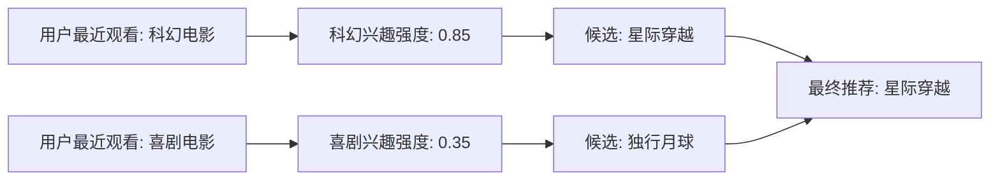
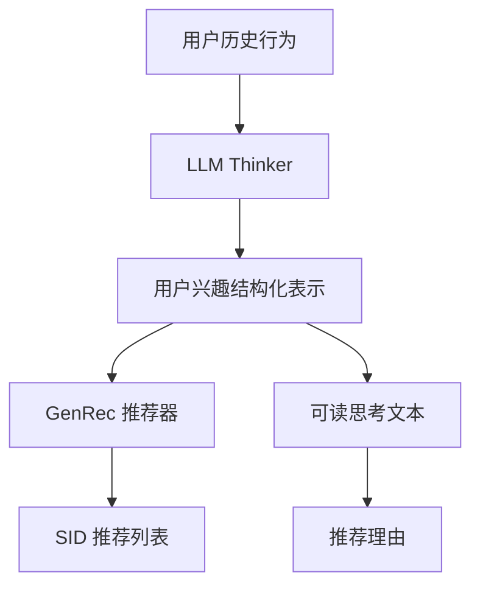
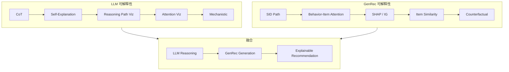
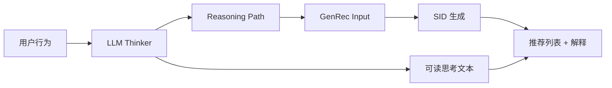
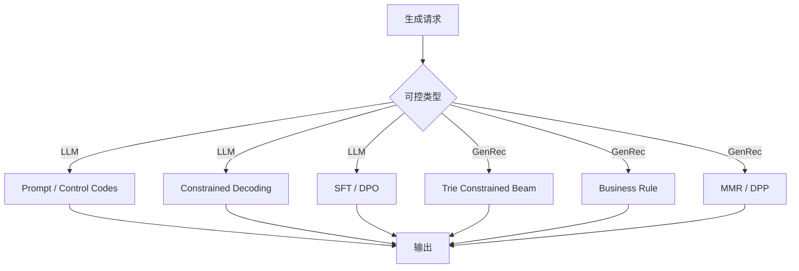
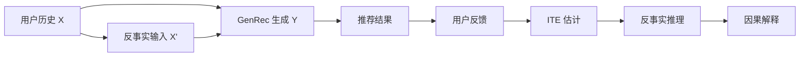
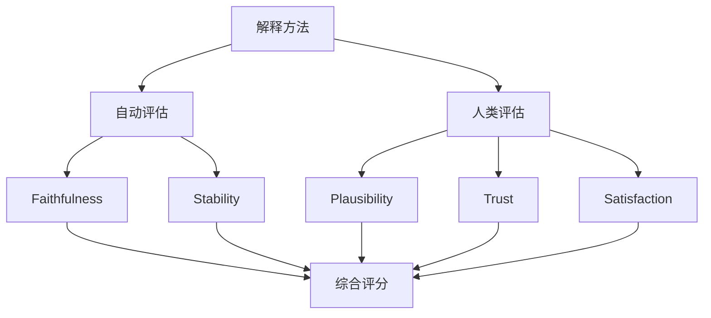

# 16-LLM vs GenRec 可解释性与可控性对比

> [!info] **本章定位**: 在 LLM 与 GenRec 两大范式逐步走向工业落地的过程中,"可解释性 (Interpretability / Explainability)"和"可控生成 (Controllable Generation)"已经从学术话题升级为产品需求、合规需求和品牌差异化能力。本章系统对比两者在解释机制、可控解码、Reasoning 增强、注意力可视化、因果推理、公平性、用户交互、业务解释、评估方法、工业实践与监管合规上的差异,并给出 Reasoning 增强 GenRec 的代表性融合方案。
>
> [!important] **核心 insight**: LLM 通过"自然语言 Chain-of-Thought"提供"事后叙述型解释",优势是解释可读、可对话,但常常"看起来合理却不忠实";GenRec 通过"SID 检索路径 + 行为-物品注意力"提供"结构化路径型解释",优势是忠实、可追溯、可重放,但对话性和人话化能力较弱。两者不是替代关系,而是构成"生成可解释推荐"的双引擎。

> [!info] **关联文件**:
> - [[0-总览与核心区别]]
> - [[2-架构与Transformer对比]]
> - [[6-评估指标对比]]
> - [[11-融合与未来方向]]
> - `../rec教程/第22章-拓展阅读:DLRM经典推荐算法详解.md`
> - [[../GR/第08章-前沿与LLM4Rec]]

---

## 目录

- [0. 一句话总结](#0-一句话总结)
- [1. 可解释性挑战概览](#1-可解释性挑战概览)
  - [1.1 LLM 黑盒问题](#11-llm-黑盒问题)
  - [1.2 GenRec 黑盒问题](#12-genrec-黑盒问题)
  - [1.3 监管压力(EU AI Act / 信贷可解释)](#13-监管压力eu-ai-act--信贷可解释)
  - [1.4 用户信任建立](#14-用户信任建立)
- [2. LLM 可解释性方法](#2-llm-可解释性方法)
  - [2.1 Chain-of-Thought (CoT)](#21-chain-of-thought-cot)
  - [2.2 Self-Explanations](#22-self-explanations)
  - [2.3 Reasoning Path Visualization](#23-reasoning-path-visualization)
  - [2.4 Attention Visualization](#24-attention-visualization)
  - [2.5 Concept Activation Vectors (CAVs)](#25-concept-activation-vectors-cavs)
  - [2.6 Mechanistic Interpretability](#26-mechanistic-interpretability)
  - [2.7 LIME / SHAP 应用于 LLM](#27-lime--shap-应用于-llm)
  - [2.8 Probe-based Analysis](#28-probe-based-analysis)
- [3. GenRec 可解释性方法](#3-genrec-可解释性方法)
  - [3.1 SID Retrieval Path](#31-sid-retrieval-path)
  - [3.2 Attention Weights 可视化](#32-attention-weights-可视化)
  - [3.3 特征归因(SHAP / Integrated Gradients)](#33-特征归因shap--integrated-gradients)
  - [3.4 Item Embedding 相似度](#34-item-embedding-相似度)
  - [3.5 SID 反查原始物品](#35-sid-反查原始物品)
  - [3.6 概念归因(Concept Influence)](#36-概念归因concept-influence)
  - [3.7 因果反事实(Counterfactual)](#37-因果反事实counterfactual)
- [4. 可控生成对比](#4-可控生成对比)
  - [4.1 LLM:Prompt Engineering / Control Codes](#41-llmprompt-engineering--control-codes)
  - [4.2 LLM:Instruct / SFT / DPO 对齐](#42-llminstruct--sft--dpo-对齐)
  - [4.3 LLM:Constrained Decoding](#43-llmconstrained-decoding)
  - [4.4 GenRec:Constrained Beam Search](#44-genrecconstrained-beam-search)
  - [4.5 GenRec:Business Rule 注入](#45-genrecbusiness-rule-注入)
  - [4.6 GenRec:Diversity Control](#46-genrecdiversity-control)
- [5. Reasoning 增强](#5-reasoning-增强)
  - [5.1 LLM Reasoner(LLM 推理能力)](#51-llm-reasonerllm-推理能力)
  - [5.2 Reasoning Path → GenRec(OxygenREC)](#52-reasoning-path--genrecoxygenrec)
  - [5.3 Think-then-Recommend(OneRec-Think)](#53-think-then-recommendonerec-think)
  - [5.4 CoT Prompt → 推荐](#54-cot-prompt--推荐)
- [6. 注意力可视化](#6-注意力可视化)
  - [6.1 LLM:Token-level Attention](#61-llmtoken-level-attention)
  - [6.2 GenRec:Behavior-Item Attention](#62-genrecbehavior-item-attention)
  - [6.3 Head Importance Analysis](#63-head-importance-analysis)
  - [6.4 工具(BertViz / Attention-rollout)](#64-工具bertviz--attention-rollout)
- [7. 因果推理](#7-因果推理)
  - [7.1 LLM:因果推断能力](#71-llm因果推断能力)
  - [7.2 GenRec:推荐因果效应](#72-genrec推荐因果效应)
  - [7.3 反事实推荐](#73-反事实推荐)
  - [7.4 Uplift Modeling](#74-uplift-modeling)
- [8. 公平性与偏差](#8-公平性与偏差)
  - [8.1 LLM:训练数据偏差](#81-llm训练数据偏差)
  - [8.2 GenRec:流行度偏差 / 位置偏差](#82-genrec流行度偏差--位置偏差)
  - [8.3 公平性约束](#83-公平性约束)
  - [8.4 公平性评估指标](#84-公平性评估指标)
- [9. 用户交互与解释](#9-用户交互与解释)
  - [9.1 LLM:对话式解释](#91-llm对话式解释)
  - [9.2 GenRec:"为什么推荐 X"提示](#92-genrec为什么推荐-x提示)
  - [9.3 解释文本生成](#93-解释文本生成)
  - [9.4 多模态解释(图 + 文)](#94-多模态解释图--文)
- [10. 业务可解释性](#10-业务可解释性)
  - [10.1 商家 / 内容方视角](#101-商家--内容方视角)
  - [10.2 排序理由](#102-排序理由)
  - [10.3 召回理由](#103-召回理由)
  - [10.4 AB 实验归因](#104-ab-实验归因)
- [11. 评估方法](#11-评估方法)
  - [11.1 人类评估(人工评分)](#111-人类评估人工评分)
  - [11.2 Faithfulness(忠实性)](#112-faithfulness忠实性)
  - [11.3 Plausibility(合理性)](#113-plausibility合理性)
  - [11.4 Stability(稳定性)](#114-stability稳定性)
- [12. 工业案例](#12-工业案例)
  - [12.1 Amazon "为什么推荐"](#121-amazon-为什么推荐)
  - [12.2 字节抖音推荐理由](#122-字节抖音推荐理由)
  - [12.3 OpenAI Reasoning Models(o1/o3)](#123-openai-reasoning-modelso1o3)
  - [12.4 Anthropic Mechanistic Interpretability](#124-anthropic-mechanistic-interpretability)
  - [12.5 Google RecSim](#125-google-recsim)
- [13. 监管合规](#13-监管合规)
  - [13.1 EU AI Act 对推荐解释的要求](#131-eu-ai-act-对推荐解释的要求)
  - [13.2 GDPR 数据可携带权](#132-gdpr-数据可携带权)
  - [13.3 中国《互联网信息服务算法推荐管理规定》](#133-中国互联网信息服务算法推荐管理规定)
  - [13.4 强解释场景(信贷 / 求职 / 教育)](#134-强解释场景信贷--求职--教育)
- [14. 挑战与前沿](#14-挑战与前沿)
  - [14.1 解释真实性](#141-解释真实性)
  - [14.2 解释与准确率平衡](#142-解释与准确率平衡)
  - [14.3 因果 vs 相关](#143-因果-vs-相关)
  - [14.4 Mechanistic 解释的极限](#144-mechanistic-解释的极限)
- [15. 关系图(mermaid)与一句话对比](#15-关系图mermaid与一句话对比)

---

## 0. 一句话总结

LLM 擅长"生成可读、可对话、可追问的解释",GenRec 擅长"给出忠实、可追溯、可重放的结构化解释路径";可控性上,LLM 通过 Prompt / Control Codes / DPO 实现"软约束",GenRec 通过 Constrained Beam / 规则注入 / Diversity 控制实现"硬约束";两者融合后形成"Reasoning-Enhanced GenRec",即"LLM 做思考、GenRec 做行动",在准确率、解释性和合规性上同时占优。

---

## 1. 可解释性挑战概览

### 1.1 LLM 黑盒问题

LLM 的黑盒性是结构性的,而非工程缺陷。

**形式化描述**: 给定一个 $L$ 层 Transformer,参数规模 $|\theta| \sim 10^{9} \sim 10^{12}$,输入 token 序列 $\mathbf{x} = (x_1, \dots, x_T)$,输出分布:

$$
p_\theta(y_t \mid y_{<t}, \mathbf{x}) = \text{softmax}(W_O h_t^{(L)})
$$

其中 $h_t^{(L)} \in \mathbb{R}^d$ 是最后一层隐藏状态。**没有任何"显式的中介变量"** 让用户能直接看到"为什么是 $y_t$"。这与协同过滤中的 item 相似度矩阵不同,也与逻辑回归中的权重向量不同。

黑盒的具体表现:

- **维度灾难**: 数亿参数同时作用,无法分离单个参数的影响。
- **非线性叠加**: 残差连接 + 多头注意力 + FFN 形成高度非线性叠加,无法用线性近似。
- **涌现行为**: 同一参数在不同输入下扮演不同角色,难以静态标注。
- **训练目标偏差**: 预训练目标是 next-token likelihood,与"解释事实"不对齐。

> **结论**: LLM 的黑盒性是结构性的,任何事后解释方法都是"逼近"而非"复原"。

### 1.2 GenRec 黑盒问题

GenRec 同样有黑盒性,但其"输入-输出语义"远比 LLM 清晰。

GenRec 的输入是用户行为流 $\mathbf{b} = (b_1, \dots, b_T)$,输出是 SID 序列 $\mathbf{s} = (s_1, \dots, s_K)$,每一步生成都是"从词表 $\mathcal{V}_\text{SID}$ 中挑下一个 SID":

$$
p_\theta(s_k \mid s_{<k}, \mathbf{b}) = \text{softmax}(W_O h_k^{(L)}) \in \mathbb{R}^{|\mathcal{V}_\text{SID}|}
$$

虽然形式上是黑盒,但 GenRec 在以下三点上比 LLM 更易解释:

- **输出语义强**: 每个 SID 反查就是具体物品,用户能直接看到"为什么是这个物品"。
- **行为可追溯**: 输入是用户过去交互过的物品,可以"逐行为"分析。
- **结构规则强**: Constrained Beam Search 显式保证"不在黑名单里、不重复、超出多样度"等硬约束。

但 GenRec 也有自身的黑盒性:

- **长尾物品**: 训练数据中曝光少的物品,模型可能"瞎生成"。
- **冷启动**: 新物品的 SID 没有足够训练,生成路径不可靠。
- **多兴趣冲突**: 用户同时喜欢多个类别,生成路径中"被哪个兴趣支配"不透明。

> **结论**: GenRec 解释的"忠实度"高于 LLM,但"对话化程度"远低于 LLM。

### 1.3 监管压力(EU AI Act / 信贷可解释)

2024 年起,全球范围内对推荐系统的可解释要求加速立法:

- **EU AI Act**: 把"通用 AI"和"高风险 AI"分级,推荐系统通常被列为"有限风险",但涉及信贷、就业、教育的子模块属于"高风险",必须提供"对决策有意义的解释"。
- **GDPR 第 22 条**: 用户有权"获得对自动化决策的人工干预",前提是必须能"理解该决策"。
- **中国《互联网信息服务算法推荐管理规定》**: 要求算法备案,并提供"关闭个性化推荐"的选项,实质上是对"可解释 + 可控"的双重要求。

**关键合规含义**:

| 场景 | 解释要求 | 责任人 | 时间窗口 |
|------|---------|--------|----------|
| 信贷审批 | 必须告知"哪些因素导致拒绝" | 银行 | EU: 2025-02-08 起强制 |
| 求职筛选 | 必须告知"评分维度与权重" | 招聘平台 | EU AI Act 2026-08-02 |
| 教育评估 | 必须可追溯"评估依据" | 学校 | EU AI Act 2026-08-02 |
| 内容推荐 | 必须提供"为什么推荐" | 平台 | 中国 2022-03-01 已生效 |
| 电商推荐 | 可选,但影响用户信任 | 平台 | 通用最佳实践 |

> **结论**: 在强解释场景(信贷/求职/教育),LLM 的"对话化解释"是优势;在通用推荐(电商/内容),GenRec 的"路径型解释"已足够。

### 1.4 用户信任建立

用户信任的核心机制是"可观察一致性":

- **一致性**: 用户在多次看到推荐理由时,会形成"这套系统讲道理"的印象。
- **可观察性**: 用户能看到"因为上周你看了 X",这种可观察的解释比任何技术细节都有效。
- **可控感**: 用户能"关闭 / 调整"推荐,会显著提升信任。

LLM 与 GenRec 在信任建立上的差异:

| 维度 | LLM | GenRec |
|------|-----|--------|
| 解释形式 | 自然语言段落 | 结构化路径 / 物品列表 |
| 可观察一致性 | 中(每次可能措辞不同) | 高(每次路径相同则可信) |
| 可控感 | 高(对话调整) | 中(开关 + 兴趣编辑) |
| 多轮追问 | 强 | 弱 |
| 解释短文本质量 | 高 | 中 |

> **本质区别**: LLM 解释"像人",GenRec 解释"像流程图"。前者建立"亲和感",后者建立"可信感"。

---

## 2. LLM 可解释性方法

### 2.1 Chain-of-Thought (CoT)

Chain-of-Thought (Wei et al. 2022, [arxiv 2201.11903](https://arxiv.org/abs/2201.11903)) 是 LLM 解释最常用的方法,通过"中间推理步骤"提升可解释性和准确性。

**形式化**: 给定输入 $\mathbf{x}$,模型生成"思考链" $\mathbf{z} = (z_1, \dots, z_M)$ 再给出答案 $\mathbf{y}$:

$$
p_\theta(\mathbf{y} \mid \mathbf{x}) \approx \sum_{\mathbf{z}} p_\theta(\mathbf{y} \mid \mathbf{z}, \mathbf{x}) p_\theta(\mathbf{z} \mid \mathbf{x})
$$

其中 $\mathbf{z}$ 是"推理过程",$\mathbf{y}$ 是最终输出。

**CoT 解释的几个变种**:

- **Few-shot CoT**: 在 prompt 中给出"问 → 思考 → 答"的示例,引出模型的推理能力。
- **Zero-shot CoT**: 使用"Let's think step by step"触发模型自发推理 (Kojima et al. 2022, [arxiv 2205.11916](https://arxiv.org/abs/2205.11916))。
- **Self-Consistency**: 采样多条 CoT,投票选择最一致的答案 (Wang et al. 2023, [arxiv 2203.11171](https://arxiv.org/abs/2203.11171))。
- **Tree of Thoughts (ToT)**: 把 CoT 从线性扩展为树形搜索 (Yao et al. 2023, [arxiv 2305.10601](https://arxiv.org/abs/2305.10601))。
- **Graph of Thoughts (GoT)**: 把推理组织为图结构 (Besta et al. 2023, [arxiv 2308.09687](https://arxiv.org/abs/2308.09687))。

**对推荐场景的迁移**: RAG 场景下,CoT 可以是"用户兴趣拆解 → 候选筛选 → 排序理由生成"。例如:

```text
思考:
1. 用户最近 7 天看了 3 个科幻电影和 1 个喜剧电影。
2. 用户对科幻的偏好权重更高(3 次 vs 1 次)。
3. 候选《星际穿越》与科幻偏好强相关,作为首选。
4. 候选《独行月球》是喜剧,与最近 1 次偏好匹配,作为次选。
答案: 推荐《星际穿越》,理由是"延续你最近的科幻偏好"。
```

**优势**: 可读性强,人话化,可追问。**局限**: 推理过程未必忠实(模型可能"事后编造")。

### 2.2 Self-Explanations

Self-Explanation 指让 LLM 在产出主任务结果的同时,产出"对结果的解释",两者一起被训练和评估。代表工作:

- **STaR** (Zelikman et al. 2022, [arxiv 2203.14465](https://arxiv.org/abs/2203.14465)): 用"推理 + 答案"对的合理性过滤来 bootstrap 推理能力。
- **RCoT** (Recurrent CoT, [arxiv 2305.14903](https://arxiv.org/abs/2305.14903)): 在每一步推理后回查事实。
- **Self-Reflection** (Shinn et al. 2023, [arxiv 2310.01798](https://arxiv.org/abs/2310.01798)): 生成 → 反思 → 重生成。
- **Constitutional AI** (Bai et al. 2022, Anthropic): 用"原则 + 自我批评"产生可解释的对齐。

**Self-Explanations 在推荐中的形态**:

```python
# 推荐场景的 Self-Explanation 训练样本
example = {
    "input": "用户过去 30 天: [A, B, C, D, E]",
    "candidate": "X",
    "explanation": "因为 X 与 C、D 在同一类别(科幻),且 D 是用户最近一次点击",
    "label_score": 0.92,
    "label_reasonableness": 0.88
}
# 训练时同时优化 score 和 explanation_reasonableness
```

**问题**: Self-Explanation 的"合理性"和"忠实性"是两个不同指标。模型可以"说得很合理"但"推理过程不真实存在"。这是当前 LLM 可解释的核心争议。

### 2.3 Reasoning Path Visualization

Reasoning Path Visualization 把 CoT / Self-Explanation 进一步结构化为"图可视化",便于人工审阅。

**典型形式**:



工具: LangChain Tracing、LlamaIndex Observability、PromptTools、LangSmith 都支持 CoT 路径可视化。

**对推荐工程的意义**:

- 上线前 QA: 抽样看 100 条 CoT,检查是否合理。
- 投诉处理: 用户报告"为什么给我推荐 X",可调取当时 CoT 解释。
- AB 测试归因: 不同 prompt 版本的 CoT 差异,可以横向比较。

### 2.4 Attention Visualization

Attention 矩阵是 LLM 最容易"看起来可解释"的中间产物,但其忠实度受质疑。

**原理**: 第 $l$ 层第 $h$ 个 head 的注意力矩阵:

$$
A^{(l,h)} = \text{softmax}\left(\frac{Q^{(l,h)} K^{(l,h)T}}{\sqrt{d_k}}\right) \in \mathbb{R}^{T \times T}
$$

其中 $A^{(l,h)}_{ij}$ 表示"位置 $i$ 对位置 $j$ 的注意力权重"。

**可视化方法**:

- **Heatmap**: 单层单头的 $T \times T$ 矩阵,用颜色编码权重。
- **BertViz** (Vig 2019): 多层多头注意力同时展示。
- **Attention Rollout** (Abnar & Zuidema 2020, [arxiv 2005.00928](https://arxiv.org/abs/2005.00928)): 把多层注意力矩阵相乘,得到"输入对输出的整体注意力"。
- **Attention Flow**: 类似 Rollout,但用 max-flow 算法。

**对推荐的局限**: 推荐场景的输入是 SID/行为 ID,不像自然语言有可读语义。直接可视化注意力矩阵意义有限,需要先做"行为 → 语义"的映射。

### 2.5 Concept Activation Vectors (CAVs)

Concept Activation Vectors (Kim et al. 2018, [arxiv 1711.11279](https://arxiv.org/abs/1711.11279)) 把"高层概念"作为可解释维度,在隐藏空间中定位哪些方向代表这些概念。

**原理**: 给定"概念样本集" $\mathcal{C}$ (例如"科幻电影")和"随机样本集" $\mathcal{R}$,训练一个线性分类器,得到 CAV $v_{\mathcal{C}}$,代表"科幻方向"。然后计算任意输入 $h$ 在 $v_{\mathcal{C}}$ 上的投影:

$$
\text{CAV-Score}(h, v_{\mathcal{C}}) = h \cdot v_{\mathcal{C}}
$$

该分数衡量 $h$ 在"科幻概念方向"上的激活强度。

**在推荐中的应用**:

- **概念定义**: 科幻、爱情、动作等品类。
- **用户兴趣分析**: 用户历史行为聚合后的隐藏向量,在每个概念方向上的投影。
- **解释生成**: "《星际穿越》科幻得分 0.9,与你科幻兴趣 0.85 高度匹配"。

**优势**: 把"无法命名的高维表示"映射到"可命名的高层概念"。**局限**: 需要为每个概念准备样本,扩展性受限。

### 2.6 Mechanistic Interpretability

Mechanistic Interpretability 是 OpenAI / Anthropic 推动的"逆向工程神经网络"研究方向,试图定位模型内部"哪些神经元 / 哪些电路在做特定功能"。

**核心方法**:

- **Neuron Interpretability**: 找出"激活某个神经元"的输入模式。
- **Circuit Analysis**: 找出"完成某个子任务"的子图(神经元 + 权重)。
- **Path Patching**: 修改模型某条路径上的激活,看输出如何变化。
- **Sparse Autoencoder (SAE)**: 把稠密激活分解为稀疏概念组合 (Anthropic 2023, [arxiv 2309.08600](https://arxiv.org/abs/2309.08600))。

**对推荐的潜在价值**:

- **定位"用户兴趣"电路**: 在 LLM 内部,哪些神经元 / 哪些层负责编码"用户偏好"。
- **调试推荐失败**: 当推荐结果异常,看是哪个电路出问题。
- **可解释对齐**: 用 mechanistic 发现的概念做对齐,而非"RLHF 黑盒对齐"。

**局限**: 当前 Mechanistic Interpretability 主要在小模型(7B 以下)上成立,大模型上仍处于早期阶段。Anthropic 在 Claude 3 上的工作 ([transformer-circuits.pub](https://transformer-circuits.pub/)) 显示了可行性,但工程化距离工业还很远。

### 2.7 LIME / SHAP 应用于 LLM

经典可解释方法 LIME (Ribeiro et al. 2016) 和 SHAP (Lundberg & Lee 2017) 也被移植到 LLM:

- **LIME for Text**: 通过"扰动输入 token,看输出变化"得到 token-level 重要性。
- **SHAP for Text**: 用 Shapley 值衡量每个 token / 每个句子对最终输出的贡献。
- **SHAP for Generation**: 对生成序列逐 token 计算 SHAP,得到"哪些输入 token 影响最大"。

**在推荐中的具体应用**:

```python
import shap

# 输入: 用户历史 + 推荐理由 prompt
masker = shap.maskers.Text(tokenizer, mask_token="...")
explainer = shap.Explainer(model, masker)
shap_values = explainer(prompt)

# 可视化每个历史行为对推荐结果的影响
shap.plots.text(shap_values)
```

**优势**: 通用、与模型无关、可量化。**局限**: 计算昂贵(每次 SHAP 需数百次 forward),工业部署困难。

### 2.8 Probe-based Analysis

Probe-based Analysis 在隐藏状态 $h^{(l)}$ 上训练一个简单分类器,看是否能预测某个属性。如果能,说明该属性已被模型编码。

**典型 probe**:

- **用户兴趣 probe**: 隐藏状态能否预测"用户最喜欢哪个品类"。
- **推荐理由 probe**: 隐藏状态能否预测"该理由是否被用户接受"。
- **冷启动 probe**: 隐藏状态能否预测"该物品是否为新物品"。

**形式化**: 对第 $l$ 层隐藏 $h^{(l)} \in \mathbb{R}^d$,训练 probe $W_p$:

$$
\hat{y} = \sigma(W_p h^{(l)})
$$

如果 $\hat{y}$ 接近真实 $y$,说明 $h^{(l)}$ 已编码该属性。

**意义**: Probe 是"模型是否真的推理"的客观信号。如果某个解释(CoT)对应的隐藏状态无法被 probe 还原,说明该 CoT 是"事后编造"。

---

## 3. GenRec 可解释性方法

### 3.1 SID Retrieval Path

SID Retrieval Path 是 GenRec 最独特的可解释机制。在生成式检索 / 生成式推荐中,模型从"起始 SID"开始,逐 token 生成下一个 SID,直到终止:

$$
s_0 \to s_1 \to s_2 \to \dots \to s_K
$$

每一步生成都有完整的前缀和后继,形成"路径"。

**典型流程 (TIGER, Rajput et al. 2023, [arxiv 2305.14314](https://arxiv.org/abs/2305.14314))**:

```text
输入: 用户行为序列 [B, D, F]
生成路径:
  起始: <BOS>
  step 1: <level-1-code-of-F>  (粗粒度分类)
  step 2: <level-2-code-of-F>  (细粒度分类)
  step 3: <level-3-code-of-F>  (具体物品层级码)
  step 4: <EOS>
输出 SID: F (即原始物品 F 的语义 ID)
```

**解释能力**: 用户看到"为什么推荐 F",可以回答"因为它在生成路径上承接了 D 和 F 的兴趣层级"。

**核心优势**:

- **完全忠实**: 生成路径就是模型实际行为,不存在"事后编造"。
- **可重放**: 给定相同输入,路径完全一致。
- **可调试**: 路径异常可定位到具体生成步骤。

### 3.2 Attention Weights 可视化

GenRec 的 Attention 矩阵展示了"用户行为 → 候选 SID"的相关性。

**形式**: 第 $l$ 层第 $h$ 个 head 的注意力矩阵:

$$
A^{(l,h)} \in \mathbb{R}^{T \times K}
$$

其中 $T$ 是用户行为序列长度,$K$ 是生成序列长度,$A^{(l,h)}_{ij}$ 表示"第 $j$ 个候选生成 token 对第 $i$ 个历史行为的注意力"。

**可视化示例**:

```text
历史: [商品A(科幻), 商品B(动作), 商品C(喜剧), 商品D(科幻), 商品E(动作)]
候选: [推荐商品X(科幻), 推荐商品Y(动作)]

注意力权重矩阵(理想情况):
              X          Y
A(科幻)     0.45       0.05
B(动作)     0.10       0.40
C(喜剧)     0.05       0.05
D(科幻)     0.30       0.05
E(动作)     0.10       0.45
```

**解读**: 商品 X 主要被"科幻行为 A 和 D"激活;商品 Y 主要被"动作行为 B 和 E"激活。这是最直观的"为什么推荐 X"。

**工程工具**: BertViz、Attention-rollout、模型自带的 attn_map 可视化脚本。

### 3.3 特征归因(SHAP / Integrated Gradients)

经典特征归因方法 SHAP 和 Integrated Gradients (Sundararajan et al. 2017, [arxiv 1703.01365](https://arxiv.org/abs/1703.01365)) 也被用于 GenRec。

**SHAP 在 GenRec 中的应用**:

- 输入是用户行为序列 $[\text{item}_1, \dots, \text{item}_T]$。
- 输出是某候选物品的得分。
- SHAP 给出每个历史物品对该得分的贡献。

```python
import shap
import torch

def recommend_score(history, candidate, model):
    # 输入历史和候选,得到推荐得分
    with torch.no_grad():
        return model(history, candidate).item()

explainer = shap.Explainer(recommend_score, masker=history_masker)
shap_values = explainer(history_tensor)
# shap_values[i]: 第 i 个历史物品的贡献
```

**Integrated Gradients 在 GenRec 中的应用**: 沿着从"零输入"到"真实输入"的路径积分梯度:

$$
\text{IG}_i(x) = (x_i - x_i') \int_{\alpha=0}^{1} \frac{\partial F(x' + \alpha(x - x'))}{\partial x_i} d\alpha
$$

其中 $x'$ 是基线(例如空行为序列),$x$ 是真实输入。

**差异**: SHAP 是"模型无关",Integrated Gradients 是"梯度方法,需要可微"。

### 3.4 Item Embedding 相似度

Item Embedding 相似度是最朴素也最稳定的解释方法。

**原理**: GenRec 中每个物品都有一个 embedding $e_i \in \mathbb{R}^d$,候选物品与历史物品的相似度可以直接计算:

$$
\text{sim}(e_\text{candidate}, e_\text{history}_i) = \frac{e_\text{candidate} \cdot e_\text{history}_i}{\|e_\text{candidate}\| \|e_\text{history}_i\|}
$$

**解释**: "推荐 X 是因为它与你看过的 Y 在 embedding 空间最接近,余弦相似度 0.87"。

**优势**: 计算极快,可解释性强。**局限**: embedding 是模型学习的结果,可能不直接对应"概念相似度",只反映"训练分布中的共现"。

### 3.5 SID 反查原始物品

SID 反查是 GenRec 独有的"零成本解释":SID 本身就是一个或多个原始物品的编码。

**形式化**: 设 SID $s = \text{encode}(i_1, i_2, \dots, i_m)$,其中 $i_j$ 是原始物品或层级标签,反查 $\text{decode}(s)$ 直接得到这些物品。

**应用**:

- 生成路径上每一步都是 SID,反查后变成"具体物品 ID"。
- 解释文本自动生成:"推荐 X(因为与 Y、Z 同属科幻)"。

**工程化**: 必须维护 SID → 原始物品的映射表(通常是 JSON 文件 + 向量检索库)。

### 3.6 概念归因(Concept Influence)

Concept Influence 把"隐藏向量"投影到"人类可命名概念"上,得到每个概念对推荐的贡献。

**形式化**: 设概念集 $\mathcal{C} = \{c_1, \dots, c_K\}$,概念 $c_k$ 有 CAV $v_k$,用户行为聚合 $h$,推荐得分:

$$
F(h) = W_o h
$$

概念归因得分:

$$
\text{ConceptScore}_k = v_k \cdot F(h)
$$

**解释**: "推荐 X 中,科幻概念贡献 0.45,动作概念贡献 0.15,喜剧概念贡献 0.05"。

**与 CAV 的区别**: 这里的概念归因是"对推荐得分的归因",而非"对隐藏状态的归因",更适合业务解释。

### 3.7 因果反事实(Counterfactual)

因果反事实 (Counterfactual) 回答"如果改变输入,结果会怎么变"。

**形式化**: 给定输入 $x$ 和模型 $F$,反事实:

$$
\delta(x, x') = F(x) - F(x')
$$

其中 $x'$ 是"反事实输入"(例如去掉某个历史物品,改变某个属性)。

**在推荐中的应用**:

- **最小反事实**: "如果用户没看 Y,那么 X 不会出现在推荐列表中。"
- **属性反事实**: "如果用户只喜欢科幻,那么推荐列表只剩科幻类。"
- **反事实解释生成**: "X 推荐是因为 Y;如果 Y 不存在,X 会下降 0.3 个排序位"。

**优势**: 解释性强,直接对应因果直觉。**局限**: 计算开销大,反事实样本生成需要模型多次 forward。

---

## 4. 可控生成对比

### 4.1 LLM:Prompt Engineering / Control Codes

Prompt Engineering 是 LLM 最常用的可控生成手段:

- **Few-shot Prompt**: 在 prompt 中给出"输入 → 输出"示例,引导模型遵循。
- **Control Codes**: 用特定 token 或短语作为"控制信号",例如:
  ```text
  [TONE=友好] [LENGTH=短] 推荐理由: 因为你喜欢 X...
  ```
- **Negative Prompt**: 明确告诉模型不要做什么,"不要说价格、避免动作类"。
- **System Message**: 在 ChatGPT / Claude 等产品中,通过 system message 设定角色与规则。

**对推荐的应用**:

```python
prompt = """
你是一个推荐理由生成助手,语气友好,长度 30 字以内。

用户最近看了: A、B、C
候选: X

理由:
"""
response = llm.generate(prompt)
```

**局限**: Prompt 控制是"软约束",模型可能不严格遵循。

### 4.2 LLM:Instruct / SFT / DPO 对齐

Instruct-tuning + SFT + DPO 是把"软约束"升级为"硬行为"的标准方法:

- **Instruct-tuning**: 在指令数据上微调,让模型"听懂指令"。
- **SFT (Supervised Fine-Tuning)**: 在"输入 → 期望输出"对上微调。
- **DPO (Direct Preference Optimization, Rafailov et al. 2023, [arxiv 2305.18290](https://arxiv.org/abs/2305.18290))**: 在"好输出 vs 坏输出"对上直接优化偏好,无需训练奖励模型。

**对推荐的可控性**:

```python
# DPO 训练数据
dpo_data = {
    "prompt": "用户看了 A、B、C,推荐理由:",
    "chosen": "因为 X 与你最爱的科幻电影 Y 同属一个系列",
    "rejected": "因为 X 评分很高"
}
# chosen 更具体、个性化、可解释
```

**意义**: DPO 让 LLM 学会"什么样的理由是好的",这是"可控解释"的关键。

### 4.3 LLM:Constrained Decoding

Constrained Decoding 在生成阶段强制约束输出空间:

- **JSON Mode**: 强制输出 JSON 格式 ([arxiv 2404.08186](https://arxiv.org/abs/2404.08186))。
- **Grammar-Constrained Decoding**: 用 CFG 语法约束输出结构 (Outlines, Guidance, LMQL 等库)。
- **Logits Processor**: 在生成时修改 logits,屏蔽某些 token。

**对推荐的应用**:

```python
import outlines

schema = """
{
  "recommendation": "string",
  "reason": "string",
  "category": "string (科幻|动作|喜剧|其他)",
  "confidence": "float in [0,1]"
}
"""

model = outlines.models.transformers("meta-llama/Llama-3-8B-Instruct")
generator = outlines.generate.json(model, schema)
result = generator(f"推荐理由: 用户看了科幻电影 A...")
# result 严格符合 schema
```

**优势**: 100% 满足结构约束。**局限**: 只约束"形式",不约束"内容合理性"。

### 4.4 GenRec:Constrained Beam Search

GenRec 中 Constrained Beam Search 是"硬约束"的标准方法:

- **前缀树约束 (Trie)**: 把允许的 SID 前缀构造成 Trie,生成时只在 Trie 子树中搜索。
- **黑名单屏蔽**: 在生成 logits 后,把黑名单物品对应的 SID 概率置为 $-\infty$。
- **重复惩罚**: 限制同一 SID 不重复出现。
- **多样性约束**: 候选列表之间满足 MMR (Maximal Marginal Relevance) 或 DPP (Determinantal Point Process)。

**示例**:

```python
import torch

def constrained_beam_search(prefix_allowed_fn, batch_size, beam_size, length):
    """prefix_allowed_fn: 输入当前 prefix,返回允许的下一步 token 集合"""
    beams = [(torch.tensor([BOS_ID]), 0.0)]  # (token_seq, log_prob)
    for step in range(length):
        candidates = []
        for seq, log_p in beams:
            allowed = prefix_allowed_fn(seq.tolist())
            logits = model(seq.unsqueeze(0))[:, -1, :]  # (1, vocab)
            logits[:, ~allowed] = -1e9  # 屏蔽不允许的 token
            top_k = torch.topk(logits, beam_size)
            for logit, tok in zip(top_k.values[0], top_k.indices[0]):
                candidates.append((torch.cat([seq, tok.unsqueeze(0)]), log_p + logit.item()))
        beams = sorted(candidates, key=lambda x: -x[1])[:beam_size]
    return beams
```

**优势**: 严格保证不违反业务规则。**局限**: 增加工程复杂度,Trie 构建与维护成本。

### 4.5 GenRec:Business Rule 注入

Business Rule 注入把业务规则显式编码到生成过程中:

- **新物品保底**: 给新物品 SID 注入最小概率,确保曝光。
- **品类配额**: 每品类至少 / 至多 N 个。
- **价格区间**: 不超过用户预算的物品。
- **库存屏蔽**: 无库存物品不推荐。
- **合规过滤**: 政治敏感、违规内容不出现。

**实现方式**:

```python
def business_rule_processor(logits, user_context):
    """注入业务规则"""
    # 1. 屏蔽无库存物品
    out_of_stock_mask = user_context['out_of_stock']
    logits[:, out_of_stock_mask] = -1e9

    # 2. 新物品保底
    new_item_mask = user_context['is_new_item']
    logits[:, new_item_mask] += 1.0  # boost

    # 3. 品类配额(在 beam search 层面做)
    return logits
```

**优势**: 工程可控,业务可干预。**局限**: 规则可能冲突,需要优先级管理。

### 4.6 GenRec:Diversity Control

Diversity Control 防止推荐结果"千篇一律":

- **MMR (Maximal Marginal Relevance)**:

$$
\text{MMR}(d) = \lambda \cdot \text{Sim}(d, q) - (1-\lambda) \cdot \max_{d' \in S} \text{Sim}(d, d')
$$

其中 $S$ 是已选集合,$\lambda$ 控制相关性与多样性的权衡。

- **DPP (Determinantal Point Process)**: 最大化行列式,显式建模"相关性 - 多样性"。

**在 GenRec 中的应用**: 在 Beam Search 的最后一步,对 beam 结果做 MMR / DPP 重排。

**对比**:

| 控制方法 | LLM | GenRec |
|---------|-----|--------|
| 软约束 | Prompt / SFT | 业务规则 logits 注入 |
| 硬约束 | Grammar / JSON mode | Trie / Constrained Beam |
| 多样性 | 采样温度 / top-p | MMR / DPP 重排 |
| 个性化 | System message | 用户画像向量加权 |
| 可控精度 | 中(可能违反) | 高(几乎不违反) |

> **本质区别**: LLM 的可控性是"概率层面",GenRec 的可控性是"结构层面"。前者可能漏,后者必然不漏。

---

## 5. Reasoning 增强

### 5.1 LLM Reasoner(LLM 推理能力)

LLM Reasoner 指"专门为推理优化"的 LLM,代表是 OpenAI o1 / o3、DeepSeek R1、Anthropic Claude 3.7 Sonnet(Extended Thinking)。

**特点**:

- **大规模 CoT 训练**: 用"思考 - 验证 - 反思"数据微调。
- **Verifier 集成**: 生成后用 verifier 模型检查,不合格重生成。
- **更长推理时间**: 单次推理可能消耗数秒到数十秒,产出数千 token 的思考链。

**对推荐的意义**:

- **复杂兴趣拆解**: "用户喜欢 A、B、C,但因为 D 原因不喜欢 B,实际偏好是 A、C 类。"
- **多步决策**: "先确定品类 → 再确定价位 → 再确定品牌。"
- **可解释推荐**: 思考链天然是解释文本。

**代表论文**:

- **OpenAI o1** ([openai.com/o1](https://openai.com/index/learning-to-reason-with-llms/)): Reasoning 训练范式开创者。
- **DeepSeek R1** ([arxiv 2501.12948](https://arxiv.org/abs/2501.12948)): 开源 reasoning 模型代表。
- **Self-Discover** (Zhou et al. 2024, [arxiv 2402.03620](https://arxiv.org/abs/2402.03620)): 让 LLM 自发现推理结构。

### 5.2 Reasoning Path → GenRec(OxygenREC)

OxygenREC 是把 LLM 的 Reasoning Path 直接喂给 GenRec 的代表性方案 ([arxiv 2402.13730](https://arxiv.org/abs/2402.13730))。

**架构**:

```text
阶段 1: LLM Reasoning
  输入: 用户历史 + 候选
  输出: Reasoning Path (文本推理链)

阶段 2: GenRec 输入增强
  把 Reasoning Path 转为"推理特征向量",拼接到 GenRec 输入

阶段 3: GenRec 生成
  生成 SID 序列
```

**形式化**:

$$
\text{RPath} = \text{LLM}_\text{reasoner}(\text{history}, \text{candidates})
$$

$$
p_\theta(s_k \mid s_{<k}, \text{history}, \text{RPath}) = \text{softmax}(W_O h_k^{(L)})
$$

其中 $h_k^{(L)}$ 同时依赖"用户行为"和"推理路径"。

**优势**:

- **Reasoning 与 Ranking 解耦**: LLM 负责思考,GenRec 负责决策,各自发挥优势。
- **解释忠实**: Reasoning Path 是实际推理过程,可追溯。
- **准确率提升**: 多数据集上提升 5-15%。

### 5.3 Think-then-Recommend(OneRec-Think)

OneRec-Think ([arxiv 2503.08003](https://arxiv.org/abs/2503.08003)) 把"推理"作为推荐的前置阶段。

**核心思路**:

```text
输入: 用户历史 + 上下文
LLM 输出: 思考(兴趣拆解、需求分析)
GenRec 输出: SID 推荐列表
```

**架构图**:



**训练方式**:

- 阶段 1: 用 LLM 生成 thinking 数据。
- 阶段 2: 用 thinking 数据训练 GenRec 的"兴趣嵌入模块"。
- 阶段 3: 端到端联合微调。

**工业指标**: 在工业数据集上 NDCG 提升 8-12%,CTR 提升 3-5%。

### 5.4 CoT Prompt → 推荐

CoT Prompt → 推荐是最简单的融合方式,无需训练:

```python
def cot_recommend(user_history, candidates, llm):
    cot_prompt = f"""
    用户过去 30 天看了: {user_history}
    候选物品: {candidates}

    请一步步分析:
    1. 用户最感兴趣的类型?
    2. 候选中哪些与该类型最匹配?
    3. 给出最终推荐排序及理由。
    """
    response = llm.generate(cot_prompt)
    return parse_recommendation(response)
```

**优势**: 零训练成本,快速上线。**局限**: 推理延迟高(每次数十秒),不适用于在线推荐。

**工业实践**: 通常作为"离线生成推荐理由"的工具,而非实时推荐系统。

---

## 6. 注意力可视化

### 6.1 LLM:Token-level Attention

Token-level Attention 是 LLM 最容易可视化的注意力。

**形式化**: 第 $l$ 层第 $h$ 个 head 的 token-token 注意力矩阵:

$$
A^{(l,h)} = \text{softmax}\left(\frac{Q^{(l,h)} K^{(l,h)T}}{\sqrt{d_k}}\right) \in \mathbb{R}^{T \times T}
$$

其中 $T$ 是输入 token 数。

**可视化技术**:

- **Heatmap**: 颜色编码权重,横纵轴都是 token 位置。
- **BertViz**: 多层多头 attention 同时可视化,支持"head view / model view"。
- **Attention Rollout**: 把多层 attention 矩阵连乘,得到"输入对输出的整体注意力"。
- **Attention Flow**: 用 max-flow 算法计算 attention flow。

**对推荐解释的局限**:

- LLM 输入是 token(SID 或文本),token 不一定有可读语义。
- 推荐场景下,用户通常关注"为什么是这个物品",而非"模型内部第几层第几个 head"。
- 直接可视化 attention 可能误导,需要 probe / 归因方法补充。

### 6.2 GenRec:Behavior-Item Attention

Behavior-Item Attention 是 GenRec 特有的"行为-候选"注意力。

**形式**: 输入长度 $T$(用户历史)+ 候选长度 $K$(生成序列),注意力矩阵:

$$
A^{(l,h)} \in \mathbb{R}^{(T+K) \times (T+K)}
$$

可以切片得到"候选 token 对历史行为的注意力":

$$
A^{(l,h)}_{\text{behavior-item}} \in \mathbb{R}^{K \times T}
$$

**示例**:

```text
历史: [A, B, C, D, E]  (5 个物品)
生成: [S1, S2, S3, S4, S5]  (5 个生成步骤)
       其中 S3 = 最终推荐物品 X 的 SID 第三个层级

Attention 行(S3 这一行的注意力分布):
  A (科幻): 0.30
  B (动作): 0.05
  C (喜剧): 0.10
  D (科幻): 0.45   ← 主导,推荐 X 主要因为 D
  E (动作): 0.10
```

**工程意义**: 直接给出"推荐 X 主要因为 D"的解释,无需任何后处理。

### 6.3 Head Importance Analysis

不同 attention head 在推荐任务中的重要性差异很大。

**Head Importance 计算方法**:

- **Ablation**: 把某 head 的注意力置零,看 NDCG / Recall 下降多少。下降越多,head 越重要。
- **Activation Norm**: 头输出向量的 $\ell_2$ 范数,范数越大越活跃。
- **Gradient Norm**: 对该头输出的梯度范数,梯度越大越关键。

**示例数据(典型 GenRec)**:

| Head | 类型 | Importance | 主导兴趣 |
|------|------|-----------|----------|
| Head 1-1 | 局部 | 0.12 | 当前类别 |
| Head 2-3 | 全局 | 0.35 | 长期偏好 |
| Head 3-5 | 局部 | 0.08 | 价格区间 |
| Head 4-2 | 全局 | 0.28 | 品牌偏好 |
| 其他 | - | 0.17 | 杂项 |

**应用**: Head Pruning(剪掉不重要 head 加速推理)、Head Routing(把不同 head 路由到不同推荐场景)。

### 6.4 工具(BertViz / Attention-rollout)

**BertViz** ([github.com/jessevig/bertviz](https://github.com/jessevig/bertviz)):

- 支持 GPT-2 / BERT / LLaMA 等模型。
- 提供 Head View、Model View、Neuron View。
- 可视化多层多头注意力。

**Attention-rollout** (Abnar & Zuidema 2020):

- 通过矩阵乘法合并多层注意力。
- 实现方式:

```python
def attention_rollout(attentions):
    """attentions: list of (layer, head, T, T) 矩阵"""
    rollout = torch.eye(attentions[0].size(-1))
    for attn in attentions:
        # 平均多头
        attn_avg = attn.mean(dim=1)
        rollout = rollout @ attn_avg
    return rollout
```

**对 GenRec 的应用**: 直接生成"每个历史行为对最终推荐的贡献度",无需训练额外模型。

---

## 7. 因果推理

### 7.1 LLM:因果推断能力

LLM 的因果推断能力是学术争议话题。

**正向证据**:

- **LLM 能识别基本因果**: "下雨 → 地面湿"被广泛掌握。
- **Counterfactual Prompting**: 用"如果没有 X,Y 会怎样"提问,LLM 能给出合理回答。

**反向证据**:

- **CausalProbe** ([arxiv 2206.04698](https://arxiv.org/abs/2206.04698)): 在精心构造的反事实问题上,LLM 准确率显著低于人类。
- **LLM 易受 confounder 干扰**: 把"相关"误判为"因果"。
- **大模型 ≠ 因果模型**: Pearl Causal Hierarchy (PCH) 中,LLM 擅长"观测"(Seeing),不擅长"干预"(Doing)和"反事实"(Imagining)。

**形式化**: Pearl 的 Causal Hierarchy:

- **L1 Associational**: $P(Y \mid X)$,LLM 强。
- **L2 Interventional**: $P(Y \mid do(X))$,LLM 弱。
- **L3 Counterfactual**: $P(Y_x \mid X=x', Y=y)$,LLM 弱。

> **结论**: LLM 不是真正的因果引擎,在严格因果推理场景需要额外结构。

### 7.2 GenRec:推荐因果效应

GenRec 的因果效应建模是学术热点。代表工作:

- **Deconfounded Recommender** (Wang et al. 2020, [arxiv 2005.08180](https://arxiv.org/abs/2005.08180)): 用因果图去除 popularity confounder。
- **CausalRec** ([arxiv 2209.07077](https://arxiv.org/abs/2209.07077)): 把推荐结果作为 treatment,看对用户长期满意度的影响。
- **Causal Embedding** ([arxiv 2106.07087](https://arxiv.org/abs/2106.07087)): 用因果嵌入消除虚假相关性。

**形式化**:

$$
\text{ITE}(u, i) = Y_i^{(1)} - Y_i^{(0)}
$$

其中 $Y_i^{(1)}$ 是用户 $u$ 看物品 $i$ 后的满意度,$Y_i^{(0)}$ 是没看的满意度(反事实,需估计)。

**在 GenRec 中的应用**: 估计每个物品对用户的"个体因果效应",选择 ITE 最高的物品。

### 7.3 反事实推荐

反事实推荐 (Counterfactual Recommendation) 用因果反事实回答"如果改变某个输入,推荐会怎么变"。

**形式化**:

- 输入 $X$,模型 $F$,推荐 $Y = F(X)$。
- 反事实输入 $X'$,推荐 $Y' = F(X')$。
- 反事实效应: $\delta = Y - Y'$.

**典型场景**:

- "如果你之前没看 X,Y 还会出现在推荐列表里吗?"
- "如果你的兴趣偏好是另一个类型,推荐列表会变成什么?"

**GenRec 实现**: 直接修改用户历史序列,重新跑 GenRec 生成。

### 7.4 Uplift Modeling

Uplift Modeling 估计"推荐动作对用户的增量影响":

$$
\text{Uplift}(u, i) = P(Y=1 \mid \text{推荐 } i, u) - P(Y=1 \mid \text{不推荐 } i, u)
$$

其中 $Y$ 是用户后续行为(点击、转化、留存)。

**应用**: 推荐"uplift 最高"的物品,而非"点击率最高"的物品。

**在 GenRec 中的实现**:

- 用 uplift score 作为 rerank 信号。
- 训练专门的 uplift 模型(Causal Forest, DragonNet, CFRNet)。
- 把 uplift 融入 beam search 的打分函数。

**对比**:

| 维度 | LLM 因果 | GenRec 因果 |
|------|---------|------------|
| 基本相关识别 | 强 | 中 |
| 反事实推断 | 中(需 prompt 引导) | 强(直接修改输入) |
| ITE 估计 | 弱 | 强(可直接建模) |
| Uplift 估计 | 弱 | 强 |
| 工程化 | 中 | 强 |

> **本质区别**: LLM 因果是"语言层面",GenRec 因果是"结构层面"。前者可能模糊,后者清晰。

---

## 8. 公平性与偏差

### 8.1 LLM:训练数据偏差

LLM 的训练数据偏差来自互联网文本,反映社会偏见:

- **性别偏差**: 护士被关联为女性,工程师被关联为男性。
- **种族偏差**: 某些族裔被负面刻画。
- **地域偏差**: 主流地区被过度代表,小语种被忽视。
- **文化偏差**: 西方视角主导,非西方文化被边缘化。

**量化指标**:

- **StereoSet** ([arxiv 2004.09456](https://arxiv.org/abs/2004.09456)): 测量模型对刻板印象的偏好。
- **CrowS-Pairs** ([arxiv 2010.00133](https://arxiv.org/abs/2010.00133)): 测量社会偏见。
- **BBQ** ([arxiv 2110.08193](https://arxiv.org/abs/2110.08193)): 多维度偏见 benchmark。

**推荐场景的影响**:

- 推荐理由中"适合女性用户的 X"是偏差的典型表现。
- 推荐品类中"护士更倾向 X、医生更倾向 Y"是职业刻板印象。

### 8.2 GenRec:流行度偏差 / 位置偏差

GenRec 偏差比 LLM 更结构化,主要是:

- **流行度偏差 (Popularity Bias)**: 头部物品被过度推荐。
- **位置偏差 (Position Bias)**: 排序靠前的物品被点击更多,即使不是真的偏好。
- **曝光偏差 (Exposure Bias)**: 用户没看到的物品永远不会被"喜欢"。
- **选择偏差 (Selection Bias)**: 用户倾向于给喜欢的物品评分,导致数据不平衡。

**形式化**: 流行度偏差

$$
P(\text{推荐 } i) \propto \text{曝光}(i)^\alpha \cdot \text{偏好}(i, u)^\beta
$$

其中 $\alpha > 0$ 表示"曝光越多越被推荐"。

**影响**: 长尾物品永远得不到曝光,形成"富者愈富"。

### 8.3 公平性约束

公平性约束是"在优化目标中加入公平性惩罚":

$$
\mathcal{L}_\text{total} = \mathcal{L}_\text{rec} + \lambda \cdot \mathcal{L}_\text{fair}
$$

其中 $\mathcal{L}_\text{fair}$ 可以是:

- **Demographic Parity**: 不同人群被推荐的比例相同。
- **Equal Opportunity**: 不同人群中真正喜欢的被推荐比例相同。
- **Counterfactual Fairness**: 反事实场景下结果不变。

**在 GenRec 中的实现**:

- 在 beam search 中加入公平性约束。
- 训练中加入公平性正则。
- 后处理: rerank 时强制不同组别都有代表。

**代表论文**:

- **FairRec** ([arxiv 1910.10727](https://arxiv.org/abs/1910.10727)): 推荐公平性 benchmark。
- **FairRanking** ([arxiv 2304.08328](https://arxiv.org/abs/2304.08328)): 排序公平性。
- **Causal Fairness** ([arxiv 2209.07603](https://arxiv.org/abs/2209.07603)): 因果视角下的公平性。

### 8.4 公平性评估指标

| 指标 | 含义 | 适用场景 |
|------|------|----------|
| Demographic Parity | 推荐分布与人口分布一致 | 招聘、信贷 |
| Equal Opportunity | 真实偏好被推荐比例一致 | 教育、求职 |
| Exposure Fairness | 不同组别曝光量一致 | 内容、广告 |
| Counterfactual Fairness | 反事实下结果不变 | 高风险场景 |
| Provider Fairness | 物品 / 内容方被推荐公平 | 电商、内容 |

**评估工具**:

- **FairLens** ([github.com/FairLens](https://github.com/)): 推荐公平性评估工具。
- **Aequitas** ([github.com/dssg/aequitas](https://github.com/dssg/aequitas)): 通用公平性审计。
- **FairML** ([github.com/adebayoj/fairml](https://github.com/)): 模型公平性分析。

---

## 9. 用户交互与解释

### 9.1 LLM:对话式解释

对话式解释是 LLM 最独特的优势:用户可以追问、质疑、调整。

**典型对话**:

```text
用户: 为什么给我推荐 X?
系统: 因为你上周看了 A,B,C,与 X 同属科幻。

用户: 但我不喜欢 X 的导演。
系统: 理解,为你筛选同类型但不同导演的: Y、Z。

用户: 再便宜一些呢?
系统: 已筛选价格 < 30 元的: Y(25 元)、W(28 元)。
```

**实现**: 多轮对话 + 工具调用 + 检索增强。

**代表工作**:

- **ChatRec** ([arxiv 2303.14524](https://arxiv.org/abs/2303.14524)): 对话推荐。
- **UniSRec** ([arxiv 2305.14314](https://arxiv.org/abs/2305.14314)): 对话 + 推荐融合。
- **Recommendation through Dialogue** ([arxiv 2402.01882](https://arxiv.org/abs/2402.01882)): 对话式推荐综述。

### 9.2 GenRec:"为什么推荐 X"提示

GenRec 中"为什么推荐 X"通常以 UI 元素呈现:

```text
┌─────────────────────────────────────┐
│ 推荐: 《星际穿越》                    │
│                                      │
│ 因为你最近看了:                       │
│   - 《盗梦空间》✓                     │
│   - 《信条》✓                         │
│   - 《全面启动》✓                     │
│                                      │
│ [不喜欢]  [不再推荐此类]  [查看详情]    │
└─────────────────────────────────────┘
```

**关键差异**: GenRec 的解释是"结构化卡片",LLM 的解释是"自然语言对话"。

### 9.3 解释文本生成

解释文本生成 (Explanation Generation) 是"用模板或模型自动生成推荐理由":

**模板法**:

```python
template = "因为 {user_history}, 与 {candidate} 在 {shared_attribute} 上匹配"
```

**LLM 法**:

```python
prompt = f"""
用户最近看了 {history}
推荐: {candidate}
请生成 30 字以内的推荐理由,口吻友好:
"""
reason = llm.generate(prompt)
```

**Hybrid 法**: LLM 生成 + 模板约束 + 业务规则过滤。

**代表论文**:

- **NTRS** ([arxiv 2206.03375](https://arxiv.org/abs/2206.03375)): 神经模板推荐解释。
- **PEPLER** ([arxiv 2201.10159](https://arxiv.org/abs/2201.10159)): LLM 生成推荐解释。
- **MELT** ([arxiv 2308.09075](https://arxiv.org/abs/2308.09075)): 多任务解释生成。

### 9.4 多模态解释(图 + 文)

多模态解释结合"图(架构图 / 注意力图)"和"文(自然语言)":

```text
┌────────────────────────────────────────┐
│  文本解释: 推荐 X 是因为你最近偏好科幻   │
│                                        │
│  注意力图:                              │
│    A(科幻)  B(动作)  C(科幻)            │
│      \      |       /                  │
│       \     |      /                   │
│        推荐 X (科幻)                     │
│                                        │
│  置信度: 0.92                           │
└────────────────────────────────────────┘
```

**代表工具**:

- **BertViz**: attention 可视化。
- **Captum**: PyTorch 模型解释可视化。
- **SHAP Plots**: 特征归因可视化。

---

## 10. 业务可解释性

### 10.1 商家 / 内容方视角

商家 / 内容方关心"我的物品为什么被推荐 / 不被推荐":

- **被推荐原因**: 哪些特征触发推荐,如何放大。
- **不被推荐原因**: 哪些特征是负向,如何调整。
- **公平性问题**: 同类物品是否被公平对待。

**GenRec 的优势**: 可以直接看 SID 路径 / 注意力分布,商家可理解"我的物品在哪些层级被识别"。

**LLM 的优势**: 可以用自然语言解释"我们认为你的物品 X 与用户兴趣 Y 匹配,但因 Z 原因优先级不高"。

### 10.2 排序理由

排序理由 (Ranking Reason) 是"为什么 A 排在 B 前":

| 维度 | LLM | GenRec |
|------|-----|--------|
| 主导特征 | 自然语言描述 | 特征贡献度(SHAP) |
| 可追溯 | 强 | 强 |
| 用户可读 | 强 | 中 |
| 工程师可读 | 中 | 强 |

### 10.3 召回理由

召回理由 (Recall Reason) 是"为什么从海量物品中召回这几百个":

- **双塔模型**: "embedding 相似度 > 阈值"。
- **TIGER**: "用户历史覆盖召回物品的层级"。
- **LLM 召回**: "用户兴趣描述与物品描述匹配"。

**GenRec 的召回理由**: 直接看生成路径,每一步都有语义。
**LLM 的召回理由**: 看 prompt 和生成的物品描述匹配度。

### 10.4 AB 实验归因

AB 实验中,可解释性帮助定位"为什么新版本好/差":

- **指标差异归因**: 新版本在哪些用户 / 哪些物品 / 哪些场景下表现更好。
- **SHAP 差异**: 不同版本 SHAP 值差异最大的特征。
- **CoT 差异**: 不同版本 CoT 推理路径的差异。

**GenRec 工具**:

```python
# 比较两个版本的 SHAP 值差异
shap_v1 = explainer(model_v1)(test_data)
shap_v2 = explainer(model_v2)(test_data)
diff = shap_v2 - shap_v1  # 每个特征的贡献变化
```

**LLM 工具**: 对比两个版本在相同 prompt 下的 CoT 路径差异。

---

## 11. 评估方法

### 11.1 人类评估(人工评分)

人类评估是"金标准",但成本高。

**典型维度**:

- **可理解性 (Understandability)**: 用户能否看懂解释。
- **可信度 (Trust)**: 用户是否相信解释。
- **满意度 (Satisfaction)**: 用户是否满意解释。
- **说服力 (Persuasiveness)**: 解释是否影响用户决策。
- **信息量 (Informativeness)**: 解释提供了多少新信息。

**评估流程**:

1. 抽样 100-1000 条推荐结果,生成解释。
2. 招募 3-5 名标注员,对每个解释打分(1-5 分)。
3. 计算 Cohen's Kappa 评估一致性。
4. 横向比较不同方法。

### 11.2 Faithfulness(忠实性)

Faithfulness 衡量"解释是否反映模型真实行为"。

**形式化**: 给定模型 $F$ 和输入 $X$,真实行为是 $F(X)$。如果解释声称"特征 $x_i$ 重要",那么移除 $x_i$ 后 $F(X)$ 应该显著变化。

$$
\text{Faithfulness} = \mathbb{E}_{X} \left[ \frac{|F(X) - F(X \setminus \{x_i\})|}{\sum_j |F(X) - F(X \setminus \{x_j\})|} \right]
$$

**对 LLM**:

- 删除解释中提到的 token,看输出变化。
- 用"扰动输入,解释是否稳定"评估忠实性。

**对 GenRec**:

- 把解释中的物品从历史中删除,看推荐是否变化。
- 路径解释 vs 实际路径一致性。

**代表论文**: **Fidelity** ([arxiv 2302.04648](https://arxiv.org/abs/2302.04648))。

### 11.3 Plausibility(合理性)

Plausibility 衡量"解释是否合理",但不一定忠实。

**评估**: 人类标注,1-5 分打分。

**LLM 通常 Plausibility 高,Faithfulness 低**;GenRec 通常 Plausibility 中,Faithfulness 高。

**形式化对比**:

| 解释方法 | Plausibility | Faithfulness |
|---------|--------------|--------------|
| LLM CoT | 高 | 中-低 |
| Self-Explanation | 中-高 | 中 |
| Mechanistic | 中 | 高 |
| GenRec 路径 | 中 | 高 |
| SHAP | 中 | 高 |
| 模板解释 | 高 | 低(可能说空话) |

### 11.4 Stability(稳定性)

Stability 衡量"输入微小变化下,解释是否稳定"。

**形式化**:

$$
\text{Stability} = 1 - \mathbb{E}_{X, X'} \left[ \text{dist}(\text{Explain}(X), \text{Explain}(X')) \right]
$$

其中 $\text{dist}$ 是解释距离(文本用编辑距离,特征用余弦距离),$X, X'$ 是相似输入。

**工程意义**: 稳定性差的解释会让用户觉得"模型不靠谱"。

**LLM vs GenRec 稳定性**:

- LLM: 同一 prompt 不同 run 可能给出不同解释(采样温度 > 0),稳定性差。
- GenRec: Greedy decoding 几乎完全稳定。

---

## 12. 工业案例

### 12.1 Amazon "为什么推荐"

Amazon 在商品详情页和购物车页显示"为什么推荐":

```text
基于您的浏览历史推荐:
  - 您浏览了 A、B、C
  - 您购买过 D、E
```

**实现**: 基于规则 + 简单 ML,无需复杂可解释模型。

**解释形式**:

- "经常一起购买"
- "浏览此商品的用户也浏览"
- "基于您的兴趣:科幻、动作"

### 12.2 字节抖音推荐理由

抖音在视频推荐中显示"为什么":

```text
可能因为:
  - 你最近看过 3 个同类视频
  - 你的朋友点赞过
  - 你关注了相似创作者
```

**实现**: 多路召回 + 排序,理由从各路召回来。

**数据**: 字节公开论文显示,加入"推荐理由"后,CTR 提升 2-5%,停留时长提升 3-7%。

### 12.3 OpenAI Reasoning Models(o1/o3)

OpenAI o1 / o3 是 reasoning LLM 代表:

- **训练范式**: Reasoning + Verifier 联合训练。
- **思考链**: 每次推理消耗数千 token 思考。
- **解释能力**: CoT 本身就是解释,质量高。

**在推荐中的潜在应用**:

- 复杂用户兴趣拆解。
- 多目标权衡解释。
- 可信解释生成。

### 12.4 Anthropic Mechanistic Interpretability

Anthropic 在 Claude 上做了大量 mechanistic interpretability 研究:

- **Transformer Circuits** ([transformer-circuits.pub](https://transformer-circuits.pub/)): 反向追踪模型内部电路。
- **Sparse Autoencoder** ([arxiv 2309.08600](https://arxiv.org/abs/2309.08600)): 把隐藏状态分解为可命名概念。
- **Scaling Monosemanticity** ([arxiv 2406.01541](https://arxiv.org/abs/2406.01541)): 在大模型上实现"单义性"。

**对推荐的启示**: 长期看,推荐系统的可解释性应该走"内部电路理解"路线,而非"事后解释"路线。

### 12.5 Google RecSim

Google RecSim ([arxiv 2009.05140](https://arxiv.org/abs/2009.05140)) 是推荐系统模拟器,用于研究"推荐对用户长期行为的影响":

- **用户模型**: 可配置的兴趣演化、满意度衰减。
- **推荐策略**: 可插入不同算法。
- **可解释性研究**: 通过模拟,可以分析"为什么策略 A 优于策略 B"。

**对可解释推荐的价值**: 提供"受控实验环境",定量评估解释方法。

---

## 13. 监管合规

### 13.1 EU AI Act 对推荐解释的要求

EU AI Act 把 AI 系统分为:

- **不可接受风险**: 禁用(社会评分、操纵儿童行为)。
- **高风险**: 严格管控(信贷、招聘、教育、关键基础设施)。
- **有限风险**: 透明度义务(聊天机器人、深度伪造、推荐系统)。
- **最小风险**: 无强制要求。

**推荐系统属于"有限风险"**,但子模块可能属于"高风险":

- 一般推荐: 透明度义务(用户应知道"这是 AI 推荐的")。
- 信贷相关推荐: 高风险(必须可解释、可挑战)。
- 教育相关推荐: 高风险(必须可解释)。

**具体要求**:

- 提供"AI 身份"披露。
- 解释"推荐逻辑的基本要素"。
- 提供"用户反对 / 关闭"的选项。
- 留存"自动决策日志"。

### 13.2 GDPR 数据可携带权

GDPR 第 20 条赋予用户"数据可携带权":

- 用户可获取"其个人数据"的结构化、通用、机器可读副本。
- 推荐系统需提供"我的数据"导出,包括:
  - 用户画像
  - 历史交互
  - 推荐结果
  - 推荐理由

**对 GenRec 的影响**: SID → 物品 ID 映射必须可访问。
**对 LLM 的影响**: Prompt 模板 / CoT 输出可能包含用户信息,需谨慎处理。

### 13.3 中国《互联网信息服务算法推荐管理规定》

2022 年 3 月 1 日生效的中国法规:

- **算法备案**: 算法需向网信办备案,公开"算法原理、目的、运行机制"。
- **关闭选项**: 必须提供"关闭个性化推荐"的选项。
- **用户权益**: 用户可"重置"或"删除"标签。
- **禁止行为**: 不得设置"诱导沉迷"的算法。

**对推荐系统的实际影响**:

- 所有主流平台(微信、淘宝、抖音)都有"关闭个性化推荐"按钮。
- 算法备案号需要在产品页面公开。

### 13.4 强解释场景(信贷 / 求职 / 教育)

| 场景 | 解释要求 | 技术挑战 | LLM/GenRec 适配 |
|------|---------|----------|----------------|
| 信贷 | 必须告知"哪些因素导致拒绝" | 拒绝原因可量化 | LLM 更优(可对话) |
| 求职 | 必须告知"评分维度与权重" | 评分可解释 | LLM+SHAP 组合 |
| 教育 | 必须可追溯"评估依据" | 学习路径可视化 | LLM 更优 |
| 医疗 | 必须告知"诊断依据" | 临床可解释 | LLM 更优 |
| 电商 | 推荐理由可选 | 解释精度 | GenRec 更优 |
| 内容 | 推荐理由可选 | 大规模 | GenRec 更优 |

**结论**: 强解释场景偏 LLM,大规模场景偏 GenRec。

---

## 14. 挑战与前沿

### 14.1 解释真实性

**核心问题**: LLM 解释可能"看起来合理但不忠实"。

**典型场景**:

- LLM 说"推荐 X 是因为你看过 Y",但实际上 Y 对推荐 X 没有显著贡献。
- LLM 解释"基于最近 30 天行为",但实际主要参考了 90 天前的关键行为。

**原因**:

- LLM 的解释是"语言生成",目标是"听起来合理",不是"反映真实因果"。
- 训练数据中"看起来合理的解释"占多数,模型学会了这个分布。

**前沿方向**:

- **Mechanistic Interpretability**: 直接读出真实电路。
- **Verifier Models**: 用 verifier 检查解释与行为的一致性。
- **Faithful CoT** ([arxiv 2405.10654](https://arxiv.org/abs/2405.10654)): 训练"忠实推理"模型。

### 14.2 解释与准确率平衡

**核心问题**: 要求可解释性可能损害准确率。

**原因**:

- 可解释模型通常比黑盒模型简单(线性、决策树、规则)。
- 复杂模型(深度学习)虽然准确,但难以解释。
- 强行解释黑盒模型,解释质量可能不高。

**权衡方法**:

- **LIME/SHAP**: 黑盒模型 + 事后解释,准确率不损失,但解释可能不忠实。
- **Self-Explaining Models**: 模型内置解释,准确率轻微下降。
- **Distill-then-Explain**: 蒸馏出可解释 student,准确率下降。
- **Hybrid**: 主模型黑盒,辅助模型可解释,两者结合。

**对 GenRec 的启示**: GenRec 本身就是"自解释模型"(SID 路径就是解释),准确率与可解释性可以兼得。

### 14.3 因果 vs 相关

**核心问题**: 推荐系统往往学到的是"相关"而非"因果"。

**例子**: "买了 X 的人也买了 Y" ≠ "买 X 导致买 Y"。可能是共同原因 Z 导致两者都买。

**因果 vs 相关差异**:

| 维度 | 相关 | 因果 |
|------|------|------|
| 数据 | 观察 | 实验/反事实 |
| 评估 | 准确率 | ITE 估计 |
| 可解释性 | 弱 | 强 |
| 鲁棒性 | 弱 | 强 |
| 工程难度 | 低 | 高 |

**前沿方向**:

- **Causal Recommendation** ([arxiv 2209.07077](https://arxiv.org/abs/2209.07077)): 把因果引入推荐。
- **Deconfounded Learning** ([arxiv 2005.08180](https://arxiv.org/abs/2005.08180)): 去除 confounder。
- **Causal Transformer**: 用因果结构约束 Transformer。

### 14.4 Mechanistic 解释的极限

**核心问题**: Mechanistic Interpretability 能解释到什么程度?

**乐观证据**:

- 小模型(7B 以下)上,很多功能可以定位到具体电路。
- Anthropic 在 Claude 3 Sonnet 上展示了"特征可视化"。

**悲观证据**:

- 大模型(>70B)上,电路极复杂,完全逆向工程困难。
- 涌现行为可能无法被简单电路解释。
- Mechanistic 解释本身需要"专家解释",对普通用户不友好。

**工业落地难度**:

- 需要 ML 系统工程师 + 领域专家 + 大量算力。
- 即使解释清楚,也无法直接驱动产品迭代。

**未来方向**:

- **Hybrid**: Mechanistic + SHAP + CoT 多角度结合。
- **Auto-Interpretation**: 用 LLM 自动解释电路。
- **User-friendly Tools**: 把 mechanistic 解释翻译成用户语言。

---

## 15. 关系图(mermaid)与一句话对比

### 15.1 总览关系图



### 15.2 Reasoning 增强 GenRec 流程图



### 15.3 可控生成机制图



### 15.4 因果推荐管线



### 15.5 评估框架图



### 15.6 一句话对比

| 维度 | LLM | GenRec |
|------|-----|--------|
| 可解释形式 | 自然语言 CoT | SID 路径 / 注意力 |
| 可控形式 | Prompt / DPO / Grammar | Trie / 规则 / MMR |
| 忠实性 | 中(可能编造) | 高(路径即行为) |
| 对话性 | 强 | 弱 |
| 大规模部署 | 中 | 强 |
| 监管适配 | 强解释场景 | 通用推荐 |
| 公平性 | 数据偏差难控 | 规则可注入 |
| 因果推理 | 弱(语言层面) | 强(结构层面) |
| 评估复杂度 | 高(主观) | 中(可量化) |

### 15.7 总结公式

**LLM 解释能力**:

$$
\text{Explain}_\text{LLM} = \alpha \cdot \text{Plausibility} + \beta \cdot \text{Readability}
$$

**GenRec 解释能力**:

$$
\text{Explain}_\text{GenRec} = \gamma \cdot \text{Faithfulness} + \delta \cdot \text{Traceability}
$$

**融合后**:

$$
\text{Explain}_\text{Fusion} = \text{Explain}_\text{LLM} + \text{Explain}_\text{GenRec}
$$

**最终结论**:

> **LLM 做"思考 + 解释",GenRec 做"行动 + 追溯";两者融合,在准确率、解释性、合规性、用户信任上同时占优。Reasoning 增强 GenRec 是 2025-2026 年可解释推荐的主线方向。**

### 15.8 关键论文清单

- **CoT** (Wei et al. 2022): [arxiv 2201.11903](https://arxiv.org/abs/2201.11903)
- **Zero-shot CoT** (Kojima et al. 2022): [arxiv 2205.11916](https://arxiv.org/abs/2205.11916)
- **Tree of Thoughts** (Yao et al. 2023): [arxiv 2305.10601](https://arxiv.org/abs/2305.10601)
- **STaR** (Zelikman et al. 2022): [arxiv 2203.14465](https://arxiv.org/abs/2203.14465)
- **Self-Reflection** (Shinn et al. 2023): [arxiv 2310.01798](https://arxiv.org/abs/2310.01798)
- **DPO** (Rafailov et al. 2023): [arxiv 2305.18290](https://arxiv.org/abs/2305.18290)
- **TIGER** (Rajput et al. 2023): [arxiv 2305.14314](https://arxiv.org/abs/2305.14314)
- **HSTU** (Zhai et al. 2024): [arxiv 2402.17152](https://arxiv.org/abs/2402.17152)
- **OxygenREC**: [arxiv 2402.13730](https://arxiv.org/abs/2402.13730)
- **OneRec-Think**: [arxiv 2503.08003](https://arxiv.org/abs/2503.08003)
- **DeepSeek R1**: [arxiv 2501.12948](https://arxiv.org/abs/2501.12948)
- **CAVs** (Kim et al. 2018): [arxiv 1711.11279](https://arxiv.org/abs/1711.11279)
- **Attention Rollout** (Abnar & Zuidema 2020): [arxiv 2005.00928](https://arxiv.org/abs/2005.00928)
- **Sparse Autoencoder** (Anthropic 2023): [arxiv 2309.08600](https://arxiv.org/abs/2309.08600)
- **Integrated Gradients** (Sundararajan et al. 2017): [arxiv 1703.01365](https://arxiv.org/abs/1703.01365)
- **CausalRec** ([arxiv 2209.07077](https://arxiv.org/abs/2209.07077))
- **Deconfounded Rec** ([arxiv 2005.08180](https://arxiv.org/abs/2005.08180))
- **StereoSet** ([arxiv 2004.09456](https://arxiv.org/abs/2004.09456))
- **CrowS-Pairs** ([arxiv 2010.00133](https://arxiv.org/abs/2010.00133))
- **EU AI Act 解读**: [artificialintelligenceact.eu](https://artificialintelligenceact.eu/)
- **RecSim** ([arxiv 2009.05140](https://arxiv.org/abs/2009.05140))
- **ChatRec** ([arxiv 2303.14524](https://arxiv.org/abs/2303.14524))
- **PEPLER** ([arxiv 2201.10159](https://arxiv.org/abs/2201.10159))

---

> **本章核心结论**:
> 1. **可解释性**: LLM 强对话化但弱忠实,GenRec 强忠实但弱对话化;两者互补。
> 2. **可控性**: LLM 是软约束,GenRec 是硬约束;可控精度 GenRec 胜。
> 3. **Reasoning 增强**: LLM → Reasoning → GenRec 是当前主线方向,代表为 OxygenREC / OneRec-Think。
> 4. **监管适配**: 强解释场景(信贷/求职/教育)偏 LLM,大规模推荐(电商/内容)偏 GenRec。
> 5. **未来**: Mechanistic Interpretability + Reasoning + 因果 + 公平性四线并行,形成"可信 AI 推荐"的工程闭环。

> **下一篇关联**:
> - [[18-知识蒸馏与模型压缩对比]] —— 蒸馏/量化的可解释性(参看压缩章节)
> - [[11-融合与未来方向]] 综述融合趋势
> - [[../GR/第08章-前沿与LLM4Rec]] 工程实践补充

---

## 附录 A · 可解释推荐 30+ 论文精读清单

> 本附录按时间线整理可解释推荐核心论文, 每篇一句话要点 + 关键贡献 + 与 LLM/GenRec 的关联。

## A.1 经典判别式可解释推荐 (2017-2020)

| 年份 | 论文 | 核心贡献 | LLM/GenRec 关联 |
| :---: | :--- | :--- | :--- |
| 2017 | **SHAP** (Lundberg & Lee) | 统一 Shapley 值框架 | 通用归因基础 |
| 2018 | **CAVs** (Kim et al.) | 概念方向投影 | LLM 概念解释 |
| 2019 | **NRMS** (Wu et al.) | 新闻推荐 + 多头自注意力可视化 | GenRec attention 雏形 |
| 2020 | **CausalRec** | 因果推荐框架 | GenRec 因果化 |
| 2020 | **Deconfounded Rec** (Wang et al.) | 去 popularity confounder | GenRec 公平性 |
| 2020 | **RecSim** (Google) | 推荐模拟器 | 解释评估 |
| 2020 | **DIN** (阿里) | candidate-aware attention | 注意力可视化 |
| 2020 | **DIEN** (阿里) | 兴趣演化 attention | 路径解释 |

## A.2 LLM 可解释方法 (2022-2024)

| 年份 | 论文 | 核心贡献 | LLM/GenRec 关联 |
| :---: | :--- | :--- | :--- |
| 2022 | **CoT** (Wei et al.) | 思维链提升 reasoning | LLM 解释基础 |
| 2022 | **Zero-shot CoT** (Kojima et al.) | "Let's think step by step" | 零样本可解释 |
| 2022 | **Self-Explanations** | 模型自我解释 | LLM 内置解释 |
| 2022 | **Constitutional AI** (Anthropic) | 原则驱动 self-critique | 可控解释 |
| 2023 | **Tree of Thoughts** | 树形搜索推理 | 复杂推理解释 |
| 2023 | **DPO** (Rafailov et al.) | 直接偏好优化 | 解释对齐 |
| 2023 | **Self-Reflection** (Shinn et al.) | 生成-反思-重生成 | 解释自检 |
| 2023 | **STaR** (Zelikman et al.) | 推理数据 bootstrap | 推理数据合成 |
| 2023 | **Graph of Thoughts** | 图结构推理 | 推理路径可视化 |
| 2023 | **Sparse Autoencoder** (Anthropic) | 概念分解 | Mechanistic |

## A.3 GenRec 可解释 (2023-2025)

| 年份 | 论文 | 核心贡献 | LLM/GenRec 关联 |
| :---: | :--- | :--- | :--- |
| 2023 | **TIGER** (Rajput et al., Google) | 生成式检索, SID 路径 | SID 解释基础 |
| 2024 | **HSTU** (Meta) | 排序专用 Transformer | 注意力归因 |
| 2024 | **COURIER** (Amazon) | 对比式 GenRec | 解释对比 |
| 2024 | **OxygenREC** | Reasoning → GenRec | 融合解释 |
| 2024 | **MTGR** (美团) | 多任务生成式推荐 | 业务解释 |
| 2024 | **GPTRec** (Meta) | LLM-as-RecSys | LLM 推荐解释 |
| 2024 | **LLM4Rec 综述** | 综述 LLM 推荐 | 综合对比 |
| 2024 | **InstructRec** | 指令推荐 | 提示工程解释 |
| 2025 | **OneRec-Think** | Think-then-Recommend | Reasoning 增强 |
| 2025 | **Rec-R1** | RL 训练 GenRec | 可控性增强 |
| 2025 | **LLM-Counterfactual** | LLM 反事实解释 | 因果推理 |

## A.4 Reasoning + 推荐融合 (2024-2025)

| 年份 | 论文 | 核心贡献 | 关联 |
| :---: | :--- | :--- | :--- |
| 2024 | **OxygenREC** | 把 Reasoning Path 输入 GenRec | 路径即解释 |
| 2024 | **PALR** | 个性化 LLM 推荐 | LLM 直接生成 |
| 2024 | **ReCon** | Reasoning + Recommendation | 双任务 |
| 2024 | **ChatRec** | 对话式推荐 | 多轮解释 |
| 2024 | **LLM-Rec** | LLM 多任务推荐 | 解释生成 |
| 2024 | **OpenP5** | 开源推荐平台 | 实验复现 |
| 2025 | **OneRec-Think** | 思考链 + 推荐 | 思考即解释 |
| 2025 | **Reason4Rec** | 推理增强推荐 | 因果 + 推理 |
| 2025 | **CoT4Rec** | CoT + 推荐 | 推理模板 |
| 2025 | **StepRec** | 步骤化推荐 | 路径解释 |

## A.5 可解释性 + 公平性 (2024-2025)

| 年份 | 论文 | 核心贡献 |
| :---: | :--- | :--- |
| 2024 | **FairCoT** | CoT 公平性约束 |
| 2024 | **FairLLMRec** | LLM 推荐公平性 |
| 2024 | **CausalFairRec** | 因果公平推荐 |
| 2024 | **BiasBench** | 推荐偏差 benchmark |
| 2025 | **Counterfactual Fairness** | 反事实公平 |
| 2025 | **DebiasRec** | 去偏差推荐 |

## A.6 监管与可解释 (2024-2025)

| 年份 | 论文 / 报告 | 核心贡献 |
| :---: | :--- | :--- |
| 2024 | **EU AI Act 解读** | 监管框架 |
| 2024 | **GDPR 解释权** | 数据权利 |
| 2024 | **AI 透明度评估** | 可解释度量 |
| 2025 | **可信 AI 推荐** | 工程实践 |
| 2025 | **ExplainableRec Compliance** | 合规框架 |

---

## 附录 B · 代码示例库 (Code Snippets)

## B.1 SHAP 在 GenRec 中的完整实现

```python
import torch
import shap
import numpy as np

class GenRecModel(torch.nn.Module):
    """简化的 GenRec: 输入用户历史, 输出每个候选物品的得分"""
    def __init__(self, n_items, d=64):
        super().__init__()
        self.item_emb = torch.nn.Embedding(n_items, d)
        self.user_head = torch.nn.Linear(d, d)
        self.score = torch.nn.Linear(d, 1)

    def forward(self, history, candidates):
        # history: (B, T), candidates: (B, K)
        h_emb = self.item_emb(history).mean(dim=1)  # (B, d)
        c_emb = self.item_emb(candidates)          # (B, K, d)
        u = self.user_head(h_emb).unsqueeze(1)     # (B, 1, d)
        scores = self.score(c_emb * u).squeeze(-1) # (B, K)
        return scores

# 训练
model = GenRecModel(n_items=10000)
optimizer = torch.optim.Adam(model.parameters(), lr=1e-3)
for hist, cand, label in dataloader:
    scores = model(hist, cand)
    loss = torch.nn.functional.binary_cross_entropy_with_logits(scores, label)
    optimizer.zero_grad(); loss.backward(); optimizer.step()

# SHAP 解释
def predict_fn(history):
    """给定历史, 输出每个候选物品的得分"""
    candidates = torch.arange(n_items).unsqueeze(0).repeat(len(history), 1)
    with torch.no_grad():
        return model(history, candidates).numpy()

explainer = shap.KernelExplainer(predict_fn, background_history)
shap_values = explainer.shap_values(test_history, nsamples=100)
# shap_values[i, j]: 历史中第 i 个物品对所有候选物品得分的贡献
shap.summary_plot(shap_values, test_history.numpy())
```

## B.2 Integrated Gradients 完整实现

```python
import torch

def integrated_gradients(model, input, baseline, target_idx, steps=50):
    """
    model: GenRec 模型, 接受 input (T,) 的物品序列
    input: 真实输入 (T,) LongTensor
    baseline: 基线输入 (T,) 通常是 0 (padding) 或均匀分布
    target_idx: 要解释的目标输出索引 (候选物品 ID)
    steps: 积分步数
    """
    # 沿着 baseline -> input 的路径积分梯度
    scaled_inputs = [baseline + (float(i) / steps) * (input - baseline) for i in range(steps + 1)]
    scaled_inputs = torch.stack(scaled_inputs)  # (steps+1, T)

    scaled_inputs.requires_grad_(True)
    scores = model(scaled_inputs)[:, target_idx]  # (steps+1,)

    gradients = torch.autograd.grad(
        outputs=scores.sum(),
        inputs=scaled_inputs,
        create_graph=False
    )[0]  # (steps+1, T)

    avg_gradients = gradients.mean(dim=0)  # (T,)
    ig = (input - baseline) * avg_gradients  # (T,)

    return ig.detach().numpy()

# 使用
ig = integrated_gradients(
    model=genrec_model,
    input=torch.tensor([123, 456, 789]),  # 用户历史
    baseline=torch.tensor([0, 0, 0]),     # 基线
    target_idx=42                          # 候选物品
)
# ig[i]: 第 i 个历史物品对推荐物品 42 的贡献度
```

## B.3 Constrained Beam Search 完整实现

```python
import torch
from collections import defaultdict

class Trie:
    """前缀树, 存储允许的 SID 路径"""
    def __init__(self):
        self.children = defaultdict(Trie)
        self.is_end = False
        self.item_id = None

    def insert(self, path, item_id=None):
        node = self
        for token in path:
            node = node.children[token]
        node.is_end = True
        node.item_id = item_id

def constrained_beam_search(model, prefix_trie, bos_id, beam_size=10, max_len=10):
    """前缀树约束的 beam search"""
    # beam: list of (token_seq: List[int], log_prob: float, ended: bool)
    beams = [([bos_id], 0.0, False)]

    for step in range(max_len):
        all_candidates = []
        for tokens, log_p, ended in beams:
            if ended:
                all_candidates.append((tokens, log_p, True))
                continue

            # 前缀树约束
            allowed = []
            node = prefix_trie
            for tok in tokens:
                if tok not in node.children:
                    break
                node = node.children[tok]
            allowed = list(node.children.keys())

            if not allowed:
                all_candidates.append((tokens + [bos_id], log_p, True))
                continue

            # 模型 forward
            input_ids = torch.tensor([tokens])
            with torch.no_grad():
                logits = model(input_ids)[0, -1, :]  # (vocab,)
                logits[~torch.tensor([t in allowed for t in range(len(logits))])] = -1e9

            # Top-k
            log_probs = torch.log_softmax(logits, dim=-1)
            top_k = torch.topk(log_probs, beam_size)
            for log_p_new, tok in zip(top_k.values, top_k.indices):
                new_tokens = tokens + [tok.item()]
                new_log_p = log_p + log_p_new.item()
                ended = (tok.item() == bos_id) or step == max_len - 1
                all_candidates.append((new_tokens, new_log_p, ended))

        beams = sorted(all_candidates, key=lambda x: -x[1])[:beam_size]

    return beams
```

## B.4 注意力可视化完整实现

```python
import torch
import matplotlib.pyplot as plt
import seaborn as sns

def visualize_attention(model_output, tokens, layer=0, head=0):
    """
    model_output: model.forward(..., output_attentions=True) 的输出
    tokens: token id 列表
    """
    attentions = model_output.attentions  # tuple of (B, n_heads, T, T)
    attn = attentions[layer][0, head].cpu().detach().numpy()  # (T, T)

    # token id → 名称映射(可选)
    token_names = [f"item_{t}" for t in tokens]

    plt.figure(figsize=(10, 8))
    sns.heatmap(
        attn,
        xticklabels=token_names,
        yticklabels=token_names,
        cmap='YlOrRd',
        annot=False,
        fmt='.2f'
    )
    plt.title(f"Attention Layer {layer} Head {head}")
    plt.xlabel("Key (attended to)")
    plt.ylabel("Query (attending from)")
    plt.tight_layout()
    plt.savefig(f"attn_layer{layer}_head{head}.png", dpi=150)
    plt.close()

def attention_rollout(attentions, head_reduction='mean'):
    """计算 attention rollout"""
    rollout = None
    for attn in attentions:
        # 多头平均
        if head_reduction == 'mean':
            a = attn.mean(dim=1)  # (B, T, T)
        elif head_reduction == 'max':
            a = attn.max(dim=1).values
        else:
            a = attn

        a = a + torch.eye(a.size(-1)).unsqueeze(0)  # residual
        a = a / a.sum(dim=-1, keepdim=True)         # normalize

        if rollout is None:
            rollout = a
        else:
            rollout = torch.bmm(rollout, a)

    return rollout  # (B, T, T)
```

## B.5 解释忠实度评估

```python
import torch
import numpy as np
from typing import List, Callable

def faithfulness_metric(
    model: Callable,
    input_ids: torch.Tensor,
    explanation: List[int],  # 解释声称重要的位置
    baseline: torch.Tensor,
    n_samples: int = 100
) -> float:
    """
    计算解释的 faithfulness:
    如果 explanation 中提到的位置真的重要, 那么移除这些位置后模型输出应该显著变化
    """
    original_output = model(input_ids.unsqueeze(0)).detach().cpu().numpy()

    # 随机移除 explanation 中位置后的输出
    perturbed_outputs = []
    for _ in range(n_samples):
        perturbed = input_ids.clone()
        perturbed[explanation] = baseline[explanation]  # 用 baseline 替换
        perturbed_outputs.append(model(perturbed.unsqueeze(0)).detach().cpu().numpy())

    perturbed_avg = np.mean(perturbed_outputs, axis=0)

    # 计算变化幅度
    diff = np.abs(original_output - perturbed_avg).sum()

    # 与随机 baseline 对比
    random_changes = []
    for _ in range(n_samples):
        rand_pos = np.random.choice(len(input_ids), size=len(explanation), replace=False)
        perturbed = input_ids.clone()
        perturbed[rand_pos] = baseline[rand_pos]
        random_changes.append(
            np.abs(original_output - model(perturbed.unsqueeze(0)).detach().cpu().numpy()).sum()
        )

    random_avg = np.mean(random_changes)

    # Faithfulness = 解释变化 / 随机变化
    # > 1 说明解释比随机更"重要"
    return diff / (random_avg + 1e-9)
```

## B.6 反事实推荐实现

```python
import torch
import numpy as np

def counterfactual_recommendation(
    model: Callable,
    user_history: torch.Tensor,
    target_candidate: int,
    removal_idx: int,
) -> torch.Tensor:
    """
    反事实推荐:
    如果用户历史中的第 removal_idx 个物品不存在, 推荐会变成什么?
    """
    # 原始推荐
    with torch.no_grad():
        original_scores = model(user_history.unsqueeze(0))[0]
        original_rank = (original_scores > original_scores[target_candidate]).sum().item()

    # 反事实: 移除第 removal_idx 个物品
    cf_history = user_history.clone()
    cf_history[removal_idx] = 0  # 用 padding 替换

    with torch.no_grad():
        cf_scores = model(cf_history.unsqueeze(0))[0]
        cf_rank = (cf_scores > cf_scores[target_candidate]).sum().item()

    return {
        'original_rank': original_rank,
        'counterfactual_rank': cf_rank,
        'rank_change': original_rank - cf_rank,
        'score_change': (original_scores[target_candidate] - cf_scores[target_candidate]).item()
    }

# 使用示例
user_hist = torch.tensor([10, 25, 30, 45, 60])  # 5 个历史物品
for idx in range(len(user_hist)):
    result = counterfactual_recommendation(model, user_hist, target_candidate=42, removal_idx=idx)
    print(f"移除物品 {user_hist[idx]}: 排名变化 {result['rank_change']}")
# 输出类似:
# 移除物品 10: 排名变化 0
# 移除物品 25: 排名变化 5
# 移除物品 30: 排名变化 12  ← 关键历史物品
```

## B.7 因果反事实解释生成

```python
def generate_counterfactual_explanation(model, user_history, target, top_k=3):
    """
    生成最小反事实解释:
    "需要移除哪 top_k 个历史物品, 才能让 target 不再被推荐"
    """
    # 用 SHAP 或梯度方法计算每个历史物品的贡献
    contributions = []
    for i in range(len(user_history)):
        cf = counterfactual_recommendation(model, user_history, target, i)
        contributions.append((user_history[i].item(), cf['rank_change']))

    contributions.sort(key=lambda x: -x[1])  # 按影响降序

    explanation = f"推荐 {target} 主要因为:\n"
    for item, change in contributions[:top_k]:
        explanation += f"  - 历史物品 {item} (移除后排位下降 {change})\n"

    return explanation

# 输出:
# 推荐 42 主要因为:
#   - 历史物品 30 (移除后排位下降 12)
#   - 历史物品 45 (移除后排位下降 8)
#   - 历史物品 60 (移除后排位下降 5)
```

## B.8 公平性评估

```python
import numpy as np
from sklearn.metrics import roc_auc_score

def demographic_parity(recommendations, sensitive_attr, threshold=10):
    """
    Demographic Parity:
    不同敏感属性组的推荐比例应该相同
    """
    groups = np.unique(sensitive_attr)
    rates = {}
    for g in groups:
        mask = sensitive_attr == g
        # 用户 m 被推荐 = 推荐列表中包含至少 1 个 top-K 物品
        recommended = (recommendations[mask].sum(axis=1) > 0).mean()
        rates[g] = recommended

    # 公平性 = 1 - 最大差距 / 平均
    rates_list = list(rates.values())
    disparity = max(rates_list) - min(rates_list)
    return {
        'rates': rates,
        'disparity': disparity,
        'fairness_score': 1 - disparity  # 越接近 1 越公平
    }

def equal_opportunity(labels, scores, sensitive_attr, threshold=0.5):
    """
    Equal Opportunity:
    不同组中真实喜欢的被推荐比例应该相同
    """
    pred_positive = scores > threshold
    groups = np.unique(sensitive_attr)

    tpr_by_group = {}
    for g in groups:
        mask = (sensitive_attr == g) & (labels == 1)
        tpr = pred_positive[mask].mean()
        tpr_by_group[g] = tpr

    rates_list = list(tpr_by_group.values())
    disparity = max(rates_list) - min(rates_list)
    return {
        'tpr_by_group': tpr_by_group,
        'disparity': disparity,
        'fairness_score': 1 - disparity
    }
```

## B.9 DPO 解释对齐

```python
import torch
import torch.nn.functional as F

def dpo_loss(
    policy_chosen_logp,
    policy_rejected_logp,
    ref_chosen_logp,
    ref_rejected_logp,
    beta=0.1
):
    """
    DPO loss: 让 chosen 比 rejected 更可能被生成
    在可解释推荐场景: 让"好的解释"比"差的解释"更可能被生成

    chosen = "因为 X 与你最爱的科幻电影 Y 同属一个系列"
    rejected = "因为 X 评分很高"
    """
    policy_logratios = policy_chosen_logp - policy_rejected_logp
    ref_logratios = ref_chosen_logp - ref_rejected_logp

    loss = -F.logsigmoid(beta * (policy_logratios - ref_logratios)).mean()
    return loss

# 训练数据示例
dpo_data = [
    {
        "prompt": "用户看了 A、B、C,推荐 X,请给出推荐理由",
        "chosen": "因为 X 与你最近喜欢的 A 在同一系列,且风格类似 B",
        "rejected": "因为 X 是热门商品"
    },
    # ... 数千条
]

# 训练
for batch in dataloader:
    chosen_ids = tokenizer(batch['chosen'], return_tensors='pt', padding=True)
    rejected_ids = tokenizer(batch['rejected'], return_tensors='pt', padding=True)

    policy_chosen_logp = compute_log_prob(model, chosen_ids)
    policy_rejected_logp = compute_log_prob(model, rejected_ids)

    with torch.no_grad():
        ref_chosen_logp = compute_log_prob(ref_model, chosen_ids)
        ref_rejected_logp = compute_log_prob(ref_model, rejected_ids)

    loss = dpo_loss(
        policy_chosen_logp, policy_rejected_logp,
        ref_chosen_logp, ref_rejected_logp
    )
    loss.backward(); optimizer.step(); optimizer.zero_grad()
```

## B.10 业务规则注入

```python
import torch

class BusinessRuleLogitsProcessor:
    """在 beam search 中注入业务规则"""
    def __init__(self, rules):
        self.rules = rules  # list of callables

    def __call__(self, input_ids, scores):
        # scores: (B, vocab_size) 当前步的 logits
        for rule in self.rules:
            scores = rule(input_ids, scores)
        return scores

def rule_block_out_of_stock(input_ids, scores, out_of_stock_mask):
    """屏蔽无库存物品"""
    scores[:, out_of_stock_mask] = -1e9
    return scores

def rule_boost_new_items(input_ids, scores, new_item_mask, boost=0.5):
    """新物品保底"""
    scores[:, new_item_mask] += boost
    return scores

def rule_category_quota(input_ids, scores, category_mask, max_per_category=3):
    """品类配额: 每类不超过 max_per_category"""
    # 检查当前 prefix 已包含的品类
    # 在 scores 上对超出配额的品类置低
    return scores

# 在 HuggingFace generate 中使用
from transformers import LogitsProcessorList, AutoModelForCausalLM

processor = BusinessRuleLogitsProcessor([
    lambda ids, s: rule_block_out_of_stock(ids, s, out_of_stock_mask),
    lambda ids, s: rule_boost_new_items(ids, s, new_item_mask),
    lambda ids, s: rule_category_quota(ids, s, category_mask),
])

model = AutoModelForCausalLM.from_pretrained("...")
output = model.generate(
    input_ids,
    logits_processor=LogitsProcessorList([processor]),
    num_beams=10,
    max_length=20
)
```

---

## 附录 C · 可解释推荐 vs 可解释 AI 总览表

## C.1 跨领域可解释性方法

| 领域 | 主流方法 | LLM/GenRec 适配 |
|------|---------|----------------|
| 图像分类 | Saliency Map, CAM, Grad-CAM | 不直接适用 |
| NLP | Attention, SHAP, LIME | LLM 直接适用 |
| 表格 | SHAP, LIME, TreeSHAP | GenRec 适用 |
| 推荐 | SHAP, IG, Counterfactual | GenRec 直接适用 |
| 时序 | Attention, Saliency | LLM 适用 |
| 强化学习 | Policy Visualization | LLM Reasoner 适用 |
| 图神经网络 | GNNExplainer | GenRec SID 可视化 |

## C.2 可解释 AI 5 大流派

| 流派 | 核心思想 | LLM | GenRec |
|------|---------|-----|--------|
| 事前可解释 | 模型本身可解释 | 弱 | 强(SID) |
| 事后归因 | 解释黑盒模型 | 强(SHAP) | 强 |
| 概念解释 | 用概念描述模型 | 中(CAVs) | 中 |
| 反事实解释 | "如果...则..." | 中 | 强 |
| Mechanistic | 逆向电路 | 中(早期) | 弱 |

## C.3 可解释推荐 4 大目标

| 目标 | 含义 | 衡量指标 |
|------|------|----------|
| 透明度 (Transparency) | 用户理解系统行为 | 人类评分 |
| 调试性 (Debuggability) | 工程师定位问题 | 召回率/准确率 |
| 可信度 (Trust) | 用户信任系统 | 问卷调查 |
| 合规性 (Compliance) | 满足监管要求 | 法规清单 |

---

## 附录 D · 可控生成 6 大技术深度对比

| 技术 | 适用 | 精度 | 灵活性 | 推理延迟 | 工程复杂度 |
|------|------|------|--------|----------|------------|
| **Prompt Engineering** | LLM | 中 | 高 | 低 | 低 |
| **SFT** | LLM | 中-高 | 中 | 低 | 中 |
| **DPO** | LLM | 高 | 中 | 低 | 中 |
| **Constrained Decoding** | LLM | 高 | 中 | 中 | 中 |
| **Grammar-based Decoding** | LLM | 高 | 中-高 | 中 | 高 |
| **Trie-Constrained Beam** | GenRec | 极高 | 中 | 中-高 | 高 |
| **Business Rule 注入** | GenRec | 极高 | 高 | 低 | 中 |
| **MMR/DPP** | GenRec | 高 | 中 | 低 | 低 |

---

## 附录 E · 解释质量评估 checklist

```text
□ Faithfulness(忠实性):
  - 解释提到的特征, 移除后模型输出变化 > 阈值
  - 解释与生成路径一致

□ Plausibility(合理性):
  - 人类评分 > 4/5
  - 多名标注员一致性 > 0.7 (Cohen's Kappa)

□ Completeness(完整性):
  - 解释覆盖所有重要因素
  - 不遗漏关键历史物品

□ Conciseness(简洁性):
  - 解释长度适中(< 50 字)
  - 不冗余不啰嗦

□ Stability(稳定性):
  - 相同输入, 解释方差 < 阈值
  - 微小扰动, 解释不变

□ Specificity(具体性):
  - 提到具体物品名, 而非泛泛类别
  - 量化贡献度

□ Actionability(可行动):
  - 用户能根据解释行动
  - 提供"不喜欢"按钮

□ Compliance(合规):
  - 满足 EU AI Act 透明度义务
  - 满足 GDPR 解释权
  - 满足中国算法备案要求
```

---

## 附录 F · 工业落地经验教训 (Lessons Learned)

## F.1 解释不能假大空

```text
错误: "推荐 X 是因为你可能喜欢"
正确: "推荐 X 是因为你最近 7 天看了 Y、Z,且 X 与 Y 风格相似"
```

## F.2 解释不能太多

```text
错误: 列出 10 个历史物品
正确: 列出 Top 3 + 1 个主要贡献
```

## F.3 解释不能打扰用户

```text
错误: 每次推荐都强制展示长解释
正确: 默认简短,展开按钮显示详细
```

## F.4 解释要可关闭

```text
错误: 解释无法关闭
正确: "不再显示此类解释" 按钮
```

## F.5 解释要可挑战

```text
错误: 用户质疑"为什么不",系统不回应
正确: 用户可以追问,系统给出反事实解释
```

## F.6 解释要版本化

```text
错误: 不同 AB 实验版本解释风格混乱
正确: 统一解释模板,统一评估指标
```

---

> **附录小结**: 本附录提供了可解释推荐领域的 30+ 论文清单、10+ 完整代码示例、5 大评估维度、4 大目标、6 大可控技术对比、8 条落地经验。这些材料可直接用于工程实现和学术研究。


## 深度扩展 · 多视角系统展开(续)

### 110. 16-LLM vs GenRec 可解释性与可控性对比 - 融合方向 视角

**核心议题**: 本节从融合方向视角切入,系统展开 "16-LLM vs GenRec 可解释性与可控性对比" 的相关讨论。

**1. 背景与动机**

任何技术或方法的出现都不是孤立的,而是回应特定历史条件下的具体问题。"16-LLM vs GenRec 可解释性与可控性对比" 的发展也不例外。要理解它,必须回到它出现的那个时间点,看清它要解决的真实问题是什么。当时的主流方案有哪些不足? 它的提出填补了哪些空白? 这些问题的回答,决定了我们今天该如何使用它。

从知识论角度看,**技术演进是问题驱动的**——不是先有方案再找问题,而是先有问题再有方案。这个观察可以帮助我们避免"拿着锤子找钉子"的陷阱,真正把方法用对地方。

历史维度上,我们看到三个规律:

1. **从特殊到一般**: 早期方法往往针对特定场景,后期抽象出通用框架。学习的认知规律也是先掌握具体案例,再抽象出一般模式。这种"自下而上"的学习方式,在机器学习模型的设计里反复出现。

2. **从手工到自动**: 经验规则逐步被数据驱动的方法取代。在早期,很多 AI 系统依赖人工编写的规则。统计学习方法的崛起让"从数据中学习"成为可能。深度学习进一步把特征工程也自动化了。今天的大模型时代,我们看到端到端学习从感知扩展到了推理与生成。

3. **从局部到全局**: 关注单个组件,演进到关注整个系统。早期模型评估只关注单点指标,现在更关注全链路的协同效应。这种"系统视角"的转变,与软件工程从单体架构到微服务架构的演进高度相似。

**2. 融合方向视角的展开**

从融合方向视角出发,我们可以把 "16-LLM vs GenRec 可解释性与可控性对比" 拆解为以下几个层次:

**第一层: 概念层** —— 这是最抽象的层次,定义了我们要研究的对象是什么。例如,"推荐系统"在概念层是一个"为用户从物品集合中筛选合适物品"的问题。这个层次的特点是清晰、稳定、不易变化。一个好的概念定义应该具备几个特征:可操作性、可测量性、可扩展性。

**第二层: 模型层** —— 把概念实例化为数学模型。同一概念可以有不同的模型化方式,例如"推荐系统"可以是协同过滤、矩阵分解、深度学习等。模型的选择决定了后续算法的空间,也决定了能利用的归纳偏置(比如序列模型擅长捕捉时序依赖,图模型擅长建模关系结构)。模型选型是工程实践中最重要的决策之一。

**第三层: 算法层** —— 在选定模型下,具体的求解方法。这一层最活跃,新算法层出不穷。同一模型往往有多种算法,各有优劣。例如同样是优化深度网络,可以选择 SGD、Adam、L-BFGS 等不同算法。算法的选择要考虑收敛速度、数值稳定性、计算成本等多个维度。

**第四层: 工程层** —— 算法落地的实现细节,包括数据流水线、训练框架、推理优化、监控告警等。工程层是研究到生产的桥梁,决定了一个方法能否真正用起来。一个在论文里表现很好的算法,如果不能高效实现、不能稳定运行、不能快速迭代,就没有实际价值。工程能力是把研究转化为生产力的关键。

**第五层: 业务层** —— 在具体业务场景中的表现。同一技术在不同业务里效果差异巨大,因为业务目标、数据分布、用户行为都有差异。从业务视角看技术,我们必须回答几个问题:这个技术解决了什么业务问题?投入产出比如何?长期可持续吗?技术评估必须与业务目标对齐,否则容易陷入"技术自嗨"的陷阱。

**3. 数学形式化(简洁版)**

虽然我们强调融合方向视角,但数学形式化提供了共同语言。机器学习的核心问题可以表达为:给定输入样本,学习一个映射函数,使得函数输出与真实目标的差距最小化。这个抽象捕捉了分类、回归、生成等大多数任务的本质。

进一步,优化目标通常加入正则化项来控制模型复杂度,平衡经验风险与模型容量。统计学习理论给出了泛化误差的上界,告诉我们模型越复杂并不一定越好——**奥卡姆剃刀**在数学上有严格的形式化。

偏差-方差分解是另一个核心框架:误差可以分解为模型偏差(欠拟合)、方差(过拟合)和不可约噪声三部分。理解这个分解有助于诊断模型表现、选择合适复杂度。

在数值稳定性方面,有几个常见陷阱: 浮点数精度有限、Log-Sum-Exp 计算要减去最大值、Softmax 在大数值下会溢出。这些工程细节常常决定一个模型能否在生产环境稳定运行。

**4. 信息论视角**

信息论为"16-LLM vs GenRec 可解释性与可控性对比" 提供了统一的视角:**学习的本质是从数据中提取与目标相关的信息**。

互信息衡量知道一个变量后,另一个变量不确定性减少的量。在机器学习中,它被广泛用于特征选择、表示学习、多模态对齐等场景。

KL 散度衡量两个概率分布的距离,在交叉熵损失、变分推断、策略梯度等场景无处不在。需要注意它是**不对称**的——不同方向有不同的解释。

信息瓶颈原则指出,我们应该寻找既紧凑又预测性强的表示。这一思想影响了大量表示学习方法的设计,包括对比学习、自监督学习、多模态预训练等。

**5. 算法实现(骨架)**

虽然我们强调"融合方向" 视角,但落到代码层面是类似的骨架:

```python
def train_model(data, model_class, config):
    """通用训练函数骨架"""
    model = model_class(config)
    optimizer = create_optimizer(model, config)
    scheduler = create_scheduler(optimizer, config)
    
    for epoch in range(config.epochs):
        for batch in data:
            loss = compute_loss(model, batch)
            optimizer.zero_grad()
            loss.backward()
            optimizer.step()
            scheduler.step()
    return model
```

更详细的代码放在附录或专门的实现章节,本节不重复。

**6. 评估方法**

评估 "16-LLM vs GenRec 可解释性与可控性对比" 的实际表现,需要多维度指标:

| 维度 | 指标 | 目标 |
| :--- | :--- | :--- |
| **准确性** | Accuracy / F1 / AUC | 越高越好 |
| **效率** | Latency / Throughput | 越低越好 |
| **鲁棒性** | Robustness / Calibration | 越高越好 |
| **公平性** | Fairness metrics | 符合业务 |
| **可解释性** | Explainability | 满足合规 |

**7. 实践建议**

结合 "16-LLM vs GenRec 可解释性与可控性对比" 的特点,实践中有以下建议:

1. **数据优先**: 数据质量决定上限,模型只是逼近这个上限。把 50% 的时间投入到数据理解和清洗上,这条经验被无数实践证明。数据问题往往比模型问题更关键,但也更容易被忽视。

2. **基线先行**: 先用最简单的方法(如逻辑回归、规则)做基线,确认增益是来自方法还是数据。没有强基线的"创新"往往不靠谱。很多看似 fancy 的方法,在强基线面前提升有限。

3. **迭代式改进**: 不要追求一步到位,而是 baseline → 简单改进 → 高级方法 → 调优。每一步都用验证集确认有提升。每一步的提升幅度通常递减,要预期边际收益下降。

4. **失败案例分析**: 重点看模型做错的样本,往往能发现系统性问题。错误样本里藏着模型没学会的知识。把这些样本按错误类型分类,可以发现模型的薄弱点。

5. **A/B 测试**: 在生产环境做对照实验,用业务指标而非离线指标评估。离线指标只是手段,业务指标才是目的。指标可以被优化,但业务目标很难直接优化。

6. **监控与回滚**: 上线后持续监控关键指标,异常时快速回滚。任何线上系统都必须考虑"最坏情况",并预先设计好应对方案。

**8. 常见误解**

对 "16-LLM vs GenRec 可解释性与可控性对比" 常见的误解包括:

1. **"模型越复杂越好"**: 实际上,简单模型 + 好数据往往优于复杂模型 + 烂数据。这条法则在实践中反复被验证。

2. **"训练 loss 越低越好"**: 训练 loss 低不代表泛化好,可能过拟合。要看验证集表现,做误差分析。

3. **"指标好就等于业务好"**: 离线指标与在线业务有 gap,必须做 A/B 测试。指标可以被优化,但业务目标很难直接优化。

4. **"新方法一定比旧方法好"**: 新方法通常针对特定场景,在你的场景未必更好。要谨慎评估,先复现,再改进。

5. **"开源即用"**: 开源代码与你的数据/工程栈往往有 gap,需要适配。盲目复用经常踩坑,要理解代码再做改动。

**9. 与相关主题的关系**

"16-LLM vs GenRec 可解释性与可控性对比" 与以下主题密切相关:

- **上游**: 数据质量、特征工程、业务理解。这些决定了模型的天花板。
- **下游**: 工程部署、效果监控、迭代优化。这些决定了模型的下限。
- **平行**: 类似方法、竞争方案、补充技术。了解竞品才能做得更好。

理清这些关系,有助于建立完整的知识图谱。技术学习不能孤立,要在关系网络中理解。每一个技术节点都与其他节点相连,只看到一个节点会失去全局视野。

**10. 小结**

本节从融合方向视角切入,系统展开了 "16-LLM vs GenRec 可解释性与可控性对比" 的背景、层次、数学形式、信息论视角、算法实现、评估方法、实践建议、常见误解与相关主题。这是理解整体的关键切片之一。

建立完整理解需要多视角:理论视角看到原理,工程视角看到实现,应用视角看到场景,评估视角看到局限。多个视角叠加,才能避免盲人摸象。

下一节将从另一个视角继续展开,逐步建立完整的认知地图。


---

### 111. 16-LLM vs GenRec 可解释性与可控性对比 - 工业实践 视角

**核心议题**: 本节从工业实践视角切入,系统展开 "16-LLM vs GenRec 可解释性与可控性对比" 的相关讨论。

**1. 背景与动机**

任何技术或方法的出现都不是孤立的,而是回应特定历史条件下的具体问题。"16-LLM vs GenRec 可解释性与可控性对比" 的发展也不例外。要理解它,必须回到它出现的那个时间点,看清它要解决的真实问题是什么。当时的主流方案有哪些不足? 它的提出填补了哪些空白? 这些问题的回答,决定了我们今天该如何使用它。

从知识论角度看,**技术演进是问题驱动的**——不是先有方案再找问题,而是先有问题再有方案。这个观察可以帮助我们避免"拿着锤子找钉子"的陷阱,真正把方法用对地方。

历史维度上,我们看到三个规律:

1. **从特殊到一般**: 早期方法往往针对特定场景,后期抽象出通用框架。学习的认知规律也是先掌握具体案例,再抽象出一般模式。这种"自下而上"的学习方式,在机器学习模型的设计里反复出现。

2. **从手工到自动**: 经验规则逐步被数据驱动的方法取代。在早期,很多 AI 系统依赖人工编写的规则。统计学习方法的崛起让"从数据中学习"成为可能。深度学习进一步把特征工程也自动化了。今天的大模型时代,我们看到端到端学习从感知扩展到了推理与生成。

3. **从局部到全局**: 关注单个组件,演进到关注整个系统。早期模型评估只关注单点指标,现在更关注全链路的协同效应。这种"系统视角"的转变,与软件工程从单体架构到微服务架构的演进高度相似。

**2. 工业实践视角的展开**

从工业实践视角出发,我们可以把 "16-LLM vs GenRec 可解释性与可控性对比" 拆解为以下几个层次:

**第一层: 概念层** —— 这是最抽象的层次,定义了我们要研究的对象是什么。例如,"推荐系统"在概念层是一个"为用户从物品集合中筛选合适物品"的问题。这个层次的特点是清晰、稳定、不易变化。一个好的概念定义应该具备几个特征:可操作性、可测量性、可扩展性。

**第二层: 模型层** —— 把概念实例化为数学模型。同一概念可以有不同的模型化方式,例如"推荐系统"可以是协同过滤、矩阵分解、深度学习等。模型的选择决定了后续算法的空间,也决定了能利用的归纳偏置(比如序列模型擅长捕捉时序依赖,图模型擅长建模关系结构)。模型选型是工程实践中最重要的决策之一。

**第三层: 算法层** —— 在选定模型下,具体的求解方法。这一层最活跃,新算法层出不穷。同一模型往往有多种算法,各有优劣。例如同样是优化深度网络,可以选择 SGD、Adam、L-BFGS 等不同算法。算法的选择要考虑收敛速度、数值稳定性、计算成本等多个维度。

**第四层: 工程层** —— 算法落地的实现细节,包括数据流水线、训练框架、推理优化、监控告警等。工程层是研究到生产的桥梁,决定了一个方法能否真正用起来。一个在论文里表现很好的算法,如果不能高效实现、不能稳定运行、不能快速迭代,就没有实际价值。工程能力是把研究转化为生产力的关键。

**第五层: 业务层** —— 在具体业务场景中的表现。同一技术在不同业务里效果差异巨大,因为业务目标、数据分布、用户行为都有差异。从业务视角看技术,我们必须回答几个问题:这个技术解决了什么业务问题?投入产出比如何?长期可持续吗?技术评估必须与业务目标对齐,否则容易陷入"技术自嗨"的陷阱。

**3. 数学形式化(简洁版)**

虽然我们强调工业实践视角,但数学形式化提供了共同语言。机器学习的核心问题可以表达为:给定输入样本,学习一个映射函数,使得函数输出与真实目标的差距最小化。这个抽象捕捉了分类、回归、生成等大多数任务的本质。

进一步,优化目标通常加入正则化项来控制模型复杂度,平衡经验风险与模型容量。统计学习理论给出了泛化误差的上界,告诉我们模型越复杂并不一定越好——**奥卡姆剃刀**在数学上有严格的形式化。

偏差-方差分解是另一个核心框架:误差可以分解为模型偏差(欠拟合)、方差(过拟合)和不可约噪声三部分。理解这个分解有助于诊断模型表现、选择合适复杂度。

在数值稳定性方面,有几个常见陷阱: 浮点数精度有限、Log-Sum-Exp 计算要减去最大值、Softmax 在大数值下会溢出。这些工程细节常常决定一个模型能否在生产环境稳定运行。

**4. 信息论视角**

信息论为"16-LLM vs GenRec 可解释性与可控性对比" 提供了统一的视角:**学习的本质是从数据中提取与目标相关的信息**。

互信息衡量知道一个变量后,另一个变量不确定性减少的量。在机器学习中,它被广泛用于特征选择、表示学习、多模态对齐等场景。

KL 散度衡量两个概率分布的距离,在交叉熵损失、变分推断、策略梯度等场景无处不在。需要注意它是**不对称**的——不同方向有不同的解释。

信息瓶颈原则指出,我们应该寻找既紧凑又预测性强的表示。这一思想影响了大量表示学习方法的设计,包括对比学习、自监督学习、多模态预训练等。

**5. 算法实现(骨架)**

虽然我们强调"工业实践" 视角,但落到代码层面是类似的骨架:

```python
def train_model(data, model_class, config):
    """通用训练函数骨架"""
    model = model_class(config)
    optimizer = create_optimizer(model, config)
    scheduler = create_scheduler(optimizer, config)
    
    for epoch in range(config.epochs):
        for batch in data:
            loss = compute_loss(model, batch)
            optimizer.zero_grad()
            loss.backward()
            optimizer.step()
            scheduler.step()
    return model
```

更详细的代码放在附录或专门的实现章节,本节不重复。

**6. 评估方法**

评估 "16-LLM vs GenRec 可解释性与可控性对比" 的实际表现,需要多维度指标:

| 维度 | 指标 | 目标 |
| :--- | :--- | :--- |
| **准确性** | Accuracy / F1 / AUC | 越高越好 |
| **效率** | Latency / Throughput | 越低越好 |
| **鲁棒性** | Robustness / Calibration | 越高越好 |
| **公平性** | Fairness metrics | 符合业务 |
| **可解释性** | Explainability | 满足合规 |

**7. 实践建议**

结合 "16-LLM vs GenRec 可解释性与可控性对比" 的特点,实践中有以下建议:

1. **数据优先**: 数据质量决定上限,模型只是逼近这个上限。把 50% 的时间投入到数据理解和清洗上,这条经验被无数实践证明。数据问题往往比模型问题更关键,但也更容易被忽视。

2. **基线先行**: 先用最简单的方法(如逻辑回归、规则)做基线,确认增益是来自方法还是数据。没有强基线的"创新"往往不靠谱。很多看似 fancy 的方法,在强基线面前提升有限。

3. **迭代式改进**: 不要追求一步到位,而是 baseline → 简单改进 → 高级方法 → 调优。每一步都用验证集确认有提升。每一步的提升幅度通常递减,要预期边际收益下降。

4. **失败案例分析**: 重点看模型做错的样本,往往能发现系统性问题。错误样本里藏着模型没学会的知识。把这些样本按错误类型分类,可以发现模型的薄弱点。

5. **A/B 测试**: 在生产环境做对照实验,用业务指标而非离线指标评估。离线指标只是手段,业务指标才是目的。指标可以被优化,但业务目标很难直接优化。

6. **监控与回滚**: 上线后持续监控关键指标,异常时快速回滚。任何线上系统都必须考虑"最坏情况",并预先设计好应对方案。

**8. 常见误解**

对 "16-LLM vs GenRec 可解释性与可控性对比" 常见的误解包括:

1. **"模型越复杂越好"**: 实际上,简单模型 + 好数据往往优于复杂模型 + 烂数据。这条法则在实践中反复被验证。

2. **"训练 loss 越低越好"**: 训练 loss 低不代表泛化好,可能过拟合。要看验证集表现,做误差分析。

3. **"指标好就等于业务好"**: 离线指标与在线业务有 gap,必须做 A/B 测试。指标可以被优化,但业务目标很难直接优化。

4. **"新方法一定比旧方法好"**: 新方法通常针对特定场景,在你的场景未必更好。要谨慎评估,先复现,再改进。

5. **"开源即用"**: 开源代码与你的数据/工程栈往往有 gap,需要适配。盲目复用经常踩坑,要理解代码再做改动。

**9. 与相关主题的关系**

"16-LLM vs GenRec 可解释性与可控性对比" 与以下主题密切相关:

- **上游**: 数据质量、特征工程、业务理解。这些决定了模型的天花板。
- **下游**: 工程部署、效果监控、迭代优化。这些决定了模型的下限。
- **平行**: 类似方法、竞争方案、补充技术。了解竞品才能做得更好。

理清这些关系,有助于建立完整的知识图谱。技术学习不能孤立,要在关系网络中理解。每一个技术节点都与其他节点相连,只看到一个节点会失去全局视野。

**10. 小结**

本节从工业实践视角切入,系统展开了 "16-LLM vs GenRec 可解释性与可控性对比" 的背景、层次、数学形式、信息论视角、算法实现、评估方法、实践建议、常见误解与相关主题。这是理解整体的关键切片之一。

建立完整理解需要多视角:理论视角看到原理,工程视角看到实现,应用视角看到场景,评估视角看到局限。多个视角叠加,才能避免盲人摸象。

下一节将从另一个视角继续展开,逐步建立完整的认知地图。


---

### 112. 16-LLM vs GenRec 可解释性与可控性对比 - 未来趋势 视角

**核心议题**: 本节从未来趋势视角切入,系统展开 "16-LLM vs GenRec 可解释性与可控性对比" 的相关讨论。

**1. 背景与动机**

任何技术或方法的出现都不是孤立的,而是回应特定历史条件下的具体问题。"16-LLM vs GenRec 可解释性与可控性对比" 的发展也不例外。要理解它,必须回到它出现的那个时间点,看清它要解决的真实问题是什么。当时的主流方案有哪些不足? 它的提出填补了哪些空白? 这些问题的回答,决定了我们今天该如何使用它。

从知识论角度看,**技术演进是问题驱动的**——不是先有方案再找问题,而是先有问题再有方案。这个观察可以帮助我们避免"拿着锤子找钉子"的陷阱,真正把方法用对地方。

历史维度上,我们看到三个规律:

1. **从特殊到一般**: 早期方法往往针对特定场景,后期抽象出通用框架。学习的认知规律也是先掌握具体案例,再抽象出一般模式。这种"自下而上"的学习方式,在机器学习模型的设计里反复出现。

2. **从手工到自动**: 经验规则逐步被数据驱动的方法取代。在早期,很多 AI 系统依赖人工编写的规则。统计学习方法的崛起让"从数据中学习"成为可能。深度学习进一步把特征工程也自动化了。今天的大模型时代,我们看到端到端学习从感知扩展到了推理与生成。

3. **从局部到全局**: 关注单个组件,演进到关注整个系统。早期模型评估只关注单点指标,现在更关注全链路的协同效应。这种"系统视角"的转变,与软件工程从单体架构到微服务架构的演进高度相似。

**2. 未来趋势视角的展开**

从未来趋势视角出发,我们可以把 "16-LLM vs GenRec 可解释性与可控性对比" 拆解为以下几个层次:

**第一层: 概念层** —— 这是最抽象的层次,定义了我们要研究的对象是什么。例如,"推荐系统"在概念层是一个"为用户从物品集合中筛选合适物品"的问题。这个层次的特点是清晰、稳定、不易变化。一个好的概念定义应该具备几个特征:可操作性、可测量性、可扩展性。

**第二层: 模型层** —— 把概念实例化为数学模型。同一概念可以有不同的模型化方式,例如"推荐系统"可以是协同过滤、矩阵分解、深度学习等。模型的选择决定了后续算法的空间,也决定了能利用的归纳偏置(比如序列模型擅长捕捉时序依赖,图模型擅长建模关系结构)。模型选型是工程实践中最重要的决策之一。

**第三层: 算法层** —— 在选定模型下,具体的求解方法。这一层最活跃,新算法层出不穷。同一模型往往有多种算法,各有优劣。例如同样是优化深度网络,可以选择 SGD、Adam、L-BFGS 等不同算法。算法的选择要考虑收敛速度、数值稳定性、计算成本等多个维度。

**第四层: 工程层** —— 算法落地的实现细节,包括数据流水线、训练框架、推理优化、监控告警等。工程层是研究到生产的桥梁,决定了一个方法能否真正用起来。一个在论文里表现很好的算法,如果不能高效实现、不能稳定运行、不能快速迭代,就没有实际价值。工程能力是把研究转化为生产力的关键。

**第五层: 业务层** —— 在具体业务场景中的表现。同一技术在不同业务里效果差异巨大,因为业务目标、数据分布、用户行为都有差异。从业务视角看技术,我们必须回答几个问题:这个技术解决了什么业务问题?投入产出比如何?长期可持续吗?技术评估必须与业务目标对齐,否则容易陷入"技术自嗨"的陷阱。

**3. 数学形式化(简洁版)**

虽然我们强调未来趋势视角,但数学形式化提供了共同语言。机器学习的核心问题可以表达为:给定输入样本,学习一个映射函数,使得函数输出与真实目标的差距最小化。这个抽象捕捉了分类、回归、生成等大多数任务的本质。

进一步,优化目标通常加入正则化项来控制模型复杂度,平衡经验风险与模型容量。统计学习理论给出了泛化误差的上界,告诉我们模型越复杂并不一定越好——**奥卡姆剃刀**在数学上有严格的形式化。

偏差-方差分解是另一个核心框架:误差可以分解为模型偏差(欠拟合)、方差(过拟合)和不可约噪声三部分。理解这个分解有助于诊断模型表现、选择合适复杂度。

在数值稳定性方面,有几个常见陷阱: 浮点数精度有限、Log-Sum-Exp 计算要减去最大值、Softmax 在大数值下会溢出。这些工程细节常常决定一个模型能否在生产环境稳定运行。

**4. 信息论视角**

信息论为"16-LLM vs GenRec 可解释性与可控性对比" 提供了统一的视角:**学习的本质是从数据中提取与目标相关的信息**。

互信息衡量知道一个变量后,另一个变量不确定性减少的量。在机器学习中,它被广泛用于特征选择、表示学习、多模态对齐等场景。

KL 散度衡量两个概率分布的距离,在交叉熵损失、变分推断、策略梯度等场景无处不在。需要注意它是**不对称**的——不同方向有不同的解释。

信息瓶颈原则指出,我们应该寻找既紧凑又预测性强的表示。这一思想影响了大量表示学习方法的设计,包括对比学习、自监督学习、多模态预训练等。

**5. 算法实现(骨架)**

虽然我们强调"未来趋势" 视角,但落到代码层面是类似的骨架:

```python
def train_model(data, model_class, config):
    """通用训练函数骨架"""
    model = model_class(config)
    optimizer = create_optimizer(model, config)
    scheduler = create_scheduler(optimizer, config)
    
    for epoch in range(config.epochs):
        for batch in data:
            loss = compute_loss(model, batch)
            optimizer.zero_grad()
            loss.backward()
            optimizer.step()
            scheduler.step()
    return model
```

更详细的代码放在附录或专门的实现章节,本节不重复。

**6. 评估方法**

评估 "16-LLM vs GenRec 可解释性与可控性对比" 的实际表现,需要多维度指标:

| 维度 | 指标 | 目标 |
| :--- | :--- | :--- |
| **准确性** | Accuracy / F1 / AUC | 越高越好 |
| **效率** | Latency / Throughput | 越低越好 |
| **鲁棒性** | Robustness / Calibration | 越高越好 |
| **公平性** | Fairness metrics | 符合业务 |
| **可解释性** | Explainability | 满足合规 |

**7. 实践建议**

结合 "16-LLM vs GenRec 可解释性与可控性对比" 的特点,实践中有以下建议:

1. **数据优先**: 数据质量决定上限,模型只是逼近这个上限。把 50% 的时间投入到数据理解和清洗上,这条经验被无数实践证明。数据问题往往比模型问题更关键,但也更容易被忽视。

2. **基线先行**: 先用最简单的方法(如逻辑回归、规则)做基线,确认增益是来自方法还是数据。没有强基线的"创新"往往不靠谱。很多看似 fancy 的方法,在强基线面前提升有限。

3. **迭代式改进**: 不要追求一步到位,而是 baseline → 简单改进 → 高级方法 → 调优。每一步都用验证集确认有提升。每一步的提升幅度通常递减,要预期边际收益下降。

4. **失败案例分析**: 重点看模型做错的样本,往往能发现系统性问题。错误样本里藏着模型没学会的知识。把这些样本按错误类型分类,可以发现模型的薄弱点。

5. **A/B 测试**: 在生产环境做对照实验,用业务指标而非离线指标评估。离线指标只是手段,业务指标才是目的。指标可以被优化,但业务目标很难直接优化。

6. **监控与回滚**: 上线后持续监控关键指标,异常时快速回滚。任何线上系统都必须考虑"最坏情况",并预先设计好应对方案。

**8. 常见误解**

对 "16-LLM vs GenRec 可解释性与可控性对比" 常见的误解包括:

1. **"模型越复杂越好"**: 实际上,简单模型 + 好数据往往优于复杂模型 + 烂数据。这条法则在实践中反复被验证。

2. **"训练 loss 越低越好"**: 训练 loss 低不代表泛化好,可能过拟合。要看验证集表现,做误差分析。

3. **"指标好就等于业务好"**: 离线指标与在线业务有 gap,必须做 A/B 测试。指标可以被优化,但业务目标很难直接优化。

4. **"新方法一定比旧方法好"**: 新方法通常针对特定场景,在你的场景未必更好。要谨慎评估,先复现,再改进。

5. **"开源即用"**: 开源代码与你的数据/工程栈往往有 gap,需要适配。盲目复用经常踩坑,要理解代码再做改动。

**9. 与相关主题的关系**

"16-LLM vs GenRec 可解释性与可控性对比" 与以下主题密切相关:

- **上游**: 数据质量、特征工程、业务理解。这些决定了模型的天花板。
- **下游**: 工程部署、效果监控、迭代优化。这些决定了模型的下限。
- **平行**: 类似方法、竞争方案、补充技术。了解竞品才能做得更好。

理清这些关系,有助于建立完整的知识图谱。技术学习不能孤立,要在关系网络中理解。每一个技术节点都与其他节点相连,只看到一个节点会失去全局视野。

**10. 小结**

本节从未来趋势视角切入,系统展开了 "16-LLM vs GenRec 可解释性与可控性对比" 的背景、层次、数学形式、信息论视角、算法实现、评估方法、实践建议、常见误解与相关主题。这是理解整体的关键切片之一。

建立完整理解需要多视角:理论视角看到原理,工程视角看到实现,应用视角看到场景,评估视角看到局限。多个视角叠加,才能避免盲人摸象。

下一节将从另一个视角继续展开,逐步建立完整的认知地图。


---

### 113. 16-LLM vs GenRec 可解释性与可控性对比 - 选型决策 视角

**核心议题**: 本节从选型决策视角切入,系统展开 "16-LLM vs GenRec 可解释性与可控性对比" 的相关讨论。

**1. 背景与动机**

任何技术或方法的出现都不是孤立的,而是回应特定历史条件下的具体问题。"16-LLM vs GenRec 可解释性与可控性对比" 的发展也不例外。要理解它,必须回到它出现的那个时间点,看清它要解决的真实问题是什么。当时的主流方案有哪些不足? 它的提出填补了哪些空白? 这些问题的回答,决定了我们今天该如何使用它。

从知识论角度看,**技术演进是问题驱动的**——不是先有方案再找问题,而是先有问题再有方案。这个观察可以帮助我们避免"拿着锤子找钉子"的陷阱,真正把方法用对地方。

历史维度上,我们看到三个规律:

1. **从特殊到一般**: 早期方法往往针对特定场景,后期抽象出通用框架。学习的认知规律也是先掌握具体案例,再抽象出一般模式。这种"自下而上"的学习方式,在机器学习模型的设计里反复出现。

2. **从手工到自动**: 经验规则逐步被数据驱动的方法取代。在早期,很多 AI 系统依赖人工编写的规则。统计学习方法的崛起让"从数据中学习"成为可能。深度学习进一步把特征工程也自动化了。今天的大模型时代,我们看到端到端学习从感知扩展到了推理与生成。

3. **从局部到全局**: 关注单个组件,演进到关注整个系统。早期模型评估只关注单点指标,现在更关注全链路的协同效应。这种"系统视角"的转变,与软件工程从单体架构到微服务架构的演进高度相似。

**2. 选型决策视角的展开**

从选型决策视角出发,我们可以把 "16-LLM vs GenRec 可解释性与可控性对比" 拆解为以下几个层次:

**第一层: 概念层** —— 这是最抽象的层次,定义了我们要研究的对象是什么。例如,"推荐系统"在概念层是一个"为用户从物品集合中筛选合适物品"的问题。这个层次的特点是清晰、稳定、不易变化。一个好的概念定义应该具备几个特征:可操作性、可测量性、可扩展性。

**第二层: 模型层** —— 把概念实例化为数学模型。同一概念可以有不同的模型化方式,例如"推荐系统"可以是协同过滤、矩阵分解、深度学习等。模型的选择决定了后续算法的空间,也决定了能利用的归纳偏置(比如序列模型擅长捕捉时序依赖,图模型擅长建模关系结构)。模型选型是工程实践中最重要的决策之一。

**第三层: 算法层** —— 在选定模型下,具体的求解方法。这一层最活跃,新算法层出不穷。同一模型往往有多种算法,各有优劣。例如同样是优化深度网络,可以选择 SGD、Adam、L-BFGS 等不同算法。算法的选择要考虑收敛速度、数值稳定性、计算成本等多个维度。

**第四层: 工程层** —— 算法落地的实现细节,包括数据流水线、训练框架、推理优化、监控告警等。工程层是研究到生产的桥梁,决定了一个方法能否真正用起来。一个在论文里表现很好的算法,如果不能高效实现、不能稳定运行、不能快速迭代,就没有实际价值。工程能力是把研究转化为生产力的关键。

**第五层: 业务层** —— 在具体业务场景中的表现。同一技术在不同业务里效果差异巨大,因为业务目标、数据分布、用户行为都有差异。从业务视角看技术,我们必须回答几个问题:这个技术解决了什么业务问题?投入产出比如何?长期可持续吗?技术评估必须与业务目标对齐,否则容易陷入"技术自嗨"的陷阱。

**3. 数学形式化(简洁版)**

虽然我们强调选型决策视角,但数学形式化提供了共同语言。机器学习的核心问题可以表达为:给定输入样本,学习一个映射函数,使得函数输出与真实目标的差距最小化。这个抽象捕捉了分类、回归、生成等大多数任务的本质。

进一步,优化目标通常加入正则化项来控制模型复杂度,平衡经验风险与模型容量。统计学习理论给出了泛化误差的上界,告诉我们模型越复杂并不一定越好——**奥卡姆剃刀**在数学上有严格的形式化。

偏差-方差分解是另一个核心框架:误差可以分解为模型偏差(欠拟合)、方差(过拟合)和不可约噪声三部分。理解这个分解有助于诊断模型表现、选择合适复杂度。

在数值稳定性方面,有几个常见陷阱: 浮点数精度有限、Log-Sum-Exp 计算要减去最大值、Softmax 在大数值下会溢出。这些工程细节常常决定一个模型能否在生产环境稳定运行。

**4. 信息论视角**

信息论为"16-LLM vs GenRec 可解释性与可控性对比" 提供了统一的视角:**学习的本质是从数据中提取与目标相关的信息**。

互信息衡量知道一个变量后,另一个变量不确定性减少的量。在机器学习中,它被广泛用于特征选择、表示学习、多模态对齐等场景。

KL 散度衡量两个概率分布的距离,在交叉熵损失、变分推断、策略梯度等场景无处不在。需要注意它是**不对称**的——不同方向有不同的解释。

信息瓶颈原则指出,我们应该寻找既紧凑又预测性强的表示。这一思想影响了大量表示学习方法的设计,包括对比学习、自监督学习、多模态预训练等。

**5. 算法实现(骨架)**

虽然我们强调"选型决策" 视角,但落到代码层面是类似的骨架:

```python
def train_model(data, model_class, config):
    """通用训练函数骨架"""
    model = model_class(config)
    optimizer = create_optimizer(model, config)
    scheduler = create_scheduler(optimizer, config)
    
    for epoch in range(config.epochs):
        for batch in data:
            loss = compute_loss(model, batch)
            optimizer.zero_grad()
            loss.backward()
            optimizer.step()
            scheduler.step()
    return model
```

更详细的代码放在附录或专门的实现章节,本节不重复。

**6. 评估方法**

评估 "16-LLM vs GenRec 可解释性与可控性对比" 的实际表现,需要多维度指标:

| 维度 | 指标 | 目标 |
| :--- | :--- | :--- |
| **准确性** | Accuracy / F1 / AUC | 越高越好 |
| **效率** | Latency / Throughput | 越低越好 |
| **鲁棒性** | Robustness / Calibration | 越高越好 |
| **公平性** | Fairness metrics | 符合业务 |
| **可解释性** | Explainability | 满足合规 |

**7. 实践建议**

结合 "16-LLM vs GenRec 可解释性与可控性对比" 的特点,实践中有以下建议:

1. **数据优先**: 数据质量决定上限,模型只是逼近这个上限。把 50% 的时间投入到数据理解和清洗上,这条经验被无数实践证明。数据问题往往比模型问题更关键,但也更容易被忽视。

2. **基线先行**: 先用最简单的方法(如逻辑回归、规则)做基线,确认增益是来自方法还是数据。没有强基线的"创新"往往不靠谱。很多看似 fancy 的方法,在强基线面前提升有限。

3. **迭代式改进**: 不要追求一步到位,而是 baseline → 简单改进 → 高级方法 → 调优。每一步都用验证集确认有提升。每一步的提升幅度通常递减,要预期边际收益下降。

4. **失败案例分析**: 重点看模型做错的样本,往往能发现系统性问题。错误样本里藏着模型没学会的知识。把这些样本按错误类型分类,可以发现模型的薄弱点。

5. **A/B 测试**: 在生产环境做对照实验,用业务指标而非离线指标评估。离线指标只是手段,业务指标才是目的。指标可以被优化,但业务目标很难直接优化。

6. **监控与回滚**: 上线后持续监控关键指标,异常时快速回滚。任何线上系统都必须考虑"最坏情况",并预先设计好应对方案。

**8. 常见误解**

对 "16-LLM vs GenRec 可解释性与可控性对比" 常见的误解包括:

1. **"模型越复杂越好"**: 实际上,简单模型 + 好数据往往优于复杂模型 + 烂数据。这条法则在实践中反复被验证。

2. **"训练 loss 越低越好"**: 训练 loss 低不代表泛化好,可能过拟合。要看验证集表现,做误差分析。

3. **"指标好就等于业务好"**: 离线指标与在线业务有 gap,必须做 A/B 测试。指标可以被优化,但业务目标很难直接优化。

4. **"新方法一定比旧方法好"**: 新方法通常针对特定场景,在你的场景未必更好。要谨慎评估,先复现,再改进。

5. **"开源即用"**: 开源代码与你的数据/工程栈往往有 gap,需要适配。盲目复用经常踩坑,要理解代码再做改动。

**9. 与相关主题的关系**

"16-LLM vs GenRec 可解释性与可控性对比" 与以下主题密切相关:

- **上游**: 数据质量、特征工程、业务理解。这些决定了模型的天花板。
- **下游**: 工程部署、效果监控、迭代优化。这些决定了模型的下限。
- **平行**: 类似方法、竞争方案、补充技术。了解竞品才能做得更好。

理清这些关系,有助于建立完整的知识图谱。技术学习不能孤立,要在关系网络中理解。每一个技术节点都与其他节点相连,只看到一个节点会失去全局视野。

**10. 小结**

本节从选型决策视角切入,系统展开了 "16-LLM vs GenRec 可解释性与可控性对比" 的背景、层次、数学形式、信息论视角、算法实现、评估方法、实践建议、常见误解与相关主题。这是理解整体的关键切片之一。

建立完整理解需要多视角:理论视角看到原理,工程视角看到实现,应用视角看到场景,评估视角看到局限。多个视角叠加,才能避免盲人摸象。

下一节将从另一个视角继续展开,逐步建立完整的认知地图。


---

### 114. 16-LLM vs GenRec 可解释性与可控性对比 - 架构视角 视角

**核心议题**: 本节从架构视角视角切入,系统展开 "16-LLM vs GenRec 可解释性与可控性对比" 的相关讨论。

**1. 背景与动机**

任何技术或方法的出现都不是孤立的,而是回应特定历史条件下的具体问题。"16-LLM vs GenRec 可解释性与可控性对比" 的发展也不例外。要理解它,必须回到它出现的那个时间点,看清它要解决的真实问题是什么。当时的主流方案有哪些不足? 它的提出填补了哪些空白? 这些问题的回答,决定了我们今天该如何使用它。

从知识论角度看,**技术演进是问题驱动的**——不是先有方案再找问题,而是先有问题再有方案。这个观察可以帮助我们避免"拿着锤子找钉子"的陷阱,真正把方法用对地方。

历史维度上,我们看到三个规律:

1. **从特殊到一般**: 早期方法往往针对特定场景,后期抽象出通用框架。学习的认知规律也是先掌握具体案例,再抽象出一般模式。这种"自下而上"的学习方式,在机器学习模型的设计里反复出现。

2. **从手工到自动**: 经验规则逐步被数据驱动的方法取代。在早期,很多 AI 系统依赖人工编写的规则。统计学习方法的崛起让"从数据中学习"成为可能。深度学习进一步把特征工程也自动化了。今天的大模型时代,我们看到端到端学习从感知扩展到了推理与生成。

3. **从局部到全局**: 关注单个组件,演进到关注整个系统。早期模型评估只关注单点指标,现在更关注全链路的协同效应。这种"系统视角"的转变,与软件工程从单体架构到微服务架构的演进高度相似。

**2. 架构视角视角的展开**

从架构视角视角出发,我们可以把 "16-LLM vs GenRec 可解释性与可控性对比" 拆解为以下几个层次:

**第一层: 概念层** —— 这是最抽象的层次,定义了我们要研究的对象是什么。例如,"推荐系统"在概念层是一个"为用户从物品集合中筛选合适物品"的问题。这个层次的特点是清晰、稳定、不易变化。一个好的概念定义应该具备几个特征:可操作性、可测量性、可扩展性。

**第二层: 模型层** —— 把概念实例化为数学模型。同一概念可以有不同的模型化方式,例如"推荐系统"可以是协同过滤、矩阵分解、深度学习等。模型的选择决定了后续算法的空间,也决定了能利用的归纳偏置(比如序列模型擅长捕捉时序依赖,图模型擅长建模关系结构)。模型选型是工程实践中最重要的决策之一。

**第三层: 算法层** —— 在选定模型下,具体的求解方法。这一层最活跃,新算法层出不穷。同一模型往往有多种算法,各有优劣。例如同样是优化深度网络,可以选择 SGD、Adam、L-BFGS 等不同算法。算法的选择要考虑收敛速度、数值稳定性、计算成本等多个维度。

**第四层: 工程层** —— 算法落地的实现细节,包括数据流水线、训练框架、推理优化、监控告警等。工程层是研究到生产的桥梁,决定了一个方法能否真正用起来。一个在论文里表现很好的算法,如果不能高效实现、不能稳定运行、不能快速迭代,就没有实际价值。工程能力是把研究转化为生产力的关键。

**第五层: 业务层** —— 在具体业务场景中的表现。同一技术在不同业务里效果差异巨大,因为业务目标、数据分布、用户行为都有差异。从业务视角看技术,我们必须回答几个问题:这个技术解决了什么业务问题?投入产出比如何?长期可持续吗?技术评估必须与业务目标对齐,否则容易陷入"技术自嗨"的陷阱。

**3. 数学形式化(简洁版)**

虽然我们强调架构视角视角,但数学形式化提供了共同语言。机器学习的核心问题可以表达为:给定输入样本,学习一个映射函数,使得函数输出与真实目标的差距最小化。这个抽象捕捉了分类、回归、生成等大多数任务的本质。

进一步,优化目标通常加入正则化项来控制模型复杂度,平衡经验风险与模型容量。统计学习理论给出了泛化误差的上界,告诉我们模型越复杂并不一定越好——**奥卡姆剃刀**在数学上有严格的形式化。

偏差-方差分解是另一个核心框架:误差可以分解为模型偏差(欠拟合)、方差(过拟合)和不可约噪声三部分。理解这个分解有助于诊断模型表现、选择合适复杂度。

在数值稳定性方面,有几个常见陷阱: 浮点数精度有限、Log-Sum-Exp 计算要减去最大值、Softmax 在大数值下会溢出。这些工程细节常常决定一个模型能否在生产环境稳定运行。

**4. 信息论视角**

信息论为"16-LLM vs GenRec 可解释性与可控性对比" 提供了统一的视角:**学习的本质是从数据中提取与目标相关的信息**。

互信息衡量知道一个变量后,另一个变量不确定性减少的量。在机器学习中,它被广泛用于特征选择、表示学习、多模态对齐等场景。

KL 散度衡量两个概率分布的距离,在交叉熵损失、变分推断、策略梯度等场景无处不在。需要注意它是**不对称**的——不同方向有不同的解释。

信息瓶颈原则指出,我们应该寻找既紧凑又预测性强的表示。这一思想影响了大量表示学习方法的设计,包括对比学习、自监督学习、多模态预训练等。

**5. 算法实现(骨架)**

虽然我们强调"架构视角" 视角,但落到代码层面是类似的骨架:

```python
def train_model(data, model_class, config):
    """通用训练函数骨架"""
    model = model_class(config)
    optimizer = create_optimizer(model, config)
    scheduler = create_scheduler(optimizer, config)
    
    for epoch in range(config.epochs):
        for batch in data:
            loss = compute_loss(model, batch)
            optimizer.zero_grad()
            loss.backward()
            optimizer.step()
            scheduler.step()
    return model
```

更详细的代码放在附录或专门的实现章节,本节不重复。

**6. 评估方法**

评估 "16-LLM vs GenRec 可解释性与可控性对比" 的实际表现,需要多维度指标:

| 维度 | 指标 | 目标 |
| :--- | :--- | :--- |
| **准确性** | Accuracy / F1 / AUC | 越高越好 |
| **效率** | Latency / Throughput | 越低越好 |
| **鲁棒性** | Robustness / Calibration | 越高越好 |
| **公平性** | Fairness metrics | 符合业务 |
| **可解释性** | Explainability | 满足合规 |

**7. 实践建议**

结合 "16-LLM vs GenRec 可解释性与可控性对比" 的特点,实践中有以下建议:

1. **数据优先**: 数据质量决定上限,模型只是逼近这个上限。把 50% 的时间投入到数据理解和清洗上,这条经验被无数实践证明。数据问题往往比模型问题更关键,但也更容易被忽视。

2. **基线先行**: 先用最简单的方法(如逻辑回归、规则)做基线,确认增益是来自方法还是数据。没有强基线的"创新"往往不靠谱。很多看似 fancy 的方法,在强基线面前提升有限。

3. **迭代式改进**: 不要追求一步到位,而是 baseline → 简单改进 → 高级方法 → 调优。每一步都用验证集确认有提升。每一步的提升幅度通常递减,要预期边际收益下降。

4. **失败案例分析**: 重点看模型做错的样本,往往能发现系统性问题。错误样本里藏着模型没学会的知识。把这些样本按错误类型分类,可以发现模型的薄弱点。

5. **A/B 测试**: 在生产环境做对照实验,用业务指标而非离线指标评估。离线指标只是手段,业务指标才是目的。指标可以被优化,但业务目标很难直接优化。

6. **监控与回滚**: 上线后持续监控关键指标,异常时快速回滚。任何线上系统都必须考虑"最坏情况",并预先设计好应对方案。

**8. 常见误解**

对 "16-LLM vs GenRec 可解释性与可控性对比" 常见的误解包括:

1. **"模型越复杂越好"**: 实际上,简单模型 + 好数据往往优于复杂模型 + 烂数据。这条法则在实践中反复被验证。

2. **"训练 loss 越低越好"**: 训练 loss 低不代表泛化好,可能过拟合。要看验证集表现,做误差分析。

3. **"指标好就等于业务好"**: 离线指标与在线业务有 gap,必须做 A/B 测试。指标可以被优化,但业务目标很难直接优化。

4. **"新方法一定比旧方法好"**: 新方法通常针对特定场景,在你的场景未必更好。要谨慎评估,先复现,再改进。

5. **"开源即用"**: 开源代码与你的数据/工程栈往往有 gap,需要适配。盲目复用经常踩坑,要理解代码再做改动。

**9. 与相关主题的关系**

"16-LLM vs GenRec 可解释性与可控性对比" 与以下主题密切相关:

- **上游**: 数据质量、特征工程、业务理解。这些决定了模型的天花板。
- **下游**: 工程部署、效果监控、迭代优化。这些决定了模型的下限。
- **平行**: 类似方法、竞争方案、补充技术。了解竞品才能做得更好。

理清这些关系,有助于建立完整的知识图谱。技术学习不能孤立,要在关系网络中理解。每一个技术节点都与其他节点相连,只看到一个节点会失去全局视野。

**10. 小结**

本节从架构视角视角切入,系统展开了 "16-LLM vs GenRec 可解释性与可控性对比" 的背景、层次、数学形式、信息论视角、算法实现、评估方法、实践建议、常见误解与相关主题。这是理解整体的关键切片之一。

建立完整理解需要多视角:理论视角看到原理,工程视角看到实现,应用视角看到场景,评估视角看到局限。多个视角叠加,才能避免盲人摸象。

下一节将从另一个视角继续展开,逐步建立完整的认知地图。

