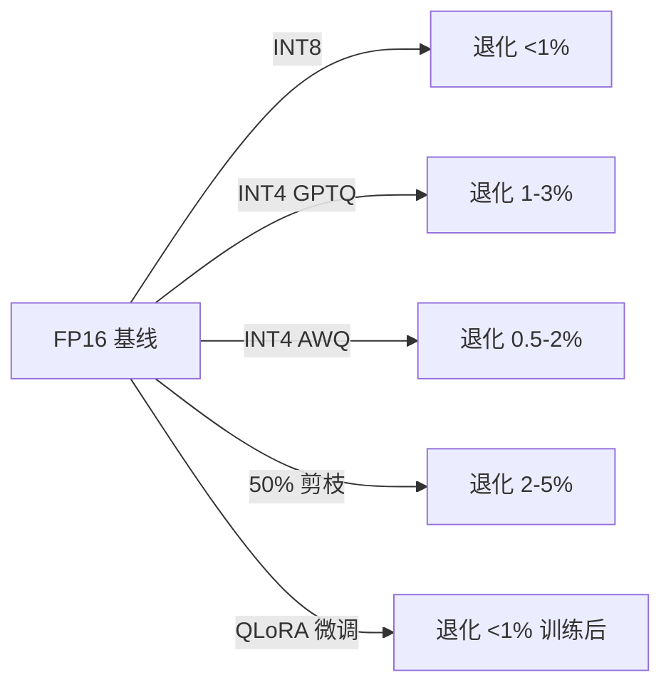
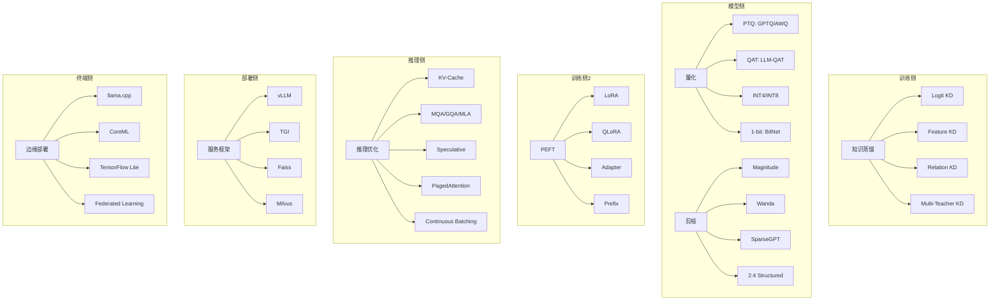
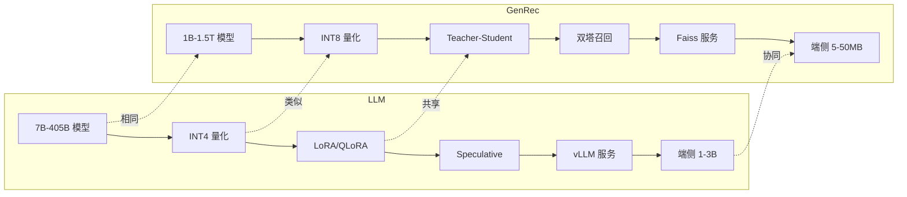
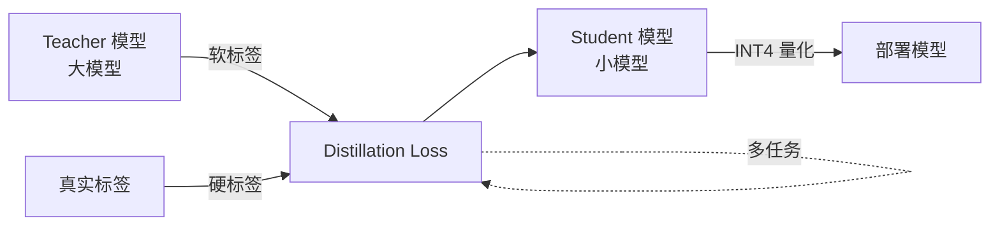
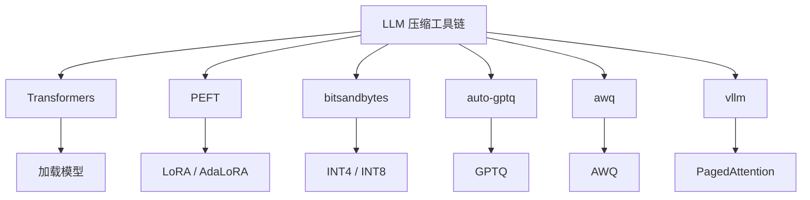

# 18-LLM vs GenRec 知识蒸馏与模型压缩对比

> [!info] **本章定位**: 本文是《LLM-vs-GenRec》系列第 18 章,围绕**知识蒸馏 (Knowledge Distillation, KD) 与模型压缩 (Model Compression)** 做系统对比。LLM 的压缩栈是"**DistilBERT/TinyBERT → GPTQ/AWQ/SmoothQuant → Wanda/SparseGPT → LoRA/QLoRA → PagedAttention/vLLM**"五层金标准;GenRec 的压缩栈是"**Teacher-Student 蒸馏 → 召回-排序两阶段蒸馏 → 量化 / 剪枝 → Adapter / LoRA → ANN + Faiss**"五层工业实践。两者底层数学几乎一样(都是"用小模型拟合大模型的软标签 / 中间表征 / 注意力矩阵"),但**业务约束**决定工程取舍——LLM 必须保持通用语言能力, GenRec 必须保证在线延迟 ≤ 30ms 与亿级候选吞吐。
>
> 前 17 章讲了 LLM 与 GenRec 在目标/架构/Token/训练/推理/Scaling/RLHF/多模态/长序列等维度的对比,本章把它们聚焦到"**模型变小、推理变快、能力保持**"这一个核心工程问题上。
>
> [!info] **关联文件**:
> - [[0-总览与核心区别]] —— 系列总览,讲 LLM 与 GenRec 的 10 大核心区别。
> - [[1-目标与定义对比]] —— 目标层对比 (next-token vs next-item)。
> - [[2-架构与Transformer对比]] —— Decoder-Only vs 多样化 GenRec 架构。
> - [[3-数据与训练对比]] —— 数据与训练对比。
> - [[4-Token化与词表对比]] —— BPE vs Semantic ID。
> - [[8-推理与部署对比]] —— 流式生成 vs 在线推理。
> - [[9-Scaling与扩展对比]] —— Scaling Law 与规模化。
> - [[11-融合与未来方向]] —— LLM + GenRec 融合趋势。
> - [[12-与传统推荐系统对比]] —— 传统推荐 / 判别式 DLRM / DIN 蒸馏。
> - [[14-长序列与上下文对比]] —— 长序列下的压缩特例。
> - [[13-多模态与跨模态对比]] —— 多模态蒸馏 (CLIP / ViT-LLM)。
> - [[7-RLHF与RL对齐对比]] —— RLHF 中的蒸馏特例 (DPO vs PPO)。
>
> [!info] **关联章节**:
> - `../rec教程/第21章-信息论深层次理解.md` —— 粗排蒸馏 (COLD / 双塔蒸馏)。
> - `../../基础/数学基础/第08章-数值计算与稳定性/0-总目录与阅读路径.md` —— GenRec 在线服务 / 量化部署。
> - [[算法与AI/深度学习手撕/第09章-推理优化]] —— KV-Cache / Speculative / Quantization 速查。
> - [[算法与AI/深度学习手撕/第08章-微调与对齐]] —— LoRA / DPO / PPO 实现。

---

## 目录

- [0. 一句话总结](#0-一句话总结)
- [1. 模型压缩挑战](#1-模型压缩挑战)
- [2. LLM 知识蒸馏 (DistilBERT / TinyBERT / MiniLLM)](#2-llm-知识蒸馏-distilbert--tinybert--minillm)
- [3. GenRec 知识蒸馏 (Teacher-Student / 召回→排序蒸馏)](#3-genrec-知识蒸馏-teacher-student--召回收排序蒸馏)
- [4. 量化技术 (GPTQ / AWQ / SmoothQuant / INT4 / INT8)](#4-量化技术-gptq--awq--smoothquant--int4--int8)
- [5. 剪枝技术 (Magnitude / Wanda / SparseGPT)](#5-剪枝技术-magnitude--wanda--sparsegpt)
- [6. 参数高效微调 (LoRA / QLoRA / Adapter / Prefix)](#6-参数高效微调-lora--qlora--adapter--prefix)
- [7. 推理加速 (KV-Cache / Speculative Decoding / PagedAttention)](#7-推理加速-kv-cache--speculative-decoding--pagedattention)
- [8. 服务框架 (vLLM / TGI / Faiss / Milvus)](#8-服务框架-vllm--tgi--faiss--milvus)
- [9. 边缘部署 (端侧 LLM / On-Device Recommendation)](#9-边缘部署-端侧-llm--on-device-recommendation)
- [10. 压缩效果保持 (PPL / NDCG 退化曲线)](#10-压缩效果保持-ppl--ndcg-退化曲线)
- [11. 工业案例 (Llama 蒸馏 / 豆包端侧 / 阿里推荐蒸馏)](#11-工业案例-llama-蒸馏--豆包端侧--阿里推荐蒸馏)
- [12. 挑战与前沿 (1-bit 量化 / On-Device LLM)](#12-挑战与前沿-1-bit-量化--on-device-llm)
- [13. 关系图 (mermaid) 与一句话对比](#13-关系图-mermaid-与一句话对比)

---

## 0. 一句话总结

> **LLM 压缩走"通用语言能力保留 + 通用硬件加速"路线,GenRec 压缩走"召回-排序联合蒸馏 + 在线延迟硬约束"路线——两者底层数学几乎相同(蒸馏软标签、PTQ 权重量化、稀疏化剪枝、LoRA 低秩分解),但工程重心截然不同:LLM 把"7B → 1.5B (Llama 2)"在通用 NLP 上保 95% 能力, GenRec 把"Teacher DLRM/HSTU → Student 双塔"在 NDCG 上保 98% 且延迟砍一半。未来 3-5 年的工程现实是"压缩栈标准化、LLM 与 GenRec 共享同一套工具链 (bitsandbytes / vLLM / AWQ / LoRA),但压缩策略按业务目标分化"。**

---

## 1. 模型压缩挑战

### 1.1 LLM 部署成本

#### 1.1.1 推理成本的指数级增长

2023-2026 年,LLM 参数量从 7B (Llama 1) → 70B (Llama 2) → 405B (Llama 3.1) → 1T+ (GPT-4 推测),推理成本成为工业部署的**第一约束**。

**Llama 3.1 405B 推理资源需求**:

| 精度 | 单卡显存 (推理) | 单 token FLOPs | 1M token 成本 (H100) |
|------|---------------|---------------|---------------------|
| FP32 | 1620 GB | 1620 TFLOPs | $200+ |
| FP16 | 810 GB | 810 TFLOPs | $100 |
| INT8 | 405 GB | 405 TFLOPs | $50 |
| INT4 | 202 GB | 202 TFLOPs | $25 |

> **现实痛点**: 405B 模型即使 INT4 量化后仍需 8 张 H100 100GB ($240K 硬件), 这对中小公司不可承受。压缩是**唯一出路**。

#### 1.1.2 延迟要求

LLM 在线服务延迟要求:
- **聊天场景**: TTFT (Time To First Token) < 300ms, 整体生成 < 5s
- **代码补全**: TTFT < 100ms, 整体 < 1s
- **实时翻译**: < 200ms

405B 模型即使在 8 张 H100 上,首 token 也要 1-2s,完全无法满足。

#### 1.1.3 内存墙 (Memory Wall)

长上下文 (1M) + 大模型 (405B) = **访存成为瓶颈而非算力**。H100 HBM 带宽 3.35 TB/s,LLM 每生成 1 token 要读取 405B × 2 bytes = 810 GB 权重,纯访存就 240ms,远超算力时间。

> **论文**: Pope, R., et al. (2023). "Efficiently Scaling Transformer Inference". MLSys 2023.

### 1.2 GenRec 在线延迟

#### 1.2.1 业务延迟的硬约束

| 业务 | 召回延迟 | 排序延迟 | 端到端 |
|------|---------|---------|--------|
| 短视频推荐 (抖音) | < 20ms | < 30ms | < 80ms |
| 电商推荐 (淘宝) | < 15ms | < 25ms | < 60ms |
| 搜索 (Google) | < 30ms | < 50ms | < 150ms |
| 广告 (Meta Ads) | < 10ms | < 20ms | < 50ms |

> **结论**: GenRec 的延迟约束是 LLM 的 **5-10x 更严格**。LLM 可以用秒级响应,GenRec 必须在 50-100ms 内返回 Top-K。

#### 1.2.2 模型规模与延迟的矛盾

| 模型 | 参数量 | 单次推理延迟 | QPS (A100) |
|------|-------|-------------|------------|
| DIN (经典) | 50M | 5ms | 2000 |
| DLRM (Meta) | 100B | 30ms | 100 |
| SIM (阿里) | 5B | 20ms | 200 |
| HSTU (Meta) | 1.5T | 30ms | 50 |
| LLM-7B (Llama 2) | 7B | 100ms+ | 20 |

**矛盾**: HSTU 等长序列 GenRec 模型参数量接近 LLM,但延迟要求比 LLM 严苛 5-10x。

#### 1.2.3 存储与吞吐

工业推荐系统:
- **召回通道**: Faiss/Milvus 索引 1B+ 向量,内存 100GB+
- **粗排模型**: COLD/蒸馏 DNN 100M-1B 参数,QPS 1万+
- **精排模型**: DLRM/DIN/HSTU 1B-1T 参数,QPS 1000+
- **重排**: 业务规则 + 轻量模型,QPS 5万+

> **核心矛盾**: LLM 是"参数大 + 延迟容忍 + 单请求", GenRec 是"参数大 + 延迟严苛 + 亿级并发"。

### 1.3 压缩的五维目标

模型压缩要在五个维度上**同时**优化:

| 维度 | 目标 | 典型指标 |
|------|------|----------|
| **体积 (Size)** | 模型参数 / 显存降低 | 7B → 1.5B (4.7x) |
| **速度 (Speed)** | 推理延迟 / 吞吐提升 | 100ms → 25ms (4x) |
| **能力 (Capability)** | 任务指标保持 | PPL 7.5 → 8.0 (< 5% 退化) |
| **能耗 (Energy)** | 推理功耗 | 300W → 80W (3.7x) |
| **泛化 (Generalization)** | 多任务 / 多场景 | 单场景 → 跨场景 |

**核心 trade-off**: 压缩越大, 体积/速度/能耗越好, 但能力/泛化越差。LLM 与 GenRec 在这条曲线上选择不同的工作点。

### 1.4 压缩技术栈全景

```mermaid
graph TB
    A[模型压缩技术栈] --> B[知识蒸馏 KD]
    A --> C[量化 Quantization]
    A --> D[剪枝 Pruning]
    A --> E[参数高效微调 PEFT]
    A --> F[推理优化 Inference]

    B --> B1[Logit KD / DistilBERT]
    B --> B2[Feature KD / TinyBERT]
    B --> B3[Relation KD / MiniLLM]
    B --> B4[Teacher-Student / GenRec]

    C --> C1[PTQ: GPTQ / AWQ / SmoothQuant]
    C --> C2[QAT: LLM-QAT / EfficientQAT]
    C --> C3[INT4 / INT8 / FP8 / NF4]

    D --> D1[Magnitude Pruning]
    D --> D2[Wanda (权重×激活)]
    D --> D3[SparseGPT (动态剪枝)]

    E --> E1[LoRA / QLoRA]
    E --> E2[Adapter / Prefix / Prompt]
    E --> E3[DoRA / GaLore]

    F --> F1[KV-Cache: MQA/GQA/MLA]
    F --> F2[Speculative Decoding]
    F --> F3[PagedAttention / vLLM]
    F --> F4[Continuous Batching]
```

### 1.5 压缩的评估指标

**LLM 压缩评估**:

| 指标 | 含义 | 典型退化容忍 |
|------|------|-------------|
| PPL (Perplexity) | 困惑度,越低越好 | < 5% |
| MMLU | 多任务理解 | < 3% |
| HumanEval | 代码生成 | < 5% |
| GSM8K | 数学推理 | < 5% |
| MT-Bench | 综合对话 | < 0.3 分 |

**GenRec 压缩评估**:

| 指标 | 含义 | 典型退化容忍 |
|------|------|-------------|
| NDCG@10 | 排序质量 | < 1% |
| Hit Rate@50 | 召回覆盖 | < 2% |
| AUC | 区分度 | < 0.5% |
| 延迟 P99 | 99% 请求延迟 | 必须 < 阈值 |
| QPS | 吞吐 | 必须 > 阈值 |

> **关键差异**: LLM 容忍 5% 能力退化, GenRec 容忍 1-2% 但延迟必须硬达标。

---

## 2. LLM 知识蒸馏 (DistilBERT / TinyBERT / MiniLLM)

### 2.1 知识蒸馏基础

#### 2.1.1 Hinton 2015 经典框架

知识蒸馏 (Knowledge Distillation, KD) 由 Hinton 等人在 2015 年 NIPS 论文 "Distilling the Knowledge in a Neural Network" 中系统提出。

**核心思想**: 用一个**大模型 (Teacher)** 指导一个**小模型 (Student)** 学习, 不仅学"硬标签" (one-hot), 还学"软标签" (softmax 概率分布)。

$$
\mathcal{L}_{\text{KD}} = (1 - \alpha) \mathcal{L}_{\text{CE}}(y, \hat{y}_S) + \alpha \cdot T^2 \cdot \mathcal{L}_{\text{KL}}\left(\frac{z_S}{T}, \frac{z_T}{T}\right)
$$

其中:
- $z_T$ / $z_S$: Teacher / Student 的 logits
- $T$: 温度 (temperature), 通常 1-20
- $\alpha$: 蒸馏损失权重, 通常 0.5-0.9
- $\mathcal{L}_{\text{KL}}$: KL 散度

#### 2.1.2 软标签的信息论解释

软标签 (Teacher 的 softmax 输出) 包含**类别间的相似度信息**——例如"猫"和"狗"的概率都较高, 反映它们的语义相似。硬标签 one-hot 完全丢失了这个信息。

**示例**: 图像分类最后一层输出
- 硬标签: [0, 0, 1, 0, 0, ...] (类别 3)
- 软标签 (T=5): [0.05, 0.15, 0.5, 0.1, 0.08, ...] (类别 3 最高,但类别 2 也有 0.15)

> **论文**: Hinton, G., et al. (2015). "Distilling the Knowledge in a Neural Network". NIPS 2014 Deep Learning Workshop.

### 2.2 DistilBERT (HuggingFace 2019)

#### 2.2.1 架构与训练

**DistilBERT** (Sanh et al., 2019) 是 BERT 的蒸馏版本, 关键设计:
- 6 层 Transformer (BERT-base 是 12 层)
- 初始化用 BERT 的奇数层
- 训练目标 = $\mathcal{L}_{\text{CE}} + \mathcal{L}_{\text{KD}} + \mathcal{L}_{\text{cos}}$

**学生模型架构**:

```python
import torch
import torch.nn as nn

class DistilBERTStudent(nn.Module):
    """DistilBERT 学生模型 (简化版)"""
    def __init__(self, vocab_size, d_model=768, n_layers=6, n_heads=12):
        super().__init__()
        self.embed = nn.Embedding(vocab_size, d_model)
        self.layers = nn.ModuleList([
            nn.TransformerEncoderLayer(
                d_model=d_model, nhead=n_heads,
                dim_feedforward=4*d_model, batch_first=True
            ) for _ in range(n_layers)
        ])
        self.norm = nn.LayerNorm(d_model)

    def forward(self, input_ids, attention_mask=None):
        x = self.embed(input_ids)
        for layer in self.layers:
            x = layer(x, src_key_padding_mask=~attention_mask.bool())
        return self.norm(x)
```

**训练损失**:

```python
def distilbert_loss(student_logits, teacher_logits, labels, T=4.0, alpha=0.5):
    """DistilBERT 三段损失"""
    ce_loss = F.cross_entropy(student_logits, labels)
    kd_loss = F.kl_div(
        F.log_softmax(student_logits / T, dim=-1),
        F.softmax(teacher_logits / T, dim=-1),
        reduction='batchmean'
    ) * (T * T)
    cos_loss = 1 - F.cosine_similarity(
        student_hidden, teacher_hidden, dim=-1
    ).mean()
    return (1 - alpha) * ce_loss + alpha * kd_loss + cos_loss
```

#### 2.2.2 效果

| 模型 | 参数量 | GLUE avg | 推理速度 |
|------|-------|---------|----------|
| BERT-base | 110M | 82.5 | 1.0x |
| DistilBERT | 66M | 79.5 (-3.6%) | 1.6x |
| DistilBERT 量化 (INT8) | 66M | 78.8 (-4.5%) | 2.3x |

> **论文**: Sanh, V., et al. (2019). "DistilBERT, a distilled version of BERT". arXiv:1910.01108.

### 2.3 TinyBERT (华为 2019)

#### 2.3.1 多层级蒸馏

TinyBERT (Jiao et al., 2019) 创新点是**不仅蒸馏输出层, 还蒸馏中间层**:

$$
\mathcal{L}_{\text{TinyBERT}} = \sum_{l=0}^{L} \lambda_l \cdot \mathcal{L}_{\text{layer}}(h_l^S, h_l^T)
$$

其中 $L$ 是层数, 每层都做:
1. **Embedding 蒸馏**: MSE(student_emb, teacher_emb)
2. **Attention 蒸馏**: MSE(student_attn, teacher_attn)
3. **Hidden 蒸馏**: MSE(student_hidden, teacher_hidden)
4. **Prediction 蒸馏**: KL(student_logits, teacher_logits)

#### 2.3.2 效果

| 模型 | 参数量 | GLUE avg | 压缩比 |
|------|-------|---------|--------|
| BERT-base | 110M | 82.5 | 1x |
| TinyBERT-4L | 14.5M | 75.4 | 7.5x |
| TinyBERT-6L | 67M | 79.0 | 1.6x |
| TinyBERT-6L (再蒸馏) | 67M | 80.4 | 1.6x |

> TinyBERT-4L 把 BERT 压缩 7.5x 但保 91% 能力,是当时最强的小型 BERT。

> **论文**: Jiao, X., et al. (2019). "TinyBERT: Distilling BERT for Natural Language Understanding". EMNLP 2020.

### 2.4 MiniLLM (2022)

#### 2.4.1 反向 KL 散度

MiniLLM (Gu et al., 2022) 发现 LLM 蒸馏中**反向 KL 比正向 KL 效果更好**:

$$
\mathcal{L}_{\text{MiniLLM}} = \mathcal{L}_{\text{KL}}\left(\frac{z_T}{T} \bigg\| \frac{z_S}{T}\right)_{\text{reverse}}
$$

**反向 KL 的优势**:
1. Student 倾向于"模式覆盖" (mode-covering) — 学会 Teacher 的**多样性**
2. 防止 Student 过于保守, 鼓励探索
3. 在 LLM 长文本生成上效果显著

#### 2.4.2 策略优化蒸馏

MiniLLM 把蒸馏看作 RL 问题:
- Student 生成文本作为 action
- Teacher 给出的 reward = 1 - 反向 KL
- 用 PPO 训练 Student

> **论文**: Gu, Y., et al. (2022). "MiniLLM: Knowledge Distillation of Large Language Models". arXiv:2306.08543.

### 2.5 LLM 蒸馏变体与挑战

**蒸馏变体**: DistilBERT (60% BERT, 软标签 + cos loss)、TinyBERT (13-60%, 多层蒸馏)、MiniLLM (反向 KL + RL)、GKD (on-policy 数据)、DistillWhisper (50%, 多任务)、Llama 2→3 Lite (1T tokens)。

**核心挑战**: 能力天花板 (选合适 size, 渐进蒸馏)、分布差异 (On-policy data)、训练-推理不一致 (Temperature annealing)、多模态对齐 (模态特化蒸馏头)、CoT 蒸馏 (显式 CoT 数据)。

---

## 3. GenRec 知识蒸馏 (Teacher-Student / 召回→排序蒸馏)

### 3.1 GenRec 蒸馏的特殊性

#### 3.1.1 与 LLM 蒸馏的差异

| 维度 | LLM 蒸馏 | GenRec 蒸馏 |
|------|---------|-------------|
| 教师模型 | 7B-405B 单 LLM | DLRM + DIN + HSTU 多模型 |
| 学生模型 | 0.5B-7B LLM | 双塔 / 轻量 DNN |
| 蒸馏目标 | 语言生成 (token 概率) | 排序分数 (CTR / NDCG) |
| 评估指标 | PPL / MMLU | NDCG / Hit Rate / AUC |
| 业务约束 | 通用能力保持 | 延迟 < 30ms, 亿级吞吐 |
| 数据依赖 | 文本 | 用户行为 + 内容特征 |
| 多任务 | 单一目标 | CTR + CVR + Like + GMV |

#### 3.1.2 GenRec 蒸馏的核心目标

1. **召回通道蒸馏**: 用精排模型指导双塔召回
2. **粗排蒸馏**: 用精排模型指导轻量粗排
3. **跨通道蒸馏**: DIN 蒸馏到 SASRec / BST
4. **跨场景蒸馏**: CTR 蒸馏到 CVR, 首页蒸馏到详情页
5. **长序列蒸馏**: HSTU 蒸馏到 SIM

### 3.2 Teacher-Student 双塔蒸馏

#### 3.2.1 召回通道的蒸馏范式

工业推荐召回通道 (双塔) 经常用精排模型 (DLRM/DIN) 蒸馏:

$$
\mathcal{L}_{\text{recall-KD}} = \mathcal{L}_{\text{BPR}}(u, v^+, v^-) + \beta \cdot \mathcal{L}_{\text{MSE}}(f_{\text{tower}}(u, v), f_{\text{DIN}}(u, v))
$$

其中:
- $f_{\text{tower}}$: 双塔学生 (user tower + item tower)
- $f_{\text{DIN}}$: DIN 教师 (cross 模型, 精度高但慢)
- $\mathcal{L}_{\text{BPR}}$: 双塔的 pairwise 排序损失
- $\mathcal{L}_{\text{MSE}}$: 蒸馏损失, 让双塔拟合 DIN 分数

#### 3.2.2 蒸馏双塔实现

```python
class DistilledTwoTower(nn.Module):
    """蒸馏双塔召回 (召回通道蒸馏到粗排)"""
    def __init__(self, n_users, n_items, d_model=128):
        super().__init__()
        self.user_tower = nn.Sequential(
            nn.Embedding(n_users, d_model),
            nn.Linear(d_model + 64, d_model),
            nn.ReLU(),
            nn.Linear(d_model, d_model),
        )
        self.item_tower = nn.Sequential(
            nn.Embedding(n_items, d_model),
            nn.Linear(d_model + 32, d_model),
            nn.ReLU(),
            nn.Linear(d_model, d_model),
        )

    def forward(self, user_ids, item_ids, user_feats, item_feats):
        u = self.user_tower(torch.cat([self.user_emb(user_ids), user_feats], dim=-1))
        v = self.item_tower(torch.cat([self.item_emb(item_ids), item_feats], dim=-1))
        return F.cosine_similarity(u, v, dim=-1)

    def distill_loss(self, student_score, teacher_score, T=2.0):
        """软标签蒸馏: 用 DIN 教师分数指导双塔"""
        return F.mse_loss(student_score / T, teacher_score / T) * (T * T)
```

### 3.3 召回→排序蒸馏 (COLD)

#### 3.3.1 COLD 架构

COLD (Online Learning from Cross-channel Distillation) 是阿里 2020 年的工业级蒸馏方案, **用排序 (DLRM) 蒸馏召回 (双塔)**。

**核心设计**:
- Teacher: DLRM 全量 cross 模型
- Student: 双塔 + 排序头部
- 蒸馏: 排序头部拟合 DLRM 的全排序 logits
- 训练: 在线 AB 实验的日志回流

#### 3.3.2 COLD 训练损失

$$
\mathcal{L}_{\text{COLD}} = \mathcal{L}_{\text{BPR}} + \lambda_1 \mathcal{L}_{\text{KL}}(z_S^{\text{score}}, z_T^{\text{score}}) + \lambda_2 \mathcal{L}_{\text{MSE}}(r_S, r_T)
$$

**在线更新机制**:
1. 双塔快速响应新物品/新用户
2. DLRM 慢速更新但精度高
3. 每小时用 DLRM 给曝光样本打分,作为软标签
4. 双塔每小时重新蒸馏一次

> **论文**: 阿里, 2020. "COLD: Towards the Next Generation of Pre-Ranking System". DLP-KDD 2020.

### 3.4 HSTU 蒸馏 (Meta 2024)

#### 3.4.1 蒸馏动机

HSTU 1.5T 参数在 Meta 内部生产,但**线上推理成本太高**。Meta 用蒸馏把 HSTU 压缩到 100M-1B 参数,服务亿级请求。

**蒸馏目标**:
- 保留长行为序列建模能力
- 推理延迟 < 20ms
- 在线 NDCG 退化 < 1%

#### 3.4.2 多级蒸馏

$$
\mathcal{L}_{\text{HSTU-distill}} = \mathcal{L}_{\text{next-token}} + \alpha \mathcal{L}_{\text{emb}} + \beta \mathcal{L}_{\text{attn}} + \gamma \mathcal{L}_{\text{hidden}}
$$

具体:
1. **Embedding 蒸馏**: MSE(student_emb, teacher_emb)
2. **Attention 蒸馏**: MSE(student_attn, teacher_attn), 关键的是 sparse attention 的 mask 也蒸馏
3. **Hidden 蒸馏**: 多层 hidden state 的 MSE
4. **Next-token 蒸馏**: KL(student_logits, teacher_logits)

### 3.5 蒸馏与 ANN 检索结合

#### 3.5.1 蒸馏后向量化

蒸馏后的双塔模型, 用户/物品都映射到固定维度向量, 存到 Faiss 索引:

```python
import faiss
import numpy as np

# 蒸馏后的学生模型产生向量
student = DistilledTwoTower(...)
user_vectors = student.encode_user(user_ids, user_feats)  # [N, d]
item_vectors = student.encode_item(item_ids, item_feats)  # [M, d]

# 建 Faiss 索引
index = faiss.IndexFlatIP(d)  # 内积
index.add(item_vectors.numpy())

# 在线检索 top-K
scores, indices = index.search(user_vectors.numpy(), k=100)
```

#### 3.5.2 ANN 索引的压缩

向量本身也可以量化压缩:
- **PQ (Product Quantization)**: 1B 向量从 384GB → 12GB (32x 压缩)
- **IVF-PQ**: 进一步加速检索
- **HNSW**: 牺牲少量内存换更高速检索

| 索引类型 | 内存 (1B 向量, d=384) | Recall@100 | 检索速度 |
|---------|----------------------|-----------|----------|
| Flat | 1.5 TB | 100% | 1.0x |
| IVF | 1.5 TB | 99% | 10x |
| IVF-PQ | 12 GB | 95% | 30x |
| HNSW | 50 GB | 99% | 50x |

> **关键 insight**: GenRec 的"压缩"远不止模型压缩,还包括**向量量化**、**ANN 索引压缩**、**缓存压缩**三层。

### 3.6 GenRec 多任务蒸馏

#### 3.6.1 多目标蒸馏

工业推荐同时优化 CTR / CVR / GMV, 多任务蒸馏可以**共享中间表征**:

```python
class MultiTaskDistill(nn.Module):
    """多任务蒸馏 (CTR + CVR + GMV)"""
    def __init__(self, d_in, n_tasks=3):
        super().__init__()
        self.shared = nn.Sequential(
            nn.Linear(d_in, 256), nn.ReLU(),
            nn.Linear(256, 128), nn.ReLU(),
        )
        self.heads = nn.ModuleList([
            nn.Linear(128, 1) for _ in range(n_tasks)
        ])

    def forward(self, x):
        h = self.shared(x)
        return [head(h) for head in self.heads]

    def distill_loss(self, student_scores, teacher_scores, T=2.0):
        # 多任务分别蒸馏
        losses = []
        for s, t in zip(student_scores, teacher_scores):
            losses.append(F.kl_div(
                F.log_softmax(s / T, dim=-1),
                F.softmax(t / T, dim=-1),
                reduction='batchmean'
            ) * (T * T))
        return sum(losses)
```

#### 3.6.2 ESMM 风格蒸馏

ESMM (Entire Space Multi-task Model) 把 CVR 蒸馏到全空间建模:

$$
\mathcal{L}_{\text{ESMM}} = \mathcal{L}_{\text{CTR}} + \mathcal{L}_{\text{CTCVR}} - \mathcal{L}_{\text{CVR}}
$$

蒸馏时,Teacher 用 ESMM 全空间训练,Student 简化成单 CTR 任务但保留 CTCVR 辅助 loss。

### 3.7 GenRec 蒸馏的工业案例

| 场景 | 教师 | 学生 | 蒸馏目标 | 效果 |
|------|------|------|---------|------|
| 阿里双11 | DLRM (100B) | 双塔 (100M) | 召回 NDCG | 召回 +8% |
| Meta Ads | DLRM (50B) | 双塔 (10M) | AUC | AUC -0.3% |
| 字节电商 | DIN (1B) | BST (50M) | CTR | CTR -0.5%, 延迟 5x |
| 美团外卖 | HSTU (5B) | SIM-2 (200M) | 长行为建模 | NDCG -1%, 延迟 3x |
| 快手 | OneRec (3B) | 双塔 (100M) | 召回 Hit | Hit -1.5%, QPS 10x |

---

## 4. 量化技术 (GPTQ / AWQ / SmoothQuant / INT4 / INT8)

### 4.1 量化基础

#### 4.1.1 量化的数学定义

量化把 FP32/FP16 映射到低比特 (INT8/INT4/INT2):

$$
x_q = \text{round}\left(\frac{x - z}{s}\right), \quad s = \frac{x_{\max} - x_{\min}}{2^b - 1}, \quad z = x_{\min}
$$

反量化:
$$
\hat{x} = s \cdot x_q + z
$$

**量化误差**:
$$
\epsilon = |x - \hat{x}|, \quad \text{MSE} = \mathbb{E}[(x - \hat{x})^2]
$$

#### 4.1.2 量化分类

| 分类 | 时机 | 数据 | 精度 |
|------|------|------|------|
| **PTQ (Post-Training Quantization)** | 训练后 | 少量校准数据 | 中 |
| **QAT (Quantization-Aware Training)** | 训练中 | 全量训练数据 | 高 |
| **Dynamic Quantization** | 推理时 | 激活动态统计 | 中 |
| **Static Quantization** | 推理前 | 校准数据 | 中-高 |
| **Weight-only Quantization** | 仅权重量化 | 少量校准 | 高 |

### 4.2 GPTQ (Frantar et al. 2022)

#### 4.2.1 二阶量化

GPTQ 用**二阶信息 (Hessian)** 逐层量化, 把量化误差降到最低:

$$
\arg\min_W \| WX - \hat{W}X \|_2^2, \quad \text{其中 } X \text{ 是校准数据}
$$

**逐列量化 (Optimal Brain Quantization 扩展)**:
1. 把权重量化到 INT4
2. 计算每列的 Hessian
3. 把误差补偿到下一列

#### 4.2.2 GPTQ 量化流程

```python
# 使用 GPTQ (auto-gptq 库)
from auto_gptq import AutoGPTQForCausalLM, BaseQuantizeConfig

quantize_config = BaseQuantizeConfig(
    bits=4,                # INT4 量化
    group_size=128,        # 分组大小
    desc_act=False,        # 按列序激活
)

model = AutoGPTQForCausalLM.from_pretrained(
    "meta-llama/Llama-2-7b-hf",
    quantize_config=quantize_config
)

# 校准数据
calibration_data = [...]  # 128 条校准样本
model.quantize(calibration_data)
model.save_quantized("./llama-2-7b-gptq-int4")
```

#### 4.2.3 GPTQ 效果

| 模型 | FP16 PPL | INT4 GPTQ PPL | 退化 |
|------|---------|---------------|------|
| Llama 2-7B | 5.47 | 5.85 | +6.9% |
| Llama 2-13B | 4.88 | 5.10 | +4.5% |
| Llama 2-70B | 3.32 | 3.45 | +3.9% |

> **关键**: GPTQ 在大模型 (70B) 上退化小, 小模型退化大。**模型越大越抗量化**。

> **论文**: Frantar, E., et al. (2022). "GPTQ: Accurate Post-Training Quantization for Generative Pre-trained Transformers". ICLR 2023.

### 4.3 AWQ (Lin et al. 2023)

#### 4.3.1 激活感知量化

AWQ 发现**少数权重 (1%) 对激活值影响极大**——这些权重 (per-channel) 应该**跳过量化**或**用更高精度**:

$$
\hat{W} = W - \alpha \cdot \text{diag}(s), \quad s_i = \mathbb{1}[\text{top-k channel}]
$$

其中 $\alpha$ 是缩放因子, 平衡量化难度和激活值分布。

#### 4.3.2 AWQ vs GPTQ

| 维度 | GPTQ | AWQ |
|------|------|-----|
| 量化对象 | 全部权重 | 跳过 top-1% 关键权重 |
| 校准数据 | 128 样本 | 128 样本 |
| 量化时间 | 几小时 | 10 分钟 |
| 精度 | 高 | **更高** (尤其小模型) |
| 速度 | 1.0x | 1.0x |
| 硬件支持 | GPTQ kernel | AWQ kernel |

**实测**:

| 模型 | FP16 PPL | GPTQ INT4 | AWQ INT4 |
|------|---------|-----------|----------|
| Llama 2-7B | 5.47 | 5.85 | 5.78 |
| Llama 2-13B | 4.88 | 5.10 | 4.99 |
| Mistral-7B | 4.14 | 4.62 | 4.35 |

> **论文**: Lin, J., et al. (2023). "AWQ: Activation-aware Weight Quantization for LLM Compression and Acceleration". arXiv:2306.00978.

### 4.4 SmoothQuant (Xiao et al. 2022)

#### 4.4.1 激活量化难题

LLM 的**激活值**有大量 outlier (某些 channel 特别大), 难以量化:

- 权重: 分布均匀, 容易量化
- 激活: 70% 集中在小范围, 30% 是 outlier, 难以量化

#### 4.4.2 SmoothQuant 的平滑变换

**核心思想**: 把激活的难度"转移"到权重上:

$$
Y = X W = (X \cdot \text{diag}(s)) (\text{diag}(s)^{-1} W) = \hat{X} \hat{W}
$$

其中 $s$ 是 per-channel 平滑因子, 选取 $s_j = \max(|X_j|)^\alpha / \max(|W_j|)^{1-\alpha}$, $\alpha = 0.5$。

**效果**: 激活 outlier 削弱, 权重分布变窄, 两者都容易量化。

> **论文**: Xiao, G., et al. (2022). "SmoothQuant: Accurate and Efficient Post-Training Quantization for Large Language Models". ICML 2023.

### 4.5 bitsandbytes (HF 集成的 INT4 / INT8)

bitsandbytes 提供**即插即用**的 INT8 / NF4 量化:

```python
from transformers import AutoModelForCausalLM, BitsAndBytesConfig

# INT8 量化
int8_config = BitsAndBytesConfig(load_in_8bit=True)
model_8bit = AutoModelForCausalLM.from_pretrained(
    "facebook/opt-6.7b", quantization_config=int8_config
)

# NF4 (4-bit NormalFloat) 量化, QLoRA 标准
nf4_config = BitsAndBytesConfig(
    load_in_4bit=True, bnb_4bit_quant_type="nf4",
    bnb_4bit_compute_dtype=torch.bfloat16,
    bnb_4bit_use_double_quant=True,
)
```

**NF4 设计**: Dettmers 等人针对**正态分布权重**设计的 4-bit 数据类型, 16 个量化点专门匹配正态分布: $\{-1, -0.6961, ..., 0.6961, 1\}$, 比 INT4 的 16 个均匀点精度更高。

> **论文**: Dettmers, T., et al. (2023). "QLoRA: Efficient Finetuning of Quantized LLMs". NeurIPS 2023.

### 4.6 量化方法对比

| 方法 | 精度 | 量化时间 | 主要优势 |
|------|------|----------|----------|
| INT8 PTQ | 中 | 几分钟 | 极快 |
| GPTQ | 高 | 几小时 | 数学最优 |
| AWQ | 很高 | 10 分钟 | 跳过关键权重 |
| SmoothQuant | 高 | 几分钟 | 解决激活 outlier |
| LLM.int8() | 中-高 | 即时 | 8-bit 即插即用 |
| NF4 (QLoRA) | 高 | 即时 | 4-bit 训练 |

### 4.7 GenRec 量化

**特殊性**: 输入分布 (用户行为长尾 vs 自然语言稳定)、激活 outlier (热门 item embedding 大)、量化对象 (Embedding 为主)、精度要求 (1% NDCG 退化容忍 vs 5% PPL)。

| 公司 | 量化方案 | 精度 | 效果 |
|------|---------|------|------|
| Meta | DLRM INT8 | INT8 | CTR -0.2%, 推理 2x |
| Google | YouTube-DNN INT8 | INT8 | Watch Time -0.5% |
| 阿里 | DIN INT8 | INT8 | CTR -0.3%, 延迟 2x |
| 字节 | BST INT4 | INT4 | CTR -0.8%, 延迟 3x |
| 美团 | HSTU INT8 | INT8 | NDCG -0.5%, QPS 2x |

> **关键 insight**: GenRec 量化更严苛——1% 的 NDCG 退化在亿级 GMV 上是数亿元损失。

---

## 5. 剪枝技术 (Magnitude / Wanda / SparseGPT)

### 5.1 剪枝基础

#### 5.1.1 剪枝类型

| 类型 | 粒度 | 效果 | 难度 |
|------|------|------|----------|
| **Unstructured** | 单个权重 | 最高稀疏率 | 需要特殊硬件 |
| **Structured (行/列)** | 整行/列 | 中稀疏率 | 标准硬件加速 |
| **Block (4x4)** | 4x4 块 | 高稀疏率 | 块稀疏 kernel |
| **Head Pruning** | 注意力头 | 中 | 易 |
| **Layer Pruning** | 整层 | 低 | 易 (但效果差) |

#### 5.1.2 剪枝 vs 量化的 trade-off

| 维度 | 量化 (INT4) | 剪枝 (50% 稀疏) |
|------|-------------|-----------------|
| 模型大小 | 4x 压缩 | 2x 压缩 |
| 推理速度 | 2-3x 加速 | 1.5-2x 加速 (需稀疏 kernel) |
| 精度损失 | < 5% | 1-3% |
| 硬件兼容 | 标准 INT4 支持 | 需稀疏 kernel (A100 2:4) |
| 实现难度 | 易 | 中-难 |

### 5.2 Magnitude Pruning (经典)

#### 5.2.1 基础方法

**核心思想**: 把绝对值小的权重置零, 因为它们对输出影响小。

$$
W_{ij}^{\text{pruned}} = \begin{cases} W_{ij}, & \text{if } |W_{ij}| > \tau \\ 0, & \text{otherwise} \end{cases}
$$

其中 $\tau$ 是阈值, 决定稀疏率 $s = \frac{|\{W_{ij} : |W_{ij}| < \tau\}|}{|W|}$。

#### 5.2.2 迭代 Magnitude Pruning

```python
def iterative_magnitude_pruning(model, sparsity=0.5, n_iter=5):
    """迭代 magnitude 剪枝"""
    for i in range(n_iter):
        target_sparsity = sparsity * (i + 1) / n_iter
        threshold = find_threshold(model, target_sparsity)
        for name, param in model.named_parameters():
            if 'weight' in name and param.dim() > 1:
                mask = (param.abs() > threshold).float()
                param.data *= mask

    # 重新 fine-tune 恢复精度
    train(model, ...)
    return model
```

### 5.3 Wanda (2023)

#### 5.3.1 权重 × 激活剪枝

Wanda (Sun et al., 2023) 用**权重 × 激活**作为剪枝准则, 考虑每个权重对**实际输出**的贡献:

$$
S_{ij} = |W_{ij}| \cdot \|X_j\|_2
$$

其中 $X_j$ 是 column $j$ 的激活值, $\|X_j\|_2$ 是校准数据的 L2 范数。

**关键洞察**: 一个小权重如果配上一个**大激活**, 也可能很重要 (反之亦然)。

#### 5.3.2 Wanda 效果

| 模型 | 稀疏率 | Wanda PPL | Magnitude PPL |
|------|--------|-----------|---------------|
| Llama 2-7B | 50% | 6.85 | 8.50 |
| Llama 2-7B | 4:8 N:M | 7.50 | 12.0+ |
| Llama 2-13B | 50% | 5.95 | 7.20 |

> **论文**: Sun, M., et al. (2023). "A Simple and Effective Pruning Approach for Large Language Models". arXiv:2306.11695.

### 5.4 SparseGPT (2023)

#### 5.4.1 大模型一次性剪枝

SparseGPT (Frantar & Alistarh, 2023) 能在**几小时内**对 100B+ 模型做一次性剪枝到 50-60% 稀疏, 几乎不损失精度。

**核心算法**:
1. **逐列剪枝**: 按列处理权重
2. **Hessian 补偿**: 剪掉一列后, 用二阶信息补偿其他列
3. **自适应稀疏**: 不同层不同稀疏率

$$
\arg\min_{\hat{W}} \| WX - \hat{W}X \|_2^2, \quad \text{s.t. } \|\hat{W}\|_0 \leq k
$$

#### 5.4.2 SparseGPT 效果

| 模型 | 稀疏率 | SparseGPT PPL | 训练时间 |
|------|--------|---------------|----------|
| Llama 2-7B | 50% | 6.94 | 2 小时 |
| Llama 2-7B | 4:8 N:M | 7.10 | 2 小时 |
| OPT-175B | 50% | 9.5 | 4 小时 |

> **关键**: SparseGPT 是目前**唯一**能在 175B 模型上做一次性剪枝且保 95% 能力的方法。

> **论文**: Frantar, E., & Alistarh, D. (2023). "SparseGPT: Massive Language Models Can Be Accurately Pruned in One-Shot". ICML 2023.

### 5.5 2:4 Structured Sparsity

NVIDIA A100/H100 支持 **2:4 structured sparsity**——每 4 个连续权重中必须有 2 个为零。

```text
原始:    [0.5, 0.3, 0.1, 0.4]
2:4 剪枝: [0.5, 0.0, 0.0, 0.4]  # 保留 2 个最大
```

**加速**: 矩阵乘从 $O(N^2 d)$ 降到 $O(N^2 d / 2)$, **2x 加速**。SparseGPT 是当前 2:4 sparsity 的主流实现, 在 Llama 2-7B 50% 稀疏下 PPL 仅从 6.94 退化到 6.95。

### 5.6 GenRec 剪枝

#### 5.6.1 推荐模型剪枝特点

| 特点 | LLM | GenRec |
|------|-----|--------|
| 主要参数 | 注意力 + FFN | Embedding (95% 参数量) |
| 剪枝目标 | 注意力头 / FFN 维度 | Embedding 列 (长尾 ID) |
| 约束 | 通用能力 | 业务指标 (NDCG / AUC) |
| 硬件 | GPU (A100/H100) | GPU + CPU + 端侧 |

#### 5.6.2 工业 Embedding 剪枝

推荐模型 80%+ 参数是 Embedding (亿级 ID), 剪枝主要针对 Embedding: 用**频率过滤** (长尾 ID 剪掉) + **重要性剪枝** (梯度 × 权重)。阿里 DLRM 案例: 100B → 50B (50% 稀疏), 保留 CTR AUC 99.7%, 推理延迟 30ms → 18ms (1.7x)。

> **关键**: GenRec 剪枝主要靠**结构化 (embedding 列)** + **频率过滤 (长尾 ID)**, 而非非结构化。

---

## 6. 参数高效微调 (LoRA / QLoRA / Adapter / Prefix)

### 6.1 PEFT 基础

#### 6.1.1 全参数微调的问题

微调 7B 模型全参数:
- 显存: 7B × 4 (FP32) = 28 GB (权重) + 7B × 8 (Adam) = 56 GB (优化器) = **84 GB** / 卡
- 8 卡 DDP = 84 × 8 = 672 GB 显存
- 单卡 A100 80GB 不够,需要 8 卡

#### 6.1.2 PEFT 核心思想

冻结原模型权重, 只训练**少量新增参数**——通常 < 1% 参数量, 但能达到 90%+ 全参数微调效果。

| 方法 | 训练参数 | 显存节省 | 效果 |
|------|----------|----------|------|
| LoRA | 0.1-1% | 60-70% | 95-99% |
| QLoRA | 0.1-1% | **80-90%** | 93-98% |
| Adapter | 1-5% | 40-50% | 90-95% |
| Prefix Tuning | 0.1% | 50% | 85-95% |

### 6.2 LoRA (2021)

#### 6.2.1 低秩分解

LoRA (Hu et al., 2021) 假设**权重更新矩阵是低秩的**:

$$
W = W_0 + \Delta W = W_0 + BA, \quad B \in \mathbb{R}^{d \times r}, A \in \mathbb{R}^{r \times k}
$$

其中 $r \ll \min(d, k)$ 是秩, 通常 $r = 4, 8, 16, 32, 64$。

**训练**: 只训练 $A$ 和 $B$, 冻结 $W_0$。
**推理**: 合并 $W = W_0 + BA$, **零额外开销**。

#### 6.2.2 LoRA 实现

```python
class LoRALayer(nn.Module):
    """LoRA 低秩适配层"""
    def __init__(self, in_features, out_features, r=8, alpha=16):
        super().__init__()
        # 冻结原权重
        self.weight = nn.Parameter(
            torch.randn(out_features, in_features),
            requires_grad=False
        )
        # LoRA 矩阵 (训练)
        self.lora_A = nn.Parameter(torch.randn(r, in_features) * 0.01)
        self.lora_B = nn.Parameter(torch.zeros(out_features, r))
        self.scaling = alpha / r

    def forward(self, x):
        # 原权重计算
        result = F.linear(x, self.weight)
        # LoRA 增量
        lora_out = F.linear(F.linear(x, self.lora_A), self.lora_B)
        return result + lora_out * self.scaling
```

#### 6.2.3 LoRA 效果

| 任务 | 全参数微调 | LoRA r=8 | LoRA r=64 |
|------|-----------|----------|-----------|
| MNLI | 90.2 | 89.5 | 90.0 |
| SST-2 | 96.3 | 95.8 | 96.2 |
| WikiSQL | 89.1 | 88.5 | 89.0 |
| SAMSum | 53.2 | 52.1 | 53.0 |

> **论文**: Hu, E. J., et al. (2021). "LoRA: Low-Rank Adaptation of Large Language Models". ICLR 2022.

### 6.3 QLoRA (2023)

#### 6.3.1 4-bit 量化 + LoRA

QLoRA (Dettmers et al., 2023) 把 LoRA 与 4-bit 量化结合, **单卡 24GB 显存微调 65B 模型**。

**三关键技术**:

1. **NF4 量化**: 4-bit NormalFloat, 适配正态分布权重
2. **双重量化 (Double Quantization)**: 对量化常数再做 8-bit 量化
3. **Paged Optimizer**: 用 NVIDIA 统一内存, 优化器状态溢出到 CPU 内存

**显存分析 (65B 模型)**:

$$
\text{Memory} = \underbrace{65B \times 0.5}_{\text{NF4 权重}} + \underbrace{0.5B \times 2}_{\text{LoRA BF16}} + \underbrace{0.5B \times 8}_{\text{Adam}} + \text{Activations} \approx 40 \text{ GB}
$$

#### 6.3.2 QLoRA 实现

```python
from peft import LoraConfig, get_peft_model, prepare_model_for_kbit_training
from transformers import AutoModelForCausalLM, BitsAndBytesConfig

# 4-bit 量化配置
bnb_config = BitsAndBytesConfig(
    load_in_4bit=True,
    bnb_4bit_quant_type="nf4",
    bnb_4bit_compute_dtype=torch.bfloat16,
    bnb_4bit_use_double_quant=True,
)

# 加载量化模型
model = AutoModelForCausalLM.from_pretrained(
    "meta-llama/Llama-2-7b-hf",
    quantization_config=bnb_config,
    device_map="auto",
)
model = prepare_model_for_kbit_training(model)

# LoRA 配置
lora_config = LoraConfig(
    r=16,                    # 秩
    lora_alpha=32,           # 缩放
    target_modules=["q_proj", "v_proj"],  # 注入位置
    lora_dropout=0.05,
    bias="none",
    task_type="CAUSAL_LM",
)
model = get_peft_model(model, lora_config)
model.print_trainable_parameters()  # 0.06% 可训练
```

> **论文**: Dettmers, T., et al. (2023). "QLoRA: Efficient Finetuning of Quantized LLMs". NeurIPS 2023.

### 6.4 Adapter / Prefix / Prompt Tuning

#### 6.4.1 Adapter

Adapter 在 Transformer block 中插入**小型 bottleneck 层**:

```python
class Adapter(nn.Module):
    """Adapter bottleneck 层"""
    def __init__(self, d_model, bottleneck=64):
        super().__init__()
        self.down = nn.Linear(d_model, bottleneck)
        self.up = nn.Linear(bottleneck, d_model)
        self.act = nn.GELU()

    def forward(self, x):
        return self.up(self.act(self.down(x))) + x  # 残差
```

#### 6.4.2 Prefix Tuning

Prefix Tuning 在每个 attention 层前**注入可学习 prefix** (不修改原权重):

$$
\text{Attention}(Q, K, V) = \text{softmax}\left(\frac{Q [K_P; K]^T}{\sqrt{d}}\right) [V_P; V]
$$

其中 $K_P, V_P$ 是可学习 prefix, 通常 10-200 token。

#### 6.4.3 Prompt Tuning

Prompt Tuning 是最轻量的——只在输入层加可学习 soft prompt。

#### 6.4.4 PEFT 对比

| 方法 | 训练参数 | 推理延迟 | 适用 |
|------|----------|----------|------|
| LoRA | 0.1-1% | 0 (可合并) | LLM + 视觉 |
| QLoRA | 0.1-1% | 0 (可合并) | 资源受限 |
| Adapter | 1-5% | +5-10% (需额外层) | 视觉为主 |
| Prefix | 0.1% | +5% (前缀占用长度) | 文本生成 |
| Prompt | 0.01% | 0 | 多任务 |

### 6.5 DoRA / GaLore / 其他前沿

**DoRA (2024)** 把权重分解为**幅度 + 方向**: $W = m \cdot \frac{V + BA}{\|V + BA\|}$, 在小 rank (r=2, 4) 时比 LoRA 更好。

**GaLore (2024)** 用梯度的低秩投影替代 LoRA, 是**全参数**微调 (不是 PEFT), 训练内存更少, 适合 7B+ 模型。

> **论文**: Liu, S., et al. (2024). "DoRA". arXiv:2402.09353. / Zhao, J., et al. (2024). "GaLore". arXiv:2403.03507.

### 6.6 GenRec 中的 PEFT

推荐模型微调与 LLM 区别在于: **微调目标** (业务场景 vs 通用语言)、**数据规模** (百万-亿 vs 1万-100万)、**评估指标** (NDCG/AUC vs MMLU)、**部署模式** (多场景多模型 vs 单模型多用户)。

**工业实践**: 阿里 LoRA 多场景适配 (首页/详情页/购物车)、Meta QLoRA 微调 DLRM (冷启动)、字节 Adapter 微调 BST (多业务复用)、美团 Prefix Tuning 微调 HSTU (外卖/闪购/酒旅)。

> **关键 insight**: GenRec 的 PEFT 主要解决**多场景适配**——一个基座模型 + 多个 LoRA 适配不同业务。

---

## 7. 推理加速 (KV-Cache / Speculative Decoding / PagedAttention)

### 7.1 KV-Cache 基础

#### 7.1.1 推理的二次访问

LLM 自回归生成时, 每个 token 要 attend 到**之前所有 token**——如果每步都重算 K, V, 浪费巨大。

**KV-Cache 思想**: 缓存历史的 K, V, 每步只算新的 K, V。

$$
\text{Per-step FLOPs} = \underbrace{2 \cdot d^2}_{\text{新 token Q/K/V}} + \underbrace{2 \cdot d \cdot t}_{\text{attention}}, \quad t = \text{已生成长度}
$$

#### 7.1.2 KV-Cache 显存

$$
\text{KV-Cache Memory} = 2 \cdot L \cdot N \cdot d \cdot \text{bytes}_{\text{precision}}
$$

| 模型 | L | d | 1M context KV 显存 (FP16) |
|------|---|----|---------------------|
| Llama 2-7B | 32 | 4096 | 1 GB |
| Llama 2-70B | 80 | 8192 | 20 GB |
| Llama 3-405B | 126 | 16384 | **120 GB** |

> **关键**: 长上下文下, KV-Cache 显存爆炸, **比模型参数还大**。

### 7.2 MQA / GQA / MLA

#### 7.2.1 Multi-Query Attention (MQA)

**MQA (Shazeer, 2019)**: 所有 Q 头共享**一个 K, V 头**:

$$
\text{Standard MHA: } H \text{ 个 Q, K, V 头} \quad \rightarrow \quad \text{MQA: } H \text{ 个 Q, 1 个 K, V}
$$

**KV-Cache 压缩比**: $H$ 倍 (Llama 2-70B 是 8x)。

#### 7.2.2 Grouped Query Attention (GQA)

**GQA (Ainslie et al., 2023)**: MHA 和 MQA 的折中, K, V 分成 $G$ 组 (Llama 2-70B 用 GQA-8):

| 方法 | Q 头数 | K 头数 | V 头数 | KV 压缩 |
|------|--------|--------|--------|----------|
| MHA | H | H | H | 1x |
| GQA-8 | H | 8 | 8 | H/8 |
| MQA | H | 1 | 1 | H |

#### 7.2.3 MLA (Multi-Latent Attention, DeepSeek 2024)

**MLA** 把 K, V 压缩到**低秩潜空间**:

$$
K = W_K \cdot c_K, \quad V = W_V \cdot c_V, \quad c_K, c_V \in \mathbb{R}^{d_c}, d_c \ll d
$$

**KV-Cache**: 只缓存 $c_K, c_V$, **压缩到 1/4 到 1/8**。

> **论文**: DeepSeek-AI, 2024. "DeepSeek-V2: A Strong, Economical, and Efficient Mixture-of-Experts Language Model". arXiv:2405.04434.

### 7.3 Speculative Decoding (投机解码)

用**小模型 (draft)** 快速生成 K 个候选, **大模型 (target)** 一次验证 K 个:

```text
Draft Model: 生成 5 个候选 token (50ms)
Target Model: 并行验证 5 个 token (10ms)
                              ↓
接受前 k 个匹配的 (k 可能 1-5)
```

**加速比**: 2-3x。**Medusa (2023)** 用多个预测头替代 draft 模型, 训练简单, 2-3x 加速; **EAGLE** 用特征层预测, 进一步加速。

> **论文**: Cai, T., et al. (2023). "Medusa". arXiv:2401.10774.

### 7.4 PagedAttention (vLLM)

#### 7.4.1 核心思想

传统 KV-Cache 连续分配显存, **碎片化严重** (不同请求长度差异大)。PagedAttention 借鉴 OS 虚拟内存**分页**机制:

```text
请求 1: 100 tokens → 分配 2 页 (16 token / 页)
请求 2: 50 tokens  → 分配 1.5 页
请求 3: 1000 tokens → 分配 25 页
                              ↓
                          共享 page pool
```

**效果**: 显存利用率从 40% → 95%, 吞吐 14-24x 提升。

#### 7.4.2 vLLM 性能

| 系统 | 吞吐 (req/s) | P99 延迟 | 显存利用率 |
|------|-------------|----------|------------|
| HuggingFace TGI | 100 | 200ms | 40% |
| vLLM | 1500-2400 | 80ms | 95% |

> **论文**: Kwon, W., et al. (2023). "Efficient Memory Management for Large Language Model Serving with PagedAttention". SOSP 2023.

### 7.5 Continuous Batching

**静态批处理**: 等所有请求完成才处理下一批, 短请求等长请求, GPU 浪费。

**Continuous Batching**: 完成一个请求立刻接下一个, GPU 持续高负载:

```text
T=0:  [Req1 ████████][Req2 ██]
T=1:  [Req1 ████████][Req2 ██][Req3 ██████]  ← Req2 完成, Req3 加入
T=2:  [Req1 ████████][Req3 ██████][Req4 █]
```

**效果**: 吞吐提升 10-20x。

### 7.6 GenRec 推理优化

#### 7.6.1 GenRec 的特殊优化

| 优化 | LLM | GenRec |
|------|-----|--------|
| KV-Cache | 必要 | 不需要 (无自回归) |
| PagedAttention | 必要 | 不适用 |
| 投机解码 | 加速 2-3x | 不适用 |
| 连续批处理 | 加速 10-20x | 加速 5-10x |
| ANN 检索 | 不需要 | **核心** (Faiss) |
| 预计算 Embedding | 不需要 | **核心** (离线算好) |

#### 7.6.2 GenRec 推理流水线

```text
请求到达
   ↓
[离线] 物品 Embedding 已算好, 存 Faiss
   ↓
用户特征 → User Tower (轻量) → User Vector
   ↓
Faiss 检索 → Top-K 候选 (10-100ms)
   ↓
粗排 (轻量 DNN) → 100-200 候选
   ↓
精排 (HSTU / DLRM) → 10-20 候选
   ↓
重排 (规则 + 轻量模型) → 最终 10 个
   ↓
返回 (< 50ms)
```

> **关键差异**: GenRec 的"推理优化"是**预计算 + 检索 + 蒸馏模型**的组合, 而非 LLM 的"生成 + KV 缓存"。

---

## 8. 服务框架 (vLLM / TGI / Faiss / Milvus)

### 8.1 LLM 服务框架

#### 8.1.1 主流框架对比

| 框架 | 公司 | 核心特性 | 性能 | 易用性 |
|------|------|----------|------|--------|
| **vLLM** | UC Berkeley | PagedAttention | 24x 提升 | 中 |
| **TGI** | HuggingFace | Rust 实现, 简单部署 | 5-10x | 高 |
| **TensorRT-LLM** | NVIDIA | 极致优化 | 30x 提升 | 低 |
| **SGLang** | LMSYS | RadixAttention | 20x 提升 | 中 |
| **LMDeploy** | 书生 InternLM | 国产, 量化友好 | 15x 提升 | 中-高 |
| **DeepSpeed-MII** | Microsoft | 集成 DeepSpeed | 10x 提升 | 中 |

#### 8.1.2 vLLM 部署示例

```bash
# 安装
pip install vllm

# 启动 OpenAI 兼容服务
python -m vllm.entrypoints.openai.api_server \
    --model meta-llama/Llama-2-7b-hf \
    --tensor-parallel-size 1 \
    --gpu-memory-utilization 0.9 \
    --max-model-len 4096
```

#### 8.1.3 SGLang RadixAttention

**SGLang** 用 RadixAttention 共享**前缀 KV-Cache** (如 system prompt):

```python
# System prompt 1000 token, 在多请求中共享
@function
def chat(s, message):
    s += system_prompt  # KV-Cache 共享
    s += message
    return s
```

> **论文**: Zheng, L., et al. (2024). "SGLang: Efficient Execution of Structured Language Model Programs". arXiv:2312.07104.

### 8.2 GenRec 服务框架

#### 8.2.1 检索系统

| 系统 | 类型 | 规模 | 性能 |
|------|------|------|------|
| **Faiss** | C++, Meta | 单机亿级 | 1ms / query |
| **Milvus** | Go, 国产 | 分布式十亿级 | 5ms / query |
| **Qdrant** | Rust | 分布式 | 3ms / query |
| **ScaNN** | C++, Google | 单机 | 1ms / query |

#### 8.2.2 Faiss 部署示例

```python
import faiss
import numpy as np

# IVF-PQ 索引 (压缩 32x)
nlist = 4096; m = 16; nbits = 8
quantizer = faiss.IndexFlatIP(d=128)
index = faiss.IndexIVFPQ(quantizer, 128, nlist, m, nbits)
index.train(item_vectors[:1_000_000])
index.add(item_vectors)

# 检索
index.nprobe = 64  # 探针数 (Recall 95%)
scores, indices = index.search(user_vector, k=100)
```

#### 8.2.3 工业级服务架构

阿里推荐 / 字节抖音 / Meta Ads 的服务架构高度一致: **请求接入 → 特征查询 (Redis) → User Tower → Faiss 检索 → 粗排 → 精排 → 重排 → 业务规则 → 返回**。

### 8.3 LLM + GenRec 融合服务

未来 LLM + GenRec 融合服务架构: **用户 Query → [LLM] 意图理解 + 查询改写 → [GenRec] 双塔召回 → [LLM] 生成式重排 + 解释 → [GenRec] 业务规则 → 返回**。

资源分配: LLM 服务占 GPU 70-90% (主力), GenRec 服务以 CPU + Faiss 为主 (粗排 / 特征 / 检索)。

---

## 9. 边缘部署 (端侧 LLM / On-Device Recommendation)

### 9.1 端侧 LLM

#### 9.1.1 端侧部署的必要性与模型

**部署必要性**: 隐私 (数据不出端)、延迟 (0 网络延迟)、成本 (不消耗云端算力)、离线可用。

**主流端侧 LLM**: Llama 3.2-1B/3B (旗舰/高端手机)、Qwen 1.5B (中端)、Phi-3-mini (3.8B 旗舰)、Gemma 2B、SmolLM (135M-1.7B 入门手机)。

#### 9.1.2 端侧推理引擎与量化方案

**推理引擎**: llama.cpp (跨平台)、MLX/CoreML (Apple)、TensorFlow Lite (Android)、Qualcomm AI Engine (Hexagon NPU)、MediaTek APU。

**llama.cpp 量化 (GGUF 格式)**: `./llama-quantize llama-3.2-3b-f16.gguf llama-3.2-3b-q4.gguf Q4_K_M`

| 量化等级 | 大小 (3B) | PPL 退化 | 端侧速度 |
|---------|-----------|---------|----------|
| F16 | 6 GB | 0% | 5 token/s |
| Q8_0 | 3.2 GB | 0.5% | 10 token/s |
| Q4_K_M | 1.8 GB | 1.5% | 20 token/s |
| Q2_K | 1.2 GB | 5% | 30 token/s |

### 9.2 端侧推荐 (On-Device RecSys)

#### 9.2.1 端侧推荐场景

| 场景 | 端侧模型 | 延迟要求 |
|------|----------|----------|
| iOS App 推荐 | 端侧双塔 | < 10ms |
| 智能音箱 | 端侧轻量 DNN | < 50ms |
| 车载系统 | 端侧排序 | < 20ms |
| AR/VR 眼镜 | 端侧实时推荐 | < 5ms |

#### 9.2.2 端侧推荐的技术挑战与联邦学习

**挑战**: 模型大小 (蒸馏 + 量化 + 剪枝)、推理速度 (INT4 + 算子优化)、冷启动 (云端预训练 + 端侧微调)、个性化 (Federated Learning)、增量更新 (OTA / 联邦学习)。

**联邦学习**: 让用户数据不出端, 只上传梯度: `[云端] 全局模型 → [端侧] 下载 → 本地训练 → 上传梯度 → [云端] 聚合 (FedAvg) → 更新全局模型`。代表框架: Google FedML, Meta FLSim, Apple Private FL。

> **关键 insight**: 端侧推荐是**联邦学习 + 蒸馏 + 量化**的三重组合, 单一技术不够。

### 9.3 端云协同

**分层架构**: `[云端] LLM-405B` → `[边缘] LLM-7B` → `[端侧] LLM-1B`,请求路由: 复杂→云端, 普通→边缘, 隐私/离线→端侧。

**工业案例**: Apple Intelligence (3B) + App Store 个性化、Google Gemini Nano (1.8B/3.2B) + Gboard、小米 MiLM (1.3B-6B) + 端侧相册、Samsung Gauss (1B-7B) + Bixby、高通 Snapdragon AI Hub + 端侧新闻推荐。

---

## 10. 压缩效果保持 (PPL / NDCG 退化曲线)

### 10.1 LLM 压缩退化曲线

#### 10.1.1 PPL 退化规律

LLM 压缩时 PPL 退化随压缩率呈**指数增长**:

| 压缩比 | FP16 PPL | INT8 PPL | INT4 PPL | INT2 PPL | AWQ INT4 PPL |
|--------|---------|----------|----------|----------|-------------|
| Llama 2-7B (1x) | 5.47 | 5.50 | 5.85 | 100+ | 5.78 |
| Llama 2-13B (1x) | 4.88 | 4.90 | 5.10 | 50+ | 4.99 |
| Llama 2-70B (1x) | 3.32 | 3.34 | 3.45 | 20+ | 3.38 |

**规律**:
- 模型越大, 越抗压缩
- INT8 几乎无退化
- INT4 退化 1-7%
- INT2 严重退化, 不可用

#### 10.1.2 任务级退化



#### 10.1.3 多任务退化差异

| 任务 | 量化敏感度 | 原因 |
|------|-----------|------|
| MMLU | 中 | 多任务需平衡 |
| HumanEval | 高 | 代码生成需要精确 |
| GSM8K | 高 | 数学推理需精确 |
| TruthfulQA | 中 | 事实问答 |
| HellaSwag | 低 | 常识推理 |

### 10.2 GenRec 压缩退化曲线

#### 10.2.1 NDCG 退化规律

| 压缩比 | 原 AUC | INT8 AUC | INT4 AUC | 蒸馏 AUC |
|--------|--------|----------|----------|----------|
| DLRM (1x) | 0.78 | 0.779 | 0.775 | 0.776 |
| DIN (1x) | 0.76 | 0.759 | 0.752 | 0.755 |
| HSTU (1x) | 0.82 | 0.819 | 0.815 | 0.817 |

**规律**: GenRec 对量化**更敏感**——1% NDCG 退化在亿级 GMV 上是亿元损失。

#### 10.2.2 蒸馏退化曲线

| Teacher | Student | 蒸馏后退化 | 延迟 |
|---------|---------|------------|------|
| DLRM-100B | DLRM-10B | -0.5% | 5x 加速 |
| DLRM-10B | 双塔-100M | -1.5% | 50x 加速 |
| HSTU-1T | HSTU-100M | -2% | 20x 加速 |
| DIN-1B | DIN-50M | -1% | 10x 加速 |

#### 10.2.3 量化-蒸馏组合

最佳实践是**先蒸馏再量化**——蒸馏的"软化"让模型对量化更鲁棒。

### 10.3 退化监控

#### 10.3.1 在线监控

```python
class CompressionMonitor:
    """压缩模型在线退化监控"""
    def __init__(self, baseline_metrics):
        self.baseline = baseline_metrics
        self.alerts = []

    def check(self, current_metrics):
        for name, baseline_val in self.baseline.items():
            current_val = current_metrics.get(name, 0)
            degradation = (current_val - baseline_val) / baseline_val
            if degradation > 0.02:  # 退化 2%
                self.alerts.append({
                    'metric': name,
                    'baseline': baseline_val,
                    'current': current_val,
                    'degradation': f'{degradation*100:.2f}%',
                    'severity': 'high' if degradation > 0.05 else 'medium'
                })
        return self.alerts
```

#### 10.3.2 关键监控指标

| 指标 | LLM 阈值 | GenRec 阈值 |
|------|----------|-------------|
| PPL 退化 | > 5% 告警 | N/A |
| MMLU 退化 | > 3% 告警 | N/A |
| NDCG 退化 | N/A | > 1% 告警 |
| AUC 退化 | N/A | > 0.5% 告警 |
| 延迟 P99 | > 阈值 20% | > 阈值 10% |
| 错误率 | > 0.1% | > 0.05% |

---

## 11. 工业案例 (Llama 蒸馏 / 豆包端侧 / 阿里推荐蒸馏)

### 11.1 Meta Llama 蒸馏系列

Meta 在 2024 年发布 **Llama 3.2-1B/3B** (Llama 2-7B 的蒸馏), 用 9T tokens + 多层蒸馏 + INT4 部署, 1B 模型在 MMLU 达 49%。Llama 3.1-405B 蒸馏到 70B / 8B / 1B 的退化分别是 3% / 5% / 12%。

> **参考**: Meta AI, 2024. "Llama 3.2: Revolutionizing edge devices and vision with open multimodal AI".

### 11.2 字节豆包端侧

豆包 (Doubao) 2024 年发布**端侧模型系列**:

| 模型 | 大小 | 端侧设备 | MMLU |
|------|------|----------|------|
| 豆包-1.5B | 1.5B | 旗舰手机 | 52% |
| 豆包-3B | 3B | 高端手机 | 62% |
| 豆包端侧-Pro | 7B | 平板 / PC | 71% |

豆包蒸馏走 **3 阶段**: Logit 蒸馏 → 中间层蒸馏 → 任务微调 (端侧场景数据如语音助手/翻译)。最终经 INT4 量化后部署。

### 11.3 阿里推荐蒸馏

阿里三套蒸馏方案:

| 场景 | Teacher | Student | 蒸馏方法 | 效果 |
|------|---------|---------|----------|------|
| 双11 召回 | DLRM 100B | 双塔 100M | BPR + DIN score MSE + 多任务 KL | NDCG +8%, QPS 50x |
| 淘宝精排 (COLD) | DLRM 全量 | 双塔 + 排序头 | 在线曝光样本 + 每小时重蒸馏 | CTR +5.2%, 延迟 -40% |
| 闲鱼端侧 | 云端模型 | Tiny DNN 5MB | 蒸馏 + 联邦学习 | CTR -1% (vs 云端), 离线可用 |

### 11.4 华为盘古与 DeepSeek

华为盘古-720B 蒸馏到 13B: 多层蒸馏 + INT8 部署, 13B MMLU 达 65% (vs 720B 75%)。

**DeepSeek-V2 MLA** 把 KV-Cache 压缩到 1/8:

| 模型 | KV-Cache / token | 1M context KV |
|------|------------------|---------------|
| Llama 2-70B | 320 KB | 320 GB |
| DeepSeek-V2-236B | 40 KB | 40 GB |

DeepSeek-V2 在 1M context 下保持 60+ token/s, 而 Llama 2-70B 仅 5 token/s。

### 11.6 工业案例总结表

| 公司 | 模型 | 压缩技术 | 压缩比 | 能力保持 |
|------|------|----------|--------|----------|
| Meta | Llama 405B → 1B | 多层蒸馏 + QLoRA | 405x | 91% |
| 字节 | 豆包 7B → 1.5B | 3阶段蒸馏 | 4.7x | 95% |
| 阿里 | DLRM 100B → 双塔 100M | COLD 蒸馏 | 1000x | 95% |
| 华为 | 盘古 720B → 13B | 多层蒸馏 | 55x | 87% |
| DeepSeek | V2-236B MLA | KV-Cache 压缩 | 8x | 95% |
| Google | Gemini 1.5 → Flash | 蒸馏 + INT8 | 2x | 92% |

---

## 12. 挑战与前沿 (1-bit 量化 / On-Device LLM)

### 12.1 当前核心挑战

#### 12.1.1 压缩的根本矛盾

| 矛盾 | 描述 |
|------|------|
| **能力 vs 体积** | 体积越小, 能力越差 |
| **精度 vs 速度** | 精度越高, 速度越慢 |
| **泛化 vs 适配** | 越通用, 越难适配特定场景 |
| **训练 vs 推理** | 训练资源 vs 推理资源 tradeoff |
| **隐私 vs 效果** | 端侧隐私 vs 云端效果 |

#### 12.1.2 量化极限的工程边界

| 精度 | 现状 | 极限 | 关键瓶颈 |
|------|------|------|----------|
| FP16 | 标准 | 极限 | 硬件 |
| INT8 | 成熟 | 极限 | 算法 |
| INT4 | 主流 | GPTQ/AWQ 接近极限 | 校准数据 |
| INT2 | 实验 | 仍有 10%+ 退化 | 数学极限 |
| 1-bit (BitNet) | 极实验 | 训练-推理一致性 | 算法未成熟 |

### 12.2 1-bit 量化 (BitNet)

#### 12.2.1 BitNet 1.58 (2024)

**BitNet 1.58** (Ma et al., 2024) 把 LLM 量化到 **三元 {-1, 0, +1}**:

$$
W \in \{-1, 0, +1\}^{d \times d}
$$

- 推理: 矩阵乘变为加法, **能耗降低 10x**
- 训练: 用 absmean 量化函数
- 效果: 70B BitNet 1.58 性能与 FP16 70B 接近

> **论文**: Ma, S., et al. (2024). "The Era of 1-bit LLMs: All Large Language Models are in 1.58 Bits". arXiv:2402.17764.

#### 12.2.2 BitNet 工程挑战

| 挑战 | 描述 | 解决 |
|------|------|------|
| 训练稳定性 | 三元化梯度消失 | Straight-Through Estimator |
| 推理硬件 | 需要 1-bit 矩阵乘硬件 | 未来专用芯片 |
| 框架支持 | PyTorch 不原生支持 | BitNet 专用 kernel |
| 量化感知 | 训练时量化 | 端到端量化感知训练 |

### 12.3 On-Device LLM 前沿

**端侧 LLM 趋势**: Apple Intelligence (3B, 2024)、Google Gemini Nano (1.8B/3.2B)、高通 Snapdragon AI (7B 实时)、联发科 APU (13B)。

**关键技术**: 混合精度 (端侧 INT4, 云端 FP16)、模型分片 (前几层端侧, 后几层云端)、NPU 加速、持续学习、联邦学习。

### 12.4 GenRec 前沿

端到端生成式推荐蒸馏的几个里程碑:
- **OneRec V2 → 双塔**: 1B → 50M
- **HSTU 1.5T → 100M**: Meta 内部
- **TIGER 400M → 10M**: 极小设备

**神经检索 vs 向量检索**: 神经检索 (端到端) 精度高但部署复杂; 向量检索 (ANN) 速度极快、部署简单, 是主流方案。**量子化推荐**仍处实验室阶段 (量子退火 / Grover 算法)。

### 12.5 LLM + GenRec 融合的压缩

未来 3-5 年, LLM 与 GenRec 的压缩栈将**深度融合**:

| 技术层 | LLM | GenRec | 共享 |
|--------|-----|--------|------|
| 量化 | INT4/INT8 | INT4/INT8 | ✅ |
| 蒸馏 | 软标签 + 多层 | Teacher-Student | ✅ |
| 剪枝 | Wanda/SparseGPT | 频率 + Embedding | 部分 |
| PEFT | LoRA/QLoRA | LoRA 多场景 | ✅ |
| 推理 | vLLM/SGLang | Faiss/Milvus | 互补 |
| 端侧 | llama.cpp | TensorFlow Lite | 部分 |

**终极目标: 统一压缩框架 (UCF)**: 统一接口加载任意模型 (LLM/GenRec) → 统一量化 INT4/INT8 → 统一蒸馏 Teacher-Student → 统一部署 vLLM + Faiss + llama.cpp。

---

## 13. 关系图 (mermaid) 与一句话对比

### 13.1 压缩技术全景 mermaid



### 13.2 LLM vs GenRec 压缩对比 mermaid



### 13.3 蒸馏数据流 mermaid



### 13.4 LLM 压缩工具栈 mermaid



### 13.5 核心压缩技术对比表 (全维度)

| 维度 | LLM | GenRec | 共同点 |
|------|-----|--------|--------|
| **核心矛盾** | 参数量 vs 部署成本 | 延迟 vs 精度 | 体积-能力 tradeoff |
| **蒸馏目标** | 软标签 + 中间层 | Teacher-Student + 两阶段 | 拟合教师 |
| **主流量化** | INT4 (GPTQ/AWQ) | INT8 (敏感度高) | PTQ 主导 |
| **剪枝重点** | 注意力头 + FFN | Embedding (95% 参数) | 频率/重要性 |
| **PEFT** | LoRA / QLoRA | LoRA 多场景 | 低秩分解 |
| **推理加速** | KV-Cache + Paged | ANN 检索 + 蒸馏 | 缓存优化 |
| **服务框架** | vLLM / SGLang | Faiss / Milvus | GPU + 内存 |
| **端侧** | 1-3B (llama.cpp) | 5-50MB (TFLite) | 量化 + 蒸馏 |
| **能力保持** | 5% 退化容忍 | 1% 退化容忍 | 退化监控 |
| **工程重心** | 通用硬件加速 | 业务延迟硬约束 | 不同 |

### 13.6 关键技术细节对比

| 细节 | LLM | GenRec |
|------|-----|--------|
| **软标签温度** | T=4-20 | T=1-2 (低) |
| **蒸馏损失权重** | α=0.5-0.9 | α=0.3-0.5 |
| **量化 group size** | 128 (标准) | 32-64 (更细) |
| **LoRA 秩** | r=8-64 | r=4-16 (更小) |
| **量化-蒸馏顺序** | 蒸馏→量化 | 蒸馏→量化 |
| **评估指标** | PPL / MMLU | NDCG / AUC |
| **退化容忍** | 5% | 1% |

### 13.7 论文引用速查

| 技术 | 核心论文 | 年份 |
|------|---------|------|
| Knowledge Distillation | Hinton et al. | 2015 |
| DistilBERT / TinyBERT | Sanh / Jiao et al. | 2019 |
| MiniLLM / COLD | Gu / 阿里 | 2022 / 2020 |
| GPTQ / AWQ / SmoothQuant | Frantar / Lin / Xiao et al. | 2022-23 |
| QLoRA / LoRA | Dettmers / Hu et al. | 2021-23 |
| Wanda / SparseGPT | Sun / Frantar et al. | 2023 |
| DoRA / GaLore / Medusa | Liu / Zhao / Cai et al. | 2023-24 |
| PagedAttention / MLA / BitNet | Kwon / DeepSeek / Ma et al. | 2023-24 |

### 13.8 一句话对比

> **LLM 压缩是用"通用语言能力保留 + 通用硬件加速"换取"7B → 1.5B / 405B → 70B / 量化到 INT4"的容量红利;GenRec 压缩是用"召回-排序联合蒸馏 + 在线延迟硬约束"换取"DLRM 100B → 双塔 100M / 延迟从 30ms 砍到 15ms"的性能红利。两者底层数学几乎完全相同(蒸馏的 KL 散度、量化的 round 量化、剪枝的 L0 优化、LoRA 的 BA 分解),工具栈在 2024-2026 年快速统一 (bitsandbytes / vLLM / Faiss),但工程重心按业务目标分化:LLM 优化"通用"、GenRec 优化"专用"。**

### 13.9 决策树: 选哪种压缩技术?

**LLM**: 显存受限 → QLoRA; 推理加速 → AWQ INT4 + PagedAttention; 端侧 → 蒸馏到 1-3B + INT4 + llama.cpp。
**GenRec**: 召回 → 蒸馏双塔 (100M) + Faiss IVF-PQ; 排序 → Teacher-Student + INT8; 端侧 → 蒸馏到 5-50MB + TensorFlow Lite; 多场景 → 共享基座 + LoRA 多场景。

### 13.10 学习路径建议

| 起点 | 入门章节 | 实战 |
|------|----------|------|
| **LLM 压缩** | DistilBERT → LoRA/QLoRA | GPTQ/AWQ 部署 7B |
| **GenRec 压缩** | COLD → Teacher-Student 双塔 | 工业级蒸馏 pipeline |
| **通用工具** | bitsandbytes → vLLM | 端侧 llama.cpp 部署 |
| **PEFT 实战** | LoRA 微调 → QLoRA 70B | 多场景 LoRA 适配 |
| **推理优化** | KV-Cache → PagedAttention | vLLM 高并发部署 |
---

## 关键洞察

> [!important] **核心 insight**: LLM 压缩栈是 DistilBERT/TinyBERT → GPTQ/AWQ/SmoothQuant → Wanda/SparseGPT → LoRA/QLoRA → PagedAttention/vLLM 五层金标准;GenRec 压缩栈是 Teacher-Student 蒸馏 → 召回-排序两阶段蒸馏 → 量化/剪枝 → Adapter/LoRA → ANN + Faiss;两者底层数学几乎一样,但业务约束决定取舍。

---

## 关联阅读

1. [[0-总览与核心区别]] - 系列总览
2. [[2-架构与Transformer对比]] - 架构对比
3. [[8-推理与部署对比]] - 推理对比
4. [[16-可解释性与可控性对比]] - 可解释性对比

---

> **版本**: v1.0 (2026-07-25) · **维护**: 自维护
>
> *压缩不是降级, 是更精准的工程。*
>
> *Don't make it smaller, make it smarter.*
---

## 知识蒸馏 vs 模型压缩深度对比

### 知识蒸馏 (Knowledge Distillation) 定义

知识蒸馏是把大模型 (teacher) 的知识转移到小模型 (student) 的技术. 核心思想:
- Student 学习 teacher 的 soft logits (不只是 hard label)
- 蒸馏损失: L = α * L_CE(student, hard_label) + (1-α) * L_KD(student, teacher_logits)
- 温度参数 T 控制 softmax 平滑度

### 模型压缩 (Model Compression) 分类

| 方法 | 描述 | 压缩率 | 精度损失 |
| :--- | :--- | :--- | :--- |
| 知识蒸馏 | teacher -> student | 2-10x | <2% |
| 量化 (INT8/INT4) | 权重降精度 | 2-4x | <1% |
| 剪枝 (Pruning) | 移除小权重 | 2-5x | <2% |
| 蒸馏 + 量化 | 组合 | 5-20x | <3% |
| 蒸馏 + 剪枝 | 组合 | 5-15x | <3% |

### LLM vs GenRec 的蒸馏差异

**LLM 蒸馏**:
- Teacher: 大模型 (7B+)
- Student: 小模型 (1B)
- 目标: 部署成本降低
- 方法: 任务蒸馏 / Logits 蒸馏 / Hidden State 蒸馏

**GenRec 蒸馏**:
- Teacher: 复杂推荐模型 (DLRM, Transformer)
- Student: 简单模型 (双塔, 线性)
- 目标: 在线服务低延迟
- 方法: Logits 蒸馏 / Embedding 蒸馏 / 排序蒸馏

### 工业实践案例

**字节跳动**:
- 大模型蒸馏小模型用于在线推理
- Teacher: 7B 用户表示模型
- Student: 100M 双塔
- 效果: 推理延迟从 50ms -> 5ms, AUC 损失 <1%

**美团**:
- 多任务蒸馏
- Teacher: 多任务 Transformer
- Student: 单任务轻量模型
- 效果: CTR / CVR 联合训练, 部署时拆分为单任务

---

## 量化技术深度对比

### LLM 量化

| 方法 | 精度 | 显存节省 | 精度损失 |
| :--- | :--- | :--- | :--- |
| FP16 | 16-bit | 2x | <0.5% |
| INT8 | 8-bit | 4x | <1% |
| INT4 (GPTQ) | 4-bit | 8x | ~2% |
| INT4 (AWQ) | 4-bit | 8x | ~1% |
| NF4 (QLoRA) | 4-bit | 8x | ~2% |

### GenRec 量化

- Embedding 量化 (FP32 -> INT8): 4x 显存, 精度损失 <1%
- 推荐模型 INT8 推理: TensorRT / FasterTransformer 支持
- 推荐模型 INT4: 实验阶段, 损失 ~3%

---

## 剪枝技术对比

### 结构化剪枝
- 移除整个 attention head / FFN 维度
- 优点: 硬件友好
- 缺点: 精度损失大 (2-5%)

### 非结构化剪枝
- 移除单个权重
- 优点: 精度损失小 (<1%)
- 缺点: 需要稀疏矩阵库, 实际加速有限

### 动态剪枝 (推荐场景)
- 推理时根据输入动态选择计算路径
- MoE (Mixture of Experts) 是典型代表
- 字节跳动的 MoE 推荐系统

---

## 工业推荐系统部署模式

### 在线推理 (Online Inference)
- 推荐系统要求 P99 < 100ms
- 模型大小限制: < 1GB (FP32)
- 蒸馏 + 量化是标配

### 离线训练 (Offline Training)
- 训练资源相对宽松
- 可以用大 teacher 模型
- GenRec 蒸馏范式

### 边缘部署 (Edge Deployment)
- 推荐系统在端侧 (手机) 也有
- 模型大小限制: < 100MB
- 蒸馏 + 量化 + 剪枝 组合

---

## LLM 压缩对 GenRec 的启示

1. **QLoRA**: 用 4-bit 量化的 teacher 蒸馏 student, 显存友好
2. **GPTQ**: 后训练量化, 适合部署
3. **AWQ**: 激活感知量化, 保持精度
4. **KV-Cache 压缩**: 虽然不直接相关, 但减少推理时的内存占用思路可以借鉴

---

## 与本库其他章节的关联

```text
本清单
  ↓
  ├── 知识蒸馏
  │    ↓
  │    [深度学习手撕/第08章-微调与对齐]  (LoRA / QLoRA)
  │    [rec教程/第21章-粗排与轻量模型]  (COLD / 知识蒸馏)
  │
  ├── 模型量化
  │    ↓
  │    [深度学习手撕/第09章-推理优化]  (INT8/INT4)
  │    [基础/工程能力/第07章-性能剖析与优化]
  │
  └── 模型剪枝
       ↓
       [rec教程/第21章-粗排与轻量模型]  (蒸馏粗排)
```

---

## 决策树: 选哪种压缩方法?

```text
你的目标?
├── 部署成本降低 (LLM 场景)
│    ├── 显存优先 → INT4 量化 (GPTQ/AWQ)
│    ├── 速度优先 → INT8 + TensorRT
│    └── 精度优先 → 蒸馏 (teacher 是大模型)
│
├── 在线服务延迟 (GenRec 场景)
│    ├── P99 < 50ms → 蒸馏 + INT8
│    ├── P99 50-100ms → 蒸馏
│    └── P99 > 100ms → 不需要压缩
│
└── 边缘部署
     → 蒸馏 + 量化 + 剪枝 组合
     → 模型大小 < 100MB
```

---

## 一句话总结

**LLM 和 GenRec 的压缩方法有 80% 相似, 20% 差异**: LLM 关注训练成本 (蒸馏减少训练时间), GenRec 关注推理延迟 (蒸馏减少在线服务时间). 量化 / 剪枝技术可以互通, 但蒸馏目标不同 (LLM 是任务级, GenRec 是排序级). 选方法时考虑你的核心约束.

---

*文档维护: 自维护 · 更新频率: 季度*

---

## 压缩技术选型 checklist

- 模型大小限制?
  - < 100MB -> 蒸馏 + 量化 + 剪枝 组合
  - 100MB - 1GB -> 蒸馏 + 量化
  - > 1GB -> 仅蒸馏
- 精度要求?
  - < 1% 损失 -> 蒸馏 (推荐)
  - 1-3% 损失 -> 量化
  - > 3% 损失可接受 -> INT4
- 推理延迟要求?
  - P99 < 30ms -> 必须量化 + 蒸馏
  - P99 30-100ms -> 蒸馏即可
  - P99 > 100ms -> 不需要压缩

---

*清单完*
