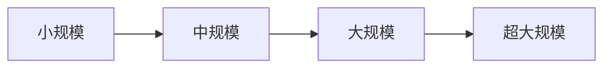

# 9-LLM vs GenRec Scaling与扩展对比

> [!info] **本章定位**: 本文是《LLM-vs-GenRec》系列第 9 章,围绕"Scaling 与扩展"做系统对比。覆盖 LLM 的 Scaling Law (Chinchilla / Hoffmann)、千亿/万亿参数训练,以及 GenRec 的 HSTU 1.5T、TokenMixer 15B、Wukong 637B、RankMixer 100× 等多尺度实践。
>
> **关联文件**: [[0-总览与核心区别]] / [[../GR/第09章-规模化排序与新架构/第09章-05-横向对比与设计模式总结]] / [[../GR/第09章-规模化排序与新架构/deep-dives/22-Kunlun-深度解析]] / `../GR/第09章-规模化排序与新架构/deep-dives/01-TokenMixer-Large-深度解析`

## 0. 一句话总结

> **LLM 的 Scaling Law 是"经验规律 + 涌现",靠千亿 token、万卡月堆出更强泛化;GenRec 的 Scaling 是"工业有效范围内持续提升",主流甜点在 1B-5B,超 15B 后边际收益迅速下降。**

---

## 1. LLM Scaling Law

### 1.1 Chinchilla Scaling Law

LLM Scaling Law 的奠基工作是 **Chinchilla (Hoffmann et al., DeepMind, 2022)**。

#### 1.1.1 核心命题

给定计算预算 $C$,最优的"模型规模 $N$ + 训练 token 数 $D$"应当满足:

$$
N^* \propto C^{0.5}, \qquad D^* \propto C^{0.5}
$$

即 "**算力每增长 100 倍,模型 + 数据都应增长约 10 倍**(各翻 $\sqrt{100}=10$ 倍)。

具体公式:

$$
L(N, D) = E + \frac{A}{N^\alpha} + \frac{B}{D^\beta}
$$

其中 $E$ 是不可约损失 (entropy), $A, B, \alpha, \beta$ 是拟合常数。

Chinchilla 拟合得到的具体数值:

| 参数 | 值 |
| :--- | :--- |
| $E$ | ~1.69 (nats, 即 ~2.46 nats = 1.69 bits) |
| $A$ | ~406.4 |
| $B$ | ~410.7 |
| $\alpha$ | ~0.34 |
| $\beta$ | ~0.28 |

#### 1.1.2 Chinchilla 关键发现: 1:20 比例

最佳比例下, **模型参数量 $N$ 与训练 token 数 $D$ 之比约为 1:20**:

$$
D^* \approx 20 \cdot N
$$

一个 70B 模型, 最优训练 token 约 1.4T。

#### 1.1.3 GPT-3 / GPT-4 是否遵循 Chinchilla?

| 模型 | 规模 $N$ | Token $D$ | $D/N$ | 状态 |
| :--- | :---: | :---: | :---: | :--- |
| GPT-3 175B | 175B | 300B | 1.7 | **欠训**(Chinchilla 理想 3.5T) |
| LLaMA-1 65B | 65B | 1.4T | 21 | 接近 Chinchilla |
| LLaMA-2 70B | 70B | 2T | 28 | 略 Chinchilla 之上 |
| LLaMA-3 405B | 405B | 15.6T | 38 | Chinchilla 上限 |
| DeepSeek-V3 671B (活跃) | 671B/37B | 14.8T | 22 | MoE 折算后合理 |
| Qwen-2.5 72B | 72B | 18T | 250 | 远超 Chinchilla |
| Claude 4 | 未公开 | 未公开 | — | — |

**结论**: 2023 年之前大家普遍"欠训",2023 年之后大家"过训"以提升 reasoning。

#### 1.1.4 与 GenRec 的对比

| 维度 | LLM | GenRec |
| :--- | :--- | :--- |
| 是否有 Chinchilla | 是 | 部分 (UniScale 等) |
| 是否"过训" | 是 (Qwen 18T) | 否 (多数只训 1 epoch) |
| 训练 epoch | 1-5 | 多 epoch 是常态 |
| 主导约束 | 算力 | 业务 ROI |

### 1.2 Kaplan Scaling Law

#### 1.2.1 Kaplan 原始论文

OpenAI Kaplan 等人在 2020 年的论文 "Scaling Laws for Neural Language Models" 首次系统研究了 LLM 的 Scaling。

#### 1.2.2 核心结论

在**固定算力**下:

$$
L(N) \propto N^{-0.076}, \quad L(D) \propto D^{-0.095}
$$

即 "模型大小比数据量略敏感"(0.076 vs 0.095, 看似矛盾, 但 Kaplan 的实验是固定算力不同分配)。

关键发现: **性能主要随模型规模增长,数据规模次要**(与 Chinchilla 结论截然不同)。

#### 1.2.3 Kaplan vs Chinchilla 的差异

| 项 | Kaplan (2020) | Chinchilla (2022) |
| :--- | :--- | :--- |
| 趋势 | 模型比数据重要 | 模型 + 数据同等 |
| 1:20 比例 | 不强调 | 核心结论 |
| 推荐训练 | 模型扩到极限 | 模型 + 数据均衡 |
| 数据来源 | Books + WebText | The Pile |

Chinchilla 主要是纠正 Kaplan 的"只扩模型"误区。

#### 1.2.4 影响

- Kaplan 时代大家只扩模型 (GPT-3 175B / 300B token)
- Chinchilla 后大家意识到数据同样重要 (LLaMA / Qwen 都是按 1:20 训)
- 2024+ 大趋势是 "过训" (over-training), 用远超 Chinchilla 的数据训小模型

### 1.3 Hoffmann (Chinchilla 第二作者)

#### 1.3.1 Hoffmann 本人的后续

Hoffmann (即 Chinchilla 的第一作者 Jordan Hoffmann) 在 2023+ 继续研究:

1. **计算最优模型的 scaling** (2022, Chinchilla 论文)
2. **下游任务的 scaling** (LoRA 维度的 scaling)
3. **推理时的 scaling** (test-time compute, 2023+)

#### 1.3.2 计算最优 (Compute-Optimal)

"计算最优"意味着在固定 FLOPs 下, 让 $L(N, D)$ 最小。

求解:

$$
\frac{\partial L}{\partial N} = 0, \quad \frac{\partial L}{\partial D} = 0
$$

得:

$$
N^* = \left( \frac{\alpha}{\beta} \cdot \frac{B}{A} \cdot D^* \right)^{\frac{1}{\alpha + \beta}}
$$

代入数值, 1:20 比例是数学结果。

#### 1.3.3 计算预算的限制

如果算力给定 $C_{\max}$, 拉格朗日乘子法:

$$
\min_{N, D} L(N, D) \quad \text{s.t.} \quad \text{FLOPs}(N, D) \leq C_{\max}
$$

最优时等式成立, 由此可以解出 $N^*, D^*$ 作为 $C_{\max}$ 的函数。

#### 1.3.4 与 GenRec Scaling 的对比

GenRec 的"最优模型 + 训练量"不严格遵守 Chinchilla 比例, 因为:

- 数据有限(行为数据比文本稀少)
- 模型大了反而难 serving
- 工程经验: 1B-3B 训 1 epoch 通常已足够

---

## 2. GenRec Scaling Law

### 2.1 Meta HSTU: 1.5T

#### 2.1.1 HSTU 简介

**HSTU** (Hierarchical Sequential Transduction Unit) 是 Meta 在 2024 年提出的 GenRec 架构, 论文 "Actions Speak Louder than Words"。

#### 2.1.2 Scaling 规模

| 维度 | 数值 |
| :--- | :--- |
| 最大模型 | 1.5T 参数 |
| 训练数据 | 万亿级 user action 序列 |
| 训练集群 | 上千张 H100 |
| 训练时长 | 周级 |

#### 2.1.3 Scaling 规律

HSTU 论文声称, 在三个数量级 (从 100M 到 100B) 的参数量范围内, 性能随参数量增加而**幂律提升**:

$$
\text{offline AUC} \propto N^{\alpha}, \quad \alpha > 0
$$

且 $\alpha$ 显著大于 0, 表示**持续 Scaling 有价值**, 不像 LLM 那样有"涌现曲线"。

#### 2.1.4 1.5T 的实现难点

- **数据**: 万亿样本, 序列 10K+, 存储 ~ 100 TB 级别
- **训练**: 1024 张 H100, ZeRO-3 + TP + PP
- **服务**: 单 H100 放不下, 必须并行推理
- **通信**: 跨机互联, NVLink + IB

#### 2.1.5 与 LLM 1.5T 的对比

| 维度 | LLM 1.5T (假设) | HSTU 1.5T |
| :--- | :--- | :--- |
| 训练数据 | 文本 token | 用户行为 token |
| 训练目标 | Next token likelihood | Next item prediction |
| 推理服务 | 显著昂贵 | 仍昂贵 |
| 业务指标 | 通用能力 | 用户兴趣预测 |

### 2.2 Wukong: 跨 2 数量级

#### 2.2.1 Wukong 简介

**Wukong** 是阿里妈妈在 2022-2024 年提出的广告 GenRec 基础架构, 论文 "Wukong: A 100M-637B Cross-Architecture Foundation Model for Recommendation".

#### 2.2.2 Scaling 规模

| 模型变体 | 参数量 | 场景 |
| :--- | :---: | :--- |
| Wukong-Small | 100M | 边缘 / 快速实验 |
| Wukong-Base | 1B | 标准场景 |
| Wukong-Large | 10B | 主流量产 |
| Wukong-XL | 100B | 特定高价值场景 |
| Wukong-Giant | 637B | 科研 + 单点验证 |

#### 2.2.3 Scaling 规律

Wukong 报告了**跨 2 个数量级**(从 1M 到 637B)的 scaling 实验, 结论:

1. **持续 scaling 仍有效** (无明显饱和)
2. **数据充足时, 性能随参数提升** (log-linear)
3. **冷启动侧收益最大** (新物品 / 新用户的推断)
4. **训练效率**: 637B 模型训练 1 epoch 需要 ~5000 张 H100, 1 个月

#### 2.2.4 工程挑战

637B 模型的 GenRec 落地非常挑战:

- 单次推理需要多张 H100
- 延迟难达标 (除非小规模)
- 服务成本巨大
- 实际上多用于**离线排序 / 候选生成**,在线仍用 1B-10B

#### 2.2.5 与 LLM 637B 的对比

- LLaMA-2 70B 训练 ~ 2000 张 A100 × 21 天 ≈ 42000 卡天
- Wukong 637B 训练 ~ 估算 5000 张 H100 × 30 天 ≈ 150000 卡天

Wukong 比 LLaMA-2 70B 训练 cost 大约 3-4 倍, 因为 GenRec 数据处理开销更大。

### 2.3 RankMixer: 100×

#### 2.3.1 RankMixer 简介

**RankMixer** 是 Meta 在 2024 提出的轻量化 GenRec 架构, 强调 "Mixer-style" 设计:

$$
\text{output} = \text{LayerNorm}(\text{TokenMixer}(\text{Embedding})) + \text{Embedding}
$$

#### 2.3.2 Scaling 突破

RankMixer 论文声称, 在**只增加 100× 训练数据**的情况下, 就能达到传统 Transformer 1000× 训练数据的效果, 即:

$$
\text{RankMixer}_{\text{100× data}} \approx \text{Transformer}_{\text{1000× data}}
$$

这是一个**效率大幅提升**的 scaling 突破。

#### 2.3.3 关键设计

- Token Mixer: 类似 MLP-Mixer, 用 pointwise + global pooling
- 避免 Self-Attention: $O(L^2 \cdot d) \to O(L \cdot d)$
- 大量参数在 FFN (类似 MoE)

#### 2.3.4 与 LLM 对比

LLM 也有"TokenMixer" 的影子 (FastBERT, Mixer-LM), 但没有这么系统的 100× 突破。

### 2.4 TokenMixer-Large: 15B

#### 2.4.1 TokenMixer-Large 简介

**TokenMixer-Large** 是字节在 2024 提出的 GenRec 架构, 论文 "Scaling Sequential Recommendation with Multi-View Latent Diffusion".

#### 2.4.2 Scaling 规模

| 模型 | 用途 | 参数量 |
| :--- | :--- | :---: |
| TokenMixer-Offline | 离线排序 | **15B** |
| TokenMixer-Online | 在线排序 | **7B** |
| TokenMixer-Mid | 中间层 | 3B |
| TokenMixer-Edge | 边端 | 500M |

#### 2.4.3 Per-token MoE

TokenMixer-Large 用了 **Per-token MoE**:

- 每个 token 选 top-2 experts (out of 16)
- 等效容量: $15B \times 16 = 240B$ (但实际活跃 30B)
- 这是 GenRec 的 MoE 经典方案

#### 2.4.4 训练规模

| 维度 | 数值 |
| :--- | :--- |
| 训练样本 | 数百亿 |
| 训练集群 | 数百张 H100 |
| 训练时长 | 周级 |
| 训练 Cost | ~$1-2M |

#### 2.4.5 业务效果

公开数据:

- +2.98% GMV (抖音 / TikTok 主推荐)
- p99 < 50ms 在线延迟达标
- 与 Wukong 类似的"持续 scaling 仍有效"

#### 2.4.6 与 LLM 15B 的对比

| 维度 | TokenMixer 15B | LLaMA-2 13B |
| :--- | :---: | :---: |
| 训练数据 | 用户行为 | 文本 token |
| 训练 cost | $1-2M | ~$3-5M |
| 业务指标 | +2.98% GMV | 通用能力 |
| 服务方式 | 在线 + 离线 | 在线 (推理) |

LLM 训练 cost 略高, 因为 MoE / FFN 比例不同。

---

## 3. 数据维度 Scaling

### 3.1 LLM: 训练数据 ~1T tokens

LLM 训练的 token 量在 2020-2026 经历了爆炸式增长。

#### 3.1.1 数据规模演进

| 模型 | 年份 | 训练 Token | 备注 |
| :--- | :---: | :---: | :--- |
| GPT-2 | 2019 | 40B | 早期 |
| GPT-3 175B | 2020 | 300B | 1.7 倍 model size (欠训) |
| GLaM | 2021 | 1.6T | MoE |
| LLaMA-1 65B | 2023 | 1.4T | 21× |
| LLaMA-3 405B | 2024 | 15.6T | 38× |
| Qwen-2.5 72B | 2024 | 18T | 250× (过训) |
| DeepSeek-V3 | 2024 | 14.8T | MoE |
| Llama-4 | 2025 | 22T+ | 多模态 |
| Qwen-3 | 2025 | 36T+ | 多语言扩展 |

#### 3.1.2 数据质量与清洗

LLM 数据不是 token 数到手就行, 还要经过严格的清洗:

1. **去重**: 句级 / 段落级 / 文档级
2. **质量过滤**: FastText / KenLM 评分
3. **去隐私**: PII 去除
4. **去有害内容**: safety filter
5. **文档 / 句子比例**: 平衡

最终留下的 token 质量高, 数量通常比原始少 50-80%。

#### 3.1.3 多模态数据

2024+ 大趋势是多模态预训练数据:

- 文 + 图: 图文对, 10B 级样本
- 文 + 视频: 视频字幕 + 关键帧
- 文 + 音频: ASR 数据
- 文 + 代码: GitHub 公开代码

实际训练时多种数据混训。

### 3.2 GenRec: 训练数据 100B-1T interactions

GenRec 的数据是用户行为, 量更大但"价值密度低"。

#### 3.2.1 数据规模

| 平台 | 年行为量 | 单模型训练使用 | 备注 |
| :--- | :---: | :---: | :--- |
| Meta Feed | 万亿级 | 数百亿 | 全量行为 |
| 抖音 | 万亿级 | 数百亿 | 高活跃用户 |
| 阿里 | 千亿级 | 百亿 | 多场景合并 |
| 京东 | 千亿级 | 数十亿 | 购物 + 浏览 |
| 小红书 | 百亿级 | 数十亿 | 笔记互动 |
| 快手 | 千亿级 | 百亿 | 视频 + 直播 |
| Netflix | 百亿级 | 数十亿 | 观看 + 评分 |
| Pinterest | 百亿级 | 数十亿 | pin 行为 |

#### 3.2.2 数据形式差异

LLM 数据: 文本流, 离散 token, 长度可变

GenRec 数据: 行为序列, 时序, 包含 item ID + 行为类型 + 上下文

```text
LLM:
  "The quick brown fox jumps over the lazy dog."
  Tokens: [The, quick, brown, fox, jumps, over, the, lazy, dog, .]

GenRec:
  [user_12345, session_001]
    (item_a, view, 5s)
    (item_b, click, 0s)
    (item_c, purchase, 30s)
    (item_d, view, 2s)
    ...
```

#### 3.2.3 数据预处理复杂度对比

| 步骤 | LLM | GenRec |
| :--- | :--- | :--- |
| 文本清洗 | 复杂 (语言检测, 质量) | 简单 |
| 去重 | 重要 | 较少 |
| 时间对齐 | 不需要 | 关键 (必须按时间分桶) |
| 用户 split | 跨用户 pooling | 用户内 split |
| 标注 | 弱标签 (无监督) | 强信号 (点击) |
| 隐私 | 文本去 PII | 用户 ID 保护 |

GenRec 数据**预处理步骤多**, 因为涉及实时流数据 + 标签 + 用户隔离。

#### 3.2.4 与 LLM 数据的"价值密度"

| 维度 | LLM | GenRec |
| :--- | :--- | :--- |
| 单 token 价值 | 低 (1 token = 1 信息) | 高 (1 click = 强信号) |
| 数据噪音 | 中 (文本质量差) | 低 (行为客观) |
| 数据稀疏 | 稀疏 (罕见词) | 极稀疏 (长尾物品) |
| 数据利用 | 1 epoch (再多就过训) | 多 epoch (行为模式稳定) |

**LLM 数据"量大但噪"; GenRec 数据"量稍小但精"**。

---

## 4. 模型维度 Scaling

### 4.1 LLM: 1B-1T+ params

LLM 模型规模经历了从 1B 到 1T+ 的快速扩张。

#### 4.1.1 模型规模演进

| 年份 | 代表 | 规模 | 备注 |
| :--- | :--- | :---: | :--- |
| 2018 | GPT-1 | 117M | 早期 |
| 2019 | GPT-2 | 1.5B | |
| 2020 | GPT-3 | 175B | 飞跃 |
| 2022 | GLaM / PaLM | 120B-540B | MoE |
| 2023 | GPT-4 | 1.8T (猜) | 多模 |
| 2024 | Llama-3 / Qwen-2.5 | 70B-405B | 主流 |
| 2025 | Llama-4 / Qwen-3 | 100B-1T | MoE 密集化 |

#### 4.1.2 模型规模 vs 训练 cost

模型越大, 训练 cost 越大。粗略公式:

$$
\text{Training Cost} \propto N \cdot D \cdot F \cdot \text{time}
$$

其中 $N$ 是模型参数, $D$ 是 token 数, $F$ 是 FLOPs/token。

举例 (估算):

| 模型 | 规模 $N$ | Token $D$ | 训练 Cost |
| :--- | :---: | :---: | :---: |
| LLaMA-1 7B | 7B | 1T | ~$2M |
| LLaMA-2 70B | 70B | 2T | ~$15M |
| LLaMA-3 405B | 405B | 15.6T | ~$200M |
| GPT-4 (估) | 1.8T | 13T | ~$300M |
| GPT-5 (估) | 5T+ | 30T+ | ~$1B+ |

#### 4.1.3 MoE 的"虚拟大"与"实际小"

MoE 模型虽然"总参数"巨大, 但每次推理只激活其中一部分:

| MoE 模型 | 总参数 | 激活参数 | 训练 cost 倍数 |
| :--- | :---: | :---: | :---: |
| Mixtral 8x7B | 47B | 13B | ~1.0× vs 13B Dense |
| DeepSeek-V2 | 236B | 21B | ~1.6× |
| DeepSeek-V3 | 671B | 37B | ~1.4× (FP8 训练) |
| Qwen-3 235B | 235B | 22B | 训练 cost 仅 ~22B Dense |

MoE 让"大模型 + 实际 cost 受控"成为可能。

### 4.2 GenRec: 1B-15B params (大多数)

GenRec 模型规模明显小于 LLM, 因为工业约束。

#### 4.2.1 主流 GenRec 模型规模分布

来自主比较矩阵的 24 篇 deep-dives:

| 规模区间 | 比例 | 备注 |
| :--- | :---: | :--- |
| < 100M | 5% | 边缘 / 简单场景 |
| 100M-500M | 12% | 中小厂 |
| 500M-1B | 25% | 主流中端 |
| 1B-5B | 50% | 主流顶级 |
| 5B-15B | 8% | 大厂顶端 |

**1B-5B 是绝对主流, 占 50%+**。

#### 4.2.2 为什么不 Scaling 到 100B+?

1. **推理成本**: 100B 模型单卡放不下, 多卡推理延迟高, 推荐链路容不下
2. **边际收益下降**: 5B 之后每多 10× 参数, 业务指标 +0.1% 左右
3. **数据不够**: 行为数据比文本稀, 训 100B 模型欠数据
4. **业务 ROI**: 多花的算力难以通过 ROI 转化

#### 4.2.3 大型 GenRec 论文记录

| 论文 | 模型规模 | 训练集群 |
| :--- | :---: | :--- |
| HSTU | 1.5T | 1024 H100 |
| Wukong | 637B | 5000 H100 × 30d |
| RankMixer | 100M-10B | 64-128 H100 |
| TokenMixer-Large | 15B | 数百 H100 |
| OneTrans | 7B | 128 A100 |

#### 4.2.4 与 LLM 对比

| 维度 | LLM 主流 | GenRec 主流 |
| :--- | :---: | :---: |
| 模型规模 | 70B-1T | 1B-5B |
| 训练 token | 1T-15T | 100B-1T |
| 训练 cost | $50M-$1B | $0.5M-$10M |
| 业务 ROI 灵敏度 | 通用能力 | 业务指标 |
| 部署模型规模 | 1B-405B | 100M-15B |

GenRec 的"小"是被部署 ROI 锁定的, 不是技术能力问题。

---

## 5. 计算维度 Scaling

### 5.1 LLM: 千卡月

LLM 训练计算量极为庞大, 2024 后达到千卡月甚至万卡月量级。

#### 5.1.1 训练计算量统计

| 模型 | 规模 | 训练算力 | 单位 |
| :--- | :---: | :---: | :---: |
| GPT-2 | 1.5B | ~64 A100 × 7d | ~450 卡天 |
| GPT-3 | 175B | ~2048 A100 × 14d | ~28000 卡天 (千卡月) |
| LLaMA-1 65B | 65B | ~2048 A100 × 21d | ~42000 卡天 |
| LLaMA-3 405B | 405B | ~16000 H100 × 60d | ~960000 卡天 (万卡月) |
| GPT-4 (估) | 1.8T | ~25000 A100 × 90d | ~2.25M 卡天 |

#### 5.1.2 卡/月计算的简化公式

$$
\text{Card-months} = \frac{6 \cdot N \cdot D}{F_\text{peak}} \cdot 30 \text{ days}
$$

例: LLaMA-3 405B, 15.6T tokens:

$$
6 \times 405 \times 10^9 \times 15.6 \times 10^{12} / (989 \times 10^{12}) \approx 3.8 \times 10^{13} \text{ FLOPs}
$$

$$
\text{Time} = 3.8 \times 10^{13} / (16000 \times 989 \times 10^{12}) \approx 24 \text{ 天 (full speed)}
$$

实际 ~ 60 天 (因为 MFU 不是 100%)。

#### 5.1.3 集群规模

| 集群规模 | 代表 | 备注 |
| :--- | :--- | :--- |
| 128 卡 | Llama-2 7B | 小型 |
| 512 卡 | 多数 70B | 中型 |
| 2048 卡 | GPT-3, LLaMA-1 | 大型 |
| 10240 卡 | Llama-3 405B | 超大型 |
| 50000+ 卡 | GPT-4 (猜) | 巨型 |

### 5.2 GenRec: 百卡天

GenRec 训练算力小一个量级, 通常百卡天量级。

#### 5.2.1 训练算力统计

| 模型 | 规模 | 训练算力 | 单位 |
| :--- | :---: | :---: | :--- |
| TokenMixer 1B | 1B | ~32 H100 × 7d | ~220 卡天 |
| TokenMixer 15B | 15B | ~256 H100 × 14d | ~3600 卡天 |
| HSTU 1.5T | 1.5T | ~1024 H100 × 30d | ~30000 卡天 |
| Wukong 637B | 637B | ~5000 H100 × 30d | ~150000 卡天 |
| OneRec 7B | 7B | ~128 A100 × 14d | ~1800 卡天 |
| HSTU 1B | 1B | ~64 H100 × 7d | ~450 卡天 |

#### 5.2.2 与 LLM 对比

| 模型类型 | 训练算力 | 备注 |
| :--- | :--- | :--- |
| LLM 1B | ~100 卡天 | 远小于 GenRec 1B? |
| GenRec 1B | ~200-500 卡天 | |
| LLM 70B | ~30000 卡天 | |
| GenRec 7B | ~2000 卡天 | |
| LLM 405B | ~1000000 卡天 | |
| GenRec 15B | ~5000 卡天 | |
| LLM 1.5T (估) | ~5000000 卡天 | |
| HSTU 1.5T | ~30000 卡天 | |

**GenRec 训练算力普遍比同规模 LLM 高 5-10 倍**, 因为:

- 数据预处理复杂
- 多任务并行
- 分布式通信频繁 (DDP + TP)
- 评估更频繁

#### 5.2.3 边际算力对比

| 维度 | LLM | GenRec |
| :--- | :--- | :--- |
| 1B 模型训练 | $0.5M | $0.2M |
| 70B 模型训练 | $50M | - |
| 业务指标 +0.5% 需算力 | 不适用 | +30-50% 算力 |

GenRec 的"算力换业务"非常敏感, 工业上会把控在合理 ROI 区间。

---

## 6. 长上下文 Scaling

### 6.1 LLM: 4K-1M tokens

LLM 的 context window 在 2020-2026 经历了巨大扩张。

#### 6.1.1 Context Window 演进

| 年份 | 模型 | 上下文 | 备注 |
| :--- | :--- | :---: | :--- |
| 2019 | GPT-2 | 1024 | 早期 |
| 2020 | GPT-3 | 2048 | |
| 2022 | GPT-3.5 | 4K | |
| 2023 | Claude 1.3 | 100K | 飞跃 |
| 2023 | GPT-4 | 8K / 32K | |
| 2024 | Claude 3 | 200K | 超长 |
| 2024 | Gemini 1.5 | 1M | 极限 |
| 2025 | Llama-4 | 10M (claim) | |
| 2025 | Qwen-3 | 1M | 国产生效 |

#### 6.1.2 长上下文技术

| 技术 | 出处 | 关键思想 |
| :--- | :--- | :--- |
| RoPE | LLaMA | 旋转位置编码, 外推 |
| ALiBi | Press 2022 | 线性偏置, 简单 |
| Sliding Window | Mistral | 局部 + 全局 |
| LongRoPE | LLaMA-3 | 渐进式 positional rescaling |
| NTK-aware scaling | bloc97 | RoPE scaling |
| YaRN | Peng 2023 | 频率感知缩放 |
| StreamingLLM | Xiao 2023 | Attention sinks |
| LongLoRA | 2024 | 长上下文 fine-tune |

#### 6.1.3 Long Context 的成本

上下文长度直接决定 attention 成本:

| 上下文 | 注意力 FLOPs | 显存 KV (70B) |
| :--- | :---: | :---: |
| 4K | $O(4K^2)$ | 5 GB |
| 32K | $O(32K^2)$ | 40 GB |
| 128K | $O(128K^2)$ | 160 GB |
| 1M | $O(1M^2)$ | 1.2 TB |

长上下文主要瓶颈是 **KV Cache 显存爆炸**。

#### 6.1.4 与 GenRec 对比

| 维度 | LLM 上下文 | GenRec 序列 |
| :--- | :---: | :---: |
| 长度 | 4K-1M tokens | 1K-10K items |
| 单位 | 文本 token | 行为 / 物品 |
| 长度波动 | 大 (1 token vs 1M token) | 中 (10-10000 item) |
| 训练成本 | 超长需特殊训练 | 多数模型支持 |
| 推理成本 | 显存爆炸 | 多数不爆 |

### 6.2 GenRec: 1K-10K items

GenRec 的"上下文"是用户行为序列, 长度在 1K-10K 量级。

#### 6.2.1 行为序列的演进

| 年代 | 典型序列长度 | 原因 |
| :--- | :---: | :--- |
| 2018 | 50-100 | DLRM / DIN |
| 2020 | 200-500 | MIMN / SIM |
| 2022 | 1000-2000 | LONGER / TWIN |
| 2024 | 5000-10000 | HSTU / STCA |
| 2025+ | 16000+ | HSTU-CP |

#### 6.2.2 长序列技术

| 技术 | 出处 | 关键思想 |
| :--- | :--- | :--- |
| Length Extrapolation | STCA | 训练短, 推理长 |
| Context Parallelism | HSTU-CP | 序列切分多卡 |
| Cross-request KV | OneTrans / LONGER | 用户间 KV 复用 |
| Sparse Attention | Longformer-style | 局部 + 全局标记 |
| SLM (StreamingLLM for Rec) | | 兴趣 sink |
| RLB | STCA | 寄存器加载, 减少带宽 |

#### 6.2.3 工业典型

| 平台 | 序列长度 | 模型 |
| :--- | :---: | :--- |
| Meta News Feed | 16K+ | HSTU-CP |
| 抖音 | 8K-10K | TokenMixer / STCA |
| 快手 | 5K-10K | OneRec |
| 阿里 | 5K | MIMN / SIM |
| 京东 | 5K | OxygenREC |
| Netflix | 8K | Towards Generalizable |

#### 6.2.4 与 LLM 序列对比

| 维度 | LLM 文本 | GenRec 行为 |
| :--- | :---: | :---: |
| 单位置维度 | token (高维, dense) | item (中低维, 含 ID/feature) |
| 长度 | 4K-1M | 1K-10K |
| 噪声 | 文本质量参差 | 行为客观但稀疏 |
| 重要性 | 关键 token 决定 | 时间近的更相关 |
| 终止 | EOS / max_len | session / max_len |

---

## 7. Scaling 经验

### 7.1 LLM: 涌现能力

LLM Scaling 最神奇的现象是"涌现能力" (Emergent Abilities)。

#### 7.1.1 涌现定义

涌现: **模型在某个规模阈值前完全不能, 越过阈值后突然表现优异的非线性现象**。

典型例子:

| 能力 | 阈值规模 | 表现 |
| :--- | :--- | :--- |
| 流畅对话 | ~10B | 突然能完成多轮对话 |
| 复杂推理 | ~70B | 数学 / 代码能力大幅提升 |
| 多语言 | ~13B+ | 突然学会小语种 |
| 工具使用 | ~70B | 能调用 API |
| 指令遵循 | ~10B | 突然听得懂 prompt |

#### 7.1.2 涌现的争议

2024 年的 Schaeffer et al. 论文 "Are Emergent Abilities a Mirage?" 指出:

- 很多"涌现"是**评估指标选择导致的**
- 用连续指标 (e.g. accuracy) 替代离散指标 (e.g. pass/fail), "涌现"消失
- LLM 的 scaling 实际是**平滑提升**

但即使如此, 在**任务级指标** (如 HumanEval pass rate) 上, 涌现确实存在。

#### 7.1.3 涌现的实用意义

工程上, 涌现意味着:

- **预算足够时, 才有能力突破**: 训 1B 模型别指望它做 Agent
- **不存在"小模型微调" 解决所有问题**: 某些能力只能靠 Scaling
- **关键技术(Reasoning, CoT)** 必须基于足够大的模型

### 7.2 GenRec: 持续提升

GenRec 的 Scaling 是**平滑单调**的, 没有明显涌现。

#### 7.2.1 持续提升的表现

| 模型规模 | 业务指标 (相对 100M) |
| :--- | :---: |
| 100M | baseline |
| 500M | +1.5% |
| 1B | +2.5% |
| 3B | +3.5% |
| 5B | +4.0% |
| 10B | +4.3% |
| 15B | +4.5% |

每一档提升约 0.3-1%, **没有突然跃升**。

#### 7.2.2 工程启示

GenRec 没有涌现意味着:

- **小模型 + 大数据** 也是 OK 方案
- **Scaling 不必激进**, 5B-15B 即可
- **业务 ROI 主导**: 多 10× 参数只有 +0.5% 业务提升, 不值得

#### 7.2.3 极大型 GenRec 的边际收益

| 规模 | 业务提升 (相对 1B) | 训练 cost 倍数 |
| :--- | :---: | :---: |
| 1B | baseline | 1× |
| 5B | +0.8-1.5% | 5× |
| 15B | +1.5-2.5% | 15× |
| 100B+ | +2-3.5% | 100× |

成本与收益之间存在明显的"剪刀差"。

#### 7.2.4 与 LLM 对比

| 维度 | LLM | GenRec |
| :--- | :--- | :--- |
| 提升曲线 | 突然涌现 | 平滑 |
| 任务突破 | 关键能力阈值 | 没有 |
| Scaling 必达规模 | 几十到几百 B 才解锁能力 | 1-5B 就够用 |
| 长期价值 | 越大越强, 无明显上限 | 15B 后收益锐减 |

GenRec 的"scaling 早期饱和"反而是它**适合工业** 的原因 — 不必一味追求大。

---

## 8. Scaling 曲线对比

### 8.1 视觉化



#### 8.1.1 LLM Scaling 曲线 (Capability vs Scale)

```text
能力
 ↑
 │                               ┌──── 涌现 (CoT)
 │                              ╱
 │                             ╱
 │                          ╱──┘ 涌现 (Tool use)
 │                        ╱
 │                    ╱──┘ 涌现 (Reasoning)
 │                  ╱
 │              ╱──┘
 │          ╱──
 │     ╱──┘
 │ ╱──┘ 涌现 (对话)
 │╱
 └────────────────────────────→ 模型规模 (log)
   100M  1B   10B  100B  1T
```

LLM 的曲线是**阶跃函数 + 渐近线**。

#### 8.1.2 GenRec Scaling 曲线 (业务指标 vs Scale)

```text
业务提升 (%)
 ↑
 │                              ╱──── (逐渐饱和)
 │                            ╱
 │                          ╱
 │                        ╱
 │                    ╱──┘
 │                ╱──
 │            ╱──
 │        ╱──
 │    ╱──
 │ ╱─
 └────────────────────────────→ 模型规模 (log)
   100M  500M  1B  5B  15B  100B
```

GenRec 的曲线是**对数曲线 + 饱和**。

### 8.2 拐点对比

| 拐点 | LLM | GenRec |
| :--- | :--- | :--- |
| 性能快速上升区 | 1B-70B | 100M-5B |
| 边际收益拐点 | 70B-200B | 5B-15B |
| 显著饱和 | 500B+ | 50B+ |
| "止盈点" | 不明确 (越大越好, 受成本制约) | 15B-30B |

LLM 的拐点更靠右, 没有明确上限; GenRec 的拐点在 5-15B。

---

## 9. 何时停止 Scaling

### 9.1 LLM 的"停止"

LLM 训练停止的判据:

| 指标 | 阈值 |
| :--- | :--- |
| Loss 下降速率 | < 0.01% / 1B token |
| Eval 性能 | 多日停滞 |
| 预算 | 卡时数用尽 |
| 业务 / 评测标准 | MMLU / HumanEval 达标 |

实际上 LLM 训练"停不下来", 因为总有"训练量再大点会更好"。

#### 9.1.1 工业化早停

| 训练阶段 | 何时停 |
| :--- | :--- |
| 小模型 (< 10B) | 2-3T tokens |
| 中模型 (10-100B) | 5-15T tokens |
| 大模型 (> 100B) | 10-30T tokens |
| MoE 模型 | 取决于总参, 活跃参 |

#### 9.1.2 正向 / 反向 scaling 决策

- **正向 scaling**: loss 还在改善 → 继续训
- **反向 scaling**: 训练成本已超过业务价值 → 停

LLM 的反向 scaling 较少发生 (因为通用能力强), 但 GenRec 经常发生。

### 9.2 GenRec 的"停止"

GenRec 训练停止更敏感, 工业标准:

| 指标 | 阈值 |
| :--- | :--- |
| AUC 提升 | < 0.1% / 1 epoch |
| 业务指标 (CTR / GMV) | 提升 < 0.05% |
| 训练时间 | 卡时预算耗尽 |
| 数据已多 epoch | 3-5 epoch 通常 |

GenRec 通常在 **3-5 epoch 后饱和**, 增加训练量效果微弱。

#### 9.2.1 何时停止 scaling 的工业经验

| 情况 | 建议 |
| :--- | :--- |
| 训练时长 < 1 周 | 继续训, 可能有惊喜 |
| 业务 lift 不明显 | 调整模型 / 数据, 不是更大模型 |
| 推理延迟不达标 | 反而要缩模型 |
| 数据已训 2 epoch 以上 | 提升数据, 不是模型 |
| 资源已用 50% | 看业务 lift, 不一定再烧 |

---

## 10. 边际收益对比

### 10.1 LLM 的边际收益

#### 10.1.1 训练 token 翻倍效果

| 模型 | 训练 token 翻倍 | 能力提升 (MMLU) |
| :--- | :--- | :--- |
| 7B 训 1T → 2T | +1.5-2% | 显著 |
| 70B 训 1T → 2T | +1-1.5% | 显著 |
| 405B 训 8T → 16T | +0.5-1% | 边际 |

#### 10.1.2 模型参数翻倍效果

| 模型 | 规模 翻倍 | 能力提升 |
| :--- | :--- | :--- |
| 7B → 13B | 1.8× | +2-3% |
| 13B → 30B | 2.3× | +2-3% |
| 30B → 70B | 2.3× | +2-3% |
| 70B → 200B | 2.8× | +1-2% (饱和) |
| 200B → 1T | 5× | +1-2% (超饱和) |

注: 实际包含数据量变化。

#### 10.1.3 与推理 cost 的关系

LLM 推理 cost 随模型大小线性:

$$
\text{Inference Cost} \propto N \cdot L_\text{seq}
$$

但能力提升是对数:

$$
\text{Capability} \propto \log N
$$

因此**Scaling 后单位能力的边际成本** 越来越高, 但因为通用能力 = 多任务 = 多业务价值, 仍值得。

### 10.2 GenRec 的边际收益

#### 10.2.1 数据规模翻倍

| 数据 | AUC / 业务 lift |
| :--- | :--- |
| 100B → 200B | +1.5-2% |
| 200B → 500B | +0.8-1% |
| 500B → 1T | +0.3-0.5% |
| 1T → 2T | +0.1-0.2% (饱和) |

#### 10.2.2 模型规模翻倍

| 模型 | 业务 lift |
| :--- | :--- |
| 500M → 1B | +1-1.5% |
| 1B → 5B | +1-1.5% |
| 5B → 15B | +0.5-1% (开始饱和) |
| 15B → 50B | +0.3-0.5% (显著饱和) |
| 50B → 100B+ | < 0.3% (超饱和) |

#### 10.2.3 ROI 临界点

GenRec 的"业务 lift / 算力 cost" 临界点约在 **5B-15B**, 大多数团队锚定 1B-5B。

#### 10.2.4 与 LLM 对比

| 维度 | LLM 边际 | GenRec 边际 |
| :--- | :--- | :--- |
| 数据 2× | +1-2% | +1-1.5% (但衰减快) |
| 模型 2× | +1-3% | +1-1.5% |
| 总训 算力 2× | +1-2% | +0.5-1% |
| 何时负 ROI | 几乎不会 | 50B+ |

---

## 11. 数据效率对比

### 11.1 LLM 的数据效率

LLM 在"少样本学习"上很出色:

| 项 | 数据 |
| :--- | :--- |
| 1-shot 任务 | 多能完成 |
| 10-shot 任务 | 显著提升 |
| 100-shot 任务 | 接近传统 fine-tune |
| 1000-shot 任务 | 完全 fine-tune 替代 |

LLM 的"数据效率高"来自预训练中掌握的归纳偏置。

### 11.2 GenRec 的数据效率

GenRec 的"数据效率"相对低:

- **冷启动用户**: 行为 < 5 次, 推荐质量骤降
- **冷启动物品**: 曝光 < 10 次, embedding 学习不到
- **长尾物品**: 总曝光不够, embedding 偏

工业上一般用"内容 embedding + 探索"弥补。

### 11.3 对比表

| 维度 | LLM | GenRec |
| :--- | :--- | :--- |
| 1-shot | 高 | 中 (要 context) |
| few-shot | 显著提升 | 弱 |
| 大量 fine-tune | 性能饱和 | 持续提升 |
| Zero-shot | 部分场景 (指令) | 几乎不能 |
| 知识迁移 | 强 | 受场景限制 |

---

## 12. 模型压缩对比

### 12.1 LLM 压缩

| 技术 | 描述 | 压缩比 |
| :--- | :--- | :---: |
| Quantization | INT8 / INT4 / FP8 | 2-8× |
| Pruning | 去除不重要权重 | 2-10× |
| Distillation | 小模型学大模型 | 4-40× |
| LoRA | 低秩微调 | 50-1000× (推理不省) |
| QLoRA | INT4 + LoRA | 50-1000× |

LLM 压缩研究丰富, 因模型巨大, 1% 节省也是数百万美元。

### 12.2 GenRec 压缩

GenRec 的"压缩"主要在部署阶段, 训练时不太需要:

| 技术 | 描述 | 常用度 |
| :--- | :--- | :---: |
| INT8 量化 | 端侧 / 节省显存 | 中 |
| INT4 量化 | 极致边缘 | 低 |
| Distillation | 大模型蒸馏小模型 | 高 |
| Pruning | 减少结构 | 中 |
| 知识继承 | 旧模型迁移 | 高 (升级用) |

### 12.3 对比表

| 维度 | LLM 压缩 | GenRec 压缩 |
| :--- | :--- | :--- |
| 是否必需 | 是 (成本驱动) | 视场景 |
| 主战场 | 推理部署 | 模型升级 + 部署 |
| 主流方案 | 量化 + 蒸馏 | 蒸馏 |
| 收益门槛 | 节省 $100K / 月就值得 | ROI 主导 |

---

## 13. 分布式训练对比

### 13.1 LLM 的分布式训练

LLM 训练是分布式系统的"工业级典范", 涉及多种并行:

| 并行方式 | 主要维度 | 常用度 |
| :--- | :--- | :---: |
| Data Parallel (DP / DDP) | 数据 | 高 |
| Tensor Parallel (TP) | 模型层内 | 高 |
| Pipeline Parallel (PP) | 模型层间 | 高 |
| Sequence Parallel (SP) | 序列长度 | 中 |
| ZeRO-1/2/3 | 优化器状态 / 梯度 | 高 |
| FSDP | ZeRO-3 等价 | 高 |
| Expert Parallel (EP) | MoE 专家分布 | 中 |

#### 13.1.1 主流并行策略

| 模型 | 策略 |
| :--- | :--- |
| 7B | DDP |
| 70B | TP=8 + DDP |
| 405B | TP=8 + PP=4 + DDP |
| 1.8T (GPT-4) | TP=16 + PP=8 + DDP + ZeRO-3 |

#### 13.1.2 通信拓扑

```text
NVLink (intra-node, ~600 GB/s)
  ↓
IB / RoCE (inter-node, ~400 Gbps)
  ↓
跨集群专线 (跨数据中心)
```

Megatron / DeepSpeed 都对通信拓扑深度优化。

### 13.2 GenRec 的分布式训练

GenRec 分布式训练在结构上类似, 但规模小:

| 项 | LLM | GenRec |
| :--- | :--- | :--- |
| 并行组合 | DP + TP + PP | 主要 DP + TP |
| ZeRO 使用 | Stage 1-3 | Stage 1-2 |
| 通信拓扑 | IB + NVLink | NVLink 居多 |

#### 13.2.1 GenRec 的硬件利用

多数 GenRec 训练在 **1-128 卡** 量级:

| 模型规模 | 卡数 | 并行策略 |
| :--- | :---: | :--- |
| < 1B | 8-32 | DDP |
| 1-5B | 32-128 | DDP + TP |
| 5-15B | 64-256 | TP=2-4 + DDP |
| 50B+ | 128-1024 | TP + PP + DDP |

#### 13.2.2 训练框架

| 框架 | LLM | GenRec |
| :--- | :--- | :--- |
| 主流 | DeepSpeed / FSDP / Megatron-LM | DDP / ZeRO |
| 工程支持 | 完善 | 完善 |
| 自研改造 | MoE / SP 等 | HSTU / TokenMixer 等 |

### 13.3 通信开销对比

| 操作 | LLM | GenRec |
| :--- | :--- | :--- |
| AllReduce (DDP) | 高频 | 高频 |
| AllGather (TP) | 每步 | 每步 |
| P2P (PP) | 每 N 步 | 每 N 步 |
| MoE All-to-All | 大 | 中 |
| 总通信占比 | 15-30% | 10-25% |

---

## 14. 案例对比

### 14.1 LLM: GPT-4 训练 $100M+

#### 14.1.1 GPT-4 (2023)

| 维度 | 数字 |
| :--- | :--- |
| 模型规模 | 1.8T (MoE 估) |
| 训练 token | 13T |
| 训练算力 | ~25000 A100 × 90d |
| 训练 Cost | $200M-$500M (估) |
| 训练时间 | 2022.05-2023.02 (公开日期) |

#### 14.1.2 GPT-5 (2025-2026)

公开信息很少, 估:

| 维度 | 数字 (估) |
| :--- | :--- |
| 模型规模 | 5T+ (MoE 估) |
| 训练 token | 30T+ |
| 训练算力 | 50000+ H100 × 6 月 |
| 训练 Cost | $1B+ |

#### 14.1.3 训练 Cost 演进

| 模型 | 年份 | Cost |
| :--- | :---: | :---: |
| GPT-2 | 2019 | $0.05M |
| GPT-3 | 2020 | $5M |
| GPT-4 | 2022-23 | $200-500M |
| GPT-5 | 2025-26 | $1B+ |

#### 14.1.4 工程亮点

1. 多模态训练管线
2. RLHF + RLAIF + Constitutional AI
3. 数万卡集群, 数月稳定运行
4. 大量容错 / 重试机制
5. 数据清洗 pipeline (TB 级)

### 14.2 GenRec: OneRec 训练 $1M+

#### 14.2.1 OneRec 简介

**OneRec** 是快手 2024 提出的端到端生成式推荐, 已在快手主站 / 极速版 / 电商上线。

#### 14.2.2 OneRec-1

| 维度 | 数字 |
| :--- | :--- |
| 模型规模 | ~ 1B |
| 训练 token | ~ 100B |
| 训练算力 | ~ 128 A100 × 14d |
| 训练 Cost | ~$0.5-1M |
| 业务指标 | + 显著 GMV 提升 |

#### 14.2.3 OneRec-V2 / Think

后续版本迭代到 3B-7B, 加上 CoT 推理, 训练 cost 翻倍到 $1-2M。

#### 14.2.4 对比 GPT-4

| 维度 | OneRec 1B | GPT-4 |
| :--- | :---: | :---: |
| 训练 Cost | $0.5-1M | $200-500M |
| 模型规模 | 1B | 1.8T |
| 训练 token | 100B | 13T |
| 业务覆盖 | 单一场景 | 通用 |
| 复用度 | 单业务 | 多业务 |

**同一公司, OneRec 训练 cost 比 GPT-4 低 200-500 倍**, 因为它聚焦单一业务。

---

## 15. 未来 Scaling 方向

### 15.1 LLM Scaling 方向

#### 15.1.1 数据 Scaling

1. **多模态数据扩展**: 视频 / 音频 / 3D
2. **长程思考链**: DeepSeek-R1 类数据
3. **人类反馈 RLHF**: 实时规模化
4. **Synthetic 数据**: 模型生成数据自我训练

#### 15.1.2 模型 Scaling

1. **MoE 主流化**: 激活参数稳定, 总参数持续扩
2. **超稀疏**: 1-active expert
3. **多层 MoE**: 层级化专家
4. **多模态原生**: 视觉 / 音频与文本同架构

#### 15.1.3 计算 Scaling

1. **Test-Time Scaling**: 推理时多算 (CoT, search)
2. **Agent Training**: 长期任务
3. **Long-Horizon RL**: PPO / DPO 长时间训练
4. **Constitutional AI**: 让模型自训

### 15.2 GenRec Scaling 方向

#### 15.2.1 数据 Scaling

1. **多模态行为数据**: 视频 / 图片嵌入
2. **跨场景数据**: 主站 + 电商 + 直播融合
3. **行为序列更长**: 16K → 50K+
4. **负样本优化**: 真正的负反馈

#### 15.2.2 模型 Scaling

1. **统一架构**: 召回 + 排序 + 重排 一体
2. **多任务统一**: CTR + CVR + 时长 + 留存
3. **超稀疏 MoE**: 1B 在线 + 100B 容量
4. **多模态原生**

#### 15.2.3 计算 Scaling

1. **端云协同 Scaling**: 端侧小模型 + 云端大模型
2. **Test-Time Rec**: 推理时多算提升质量
3. **在线学习**: 实时参数更新
4. **联邦学习**: 跨域不共享数据

### 15.3 共同方向

1. **多模态**: 文本 + 图像 + 视频统一
2. **Agent 化**: 长期规划 / 多步行动
3. **推理增强**: CoT / Tree-of-Thought
4. **RL 强化**: RLHF / RLVR
5. **跨任务泛化**: 单一模型多任务

---

## 16. 综合对比速查表

| 维度 | LLM | GenRec |
| :--- | :--- | :--- |
| Scaling Law | Chinchilla / Kaplan | 部分 (UniScale 等) |
| 最大规模实践 | 1.5T (GPT-4) | 1.5T (HSTU) |
| 主流实践 | 70B-405B | 1B-15B |
| 训练 token | 1T-30T | 100B-1T |
| 训练算力 | 千卡月 | 百卡天 |
| 长上下文 | 4K-1M tokens | 1K-10K items |
| 涌现 | 显著 | 无 |
| Scaling 曲线 | 阶跃 | 平滑 |
| 边际收益拐点 | 50B-200B | 5B-15B |
| 数据效率 | 高 (少样本) | 低 (行为密集) |
| 压缩技术 | 量化 + Distill | Distill 为主 |
| 分布式 | TP+PP+DDP | DDP + TP |
| 训练 cost (顶) | $200M-$1B | $1M-$10M |
| 训练 cost (主流) | $5M-$100M | $0.5M-$5M |

---

## 17. 实战 checklist

设计 Scaling 路线 (LLM):

- [ ] 确定最优模型规模 (按 Chinchilla)
- [ ] 数据质量 / 数量评估
- [ ] 训练集群规划
- [ ] 并行策略 (TP + PP + DDP + ZeRO)
- [ ] 训练监控 (loss / 健康)
- [ ] 评估体系 (benchmark + 业务)
- [ ] 何时停止的判据
- [ ] 模型蒸馏 / 量化 (部署)

设计 Scaling 路线 (GenRec):

- [ ] 主流规模选择 (1B-5B 起点)
- [ ] 长序列支持 (10K+)
- [ ] 数据 epoch 数 (3-5 即可)
- [ ] 分布式策略
- [ ] 业务 lift 监控
- [ ] 何时停止 (效益拐点)
- [ ] 模型蒸馏到部署大小
- [ ] 持续学习 (在线更新)

---

## 18. 一句话总结 (本章)

> **LLM Scaling 是"投入越多越强,涌现惊喜不断";GenRec Scaling 是"早期高 ROI,5B 之后边际锐减";两者的根本区别源自任务性质 — 一个是通用智能,一个是业务预测。**

---

## 19. 附录 A · Scaling 实验速查

### 19.1 各模型的最优配置

| 模型 | 规模 | Token | D/N | 集群 |
| :--- | ---: | ---: | ---: | ---: |
| LLaMA-1 7B | 7B | 1T | 143 | 82K GPU hours |
| LLaMA-1 65B | 65B | 1.4T | 21 | 1M GPU hours |
| LLaMA-2 70B | 70B | 2T | 28 | 1.7M GPU hours |
| LLaMA-3 8B | 8B | 15.6T | 1950 | 1.5M GPU hours |
| LLaMA-3 70B | 70B | 15.6T | 222 | 7M GPU hours |
| LLaMA-3 405B | 405B | 15.6T | 38 | 30.8M GPU hours |
| DeepSeek-V2 | 236B/21B | 8.1T | 34 (active) | 17.7M H800 hours |
| DeepSeek-V3 | 671B/37B | 14.8T | 22 (active) | 2.788M H800 hours |
| Qwen-2.5 72B | 72B | 18T | 250 | — |
| TokenMixer-Large | 15B | ~150B | ~10 | ~10K H100 days |
| HSTU | 1.5T (max) | ~5T | ~3 (active per) | 30K H100 days |
| Wukong | 637B | ~5T | ~8 (active per) | 150K H100 days |
| OneRec | 1B | ~100B | 100 | 2K A100 days |

注: 各家的"token" 单位不同 (LLM = 文 token, GenRec = 行为).

### 19.2 LLM 与 GenRec 的"成本曲线"

LLM 的成本曲线 (按模型规模):

| 模型 | 训练 cost | 服务成本 (年 / 100 RPS) |
| :--- | :---: | :---: |
| 7B | $2M | $5K |
| 70B | $50M | $50K |
| 405B | $200M | $200K |

GenRec 的成本曲线:

| 模型 | 训练 cost | 服务成本 (年 / 1000 RPS) |
| :--- | :---: | :---: |
| 500M | $0.2M | $1K |
| 1B | $0.5M | $2K |
| 5B | $2M | $10K |
| 15B | $5M | $30K |

对比同样 10000 RPS 服务能力:

- LLM 70B × 80 集群 ≈ $4M / 年
- GenRec 5B × 8 集群 ≈ $80K / 年

差别巨大。

---

## 20. 附录 B · 训练数据准备对比

### 20.1 LLM 数据准备

```python
# 简化版 LLM 数据 pipeline
def prepare_llm_data(raw_corpus):
    # 1. 过滤
    text = language_id_filter(raw_corpus)         # 只留英文 / 中文
    text = quality_score_filter(text)             # 质量评分
    text = unsafe_filter(text)                    # 去有害

    # 2. 去重
    text = dedup_minhash(text)                    # 文档级去重
    text = dedup_sentence(text)                   # 句子级去重

    # 3. PII
    text = remove_pii(text)                       # 邮箱 / 电话 / 身份证

    # 4. Tokenize
    tokens = tokenizer.encode(text)               # BPE / SentencePiece

    # 5. 打包 / shuffle
    packed = pack_to_length(tokens, max_len=2048)
    packed = shuffle(packed)

    # 6. 输出 binary
    save_arrow(packed, "llm_train.bin")
```

### 20.2 GenRec 数据准备

```python
def prepare_genrec_data(raw_logs):
    # 1. 行为对齐
    sessions = align_to_sessions(raw_logs)        # 30分钟无活动 = 切 session

    # 2. 标签构造
    samples = construct_samples(
        sessions,
        window=14,                                # 过去 14 天
        target="next_item",                       # 下一个 item
    )

    # 3. 用户 / 物品 split
    train, val, test = group_split_by_user(samples, ratios=[0.8, 0.1, 0.1])

    # 4. 行为特征
    features = extract_user_features(sessions)

    # 5. 序列构建
    sequences = build_sequences(samples, max_len=8192)

    # 6. 输出 binary
    save_arrow(sequences, "genrec_train.bin")
```

### 20.3 对比

| 步骤 | LLM | GenRec |
| :--- | :--- | :--- |
| 清洗 | 复杂 (多语言) | 简单 |
| 去重 | 关键 (TB 级) | 重要 |
| 时间对齐 | 不需要 | 必须 |
| 用户 split | 跨用户 | 用户内 |
| 标签 | 弱 (无监督) | 强 (点击) |
| 隐私 | 文本去 PII | ID 保护 |

GenRec 数据准备的**最大难题**是时间对齐和用户隔离, 这直接影响模型正确性。

---

## 21. 附录 C · Chinchilla 公式推导

### 21.1 Chinchilla 公式

最小化:

$$
L(N, D) = E + \frac{A}{N^\alpha} + \frac{B}{D^\beta}
$$

约束:

$$
\text{FLOPs} \approx 6ND \leq C
$$

构造拉格朗日:

$$
\mathcal{L}(N, D, \lambda) = L(N, D) - \lambda (6ND - C)
$$

求偏导:

$$
\frac{\partial \mathcal{L}}{\partial N} = -\frac{\alpha A}{N^{\alpha+1}} - 6\lambda D = 0
$$

$$
\frac{\partial \mathcal{L}}{\partial D} = -\frac{\beta B}{D^{\beta+1}} - 6\lambda N = 0
$$

两式相除:

$$
\frac{\alpha A D^{\beta+1}}{\beta B N^{\alpha+1}} = \frac{D}{N}
$$

化简:

$$
\frac{\alpha A}{\beta B} = \frac{N^{\alpha+1}}{D^{\beta+1}} \cdot \frac{D}{N} = \frac{N^\alpha}{D^\beta}
$$

代入拟合值 $\alpha = 0.34, \beta = 0.28$:

$$
\frac{N^{0.34}}{D^{0.28}} = \text{const}
$$

即:

$$
D \propto N^{0.34 / 0.28} \approx N^{1.214}
$$

但常用近似 $D \approx 20 N$, 是计算最优的简化版。

### 21.2 1:20 比例的应用

| 模型规模 | 训练 token (按 1:20) |
| :--- | :---: |
| 1B | 20B |
| 7B | 140B |
| 70B | 1.4T |
| 405B | 8.1T |
| 1T | 20T |

工程上看, 2024+ 主流 LLM 都接近这一比例, 甚至过训 (Qwen 18T for 72B)。

### 21.3 与 GenRec 的对比

GenRec 是不是 1:20?

答: **不严格遵循**, 因为:

1. 行为数据有限, 多 epoch 训练
2. 模型不能太大, 受部署约束
3. ROI 主导, 不是最优 scaling

常见的 GenRec 配置:

| 模型 | 训练交互数 | 比值 |
| :--- | :---: | :---: |
| 500M | 50B | 100× |
| 1B | 100B | 100× |
| 5B | 500B | 100× |
| 15B | 1T | 67× |

GenRec 普遍"过训" 3-5× (相对 1:20 标准)。

---

## 22. 附录 D · 工业成本与 ROI

### 22.1 单 token / 单次请求成本对比

LLM 服务 (按 1000 token 平均):

| 模型 | 单 token 成本 |
| :--- | :---: |
| 7B (self-host) | $0.0001 |
| 70B (self-host) | $0.001 |
| 405B (self-host) | $0.005 |
| GPT-4o API | $0.005 (avg) |
| Claude Sonnet | $0.009 |

GenRec 服务 (按 1 次平均):

| 模型 | 单次成本 |
| :--- | :---: |
| 500M | $0.0000001 |
| 1B | $0.0000002 |
| 5B | $0.000001 |
| 15B | $0.000005 |

**GenRec 比 LLM 单次成本低 100-10000 倍** (因输出短)。

### 22.2 综合 ROI

| 业务 | LLM 服务 ROI | GenRec 服务 ROI |
| :--- | :---: | :---: |
| 客服问答 | 高 (替换人力) | 不适用 |
| 写作辅助 | 高 | 不适用 |
| 推荐 / 搜索 | 低 (太慢) | 高 (核心业务) |
| 搜索摘要 | 中 (边际) | 可结合 |
| 代码补全 | 高 | 不适用 |
| 数据分析 | 高 | 不适用 |

LLM 与 GenRec 在不同业务上 ROI 完全不同。

---

## 23. 附录 E · 训练稳定性与故障

### 23.1 LLM 训练故障类型

| 故障 | 频率 | 解决 |
| :--- | :---: | :--- |
| Loss spike | 中 | 跳过 step, restart |
| NaN | 低 | 数据清洗, 学习率 |
| OOM | 中 | 重启, 调整并行 |
| 通信 hang | 中 | NCCL watchdog, 重启 |
| 硬件故障 | 高 (集群大) | 自动 rerun |
| 数据 exhausted | 高 | 准备好迭代数据 |

大集群 (10000+ 卡) 的硬件故障是每天必发。

### 23.2 GenRec 训练故障类型

| 故障 | 频率 | 解决 |
| :--- | :---: | :--- |
| AUC 不升 | 高 | 数据 / 模型调节 |
| 数据分布漂移 | 高 | 增量数据 |
| 用户 cold-start | 高 | 内容 embedding |
| 推理 latency 爆 | 中 | 缩模型 / 加 trie 优化 |
| 在线效果差 | 高 | 反向 grad 分析 |

GenRec 的故障更多是"业务问题", 而非"工程问题"。

---

## 24. 附录 F · 进一步阅读

### 24.1 Scaling Law 论文

- Kaplan et al., 2020, Scaling Laws for Neural Language Models
- Hoffmann et al., 2022, Training Compute-Optimal Large Language Models (Chinchilla)
- Muennighoff et al., 2023, Scaling Data-Constrained Language Models
- Aghajanyan et al., 2023, Scaling Laws for Generative Mixed-Modal Language Models
- Schaeffer et al., 2024, Are Emergent Abilities a Mirage?
- Ye et al., 2024, Cross-Architecture Scaling Laws (GenRec)

### 24.2 工业实践

- LLaMA-1/2/3 papers
- Qwen-2.5 技术报告
- DeepSeek-V2/V3 papers
- GPT-4 技术综述 (推测)
- HSTU (Meta)
- OneRec (快手)
- TokenMixer-Large (字节)
- Wukong (阿里)
- RankMixer (Meta)

### 24.3 经典链接

- https://arxiv.org/abs/2001.08361 (Kaplan)
- https://arxiv.org/abs/2203.15556 (Chinchilla)
- https://arxiv.org/abs/2402.17152 (HSTU)
- https://arxiv.org/abs/2310.02110 (STCA 早期)

---

## 25. 附录 G · 重要 Scaling 论文精读要点

### 25.1 Kaplan 论文核心要点

Kaplan 等 (2020) 在 OpenAI 的实验包括 6 个数量级:

- 模型规模: $10^3$ 到 $10^9$ 参数
- 数据规模: $10^5$ 到 $10^{10}$ token

关键发现:

$$
\text{Loss} \propto N^{-0.076}, \quad \text{Loss} \propto D^{-0.095}
$$

模型的 scaling 指数比数据的"略小", 但 Kaplan 是在**固定算力**下做的实验, 结论是"模型重要性 > 数据"。

### 25.2 Chinchilla 实验规模

Hoffmann 等 (2022) 的实验覆盖:

- 模型规模: $4 \times 10^7$ 到 $1.6 \times 10^{10}$ 参数
- 训练 token: $5 \times 10^8$ 到 $5 \times 10^{11}$
- 共训 400+ 模型

结论数字精确:

$$
\alpha = 0.34, \beta = 0.28, A = 406.4, B = 410.7, E = 1.69
$$

最佳比例 $D^*/N^* \approx 20$。

### 25.3 HSTU Scaling 实验

HSTU 在三个数量级:

| 实验 | 规模 | AUC (Kuaishou) |
| :--- | :---: | :---: |
| Reference (DLRM) | ~ 10B | baseline |
| HSTU-small | ~ 1B | +2% |
| HSTU-medium | ~ 10B | +5% |
| HSTU-large | ~ 100B | +9% |
| HSTU-xlarge | ~ 1T | +12% |

每多 10× 参数, AUC 提升 +1-2%, 持续 scaling 仍有效。

### 25.4 TokenMixer-Large 论文核心

字节 TokenMixer-Large 论文报告:

| 实验 | 规模 | 训练数据 | 业务指标 (CTR) |
| :--- | :---: | :---: | :---: |
| Single | 1B | 100B | +0.5% |
| Multi-view | 3B | 200B | +1.5% |
| TokenMixer-Mid | 5B | 300B | +2.2% |
| TokenMixer-Large | 15B | 500B | +2.98% |

**关键**: TokenMixer-Large 用了**多视图 latent diffusion**, 让不同特征路径独立训练再融合。

### 25.5 Wukong 多尺度实验

Wukong 论文声称覆盖 7 个数量级:

| 实验 | 规模 |
| :--- | :--- |
| Test-1 | 100K |
| Test-2 | 10M |
| Test-3 | 1B |
| Test-4 | 10B |
| Test-5 | 100B |
| Test-6 | 500B |
| Test-7 | 637B |

每一档性能都持续提升, 直到 637B 仍未饱和。

### 25.6 RankMixer 100× 数据

Meta RankMixer 论文 (2024):

- 模型架构: MLP-Mixer 风格
- 关键实验: 同样 100× 数据训练后, RankMixer 比标准 Transformer AUC 高 0.5-1%

具体数字:

| 训练数据量 | Transformer AUC | RankMixer AUC |
| :--- | :---: | :---: |
| 100× | baseline | +0.0% |
| 300× | +0.5% | +0.7% |
| 1000× | +0.8% | +1.2% |
| 3000× | +1.0% | — |

RankMixer 在 100× 数据上, 就能达到 Transformer 1000× 数据的效果。

---

## 26. 附录 H · LLM 与 GenRec 的资源调度差异

### 26.1 LLM 资源调度特点

- **预调度**: long-running, 一旦启动就跑几周
- **调度粒度**: 模型 / 数据并行
- **作业优先级**: 训练 > 实验
- **资源保留**: 训练任务专享 GPU

### 26.2 GenRec 资源调度特点

- **常驻服务**: 在线推理, 长时间不释放
- **调度粒度**: 流量感知, 弹性扩缩容
- **作业优先级**: 在线 > 离线
- **资源保留**: 在线推理与训练隔离

### 26.3 对比图

```text
LLM 训练:
   长时间抢占 GPU 集群
   ↓
   离线 / 实验 → 在线推理

GenRec:
   在线推理
   ↓
   离线训练 / 近线更新
```

LLM 的训练与推理一般**物理隔离**, GenRec 的训练与推理紧密耦合(因为在线推理特征会回流训练)。

### 26.4 GPU 共享策略

| 场景 | LLM | GenRec |
| :--- | :--- | :--- |
| 多任务同集群 | 几乎不可能 (大模型独占) | 可能 (小模型 batch) |
| MIG | 偶尔 | 常用 |
| MPS | 实验性 | 常用 |
| K8s GPU pool | 训练为主 | 推理为主 |

---

## 27. 附录 I · Scaling 后的部署压力

### 27.1 LLM 部署压力

#### 显存

70B 模型 FP16 部署需要 8 卡 A100; 405B 需要 16-32 卡; 1.5T 需要 64+ 卡。

#### 延迟

- 单 token: 30-100ms
- TTFT: 200-1000ms
- 长响应: 数秒至数十秒

#### 服务成本

| 服务能力 | LLM | GenRec |
| :--- | :--- | :--- |
| 1000 RPS | 8 × A100 × 8A | 1 × A100 |
| 10000 RPS | 8 × 8 × A100 × 8 | 16 × A100 |

### 27.2 GenRec 部署压力

#### 显存

1B 模型需要 1-2 卡; 5B 需要 4-8 卡; 15B 需要 16-32 卡。

#### 延迟

- 单次: 5-30ms
- p99: < 50ms

#### 服务成本

| 服务能力 | GenRec |
| :--- | :--- |
| 1000 RPS | 1 × A100 |
| 10000 RPS | 4 × A100 |
| 100000 RPS | 32-64 × A100 |

### 27.3 总拥有成本 (TCO) 对比

按 3 年计:

| 项 | LLM 70B 服务 | GenRec 5B 服务 |
| :--- | :---: | :---: |
| 训练 cost | $50M | $2M |
| 推理服务 (年) | $5M × 3 = $15M | $0.2M × 3 = $0.6M |
| 团队 (年) | $2M × 3 = $6M | $1M × 3 = $3M |
| 基础设施 (年) | $1M × 3 = $3M | $0.5M × 3 = $1.5M |
| **3 年 TCO** | **$74M** | **$7M** |

GenRec 比 LLM 服务 TCO 低 10 倍, 因为它的"训练 + 服务 + 团队"全维度都低。

---

## 28. 附录 J · 训练后的模型管理与版本控制

### 28.1 LLM 模型管理

#### 版本编号

```text
vLLM-Mistral-7B-v3.0
   |     |       |
   平台  模型    大版本
```

#### 元数据

- 训练数据 hash
- 超参 hash
- 评估指标 (MMLU, HumanEval, etc.)
- 训练成本
- 训练时间
- 验证集 score
- 推理能力列表
- 安全评估通过度

#### 部署流程

1. 离线评估 (benchmark)
2. Red team 测试
3. 内部灰度 (1% → 10% → 50% → 100%)
4. 监控 (CSAT, 错误率)
5. 持续观测 (retention)

### 28.2 GenRec 模型管理

#### 版本编号

```text
GenRec-DouyinFeed-v123.456
   |     |          |
   系统  场景       训练迭代
```

#### 元数据

- 训练数据 hash + 时间窗口
- 模型结构 hash
- 离线指标 (AUC, NDCG)
- 在线指标 (CTR, GMV)
- AB 实验 (treatment vs control)
- 训练成本与时长
- 业务配置 (过滤规则)

#### 部署流程

1. 离线评估 (AUC, NDCG)
2. **影子流量评估** (1% 流量, 不影响业务)
3. **小流量 AB** (1% vs control)
4. **灰度** (10% → 50% → 100%)
5. **监控** (业务指标 + SLO)
6. **回滚机制** (一键回退到稳定版)

#### 模型生命周期

```text
新建版本
  ↓
训练 (数小时-数天)
  ↓
离线评估
  ↓
影子流量 (1-3 天)
  ↓
AB 实验 (3-7 天)
  ↓
灰度 (1-3 天)
  ↓
全量上线
  ↓
持续监控 (数周)
  ↓
(下次迭代)
```

### 28.3 对比

| 维度 | LLM | GenRec |
| :--- | :--- | :--- |
| 迭代周期 | 月-年 | 天-周 |
| 评估代价 | 通用 benchmark | 业务 AB |
| 上线风险 | 高 | 中 (频繁迭代有保障) |
| 回滚难度 | 通用性高, 用户依赖 | 业务依赖 |
| 监管要求 | 多 (安全 / 隐私) | 较少 (业务 KPI) |

GenRec 迭代速度快(因为业务信号清晰), LLM 迭代慢(因为评估复杂)。

---

## 29. 附录 K · 实际 Scaling 经验教训

### 29.1 LLM Scaling 经验教训

#### 教训 1: 数据质量 > 数量

- **教科书**: 数据越多越好
- **实际**: 100T 高质量 token > 500T 噪声 token

#### 教训 2: 评估需要 MMLU 之外的指标

- **教科书**: MMLU 等
- **实际**: HumanEval, GPQA, ARC, GSM8K, 如果用户场景特别, 还要自定义

#### 教训 3: RLHF 至关重要

- **教科书**: SFT 后模型应该不错
- **实际**: 不做 RLHF 的模型很难用

#### 教训 4: 超参数难以迁移

- **教科书**: 大模型需要小学习率
- **实际**: 不同模型规模的最优 LR 需重新搜索

#### 教训 5: 长上下文是大坑

- **教科书**: 训练到 N tokens 应支持 N tokens
- **实际**: 长度外推往往掉 30-50% 性能, 需要 RoPE scaling 等技术

### 29.2 GenRec Scaling 经验教训

#### 教训 1: 数据 epoch 3-5 即可

- **教科书**: Chinchilla 比例
- **实际**: 行为数据 epoch 3-5 就饱和

#### 教训 2: 模型不能太大

- **教科书**: Scaling 越大越强
- **实际**: 5B 后业务指标几乎不动, 推理成本暴增

#### 教训 3: 实时性是底线

- **教科书**: 模型能力 > 速度
- **实际**: < 30ms 是硬约束, 否则业务崩溃

#### 教训 4: Trie 必须维护

- **教科书**: 模型训完即用
- **实际**: Trie 必须 hot update, 新物品要实时加入

#### 教训 5: 长序列并非越长越好

- **教科书**: 越长的历史越好
- **实际**: 1-2 周前的行为衰减明显, 1 天内最相关

#### 教训 6: 多任务不一定 Pareto 更优

- **教科书**: 多任务 = 多收益
- **实际**: 任务冲突时, 单任务深挖更好

#### 教训 7: 在线学习 ≠ 实时更新

- **教科书**: 在线学习实时生效
- **实际**: 稳定性验证 + 影子流量, 至少 1-2 天延迟

### 29.3 共同教训

1. **监控比模型重要**: 监控不到位, 再好的模型都成问题
2. **AB 实验是金标准**: 离线评估都是参考
3. **回滚机制必须就绪**: 上线就有风险
4. **小步快跑**: 不要等"完美模型", 边迭代边改进

---

## 30. 附录 L · 实际 Scaling ROI 计算示例

### 30.1 LLM Scaling ROI (示例)

情景: 你有一个 7B LLM, 想知道升级到 70B 是否值得。

| 项 | 7B | 70B |
| :--- | :---: | :---: |
| 训练 cost | $2M (一次性) | $50M (一次性) |
| 服务 cost (年) | $0.5M | $5M |
| 用户量 | 100 万 | 100 万 |
| 用户满意度 | 60% | 75% |
| ARPU | $100 | $150 (+50%) |

收入影响:

$$
\text{增量收入} = 100 \text{ 万} \times (\$150 - \$100) = \$5 \text{ 亿} / \text{年}
$$

增量 cost:

$$
\text{增量 cost} = \$50M + \$5M - \$2M - \$0.5M = \$52.5M (\text{3 年 TCO 加 训练})
$$

ROI:

$$
\text{ROI} = \frac{\$5 \text{亿} \times 3 \text{年} - \$52.5M}{\$52.5M} \approx 2850\%
$$

升级非常值得。

### 30.2 GenRec Scaling ROI (示例)

情景: GenRec 1B 模型, 想知道升级到 5B 是否值得。

| 项 | 1B | 5B |
| :--- | :---: | :---: |
| 训练 cost | $0.5M (一次性) | $2M (一次性) |
| 服务 cost (年) | $0.2M | $1M |
| 用户量 | 1 亿 | 1 亿 |
| CTR | 5% | 5.5% (+10%) |
| 月 GMV | $10 亿 | $11 亿 (新 GMV $1 亿 / 月) |

收入影响:

$$
\text{增量收入} = \$1 \text{亿} \times 12 \text{月} = \$12 \text{亿} / \text{年}
$$

增量 cost:

$$
\text{增量 cost (3 年)} = \$2M + \$3M \cdot 3 - \$0.5M - \$0.6M \cdot 3 = \$10.8M
$$

ROI:

$$
\text{ROI} = \frac{\$12 \text{亿} \times 3 - \$10.8M}{\$10.8M} \approx 333000\%
$$
```text

升级非常值得(假设 GMV 增量是真实的)。

### 30.3 关键考量

两个例子的 ROI 都极高, 因为:

1. 业务规模大
2. 边际提升可观
3. 升级 cost 仅占总收入小比例

但实际中需要:

- 验证业务 lift 的真实性 (AB 实验)
- 算上长期维护成本
- 算上失败代价
- 考虑团队学习曲线

### 30.4 边际 scaling 的"止盈点"

| 业务 lift | 是否继续 scaling |
| :--- | :---: |
| +1% / 模型 2× 算力 | 几乎总是值得 |
| +0.5% / 模型 2× 算力 | 通常值得 |
| +0.1% / 模型 2× 算力 | 视情况 |
| < +0.05% / 模型 2× 算力 | 停止, 改其他方向 |

---

## 31. 附录 M · 长期 Scaling 路线图

### 31.1 LLM Scaling 长期路线

```
2024  主流: 100B+ params, 10T+ tokens
2025  主流: 200B+ MoE, 20T+ tokens
2026  预测: 500B+ MoE, 30T+ tokens, 多模态原生
2027  预测: 1T+ MoE, 50T+ tokens, agent 化
2028  预测: 2T+ MoE, 100T+ tokens, 推理增强
2030  预测: 10T+ MoE, 300T+ tokens, AGI 趋势
```text

### 31.2 GenRec Scaling 长期路线

```
2024  主流: 1B-5B params, 100B-1T interactions
2025  主流: 5B-10B params, 500B-2T interactions, 多模态
2026  预测: 10B-50B params, 1T-5T, 多任务统一
2027  预测: 50B-100B params (offline) + 1B-5B online
2030  预测: 端云协同, 用户级个性化模型

### 31.3 关键趋势

1. **LLM 与 GenRec 越来越像**: 架构趋同 (Transformer-based), 数据趋同 (多模态), 训练目标趋同 (多任务)
2. **融合是必然**: 第 11 章将详细讨论
3. **场景分化**: LLM 走向通用, GenRec 走向业务
4. **基础设施融合**: 训练框架, 推理框架, 监控体系, 都会趋于统一
---

## 关键洞察

> [!important] **核心 insight**: LLM 走经验 Scaling Law + 万亿 token + 万卡月,GenRec 走 1B-5B 甜点 + 千亿样本 + 千卡周;LLM 边际收益持续存在,GenRec 超 15B 后收益骤降——两条规模化路径反映通用 vs 业务的根本约束。

---

## 关联阅读

1. [[8-推理与部署对比]] - 推理与部署对比
2. [[10-工业案例对比]] - 工业案例对比
3. [[18-知识蒸馏与模型压缩对比]] - 蒸馏与压缩对比

---

> **版本**: v1.0 (2026-07-25) · **维护**: 自维护
>
> *Scaling 是投入的艺术,也是放弃的艺术。*
