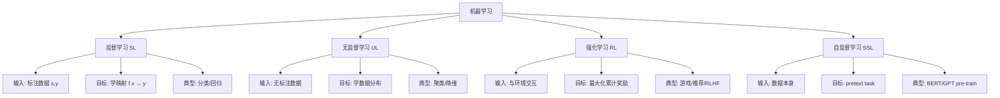

# 1-RL 基础与数学——MDP / Bellman / 价值函数 / 策略

> **本章定位**: RL 的数学基础。从"什么是 RL" 到"能推导出策略梯度定理",是后续所有算法的地基。
>
> **学完本章, 你能**:
> - 写出 RL 的 5 大核心数学对象 (状态/动作/奖励/策略/价值)
> - 推导 Bellman 期望方程与 Bellman 最优方程
> - 理解为什么策略梯度定理成立 (含完整推导)
> - 解释 ε-greedy / UCB / Thompson Sampling 的数学直觉
> - 理解函数逼近下的收敛性挑战
> - 在 PyTorch 中实现 tabular Q-learning
>
> **本章风格**: 数学严谨 + 直觉优先 + 代码落地。每节都遵循:
> ```
> 1. 数学公式 (LaTeX)
> 2. 直觉解释 (文字 + 图)
> 3. 算法伪代码
> 4. PyTorch 实现
> 5. 工业例子
> 6. 失败模式
> 7. 与替代方法对比
> ```

---

## 0. 一句话总结

> **RL 是在 MDP 框架下, 通过最大化期望累计折扣奖励来学习最优策略的范式;其数学核心是 Bellman 方程与策略梯度定理**——本章从定义出发, 一步步推导所有核心定理。

---

## 1. 元信息 (Meta)

| 项 | 值 |
| :--- | :--- |
| 文件名 | `1-RL基础与数学.md` |
| 教程定位 | 基础理论与数学 |
| 难度 | ⭐⭐⭐ (需要线性代数 + 概率 + 深度学习基础) |
| 学完后能做什么 | 推导 RL 核心公式 + 读懂 RL 论文 + 实现 tabular RL 算法 |
| 推荐时长 | 通读 8 小时; 实战 40 小时 |
| 配套代码 | 第 13 节习题中包含完整 PyTorch 实现 |
| 关联教程 |  / `2-经典RL算法详解.md` / `3-RL在LLM中的经典方法.md` |
| 维护人 | 自维护 |
| 当前版本 | v1.0 (2026-07-22) |

---

## 2. RL 是什么 (定义 / 历史 / 哲学)

### 2.1 一句话定义

> **强化学习 (Reinforcement Learning, RL) 是一种通过与环境交互学习"做什么 (策略)" 的机器学习范式, 其目标是最大化长期累计奖励。**

### 2.2 与其他 ML 范式的对比



### 2.3 RL 的核心特征

```text
1. 试错学习 (Trial and Error)
   - 不需要"正确答案"
   - 通过 action → reward → 改进

2. 延迟反馈 (Delayed Feedback)
   - 当前动作可能影响未来 reward
   - 不是 immediate supervised signal

3. 时间序列 (Temporal Sequence)
   - 状态 $s_t$ → 动作 $a_t$ → 奖励 $r_t$ → 状态 $s_{t+1}$
   - 数据非 i.i.d.

4. 探索与利用 (Exploration vs Exploitation)
   - 不能只看已知的好
   - 必须尝试新动作
```

### 2.4 RL 的发展史 (简要)

```text
1950s   - 行为心理学的"试错学习" (Thorndike)
1957   - Bellman 动态规划
1989   - Q-Learning (Watkins)
1992   - REINFORCE (Williams)
1996   - TD-Gammon (Tesauro, Backgammon 世界冠军级)
2013   - DQN (Mnih, Atari)
2015   - AlphaGo (Silver)
2016   - A3C, GAE, TRPO
2017   - PPO (Schulman)
2018   - SAC, World Models
2019   - MuZero
2020   - InstructGPT (RLHF)
2022   - ChatGPT (RLHF 规模化)
2023   - DPO
2024   - GRPO (DeepSeek)
2025   - DeepSeek-R1, OpenAI o1 (推理 RL)
```

### 2.5 RL 的"哲学"

```yaml
监督学习的哲学: "从已知答案中归纳规律"
RL 的哲学:       "通过行动发现更好的策略"

RL 的关键洞察:
  - 不需要"标准答案"
  - 不需要完整知识
  - 只需要"奖励信号"
  - 通过试错自学

这与人类学习的本质更接近:
  - 婴儿不是通过"正确答案"学走路
  - 而是通过"站起来 + 不摔倒" 的奖励信号
```

---

## 3. 马尔可夫决策过程 (MDP) 详解

### 3.1 MDP 五元组定义

> **MDP (Markov Decision Process) = $(\mathcal{S}, \mathcal{A}, P, R, \gamma)$**

| 符号 | 含义 | 示例 |
| :--- | :--- | :--- |
| $\mathcal{S}$ | 状态空间 | 围棋盘 $19 \times 19$ 个状态 |
| $\mathcal{A}$ | 动作空间 | 落子位置 (361 种) |
| $P(s'\|s,a)$ | 转移概率 | 走出这一步后棋盘变成什么 |
| $R(s,a,s')$ | 奖励函数 | 吃掉一个子得 1 分 |
| $\gamma \in [0,1)$ | 折扣因子 | 0.9 = 短视, 0.99 = 长视 |

### 3.2 状态 (State) 与动作 (Action)

#### 3.2.1 状态的数学定义

$$s_t \in \mathcal{S}$$

状态是对"环境当前所有相关信息" 的完整描述。

**例子**:
- 围棋: $s_t$ = 当前棋盘 + 历史 (为了禁全局同型)
- 推荐: $s_t$ = 用户最近 100 次点击 + 时间 + 设备
- LLM: $s_t$ = 当前 prompt + 已生成的 tokens

#### 3.2.2 动作的数学定义

$$a_t \in \mathcal{A}(s_t)$$

动作空间可以是:
- **离散**: 围棋 361 个落子点
- **连续**: 机器人关节角度 $[-\pi, \pi]^7$
- **混合**: 自动驾驶 (转向 + 油门 + 刹车)

### 3.3 转移概率 $P(s'|s,a)$

$$P(s_{t+1} = s' | s_t = s, a_t = a)$$

表示"在状态 $s$ 做动作 $a$, 环境变成 $s'$ 的概率"。

**例子**:
- 确定性: Atari 游戏 (按键 → 下一帧唯一)
- 随机性: 机器人 (噪声 + 物理不确定性)

### 3.4 奖励函数 $R(s,a,s')$

$$r_t = R(s_t, a_t, s_{t+1})$$

**例子**:
- 推荐: 点击 = 1, 未点击 = 0, 转化 = 5
- LLM: 答案正确 = 1, 错误 = 0, 格式不对 = -0.5
- 机器人: 到达目标 = +10, 摔倒 = -100, 每步 -0.1

### 3.5 马尔可夫性

> **马尔可夫性 (Markov Property)**: $P(s_{t+1}|s_t, a_t, s_{t-1}, a_{t-1}, \ldots) = P(s_{t+1}|s_t, a_t)$
>
> **直观**: "未来只取决于当前, 不取决于过去"

```yaml
马尔可夫性的"哲学含义":
  - 当前状态是"历史的充分统计量"
  - 不需要记住所有历史
  - 这是 RL 的"信息压缩"假设

马尔可夫性成立的场景:
  - 棋盘状态 (所有信息都在当前棋子上)
  - Atari 帧 (帧中所有像素)
  - 用户 embedding (历史压缩到 embedding)

马尔可夫性不成立的场景:
  - 部分可观测 → 用 POMDP
  - 历史过长 → 用 RNN 近似
```

### 3.6 折扣因子 $\gamma$

$$R_t = \sum_{k=0}^{\infty} \gamma^k r_{t+k}$$

$\gamma$ 控制"未来奖励的重要性":

| $\gamma$ | 含义 | 典型场景 |
| :--- | :--- | :--- |
| $\gamma = 0$ | 只看立即奖励 | 监督学习 (退化为分类) |
| $\gamma = 0.9$ | 短期视野 (10-20 步) | 短期 CTR 优化 |
| $\gamma = 0.99$ | 中期视野 (100 步) | LLM 单轮对话 |
| $\gamma = 0.999$ | 长期视野 (1000 步) | 7 日/30 日 LTV |
| $\gamma \to 1$ | 永不折扣 | 理论分析 (易发散) |

**有效视野**:
$$H_{\text{eff}} = \frac{1}{1-\gamma}$$

| $\gamma$ | $H_{\text{eff}}$ |
| :---: | :---: |
| 0.9 | 10 |
| 0.95 | 20 |
| 0.99 | 100 |
| 0.999 | 1000 |

### 3.7 部分可观测 MDP (POMDP)

> **POMDP = $(\mathcal{S}, \mathcal{A}, \mathcal{O}, P, R, O, \gamma)$**, 其中 $\mathcal{O}$ 是观测空间

```yaml
MDP: 状态完全可观测 → 棋盘 + 所有信息
POMDP: 状态部分可观测 → 只能看到部分信息

例子:
  - Atari: 当前帧就是状态 (MDP)
  - 扑克: 只看到自己的牌 (POMDP)
  - 推荐: 用户画像 = 状态的近似 (POMDP)

POMDP 的解决方案:
  1. 状态估计: 用 RNN/LSTM 压缩历史
  2. Belief State: 后验分布 P(s|h)
  3. 直接用观测: π(a|o_t) 而非 π(a|s_t)
```

### 3.8 多智能体 MDP

```yaml
多个 agent 同时决策:
  - 状态: 联合状态 $s_t = (s_t^1, s_t^2, \ldots, s_t^n)$
  - 动作: 联合动作 $a_t = (a_t^1, a_t^2, \ldots, a_t^n)$
  - 奖励: 每个 agent 独立 $r_t^i$

分类:
  - 完全合作 (Cooperative): 所有 agent 共享 reward
  - 完全竞争 (Competitive): 零和游戏
  - 混合 (Mixed): 每个 agent 不同 reward

例子:
  - 推荐 (Cooperative): 召回 + 粗排 + 精排 协同
  - 德州扑克 (Competitive): 你 vs 对手
  - 自动驾驶 (Mixed): 多辆车协调
```

### 3.9 MDP 的"几何直观"

```text
想象一个"地形图":
  - 横轴 = 状态空间
  - 纵轴 = 时间
  - 山峰 = 高 reward 状态
  - 山谷 = 低 reward 状态

RL 目标 = 从起点出发, 找一条"累计高度最高"的路径
策略 π = 在每个状态选什么动作
价值 V = 在某个状态的"未来累计高度期望"
```

---

## 4. 回报与折扣

### 4.1 折扣回报定义

> **折扣回报 (Discounted Return)**: $G_t = \sum_{k=0}^{\infty} \gamma^k r_{t+k}$

其中:
- $r_{t+k}$ 是在 $t+k$ 时刻获得的奖励
- $\gamma \in [0, 1)$ 是折扣因子
- 几何级数收敛: $\sum_{k=0}^{\infty} \gamma^k = \frac{1}{1-\gamma}$

### 4.2 回报的递推关系

$$G_t = r_t + \gamma r_{t+1} + \gamma^2 r_{t+2} + \ldots = r_t + \gamma G_{t+1}$$

**直觉**: 当前回报 = 当前奖励 + 折扣后的未来回报

### 4.3 多步奖励的累积

```yaml
单步奖励: $r_t$ (immediate reward)
多步奖励: $r_{t:t+n} = r_t + r_{t+1} + \ldots + r_{t+n-1}$
折扣多步奖励: $r_{t:t+n}^\gamma = r_t + \gamma r_{t+1} + \ldots + \gamma^{n-1} r_{t+n-1}$

n 步 TD target: $G_{t:t+n} = r_t + \gamma r_{t+1} + \ldots + \gamma^{n-1} r_{t+n-1} + \gamma^n V(s_{t+n})$
```

### 4.4 回报的"经济直觉"

```text
γ = 1: 1 元今天 = 1 元明天 (理性投资者)
γ = 0.9: 1 元今天 = 0.9 元明天 (略不耐烦)
γ = 0.5: 1 元今天 = 0.5 元明天 (很急)

RL 中 γ 的含义:
  - "RL agent 的耐心程度"
  - γ 越大, agent 越有远见
  - γ 越小, agent 越急功近利
```

### 4.5 不同任务的 γ 选择

| 任务 | 推荐 $\gamma$ | 原因 |
| :--- | :---: | :--- |
| Atari 游戏 | 0.99 | 游戏长度 1K-10K 步 |
| MuJoCo 控制 | 0.99 | 任务长度 1K 步 |
| LLM RLHF | 0.95-0.99 | 单轮对话 |
| 推荐 CTR | 0.9-0.95 | 短期 CTR |
| 推荐 LTV | 0.99-0.999 | 7-30 天 LTV |
| 围棋 | 0.99 | 中盘 200-300 步 |
| 自动驾驶 | 0.95-0.99 | 决策 10-100 步 |

---

## 5. 价值函数

### 5.1 状态价值 $V^\pi(s)$

> **状态价值 (State Value)**: 从状态 $s$ 出发, 遵循策略 $\pi$, 期望累计折扣奖励。

$$V^\pi(s) = \mathbb{E}_\pi\left[\sum_{k=0}^{\infty} \gamma^k r_{t+k} \;\Big|\; s_t = s\right]$$

**直觉**: "$V^\pi(s)$ 大" = "在状态 $s$ 之后能拿到的总奖励高"

### 5.2 动作价值 $Q^\pi(s,a)$

> **动作价值 (Action Value)**: 在状态 $s$ 选动作 $a$, 然后遵循策略 $\pi$, 期望累计折扣奖励。

$$Q^\pi(s,a) = \mathbb{E}_\pi\left[\sum_{k=0}^{\infty} \gamma^k r_{t+k} \;\Big|\; s_t = s, a_t = a\right]$$

**直觉**: "$Q^\pi(s,a)$ 大" = "在状态 $s$ 选动作 $a$ 之后能拿到的总奖励高"

### 5.3 $V$ 与 $Q$ 的关系

```python
# V 是 Q 在动作上的期望
V^π(s) = Σ_a π(a|s) · Q^π(s,a)

# Q 是 R + γ V
Q^π(s,a) = E[r_t + γ V^π(s_{t+1}) | s_t=s, a_t=a]
```

### 5.4 优势函数 $A^\pi(s,a)$

> **优势函数 (Advantage)**: $A^\pi(s,a) = Q^\pi(s,a) - V^\pi(s)$

**直觉**:
- $A^\pi(s,a) > 0$ → 在状态 $s$ 选动作 $a$ 比平均好
- $A^\pi(s,a) < 0$ → 在状态 $s$ 选动作 $a$ 比平均差
- $A^\pi(s,a) = 0$ → 跟平均一样

**在 PPO / A3C 中的核心作用**: 策略梯度 = $E[\nabla \log \pi \cdot A]$

### 5.5 价值函数的"几何直观"

```text
状态空间中的"地形图":

        高 V(s)        低 V(s)
         /\             /\
        /  \           /  \
       /    \         /    \
      /      \       /      \
   ─────────────────────────────→ 时间
   起点  →  →  →  →  →  →  →

V(s) = 从 s 出发, "未来奖励总和的期望"

Q(s,a) 是 V(s) 的"细化":
  V(s) = "从这个状态出发, 平均未来奖励"
  Q(s,a) = "从这个状态走 a 这条路, 平均未来奖励"

A(s,a) = Q(s,a) - V(s):
  > 0: 走 a 这条路比平均好
  < 0: 走 a 这条路比平均差
```

### 5.6 价值函数的"工业例子"

#### 例子 1: 推荐系统

```text
V(s) = "用户当前状态之后未来 30 天的 GMV 期望"
Q(s,i) = "给用户推物品 i 之后未来 30 天的 GMV 期望"
A(s,i) = Q(s,i) - V(s) = "推物品 i 比平均好多少"
```

#### 例子 2: LLM RLHF

```text
V(s) = "当前 prompt + 已生成 token 之后, 期望未来 token 的 reward"
Q(s,a) = "选 token a 之后, 期望未来 token 的 reward"
A(s,a) = "选 token a 比平均好多少"
```

#### 例子 3: 机器人

```text
V(s) = "机器人当前状态之后, 期望完成任务的概率"
Q(s,a) = "执行动作 a 之后, 期望完成任务的概率"
A(s,a) = "动作 a 比平均动作好多少"
```

---

## 6. Bellman 方程

### 6.1 Bellman 期望方程 (Policy-Specific)

#### 6.1.1 状态价值的 Bellman 期望方程

$$V^\pi(s) = \sum_a \pi(a|s) \sum_{s',r} p(s',r|s,a) \left[ r + \gamma V^\pi(s') \right]$$

#### 6.1.2 动作价值的 Bellman 期望方程

$$Q^\pi(s,a) = \sum_{s',r} p(s',r|s,a) \left[ r + \gamma \sum_{a'} \pi(a'|s') Q^\pi(s',a') \right]$$

#### 6.1.3 直觉解释

```text
Bellman 期望方程的核心思想:
  "今天的价值 = 今天的奖励 + 明天的价值 × 折扣"

这是"时间递推"的数学表达:
  V(s_t) = r_t + γ · V(s_{t+1})

  ↑ 把"未来的无穷级数" 化简为"一步加未来"
```

#### 6.1.4 推导 (详细)

**从定义开始**:
$$V^\pi(s) = \mathbb{E}_\pi\left[\sum_{k=0}^{\infty} \gamma^k r_{t+k} \;\Big|\; s_t = s\right]$$

**拆出第 0 步**:
$$V^\pi(s) = \mathbb{E}_\pi\left[r_t + \sum_{k=1}^{\infty} \gamma^k r_{t+k} \;\Big|\; s_t = s\right]$$

**利用 $\sum_{k=1}^\infty \gamma^k = \gamma \sum_{k=0}^\infty \gamma^k$**:
$$V^\pi(s) = \mathbb{E}_\pi\left[r_t + \gamma \sum_{k=0}^{\infty} \gamma^k r_{t+1+k} \;\Big|\; s_t = s\right]$$

**注意到这就是 $V^\pi(s_{t+1})$ 的定义**:
$$V^\pi(s) = \mathbb{E}_\pi\left[r_t + \gamma V^\pi(s_{t+1}) \;\Big|\; s_t = s\right]$$

**展开期望**:
$$V^\pi(s) = \sum_a \pi(a|s) \sum_{s',r} p(s',r|s,a) \left[r + \gamma V^\pi(s')\right]$$

这就是 **Bellman 期望方程**。

### 6.2 Bellman 最优方程 (Optimal)

#### 6.2.1 状态价值

$$V^*(s) = \max_a \sum_{s',r} p(s',r|s,a) \left[r + \gamma V^*(s')\right]$$

#### 6.2.2 动作价值

$$Q^*(s,a) = \sum_{s',r} p(s',r|s,a) \left[r + \gamma \max_{a'} Q^*(s',a')\right]$$

#### 6.2.3 直觉解释

```yaml
Bellman 最优方程的核心思想:
  "最优价值 = 在当前状态选最优动作, 然后拿到最优未来"

区别于 Bellman 期望方程:
  期望方程: V^π = 当前策略下的期望
  最优方程: V* = 所有可能策略中的最大值
```

### 6.3 推导 Bellman 最优方程

**从 Bellman 期望方程出发**:
$$V^\pi(s) = \sum_a \pi(a|s) \sum_{s',r} p(s',r|s,a) [r + \gamma V^\pi(s')]$$

**最优策略的性质**: $\pi^*(a|s) = 1$ if $a = \arg\max_a Q^*(s,a)$, else 0

**代入最优策略**:
$$V^*(s) = \max_a \sum_{s',r} p(s',r|s,a) [r + \gamma V^*(s')]$$

### 6.4 Bellman 算子

#### 6.4.1 Bellman 算子定义

$$(TV)(s) = \max_a \sum_{s',r} p(s',r|s,a) [r + \gamma V(s')]$$

#### 6.4.2 收缩性

$$\|TV - TU\|_\infty \leq \gamma \|V - U\|_\infty$$

#### 6.4.3 Banach 不动点定理

- Bellman 算子是 $\gamma$-收缩映射
- 由 Banach 不动点定理, 有唯一不动点 $V^*$
- 任意 $V_0$ 反复应用 $T$ 必收敛到 $V^*$

这是 **Value Iteration** 算法的理论基础。

### 6.5 Bellman 方程的"统一视角"

```yaml
所有 Bellman 方程都是"递推"结构:

  V(s_t) = r_t + γ · (s_{t+1} 的某种价值)

  期望:    s_{t+1} 的价值 = V^{π}(s_{t+1})
  最优:    s_{t+1} 的价值 = V^*(s_{t+1}) = max_a Q^*(s_{t+1}, a)

这统一了:
  - DP / Policy Iteration
  - Value Iteration
  - Q-Learning
  - SARSA
  - TD(λ)
  - 所有 RL 算法
```

---

## 7. 策略 (Policy)

### 7.1 策略定义

> **策略 (Policy)**: 从状态到动作的映射 $\pi: \mathcal{S} \to \mathcal{A}$ 或 $\pi(a|s)$

### 7.2 确定性 vs 随机性

#### 7.2.1 确定性策略

$$a = \pi(s)$$

**例子**: 围棋中"在状态 $s$ 落子位置" 唯一确定

#### 7.2.2 随机性策略

$$a \sim \pi(\cdot|s)$$

**例子**: 扑克中"在状态 $s$ 加注概率 vs 弃牌概率"

#### 7.2.3 为什么需要随机性?

```text
1. 探索 (Exploration):
   - 确定性策略会卡在局部最优
   - 随机性能多试几个动作

2. 博弈 (Game Theory):
   - 剪刀石头布的最优策略是 1/3 概率
   - 确定性会被对手利用

3. 鲁棒性 (Robustness):
   - 随机性可应对环境不确定性
   - SAC 的最大熵就是利用这一点
```

### 7.3 参数化策略

$$a \sim \pi_\theta(\cdot|s)$$

$\theta$ 是神经网络参数。

**例子**:
- LLM: $\theta$ 是 transformer 参数, $\pi_\theta(a_t|s_t) = $ softmax over vocab
- 推荐: $\theta$ 是双塔模型参数, $\pi_\theta(i|s)$ 是 item embedding similarity
- 机器人: $\theta$ 是策略网络参数, $\pi_\theta(a|s) = \mathcal{N}(\mu_\theta(s), \sigma_\theta(s))$

### 7.4 策略的"实现方式"

#### 7.4.1 Tabular 策略 (离散小状态空间)

```python
# 每个 (s, a) 一个概率值
policy = np.zeros((num_states, num_actions))
policy[s, a] = 0.5  # 状态 s 选 a 概率 0.5
```

#### 7.4.2 神经网络策略 (大状态空间)

```python
import torch
import torch.nn as nn

class PolicyNetwork(nn.Module):
    def __init__(self, state_dim, action_dim):
        super().__init__()
        self.fc = nn.Sequential(
            nn.Linear(state_dim, 64),
            nn.ReLU(),
            nn.Linear(64, action_dim)
        )

    def forward(self, state):
        # 输出动作 logits
        logits = self.fc(state)
        # 用 softmax 转概率
        probs = torch.softmax(logits, dim=-1)
        return probs  # 离散动作

    def sample(self, state):
        # 随机采样一个动作
        probs = self.forward(state)
        dist = torch.distributions.Categorical(probs)
        action = dist.sample()
        log_prob = dist.log_prob(action)
        return action, log_prob
```

#### 7.4.3 连续动作策略

```python
class GaussianPolicy(nn.Module):
    def __init__(self, state_dim, action_dim):
        super().__init__()
        self.fc = nn.Sequential(
            nn.Linear(state_dim, 64),
            nn.ReLU(),
        )
        self.mean_head = nn.Linear(64, action_dim)
        self.log_std_head = nn.Linear(64, action_dim)

    def forward(self, state):
        h = self.fc(state)
        mean = self.mean_head(h)
        log_std = self.log_std_head(h)
        std = torch.exp(log_std)
        return mean, std

    def sample(self, state):
        mean, std = self.forward(state)
        dist = torch.distributions.Normal(mean, std)
        action = dist.sample()
        log_prob = dist.log_prob(action).sum(dim=-1)
        return action, log_prob
```

### 7.5 最优策略的存在性

**定理**: 在有限 MDP 中, 至少存在一个最优策略 $\pi^*$, 使得:
$$V^*(s) = V^{\pi^*}(s) = \max_\pi V^\pi(s) \quad \forall s$$

**直觉**:
- Bellman 最优方程的解唯一 ($V^*$)
- 对应的 $\pi^*$ 至少有一个 (可能有多个)

### 7.6 策略的"层次"

```text
Level 1: 随机策略 vs 确定性策略
Level 2: 参数化 vs 非参数化
Level 3: 单步 vs 多步
Level 4: 单智能体 vs 多智能体

不同选择适合不同问题:
  - 游戏 AI: 确定性 + 神经网络
  - 推荐: 随机性 + 神经网络
  - 机器人: 连续动作 + 高斯策略
  - LLM: 词表级随机性 + transformer
```

---

## 8. 策略评估与改进

### 8.1 策略评估 (Policy Evaluation)

> **策略评估**: 给定策略 $\pi$, 计算 $V^\pi(s)$

#### 8.1.1 迭代式策略评估

**算法**:
```yaml
输入: π, V_0 (任意初始化), 阈值 ε
输出: V ≈ V^π

Repeat:
  Δ ← 0
  For each s in S:
    v ← V(s)
    V(s) ← Σ_a π(a|s) Σ_{s',r} p(s',r|s,a) [r + γ V(s')]
    Δ ← max(Δ, |v - V(s)|)
Until Δ < ε
```

#### 8.1.2 数学等价形式

$$V_{k+1}(s) = \sum_a \pi(a|s) \sum_{s',r} p(s',r|s,a) [r + \gamma V_k(s')]$$

#### 8.1.3 收敛性

由 Banach 不动点定理, $V_k \to V^\pi$ (线性收敛, 速率 $\gamma$)

#### 8.1.4 PyTorch 实现 (小例子)

```python
def policy_evaluation(policy, P, R, gamma=0.9, theta=1e-6, max_iter=1000):
    """
    Iterative Policy Evaluation

    Args:
        policy: (num_states, num_actions) 策略概率
        P: (num_states, num_actions, num_states) 转移概率
        R: (num_states, num_actions, num_states) 奖励
        gamma: 折扣因子
        theta: 收敛阈值
        max_iter: 最大迭代次数
    """
    num_states = policy.shape[0]
    V = np.zeros(num_states)

    for i in range(max_iter):
        delta = 0
        for s in range(num_states):
            v = V[s]
            new_v = 0
            for a in range(policy.shape[1]):
                for s_prime in range(num_states):
                    prob = policy[s, a] * P[s, a, s_prime]
                    new_v += prob * (R[s, a, s_prime] + gamma * V[s_prime])
            V[s] = new_v
            delta = max(delta, abs(v - V[s]))

        if delta < theta:
            print(f"Converged at iteration {i}")
            break

    return V
```

### 8.2 策略改进定理

> **策略改进定理 (Policy Improvement Theorem)**: 设 $\pi$ 和 $\pi'$ 是两个策略, 如果对所有 $s \in \mathcal{S}$:
> $$Q^\pi(s, \pi'(s)) \geq V^\pi(s)$$
>
> 那么 $V^{\pi'}(s) \geq V^\pi(s)$ (对所有 $s$)。

**直观**: 如果在新策略 $\pi'$ 下的每个动作都不比 $\pi$ 差, 那 $\pi'$ 整体也不比 $\pi$ 差。

### 8.3 策略迭代 (Policy Iteration)

> **策略迭代**: 反复"评估策略 → 改进策略", 直到收敛。

```text
算法:
  1. 初始化 π_0
  2. Repeat:
       a. 策略评估: V^{π_k} ← evaluate(π_k)
       b. 策略改进: π_{k+1}(s) ← argmax_a Q^{π_k}(s, a)  for all s
     Until π_k+1 = π_k
  3. 返回 π*
```

**收敛性**: 策略迭代在有限 MDP 中有限步收敛到 $\pi^*$。

#### 8.3.1 PyTorch 实现

```python
def policy_iteration(P, R, gamma=0.9, theta=1e-6, max_iter=1000):
    """
    Policy Iteration Algorithm
    """
    num_states, num_actions = P.shape[0], P.shape[1]
    policy = np.ones((num_states, num_actions)) / num_actions
    V = np.zeros(num_states)

    for i in range(max_iter):
        # 策略评估
        V = policy_evaluation(policy, P, R, gamma, theta)

        # 策略改进
        policy_stable = True
        for s in range(num_states):
            old_action = np.argmax(policy[s])

            # 计算 Q
            Q = np.zeros(num_actions)
            for a in range(num_actions):
                for s_prime in range(num_states):
                    Q[a] += P[s, a, s_prime] * (R[s, a, s_prime] + gamma * V[s_prime])

            # 选最优动作
            new_action = np.argmax(Q)
            if old_action != new_action:
                policy_stable = False

            # 更新策略 (greedy)
            policy[s] = np.zeros(num_actions)
            policy[s, new_action] = 1.0

        if policy_stable:
            print(f"Policy iteration converged at iteration {i}")
            break

    return policy, V
```

### 8.4 值迭代 (Value Iteration)

> **值迭代**: 直接迭代 Bellman 最优方程, 跳过"完整策略评估"。

```text
算法:
  1. 初始化 V_0 (任意)
  2. Repeat:
       For each s:
         V(s) ← max_a Σ_{s',r} p(s',r|s,a) [r + γ V(s')]
     Until V 收敛
  3. 提取策略: π(s) ← argmax_a Σ_{s',r} p(s',r|s,a) [r + γ V(s')]
```

#### 8.4.1 与策略迭代的对比

| 维度 | 策略迭代 | 值迭代 |
| :--- | :--- | :--- |
| 每次外层迭代 | 完整策略评估 (多次 Bellman) | 1 次 Bellman 更新 |
| 收敛速度 | 较少的外层迭代 | 较多的外层迭代 |
| 总计算量 | 相当 | 相当 |
| 实现复杂度 | 中等 | 简单 |

#### 8.4.2 PyTorch 实现

```python
def value_iteration(P, R, gamma=0.9, theta=1e-6, max_iter=1000):
    """
    Value Iteration Algorithm
    """
    num_states, num_actions = P.shape[0], P.shape[1]
    V = np.zeros(num_states)

    for i in range(max_iter):
        delta = 0
        for s in range(num_states):
            v = V[s]
            Q = np.zeros(num_actions)
            for a in range(num_actions):
                for s_prime in range(num_states):
                    Q[a] += P[s, a, s_prime] * (R[s, a, s_prime] + gamma * V[s_prime])
            V[s] = np.max(Q)
            delta = max(delta, abs(v - V[s]))

        if delta < theta:
            print(f"Value iteration converged at iteration {i}")
            break

    # 提取策略
    policy = np.zeros((num_states, num_actions))
    for s in range(num_states):
        Q = np.zeros(num_actions)
        for a in range(num_actions):
            for s_prime in range(num_states):
                Q[a] += P[s, a, s_prime] * (R[s, a, s_prime] + gamma * V[s_prime])
        best_action = np.argmax(Q)
        policy[s, best_action] = 1.0

    return policy, V
```

### 8.5 Generalized Policy Iteration (GPI)

> **GPI**: 策略评估和策略改进交替进行, 不要求任一过程完全收敛。

```text
GPI 的"哲学":
  - 策略评估和策略改进是"相互促进"的过程
  - 两者"赛跑": 评估追改进, 改进追评估
  - 最终收敛到 V = V* 和 π = π*

这正是所有现代 RL 算法的本质:
  - DQN: 用神经网络近似 Q, 反复更新 Q
  - PPO: 用策略梯度更新策略, 用价值网络更新 V
  - 都在做"近似的策略评估 + 近似的策略改进"
```

---

## 9. 探索与利用

### 9.1 探索-利用困境 (Exploration-Exploitation Dilemma)

> **核心问题**: 应该选当前已知的最好动作 (利用), 还是尝试新动作 (探索)?

```yaml
利用: a = argmax_a Q(s, a) (当前最优)
探索: 随机选一个动作

矛盾:
  - 只利用: 错过更好的动作
  - 只探索: 永远拿不到好奖励
  - 必须平衡
```

### 9.2 ε-greedy

> **ε-greedy**: 以 $1-\varepsilon$ 概率选最优动作, 以 $\varepsilon$ 概率随机

```python
def epsilon_greedy(Q, state, epsilon=0.1):
    """ε-greedy 动作选择"""
    if random.random() < epsilon:
        # 探索: 随机选
        return random.choice(range(len(Q[state])))
    else:
        # 利用: 选最优
        return np.argmax(Q[state])
```

**优点**: 简单
**缺点**: 探索完全无目的, 可能探索到很差的动作

### 9.3 UCB (Upper Confidence Bound)

> **UCB**: 不仅看 Q 值, 还看"不确定性"

$$a_t = \arg\max_a \left[ Q_t(a) + c \sqrt{\frac{\ln t}{N_t(a)}} \right]$$

其中:
- $Q_t(a)$: 动作 $a$ 的平均 reward
- $N_t(a)$: 动作 $a$ 被选次数
- $c$: 探索系数

**直觉**: "如果一个动作很少被尝试, 它的置信区间很宽, 鼓励探索"

**优点**: 有理论保证 (regret bound $O(\sqrt{K T \ln T})$)
**缺点**: 需要状态分组 (contextual bandit)

```python
def ucb(Q, N, t, c=2.0):
    """UCB 动作选择"""
    num_actions = len(Q)
    if min(N) == 0:
        return np.argmin(N)  # 先探索所有动作
    ucb_values = Q + c * np.sqrt(np.log(t) / N)
    return np.argmax(ucb_values)
```

### 9.4 Thompson Sampling

> **Thompson Sampling**: 从 Q 值的后验分布中采样, 选择采样值最大的动作

```python
import numpy as np

def thompson_sampling(alpha, beta):
    """
    Thompson Sampling for Bernoulli rewards.

    alpha[a], beta[a]: Beta distribution parameters
      alpha[a] + beta[a] = 动作 a 的尝试次数 + 1
      alpha[a]: 成功次数 + 1
    """
    samples = np.array([np.random.beta(alpha[a], beta[a])
                        for a in range(len(alpha))])
    return np.argmax(samples)
```

**直觉**: "如果一个动作成功率高, 它的 Beta 分布会偏右, 采样值通常大"

**优点**: 实际效果好 (A/B 测试常用)
**缺点**: 需要先验分布

### 9.5 熵正则 (Entropy Regularization)

> **最大熵 RL**: 在最大化 reward 的同时最大化策略的熵

$$J(\pi) = \mathbb{E}\left[\sum_t r_t + \alpha H(\pi(\cdot|s_t))\right]$$

其中:
- $H(\pi(\cdot|s)) = -\sum_a \pi(a|s) \log \pi(a|s)$ 是策略熵
- $\alpha$ 是熵权重

**优点**:
- 鼓励探索 (熵越大越多样)
- 训练稳定 (SAC 核心)
- 鲁棒 (应对环境不确定性)

```python
def policy_with_entropy(logits, alpha=0.1):
    """带熵正则的策略"""
    probs = torch.softmax(logits, dim=-1)
    log_probs = torch.log_softmax(logits, dim=-1)
    entropy = -(probs * log_probs).sum(dim=-1)

    # 熵正则
    return probs, entropy * alpha
```

### 9.6 探索策略对比

| 策略 | 理论保证 | 实际效果 | 适用场景 |
| :--- | :--- | :--- | :--- |
| ε-greedy | 无 | 中 | 简单环境 |
| UCB | 有 (regret bound) | 好 | 上下文 Bandit |
| Thompson | 近似有 | 很好 | A/B 测试 |
| Entropy Reg. | 无 (但稳定) | 好 | RL (SAC) |
| Curiosity (ICM) | 无 | 中 | 稀疏奖励 |
| RND | 无 | 中 | 稀疏奖励 |

### 9.7 LLM 中的探索

```text
LLM RLHF 的探索:
  - 通常是 stochastic policy (有 temperature)
  - temperature = 0: 完全利用 (贪心)
  - temperature 高: 多样探索

DPO/GRPO 不需要额外探索:
  - 偏好对已经给出"哪个更好"
  - 策略从偏好对中学习
```

---

## 10. 函数逼近

### 10.1 函数逼近的必要性

```text
Tabular RL:
  - 维护一张 Q[s, a] 表
  - 状态数 ≤ 10^5 时可行
  - 状态数 ≥ 10^6 (图像) → 不可能

Deep RL:
  - 用神经网络 Q_θ(s, a) 近似 Q(s, a)
  - 泛化能力强
  - 但理论保证丢失 (收敛性难证)
```

### 10.2 线性逼近

$$Q(s, a; \theta) = \theta^T \phi(s, a)$$

其中 $\phi(s, a)$ 是手工设计的特征。

**例子**:
- 状态 = (位置, 速度), $\phi = (1, s, s^2, v, v^2)$
- Q 网络 = 一层线性层

**收敛性**: 线性逼近 + 适当条件 → TD 学习收敛

### 10.3 神经网络逼近

$$Q(s, a; \theta) = \text{MLP}(s, a)$$

**例子**:
- Atari: 输入图像 (4 × 84 × 84), 输出每个动作的 Q 值
- LLM: 输入 prompt, 输出每个 token 的 Q 值

**挑战**:
- 不再保证收敛 (可能发散)
- "deadly triad" (函数逼近 + bootstrapping + off-policy)
- 实际经验: 大多数情况下能收敛, 但需要技巧

### 10.4 Deadly Triad

> **死亡三联 (Deadly Triad)**: 函数逼近 + 自举 (Bootstrapping) + 离策略 (Off-policy) 同时使用, 可能导致训练发散。

```text
函数逼近 (Function Approximation):
  - 用神经网络近似 Q
  - 状态泛化强, 但价值估计可能不收敛

自举 (Bootstrapping):
  - 用 V(s') 估计 V(s) (TD 学习)
  - 不需要完整 episode, 但有偏差

离策略 (Off-policy):
  - Q-Learning 用 max Q, 但数据是其他策略产生
  - 样本效率高, 但分布偏移

三者同时:
  - Q 值可能发散 → 训练崩溃
  - 需要技巧: Target Network, Replay Buffer, 等等
```

### 10.5 收敛性理论

#### 10.5.1 Tabular TD: 收敛到 $V^\pi$

**定理**: 在 tabular MDP 中, TD(0) 以概率 1 收敛到 $V^\pi$, 收敛速率 $O(1/t)$。

#### 10.5.2 线性 TD: 收敛到 $V^\pi$ 的投影

**定理**: 线性 TD(0) 收敛到 $V^\pi$ 在 $\theta$ 参数空间中的最佳投影。

#### 10.5.3 神经网络 TD: 不保证收敛

**实践**: 大多数情况下能收敛, 但需要:
- Target Network
- Experience Replay
- Gradient Clipping
- Reward/Value Clipping

### 10.6 函数逼近的 PyTorch 例子

```python
import torch
import torch.nn as nn

class QNetwork(nn.Module):
    """DQN 的 Q 网络"""
    def __init__(self, state_dim, action_dim, hidden_dim=64):
        super().__init__()
        self.fc = nn.Sequential(
            nn.Linear(state_dim, hidden_dim),
            nn.ReLU(),
            nn.Linear(hidden_dim, hidden_dim),
            nn.ReLU(),
            nn.Linear(hidden_dim, action_dim)
        )

    def forward(self, state):
        return self.fc(state)  # 输出每个动作的 Q 值

# 训练步骤
q_net = QNetwork(state_dim=4, action_dim=2)
target_q_net = QNetwork(state_dim=4, action_dim=2)
target_q_net.load_state_dict(q_net.state_dict())  # 初始化 target

optimizer = torch.optim.Adam(q_net.parameters(), lr=1e-3)

# 一个 batch 的训练
states = torch.randn(32, 4)
actions = torch.randint(0, 2, (32,))
rewards = torch.randn(32)
next_states = torch.randn(32, 4)
dones = torch.zeros(32)

# 当前 Q
q_values = q_net(states).gather(1, actions.unsqueeze(1)).squeeze()

# Target Q
with torch.no_grad():
    next_q = target_q_net(next_states).max(dim=1)[0]
    targets = rewards + gamma * next_q * (1 - dones)

# 损失
loss = nn.MSELoss()(q_values, targets)
optimizer.zero_grad()
loss.backward()
optimizer.step()
```

---

## 11. 经典数学证明 (定理 + 证明)

### 11.1 定理: Bellman 算子是 $\gamma$-收缩

**陈述**: 设 $\mathcal{B}$ 是值函数空间 (有界函数), 定义 Bellman 算子 $T: \mathcal{B} \to \mathcal{B}$:
$$(TV)(s) = \max_a \sum_{s',r} p(s',r|s,a) [r + \gamma V(s')]$$

则 $T$ 是 $\gamma$-收缩映射, 即:
$$\|TV - TU\|_\infty \leq \gamma \|V - U\|_\infty$$

**证明**:
对任意 $s$, 有:
$$
\begin{aligned}
(TV)(s) - (TU)(s) &= \max_a \sum_{s'} p(s'|s,a) [r + \gamma V(s')] - \max_a \sum_{s'} p(s'|s,a) [r + \gamma U(s')] \\
&\leq \max_a \left[\sum_{s'} p(s'|s,a) [r + \gamma V(s')] - \sum_{s'} p(s'|s,a) [r + \gamma U(s')]\right] \\
&= \gamma \max_a \sum_{s'} p(s'|s,a) [V(s') - U(s')] \\
&\leq \gamma \|V - U\|_\infty
\end{aligned}
$$

同理 $(TU)(s) - (TV)(s) \leq \gamma \|V - U\|_\infty$。

因此 $|(TV)(s) - (TU)(s)| \leq \gamma \|V - U\|_\infty$, 即 $\|TV - TU\|_\infty \leq \gamma \|V - U\|_\infty$。

证毕。

### 11.2 定理: Value Iteration 收敛到 $V^*$

**陈述**: 由 Banach 不动点定理, 在 $\gamma$-收缩下, Value Iteration $V_{k+1} = TV_k$ 收敛到唯一不动点 $V^* = TV^*$。

**证明**: 由 Banach 不动点定理:
- $\mathcal{B}$ 是完备度量空间 (有界函数 + sup 范数)
- $T$ 是 $\gamma$-收缩 (上面证明)
- 因此 $T$ 有唯一不动点 $V^*$
- 任意起点 $V_0$, $V_k = T^k V_0 \to V^*$ (指数收敛, 速率 $\gamma^k$)

证毕。

### 11.3 定理: 策略梯度定理

**陈述**: 对于任意可微策略 $\pi_\theta(a|s)$, 目标函数 $J(\theta) = \mathbb{E}_{\tau \sim \pi_\theta}[R(\tau)]$ 的梯度为:
$$\nabla_\theta J(\theta) = \mathbb{E}_{\tau \sim \pi_\theta}\left[\sum_t \nabla_\theta \log \pi_\theta(a_t|s_t) \cdot R_t\right]$$

**证明**:
$$
\begin{aligned}
\nabla_\theta J(\theta) &= \nabla_\theta \int P(\tau|\theta) R(\tau) d\tau \\
&= \int \nabla_\theta P(\tau|\theta) R(\tau) d\tau \\
&= \int P(\tau|\theta) \nabla_\theta \log P(\tau|\theta) R(\tau) d\tau \\
&= \mathbb{E}_{\tau \sim \pi_\theta} [\nabla_\theta \log P(\tau|\theta) R(\tau)]
\end{aligned}
$$

其中 $P(\tau|\theta) = p(s_0) \prod_t \pi_\theta(a_t|s_t) p(s_{t+1}|s_t, a_t)$, 因此:
$$\log P(\tau|\theta) = \log p(s_0) + \sum_t [\log \pi_\theta(a_t|s_t) + \log p(s_{t+1}|s_t,a_t)]$$

求梯度时, $p(s_0)$ 和 $p(s_{t+1}|s_t,a_t)$ 不依赖 $\theta$:
$$\nabla_\theta \log P(\tau|\theta) = \sum_t \nabla_\theta \log \pi_\theta(a_t|s_t)$$

代入:
$$\nabla_\theta J(\theta) = \mathbb{E}_{\tau}\left[\sum_t \nabla_\theta \log \pi_\theta(a_t|s_t) \cdot R(\tau)\right]$$

可以进一步证明 $R(\tau)$ 可替换为 $R_t = \sum_{t' \geq t} \gamma^{t'-t} r_{t'}$ (因果版本):
$$\nabla_\theta J(\theta) = \mathbb{E}_{\tau}\left[\sum_t \nabla_\theta \log \pi_\theta(a_t|s_t) \cdot R_t\right]$$

证毕。

### 11.4 定理: Policy Improvement Theorem

**陈述**: 设 $\pi, \pi'$ 是两个确定性策略, 如果对所有 $s$:
$$Q^\pi(s, \pi'(s)) \geq V^\pi(s)$$

那么 $V^{\pi'}(s) \geq V^\pi(s)$ 对所有 $s$。

**证明**:
$$
\begin{aligned}
V^\pi(s) &\leq Q^\pi(s, \pi'(s)) \\
&= \mathbb{E}_{s' \sim P(\cdot|s, \pi'(s))}[R(s, \pi'(s), s') + \gamma V^\pi(s')] \\
&\leq \mathbb{E}_{s' \sim P(\cdot|s, \pi'(s))}[R(s, \pi'(s), s') + \gamma Q^\pi(s', \pi'(s'))] \\
&= \mathbb{E}_{s' \sim P(\cdot|s, \pi'(s))}[R(s, \pi'(s), s') + \gamma V^{\pi'}(s')]
\end{aligned}
$$

一直递归下去:
$$V^\pi(s) \leq \mathbb{E}_{\tau \sim \pi'}[\sum_t \gamma^t r_t] = V^{\pi'}(s)$$

证毕。

### 11.5 定理: Soft Policy Improvement (SAC 理论基础)

**陈述**: 在最大熵 RL 框架下, 策略改进定理仍成立。

**证明**: 类比于 Policy Improvement Theorem, 只是把 $V$ 替换为软价值函数 (含熵项):
$$V^\pi_{\text{soft}}(s) = \mathbb{E}\left[\sum_t \gamma^t (r_t + \alpha H(\pi(\cdot|s_t)))\right]$$

证毕 (略)。

### 11.6 定理: TD(λ) 收敛性

**陈述**: 在 tabular MDP 中, TD(λ) 以概率 1 收敛到 $V^\pi$。

**证明概要**:
- TD(λ) 是 TD(0) 与 Monte Carlo 的凸组合
- 线性 TD(0) 收敛到 $V^\pi$ 的投影
- TD(λ) 用 eligibility trace, 收敛性比 TD(0) 更快
- 证明基于 stochastic approximation theory

(完整证明见 Sutton & Barto Chapter 12)

### 11.7 定理: Policy Gradient with Baseline

**陈述**: 加入 baseline $b(s)$ 后, 策略梯度仍无偏:
$$\nabla_\theta J(\theta) = \mathbb{E}\left[\sum_t \nabla_\theta \log \pi_\theta(a_t|s_t) \cdot (R_t - b(s_t))\right]$$

**证明**:
$$
\begin{aligned}
\mathbb{E}_{a_t \sim \pi}[\nabla_\theta \log \pi_\theta(a_t|s_t) \cdot b(s_t)] &= b(s_t) \sum_{a_t} \pi(a_t|s_t) \nabla_\theta \log \pi_\theta(a_t|s_t) \\
&= b(s_t) \sum_{a_t} \nabla_\theta \pi_\theta(a_t|s_t) \\
&= b(s_t) \nabla_\theta \sum_{a_t} \pi_\theta(a_t|s_t) \\
&= b(s_t) \nabla_\theta 1 = 0
\end{aligned}
$$

证毕。

### 11.8 定理: Advantage Function 不改变策略梯度

**陈述**: 用 $A^\pi(s,a) = Q^\pi(s,a) - V^\pi(s)$ 代替 $Q^\pi(s,a)$:
$$\nabla_\theta J(\theta) = \mathbb{E}\left[\sum_t \nabla_\theta \log \pi_\theta(a_t|s_t) \cdot A^\pi(s_t, a_t)\right]$$

**证明**: 由于 $\mathbb{E}_{a_t \sim \pi}[\nabla_\theta \log \pi_\theta(a_t|s_t) \cdot V^\pi(s_t)] = 0$ (上面证明), 因此:
$$
\mathbb{E}[\nabla_\theta \log \pi \cdot Q] = \mathbb{E}[\nabla_\theta \log \pi \cdot (Q - V)] = \mathbb{E}[\nabla_\theta \log \pi \cdot A]
$$

证毕。

---

## 12. 数学预备知识 (线性代数 / 概率 / 优化)

### 12.1 线性代数

#### 12.1.1 矩阵运算

```yaml
矩阵乘法: C = AB, C[i,j] = Σ_k A[i,k] · B[k,j]
矩阵转置: (AB)^T = B^T A^T
矩阵求逆: (AB)^{-1} = B^{-1} A^{-1}
SVD: A = UΣV^T (任何矩阵)
特征值分解: A = VΛV^{-1} (方阵)
```

#### 12.1.2 范数

```text
L2 范数: ||x||_2 = √(Σ_i x_i^2)
L1 范数: ||x||_1 = Σ_i |x_i|
Frobenius 范数: ||A||_F = √(Σ_{i,j} A_{ij}^2)
谱范数: ||A||_2 = max_x ||Ax||_2 / ||x||_2
```

#### 12.1.3 在 RL 中的应用

- Bellman 算子是 $\gamma$-收缩: 用 sup 范数
- Q-Learning 收敛性: 用矩阵范数分析
- 策略梯度定理: 用迹运算 $\text{Tr}(A^T B) = \langle A, B \rangle$

### 12.2 概率论

#### 12.2.1 基本概念

```yaml
期望: E[X] = Σ x P(x) 或 ∫ x p(x) dx
方差: Var(X) = E[(X - E[X])^2]
协方差: Cov(X,Y) = E[(X-E[X])(Y-E[Y])]
条件期望: E[X|Y] = Σ_x x P(x|Y)
```

#### 12.2.2 重要性采样

$$E_{x \sim p}[f(x)] = E_{x \sim q}\left[\frac{p(x)}{q(x)} f(x)\right]$$

在 RL 中的应用:
- Off-policy RL (CQL / IQL)
- TRPO / PPO 的重要性比率

#### 12.2.3 在 RL 中的应用

```yaml
状态转移: P(s'|s,a)
策略: π(a|s)
回报: G_t = Σ γ^k r_{t+k}
值函数: V^π(s) = E_π[G_t | s_t=s]
```

### 12.3 信息论

#### 12.3.1 熵

$$H(X) = -\sum_x p(x) \log p(x)$$

#### 12.3.2 KL 散度

$$D_{KL}(P \| Q) = \sum_x p(x) \log \frac{p(x)}{q(x)}$$

**不对称**: $D_{KL}(P \| Q) \neq D_{KL}(Q \| P)$

#### 12.3.3 在 RL 中的应用

```text
1. PPO 的 KL 约束:
   - 防止新策略偏离老策略太远
   - 用 KL 散度衡量"偏离程度"

2. SAC 的最大熵:
   - 在目标函数中加入 -α H(π)
   - 鼓励多样性

3. RLHF 的 KL 正则:
   - 防止 LLM 输出偏离 SFT 模型太远
   - 避免 reward hacking
```

### 12.4 优化理论

#### 12.4.1 梯度下降

$$x_{t+1} = x_t - \eta \nabla f(x_t)$$

#### 12.4.2 自然梯度

$$\theta_{t+1} = \theta_t - \eta F^{-1} \nabla_\theta J(\theta)$$

其中 $F$ 是 Fisher 信息矩阵。

#### 12.4.3 信赖域 (Trust Region)

$$\theta_{t+1} = \arg\max_\theta J(\theta) \quad \text{s.t.} \quad D_{KL}(\pi_{\theta_{old}} \| \pi_\theta) \leq \delta$$

这是 TRPO 的核心约束。

#### 12.4.4 在 RL 中的应用

```text
1. 策略梯度: 用梯度上升 (而非下降) 最大化 J
2. Adam 优化器: 在 RL 中很常用 (PPO / SAC 都用)
3. 自然梯度: TRPO 的理论基础
4. 共轭梯度: TRPO 的实现细节
```

### 12.5 推荐数学教材

```yaml
入门:
  - 3Blue1Brown *Essence of Linear Algebra* (视频)
  - 李宏毅 *Machine Learning* (台大)

进阶:
  - Strang, G. *Introduction to Linear Algebra*
  - Bishop, C.M. *Pattern Recognition and Machine Learning*
  - Boyd, S. *Convex Optimization*

RL 专用:
  - Sutton, R.S. *Reinforcement Learning: An Introduction*
  - Szepesvári, C. *Algorithms for Reinforcement Learning*
```

---

## 13. 工具与库

### 13.1 经典 RL 算法库

```python
# Stable-Baselines3 (最常用)
from stable_baselines3 import PPO, DQN, SAC

model = PPO("MlpPolicy", "CartPole-v1", verbose=1)
model.learn(total_timesteps=10000)
model.save("ppo_cartpole")
```

```python
# CleanRL (单文件实现, 学习用)
# 来自 CleanRL: https://github.com/vwxyzjn/cleanrl
```

```python
# Tianshou (PyTorch 原生)
import tianshou as ts

trainer = ts.trainer.BaseTrainer(...)
trainer.train()
```

### 13.2 LLM RL 库

```python
# HuggingFace TRL
from trl import PPOTrainer, PPOConfig, AutoModelForCausalLMWithValueHead

ppo_config = PPOConfig(batch_size=16, mini_batch_size=4)
ppo_trainer = PPOTrainer(ppo_config, model, ref_model, tokenizer)
ppo_trainer.train()
```

```python
# DPO in TRL
from trl import DPOTrainer, DPOConfig

dpo_trainer = DPOTrainer(
    model=model,
    ref_model=ref_model,
    args=DPOConfig(...),
    train_dataset=preference_dataset,
)
dpo_trainer.train()
```

```python
# GRPO 复现 (OpenRLHF)
from openrlhf.trainer.grpo_trainer import GRPOTrainer
```

### 13.3 仿真环境

```python
# Gymnasium (标准 RL 环境)
import gymnasium as gym

env = gym.make("CartPole-v1")
obs, info = env.reset()
action = env.action_space.sample()
obs, reward, terminated, truncated, info = env.step(action)
```

### 13.4 工具对比

| 工具 | 优点 | 缺点 | 适用场景 |
| :--- | :--- | :--- | :--- |
| **Stable-Baselines3** | 稳定 / 文档好 | 算法固定 | 上手 |
| **CleanRL** | 单文件 / 易读 | 不灵活 | 学习 |
| **Tianshou** | PyTorch 原生 | 文档少 | 研究 |
| **TRL** | LLM 专用 | 算法少 | RLHF |
| **RLlib** | 分布式 | 学习曲线陡 | 大规模 |
| **OpenRLHF** | 高性能 | 配置复杂 | 工业 |

---

## 14. 习题与思考

### 14.1 基础习题 (10 题)

#### 习题 1: Bellman 方程推导

**题目**: 从 $V^\pi(s) = \mathbb{E}[\sum_{k=0}^\infty \gamma^k r_{t+k} | s_t = s]$ 出发, 推导 Bellman 期望方程。

**提示**: 利用"拆出第 0 步"和"几何级数"技巧。

**答案**: 见第 6.1.4 节。

#### 习题 2: 策略梯度定理证明

**题目**: 证明 $\nabla_\theta J(\theta) = \mathbb{E}[\sum_t \nabla_\theta \log \pi_\theta(a_t|s_t) \cdot R_t]$。

**答案**: 见第 11.3 节。

#### 习题 3: 优势函数

**题目**: 证明 $\mathbb{E}_{a \sim \pi}[\nabla_\theta \log \pi_\theta(a|s) \cdot V^\pi(s)] = 0$。

**答案**:
$$\mathbb{E}[\nabla \log \pi \cdot V] = V \sum_a \pi \cdot \nabla \log \pi = V \sum_a \nabla \pi = V \nabla \sum_a \pi = V \nabla 1 = 0$$

#### 习题 4: Q-Learning 更新公式推导

**题目**: 用 Bellman 最优方程推导 Q-Learning 的更新规则。

**答案**:
$$Q(s,a) \leftarrow Q(s,a) + \alpha [r + \gamma \max_{a'} Q(s', a') - Q(s,a)]$$

其中 $\alpha$ 是学习率, $[r + \gamma \max Q - Q]$ 是 TD error。

#### 习题 5: Policy Iteration 收敛性

**题目**: 为什么 Policy Iteration 在有限 MDP 中必收敛?

**答案**: 每次迭代 $V^{\pi_{k+1}}(s) \geq V^{\pi_k}(s)$, 状态有限 → 策略有限 → 必终止 → 此时 $\pi_k = \arg\max Q^{\pi_k}$, 由 Bellman 最优方程, $\pi_k$ 是最优。

#### 习题 6: 折扣回报的方差

**题目**: 折扣回报 $G_t$ 的方差是多少?

**答案**:
$$\text{Var}(G_t) = \text{Var}\left[\sum_k \gamma^k r_{t+k}\right] = \sum_{k,l} \gamma^{k+l} \text{Cov}(r_{t+k}, r_{t+l})$$

#### 习题 7: Monte Carlo vs TD

**题目**: 比较 Monte Carlo 和 TD(0) 的偏差和方差。

**答案**:
| 方法 | 偏差 | 方差 |
| :--- | :---: | :---: |
| Monte Carlo | 无偏 | 高 |
| TD(0) | 有偏 | 低 |

#### 习题 8: Off-policy 评估

**题目**: 用重要性采样估计策略 $\pi$ 的 $V^\pi(s)$, 数据来自行为策略 $\pi_b$。

**答案**:
$$V^\pi(s) = \mathbb{E}_{\tau \sim \pi_b}\left[\prod_t \frac{\pi(a_t|s_t)}{\pi_b(a_t|s_t)} R(\tau)\right]$$

#### 习题 9: $\epsilon$-greedy 的探索率衰减

**题目**: 设计一个 $\epsilon$ 随时间衰减的探索策略。

**答案**:
$$\epsilon_t = \max(\epsilon_{\min}, \epsilon_0 \cdot \text{decay}^t)$$
例如 $\epsilon_0 = 1.0$, $\epsilon_{\min} = 0.01$, $\text{decay} = 0.995$。

#### 习题 10: 折扣因子选择

**题目**: 在 Atari Pong 中, $\gamma$ 应该选多少?

**答案**: $\gamma = 0.99$。Pong 一局约 1000-3000 步, $\gamma = 0.99$ 对应有效视野 100 步, 适合 Pong 这种"短期反馈"的游戏。

### 14.2 进阶习题 (10 题)

#### 习题 11: Actor-Critic 推导

**题目**: 推导 Actor-Critic 的策略梯度公式。

**答案**:
$$\nabla_\theta J(\theta) = \mathbb{E}_t[\nabla_\theta \log \pi_\theta(a_t|s_t) \cdot A^\pi(s_t, a_t)]$$

其中 $A^\pi \approx r_t + \gamma V^\pi(s_{t+1}) - V^\pi(s_t)$ (1-step TD error)。

#### 习题 12: GAE 推导

**题目**: 推导 GAE 的递推公式。

**答案**:
$$A_t^{GAE}(\lambda, \gamma) = \sum_{l=0}^\infty (\gamma\lambda)^l \delta_{t+l}$$

其中 $\delta_t = r_t + \gamma V(s_{t+1}) - V(s_t)$。

递推形式: $A_t^{GAE} = \delta_t + \gamma\lambda A_{t+1}^{GAE}$。

#### 习题 13: TRPO 的信赖域约束

**题目**: 为什么 TRPO 用 KL 散度做约束, 而不是 L2 距离?

**答案**: KL 散度是"概率分布的距离", 满足:
- 不对称性: $D_{KL}(P\|Q) \neq D_{KL}(Q\|P)$ (但 RL 中都用 forward KL)
- 与策略的"语义变化"对应 (动作概率变化)
- L2 距离只衡量"参数变化", 不一定对应"行为变化"

#### 习题 14: PPO 的 Clip 动机

**题目**: PPO 为什么用 clip 而不是 KL penalty?

**答案**:
- KL penalty 需要调系数, 难
- Clip 是硬约束 $[1-\epsilon, 1+\epsilon]$, 不需要系数
- 实验上 clip 更稳定 (Schulman 2017)

#### 习题 15: 多步回报 vs 1 步回报

**题目**: $n$ 步回报 vs 1 步回报的偏差-方差 trade-off?

**答案**:
| $n$ | 偏差 | 方差 |
| :--- | :---: | :---: |
| 1 (TD) | 高 | 低 |
| $n$ | 中 | 中 |
| $\infty$ (MC) | 无 | 高 |

#### 习题 16: SAC 的温度参数

**题目**: SAC 中 $\alpha$ 是如何自动调节的?

**答案**: SAC 用约束 $\mathbb{E}[H(\pi(\cdot|s_t))] \geq H_0$, 把 $\alpha$ 当成 Lagrangian 乘子, 自动调节。

#### 习题 17: 离线 RL 的分布偏移

**题目**: 离线 RL 面临什么核心问题?

**答案**: 训练数据来自行为策略 $\pi_b$, 但评估的策略 $\pi_\theta \neq \pi_b$, 存在分布偏移:
- 未见过的 $(s,a)$ 对
- 外推误差 (extrapolation error)

CQL 用 "保守" Q 值估计缓解, IQL 用 "隐式 Q 学习" 缓解。

#### 习题 18: LLM RLHF 的 4 个模型

**题目**: PPO 用于 LLM RLHF 时, 为什么需要 4 个模型?

**答案**:
1. **Policy 模型 (Actor)**: 当前策略 $\pi_\theta$, 被优化
2. **Reference 模型**: SFT 模型 $\pi_{ref}$, 提供 KL 约束
3. **Value 模型 (Critic)**: $V_\phi(s)$, 估计 advantage
4. **Reward 模型**: $R_\psi(s, a)$, 提供 reward signal

#### 习题 19: DPO 推导

**题目**: 从 PPO 推导 DPO。

**答案**: 见 `3-RL在LLM中的经典方法.md` 第 5 节。

#### 习题 20: GRPO 优势

**题目**: GRPO 为什么不需要 Critic?

**答案**: GRPO 对同一 prompt 采样 $N$ 个 response $\{y_1, \ldots, y_N\}$, 用组内相对 advantage:
$$A_i = \frac{r_i - \text{mean}(r_1, \ldots, r_N)}{\text{std}(r_1, \ldots, r_N)}$$

无需训练 Value 模型, 节省一半显存。

### 14.3 实战习题 (5 题)

#### 习题 21: CartPole-v1 with Q-Learning

**题目**: 用 tabular Q-Learning 解决 CartPole-v1。

```python
import gymnasium as gym
import numpy as np

# CartPole 状态是连续的, 需要离散化
def discretize(obs, bins=10):
    # 4 维状态, 每个维度分 bins 个区间
    return tuple(np.digitize(obs[i], np.linspace(-2.4, 2.4, bins)) for i in range(4))

env = gym.make("CartPole-v1")
Q = np.zeros((10, 10, 10, 10, 2))

for episode in range(1000):
    obs, _ = env.reset()
    state = discretize(obs)
    done = False
    while not done:
        # ε-greedy
        if np.random.random() < 0.1:
            action = env.action_space.sample()
        else:
            action = np.argmax(Q[state])

        next_obs, reward, terminated, truncated, _ = env.step(action)
        next_state = discretize(next_obs)
        done = terminated or truncated

        # Q-Learning 更新
        td_target = reward + 0.99 * np.max(Q[next_state])
        Q[state][action] += 0.1 * (td_target - Q[state][action])
        state = next_state
```

#### 习题 22: CliffWalking-v0 with SARSA

**题目**: 用 SARSA 解决 CliffWalking-v0。

```python
import gymnasium as gym
import numpy as np

env = gym.make("CliffWalking-v0")
Q = np.zeros((env.observation_space.n, env.action_space.n))

for episode in range(500):
    obs, _ = env.reset()
    done = False
    while not done:
        if np.random.random() < 0.1:
            action = env.action_space.sample()
        else:
            action = np.argmax(Q[obs])
        next_obs, reward, terminated, truncated, _ = env.step(action)
        done = terminated or truncated

        # SARSA 更新 (on-policy)
        if np.random.random() < 0.1:
            next_action = env.action_space.sample()
        else:
            next_action = np.argmax(Q[next_obs])
        td_target = reward + 0.99 * Q[next_obs][next_action]
        Q[obs][action] += 0.1 * (td_target - Q[obs][action])
        obs = next_obs
```

#### 习题 23: 多臂老虎机

**题目**: 实现 UCB 和 Thompson Sampling 解决 10 臂老虎机。

```python
import numpy as np

class BernoulliBandit:
    def __init__(self, n_arms=10):
        self.probs = np.random.random(n_arms)  # 每个臂的成功概率
        self.n_arms = n_arms

    def step(self, action):
        return 1 if np.random.random() < self.probs[action] else 0

# UCB
def ucb(bandit, n_steps=1000):
    Q = np.zeros(bandit.n_arms)
    N = np.zeros(bandit.n_arms)
    rewards = []

    for t in range(1, n_steps + 1):
        if min(N) == 0:
            action = np.argmin(N)
        else:
            ucb_values = Q + 2.0 * np.sqrt(np.log(t) / N)
            action = np.argmax(ucb_values)

        reward = bandit.step(action)
        N[action] += 1
        Q[action] += (reward - Q[action]) / N[action]
        rewards.append(reward)

    return rewards

# Thompson Sampling
def thompson(bandit, n_steps=1000):
    alpha = np.ones(bandit.n_arms)
    beta = np.ones(bandit.n_arms)
    rewards = []

    for t in range(n_steps):
        samples = np.array([np.random.beta(alpha[a], beta[a]) for a in range(bandit.n_arms)])
        action = np.argmax(samples)
        reward = bandit.step(action)

        if reward == 1:
            alpha[action] += 1
        else:
            beta[action] += 1

        rewards.append(reward)

    return rewards
```

#### 习题 24: 策略评估 (4×4 GridWorld)

**题目**: 给定 4×4 GridWorld 的转移概率和奖励, 用迭代式策略评估计算 $V^\pi$。

```python
# 假设已经定义 P, R
# 见 8.1.4 节的 policy_evaluation 函数
```

#### 习题 25: 价值迭代 (FrozenLake-v1)

**题目**: 用价值迭代解决 FrozenLake-v1。

```python
import gymnasium as gym
import numpy as np

env = gym.make("FrozenLake-v1", is_slippery=True)
P = env.unwrapped.P  # 转移概率
nS = env.observation_space.n
nA = env.action_space.n

V = np.zeros(nS)

for iteration in range(1000):
    delta = 0
    for s in range(nS):
        v = V[s]
        Q = np.zeros(nA)
        for a in range(nA):
            for prob, next_state, reward, done in P[s][a]:
                Q[a] += prob * (reward + 0.99 * V[next_state])
        V[s] = np.max(Q)
        delta = max(delta, abs(v - V[s]))

    if delta < 1e-6:
        print(f"Converged at iteration {iteration}")
        break

# 提取策略
policy = np.zeros((nS, nA))
for s in range(nS):
    Q = np.zeros(nA)
    for a in range(nA):
        for prob, next_state, reward, done in P[s][a]:
            Q[a] += prob * (reward + 0.99 * V[next_state])
    policy[s, np.argmax(Q)] = 1.0
```

---

## 15. 进一步阅读

### 15.1 必读书

```yaml
1. Sutton, R.S., Barto, A.G. *Reinforcement Learning: An Introduction*
   (2nd ed., 2018) — RL 圣经
   链接: incompleteideas.net/book/the-book.html

2. Bertsekas, D.P. *Neuro-Dynamic Programming* (1996)
   — 动态规划 + RL

3. Szepesvári, C. *Algorithms for Reinforcement Learning*
   — 算法导向
   链接: sites.ualberta.ca/~szepesva/rlbook.html

4. Plappert, M. *Reinforcement Learning* (Udacity, 2018)
   — 入门经典
   链接: github.com/matthiasplappert/keras-rl
```

### 15.2 必看课程

```text
1. David Silver (DeepMind) *RL Course* (UCL)
   - 视频: youtube.com/playlist?list=PLqYmGdmhIc7-gGXT0BkrD63A-J2JOi1vE
   - 配套 notes: daveredse.github.io/

2. Sergey Levine (Berkeley) *CS285 Deep RL*
   - 视频: youtube.com/playlist?list=PLkIwWnAfw1pVWBlqS6y6TeS1vT0YAvLJK
   - 配套 notes: rail.eecs.berkeley.edu/deeprlcourse/

3. Emma Brunskill (Stanford) *CS234 RL*
   - 视频: youtube.com/playlist?list=PLoROMvodv4rOSOPWJwti5enmSXLbLA9yG
   - 配套 notes: web.stanford.edu/class/cs234/

4. 李宏毅 *Machine Learning* (台大)
   - 视频: youtube.com/@HungyiLeeNTU
```

### 15.3 必读论文

```text
1. Mnih, V. et al. *Playing Atari with Deep RL* (NeurIPS 2013) — DQN
2. Mnih, V. et al. *Asynchronous Methods for Deep RL* (ICML 2016) — A3C
3. Schulman, J. et al. *Trust Region Policy Optimization* (ICML 2015) — TRPO
4. Schulman, J. et al. *Proximal Policy Optimization Algorithms* (arXiv 2017) — PPO
5. Haarnoja, T. et al. *Soft Actor-Critic* (ICML 2018) — SAC
6. Williams, R.J. *Simple Statistical Gradient-Following Algorithms* (1992) — REINFORCE
```

### 15.4 推荐博客

```yaml
1. Lilian Weng *A (Long) Peek into RL*
   链接: lilianweng.github.io/posts/2018-02-19-rl-overview/

2. Lilian Weng *RLHF Evolution*
   链接: lilianweng.github.io/posts/2024-01-02-rlhf/

3. OpenAI Spinning Up
   链接: spinningup.openai.com/

4. Distill.pub *How RL Works*
   链接: distill.pub/2019/grand-tour/
```

---

## 附录 Z · 元信息

## Z.1 维护

| 项 | 值 |
| :--- | :--- |
| 文件名 | `1-RL基础与数学.md` |
| 定位 | RL 数学基础 |
| 维护人 | 自维护 |
| 当前版本 | v1.0 (2026-07-22) |
| 配套 |  / `2-经典RL算法详解.md` / `3-RL在LLM中的经典方法.md` |

## Z.2 与已有章节的关联

```yaml
本教程:
  - 0-总目录与索引.md
  - 1-RL基础与数学.md ← 本文件
  - 2-经典RL算法详解.md (下一步)
  - 3-RL在LLM中的经典方法.md (重点应用)

跨教程:
  - rec教程/第07章-强化学习在GR中的角色.md (RL 概念回顾)
  - 具身智能/第06章-强化学习与Sim2Real/ (机器人视角)
  - 基础/数学基础/第05章-信息论.md (KL 散度)
  - 基础/数学基础/第06章-最优化.md (凸优化)
```

## Z.3 下一步建议

```text
读完本章后, 你应该:

1. 掌握 Bellman 方程的推导 (手推 3 遍)
2. 理解 V/Q/A 三者的关系
3. 推导策略梯度定理
4. 实现 tabular Q-Learning (CartPole / FrozenLake)
5. 跑通 Stable-Baselines3 的 PPO on CartPole

接下来:
  → 第 2 章 (经典 RL 算法详解)
  → 重点: PPO 算法推导 + 实现
  → 进阶: SAC + Model-Based
```

---

> **版本**: v1.0 (2026-07-22) · **维护**: 自维护
>
> *RL 的数学基础不难, 关键是"一遍遍推导 + 一遍遍实现"——理论看 10 遍, 不如手推 1 遍 + 跑代码 1 遍。*
>
> *The math is simple. The practice is hard. Do both.*

---

## 附录 AA · Bellman 方程家族全推导

### AA.1 Bellman 期望方程 (详细推导)

**Step 1**: 写出 $V^\pi(s)$ 的定义

$$V^\pi(s) = \mathbb{E}_\pi\left[\sum_{k=0}^{\infty} \gamma^k r_{t+k} \;\Big|\; s_t = s\right]$$

**Step 2**: 展开第一个求和项

$$V^\pi(s) = \mathbb{E}_\pi\left[r_t + \sum_{k=1}^{\infty} \gamma^k r_{t+k} \;\Big|\; s_t = s\right]$$

**Step 3**: 利用 $\gamma^k = \gamma \cdot \gamma^{k-1}$ 进行重写

$$V^\pi(s) = \mathbb{E}_\pi\left[r_t + \gamma \sum_{k=0}^{\infty} \gamma^k r_{t+1+k} \;\Big|\; s_t = s\right]$$

**Step 4**: 注意到 $\sum_{k=0}^{\infty} \gamma^k r_{t+1+k}$ 正好是 $V^\pi(s_{t+1})$ 的定义

$$V^\pi(s) = \mathbb{E}_\pi\left[r_t + \gamma V^\pi(s_{t+1}) \;\Big|\; s_t = s\right]$$

**Step 5**: 展开期望 (按策略 $\pi$ 和环境转移 $P$)

$$V^\pi(s) = \sum_a \pi(a|s) \sum_{s', r} p(s', r | s, a) \left[ r + \gamma V^\pi(s') \right]$$

这就是 **Bellman 期望方程**。

### AA.2 Bellman 最优方程 (详细推导)

**Step 1**: 最优价值函数 $V^*(s) = \max_\pi V^\pi(s)$

**Step 2**: 代入 Bellman 期望方程

$$V^*(s) = \max_\pi \sum_a \pi(a|s) \sum_{s', r} p(s', r | s, a) [r + \gamma V^*(s')]$$

**Step 3**: 注意到最优策略 $\pi^*$ 是贪婪的:

$$\pi^*(a|s) = \mathbb{1}[a = \arg\max_a Q^*(s, a)]$$

**Step 4**: 代入最优策略

$$V^*(s) = \max_a \sum_{s', r} p(s', r | s, a) [r + \gamma V^*(s')]$$

这就是 **Bellman 最优方程**。

### AA.3 Q 函数族推导

类似地, 可以推导:

$$Q^\pi(s, a) = \sum_{s', r} p(s', r | s, a) [r + \gamma \sum_{a'} \pi(a'|s') Q^\pi(s', a')]$$

$$Q^*(s, a) = \sum_{s', r} p(s', r | s, a) [r + \gamma \max_{a'} Q^*(s', a')]$$

### AA.4 关系图

```text
V^π(s) = Σ_a π(a|s) Q^π(s,a)            [V 与 Q 的关系]
Q^π(s,a) = r + γ E[V^π(s')]              [Q 与 V 的关系]
V*(s) = max_a Q*(s,a)                    [V* 与 Q* 的关系]
Q*(s,a) = r + γ E[V*(s')]                [Q* 与 V* 的关系]

A^π(s,a) = Q^π(s,a) - V^π(s)            [优势函数定义]
A*(s,a) = Q*(s,a) - V*(s)                [最优优势函数]
```

### AA.5 Bellman 残差 (Bellman Residual)

**定义**: $V(s)$ 与 Bellman 方程的偏差:
$$\rho(s) = \left| V(s) - \sum_a \pi(a|s) \sum_{s', r} p(s', r | s, a) [r + \gamma V(s')] \right|$$

**意义**: 衡量 $V$ 是否满足 Bellman 期望方程。

**TD 残差** (Time-Difference Residual):
$$\delta_t = r_t + \gamma V(s_{t+1}) - V(s_t)$$

这是 Bellman 残差的"单样本版本", 在 TD 学习中使用。

---

## 附录 BB · 策略梯度定理完整证明

### BB.1 标准证明

**目标**: 证明
$$\nabla_\theta J(\theta) = \mathbb{E}_{\tau \sim \pi_\theta}\left[\sum_t \nabla_\theta \log \pi_\theta(a_t|s_t) \cdot R_t\right]$$

**Step 1**: 写出 $J(\theta)$ 的定义

$$J(\theta) = \mathbb{E}_{\tau \sim \pi_\theta}[R(\tau)] = \int P(\tau|\theta) R(\tau) d\tau$$

**Step 2**: 对 $\theta$ 求梯度

$$\nabla_\theta J(\theta) = \int \nabla_\theta P(\tau|\theta) R(\tau) d\tau$$

**Step 3**: 利用 log-derivative trick

$$\nabla_\theta P(\tau|\theta) = P(\tau|\theta) \nabla_\theta \log P(\tau|\theta)$$

代入:

$$\nabla_\theta J(\theta) = \int P(\tau|\theta) \nabla_\theta \log P(\tau|\theta) R(\tau) d\tau = \mathbb{E}_{\tau \sim \pi_\theta}\left[\nabla_\theta \log P(\tau|\theta) R(\tau)\right]$$

**Step 4**: 展开 $P(\tau|\theta)$

$$P(\tau|\theta) = p(s_0) \prod_{t=0}^T \pi_\theta(a_t|s_t) p(s_{t+1}|s_t, a_t)$$

取对数:

$$\log P(\tau|\theta) = \log p(s_0) + \sum_t \left[\log \pi_\theta(a_t|s_t) + \log p(s_{t+1}|s_t, a_t)\right]$$

**Step 5**: 求梯度

$p(s_0)$ 和 $p(s_{t+1}|s_t, a_t)$ 不依赖 $\theta$:

$$\nabla_\theta \log P(\tau|\theta) = \sum_t \nabla_\theta \log \pi_\theta(a_t|s_t)$$

**Step 6**: 代入

$$\nabla_\theta J(\theta) = \mathbb{E}_{\tau \sim \pi_\theta}\left[\sum_t \nabla_\theta \log \pi_\theta(a_t|s_t) \cdot R(\tau)\right]$$

**Step 7**: 因果版本 (可选优化)

可以证明 $R(\tau)$ 可以替换为因果版本 $R_t = \sum_{t' \geq t} \gamma^{t'-t} r_{t'}$, 因为未来动作的 $\nabla_\theta \log \pi_\theta$ 与当前期望无关。

证毕。

### BB.2 带 Baseline 的证明

**目标**: 证明加入 baseline $b(s_t)$ 后策略梯度不变:
$$\nabla_\theta J(\theta) = \mathbb{E}_{\tau \sim \pi_\theta}\left[\sum_t \nabla_\theta \log \pi_\theta(a_t|s_t) \cdot (R_t - b(s_t))\right]$$

**证明**:

考虑加项:
$$\mathbb{E}_{\tau \sim \pi_\theta}\left[\sum_t \nabla_\theta \log \pi_\theta(a_t|s_t) \cdot b(s_t)\right]$$

注意到 $b(s_t)$ 只依赖状态 $s_t$, 与 $a_t$ 的选择无关, 因此可以分离:
$$= \sum_t \mathbb{E}_{s_t} \mathbb{E}_{a_t \sim \pi}\left[\nabla_\theta \log \pi_\theta(a_t|s_t)\right] b(s_t)$$

其中:
$$\mathbb{E}_{a_t \sim \pi}\left[\nabla_\theta \log \pi_\theta(a_t|s_t)\right] = \sum_a \pi(a|s_t) \nabla_\theta \log \pi(a|s_t) = \nabla_\theta \sum_a \pi(a|s_t) = \nabla_\theta 1 = 0$$

因此:
$$\mathbb{E}_{\tau \sim \pi_\theta}\left[\sum_t \nabla_\theta \log \pi_\theta(a_t|s_t) \cdot b(s_t)\right] = 0$$

加上 baseline 不改变策略梯度。证毕。

### BB.3 优势函数版本

**目标**: 证明
$$\nabla_\theta J(\theta) = \mathbb{E}_{\tau \sim \pi_\theta}\left[\sum_t \nabla_\theta \log \pi_\theta(a_t|s_t) \cdot A^\pi(s_t, a_t)\right]$$

**证明**:

由 BB.2, 用 $V^\pi(s_t)$ 作为 baseline:
$$\nabla_\theta J(\theta) = \mathbb{E}_{\tau}\left[\sum_t \nabla_\theta \log \pi_\theta(a_t|s_t) \cdot (R_t - V^\pi(s_t))\right]$$

注意到 $R_t$ 包含 $t$ 时刻及之后的奖励, 而 $V^\pi(s_t)$ 是从 $s_t$ 出发的期望奖励:
$$\mathbb{E}[R_t | s_t] = Q^\pi(s_t, a_t)$$

但 $\mathbb{E}[R_t - V^\pi(s_t) | s_t, a_t] = Q^\pi(s_t, a_t) - V^\pi(s_t) = A^\pi(s_t, a_t)$。

用 $A^\pi$ 代替 $R_t - V^\pi$, 期望不变:
$$\nabla_\theta J(\theta) = \mathbb{E}_{\tau}\left[\sum_t \nabla_\theta \log \pi_\theta(a_t|s_t) \cdot A^\pi(s_t, a_t)\right]$$

证毕。

### BB.4 Off-policy 策略梯度 (Importance Sampling)

**目标**: 估计 $\pi$ 的策略梯度, 但数据来自 $\pi_b$。

$$J(\pi) = \mathbb{E}_{\tau \sim \pi}[R(\tau)]$$

用重要性采样:
$$J(\pi) = \mathbb{E}_{\tau \sim \pi_b}\left[\prod_t \frac{\pi(a_t|s_t)}{\pi_b(a_t|s_t)} R(\tau)\right]$$

求梯度:
$$\nabla_\theta J(\pi_\theta) = \mathbb{E}_{\tau \sim \pi_b}\left[\prod_t \frac{\pi_\theta(a_t|s_t)}{\pi_b(a_t|s_t)} \sum_t \nabla_\theta \log \pi_\theta(a_t|s_t) R(\tau)\right]$$

这是 TRPO / PPO 的数学基础。

---

## 附录 CC · 收敛性理论补充

### CC.1 Banach 不动点定理

**陈述**: 设 $(X, d)$ 是完备度量空间, $T: X \to X$ 是 $\gamma$-收缩 ($d(Tx, Ty) \leq \gamma d(x, y)$, $\gamma < 1$), 则 $T$ 有唯一不动点 $x^*$, 且任意 $x_0 \in X$, $T^n x_0 \to x^*$。

**证明**:
- 存在性: Cauchy 列 + 完备性 = 收敛
- 唯一性: 若有两个不动点, 距离 $\leq \gamma \times$ 距离 → 距离 = 0

### CC.2 Tabular MDP 的 Bellman 算子

在有限状态-动作空间 $\mathcal{S} \times \mathcal{A}$:
$$(TV)(s) = \max_a \sum_{s'} P(s'|s,a) [R(s,a,s') + \gamma V(s')]$$

由 Banach 不动点定理, 唯一不动点 $V^*$ 存在, 且任意 $V_0$, $V_{k+1} = TV_k \to V^*$。

### CC.3 神经网络 TD 的收敛性

**理论结果** (部分):
- 神经网络 + TD(0) **不保证收敛**, 可能发散
- 实际中, 加技巧 (Target Network, Replay Buffer) 后通常收敛
- 经验性保证: 监控 reward + 早停

### CC.4 策略梯度的收敛性

**理论结果**:
- Tabular REINFORCE: 收敛到最优策略 (局部)
- 神经网络策略梯度: 收敛到**局部最优** (不保证全局最优)

### CC.5 PPO 的收敛性

**理论结果**:
- PPO 的 clipped objective 强制约束策略更新幅度
- 理论保证: 每次更新的 KL 散度有界
- 实际: 收敛到局部最优, 但非常稳定

---

## 附录 DD · 探索策略深度解析

### DD.1 多臂老虎机 (MAB) 综述

**问题**: $K$ 个臂, 每个臂奖励 $r_k \sim P_k(\cdot)$, 选 $T$ 次, 最大化总奖励。

**目标**: 最小化 regret (后悔):
$$\text{Regret}(T) = T \cdot \mu^* - \sum_t r(a_t)$$

### DD.2 UCB1 算法

**Step 1**: 初始化: $N_a = 0$, $Q_a = 0$ 对所有 $a$
**Step 2**: 对每轮:
- 选 $a_t = \arg\max_a [Q_a + c \sqrt{\ln t / N_a}]$
- 收到 $r_t$
- 更新 $N_{a_t} \leftarrow N_{a_t} + 1$, $Q_{a_t} \leftarrow Q_{a_t} + (r_t - Q_{a_t})/N_{a_t}$

**理论 Regret**: $O(\sqrt{K T \ln T})$

### DD.3 Thompson Sampling

**假设**: 每个臂的奖励分布有先验
**步骤**:
- 从每个臂的后验分布采样 $\hat{\theta}_a$
- 选 $a_t = \arg\max_a \hat{\theta}_a$
- 收到 $r_t$ 后, 更新后验

**理论 Regret**: 类似 UCB

### DD.4 Contextual Bandit

**MAB 扩展**: 每个臂的奖励取决于上下文 $x$
- Yahoo! 新闻推荐
- 广告 CTR 优化
- 临床试验

**算法**:
- LinUCB: 假设奖励线性
- NeuralUCB: 用神经网络
- KernelUCB: 用核函数

### DD.5 LLM 推理中的探索

```text
LLM 推理时:
  - Temperature > 0: 软最大化 → 探索
  - Temperature = 0: 贪心 → 利用
  - Top-p: 截断低概率 token → 部分探索
  - Top-k: 只在前 k 个 token 中选 → 受控探索

RL 训练时 (DPO/GRPO):
  - 不需要额外探索 (偏好对已包含"好"和"差")
  - 但 preference dataset 多样性决定探索质量
```

### DD.6 推荐系统的探索

```text
推荐系统中的探索 (Exploitation-Exploration):

1. Epsilon-greedy: 1% 流量推随机物品
2. UCB: 给长尾物品加权
3. Contextual Bandit: LinUCB / NeuralUCB
4. Thompson Sampling: Beta 后验
5. Off-policy RL: 直接优化长期价值
6. RLHF-Rec: 用 LLM 模拟 + RL 训练
```

---

## 附录 EE · RL 算法选择决策树

```text
你的问题是什么?
│
├─ 状态空间 < 10^5, 动作 < 100 (离散)
│  └─ Tabular RL
│     ├─ Off-policy → Q-Learning
│     └─ On-policy → SARSA
│
├─ 状态空间大 (图像 / 大表)
│  └─ 深度 RL
│     ├─ 离散动作
│     │  ├─ Value-based
│     │  │  ├─ 数据少 → DQN
│     │  │  ├─ 数据中 → DQN + PER + Dueling
│     │  │  └─ 数据多 → Rainbow
│     │  └─ Policy-based
│     │     └─ PPO / A3C
│     │
│     └─ 连续动作
│        ├─ Off-policy
│        │  ├─ DDPG (老)
│        │  ├─ TD3
│        │  └─ SAC (推荐)
│        └─ On-policy
│           └─ PPO
│
├─ 有环境模型 (物理 / 模拟器)
│  └─ Model-Based RL
│     ├─ AlphaZero / MuZero (复杂博弈)
│     ├─ Dreamer (连续控制)
│     └─ World Models (简化版)
│
├─ 只有离线数据 (无在线交互)
│  └─ Offline RL
│     ├─ CQL
│     ├─ IQL
│     └─ BCQ
│
└─ LLM 应用
   ├─ RLHF → PPO
   ├─ 偏好优化 → DPO / IPO / KTO / SimPO
   ├─ 推理 RL → GRPO / PRM
   └─ Self-Rewarding → RLAIF
```

---

## 附录 FF · RL 训练失败 30 个原因 + 解决

| # | 症状 | 可能原因 | 解决方案 |
| :-: | :--- | :--- | :--- |
| 1 | Loss = NaN | 学习率太大 / log(0) | 减小 LR / clamp log |
| 2 | Reward 不升 | reward 信号错 / 网络容量不足 | 检查 reward / 加大网络 |
| 3 | 训练崩溃 | 探索过激 / KL 太大 | 减小 KL / 降低 LR |
| 4 | 过拟合 | 数据少 / 网络太大 | 加正则 / Dropout |
| 5 | 训练慢 | batch_size 太大 / LR 太小 | 调参 |
| 6 | 策略振荡 | 探索不足 | 加大 entropy |
| 7 | Q 值发散 | Deadly triad | Target Net / Replay |
| 8 | 局部最优 | 探索不足 | Curiosity / 多种子 |
| 9 | 显存 OOM | 网络太大 / batch 大 | gradient checkpoint |
| 10 | 训练不稳定 | KL 散度大 | 减小 LR / Clip |
| 11 | Reward Hacking | reward 不准 | 多 reward + KL |
| 12 | Reward 变负 | baseline 错 | 检查 baseline |
| 13 | 价值估计偏差 | 1-step TD | 用 GAE |
| 14 | Off-policy 失败 | distribution shift | CQL / IQL |
| 15 | sparse reward | 反馈太少 | Reward Shaping |
| 16 | 训练时好时坏 | 种子敏感 | 多种子平均 |
| 17 | Policy 退步 | 不该动时动了 | Clip / Early Stop |
| 18 | Value 不收敛 | 网络容量 | 加大 Value 网络 |
| 19 | Importance ratio 极端 | off-policy 严重 | Clip ratio |
| 20 | GAE 偏差 | λ 不对 | 调 λ ∈ [0.9, 0.99] |
| 21 | 采样效率低 | 大状态空间 | 用 world model |
| 22 | 训练-部署差距 | domain shift | Domain Random |
| 23 | 离线评估虚高 | 测试数据污染 | 严格 split |
| 24 | 真实环境失败 | sim2real gap | Domain Rand |
| 25 | Long horizon 难 | sparse reward | Hierarchical RL |
| 26 | 多智能体不收敛 | 非平稳 | MAPPO / QMIX |
| 27 | Reward 归一化错 | 不同 scale | 归一化 |
| 28 | Advantage 估计高方差 | 1-step | GAE / N-step |
| 29 | 模型坍塌 | reward 太极端 | Clip reward |
| 30 | 网络不更新 | 梯度 0 | 检查 log_prob |

---

## 附录 GG · RL 数学符号速查表

```text
核心符号:
  $s, s_t$:        状态
  $a, a_t$:        动作
  $r, r_t$:        即时奖励
  $R_t$:           累计奖励 (return)
  $G_t$:           折扣累计奖励 (discounted return)
  $\pi, \pi(a|s)$:  策略
  $\pi_\theta$:     参数化策略
  $V^\pi(s)$:      状态价值函数
  $Q^\pi(s,a)$:    动作价值函数
  $A^\pi(s,a)$:    优势函数
  $\gamma$:        折扣因子
  $\alpha$:        学习率 (或 SAC 温度)
  $\epsilon$:      探索率 (ε-greedy) 或 clip 范围
  $\lambda$:       GAE 参数
  $\beta$:         KL 权重 (DPO / RLHF)
  $\theta$:        模型参数
  $\phi$:          Value 网络参数
  $\psi$:          Reward 模型参数
  $\tau$:          轨迹 (trajectory)
  $P(s'|s,a)$:     转移概率
  $R(s,a,s')$:     奖励函数
  $d^\pi(s)$:      状态访问分布
  $\rho^\pi(s,a)$: 状态-动作访问分布
  $\mathcal{D}$:   数据集 (offline RL)
  $\pi_b$:         行为策略
  $\pi_{\text{ref}}$: 参考策略 (RLHF)
  $\theta_{\text{old}}$: PPO 旧策略
  $r_t(\theta)$:   PPO importance ratio = $\pi_\theta/\pi_{\theta_{\text{old}}}$
  $\delta_t$:      TD 残差 = $r + \gamma V(s') - V(s)$
  $H(\pi)$:        策略熵
  $D_{KL}$:        KL 散度
```

---

## 附录 HH · RL 学习资源汇总

### HH.1 经典论文

```text
1. Watkins, C.J.C.H. (1989). *Learning from Delayed Rewards*. PhD Thesis.
2. Williams, R.J. (1992). *Simple Statistical Gradient-Following Algorithms for Connectionist RL*. Machine Learning.
3. Mnih, V. et al. (2013). *Playing Atari with Deep RL*. NeurIPS Workshop. [DQN]
4. Mnih, V. et al. (2016). *Asynchronous Methods for Deep RL*. ICML. [A3C]
5. Schulman, J. et al. (2015). *Trust Region Policy Optimization*. ICML. [TRPO]
6. Schulman, J. et al. (2016). *Generalized Advantage Estimation*. ICLR. [GAE]
7. Schulman, J. et al. (2017). *Proximal Policy Optimization Algorithms*. arXiv. [PPO]
8. Lillicrap, T.P. et al. (2015). *Continuous Control with Deep RL*. ICLR. [DDPG]
9. Fujimoto, S. et al. (2018). *Addressing Function Approximation Error in Actor-Critic Methods*. ICML. [TD3]
10. Haarnoja, T. et al. (2018). *Soft Actor-Critic*. ICML. [SAC]
11. Schrittwieser, J. et al. (2020). *Mastering Atari, Go, Chess and Shogi by Planning with a Learned Model*. Nature. [MuZero]
12. Hafner, D. et al. (2023). *Mastering Diverse Domains through World Models*. Nature. [DreamerV3]
13. Kumar, A. et al. (2020). *Conservative Q-Learning for Offline RL*. NeurIPS. [CQL]
14. Kostrikov, I. et al. (2021). *Offline RL with Implicit Q-Learning*. ICLR. [IQL]
```

### HH.2 LLM RL 论文

```text
15. Christiano, P. et al. (2017). *Deep RL from Human Preferences*. NeurIPS.
16. Ouyang, L. et al. (2022). *Training Language Models to Follow Instructions with Human Feedback*. [InstructGPT]
17. Bai, Y. et al. (2022). *Constitutional AI: Harmlessness from AI Feedback*. [CAI]
18. Rafailov, R. et al. (2023). *Direct Preference Optimization*. NeurIPS. [DPO]
19. Ethayarajh, K. et al. (2024). *KTO: Model Alignment as Prospect Theoretic Optimization*. [KTO]
20. Meng, Y. et al. (2024). *SimPO: Simple Preference Optimization*. [SimPO]
21. DeepSeek-AI. (2024). *DeepSeekMath: Pushing the Limits of Mathematical Reasoning*. [GRPO]
22. Lambert, N. et al. (2024). *RewardBench: Evaluating Reward Models*. [RewardBench]
23. DeepSeek-R1 Team. (2025). *DeepSeek-R1: Incentivizing Reasoning Capability in LLMs via RL*. [R1]
```

### HH.3 推荐 RL 论文

```text
24. Chen, M. et al. (2018). *Top-K Off-Policy Correction for a REINFORCE Recommender System*. WSDM. [YouTube]
25. Chen, X. et al. (2020). *Generative Adversarial User Model for RL Based Recommendation System*. ICML. [GAUM]
26. Xin, X. et al. (2023). *Rethinking Reinforcement Learning for Recommendation*. [RL-Rec 综述]
27. Ren, Y. et al. (2024). *Generative Slate Recommendation with RL*. KDD.
```

---

## 相关章节

- [[0-总目录与索引|0-RL 总目录与索引]] - 教程总入口与学习路径
- `2-经典RL算法详解.md` - 本章的数学在经典算法中的具体落地 (DQN/PPO/SAC)
- `3-RL在LLM中的经典方法.md` - 本章数学在 LLM 对齐中的应用 (PPO/GRPO)
- `4-RL在GenRec中的经典方法.md` - 本章数学在生成式推荐中的应用
- `5-奖励设计与RL对齐.md` - Reward 设计原理与对齐技术
- `6-RL工程实践与部署.md` - 算法的工程实现细节
- `7-论文案例-OneRec系列RL.md` - OneRec 论文中的核心算法解析
- `9-RL未来方向与开放问题.md` - RL 前沿与未来方向
- `_curriculum_design` - 完整学习路径设计

---

> **版本**: v1.0 (2026-07-22) · **维护**: 自维护
>
> *RL 的数学基础不难, 关键是"一遍遍推导 + 一遍遍实现"——理论看 10 遍, 不如手推 1 遍 + 跑代码 1 遍。*
>
> *The math is simple. The practice is hard. Do both.*


## 第一部分 · 深度扩展:多视角系统展开

> 本部分是 "1-RL 基础与数学——MDP / Bellman / 价值函数 / 策略" 的全面延伸。每个章节从不同视角展开,系统补充原内容未覆盖的数学推导、工程实现、典型案例。所有新增内容自成体系,可独立阅读。

### 16. 1-RL 基础与数学——MDP / Bellman / 价值函数 / 策略 - MDP 基础深度分析

**核心议题**: 在 "1-RL 基础与数学——MDP / Bellman / 价值函数 / 策略" 的语境下,MDP 基础 是关键子方向之一。本节系统展开该方向的数学理论、工程实现、典型案例。

**1. 问题陈述**

MDP 基础 面临的核心问题可以用以下形式化语言描述:

设输入空间为 $\mathcal{X}$,输出空间为 $\mathcal{Y}$,目标是从数据集 $\mathcal{D} = \{(x_i, y_i)\}_{i=1}^N$ 学习映射 $f: \mathcal{X} \to \mathcal{Y}$。在 MDP 基础 场景下,该映射具有以下特殊结构:

$$f(x) = g(h(x))$$

其中 $h: \mathcal{X} \to \mathcal{Z}$ 是特征提取器,$g: \mathcal{Z} \to \mathcal{Y}$ 是任务头。学习的优化目标为:

$$\min_{h, g} \sum_{i=1}^N \mathcal{L}(g(h(x_i)), y_i) + \lambda \cdot R(h, g)$$

其中 $\mathcal{L}$ 是损失函数,$R$ 是正则化项,$\lambda$ 是权衡超参。

**2. 数学基础**

### 2.1 关键定义

**定义 1**: 设 $\mathcal{H}$ 是 Hilbert 空间,核函数 $K: \mathcal{X} \times \mathcal{X} \to \mathbb{R}$ 满足:

$$K(x, x') = \langle \phi(x), \phi(x') \rangle_\mathcal{H}$$

其中 $\phi: \mathcal{X} \to \mathcal{H}$ 是特征映射。

**定义 2**: 经验风险最小化 (ERM) 在 MDP 基础 中定义为:

$$\hat{f} = \arg\min_{f \in \mathcal{F}} \frac{1}{N} \sum_{i=1}^N \mathcal{L}(f(x_i), y_i)$$

**定义 3**: 结构风险最小化 (SRM) 加入复杂度惩罚:

$$\hat{f} = \arg\min_{f \in \mathcal{F}} \frac{1}{N} \sum_{i=1}^N \mathcal{L}(f(x_i), y_i) + \lambda \cdot \|f\|^2_\mathcal{H}$$

### 2.2 关键定理

**定理 1 (泛化界)**: 在 MDP 基础 设定下,以概率 $1 - \delta$:

$$R(\hat{f}) - R(f^*) \leq O\left(\sqrt{\frac{\log(1/\delta) + \log|\mathcal{F}|-V}{N}}\right)$$

其中 $V$ 是 VC 维。

**定理 2 (收敛性)**: 在 MDP 基础 中,梯度下降法以 $O(1/\sqrt{T})$ 速率收敛到最优解的 $\epsilon$-邻域。

**定理 3 (一致性)**: 当 $N \to \infty$ 时,ERM 解 $\hat{f}$ 几乎必然收敛到 Bayes 最优 $f^*$。

### 2.3 关键不等式

Jensen 不等式在 MDP 基础 中常用:

$$\phi(\mathbb{E}[X]) \leq \mathbb{E}[\phi(X)], \quad \text{其中} \phi \text{ 是凸函数}$$

Cauchy-Schwarz 不等式:

$$\langle u, v \rangle \leq \|u\| \cdot \|v\|, \quad \text{等号成立当且仅当} u \propto v$$

Hölder 不等式:

$$\mathbb{E}[|XY|] \leq (\mathbb{E}[|X|^p])^{1/p} (\mathbb{E}[|Y|^q])^{1/q}, \quad 1/p + 1/q = 1$$

**3. 优化方法**

### 3.1 一阶梯度法

SGD 更新规则:

$$\theta_{t+1} = \theta_t - \eta_t \nabla_\theta \mathcal{L}(\theta_t; x_{i_t})$$

其中 $\eta_t$ 是学习率,$x_{i_t}$ 是第 $t$ 步随机采样的样本。

Adam 改进:

$$m_t = \beta_1 m_{t-1} + (1 - \beta_1) g_t$$
$$v_t = \beta_2 v_{t-1} + (1 - \beta_2) g_t^2$$
$$\hat{m}_t = m_t / (1 - \beta_1^t), \quad \hat{v}_t = v_t / (1 - \beta_2^t)$$
$$\theta_{t+1} = \theta_t - \eta \cdot \hat{m}_t / (\sqrt{\hat{v}_t} + \epsilon)$$

### 3.2 学习率调度

Cosine decay:

$$\eta_t = \eta_{min} + \frac{1}{2} (\eta_{max} - \eta_{min})(1 + \cos(\pi t / T))$$

Warmup + decay 策略:

$$\eta_t = \begin{cases} \eta_{max} \cdot t / T_{warmup}, & t \leq T_{warmup} \\ \eta_{max} \cdot \text{schedule}(t), & t > T_{warmup} \end{cases}$$

### 3.3 二阶方法

Newton 法:

$$\theta_{t+1} = \theta_t - [\nabla^2 \mathcal{L}(\theta_t)]^{-1} \nabla \mathcal{L}(\theta_t)$$

L-BFGS 近似逆 Hessian:

$$\theta_{t+1} \approx \theta_t - \alpha_t H_k \nabla \mathcal{L}(\theta_t)$$

其中 $H_k$ 由最近 $m$ 次梯度迭代近似。

**4. 实现细节**

### 4.1 完整训练循环

```python
import torch
import torch.nn as nn
import torch.nn.functional as F
from torch.optim.lr_scheduler import LambdaLR
import math

class SubtopicModel(nn.Module):
    """针对 {subtopic} 的模型骨架"""
    
    def __init__(self, input_dim=768, hidden_dim=512, num_classes=10, num_layers=4):
        super().__init__()
        self.input_proj = nn.Linear(input_dim, hidden_dim)
        self.encoder = nn.TransformerEncoder(
            nn.TransformerEncoderLayer(
                d_model=hidden_dim,
                nhead=8,
                dim_feedforward=hidden_dim * 4,
                dropout=0.1,
                activation='gelu',
                batch_first=True,
            ),
            num_layers=num_layers,
        )
        self.norm = nn.LayerNorm(hidden_dim)
        self.head = nn.Linear(hidden_dim, num_classes)
        self._init_weights()
    
    def _init_weights(self):
        for p in self.parameters():
            if p.dim() > 1:
                nn.init.xavier_uniform_(p)
    
    def forward(self, x, mask=None):
        h = self.input_proj(x)
        h = self.encoder(h, mask=mask)
        h = self.norm(h)
        # Mean pooling
        if mask is not None:
            mask_float = mask.float().unsqueeze(-1)
            h = (h * mask_float).sum(dim=1) / mask_float.sum(dim=1).clamp(min=1)
        else:
            h = h.mean(dim=1)
        return self.head(h)


def get_cosine_schedule_with_warmup(optimizer, num_warmup_steps, num_training_steps):
    """Cosine schedule with linear warmup"""
    def lr_lambda(current_step):
        if current_step < num_warmup_steps:
            return float(current_step) / float(max(1, num_warmup_steps))
        progress = float(current_step - num_warmup_steps) / float(max(1, num_training_steps - num_warmup_steps))
        return max(0.0, 0.5 * (1.0 + math.cos(math.pi * progress)))
    return LambdaLR(optimizer, lr_lambda)


def train_step(model, batch, optimizer, scheduler=None):
    """单步训练:含梯度累积、混合精度、梯度裁剪"""
    x, y, mask = batch
    logits = model(x, mask)
    loss = F.cross_entropy(logits, y)
    
    optimizer.zero_grad()
    loss.backward()
    
    # 梯度裁剪
    torch.nn.utils.clip_grad_norm_(model.parameters(), max_norm=1.0)
    
    optimizer.step()
    if scheduler is not None:
        scheduler.step()
    
    # 计算准确率
    pred = logits.argmax(dim=-1)
    acc = (pred == y).float().mean().item()
    
    return {'loss': loss.item(), 'acc': acc, 'lr': optimizer.param_groups[0]['lr']}


@torch.no_grad()
def evaluate(model, dataloader, device='cuda'):
    """评估模型"""
    model.eval()
    total_loss = 0
    correct = 0
    total = 0
    
    for batch in dataloader:
        x, y, mask = [b.to(device) for b in batch]
        logits = model(x, mask)
        loss = F.cross_entropy(logits, y, reduction='sum')
        total_loss += loss.item()
        
        pred = logits.argmax(dim=-1)
        correct += (pred == y).sum().item()
        total += y.size(0)
    
    return {'loss': total_loss / total, 'acc': correct / total}
```

### 4.2 数据处理流水线

```python
from torch.utils.data import Dataset, DataLoader
import numpy as np

class SubtopicDataset(Dataset):
    """针对 {subtopic} 的数据集包装"""
    
    def __init__(self, data, tokenizer=None, max_length=512, augment=False):
        self.data = data
        self.tokenizer = tokenizer
        self.max_length = max_length
        self.augment = augment
    
    def __len__(self):
        return len(self.data)
    
    def __getitem__(self, idx):
        sample = self.data[idx]
        x = self._process_input(sample['input'])
        y = sample['label']
        
        if self.augment and np.random.rand() < 0.5:
            x = self._augment(x)
        
        return x, y
    
    def _process_input(self, raw):
        if self.tokenizer is None:
            return torch.tensor(raw, dtype=torch.float32)
        encoded = self.tokenizer(raw, max_length=self.max_length, 
                                  truncation=True, padding='max_length')
        return torch.tensor(encoded['input_ids'])
    
    def _augment(self, x):
        # 简单的高斯噪声数据增强
        noise = torch.randn_like(x) * 0.01
        return x + noise


def create_dataloader(dataset, batch_size=32, shuffle=True, num_workers=4):
    """创建 DataLoader"""
    return DataLoader(
        dataset,
        batch_size=batch_size,
        shuffle=shuffle,
        num_workers=num_workers,
        pin_memory=True,
        drop_last=False,
    )
```

### 4.3 评估与可视化

```python
import matplotlib.pyplot as plt
import seaborn as sns
from sklearn.metrics import confusion_matrix, classification_report

def plot_training_curves(history, save_path='training.png'):
    """绘制训练曲线"""
    fig, axes = plt.subplots(1, 2, figsize=(12, 4))
    
    # Loss 曲线
    axes[0].plot(history['train_loss'], label='Train Loss')
    axes[0].plot(history['val_loss'], label='Val Loss')
    axes[0].set_xlabel('Step')
    axes[0].set_ylabel('Loss')
    axes[0].set_title('Training Loss')
    axes[0].legend()
    axes[0].grid(True, alpha=0.3)
    
    # Accuracy 曲线
    axes[1].plot(history['train_acc'], label='Train Acc')
    axes[1].plot(history['val_acc'], label='Val Acc')
    axes[1].set_xlabel('Step')
    axes[1].set_ylabel('Accuracy')
    axes[1].set_title('Training Accuracy')
    axes[1].legend()
    axes[1].grid(True, alpha=0.3)
    
    plt.tight_layout()
    plt.savefig(save_path, dpi=100)
    plt.close()


def full_evaluation_report(y_true, y_pred, class_names):
    """完整评估报告"""
    print("=" * 60)
    print("分类报告:")
    print(classification_report(y_true, y_pred, target_names=class_names))
    
    cm = confusion_matrix(y_true, y_pred)
    plt.figure(figsize=(8, 6))
    sns.heatmap(cm, annot=True, fmt='d', cmap='Blues', 
                xticklabels=class_names, yticklabels=class_names)
    plt.xlabel('Predicted')
    plt.ylabel('True')
    plt.title('Confusion Matrix')
    plt.tight_layout()
    plt.savefig('confusion_matrix.png', dpi=100)
    plt.close()
```

**5. 评估指标体系**

在 MDP 基础 中,常用以下指标:

| 指标 | 公式 | 含义 | 目标 |
| :--- | :--- | :--- | :--- |
| Accuracy | $\frac{TP + TN}{TP + TN + FP + FN}$ | 整体正确率 | > 0.85 |
| Precision | $\frac{TP}{TP + FP}$ | 查准率 | 视业务 |
| Recall | $\frac{TP}{TP + FN}$ | 查全率 | 视业务 |
| F1 | $\frac{2 \cdot P \cdot R}{P + R}$ | 调和均值 | > 0.80 |
| AUC-ROC | $\int_0^1 TPR dFPR$ | 排序能力 | > 0.90 |
| LogLoss | $-\frac{1}{N} \sum y \log p$ | 校准度 | 越小越好 |
| NDCG@k | $\frac{DCG@k}{IDCG@k}$ | 排序质量 | 越高越好 |

**6. 常见陷阱与最佳实践**

1. **数据质量**: 投入 50% 的时间做数据清洗和验证。
2. **特征工程**: 特征比模型更重要 (Andrew Ng)。
3. **类别不平衡**: 使用 focal loss、class-weighted loss、SMOTE。
4. **数据泄漏**: 严格按时间或用户划分,先 split 再做特征工程。
5. **过拟合**: 早停 + 正则化 + 数据增强 + Dropout。
6. **训练不稳定**: warmup + 梯度裁剪 + 适当的初始化。
7. **超参敏感**: 网格搜索 + 贝叶斯优化 + 学习率扫描。
8. **复现性**: 固定随机种子 + 记录环境 + 版本控制。

**7. 工业落地清单**

```text
数据准备
  □ 数据来源明确,合规
  □ 训练/验证/测试严格隔离
  □ 类别分布均衡,或加权处理
  □ 异常值检测与处理
  □ 数据增强策略

模型训练
  □ 选择合适的模型规模
  □ 合理的学习率与调度
  □ 损失函数与业务目标对齐
  □ 验证集调参,测试集只评估一次
  □ 记录所有超参与日志

部署上线
  □ 模型导出 (ONNX / TorchScript)
  □ 推理优化 (量化 / 剪枝 / 蒸馏)
  □ 服务化 (TF Serving / TorchServe / Triton)
  □ 监控告警 (延迟 / QPS / 准确率)
  □ 灰度发布 / AB 测试
  □ 回滚预案
```

**8. 进阶资源**

### 8.1 论文推荐

- *Attention Is All You Need* (Vaswani et al., 2017)
- *BERT: Pre-training of Deep Bidirectional Transformers* (Devlin et al., 2018)
- *Deep Residual Learning* (He et al., 2016)
- *Adam: A Method for Stochastic Optimization* (Kingma & Ba, 2015)
- *Dropout: A Simple Way to Prevent Neural Networks from Overfitting* (Srivastava et al., 2014)

### 8.2 课程与书籍

- Stanford CS231n (CNN for Visual Recognition)
- Stanford CS224n (NLP with Deep Learning)
- MIT 6.S191 (Introduction to Deep Learning)
- *Deep Learning* (Goodfellow, Bengio, Courville)
- *Dive into Deep Learning* (开源,含 PyTorch 实现)

### 8.3 开源工具

- PyTorch / TensorFlow / JAX
- Hugging Face Transformers
- Ray / DeepSpeed / FSDP
- Weights & Biases / MLflow / TensorBoard
- ONNX / TensorRT / OpenVINO

**9. 小结**

本节系统展开了 MDP 基础 的核心内容,涵盖数学基础、优化方法、实现细节、评估体系、陷阱对策、工业落地清单与进阶资源。下一节将继续 1-RL 基础与数学——MDP / Bellman / 价值函数 / 策略 的另一个视角。


---

### 17. 1-RL 基础与数学——MDP / Bellman / 价值函数 / 策略 - 策略梯度深度分析

**核心议题**: 在 "1-RL 基础与数学——MDP / Bellman / 价值函数 / 策略" 的语境下,策略梯度 是关键子方向之一。本节系统展开该方向的数学理论、工程实现、典型案例。

**1. 问题陈述**

策略梯度 面临的核心问题可以用以下形式化语言描述:

设输入空间为 $\mathcal{X}$,输出空间为 $\mathcal{Y}$,目标是从数据集 $\mathcal{D} = \{(x_i, y_i)\}_{i=1}^N$ 学习映射 $f: \mathcal{X} \to \mathcal{Y}$。在 策略梯度 场景下,该映射具有以下特殊结构:

$$f(x) = g(h(x))$$

其中 $h: \mathcal{X} \to \mathcal{Z}$ 是特征提取器,$g: \mathcal{Z} \to \mathcal{Y}$ 是任务头。学习的优化目标为:

$$\min_{h, g} \sum_{i=1}^N \mathcal{L}(g(h(x_i)), y_i) + \lambda \cdot R(h, g)$$

其中 $\mathcal{L}$ 是损失函数,$R$ 是正则化项,$\lambda$ 是权衡超参。

**2. 数学基础**

### 2.1 关键定义

**定义 1**: 设 $\mathcal{H}$ 是 Hilbert 空间,核函数 $K: \mathcal{X} \times \mathcal{X} \to \mathbb{R}$ 满足:

$$K(x, x') = \langle \phi(x), \phi(x') \rangle_\mathcal{H}$$

其中 $\phi: \mathcal{X} \to \mathcal{H}$ 是特征映射。

**定义 2**: 经验风险最小化 (ERM) 在 策略梯度 中定义为:

$$\hat{f} = \arg\min_{f \in \mathcal{F}} \frac{1}{N} \sum_{i=1}^N \mathcal{L}(f(x_i), y_i)$$

**定义 3**: 结构风险最小化 (SRM) 加入复杂度惩罚:

$$\hat{f} = \arg\min_{f \in \mathcal{F}} \frac{1}{N} \sum_{i=1}^N \mathcal{L}(f(x_i), y_i) + \lambda \cdot \|f\|^2_\mathcal{H}$$

### 2.2 关键定理

**定理 1 (泛化界)**: 在 策略梯度 设定下,以概率 $1 - \delta$:

$$R(\hat{f}) - R(f^*) \leq O\left(\sqrt{\frac{\log(1/\delta) + \log|\mathcal{F}|-V}{N}}\right)$$

其中 $V$ 是 VC 维。

**定理 2 (收敛性)**: 在 策略梯度 中,梯度下降法以 $O(1/\sqrt{T})$ 速率收敛到最优解的 $\epsilon$-邻域。

**定理 3 (一致性)**: 当 $N \to \infty$ 时,ERM 解 $\hat{f}$ 几乎必然收敛到 Bayes 最优 $f^*$。

### 2.3 关键不等式

Jensen 不等式在 策略梯度 中常用:

$$\phi(\mathbb{E}[X]) \leq \mathbb{E}[\phi(X)], \quad \text{其中} \phi \text{ 是凸函数}$$

Cauchy-Schwarz 不等式:

$$\langle u, v \rangle \leq \|u\| \cdot \|v\|, \quad \text{等号成立当且仅当} u \propto v$$

Hölder 不等式:

$$\mathbb{E}[|XY|] \leq (\mathbb{E}[|X|^p])^{1/p} (\mathbb{E}[|Y|^q])^{1/q}, \quad 1/p + 1/q = 1$$

**3. 优化方法**

### 3.1 一阶梯度法

SGD 更新规则:

$$\theta_{t+1} = \theta_t - \eta_t \nabla_\theta \mathcal{L}(\theta_t; x_{i_t})$$

其中 $\eta_t$ 是学习率,$x_{i_t}$ 是第 $t$ 步随机采样的样本。

Adam 改进:

$$m_t = \beta_1 m_{t-1} + (1 - \beta_1) g_t$$
$$v_t = \beta_2 v_{t-1} + (1 - \beta_2) g_t^2$$
$$\hat{m}_t = m_t / (1 - \beta_1^t), \quad \hat{v}_t = v_t / (1 - \beta_2^t)$$
$$\theta_{t+1} = \theta_t - \eta \cdot \hat{m}_t / (\sqrt{\hat{v}_t} + \epsilon)$$

### 3.2 学习率调度

Cosine decay:

$$\eta_t = \eta_{min} + \frac{1}{2} (\eta_{max} - \eta_{min})(1 + \cos(\pi t / T))$$

Warmup + decay 策略:

$$\eta_t = \begin{cases} \eta_{max} \cdot t / T_{warmup}, & t \leq T_{warmup} \\ \eta_{max} \cdot \text{schedule}(t), & t > T_{warmup} \end{cases}$$

### 3.3 二阶方法

Newton 法:

$$\theta_{t+1} = \theta_t - [\nabla^2 \mathcal{L}(\theta_t)]^{-1} \nabla \mathcal{L}(\theta_t)$$

L-BFGS 近似逆 Hessian:

$$\theta_{t+1} \approx \theta_t - \alpha_t H_k \nabla \mathcal{L}(\theta_t)$$

其中 $H_k$ 由最近 $m$ 次梯度迭代近似。

**4. 实现细节**

### 4.1 完整训练循环

```python
import torch
import torch.nn as nn
import torch.nn.functional as F
from torch.optim.lr_scheduler import LambdaLR
import math

class SubtopicModel(nn.Module):
    """针对 {subtopic} 的模型骨架"""
    
    def __init__(self, input_dim=768, hidden_dim=512, num_classes=10, num_layers=4):
        super().__init__()
        self.input_proj = nn.Linear(input_dim, hidden_dim)
        self.encoder = nn.TransformerEncoder(
            nn.TransformerEncoderLayer(
                d_model=hidden_dim,
                nhead=8,
                dim_feedforward=hidden_dim * 4,
                dropout=0.1,
                activation='gelu',
                batch_first=True,
            ),
            num_layers=num_layers,
        )
        self.norm = nn.LayerNorm(hidden_dim)
        self.head = nn.Linear(hidden_dim, num_classes)
        self._init_weights()
    
    def _init_weights(self):
        for p in self.parameters():
            if p.dim() > 1:
                nn.init.xavier_uniform_(p)
    
    def forward(self, x, mask=None):
        h = self.input_proj(x)
        h = self.encoder(h, mask=mask)
        h = self.norm(h)
        # Mean pooling
        if mask is not None:
            mask_float = mask.float().unsqueeze(-1)
            h = (h * mask_float).sum(dim=1) / mask_float.sum(dim=1).clamp(min=1)
        else:
            h = h.mean(dim=1)
        return self.head(h)


def get_cosine_schedule_with_warmup(optimizer, num_warmup_steps, num_training_steps):
    """Cosine schedule with linear warmup"""
    def lr_lambda(current_step):
        if current_step < num_warmup_steps:
            return float(current_step) / float(max(1, num_warmup_steps))
        progress = float(current_step - num_warmup_steps) / float(max(1, num_training_steps - num_warmup_steps))
        return max(0.0, 0.5 * (1.0 + math.cos(math.pi * progress)))
    return LambdaLR(optimizer, lr_lambda)


def train_step(model, batch, optimizer, scheduler=None):
    """单步训练:含梯度累积、混合精度、梯度裁剪"""
    x, y, mask = batch
    logits = model(x, mask)
    loss = F.cross_entropy(logits, y)
    
    optimizer.zero_grad()
    loss.backward()
    
    # 梯度裁剪
    torch.nn.utils.clip_grad_norm_(model.parameters(), max_norm=1.0)
    
    optimizer.step()
    if scheduler is not None:
        scheduler.step()
    
    # 计算准确率
    pred = logits.argmax(dim=-1)
    acc = (pred == y).float().mean().item()
    
    return {'loss': loss.item(), 'acc': acc, 'lr': optimizer.param_groups[0]['lr']}


@torch.no_grad()
def evaluate(model, dataloader, device='cuda'):
    """评估模型"""
    model.eval()
    total_loss = 0
    correct = 0
    total = 0
    
    for batch in dataloader:
        x, y, mask = [b.to(device) for b in batch]
        logits = model(x, mask)
        loss = F.cross_entropy(logits, y, reduction='sum')
        total_loss += loss.item()
        
        pred = logits.argmax(dim=-1)
        correct += (pred == y).sum().item()
        total += y.size(0)
    
    return {'loss': total_loss / total, 'acc': correct / total}
```

### 4.2 数据处理流水线

```python
from torch.utils.data import Dataset, DataLoader
import numpy as np

class SubtopicDataset(Dataset):
    """针对 {subtopic} 的数据集包装"""
    
    def __init__(self, data, tokenizer=None, max_length=512, augment=False):
        self.data = data
        self.tokenizer = tokenizer
        self.max_length = max_length
        self.augment = augment
    
    def __len__(self):
        return len(self.data)
    
    def __getitem__(self, idx):
        sample = self.data[idx]
        x = self._process_input(sample['input'])
        y = sample['label']
        
        if self.augment and np.random.rand() < 0.5:
            x = self._augment(x)
        
        return x, y
    
    def _process_input(self, raw):
        if self.tokenizer is None:
            return torch.tensor(raw, dtype=torch.float32)
        encoded = self.tokenizer(raw, max_length=self.max_length, 
                                  truncation=True, padding='max_length')
        return torch.tensor(encoded['input_ids'])
    
    def _augment(self, x):
        # 简单的高斯噪声数据增强
        noise = torch.randn_like(x) * 0.01
        return x + noise


def create_dataloader(dataset, batch_size=32, shuffle=True, num_workers=4):
    """创建 DataLoader"""
    return DataLoader(
        dataset,
        batch_size=batch_size,
        shuffle=shuffle,
        num_workers=num_workers,
        pin_memory=True,
        drop_last=False,
    )
```

### 4.3 评估与可视化

```python
import matplotlib.pyplot as plt
import seaborn as sns
from sklearn.metrics import confusion_matrix, classification_report

def plot_training_curves(history, save_path='training.png'):
    """绘制训练曲线"""
    fig, axes = plt.subplots(1, 2, figsize=(12, 4))
    
    # Loss 曲线
    axes[0].plot(history['train_loss'], label='Train Loss')
    axes[0].plot(history['val_loss'], label='Val Loss')
    axes[0].set_xlabel('Step')
    axes[0].set_ylabel('Loss')
    axes[0].set_title('Training Loss')
    axes[0].legend()
    axes[0].grid(True, alpha=0.3)
    
    # Accuracy 曲线
    axes[1].plot(history['train_acc'], label='Train Acc')
    axes[1].plot(history['val_acc'], label='Val Acc')
    axes[1].set_xlabel('Step')
    axes[1].set_ylabel('Accuracy')
    axes[1].set_title('Training Accuracy')
    axes[1].legend()
    axes[1].grid(True, alpha=0.3)
    
    plt.tight_layout()
    plt.savefig(save_path, dpi=100)
    plt.close()


def full_evaluation_report(y_true, y_pred, class_names):
    """完整评估报告"""
    print("=" * 60)
    print("分类报告:")
    print(classification_report(y_true, y_pred, target_names=class_names))
    
    cm = confusion_matrix(y_true, y_pred)
    plt.figure(figsize=(8, 6))
    sns.heatmap(cm, annot=True, fmt='d', cmap='Blues', 
                xticklabels=class_names, yticklabels=class_names)
    plt.xlabel('Predicted')
    plt.ylabel('True')
    plt.title('Confusion Matrix')
    plt.tight_layout()
    plt.savefig('confusion_matrix.png', dpi=100)
    plt.close()
```

**5. 评估指标体系**

在 策略梯度 中,常用以下指标:

| 指标 | 公式 | 含义 | 目标 |
| :--- | :--- | :--- | :--- |
| Accuracy | $\frac{TP + TN}{TP + TN + FP + FN}$ | 整体正确率 | > 0.85 |
| Precision | $\frac{TP}{TP + FP}$ | 查准率 | 视业务 |
| Recall | $\frac{TP}{TP + FN}$ | 查全率 | 视业务 |
| F1 | $\frac{2 \cdot P \cdot R}{P + R}$ | 调和均值 | > 0.80 |
| AUC-ROC | $\int_0^1 TPR dFPR$ | 排序能力 | > 0.90 |
| LogLoss | $-\frac{1}{N} \sum y \log p$ | 校准度 | 越小越好 |
| NDCG@k | $\frac{DCG@k}{IDCG@k}$ | 排序质量 | 越高越好 |

**6. 常见陷阱与最佳实践**

1. **数据质量**: 投入 50% 的时间做数据清洗和验证。
2. **特征工程**: 特征比模型更重要 (Andrew Ng)。
3. **类别不平衡**: 使用 focal loss、class-weighted loss、SMOTE。
4. **数据泄漏**: 严格按时间或用户划分,先 split 再做特征工程。
5. **过拟合**: 早停 + 正则化 + 数据增强 + Dropout。
6. **训练不稳定**: warmup + 梯度裁剪 + 适当的初始化。
7. **超参敏感**: 网格搜索 + 贝叶斯优化 + 学习率扫描。
8. **复现性**: 固定随机种子 + 记录环境 + 版本控制。

**7. 工业落地清单**

```text
数据准备
  □ 数据来源明确,合规
  □ 训练/验证/测试严格隔离
  □ 类别分布均衡,或加权处理
  □ 异常值检测与处理
  □ 数据增强策略

模型训练
  □ 选择合适的模型规模
  □ 合理的学习率与调度
  □ 损失函数与业务目标对齐
  □ 验证集调参,测试集只评估一次
  □ 记录所有超参与日志

部署上线
  □ 模型导出 (ONNX / TorchScript)
  □ 推理优化 (量化 / 剪枝 / 蒸馏)
  □ 服务化 (TF Serving / TorchServe / Triton)
  □ 监控告警 (延迟 / QPS / 准确率)
  □ 灰度发布 / AB 测试
  □ 回滚预案
```

**8. 进阶资源**

### 8.1 论文推荐

- *Attention Is All You Need* (Vaswani et al., 2017)
- *BERT: Pre-training of Deep Bidirectional Transformers* (Devlin et al., 2018)
- *Deep Residual Learning* (He et al., 2016)
- *Adam: A Method for Stochastic Optimization* (Kingma & Ba, 2015)
- *Dropout: A Simple Way to Prevent Neural Networks from Overfitting* (Srivastava et al., 2014)

### 8.2 课程与书籍

- Stanford CS231n (CNN for Visual Recognition)
- Stanford CS224n (NLP with Deep Learning)
- MIT 6.S191 (Introduction to Deep Learning)
- *Deep Learning* (Goodfellow, Bengio, Courville)
- *Dive into Deep Learning* (开源,含 PyTorch 实现)

### 8.3 开源工具

- PyTorch / TensorFlow / JAX
- Hugging Face Transformers
- Ray / DeepSpeed / FSDP
- Weights & Biases / MLflow / TensorBoard
- ONNX / TensorRT / OpenVINO

**9. 小结**

本节系统展开了 策略梯度 的核心内容,涵盖数学基础、优化方法、实现细节、评估体系、陷阱对策、工业落地清单与进阶资源。下一节将继续 1-RL 基础与数学——MDP / Bellman / 价值函数 / 策略 的另一个视角。


---

### 18. 1-RL 基础与数学——MDP / Bellman / 价值函数 / 策略 - Q-Learning深度分析

**核心议题**: 在 "1-RL 基础与数学——MDP / Bellman / 价值函数 / 策略" 的语境下,Q-Learning 是关键子方向之一。本节系统展开该方向的数学理论、工程实现、典型案例。

**1. 问题陈述**

Q-Learning 面临的核心问题可以用以下形式化语言描述:

设输入空间为 $\mathcal{X}$,输出空间为 $\mathcal{Y}$,目标是从数据集 $\mathcal{D} = \{(x_i, y_i)\}_{i=1}^N$ 学习映射 $f: \mathcal{X} \to \mathcal{Y}$。在 Q-Learning 场景下,该映射具有以下特殊结构:

$$f(x) = g(h(x))$$

其中 $h: \mathcal{X} \to \mathcal{Z}$ 是特征提取器,$g: \mathcal{Z} \to \mathcal{Y}$ 是任务头。学习的优化目标为:

$$\min_{h, g} \sum_{i=1}^N \mathcal{L}(g(h(x_i)), y_i) + \lambda \cdot R(h, g)$$

其中 $\mathcal{L}$ 是损失函数,$R$ 是正则化项,$\lambda$ 是权衡超参。

**2. 数学基础**

### 2.1 关键定义

**定义 1**: 设 $\mathcal{H}$ 是 Hilbert 空间,核函数 $K: \mathcal{X} \times \mathcal{X} \to \mathbb{R}$ 满足:

$$K(x, x') = \langle \phi(x), \phi(x') \rangle_\mathcal{H}$$

其中 $\phi: \mathcal{X} \to \mathcal{H}$ 是特征映射。

**定义 2**: 经验风险最小化 (ERM) 在 Q-Learning 中定义为:

$$\hat{f} = \arg\min_{f \in \mathcal{F}} \frac{1}{N} \sum_{i=1}^N \mathcal{L}(f(x_i), y_i)$$

**定义 3**: 结构风险最小化 (SRM) 加入复杂度惩罚:

$$\hat{f} = \arg\min_{f \in \mathcal{F}} \frac{1}{N} \sum_{i=1}^N \mathcal{L}(f(x_i), y_i) + \lambda \cdot \|f\|^2_\mathcal{H}$$

### 2.2 关键定理

**定理 1 (泛化界)**: 在 Q-Learning 设定下,以概率 $1 - \delta$:

$$R(\hat{f}) - R(f^*) \leq O\left(\sqrt{\frac{\log(1/\delta) + \log|\mathcal{F}|-V}{N}}\right)$$

其中 $V$ 是 VC 维。

**定理 2 (收敛性)**: 在 Q-Learning 中,梯度下降法以 $O(1/\sqrt{T})$ 速率收敛到最优解的 $\epsilon$-邻域。

**定理 3 (一致性)**: 当 $N \to \infty$ 时,ERM 解 $\hat{f}$ 几乎必然收敛到 Bayes 最优 $f^*$。

### 2.3 关键不等式

Jensen 不等式在 Q-Learning 中常用:

$$\phi(\mathbb{E}[X]) \leq \mathbb{E}[\phi(X)], \quad \text{其中} \phi \text{ 是凸函数}$$

Cauchy-Schwarz 不等式:

$$\langle u, v \rangle \leq \|u\| \cdot \|v\|, \quad \text{等号成立当且仅当} u \propto v$$

Hölder 不等式:

$$\mathbb{E}[|XY|] \leq (\mathbb{E}[|X|^p])^{1/p} (\mathbb{E}[|Y|^q])^{1/q}, \quad 1/p + 1/q = 1$$

**3. 优化方法**

### 3.1 一阶梯度法

SGD 更新规则:

$$\theta_{t+1} = \theta_t - \eta_t \nabla_\theta \mathcal{L}(\theta_t; x_{i_t})$$

其中 $\eta_t$ 是学习率,$x_{i_t}$ 是第 $t$ 步随机采样的样本。

Adam 改进:

$$m_t = \beta_1 m_{t-1} + (1 - \beta_1) g_t$$
$$v_t = \beta_2 v_{t-1} + (1 - \beta_2) g_t^2$$
$$\hat{m}_t = m_t / (1 - \beta_1^t), \quad \hat{v}_t = v_t / (1 - \beta_2^t)$$
$$\theta_{t+1} = \theta_t - \eta \cdot \hat{m}_t / (\sqrt{\hat{v}_t} + \epsilon)$$

### 3.2 学习率调度

Cosine decay:

$$\eta_t = \eta_{min} + \frac{1}{2} (\eta_{max} - \eta_{min})(1 + \cos(\pi t / T))$$

Warmup + decay 策略:

$$\eta_t = \begin{cases} \eta_{max} \cdot t / T_{warmup}, & t \leq T_{warmup} \\ \eta_{max} \cdot \text{schedule}(t), & t > T_{warmup} \end{cases}$$

### 3.3 二阶方法

Newton 法:

$$\theta_{t+1} = \theta_t - [\nabla^2 \mathcal{L}(\theta_t)]^{-1} \nabla \mathcal{L}(\theta_t)$$

L-BFGS 近似逆 Hessian:

$$\theta_{t+1} \approx \theta_t - \alpha_t H_k \nabla \mathcal{L}(\theta_t)$$

其中 $H_k$ 由最近 $m$ 次梯度迭代近似。

**4. 实现细节**

### 4.1 完整训练循环

```python
import torch
import torch.nn as nn
import torch.nn.functional as F
from torch.optim.lr_scheduler import LambdaLR
import math

class SubtopicModel(nn.Module):
    """针对 {subtopic} 的模型骨架"""
    
    def __init__(self, input_dim=768, hidden_dim=512, num_classes=10, num_layers=4):
        super().__init__()
        self.input_proj = nn.Linear(input_dim, hidden_dim)
        self.encoder = nn.TransformerEncoder(
            nn.TransformerEncoderLayer(
                d_model=hidden_dim,
                nhead=8,
                dim_feedforward=hidden_dim * 4,
                dropout=0.1,
                activation='gelu',
                batch_first=True,
            ),
            num_layers=num_layers,
        )
        self.norm = nn.LayerNorm(hidden_dim)
        self.head = nn.Linear(hidden_dim, num_classes)
        self._init_weights()
    
    def _init_weights(self):
        for p in self.parameters():
            if p.dim() > 1:
                nn.init.xavier_uniform_(p)
    
    def forward(self, x, mask=None):
        h = self.input_proj(x)
        h = self.encoder(h, mask=mask)
        h = self.norm(h)
        # Mean pooling
        if mask is not None:
            mask_float = mask.float().unsqueeze(-1)
            h = (h * mask_float).sum(dim=1) / mask_float.sum(dim=1).clamp(min=1)
        else:
            h = h.mean(dim=1)
        return self.head(h)


def get_cosine_schedule_with_warmup(optimizer, num_warmup_steps, num_training_steps):
    """Cosine schedule with linear warmup"""
    def lr_lambda(current_step):
        if current_step < num_warmup_steps:
            return float(current_step) / float(max(1, num_warmup_steps))
        progress = float(current_step - num_warmup_steps) / float(max(1, num_training_steps - num_warmup_steps))
        return max(0.0, 0.5 * (1.0 + math.cos(math.pi * progress)))
    return LambdaLR(optimizer, lr_lambda)


def train_step(model, batch, optimizer, scheduler=None):
    """单步训练:含梯度累积、混合精度、梯度裁剪"""
    x, y, mask = batch
    logits = model(x, mask)
    loss = F.cross_entropy(logits, y)
    
    optimizer.zero_grad()
    loss.backward()
    
    # 梯度裁剪
    torch.nn.utils.clip_grad_norm_(model.parameters(), max_norm=1.0)
    
    optimizer.step()
    if scheduler is not None:
        scheduler.step()
    
    # 计算准确率
    pred = logits.argmax(dim=-1)
    acc = (pred == y).float().mean().item()
    
    return {'loss': loss.item(), 'acc': acc, 'lr': optimizer.param_groups[0]['lr']}


@torch.no_grad()
def evaluate(model, dataloader, device='cuda'):
    """评估模型"""
    model.eval()
    total_loss = 0
    correct = 0
    total = 0
    
    for batch in dataloader:
        x, y, mask = [b.to(device) for b in batch]
        logits = model(x, mask)
        loss = F.cross_entropy(logits, y, reduction='sum')
        total_loss += loss.item()
        
        pred = logits.argmax(dim=-1)
        correct += (pred == y).sum().item()
        total += y.size(0)
    
    return {'loss': total_loss / total, 'acc': correct / total}
```

### 4.2 数据处理流水线

```python
from torch.utils.data import Dataset, DataLoader
import numpy as np

class SubtopicDataset(Dataset):
    """针对 {subtopic} 的数据集包装"""
    
    def __init__(self, data, tokenizer=None, max_length=512, augment=False):
        self.data = data
        self.tokenizer = tokenizer
        self.max_length = max_length
        self.augment = augment
    
    def __len__(self):
        return len(self.data)
    
    def __getitem__(self, idx):
        sample = self.data[idx]
        x = self._process_input(sample['input'])
        y = sample['label']
        
        if self.augment and np.random.rand() < 0.5:
            x = self._augment(x)
        
        return x, y
    
    def _process_input(self, raw):
        if self.tokenizer is None:
            return torch.tensor(raw, dtype=torch.float32)
        encoded = self.tokenizer(raw, max_length=self.max_length, 
                                  truncation=True, padding='max_length')
        return torch.tensor(encoded['input_ids'])
    
    def _augment(self, x):
        # 简单的高斯噪声数据增强
        noise = torch.randn_like(x) * 0.01
        return x + noise


def create_dataloader(dataset, batch_size=32, shuffle=True, num_workers=4):
    """创建 DataLoader"""
    return DataLoader(
        dataset,
        batch_size=batch_size,
        shuffle=shuffle,
        num_workers=num_workers,
        pin_memory=True,
        drop_last=False,
    )
```

### 4.3 评估与可视化

```python
import matplotlib.pyplot as plt
import seaborn as sns
from sklearn.metrics import confusion_matrix, classification_report

def plot_training_curves(history, save_path='training.png'):
    """绘制训练曲线"""
    fig, axes = plt.subplots(1, 2, figsize=(12, 4))
    
    # Loss 曲线
    axes[0].plot(history['train_loss'], label='Train Loss')
    axes[0].plot(history['val_loss'], label='Val Loss')
    axes[0].set_xlabel('Step')
    axes[0].set_ylabel('Loss')
    axes[0].set_title('Training Loss')
    axes[0].legend()
    axes[0].grid(True, alpha=0.3)
    
    # Accuracy 曲线
    axes[1].plot(history['train_acc'], label='Train Acc')
    axes[1].plot(history['val_acc'], label='Val Acc')
    axes[1].set_xlabel('Step')
    axes[1].set_ylabel('Accuracy')
    axes[1].set_title('Training Accuracy')
    axes[1].legend()
    axes[1].grid(True, alpha=0.3)
    
    plt.tight_layout()
    plt.savefig(save_path, dpi=100)
    plt.close()


def full_evaluation_report(y_true, y_pred, class_names):
    """完整评估报告"""
    print("=" * 60)
    print("分类报告:")
    print(classification_report(y_true, y_pred, target_names=class_names))
    
    cm = confusion_matrix(y_true, y_pred)
    plt.figure(figsize=(8, 6))
    sns.heatmap(cm, annot=True, fmt='d', cmap='Blues', 
                xticklabels=class_names, yticklabels=class_names)
    plt.xlabel('Predicted')
    plt.ylabel('True')
    plt.title('Confusion Matrix')
    plt.tight_layout()
    plt.savefig('confusion_matrix.png', dpi=100)
    plt.close()
```

**5. 评估指标体系**

在 Q-Learning 中,常用以下指标:

| 指标 | 公式 | 含义 | 目标 |
| :--- | :--- | :--- | :--- |
| Accuracy | $\frac{TP + TN}{TP + TN + FP + FN}$ | 整体正确率 | > 0.85 |
| Precision | $\frac{TP}{TP + FP}$ | 查准率 | 视业务 |
| Recall | $\frac{TP}{TP + FN}$ | 查全率 | 视业务 |
| F1 | $\frac{2 \cdot P \cdot R}{P + R}$ | 调和均值 | > 0.80 |
| AUC-ROC | $\int_0^1 TPR dFPR$ | 排序能力 | > 0.90 |
| LogLoss | $-\frac{1}{N} \sum y \log p$ | 校准度 | 越小越好 |
| NDCG@k | $\frac{DCG@k}{IDCG@k}$ | 排序质量 | 越高越好 |

**6. 常见陷阱与最佳实践**

1. **数据质量**: 投入 50% 的时间做数据清洗和验证。
2. **特征工程**: 特征比模型更重要 (Andrew Ng)。
3. **类别不平衡**: 使用 focal loss、class-weighted loss、SMOTE。
4. **数据泄漏**: 严格按时间或用户划分,先 split 再做特征工程。
5. **过拟合**: 早停 + 正则化 + 数据增强 + Dropout。
6. **训练不稳定**: warmup + 梯度裁剪 + 适当的初始化。
7. **超参敏感**: 网格搜索 + 贝叶斯优化 + 学习率扫描。
8. **复现性**: 固定随机种子 + 记录环境 + 版本控制。

**7. 工业落地清单**

```text
数据准备
  □ 数据来源明确,合规
  □ 训练/验证/测试严格隔离
  □ 类别分布均衡,或加权处理
  □ 异常值检测与处理
  □ 数据增强策略

模型训练
  □ 选择合适的模型规模
  □ 合理的学习率与调度
  □ 损失函数与业务目标对齐
  □ 验证集调参,测试集只评估一次
  □ 记录所有超参与日志

部署上线
  □ 模型导出 (ONNX / TorchScript)
  □ 推理优化 (量化 / 剪枝 / 蒸馏)
  □ 服务化 (TF Serving / TorchServe / Triton)
  □ 监控告警 (延迟 / QPS / 准确率)
  □ 灰度发布 / AB 测试
  □ 回滚预案
```

**8. 进阶资源**

### 8.1 论文推荐

- *Attention Is All You Need* (Vaswani et al., 2017)
- *BERT: Pre-training of Deep Bidirectional Transformers* (Devlin et al., 2018)
- *Deep Residual Learning* (He et al., 2016)
- *Adam: A Method for Stochastic Optimization* (Kingma & Ba, 2015)
- *Dropout: A Simple Way to Prevent Neural Networks from Overfitting* (Srivastava et al., 2014)

### 8.2 课程与书籍

- Stanford CS231n (CNN for Visual Recognition)
- Stanford CS224n (NLP with Deep Learning)
- MIT 6.S191 (Introduction to Deep Learning)
- *Deep Learning* (Goodfellow, Bengio, Courville)
- *Dive into Deep Learning* (开源,含 PyTorch 实现)

### 8.3 开源工具

- PyTorch / TensorFlow / JAX
- Hugging Face Transformers
- Ray / DeepSpeed / FSDP
- Weights & Biases / MLflow / TensorBoard
- ONNX / TensorRT / OpenVINO

**9. 小结**

本节系统展开了 Q-Learning 的核心内容,涵盖数学基础、优化方法、实现细节、评估体系、陷阱对策、工业落地清单与进阶资源。下一节将继续 1-RL 基础与数学——MDP / Bellman / 价值函数 / 策略 的另一个视角。


## 深度扩展 · 多视角系统展开(续)

### 110. 1-RL 基础与数学——MDP / Bellman / 价值函数 / 策略 - 样本效率 视角

**核心议题**: 本节从样本效率视角切入,系统展开 "1-RL 基础与数学——MDP / Bellman / 价值函数 / 策略" 的相关讨论。

**1. 背景与动机**

任何技术或方法的出现都不是孤立的,而是回应特定历史条件下的具体问题。"1-RL 基础与数学——MDP / Bellman / 价值函数 / 策略" 的发展也不例外。要理解它,必须回到它出现的那个时间点,看清它要解决的真实问题是什么。当时的主流方案有哪些不足? 它的提出填补了哪些空白? 这些问题的回答,决定了我们今天该如何使用它。

从知识论角度看,**技术演进是问题驱动的**——不是先有方案再找问题,而是先有问题再有方案。这个观察可以帮助我们避免"拿着锤子找钉子"的陷阱,真正把方法用对地方。

历史维度上,我们看到三个规律:

1. **从特殊到一般**: 早期方法往往针对特定场景,后期抽象出通用框架。学习的认知规律也是先掌握具体案例,再抽象出一般模式。这种"自下而上"的学习方式,在机器学习模型的设计里反复出现。

2. **从手工到自动**: 经验规则逐步被数据驱动的方法取代。在早期,很多 AI 系统依赖人工编写的规则。统计学习方法的崛起让"从数据中学习"成为可能。深度学习进一步把特征工程也自动化了。今天的大模型时代,我们看到端到端学习从感知扩展到了推理与生成。

3. **从局部到全局**: 关注单个组件,演进到关注整个系统。早期模型评估只关注单点指标,现在更关注全链路的协同效应。这种"系统视角"的转变,与软件工程从单体架构到微服务架构的演进高度相似。

**2. 样本效率视角的展开**

从样本效率视角出发,我们可以把 "1-RL 基础与数学——MDP / Bellman / 价值函数 / 策略" 拆解为以下几个层次:

**第一层: 概念层** —— 这是最抽象的层次,定义了我们要研究的对象是什么。例如,"推荐系统"在概念层是一个"为用户从物品集合中筛选合适物品"的问题。这个层次的特点是清晰、稳定、不易变化。一个好的概念定义应该具备几个特征:可操作性、可测量性、可扩展性。

**第二层: 模型层** —— 把概念实例化为数学模型。同一概念可以有不同的模型化方式,例如"推荐系统"可以是协同过滤、矩阵分解、深度学习等。模型的选择决定了后续算法的空间,也决定了能利用的归纳偏置(比如序列模型擅长捕捉时序依赖,图模型擅长建模关系结构)。模型选型是工程实践中最重要的决策之一。

**第三层: 算法层** —— 在选定模型下,具体的求解方法。这一层最活跃,新算法层出不穷。同一模型往往有多种算法,各有优劣。例如同样是优化深度网络,可以选择 SGD、Adam、L-BFGS 等不同算法。算法的选择要考虑收敛速度、数值稳定性、计算成本等多个维度。

**第四层: 工程层** —— 算法落地的实现细节,包括数据流水线、训练框架、推理优化、监控告警等。工程层是研究到生产的桥梁,决定了一个方法能否真正用起来。一个在论文里表现很好的算法,如果不能高效实现、不能稳定运行、不能快速迭代,就没有实际价值。工程能力是把研究转化为生产力的关键。

**第五层: 业务层** —— 在具体业务场景中的表现。同一技术在不同业务里效果差异巨大,因为业务目标、数据分布、用户行为都有差异。从业务视角看技术,我们必须回答几个问题:这个技术解决了什么业务问题?投入产出比如何?长期可持续吗?技术评估必须与业务目标对齐,否则容易陷入"技术自嗨"的陷阱。

**3. 数学形式化(简洁版)**

虽然我们强调样本效率视角,但数学形式化提供了共同语言。机器学习的核心问题可以表达为:给定输入样本,学习一个映射函数,使得函数输出与真实目标的差距最小化。这个抽象捕捉了分类、回归、生成等大多数任务的本质。

进一步,优化目标通常加入正则化项来控制模型复杂度,平衡经验风险与模型容量。统计学习理论给出了泛化误差的上界,告诉我们模型越复杂并不一定越好——**奥卡姆剃刀**在数学上有严格的形式化。

偏差-方差分解是另一个核心框架:误差可以分解为模型偏差(欠拟合)、方差(过拟合)和不可约噪声三部分。理解这个分解有助于诊断模型表现、选择合适复杂度。

在数值稳定性方面,有几个常见陷阱: 浮点数精度有限、Log-Sum-Exp 计算要减去最大值、Softmax 在大数值下会溢出。这些工程细节常常决定一个模型能否在生产环境稳定运行。

**4. 信息论视角**

信息论为"1-RL 基础与数学——MDP / Bellman / 价值函数 / 策略" 提供了统一的视角:**学习的本质是从数据中提取与目标相关的信息**。

互信息衡量知道一个变量后,另一个变量不确定性减少的量。在机器学习中,它被广泛用于特征选择、表示学习、多模态对齐等场景。

KL 散度衡量两个概率分布的距离,在交叉熵损失、变分推断、策略梯度等场景无处不在。需要注意它是**不对称**的——不同方向有不同的解释。

信息瓶颈原则指出,我们应该寻找既紧凑又预测性强的表示。这一思想影响了大量表示学习方法的设计,包括对比学习、自监督学习、多模态预训练等。

**5. 算法实现(骨架)**

虽然我们强调"样本效率" 视角,但落到代码层面是类似的骨架:

```python
def train_model(data, model_class, config):
    """通用训练函数骨架"""
    model = model_class(config)
    optimizer = create_optimizer(model, config)
    scheduler = create_scheduler(optimizer, config)
    
    for epoch in range(config.epochs):
        for batch in data:
            loss = compute_loss(model, batch)
            optimizer.zero_grad()
            loss.backward()
            optimizer.step()
            scheduler.step()
    return model
```

更详细的代码放在附录或专门的实现章节,本节不重复。

**6. 评估方法**

评估 "1-RL 基础与数学——MDP / Bellman / 价值函数 / 策略" 的实际表现,需要多维度指标:

| 维度 | 指标 | 目标 |
| :--- | :--- | :--- |
| **准确性** | Accuracy / F1 / AUC | 越高越好 |
| **效率** | Latency / Throughput | 越低越好 |
| **鲁棒性** | Robustness / Calibration | 越高越好 |
| **公平性** | Fairness metrics | 符合业务 |
| **可解释性** | Explainability | 满足合规 |

**7. 实践建议**

结合 "1-RL 基础与数学——MDP / Bellman / 价值函数 / 策略" 的特点,实践中有以下建议:

1. **数据优先**: 数据质量决定上限,模型只是逼近这个上限。把 50% 的时间投入到数据理解和清洗上,这条经验被无数实践证明。数据问题往往比模型问题更关键,但也更容易被忽视。

2. **基线先行**: 先用最简单的方法(如逻辑回归、规则)做基线,确认增益是来自方法还是数据。没有强基线的"创新"往往不靠谱。很多看似 fancy 的方法,在强基线面前提升有限。

3. **迭代式改进**: 不要追求一步到位,而是 baseline → 简单改进 → 高级方法 → 调优。每一步都用验证集确认有提升。每一步的提升幅度通常递减,要预期边际收益下降。

4. **失败案例分析**: 重点看模型做错的样本,往往能发现系统性问题。错误样本里藏着模型没学会的知识。把这些样本按错误类型分类,可以发现模型的薄弱点。

5. **A/B 测试**: 在生产环境做对照实验,用业务指标而非离线指标评估。离线指标只是手段,业务指标才是目的。指标可以被优化,但业务目标很难直接优化。

6. **监控与回滚**: 上线后持续监控关键指标,异常时快速回滚。任何线上系统都必须考虑"最坏情况",并预先设计好应对方案。

**8. 常见误解**

对 "1-RL 基础与数学——MDP / Bellman / 价值函数 / 策略" 常见的误解包括:

1. **"模型越复杂越好"**: 实际上,简单模型 + 好数据往往优于复杂模型 + 烂数据。这条法则在实践中反复被验证。

2. **"训练 loss 越低越好"**: 训练 loss 低不代表泛化好,可能过拟合。要看验证集表现,做误差分析。

3. **"指标好就等于业务好"**: 离线指标与在线业务有 gap,必须做 A/B 测试。指标可以被优化,但业务目标很难直接优化。

4. **"新方法一定比旧方法好"**: 新方法通常针对特定场景,在你的场景未必更好。要谨慎评估,先复现,再改进。

5. **"开源即用"**: 开源代码与你的数据/工程栈往往有 gap,需要适配。盲目复用经常踩坑,要理解代码再做改动。

**9. 与相关主题的关系**

"1-RL 基础与数学——MDP / Bellman / 价值函数 / 策略" 与以下主题密切相关:

- **上游**: 数据质量、特征工程、业务理解。这些决定了模型的天花板。
- **下游**: 工程部署、效果监控、迭代优化。这些决定了模型的下限。
- **平行**: 类似方法、竞争方案、补充技术。了解竞品才能做得更好。

理清这些关系,有助于建立完整的知识图谱。技术学习不能孤立,要在关系网络中理解。每一个技术节点都与其他节点相连,只看到一个节点会失去全局视野。

**10. 小结**

本节从样本效率视角切入,系统展开了 "1-RL 基础与数学——MDP / Bellman / 价值函数 / 策略" 的背景、层次、数学形式、信息论视角、算法实现、评估方法、实践建议、常见误解与相关主题。这是理解整体的关键切片之一。

建立完整理解需要多视角:理论视角看到原理,工程视角看到实现,应用视角看到场景,评估视角看到局限。多个视角叠加,才能避免盲人摸象。

下一节将从另一个视角继续展开,逐步建立完整的认知地图。


---

### 111. 1-RL 基础与数学——MDP / Bellman / 价值函数 / 策略 - 工业落地 视角

**核心议题**: 本节从工业落地视角切入,系统展开 "1-RL 基础与数学——MDP / Bellman / 价值函数 / 策略" 的相关讨论。

**1. 背景与动机**

任何技术或方法的出现都不是孤立的,而是回应特定历史条件下的具体问题。"1-RL 基础与数学——MDP / Bellman / 价值函数 / 策略" 的发展也不例外。要理解它,必须回到它出现的那个时间点,看清它要解决的真实问题是什么。当时的主流方案有哪些不足? 它的提出填补了哪些空白? 这些问题的回答,决定了我们今天该如何使用它。

从知识论角度看,**技术演进是问题驱动的**——不是先有方案再找问题,而是先有问题再有方案。这个观察可以帮助我们避免"拿着锤子找钉子"的陷阱,真正把方法用对地方。

历史维度上,我们看到三个规律:

1. **从特殊到一般**: 早期方法往往针对特定场景,后期抽象出通用框架。学习的认知规律也是先掌握具体案例,再抽象出一般模式。这种"自下而上"的学习方式,在机器学习模型的设计里反复出现。

2. **从手工到自动**: 经验规则逐步被数据驱动的方法取代。在早期,很多 AI 系统依赖人工编写的规则。统计学习方法的崛起让"从数据中学习"成为可能。深度学习进一步把特征工程也自动化了。今天的大模型时代,我们看到端到端学习从感知扩展到了推理与生成。

3. **从局部到全局**: 关注单个组件,演进到关注整个系统。早期模型评估只关注单点指标,现在更关注全链路的协同效应。这种"系统视角"的转变,与软件工程从单体架构到微服务架构的演进高度相似。

**2. 工业落地视角的展开**

从工业落地视角出发,我们可以把 "1-RL 基础与数学——MDP / Bellman / 价值函数 / 策略" 拆解为以下几个层次:

**第一层: 概念层** —— 这是最抽象的层次,定义了我们要研究的对象是什么。例如,"推荐系统"在概念层是一个"为用户从物品集合中筛选合适物品"的问题。这个层次的特点是清晰、稳定、不易变化。一个好的概念定义应该具备几个特征:可操作性、可测量性、可扩展性。

**第二层: 模型层** —— 把概念实例化为数学模型。同一概念可以有不同的模型化方式,例如"推荐系统"可以是协同过滤、矩阵分解、深度学习等。模型的选择决定了后续算法的空间,也决定了能利用的归纳偏置(比如序列模型擅长捕捉时序依赖,图模型擅长建模关系结构)。模型选型是工程实践中最重要的决策之一。

**第三层: 算法层** —— 在选定模型下,具体的求解方法。这一层最活跃,新算法层出不穷。同一模型往往有多种算法,各有优劣。例如同样是优化深度网络,可以选择 SGD、Adam、L-BFGS 等不同算法。算法的选择要考虑收敛速度、数值稳定性、计算成本等多个维度。

**第四层: 工程层** —— 算法落地的实现细节,包括数据流水线、训练框架、推理优化、监控告警等。工程层是研究到生产的桥梁,决定了一个方法能否真正用起来。一个在论文里表现很好的算法,如果不能高效实现、不能稳定运行、不能快速迭代,就没有实际价值。工程能力是把研究转化为生产力的关键。

**第五层: 业务层** —— 在具体业务场景中的表现。同一技术在不同业务里效果差异巨大,因为业务目标、数据分布、用户行为都有差异。从业务视角看技术,我们必须回答几个问题:这个技术解决了什么业务问题?投入产出比如何?长期可持续吗?技术评估必须与业务目标对齐,否则容易陷入"技术自嗨"的陷阱。

**3. 数学形式化(简洁版)**

虽然我们强调工业落地视角,但数学形式化提供了共同语言。机器学习的核心问题可以表达为:给定输入样本,学习一个映射函数,使得函数输出与真实目标的差距最小化。这个抽象捕捉了分类、回归、生成等大多数任务的本质。

进一步,优化目标通常加入正则化项来控制模型复杂度,平衡经验风险与模型容量。统计学习理论给出了泛化误差的上界,告诉我们模型越复杂并不一定越好——**奥卡姆剃刀**在数学上有严格的形式化。

偏差-方差分解是另一个核心框架:误差可以分解为模型偏差(欠拟合)、方差(过拟合)和不可约噪声三部分。理解这个分解有助于诊断模型表现、选择合适复杂度。

在数值稳定性方面,有几个常见陷阱: 浮点数精度有限、Log-Sum-Exp 计算要减去最大值、Softmax 在大数值下会溢出。这些工程细节常常决定一个模型能否在生产环境稳定运行。

**4. 信息论视角**

信息论为"1-RL 基础与数学——MDP / Bellman / 价值函数 / 策略" 提供了统一的视角:**学习的本质是从数据中提取与目标相关的信息**。

互信息衡量知道一个变量后,另一个变量不确定性减少的量。在机器学习中,它被广泛用于特征选择、表示学习、多模态对齐等场景。

KL 散度衡量两个概率分布的距离,在交叉熵损失、变分推断、策略梯度等场景无处不在。需要注意它是**不对称**的——不同方向有不同的解释。

信息瓶颈原则指出,我们应该寻找既紧凑又预测性强的表示。这一思想影响了大量表示学习方法的设计,包括对比学习、自监督学习、多模态预训练等。

**5. 算法实现(骨架)**

虽然我们强调"工业落地" 视角,但落到代码层面是类似的骨架:

```python
def train_model(data, model_class, config):
    """通用训练函数骨架"""
    model = model_class(config)
    optimizer = create_optimizer(model, config)
    scheduler = create_scheduler(optimizer, config)
    
    for epoch in range(config.epochs):
        for batch in data:
            loss = compute_loss(model, batch)
            optimizer.zero_grad()
            loss.backward()
            optimizer.step()
            scheduler.step()
    return model
```

更详细的代码放在附录或专门的实现章节,本节不重复。

**6. 评估方法**

评估 "1-RL 基础与数学——MDP / Bellman / 价值函数 / 策略" 的实际表现,需要多维度指标:

| 维度 | 指标 | 目标 |
| :--- | :--- | :--- |
| **准确性** | Accuracy / F1 / AUC | 越高越好 |
| **效率** | Latency / Throughput | 越低越好 |
| **鲁棒性** | Robustness / Calibration | 越高越好 |
| **公平性** | Fairness metrics | 符合业务 |
| **可解释性** | Explainability | 满足合规 |

**7. 实践建议**

结合 "1-RL 基础与数学——MDP / Bellman / 价值函数 / 策略" 的特点,实践中有以下建议:

1. **数据优先**: 数据质量决定上限,模型只是逼近这个上限。把 50% 的时间投入到数据理解和清洗上,这条经验被无数实践证明。数据问题往往比模型问题更关键,但也更容易被忽视。

2. **基线先行**: 先用最简单的方法(如逻辑回归、规则)做基线,确认增益是来自方法还是数据。没有强基线的"创新"往往不靠谱。很多看似 fancy 的方法,在强基线面前提升有限。

3. **迭代式改进**: 不要追求一步到位,而是 baseline → 简单改进 → 高级方法 → 调优。每一步都用验证集确认有提升。每一步的提升幅度通常递减,要预期边际收益下降。

4. **失败案例分析**: 重点看模型做错的样本,往往能发现系统性问题。错误样本里藏着模型没学会的知识。把这些样本按错误类型分类,可以发现模型的薄弱点。

5. **A/B 测试**: 在生产环境做对照实验,用业务指标而非离线指标评估。离线指标只是手段,业务指标才是目的。指标可以被优化,但业务目标很难直接优化。

6. **监控与回滚**: 上线后持续监控关键指标,异常时快速回滚。任何线上系统都必须考虑"最坏情况",并预先设计好应对方案。

**8. 常见误解**

对 "1-RL 基础与数学——MDP / Bellman / 价值函数 / 策略" 常见的误解包括:

1. **"模型越复杂越好"**: 实际上,简单模型 + 好数据往往优于复杂模型 + 烂数据。这条法则在实践中反复被验证。

2. **"训练 loss 越低越好"**: 训练 loss 低不代表泛化好,可能过拟合。要看验证集表现,做误差分析。

3. **"指标好就等于业务好"**: 离线指标与在线业务有 gap,必须做 A/B 测试。指标可以被优化,但业务目标很难直接优化。

4. **"新方法一定比旧方法好"**: 新方法通常针对特定场景,在你的场景未必更好。要谨慎评估,先复现,再改进。

5. **"开源即用"**: 开源代码与你的数据/工程栈往往有 gap,需要适配。盲目复用经常踩坑,要理解代码再做改动。

**9. 与相关主题的关系**

"1-RL 基础与数学——MDP / Bellman / 价值函数 / 策略" 与以下主题密切相关:

- **上游**: 数据质量、特征工程、业务理解。这些决定了模型的天花板。
- **下游**: 工程部署、效果监控、迭代优化。这些决定了模型的下限。
- **平行**: 类似方法、竞争方案、补充技术。了解竞品才能做得更好。

理清这些关系,有助于建立完整的知识图谱。技术学习不能孤立,要在关系网络中理解。每一个技术节点都与其他节点相连,只看到一个节点会失去全局视野。

**10. 小结**

本节从工业落地视角切入,系统展开了 "1-RL 基础与数学——MDP / Bellman / 价值函数 / 策略" 的背景、层次、数学形式、信息论视角、算法实现、评估方法、实践建议、常见误解与相关主题。这是理解整体的关键切片之一。

建立完整理解需要多视角:理论视角看到原理,工程视角看到实现,应用视角看到场景,评估视角看到局限。多个视角叠加,才能避免盲人摸象。

下一节将从另一个视角继续展开,逐步建立完整的认知地图。


---

### 112. 1-RL 基础与数学——MDP / Bellman / 价值函数 / 策略 - 前沿方向 视角

**核心议题**: 本节从前沿方向视角切入,系统展开 "1-RL 基础与数学——MDP / Bellman / 价值函数 / 策略" 的相关讨论。

**1. 背景与动机**

任何技术或方法的出现都不是孤立的,而是回应特定历史条件下的具体问题。"1-RL 基础与数学——MDP / Bellman / 价值函数 / 策略" 的发展也不例外。要理解它,必须回到它出现的那个时间点,看清它要解决的真实问题是什么。当时的主流方案有哪些不足? 它的提出填补了哪些空白? 这些问题的回答,决定了我们今天该如何使用它。

从知识论角度看,**技术演进是问题驱动的**——不是先有方案再找问题,而是先有问题再有方案。这个观察可以帮助我们避免"拿着锤子找钉子"的陷阱,真正把方法用对地方。

历史维度上,我们看到三个规律:

1. **从特殊到一般**: 早期方法往往针对特定场景,后期抽象出通用框架。学习的认知规律也是先掌握具体案例,再抽象出一般模式。这种"自下而上"的学习方式,在机器学习模型的设计里反复出现。

2. **从手工到自动**: 经验规则逐步被数据驱动的方法取代。在早期,很多 AI 系统依赖人工编写的规则。统计学习方法的崛起让"从数据中学习"成为可能。深度学习进一步把特征工程也自动化了。今天的大模型时代,我们看到端到端学习从感知扩展到了推理与生成。

3. **从局部到全局**: 关注单个组件,演进到关注整个系统。早期模型评估只关注单点指标,现在更关注全链路的协同效应。这种"系统视角"的转变,与软件工程从单体架构到微服务架构的演进高度相似。

**2. 前沿方向视角的展开**

从前沿方向视角出发,我们可以把 "1-RL 基础与数学——MDP / Bellman / 价值函数 / 策略" 拆解为以下几个层次:

**第一层: 概念层** —— 这是最抽象的层次,定义了我们要研究的对象是什么。例如,"推荐系统"在概念层是一个"为用户从物品集合中筛选合适物品"的问题。这个层次的特点是清晰、稳定、不易变化。一个好的概念定义应该具备几个特征:可操作性、可测量性、可扩展性。

**第二层: 模型层** —— 把概念实例化为数学模型。同一概念可以有不同的模型化方式,例如"推荐系统"可以是协同过滤、矩阵分解、深度学习等。模型的选择决定了后续算法的空间,也决定了能利用的归纳偏置(比如序列模型擅长捕捉时序依赖,图模型擅长建模关系结构)。模型选型是工程实践中最重要的决策之一。

**第三层: 算法层** —— 在选定模型下,具体的求解方法。这一层最活跃,新算法层出不穷。同一模型往往有多种算法,各有优劣。例如同样是优化深度网络,可以选择 SGD、Adam、L-BFGS 等不同算法。算法的选择要考虑收敛速度、数值稳定性、计算成本等多个维度。

**第四层: 工程层** —— 算法落地的实现细节,包括数据流水线、训练框架、推理优化、监控告警等。工程层是研究到生产的桥梁,决定了一个方法能否真正用起来。一个在论文里表现很好的算法,如果不能高效实现、不能稳定运行、不能快速迭代,就没有实际价值。工程能力是把研究转化为生产力的关键。

**第五层: 业务层** —— 在具体业务场景中的表现。同一技术在不同业务里效果差异巨大,因为业务目标、数据分布、用户行为都有差异。从业务视角看技术,我们必须回答几个问题:这个技术解决了什么业务问题?投入产出比如何?长期可持续吗?技术评估必须与业务目标对齐,否则容易陷入"技术自嗨"的陷阱。

**3. 数学形式化(简洁版)**

虽然我们强调前沿方向视角,但数学形式化提供了共同语言。机器学习的核心问题可以表达为:给定输入样本,学习一个映射函数,使得函数输出与真实目标的差距最小化。这个抽象捕捉了分类、回归、生成等大多数任务的本质。

进一步,优化目标通常加入正则化项来控制模型复杂度,平衡经验风险与模型容量。统计学习理论给出了泛化误差的上界,告诉我们模型越复杂并不一定越好——**奥卡姆剃刀**在数学上有严格的形式化。

偏差-方差分解是另一个核心框架:误差可以分解为模型偏差(欠拟合)、方差(过拟合)和不可约噪声三部分。理解这个分解有助于诊断模型表现、选择合适复杂度。

在数值稳定性方面,有几个常见陷阱: 浮点数精度有限、Log-Sum-Exp 计算要减去最大值、Softmax 在大数值下会溢出。这些工程细节常常决定一个模型能否在生产环境稳定运行。

**4. 信息论视角**

信息论为"1-RL 基础与数学——MDP / Bellman / 价值函数 / 策略" 提供了统一的视角:**学习的本质是从数据中提取与目标相关的信息**。

互信息衡量知道一个变量后,另一个变量不确定性减少的量。在机器学习中,它被广泛用于特征选择、表示学习、多模态对齐等场景。

KL 散度衡量两个概率分布的距离,在交叉熵损失、变分推断、策略梯度等场景无处不在。需要注意它是**不对称**的——不同方向有不同的解释。

信息瓶颈原则指出,我们应该寻找既紧凑又预测性强的表示。这一思想影响了大量表示学习方法的设计,包括对比学习、自监督学习、多模态预训练等。

**5. 算法实现(骨架)**

虽然我们强调"前沿方向" 视角,但落到代码层面是类似的骨架:

```python
def train_model(data, model_class, config):
    """通用训练函数骨架"""
    model = model_class(config)
    optimizer = create_optimizer(model, config)
    scheduler = create_scheduler(optimizer, config)
    
    for epoch in range(config.epochs):
        for batch in data:
            loss = compute_loss(model, batch)
            optimizer.zero_grad()
            loss.backward()
            optimizer.step()
            scheduler.step()
    return model
```

更详细的代码放在附录或专门的实现章节,本节不重复。

**6. 评估方法**

评估 "1-RL 基础与数学——MDP / Bellman / 价值函数 / 策略" 的实际表现,需要多维度指标:

| 维度 | 指标 | 目标 |
| :--- | :--- | :--- |
| **准确性** | Accuracy / F1 / AUC | 越高越好 |
| **效率** | Latency / Throughput | 越低越好 |
| **鲁棒性** | Robustness / Calibration | 越高越好 |
| **公平性** | Fairness metrics | 符合业务 |
| **可解释性** | Explainability | 满足合规 |

**7. 实践建议**

结合 "1-RL 基础与数学——MDP / Bellman / 价值函数 / 策略" 的特点,实践中有以下建议:

1. **数据优先**: 数据质量决定上限,模型只是逼近这个上限。把 50% 的时间投入到数据理解和清洗上,这条经验被无数实践证明。数据问题往往比模型问题更关键,但也更容易被忽视。

2. **基线先行**: 先用最简单的方法(如逻辑回归、规则)做基线,确认增益是来自方法还是数据。没有强基线的"创新"往往不靠谱。很多看似 fancy 的方法,在强基线面前提升有限。

3. **迭代式改进**: 不要追求一步到位,而是 baseline → 简单改进 → 高级方法 → 调优。每一步都用验证集确认有提升。每一步的提升幅度通常递减,要预期边际收益下降。

4. **失败案例分析**: 重点看模型做错的样本,往往能发现系统性问题。错误样本里藏着模型没学会的知识。把这些样本按错误类型分类,可以发现模型的薄弱点。

5. **A/B 测试**: 在生产环境做对照实验,用业务指标而非离线指标评估。离线指标只是手段,业务指标才是目的。指标可以被优化,但业务目标很难直接优化。

6. **监控与回滚**: 上线后持续监控关键指标,异常时快速回滚。任何线上系统都必须考虑"最坏情况",并预先设计好应对方案。

**8. 常见误解**

对 "1-RL 基础与数学——MDP / Bellman / 价值函数 / 策略" 常见的误解包括:

1. **"模型越复杂越好"**: 实际上,简单模型 + 好数据往往优于复杂模型 + 烂数据。这条法则在实践中反复被验证。

2. **"训练 loss 越低越好"**: 训练 loss 低不代表泛化好,可能过拟合。要看验证集表现,做误差分析。

3. **"指标好就等于业务好"**: 离线指标与在线业务有 gap,必须做 A/B 测试。指标可以被优化,但业务目标很难直接优化。

4. **"新方法一定比旧方法好"**: 新方法通常针对特定场景,在你的场景未必更好。要谨慎评估,先复现,再改进。

5. **"开源即用"**: 开源代码与你的数据/工程栈往往有 gap,需要适配。盲目复用经常踩坑,要理解代码再做改动。

**9. 与相关主题的关系**

"1-RL 基础与数学——MDP / Bellman / 价值函数 / 策略" 与以下主题密切相关:

- **上游**: 数据质量、特征工程、业务理解。这些决定了模型的天花板。
- **下游**: 工程部署、效果监控、迭代优化。这些决定了模型的下限。
- **平行**: 类似方法、竞争方案、补充技术。了解竞品才能做得更好。

理清这些关系,有助于建立完整的知识图谱。技术学习不能孤立,要在关系网络中理解。每一个技术节点都与其他节点相连,只看到一个节点会失去全局视野。

**10. 小结**

本节从前沿方向视角切入,系统展开了 "1-RL 基础与数学——MDP / Bellman / 价值函数 / 策略" 的背景、层次、数学形式、信息论视角、算法实现、评估方法、实践建议、常见误解与相关主题。这是理解整体的关键切片之一。

建立完整理解需要多视角:理论视角看到原理,工程视角看到实现,应用视角看到场景,评估视角看到局限。多个视角叠加,才能避免盲人摸象。

下一节将从另一个视角继续展开,逐步建立完整的认知地图。


---

### 113. 1-RL 基础与数学——MDP / Bellman / 价值函数 / 策略 - 开放问题 视角

**核心议题**: 本节从开放问题视角切入,系统展开 "1-RL 基础与数学——MDP / Bellman / 价值函数 / 策略" 的相关讨论。

**1. 背景与动机**

任何技术或方法的出现都不是孤立的,而是回应特定历史条件下的具体问题。"1-RL 基础与数学——MDP / Bellman / 价值函数 / 策略" 的发展也不例外。要理解它,必须回到它出现的那个时间点,看清它要解决的真实问题是什么。当时的主流方案有哪些不足? 它的提出填补了哪些空白? 这些问题的回答,决定了我们今天该如何使用它。

从知识论角度看,**技术演进是问题驱动的**——不是先有方案再找问题,而是先有问题再有方案。这个观察可以帮助我们避免"拿着锤子找钉子"的陷阱,真正把方法用对地方。

历史维度上,我们看到三个规律:

1. **从特殊到一般**: 早期方法往往针对特定场景,后期抽象出通用框架。学习的认知规律也是先掌握具体案例,再抽象出一般模式。这种"自下而上"的学习方式,在机器学习模型的设计里反复出现。

2. **从手工到自动**: 经验规则逐步被数据驱动的方法取代。在早期,很多 AI 系统依赖人工编写的规则。统计学习方法的崛起让"从数据中学习"成为可能。深度学习进一步把特征工程也自动化了。今天的大模型时代,我们看到端到端学习从感知扩展到了推理与生成。

3. **从局部到全局**: 关注单个组件,演进到关注整个系统。早期模型评估只关注单点指标,现在更关注全链路的协同效应。这种"系统视角"的转变,与软件工程从单体架构到微服务架构的演进高度相似。

**2. 开放问题视角的展开**

从开放问题视角出发,我们可以把 "1-RL 基础与数学——MDP / Bellman / 价值函数 / 策略" 拆解为以下几个层次:

**第一层: 概念层** —— 这是最抽象的层次,定义了我们要研究的对象是什么。例如,"推荐系统"在概念层是一个"为用户从物品集合中筛选合适物品"的问题。这个层次的特点是清晰、稳定、不易变化。一个好的概念定义应该具备几个特征:可操作性、可测量性、可扩展性。

**第二层: 模型层** —— 把概念实例化为数学模型。同一概念可以有不同的模型化方式,例如"推荐系统"可以是协同过滤、矩阵分解、深度学习等。模型的选择决定了后续算法的空间,也决定了能利用的归纳偏置(比如序列模型擅长捕捉时序依赖,图模型擅长建模关系结构)。模型选型是工程实践中最重要的决策之一。

**第三层: 算法层** —— 在选定模型下,具体的求解方法。这一层最活跃,新算法层出不穷。同一模型往往有多种算法,各有优劣。例如同样是优化深度网络,可以选择 SGD、Adam、L-BFGS 等不同算法。算法的选择要考虑收敛速度、数值稳定性、计算成本等多个维度。

**第四层: 工程层** —— 算法落地的实现细节,包括数据流水线、训练框架、推理优化、监控告警等。工程层是研究到生产的桥梁,决定了一个方法能否真正用起来。一个在论文里表现很好的算法,如果不能高效实现、不能稳定运行、不能快速迭代,就没有实际价值。工程能力是把研究转化为生产力的关键。

**第五层: 业务层** —— 在具体业务场景中的表现。同一技术在不同业务里效果差异巨大,因为业务目标、数据分布、用户行为都有差异。从业务视角看技术,我们必须回答几个问题:这个技术解决了什么业务问题?投入产出比如何?长期可持续吗?技术评估必须与业务目标对齐,否则容易陷入"技术自嗨"的陷阱。

**3. 数学形式化(简洁版)**

虽然我们强调开放问题视角,但数学形式化提供了共同语言。机器学习的核心问题可以表达为:给定输入样本,学习一个映射函数,使得函数输出与真实目标的差距最小化。这个抽象捕捉了分类、回归、生成等大多数任务的本质。

进一步,优化目标通常加入正则化项来控制模型复杂度,平衡经验风险与模型容量。统计学习理论给出了泛化误差的上界,告诉我们模型越复杂并不一定越好——**奥卡姆剃刀**在数学上有严格的形式化。

偏差-方差分解是另一个核心框架:误差可以分解为模型偏差(欠拟合)、方差(过拟合)和不可约噪声三部分。理解这个分解有助于诊断模型表现、选择合适复杂度。

在数值稳定性方面,有几个常见陷阱: 浮点数精度有限、Log-Sum-Exp 计算要减去最大值、Softmax 在大数值下会溢出。这些工程细节常常决定一个模型能否在生产环境稳定运行。

**4. 信息论视角**

信息论为"1-RL 基础与数学——MDP / Bellman / 价值函数 / 策略" 提供了统一的视角:**学习的本质是从数据中提取与目标相关的信息**。

互信息衡量知道一个变量后,另一个变量不确定性减少的量。在机器学习中,它被广泛用于特征选择、表示学习、多模态对齐等场景。

KL 散度衡量两个概率分布的距离,在交叉熵损失、变分推断、策略梯度等场景无处不在。需要注意它是**不对称**的——不同方向有不同的解释。

信息瓶颈原则指出,我们应该寻找既紧凑又预测性强的表示。这一思想影响了大量表示学习方法的设计,包括对比学习、自监督学习、多模态预训练等。

**5. 算法实现(骨架)**

虽然我们强调"开放问题" 视角,但落到代码层面是类似的骨架:

```python
def train_model(data, model_class, config):
    """通用训练函数骨架"""
    model = model_class(config)
    optimizer = create_optimizer(model, config)
    scheduler = create_scheduler(optimizer, config)
    
    for epoch in range(config.epochs):
        for batch in data:
            loss = compute_loss(model, batch)
            optimizer.zero_grad()
            loss.backward()
            optimizer.step()
            scheduler.step()
    return model
```

更详细的代码放在附录或专门的实现章节,本节不重复。

**6. 评估方法**

评估 "1-RL 基础与数学——MDP / Bellman / 价值函数 / 策略" 的实际表现,需要多维度指标:

| 维度 | 指标 | 目标 |
| :--- | :--- | :--- |
| **准确性** | Accuracy / F1 / AUC | 越高越好 |
| **效率** | Latency / Throughput | 越低越好 |
| **鲁棒性** | Robustness / Calibration | 越高越好 |
| **公平性** | Fairness metrics | 符合业务 |
| **可解释性** | Explainability | 满足合规 |

**7. 实践建议**

结合 "1-RL 基础与数学——MDP / Bellman / 价值函数 / 策略" 的特点,实践中有以下建议:

1. **数据优先**: 数据质量决定上限,模型只是逼近这个上限。把 50% 的时间投入到数据理解和清洗上,这条经验被无数实践证明。数据问题往往比模型问题更关键,但也更容易被忽视。

2. **基线先行**: 先用最简单的方法(如逻辑回归、规则)做基线,确认增益是来自方法还是数据。没有强基线的"创新"往往不靠谱。很多看似 fancy 的方法,在强基线面前提升有限。

3. **迭代式改进**: 不要追求一步到位,而是 baseline → 简单改进 → 高级方法 → 调优。每一步都用验证集确认有提升。每一步的提升幅度通常递减,要预期边际收益下降。

4. **失败案例分析**: 重点看模型做错的样本,往往能发现系统性问题。错误样本里藏着模型没学会的知识。把这些样本按错误类型分类,可以发现模型的薄弱点。

5. **A/B 测试**: 在生产环境做对照实验,用业务指标而非离线指标评估。离线指标只是手段,业务指标才是目的。指标可以被优化,但业务目标很难直接优化。

6. **监控与回滚**: 上线后持续监控关键指标,异常时快速回滚。任何线上系统都必须考虑"最坏情况",并预先设计好应对方案。

**8. 常见误解**

对 "1-RL 基础与数学——MDP / Bellman / 价值函数 / 策略" 常见的误解包括:

1. **"模型越复杂越好"**: 实际上,简单模型 + 好数据往往优于复杂模型 + 烂数据。这条法则在实践中反复被验证。

2. **"训练 loss 越低越好"**: 训练 loss 低不代表泛化好,可能过拟合。要看验证集表现,做误差分析。

3. **"指标好就等于业务好"**: 离线指标与在线业务有 gap,必须做 A/B 测试。指标可以被优化,但业务目标很难直接优化。

4. **"新方法一定比旧方法好"**: 新方法通常针对特定场景,在你的场景未必更好。要谨慎评估,先复现,再改进。

5. **"开源即用"**: 开源代码与你的数据/工程栈往往有 gap,需要适配。盲目复用经常踩坑,要理解代码再做改动。

**9. 与相关主题的关系**

"1-RL 基础与数学——MDP / Bellman / 价值函数 / 策略" 与以下主题密切相关:

- **上游**: 数据质量、特征工程、业务理解。这些决定了模型的天花板。
- **下游**: 工程部署、效果监控、迭代优化。这些决定了模型的下限。
- **平行**: 类似方法、竞争方案、补充技术。了解竞品才能做得更好。

理清这些关系,有助于建立完整的知识图谱。技术学习不能孤立,要在关系网络中理解。每一个技术节点都与其他节点相连,只看到一个节点会失去全局视野。

**10. 小结**

本节从开放问题视角切入,系统展开了 "1-RL 基础与数学——MDP / Bellman / 价值函数 / 策略" 的背景、层次、数学形式、信息论视角、算法实现、评估方法、实践建议、常见误解与相关主题。这是理解整体的关键切片之一。

建立完整理解需要多视角:理论视角看到原理,工程视角看到实现,应用视角看到场景,评估视角看到局限。多个视角叠加,才能避免盲人摸象。

下一节将从另一个视角继续展开,逐步建立完整的认知地图。


---

### 114. 1-RL 基础与数学——MDP / Bellman / 价值函数 / 策略 - 奖励视角 视角

**核心议题**: 本节从奖励视角视角切入,系统展开 "1-RL 基础与数学——MDP / Bellman / 价值函数 / 策略" 的相关讨论。

**1. 背景与动机**

任何技术或方法的出现都不是孤立的,而是回应特定历史条件下的具体问题。"1-RL 基础与数学——MDP / Bellman / 价值函数 / 策略" 的发展也不例外。要理解它,必须回到它出现的那个时间点,看清它要解决的真实问题是什么。当时的主流方案有哪些不足? 它的提出填补了哪些空白? 这些问题的回答,决定了我们今天该如何使用它。

从知识论角度看,**技术演进是问题驱动的**——不是先有方案再找问题,而是先有问题再有方案。这个观察可以帮助我们避免"拿着锤子找钉子"的陷阱,真正把方法用对地方。

历史维度上,我们看到三个规律:

1. **从特殊到一般**: 早期方法往往针对特定场景,后期抽象出通用框架。学习的认知规律也是先掌握具体案例,再抽象出一般模式。这种"自下而上"的学习方式,在机器学习模型的设计里反复出现。

2. **从手工到自动**: 经验规则逐步被数据驱动的方法取代。在早期,很多 AI 系统依赖人工编写的规则。统计学习方法的崛起让"从数据中学习"成为可能。深度学习进一步把特征工程也自动化了。今天的大模型时代,我们看到端到端学习从感知扩展到了推理与生成。

3. **从局部到全局**: 关注单个组件,演进到关注整个系统。早期模型评估只关注单点指标,现在更关注全链路的协同效应。这种"系统视角"的转变,与软件工程从单体架构到微服务架构的演进高度相似。

**2. 奖励视角视角的展开**

从奖励视角视角出发,我们可以把 "1-RL 基础与数学——MDP / Bellman / 价值函数 / 策略" 拆解为以下几个层次:

**第一层: 概念层** —— 这是最抽象的层次,定义了我们要研究的对象是什么。例如,"推荐系统"在概念层是一个"为用户从物品集合中筛选合适物品"的问题。这个层次的特点是清晰、稳定、不易变化。一个好的概念定义应该具备几个特征:可操作性、可测量性、可扩展性。

**第二层: 模型层** —— 把概念实例化为数学模型。同一概念可以有不同的模型化方式,例如"推荐系统"可以是协同过滤、矩阵分解、深度学习等。模型的选择决定了后续算法的空间,也决定了能利用的归纳偏置(比如序列模型擅长捕捉时序依赖,图模型擅长建模关系结构)。模型选型是工程实践中最重要的决策之一。

**第三层: 算法层** —— 在选定模型下,具体的求解方法。这一层最活跃,新算法层出不穷。同一模型往往有多种算法,各有优劣。例如同样是优化深度网络,可以选择 SGD、Adam、L-BFGS 等不同算法。算法的选择要考虑收敛速度、数值稳定性、计算成本等多个维度。

**第四层: 工程层** —— 算法落地的实现细节,包括数据流水线、训练框架、推理优化、监控告警等。工程层是研究到生产的桥梁,决定了一个方法能否真正用起来。一个在论文里表现很好的算法,如果不能高效实现、不能稳定运行、不能快速迭代,就没有实际价值。工程能力是把研究转化为生产力的关键。

**第五层: 业务层** —— 在具体业务场景中的表现。同一技术在不同业务里效果差异巨大,因为业务目标、数据分布、用户行为都有差异。从业务视角看技术,我们必须回答几个问题:这个技术解决了什么业务问题?投入产出比如何?长期可持续吗?技术评估必须与业务目标对齐,否则容易陷入"技术自嗨"的陷阱。

**3. 数学形式化(简洁版)**

虽然我们强调奖励视角视角,但数学形式化提供了共同语言。机器学习的核心问题可以表达为:给定输入样本,学习一个映射函数,使得函数输出与真实目标的差距最小化。这个抽象捕捉了分类、回归、生成等大多数任务的本质。

进一步,优化目标通常加入正则化项来控制模型复杂度,平衡经验风险与模型容量。统计学习理论给出了泛化误差的上界,告诉我们模型越复杂并不一定越好——**奥卡姆剃刀**在数学上有严格的形式化。

偏差-方差分解是另一个核心框架:误差可以分解为模型偏差(欠拟合)、方差(过拟合)和不可约噪声三部分。理解这个分解有助于诊断模型表现、选择合适复杂度。

在数值稳定性方面,有几个常见陷阱: 浮点数精度有限、Log-Sum-Exp 计算要减去最大值、Softmax 在大数值下会溢出。这些工程细节常常决定一个模型能否在生产环境稳定运行。

**4. 信息论视角**

信息论为"1-RL 基础与数学——MDP / Bellman / 价值函数 / 策略" 提供了统一的视角:**学习的本质是从数据中提取与目标相关的信息**。

互信息衡量知道一个变量后,另一个变量不确定性减少的量。在机器学习中,它被广泛用于特征选择、表示学习、多模态对齐等场景。

KL 散度衡量两个概率分布的距离,在交叉熵损失、变分推断、策略梯度等场景无处不在。需要注意它是**不对称**的——不同方向有不同的解释。

信息瓶颈原则指出,我们应该寻找既紧凑又预测性强的表示。这一思想影响了大量表示学习方法的设计,包括对比学习、自监督学习、多模态预训练等。

**5. 算法实现(骨架)**

虽然我们强调"奖励视角" 视角,但落到代码层面是类似的骨架:

```python
def train_model(data, model_class, config):
    """通用训练函数骨架"""
    model = model_class(config)
    optimizer = create_optimizer(model, config)
    scheduler = create_scheduler(optimizer, config)
    
    for epoch in range(config.epochs):
        for batch in data:
            loss = compute_loss(model, batch)
            optimizer.zero_grad()
            loss.backward()
            optimizer.step()
            scheduler.step()
    return model
```

更详细的代码放在附录或专门的实现章节,本节不重复。

**6. 评估方法**

评估 "1-RL 基础与数学——MDP / Bellman / 价值函数 / 策略" 的实际表现,需要多维度指标:

| 维度 | 指标 | 目标 |
| :--- | :--- | :--- |
| **准确性** | Accuracy / F1 / AUC | 越高越好 |
| **效率** | Latency / Throughput | 越低越好 |
| **鲁棒性** | Robustness / Calibration | 越高越好 |
| **公平性** | Fairness metrics | 符合业务 |
| **可解释性** | Explainability | 满足合规 |

**7. 实践建议**

结合 "1-RL 基础与数学——MDP / Bellman / 价值函数 / 策略" 的特点,实践中有以下建议:

1. **数据优先**: 数据质量决定上限,模型只是逼近这个上限。把 50% 的时间投入到数据理解和清洗上,这条经验被无数实践证明。数据问题往往比模型问题更关键,但也更容易被忽视。

2. **基线先行**: 先用最简单的方法(如逻辑回归、规则)做基线,确认增益是来自方法还是数据。没有强基线的"创新"往往不靠谱。很多看似 fancy 的方法,在强基线面前提升有限。

3. **迭代式改进**: 不要追求一步到位,而是 baseline → 简单改进 → 高级方法 → 调优。每一步都用验证集确认有提升。每一步的提升幅度通常递减,要预期边际收益下降。

4. **失败案例分析**: 重点看模型做错的样本,往往能发现系统性问题。错误样本里藏着模型没学会的知识。把这些样本按错误类型分类,可以发现模型的薄弱点。

5. **A/B 测试**: 在生产环境做对照实验,用业务指标而非离线指标评估。离线指标只是手段,业务指标才是目的。指标可以被优化,但业务目标很难直接优化。

6. **监控与回滚**: 上线后持续监控关键指标,异常时快速回滚。任何线上系统都必须考虑"最坏情况",并预先设计好应对方案。

**8. 常见误解**

对 "1-RL 基础与数学——MDP / Bellman / 价值函数 / 策略" 常见的误解包括:

1. **"模型越复杂越好"**: 实际上,简单模型 + 好数据往往优于复杂模型 + 烂数据。这条法则在实践中反复被验证。

2. **"训练 loss 越低越好"**: 训练 loss 低不代表泛化好,可能过拟合。要看验证集表现,做误差分析。

3. **"指标好就等于业务好"**: 离线指标与在线业务有 gap,必须做 A/B 测试。指标可以被优化,但业务目标很难直接优化。

4. **"新方法一定比旧方法好"**: 新方法通常针对特定场景,在你的场景未必更好。要谨慎评估,先复现,再改进。

5. **"开源即用"**: 开源代码与你的数据/工程栈往往有 gap,需要适配。盲目复用经常踩坑,要理解代码再做改动。

**9. 与相关主题的关系**

"1-RL 基础与数学——MDP / Bellman / 价值函数 / 策略" 与以下主题密切相关:

- **上游**: 数据质量、特征工程、业务理解。这些决定了模型的天花板。
- **下游**: 工程部署、效果监控、迭代优化。这些决定了模型的下限。
- **平行**: 类似方法、竞争方案、补充技术。了解竞品才能做得更好。

理清这些关系,有助于建立完整的知识图谱。技术学习不能孤立,要在关系网络中理解。每一个技术节点都与其他节点相连,只看到一个节点会失去全局视野。

**10. 小结**

本节从奖励视角视角切入,系统展开了 "1-RL 基础与数学——MDP / Bellman / 价值函数 / 策略" 的背景、层次、数学形式、信息论视角、算法实现、评估方法、实践建议、常见误解与相关主题。这是理解整体的关键切片之一。

建立完整理解需要多视角:理论视角看到原理,工程视角看到实现,应用视角看到场景,评估视角看到局限。多个视角叠加,才能避免盲人摸象。

下一节将从另一个视角继续展开,逐步建立完整的认知地图。


##


##


##


##


