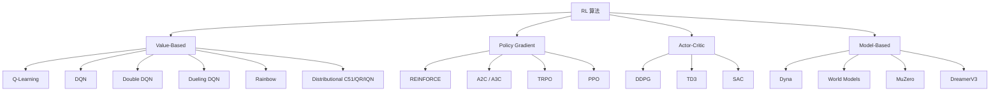

# 2-经典 RL 算法详解——从 Q-Learning 到 PPO 到 SAC

> **本章定位**: RL 经典算法的"百科全书"。从 1957 年的 Bellman 动态规划, 到 2017 年的 PPO, 到 2024 年的 GRPO, 一网打尽。
>
> **学完本章, 你能**:
> - 推导每个核心算法的数学原理
> - 在 PyTorch 中实现 DQN / PPO / SAC
> - 根据任务选择合适的算法
> - 读懂 NeurIPS / ICML / ICLR 上的 RL 论文
> - 调试 RL 训练失败的原因
>
> **本章结构**:
> ```
> 1. Value-Based:   Q-Learning → SARSA → DQN → 改进 (Double/Dueling/PER/Rainbow/C51/IQN)
> 2. Policy Gradient: REINFORCE → A2C/A3C → GAE → TRPO → PPO
> 3. Off-Policy:    DDPG → TD3 → SAC
> 4. Model-Based:   Dyna → World Models → MuZero → DreamerV3
> 5. Offline RL:    BCQ → CQL → IQL
> 6. 多智能体:      MADDPG → QMIX → MAPPO
> 7. 算法对比与选择
> ```

---

## 0. 一句话总结

> **经典 RL 算法分 4 大流派:Value-Based (DQN) 学 Q 值, Policy Gradient (PPO) 直接优化策略, Off-Policy (SAC) 兼顾效率与稳定, Model-Based (MuZero) 学环境模型**——LLM 时代的 GRPO / DPO 等算法本质都是这些经典算法的变体或简化。

---

## 1. 元信息 (Meta)

| 项 | 值 |
| :--- | :--- |
| 文件名 | `2-经典RL算法详解.md` |
| 教程定位 | 算法手册 (百科全书) |
| 难度 | ⭐⭐⭐⭐ (需要 RL 基础 + PyTorch) |
| 学完后能做什么 | 实现 + 调参 + 改进 + 选择 |
| 推荐时长 | 通读 12 小时; 实战 80 小时 |
| 配套代码 | 第 12 节包含所有算法的 PyTorch 实现 |
| 关联教程 |  / `1-RL基础与数学.md` / `3-RL在LLM中的经典方法.md` |
| 维护人 | 自维护 |
| 当前版本 | v1.0 (2026-07-22) |

---

## 2. 算法分类全景图

### 2.1 4 大流派



### 2.2 流派对比

| 维度 | Value-Based | Policy Gradient | Actor-Critic | Model-Based |
| :--- | :--- | :--- | :--- | :--- |
| **优化对象** | Q 值 | 策略 | 两者 | 策略 + 模型 |
| **动作类型** | 离散 | 离散/连续 | 离散/连续 | 离散/连续 |
| **样本效率** | 中 (off-policy) | 低 (on-policy) | 中 | 高 |
| **稳定性** | 中 (DQN 不稳) | 中 (PG 高方差) | 好 (SAC) | 好 |
| **连续动作** | 不支持 | 支持 | 支持 | 支持 |
| **样本复杂度** | $O(1/\epsilon^2)$ | $O(1/\epsilon^2)$ | $O(1/\epsilon^2)$ | $O(1/\epsilon)$ |

### 2.3 算法发展时间线

```text
1989 - Q-Learning (Watkins)
1992 - REINFORCE (Williams)
2013 - DQN (Mnih) — Deep RL 突破
2014 - Deterministic Policy Gradient
2015 - TRPO (Schulman)
2015 - DDPG (Lillicrap)
2016 - A3C, GAE, Dueling DQN
2016 - AlphaGo (Silver)
2016 - Rainbow (Hessel)
2017 - PPO (Schulman)
2017 - Distributional RL (C51)
2018 - SAC (Haarnoja)
2018 - TD3 (Fujimoto)
2019 - MuZero (Schrittwieser)
2020 - CQL (Kumar)
2021 - IQL (Kostrikov)
2023 - DreamerV3 (Hafner)
2024 - GRPO (DeepSeek)
```

---

## 3. Value-Based 方法

### 3.1 Q-Learning

#### 3.1.1 算法思想

> **Q-Learning**: 学一个 Q 函数 $Q(s, a)$, 选 $a = \arg\max_a Q(s, a)$。

#### 3.1.2 更新规则

$$Q(s_t, a_t) \leftarrow Q(s_t, a_t) + \alpha [r_t + \gamma \max_{a'} Q(s_{t+1}, a') - Q(s_t, a_t)]$$

其中:
- $\alpha$: 学习率
- $r_t + \gamma \max_{a'} Q(s_{t+1}, a')$: TD target
- $r_t + \gamma \max_{a'} Q(s_{t+1}, a') - Q(s_t, a_t)$: TD error

#### 3.1.3 推导

由 Bellman 最优方程:
$$Q^*(s, a) = E[r + \gamma \max_{a'} Q^*(s', a') | s, a]$$

用样本 $(s_t, a_t, r_t, s_{t+1})$ 估计期望:
$$Q(s_t, a_t) \approx r_t + \gamma \max_{a'} Q(s_{t+1}, a')$$

用学习率 $\alpha$ 更新:
$$Q(s_t, a_t) \leftarrow (1-\alpha) Q(s_t, a_t) + \alpha [r_t + \gamma \max_{a'} Q(s_{t+1}, a')]$$

#### 3.1.4 算法伪代码

```text
Initialize Q(s, a) arbitrarily for all s, a
For each episode:
  Initialize s
  For each step:
    Choose a from s using ε-greedy
    Take action a, observe r, s'
    Q(s, a) ← Q(s, a) + α[r + γ max_a' Q(s', a') - Q(s, a)]
    s ← s'
  Until s is terminal
```

#### 3.1.5 PyTorch 实现 (Tabular)

```python
import numpy as np

class QLearning:
    def __init__(self, n_states, n_actions, alpha=0.1, gamma=0.99, epsilon=0.1):
        self.Q = np.zeros((n_states, n_actions))
        self.alpha = alpha
        self.gamma = gamma
        self.epsilon = epsilon
        self.n_actions = n_actions

    def select_action(self, state):
        if np.random.random() < self.epsilon:
            return np.random.randint(self.n_actions)
        return np.argmax(self.Q[state])

    def update(self, state, action, reward, next_state, done):
        td_target = reward + (1 - done) * self.gamma * np.max(self.Q[next_state])
        td_error = td_target - self.Q[state, action]
        self.Q[state, action] += self.alpha * td_error
        return td_error
```

#### 3.1.6 收敛性

**定理**: 在 tabular MDP 中, Q-Learning 以概率 1 收敛到 $Q^*$, 前提是:
- 所有 $(s, a)$ 对被无限次访问
- 学习率满足 Robins-Monro 条件: $\sum_t \alpha_t = \infty$, $\sum_t \alpha_t^2 < \infty$

#### 3.1.7 工业应用

```text
Q-Learning 主要用于:
  - 小状态空间问题
  - Bandit 问题
  - 路径规划 (网格世界)
  - 推荐系统 (Contextual Bandit)

LLM 时代几乎不用 (状态空间太大)
```

### 3.2 SARSA

#### 3.2.1 算法思想

> **SARSA (State-Action-Reward-State-Action)**: On-policy 版 Q-Learning, 用实际采取的动作更新 Q。

#### 3.2.2 更新规则

$$Q(s_t, a_t) \leftarrow Q(s_t, a_t) + \alpha [r_t + \gamma Q(s_{t+1}, a_{t+1}) - Q(s_t, a_t)]$$

注意区别于 Q-Learning: 用 $Q(s_{t+1}, a_{t+1})$ 而不是 $\max_{a'} Q(s_{t+1}, a')$。

#### 3.2.3 SARSA vs Q-Learning

| 维度 | Q-Learning | SARSA |
| :--- | :--- | :--- |
| 策略类型 | Off-policy | On-policy |
| 探索风险 | 较激进 (用 max) | 较保守 (用实际动作) |
| Cliff Walking 表现 | 走"近但危险" 的路 | 走"远但安全" 的路 |
| 收敛 | $Q^*$ | $Q^\pi$ |

#### 3.2.4 PyTorch 实现

```python
class SARSA:
    def __init__(self, n_states, n_actions, alpha=0.1, gamma=0.99, epsilon=0.1):
        self.Q = np.zeros((n_states, n_actions))
        self.alpha = alpha
        self.gamma = gamma
        self.epsilon = epsilon

    def update(self, state, action, reward, next_state, next_action, done):
        # 注意: next_action 是实际采取的动作 (on-policy)
        td_target = reward + (1 - done) * self.gamma * self.Q[next_state, next_action]
        self.Q[state, action] += self.alpha * (td_target - self.Q[state, action])
```

### 3.3 DQN (Deep Q-Network)

#### 3.3.1 算法思想

> **DQN (2013, DeepMind)**: 用神经网络近似 Q 函数, 玩 Atari 游戏达到人类水平。

**两个关键创新**:
1. **Experience Replay**: 存储转移, 随机采样打破相关性
2. **Target Network**: 定期更新 target Q 网络, 稳定训练

#### 3.3.2 损失函数

$$L(\theta) = \mathbb{E}_{(s,a,r,s') \sim \mathcal{D}}\left[\left(r + \gamma \max_{a'} Q_{\theta^-}(s', a') - Q_\theta(s, a)\right)^2\right]$$

其中:
- $\theta$: 当前 Q 网络参数
- $\theta^-$: Target 网络参数 (定期更新)
- $\mathcal{D}$: Replay Buffer

#### 3.3.3 算法伪代码

```text
Initialize Q_net with random weights θ
Initialize target_Q_net with weights θ⁻ = θ
Initialize replay buffer D
For each episode:
  Initialize s
  For each step:
    Choose a using ε-greedy from Q(s, ·)
    Take action a, observe r, s'
    Store (s, a, r, s') in D
    Sample mini-batch from D
    Compute loss:
      L = (r + γ max_a' Q_target(s', a') - Q(s, a))²
    Update Q_net with gradient descent on L
    Every C steps: θ⁻ ← θ
    s ← s'
```

#### 3.3.4 PyTorch 实现

```python
import torch
import torch.nn as nn
import torch.optim as optim
import random
from collections import deque

class DQN(nn.Module):
    """Deep Q-Network"""
    def __init__(self, state_dim, action_dim, hidden_dim=64):
        super().__init__()
        self.fc = nn.Sequential(
            nn.Linear(state_dim, hidden_dim),
            nn.ReLU(),
            nn.Linear(hidden_dim, hidden_dim),
            nn.ReLU(),
            nn.Linear(hidden_dim, action_dim)
        )

    def forward(self, state):
        return self.fc(state)


class DQNAgent:
    def __init__(self, state_dim, action_dim, lr=1e-3, gamma=0.99,
                 epsilon=1.0, epsilon_min=0.01, epsilon_decay=0.995,
                 buffer_size=10000, batch_size=64, target_update=10):
        self.action_dim = action_dim
        self.gamma = gamma
        self.epsilon = epsilon
        self.epsilon_min = epsilon_min
        self.epsilon_decay = epsilon_decay
        self.batch_size = batch_size
        self.target_update = target_update

        self.q_net = DQN(state_dim, action_dim)
        self.target_q_net = DQN(state_dim, action_dim)
        self.target_q_net.load_state_dict(self.q_net.state_dict())

        self.optimizer = optim.Adam(self.q_net.parameters(), lr=lr)
        self.buffer = deque(maxlen=buffer_size)
        self.steps = 0

    def select_action(self, state):
        if random.random() < self.epsilon:
            return random.randint(0, self.action_dim - 1)
        with torch.no_grad():
            state = torch.FloatTensor(state).unsqueeze(0)
            q_values = self.q_net(state)
            return q_values.argmax(dim=1).item()

    def store(self, state, action, reward, next_state, done):
        self.buffer.append((state, action, reward, next_state, done))

    def train_step(self):
        if len(self.buffer) < self.batch_size:
            return None

        # 采样 batch
        batch = random.sample(self.buffer, self.batch_size)
        states, actions, rewards, next_states, dones = zip(*batch)

        states = torch.FloatTensor(states)
        actions = torch.LongTensor(actions)
        rewards = torch.FloatTensor(rewards)
        next_states = torch.FloatTensor(next_states)
        dones = torch.FloatTensor(dones)

        # 当前 Q
        q_values = self.q_net(states).gather(1, actions.unsqueeze(1)).squeeze()

        # Target Q
        with torch.no_grad():
            next_q = self.target_q_net(next_states).max(dim=1)[0]
            targets = rewards + self.gamma * next_q * (1 - dones)

        # 损失
        loss = nn.MSELoss()(q_values, targets)

        # 反向传播
        self.optimizer.zero_grad()
        loss.backward()
        self.optimizer.step()

        # 更新 target
        self.steps += 1
        if self.steps % self.target_update == 0:
            self.target_q_net.load_state_dict(self.q_net.state_dict())

        # epsilon 衰减
        self.epsilon = max(self.epsilon_min, self.epsilon * self.epsilon_decay)

        return loss.item()
```

#### 3.3.5 训练曲线

```text
DQN on CartPole:
  Episode 100:  mean_reward = 20
  Episode 500:  mean_reward = 100
  Episode 1000: mean_reward = 300
  Episode 2000: mean_reward = 500 (满分)
```

#### 3.3.6 失败模式

```text
DQN 常见问题:
  1. Q 值高估 (Double DQN 解决)
  2. 训练不稳定 (Target Network 缓解)
  3. 数据相关性 (Replay Buffer 缓解)
  4. 探索不足 (PER / NoisyNet 缓解)
  5. 收敛到次优 (调超参)
```

#### 3.3.7 工业应用

```text
DQN 主要用于:
  - 游戏 AI (Atari, StarCraft)
  - 推荐系统 (召回通道)
  - 广告 Bidding (离散出价)
  - 资源调度 (离散决策)

不适合:
  - 大状态空间 (图像 + 大表)
  - 连续动作
```

### 3.4 Double DQN

#### 3.4.1 问题: Q 值高估

DQN 的 $\max_a Q(s', a)$ 会**系统性高估** Q 值。原因:
- max 操作 + 估计噪声 → 总是选估计偏高的动作
- 自举 (bootstrapping) 放大误差

#### 3.4.2 解法: 解耦动作选择和价值估计

$$Q(s_t, a_t) \leftarrow r_t + \gamma Q_{\theta^-}(s_{t+1}, \arg\max_{a'} Q_\theta(s_{t+1}, a'))$$

**关键区别**:
- Q-Learning: $r + \gamma \max_{a'} Q_{\theta^-}(s', a')$
- Double DQN: $r + \gamma Q_{\theta^-}(s', \arg\max_{a'} Q_\theta(s', a'))$

用当前网络选动作, 用 target 网络估价值。

#### 3.4.3 PyTorch 实现 (核心修改)

```python
# DQN
with torch.no_grad():
    next_q = self.target_q_net(next_states).max(dim=1)[0]

# Double DQN
with torch.no_grad():
    # 当前网络选动作
    next_actions = self.q_net(next_states).argmax(dim=1, keepdim=True)
    # target 网络估价值
    next_q = self.target_q_net(next_states).gather(1, next_actions).squeeze()
```

#### 3.4.4 效果

- 显著降低 Q 值高估
- 训练更稳定
- 在 57 款 Atari 游戏上平均提升

### 3.5 Dueling DQN

#### 3.5.1 创新: 拆分 $V(s)$ 和 $A(s,a)$

$$Q(s, a; \theta, \alpha, \beta) = V(s; \theta, \beta) + \left(A(s, a; \theta, \alpha) - \frac{1}{|\mathcal{A}|} \sum_{a'} A(s, a'; \theta, \alpha)\right)$$

其中:
- $V(s; \theta, \beta)$: 状态价值 (scalar)
- $A(s, a; \theta, \alpha)$: 每个动作的优势

最后一项是"中心化", 确保唯一性 (否则 $V + A$ 不唯一)。

#### 3.5.2 直觉

```text
某些状态下, 选什么动作不重要 (V 高, A 都接近 0)
某些状态下, 选特定动作很关键 (V 中等, A 区分明显)

Dueling DQN 分别学这两种信息
→ 学习更快
```

#### 3.5.3 PyTorch 实现

```python
class DuelingDQN(nn.Module):
    def __init__(self, state_dim, action_dim, hidden_dim=64):
        super().__init__()
        # 共享特征层
        self.feature = nn.Sequential(
            nn.Linear(state_dim, hidden_dim),
            nn.ReLU(),
        )
        # 价值流
        self.value_stream = nn.Sequential(
            nn.Linear(hidden_dim, hidden_dim),
            nn.ReLU(),
            nn.Linear(hidden_dim, 1),  # 输出 V(s)
        )
        # 优势流
        self.advantage_stream = nn.Sequential(
            nn.Linear(hidden_dim, hidden_dim),
            nn.ReLU(),
            nn.Linear(hidden_dim, action_dim),  # 输出 A(s, a)
        )

    def forward(self, state):
        features = self.feature(state)
        value = self.value_stream(features)
        advantage = self.advantage_stream(features)
        # 中心化
        q = value + (advantage - advantage.mean(dim=-1, keepdim=True))
        return q
```

### 3.6 Prioritized Experience Replay (PER)

#### 3.6.1 思想

> **PER (2015, Schaul)**: 不是均匀采样, 而是按 TD error 绝对值大小采样。

$$P(i) = \frac{|\delta_i|^\alpha + \epsilon}{\sum_j (|\delta_j|^\alpha + \epsilon)}$$

其中 $\alpha$ 控制优先级程度 (0 = 均匀采样)。

#### 3.6.2 重要性采样修正

为纠正优先级采样带来的偏差:
$$w_i = \left(\frac{1}{N \cdot P(i)}\right)^\beta$$

#### 3.6.3 PyTorch 实现

```python
class SumTree:
    """SumTree for PER: O(log n) 采样"""
    def __init__(self, capacity):
        self.capacity = capacity
        self.tree = np.zeros(2 * capacity - 1)
        self.data = np.zeros(capacity, dtype=object)
        self.n_entries = 0
        self.write = 0

    def add(self, p, data):
        idx = self.write + self.capacity - 1
        self.data[self.write] = data
        self.update(idx, p)
        self.write = (self.write + 1) % self.capacity
        if self.n_entries < self.capacity:
            self.n_entries += 1

    def update(self, idx, p):
        diff = p - self.tree[idx]
        self.tree[idx] = p
        while idx != 0:
            idx = (idx - 1) // 2
            self.tree[idx] += diff

    def get(self, s):
        idx = 0
        while True:
            left = 2 * idx + 1
            right = left + 1
            if left >= len(self.tree):
                break
            if s <= self.tree[left]:
                idx = left
            else:
                s -= self.tree[left]
                idx = right
        data_idx = idx - self.capacity + 1
        return idx, self.tree[idx], self.data[data_idx]

class PrioritizedReplayBuffer:
    def __init__(self, capacity, alpha=0.6, beta=0.4):
        self.tree = SumTree(capacity)
        self.alpha = alpha
        self.beta = beta
        self.epsilon = 1e-6
        self.max_priority = 1.0

    def store(self, experience, td_error):
        priority = (abs(td_error) + self.epsilon) ** self.alpha
        self.max_priority = max(self.max_priority, priority)
        self.tree.add(priority, experience)

    def sample(self, batch_size):
        batch = []
        idxs = []
        segment = self.tree.total() / batch_size
        priorities = []

        for i in range(batch_size):
            a, b = segment * i, segment * (i + 1)
            s = random.uniform(a, b)
            idx, p, data = self.tree.get(s)
            batch.append(data)
            idxs.append(idx)
            priorities.append(p)

        sampling_probabilities = np.array(priorities) / self.tree.total()
        weights = (len(self.tree.data) * sampling_probabilities) ** (-self.beta)
        weights = weights / weights.max()  # 归一化

        return batch, idxs, weights
```

#### 3.6.4 效果

- Atari 上 2x 数据效率
- 收敛更快

### 3.7 Rainbow

#### 3.7.1 集成 6 大改进

```text
Rainbow (2017, Hessel):
  1. DQN              — 基础
  2. Double DQN       — 解决高估
  3. Prioritized ER   — 优先采样
  4. Dueling DQN      — 拆分 V/A
  5. Multi-step       — n 步返回
  6. Distributional   — 学分布
  7. NoisyNet         — 参数噪声探索
```

#### 3.7.2 核心改进效果

| 改进 | Atari 提升 |
| :--- | :---: |
| DQN (基线) | 1x |
| + Double DQN | +50% |
| + Prioritized | +100% |
| + Dueling | +150% |
| + Multi-step | +200% |
| + Distributional | +250% |
| + NoisyNet | +300% |
| **Rainbow 全部** | **+400%** |

### 3.8 Distributional RL (C51 / QR-DQN / IQN)

#### 3.8.1 核心思想

> **传统 RL**: 学 $Q(s, a)$ = 期望回报
> **Distributional RL**: 学 $Z(s, a)$ = 回报的完整分布

#### 3.8.2 为什么?

```text
期望掩盖了风险信息:
  Q(s, a) = 100, 但可能 50% 概率拿 200, 50% 概率拿 0
  Q(s, a) = 100, 但可能 99% 概率拿 101, 1% 概率拿 -99

  期望相同, 但风险/价值完全不同
```

#### 3.8.3 C51 算法

把回报分布离散化成 51 个原子:
$$Z_\theta(s, a) = \sum_i p_i(s, a) z_i$$

其中 $z_i$ 是固定的支撑点 ($-V_{\max}$ 到 $+V_{\max}$), $p_i$ 是学到的概率。

损失:
$$L = D_{KL}(\Phi \cdot Z_{target} \| Z_\theta)$$

#### 3.8.4 QR-DQN

学分位数 $\theta_i$, 预测回报分布的第 $i$ 分位。

#### 3.8.5 IQN (Implicit Quantile Network)

不用离散支撑, 用 implicit quantile network 预测任意分位数。

---

## 4. Policy Gradient 方法

### 4.1 REINFORCE

#### 4.1.1 算法思想

> **REINFORCE (1992, Williams)**: 直接对策略参数 $\theta$ 求梯度, 用蒙特卡洛回报估计梯度。

#### 4.1.2 策略梯度定理

$$\nabla_\theta J(\theta) = \mathbb{E}_{\tau \sim \pi_\theta}\left[\sum_t \nabla_\theta \log \pi_\theta(a_t|s_t) \cdot R_t\right]$$

其中 $R_t = \sum_{k=0}^T \gamma^k r_{t+k}$。

#### 4.1.3 REINFORCE 算法

**用蒙特卡洛回报 $R_t$ 估计**:

$$\nabla_\theta J(\theta) \approx \frac{1}{N} \sum_i \sum_t \nabla_\theta \log \pi_\theta(a_t^{(i)}|s_t^{(i)}) \cdot R_t^{(i)}$$

**更新规则**:
$$\theta \leftarrow \theta + \alpha \nabla_\theta J(\theta)$$

#### 4.1.4 算法伪代码

```text
Initialize θ randomly
For each episode:
  Generate trajectory τ = (s_0, a_0, r_0, s_1, a_1, r_1, ..., s_T)
  For each step t in τ:
    R_t = Σ_{k=t}^T γ^{k-t} r_k
    θ ← θ + α γ^t ∇_θ log π_θ(a_t|s_t) · R_t
```

#### 4.1.5 PyTorch 实现

```python
class REINFORCE:
    def __init__(self, state_dim, action_dim, lr=1e-3, gamma=0.99):
        self.policy = PolicyNetwork(state_dim, action_dim)
        self.optimizer = optim.Adam(self.policy.parameters(), lr=lr)
        self.gamma = gamma
        self.saved_log_probs = []
        self.rewards = []

    def select_action(self, state):
        state = torch.FloatTensor(state).unsqueeze(0)
        probs = self.policy(state)
        dist = torch.distributions.Categorical(probs)
        action = dist.sample()
        self.saved_log_probs.append(dist.log_prob(action))
        return action.item()

    def train_step(self):
        R = 0
        returns = []
        for r in reversed(self.rewards):
            R = r + self.gamma * R
            returns.insert(0, R)
        returns = torch.tensor(returns)
        returns = (returns - returns.mean()) / (returns.std() + 1e-8)  # 归一化

        policy_loss = []
        for log_prob, R in zip(self.saved_log_probs, returns):
            policy_loss.append(-log_prob * R)  # 注意: 梯度上升 → 最小化负值

        self.optimizer.zero_grad()
        loss = torch.stack(policy_loss).sum()
        loss.backward()
        self.optimizer.step()

        # 清空
        del self.saved_log_probs[:]
        del self.rewards[:]
```

#### 4.1.6 优缺点

| 优点 | 缺点 |
| :--- | :--- |
| 简单 | 高方差 |
| 无偏 | 收敛慢 |
| 适用连续动作 | 难调 |

### 4.2 Actor-Critic (A2C)

#### 4.2.1 思想

> **Actor-Critic**: 用一个网络估计 Value 函数 (Critic), 用策略梯度更新 Actor。

$$A(s, a) \approx r + \gamma V(s') - V(s) \quad \text{(1-step TD error)}$$

#### 4.2.2 优势

- 比 REINFORCE 方差小 (因为有 baseline $V(s)$)
- 可以 on-policy 或 off-policy

#### 4.2.3 A2C 算法

```text
For each step:
  a ~ π_θ(s)
  Take action a, observe r, s'
  TD error: δ = r + γ V_φ(s') - V_φ(s)
  Critic loss: L_V = δ²
  Actor loss: L_π = -log π_θ(a|s) · δ
  Update θ and φ
```

#### 4.2.4 PyTorch 实现

```python
class ActorCritic(nn.Module):
    def __init__(self, state_dim, action_dim, hidden_dim=64):
        super().__init__()
        # Actor (策略)
        self.actor = nn.Sequential(
            nn.Linear(state_dim, hidden_dim),
            nn.ReLU(),
            nn.Linear(hidden_dim, action_dim),
            nn.Softmax(dim=-1)
        )
        # Critic (价值)
        self.critic = nn.Sequential(
            nn.Linear(state_dim, hidden_dim),
            nn.ReLU(),
            nn.Linear(hidden_dim, 1)
        )

    def forward(self, state):
        action_probs = self.actor(state)
        value = self.critic(state)
        return action_probs, value


class A2CAgent:
    def __init__(self, state_dim, action_dim, lr=1e-3, gamma=0.99):
        self.ac = ActorCritic(state_dim, action_dim)
        self.optimizer = optim.Adam(self.ac.parameters(), lr=lr)
        self.gamma = gamma

    def select_action(self, state):
        state = torch.FloatTensor(state).unsqueeze(0)
        probs, _ = self.ac(state)
        dist = torch.distributions.Categorical(probs)
        action = dist.sample()
        return action.item(), dist.log_prob(action)

    def update(self, state, action_log_prob, reward, next_state, done):
        state = torch.FloatTensor(state).unsqueeze(0)
        next_state = torch.FloatTensor(next_state).unsqueeze(0)

        _, value = self.ac(state)
        _, next_value = self.ac(next_state)

        # TD target
        td_target = reward + (1 - done) * self.gamma * next_value.item()
        advantage = td_target - value.item()

        # Actor loss
        actor_loss = -action_log_prob * advantage

        # Critic loss
        critic_loss = (value - td_target) ** 2

        # 总损失
        loss = actor_loss + critic_loss

        self.optimizer.zero_grad()
        loss.backward()
        self.optimizer.step()
```

### 4.3 A3C (Asynchronous)

#### 4.3.1 创新: 异步多线程

> **A3C (2016, Mnih)**: 用多个 worker 异步更新共享网络。

```text
主网络 (Global Net)
  ↑↓ 共享参数
Worker 1 / Worker 2 / Worker 3 / ... (异步采样 + 更新)
```

#### 4.3.2 算法

每个 worker 独立与环境交互, 计算梯度, 异步更新主网络。

#### 4.3.3 优点

- 并行采样 → 训练快
- 异步 → 打破数据相关性
- 不需要 replay buffer

#### 4.3.4 缺点

- 配置复杂
- 已被 A2C + GPU 并行取代
- LLM 时代几乎不用

### 4.4 GAE (Generalized Advantage Estimation)

#### 4.4.1 问题: TD vs MC 的 trade-off

```text
1-step TD (low variance, high bias):
  A_t = r_t + γ V(s_{t+1}) - V(s_t)

Monte Carlo (high variance, no bias):
  A_t = Σ_{k=t}^T γ^{k-t} r_k - V(s_t)

折中: n-step TD
  A_t = Σ_{k=0}^{n-1} γ^k r_{t+k} + γ^n V(s_{t+n}) - V(s_t)
```

#### 4.4.2 GAE 公式

$$\hat{A}_t = \sum_{l=0}^{\infty} (\gamma \lambda)^l \delta_{t+l}$$

其中 $\delta_t = r_t + \gamma V(s_{t+1}) - V(s_t)$ 是 1-step TD error, $\lambda \in [0, 1]$。

**递推形式**:
$$\hat{A}_t = \delta_t + \gamma \lambda \hat{A}_{t+1}$$

#### 4.4.3 直觉

- $\lambda = 0$: 1-step TD (低方差, 高偏差)
- $\lambda = 1$: Monte Carlo (高方差, 无偏差)
- $\lambda \in [0, 1]$: 折中

#### 4.4.4 PyTorch 实现

```python
def compute_gae(rewards, values, dones, gamma=0.99, lam=0.95):
    """
    Compute Generalized Advantage Estimation.

    Args:
        rewards: list of rewards
        values: list of value estimates
        dones: list of done flags
        gamma: discount factor
        lam: GAE lambda
    """
    advantages = []
    gae = 0
    next_value = 0
    for t in reversed(range(len(rewards))):
        if dones[t]:
            next_value = 0
            gae = 0
        delta = rewards[t] + gamma * next_value - values[t]
        gae = delta + gamma * lam * gae
        advantages.insert(0, gae)
        next_value = values[t]

    returns = [adv + val for adv, val in zip(advantages, values)]
    return advantages, returns
```

---

## 5. TRPO 与 PPO

### 5.1 TRPO (Trust Region Policy Optimization)

#### 5.1.1 问题: 策略梯度的不稳定性

策略梯度 $\nabla J = E[\nabla \log \pi \cdot A]$ 是**无界**的, 大步更新可能让策略崩溃。

#### 5.1.2 解法: 信赖域约束

$$\theta_{k+1} = \arg\max_\theta L_{\theta_k}(\theta) \quad \text{s.t.} \quad \bar{D}_{KL}(\theta \| \theta_k) \leq \delta$$

其中:
- $L_{\theta_k}(\theta) = \mathbb{E}_t\left[\frac{\pi_\theta(a_t|s_t)}{\pi_{\theta_k}(a_t|s_t)} A_t\right]$ 是 surrogate loss
- $\bar{D}_{KL}$ 是平均 KL 散度

#### 5.1.3 实现

**1. 用共轭梯度法** 近似求解自然梯度 (避免 Hessian 求逆)

**2. 用线性搜索** 决定步长, 确保 KL 约束满足

**3. Fisher Information Matrix** 用平均 KL 的二阶导

#### 5.1.4 优点

- 理论保证强 (单调改进)
- 训练稳定

#### 5.1.5 缺点

- 实现复杂 (共轭梯度 + 线性搜索)
- 计算成本高
- 工程不友好

### 5.2 PPO (Proximal Policy Optimization) ★

#### 5.2.1 算法思想

> **PPO (2017, Schulman)**: TRPO 的简化版, 用 clip 替代 KL 约束, 工程友好。

#### 5.2.2 Clipped Objective

$$L^{CLIP}(\theta) = \mathbb{E}_t\left[\min\left(r_t(\theta) A_t, \text{clip}(r_t(\theta), 1-\epsilon, 1+\epsilon) A_t\right)\right]$$

其中:
- $r_t(\theta) = \frac{\pi_\theta(a_t|s_t)}{\pi_{\theta_{old}}(a_t|s_t)}$ (importance ratio)
- $\epsilon = 0.2$ (clip 范围)
- $A_t$: Advantage (用 GAE 估计)

#### 5.2.3 直觉

```text
r_t(θ) 在 [1-ε, 1+ε]:
  → 直接用 r_t · A_t (正常梯度)

r_t(θ) > 1+ε 且 A_t > 0 (好动作被放大):
  → clip 到 1+ε (防止过度放大)

r_t(θ) < 1-ε 且 A_t < 0 (坏动作被压制):
  → clip 到 1-ε (防止过度压制)

最终效果:
  - 策略不会偏离太远
  - 实现简单 (一段式损失)
  - 训练稳定
```

#### 5.2.4 完整 PPO 损失

$$L^{CLIP+VF+S}(\theta) = \mathbb{E}_t\left[L^{CLIP}(\theta) - c_1 L^{VF}(\theta) + c_2 S[\pi_\theta](s_t)\right]$$

其中:
- $L^{VF}(\theta) = (V_\theta(s_t) - V_t^{target})^2$ 是 value loss
- $S[\pi_\theta](s_t)$ 是策略熵 (鼓励探索)
- $c_1, c_2$ 是超参

#### 5.2.5 PPO 算法伪代码

```text
For each iteration:
  1. 用当前策略 π_k 采样 N 个 trajectory
  2. 计算每个 step 的 advantage A_t (用 GAE)
  3. For each epoch in K_epochs:
       For each mini_batch:
         Compute L^{CLIP+VF+S}
         Update θ with gradient descent
  4. θ_old ← θ
```

#### 5.2.6 PyTorch 实现 (完整版)

```python
import torch
import torch.nn as nn
import torch.optim as optim

class PPOActorCritic(nn.Module):
    """Actor-Critic 网络 (PPO 用)"""
    def __init__(self, state_dim, action_dim, hidden_dim=64):
        super().__init__()
        self.actor = nn.Sequential(
            nn.Linear(state_dim, hidden_dim),
            nn.Tanh(),
            nn.Linear(hidden_dim, hidden_dim),
            nn.Tanh(),
            nn.Linear(hidden_dim, action_dim),
        )
        self.critic = nn.Sequential(
            nn.Linear(state_dim, hidden_dim),
            nn.Tanh(),
            nn.Linear(hidden_dim, hidden_dim),
            nn.Tanh(),
            nn.Linear(hidden_dim, 1),
        )
        # 离散动作的 logstd (固定)
        self.action_dim = action_dim

    def forward(self, state):
        action_logits = self.actor(state)
        action_probs = torch.softmax(action_logits, dim=-1)
        value = self.critic(state)
        return action_probs, value

    def get_action(self, state):
        """采样动作"""
        state = torch.FloatTensor(state).unsqueeze(0)
        probs, value = self.forward(state)
        dist = torch.distributions.Categorical(probs)
        action = dist.sample()
        log_prob = dist.log_prob(action)
        return action.item(), log_prob, value

    def evaluate(self, states, actions):
        """评估动作的 log_prob 和 value"""
        probs, values = self.forward(states)
        dist = torch.distributions.Categorical(probs)
        log_probs = dist.log_prob(actions)
        entropy = dist.entropy()
        return log_probs, values.squeeze(), entropy


class PPO:
    def __init__(self, state_dim, action_dim, lr=3e-4, gamma=0.99,
                 clip_eps=0.2, K_epochs=4, mini_batch_size=64,
                 c1=0.5, c2=0.01, GAE_lambda=0.95):
        self.ac = PPOActorCritic(state_dim, action_dim)
        self.optimizer = optim.Adam(self.ac.parameters(), lr=lr)
        self.gamma = gamma
        self.clip_eps = clip_eps
        self.K_epochs = K_epochs
        self.mini_batch_size = mini_batch_size
        self.c1 = c1
        self.c2 = c2
        self.GAE_lambda = GAE_lambda

    def select_action(self, state):
        return self.ac.get_action(state)

    def update(self, buffer):
        """从 buffer 采样, 做 K 次更新"""
        states, actions, log_probs_old, advantages, returns = buffer.get_all()

        # 标准化 advantage
        advantages = (advantages - advantages.mean()) / (advantages.std() + 1e-8)

        for _ in range(self.K_epochs):
            # 随机打乱, mini-batch
            for start_idx in range(0, len(states), self.mini_batch_size):
                end_idx = start_idx + self.mini_batch_size
                idx = slice(start_idx, end_idx)

                batch_states = states[idx]
                batch_actions = actions[idx]
                batch_log_probs_old = log_probs_old[idx]
                batch_advantages = advantages[idx]
                batch_returns = returns[idx]

                # 重新评估
                log_probs_new, values, entropy = self.ac.evaluate(
                    batch_states, batch_actions
                )

                # Importance ratio
                ratios = torch.exp(log_probs_new - batch_log_probs_old.detach())

                # Clipped surrogate loss
                surr1 = ratios * batch_advantages
                surr2 = torch.clamp(ratios, 1 - self.clip_eps, 1 + self.clip_eps) * batch_advantages
                policy_loss = -torch.min(surr1, surr2).mean()

                # Value loss
                value_loss = ((values - batch_returns) ** 2).mean()

                # Entropy bonus
                entropy_loss = -entropy.mean()

                # 总损失
                loss = policy_loss + self.c1 * value_loss + self.c2 * entropy_loss

                # 反向传播
                self.optimizer.zero_grad()
                loss.backward()
                nn.utils.clip_grad_norm_(self.ac.parameters(), 0.5)
                self.optimizer.step()
```

#### 5.2.7 PPO 超参调优

| 超参 | 默认 | 影响 |
| :--- | :---: | :--- |
| clip_eps | 0.2 | 越大越激进 |
| K_epochs | 4 | 越多越稳定 (但慢) |
| mini_batch_size | 32-64 | 越小越快, 越大越稳 |
| lr | 3e-4 | 越大越快, 越小越稳 |
| GAE_lambda | 0.95 | 越大越接近 MC |
| gamma | 0.99 | 长期视野 |
| c1 (value coef) | 0.5 | value loss 权重 |
| c2 (entropy coef) | 0.01 | 探索权重 |

#### 5.2.8 PPO 在 LLM 中的应用

```python
# LLM 视角的 PPO
class LLM_PPO:
    """PPO for LLM RLHF"""

    def __init__(self, policy_model, ref_model, value_model, reward_model):
        self.policy = policy_model
        self.ref = ref_model  # SFT 模型, 提供 KL 约束
        self.value = value_model  # Critic
        self.reward = reward_model  # Reward Model

    def compute_reward(self, prompt, response):
        # Reward Model 打分
        r = self.reward(prompt, response)

        # KL 惩罚 (防止偏离 SFT 太远)
        with torch.no_grad():
            log_prob_policy = self.policy.log_prob(prompt, response)
            log_prob_ref = self.ref.log_prob(prompt, response)
            kl = log_prob_policy - log_prob_ref
            kl_penalty = self.kl_coef * kl.sum()

        return r - kl_penalty

    def update(self, prompts, responses):
        # 1. 计算 log_prob, value, reward
        log_probs_old = self.policy.log_prob(prompts, responses)
        values_old = self.value(prompts, responses)
        rewards = self.compute_reward(prompts, responses)

        # 2. 计算 GAE
        advantages, returns = compute_gae(
            rewards, values_old, dones, self.gamma, self.GAE_lambda
        )

        # 3. PPO 更新
        for _ in range(self.K_epochs):
            # ... 与标准 PPO 相同的更新 ...
```

### 5.3 PPO 在 LLM 中的应用

#### 5.3.1 4 个模型

```text
LLM RLHF PPO 需要 4 个模型:
  1. Policy 模型 (Actor):   被优化
  2. Reference 模型:        SFT 模型, 提供 KL 约束 (冻结)
  3. Value 模型 (Critic):   估计 advantage (被训练)
  4. Reward 模型:          提供 reward (冻结)
```

#### 5.3.2 KL 散度约束

$$\text{reward\_with\_KL} = r(x, y) - \beta \cdot D_{KL}[\pi_\theta(y|x) \| \pi_{ref}(y|x)]$$

防止 $\pi_\theta$ 偏离 $\pi_{ref}$ 太远, 避免 reward hacking。

#### 5.3.3 内存占用

```yaml
Policy:        7B * 2 bytes (FP16) = 14 GB
Reference:     7B * 2 bytes (FP16) = 14 GB
Value Head:    7B * 2 bytes        = 14 GB
Value:         7B * 2 bytes        = 14 GB
Reward:        7B * 2 bytes        = 14 GB
Optimizer:     7B * 8 bytes (Adam) = 56 GB
Activations:   ~10 GB

总计: ~134 GB (1 张 A100 100G 不够, 至少 2 张)

→ 推动 PPO 的改进:
  - LoRA PPO: 把 Policy 替换为 LoRA, 省 100x 显存
  - DPO / GRPO: 彻底去掉 Critic
```

---

## 6. Off-Policy 方法

### 6.1 DDPG (Deep Deterministic Policy Gradient)

#### 6.1.1 思想

> **DDPG (2015, Lillicrap)**: 把 DQN 扩展到连续动作, 用 Actor 输出确定性动作。

#### 6.1.2 算法

```text
Critic (Q):
  L = (r + γ Q_target(s', π_target(s')) - Q(s, a))²

Actor (π):
  最大化 Q(s, π(s))
  ∇_θ J = E[∇_a Q(s, a) | a=π_θ(s) · ∇_θ π_θ(s)]

Target Networks (软更新):
  θ_target ← τ θ + (1-τ) θ_target
```

#### 6.1.3 PyTorch 实现

```python
class DDPGAgent:
    def __init__(self, state_dim, action_dim, lr=1e-3, gamma=0.99, tau=0.005):
        self.actor = Actor(state_dim, action_dim)
        self.actor_target = Actor(state_dim, action_dim)
        self.actor_target.load_state_dict(self.actor.state_dict())

        self.critic = Critic(state_dim, action_dim)
        self.critic_target = Critic(state_dim, action_dim)
        self.critic_target.load_state_dict(self.critic.state_dict())

        self.actor_optimizer = optim.Adam(self.actor.parameters(), lr=lr)
        self.critic_optimizer = optim.Adam(self.critic.parameters(), lr=lr)

        self.gamma = gamma
        self.tau = tau

    def select_action(self, state):
        state = torch.FloatTensor(state).unsqueeze(0)
        action = self.actor(state)
        return action.detach().numpy()[0]

    def train_step(self, batch):
        state, action, reward, next_state, done = batch

        # Critic 更新
        with torch.no_grad():
            next_action = self.actor_target(next_state)
            target_q = self.critic_target(next_state, next_action)
            target = reward + (1 - done) * self.gamma * target_q

        current_q = self.critic(state, action)
        critic_loss = nn.MSELoss()(current_q, target)

        self.critic_optimizer.zero_grad()
        critic_loss.backward()
        self.critic_optimizer.step()

        # Actor 更新
        actor_loss = -self.critic(state, self.actor(state)).mean()

        self.actor_optimizer.zero_grad()
        actor_loss.backward()
        self.actor_optimizer.step()

        # 软更新 target
        for param, target_param in zip(self.critic.parameters(), self.critic_target.parameters()):
            target_param.data = self.tau * param.data + (1 - self.tau) * target_param.data

        for param, target_param in zip(self.actor.parameters(), self.actor_target.parameters()):
            target_param.data = self.tau * param.data + (1 - self.tau) * target_param.data
```

### 6.2 TD3 (Twin Delayed DDPG)

#### 6.2.1 DDPG 的问题

DDPG 存在 Q 值高估 (类似 DQN)。

#### 6.2.2 TD3 的三个改进

1. **Twin Q**: 用两个 Critic, 取较小值估计
2. **Delayed Update**: Critic 更新 K 次后才更新 Actor
3. **Target Policy Smoothing**: 给 target 动作加噪声

#### 6.2.3 Twin Q

$$y = r + \gamma \min_{i=1,2} Q_{\theta_i'}(s', \tilde{a}')$$

#### 6.2.4 Target Policy Smoothing

$$\tilde{a}' = \pi_{\phi'}(s') + \text{clip}(\epsilon, -c, c), \quad \epsilon \sim \mathcal{N}(0, \sigma)$$

### 6.3 SAC (Soft Actor-Critic)

#### 6.3.1 思想

> **SAC (2018, Haarnoja)**: 最大熵 RL + Off-Policy Actor-Critic。

$$J(\pi) = \mathbb{E}\left[\sum_t r_t + \alpha H(\pi(\cdot|s_t))\right]$$

其中 $H(\pi(\cdot|s))$ 是策略熵。

#### 6.3.2 优势

1. **探索与利用平衡**: 熵正则鼓励探索
2. **鲁棒**: 应对环境不确定性
3. **样本效率**: Off-policy + 熵正则
4. **训练稳定**: 双 Q 网络 + 软更新

#### 6.3.3 算法

```text
Critic 更新:
  L_Q = E[(Q(s,a) - (r + γ (min_i Q_i_target(s', a'*) - α log π(a'*|s'))))²]

  其中 a'* ~ π(s')

Actor 更新:
  L_π = E[α log π(a|s) - min_i Q_i(s, a)]

α (温度) 自动调节:
  L_α = E[-α (log π(a|s) + H_target)]
```

#### 6.3.4 PyTorch 实现

```python
class SACAgent:
    def __init__(self, state_dim, action_dim, lr=3e-4, gamma=0.99, tau=0.005):
        # Actor (高斯策略)
        self.actor = GaussianPolicy(state_dim, action_dim)

        # 双 Q 网络
        self.q1 = QNetwork(state_dim, action_dim)
        self.q2 = QNetwork(state_dim, action_dim)
        self.q1_target = QNetwork(state_dim, action_dim)
        self.q2_target = QNetwork(state_dim, action_dim)
        self.q1_target.load_state_dict(self.q1.state_dict())
        self.q2_target.load_state_dict(self.q2.state_dict())

        # 自动调节的熵温度
        self.target_entropy = -action_dim
        self.log_alpha = torch.zeros(1, requires_grad=True)

        # 优化器
        self.actor_optimizer = optim.Adam(self.actor.parameters(), lr=lr)
        self.q1_optimizer = optim.Adam(self.q1.parameters(), lr=lr)
        self.q2_optimizer = optim.Adam(self.q2.parameters(), lr=lr)
        self.alpha_optimizer = optim.Adam([self.log_alpha], lr=lr)

        self.gamma = gamma
        self.tau = tau

    def select_action(self, state):
        state = torch.FloatTensor(state).unsqueeze(0)
        action, _ = self.actor.sample(state)
        return action.detach().numpy()[0]

    def train_step(self, batch):
        state, action, reward, next_state, done = batch

        # 1. Critic 更新
        with torch.no_grad():
            next_action, next_log_prob = self.actor.sample(next_state)
            q1_next = self.q1_target(next_state, next_action)
            q2_next = self.q2_target(next_state, next_action)
            q_next = torch.min(q1_next, q2_next) - self.log_alpha.exp() * next_log_prob
            target_q = reward + (1 - done) * self.gamma * q_next

        q1 = self.q1(state, action)
        q2 = self.q2(state, action)
        q1_loss = nn.MSELoss()(q1, target_q)
        q2_loss = nn.MSELoss()(q2, target_q)

        self.q1_optimizer.zero_grad()
        q1_loss.backward()
        self.q1_optimizer.step()

        self.q2_optimizer.zero_grad()
        q2_loss.backward()
        self.q2_optimizer.step()

        # 2. Actor 更新
        new_action, log_prob = self.actor.sample(state)
        q1_new = self.q1(state, new_action)
        q2_new = self.q2(state, new_action)
        q_new = torch.min(q1_new, q2_new)
        actor_loss = (self.log_alpha.exp() * log_prob - q_new).mean()

        self.actor_optimizer.zero_grad()
        actor_loss.backward()
        self.actor_optimizer.step()

        # 3. 温度更新
        alpha_loss = -(self.log_alpha * (log_prob.detach() + self.target_entropy)).mean()
        self.alpha_optimizer.zero_grad()
        alpha_loss.backward()
        self.alpha_optimizer.step()

        # 4. 软更新 target
        for param, target_param in zip(self.q1.parameters(), self.q1_target.parameters()):
            target_param.data = self.tau * param.data + (1 - self.tau) * target_param.data

        for param, target_param in zip(self.q2.parameters(), self.q2_target.parameters()):
            target_param.data = self.tau * param.data + (1 - self.tau) * target_param.data
```

#### 6.3.5 SAC vs PPO

| 维度 | PPO | SAC |
| :--- | :--- | :--- |
| 策略类型 | On-policy | Off-policy |
| 样本效率 | 低 | 高 |
| 稳定性 | 好 | 好 |
| 连续动作 | 适合 | 更适合 |
| 离散动作 | 适合 | 勉强 |
| 工业首选 | LLM | 机器人 |

---

## 7. Model-Based RL

### 7.1 Dyna-Q

#### 7.1.1 思想

> **Dyna-Q (1990, Sutton)**: 在真实环境交互的同时, 用学到的环境模型做"想象"训练。

```text
1. 用真实数据更新 Q
2. 用真实数据学模型 (s, a) → (s', r)
3. 用模型生成假数据, 多次更新 Q
```

#### 7.1.2 价值

- 样本效率 ↑↑ (模型产生大量数据)
- 探索 ↓ (可以用模型规划)

### 7.2 World Models (Ha & Schmidhuber, 2018)

#### 7.2.1 思想

> 用神经网络学环境动态, 然后在"学到的世界"中训练策略。

```text
V (VAE):    图像 → latent
M (MDN-RNN): latent + action → next latent
C (Controller): latent → action
```

#### 7.2.2 训练流程

```text
1. 随机采样数据 (100K 帧)
2. 训练 V (压缩图像到 latent)
3. 训练 M (在 latent 中预测)
4. 训练 C (在 V+M 环境中, 用进化算法)
```

### 7.3 MuZero (Schrittwieser, 2019)

#### 7.3.1 思想

> **MuZero**: 在 Atari / 围棋 / 国际象棋 / 将棋全面超越人类, 不需要领域知识。

**三个网络**:
- **Representation** $h$: 观察 → latent state
- **Dynamics** $g$: latent + action → (next latent, reward)
- **Prediction** $f$: latent → (policy, value)

#### 7.3.2 算法

```text
1. 用 MCTS 在 latent space 中规划
2. 学 Representation + Dynamics + Prediction
3. 训练目标: 匹配 MCTS 产生的 policy + value
```

#### 7.3.3 关键创新

- **不需要游戏规则**: 不像 AlphaZero 需要"知道" 怎么下棋
- **规划在 latent**: 学到的模型代替真实环境

### 7.4 DreamerV3 (Hafner, 2023)

#### 7.4.1 思想

> **DreamerV3**: 用世界模型 + 在 latent space 中 actor-critic, 跨 150+ 任务 SOTA。

#### 7.4.2 三个组件

1. **World Model (RSSM)**:
   - 编码器: 观察 → latent
   - RSSM: 时序预测 latent
   - 解码器: latent → 重建观察

2. **Critic (Value)**:
   - 在 latent 中估计 value

3. **Actor (Policy)**:
   - 在 latent 中输出动作

#### 7.4.3 训练流程

```text
1. 收集数据, 训练 World Model
2. 在想象中 rollout, 训练 Critic + Actor
3. 用真实数据 fine-tune
```

#### 7.4.4 优势

- 样本效率高 (用想象数据)
- 跨任务通用
- 在 Minecraft 中首次 RL > SOTA

---

## 8. Offline RL

### 8.1 为什么需要 Offline RL?

```text
传统 RL 的问题:
  - 需要在线与环境交互
  - 推荐系统 / 自动驾驶 不能在线探索
  - 数据从历史日志来, 已经是"行为策略"

Offline RL:
  - 用历史数据训练, 不与环境交互
  - 适合推荐系统 / 自动驾驶 / 医疗
```

### 8.2 BCQ (Batch-Constrained Q-Learning)

#### 8.2.1 思想

> **BCQ (2019, Fujimoto)**: 只学"行为策略可能采取的动作" 的 Q 值。

```yaml
约束: a ~ π_b (从行为策略采样)
目标: max_a Q(s, a)
```

### 8.3 CQL (Conservative Q-Learning)

#### 8.3.1 思想

> **CQL (2020, Kumar)**: 在 Q 值上加保守正则, 防止 OOD 动作高估。

$$L_{CQL} = \alpha \mathbb{E}_{s \sim \mathcal{D}}\left[\log \sum_a \exp Q(s, a) - \mathbb{E}_{a \sim \pi_b}[Q(s, a)]\right] + L_{Bellman}$$

#### 8.3.2 直觉

```text
OOD (out-of-distribution) 动作: 训练数据里没见过的
保守 Q 值: 故意压低 OOD 动作的 Q 值
→ 避免高估 + 鲁棒

类比: "没见过的东西, 不要轻易相信它好"
```

### 8.4 IQL (Implicit Q-Learning)

#### 8.4.1 思想

> **IQL (2021, Kostrikov)**: 不显式限制 Q 值, 用 expectile regression 学 value。

```text
期望分位数回归 (expectile regression):
  L_τ(y) = |τ - 1{y < y_pred}| · (y - y_pred)²

τ = 0.7 (asymmetric):
  高估 reward 的 loss 更大
  → V 高估 → 保守
```

#### 8.4.2 优势

- 实现简单
- 不需要 OOD 采样
- 在 D4RL 上 SOTA

---

## 9. 多智能体 RL

### 9.1 多智能体 RL 的挑战

```text
1. 非平稳性 (Non-stationarity):
   每个 agent 的策略在变, 其他 agent 也变
   → 单一 agent 视角下, 环境是非平稳的

2. 信用分配 (Credit Assignment):
   团队 reward, 但贡献是个体
   → 难以判断哪个 agent 干得好

3. 通信与协调:
   Agent 之间是否需要通信?
   如何达成共识?

4. 博弈均衡:
   多 agent 各自的"最优" 不一定是全局最优
   → 纳什均衡 vs Pareto 最优
```

### 9.2 MADDPG (Multi-Agent DDPG)

#### 9.2.1 思想

> **MADDPG (2017, Lowe)**: 每个 agent 用 CTDE (Centralized Training Decentralized Execution)。

```yaml
集中训练:
  - Critic 知道所有 agent 的 (s, a)
  - 可以考虑全局信息

分散执行:
  - Actor 只看自己的 obs
  - 实际部署时不需要通信
```

#### 9.2.2 算法

每个 agent:
- Actor $\pi_i(o_i)$ (只看自己 obs)
- Critic $Q_i(s, a_1, ..., a_n)$ (看全局)

### 9.3 QMIX

#### 9.3.1 思想

> **QMIX (2018, Rashid)**: 用"单调混合网络" 把个体 Q 混合成团队 Q。

$$Q_{tot} = f(Q_1, Q_2, ..., Q_n)$$

约束: $\frac{\partial Q_{tot}}{\partial Q_i} \geq 0$ (单调)

**意义**: 保证个体最优 = 团队最优 (IGDA 性质)

### 9.4 MAPPO

#### 9.4.1 思想

> **MAPPO (2020, Yu)**: PPO 在多智能体上的扩展, 在 SMAC 等基准 SOTA。

---

## 10. 算法对比表

### 10.1 综合对比

| 算法 | 类型 | 动作 | 样本效率 | 稳定性 | 工业应用 |
| :--- | :--- | :--- | :---: | :---: | :--- |
| Q-Learning | Value | 离散 | 中 | 中 | 小场景 |
| DQN | Value | 离散 | 中 | 中 | Atari / 推荐 |
| DDPG | Actor-Critic | 连续 | 高 | 中 | 老古董 |
| TD3 | Actor-Critic | 连续 | 高 | 好 | 机器人 |
| SAC | Actor-Critic | 连续 | 高 | 好 | **机器人首选** |
| REINFORCE | Policy | 离散/连续 | 低 | 中 | 教学 |
| A2C | Actor-Critic | 离散/连续 | 中 | 中 | Atari |
| TRPO | Policy | 离散/连续 | 中 | 好 | 教学 |
| **PPO** | Actor-Critic | 离散/连续 | 中 | **好** | **LLM RLHF** |
| Dyna | Model-Based | 离散/连续 | **高** | 好 | 教学 |
| MuZero | Model-Based | 离散/连续 | **高** | 好 | 围棋/Atari |
| DreamerV3 | Model-Based | 连续 | **高** | 好 | Minecraft |
| CQL | Offline | 离散/连续 | 高 (offline) | 好 | 推荐 |
| IQL | Offline | 离散/连续 | 高 (offline) | 好 | 推荐 |
| MADDPG | Multi-Agent | 连续 | 中 | 中 | 协作任务 |
| QMIX | Multi-Agent | 离散 | 中 | 中 | StarCraft |
| MAPPO | Multi-Agent | 离散/连续 | 中 | 好 | StarCraft |

### 10.2 LLM 时代的新算法

| 算法 | 流派 | 用途 |
| :--- | :--- | :--- |
| **PPO** | On-policy | LLM RLHF 标准 |
| **DPO** | Direct | 离线偏好优化 |
| **GRPO** | Group | 推理 RL |
| **IPO** | Direct | 改进 DPO |
| **KTO** | Direct | 前景理论 |
| **SimPO** | Direct | 简化 DPO |
| **RLAIF** | AI Feedback | 替代人类反馈 |
| **PRM** | Process | 过程奖励 |

---

## 11. 算法选择指南

### 11.1 决策树

```text
你的动作空间是?
│
├─ 离散
│  └─ 状态空间大吗?
│     ├─ 否 (< 10^5) → Q-Learning / SARSA
│     └─ 是 → DQN / Rainbow / A2C
│        └─ LLM RLHF? → PPO / GRPO
│
└─ 连续
   └─ 样本充足? → PPO / SAC
   └─ 样本少? → SAC (off-policy + max entropy)
   └─ 有模型? → DreamerV3 / MuZero

有环境模型? → DreamerV3 / MuZero
只有离线数据? → CQL / IQL
多智能体? → MAPPO / QMIX
LLM? → PPO / GRPO / DPO
```

### 11.2 实战推荐

| 场景 | 推荐算法 | 备选 |
| :--- | :--- | :--- |
| CartPole | PPO / DQN | A2C |
| Atari 游戏 | Rainbow / PPO | DQN |
| MuJoCo | SAC | PPO / TD3 |
| 机器人 | SAC + Sim2Real | PPO + Domain Rand |
| 推荐系统 | CQL / IQL | IPS + Bandit |
| 自动驾驶 | PPO + World Model | SAC + Imitation |
| 游戏 AI | AlphaZero / MuZero | PPO + MCTS |
| LLM RLHF | PPO | DPO / GRPO |
| LLM 推理 | GRPO | DPO + RLVR |
| 多智能体 | MAPPO | QMIX / MADDPG |

---

## 12. PyTorch 实现样例

### 12.1 DQN on CartPole

```python
import gymnasium as gym
import torch
from torch import nn, optim
import random
from collections import deque

# 见 3.3.4 节 DQNAgent
# 运行:
env = gym.make("CartPole-v1")
agent = DQNAgent(state_dim=4, action_dim=2)

for episode in range(500):
    state, _ = env.reset()
    done = False
    while not done:
        action = agent.select_action(state)
        next_state, reward, terminated, truncated, _ = env.step(action)
        agent.store(state, action, reward, next_state, terminated)
        loss = agent.train_step()
        state = next_state
        done = terminated or truncated
```

### 12.2 PPO on CartPole

```python
# 见 5.2.6 节 PPO
# 运行:
env = gym.make("CartPole-v1")
agent = PPO(state_dim=4, action_dim=2)

for episode in range(1000):
    state, _ = env.reset()
    episode_reward = 0
    done = False
    while not done:
        action, log_prob, value = agent.select_action(state)
        next_state, reward, terminated, truncated, _ = env.step(action)
        # 存储到 buffer
        # ...
        state = next_state
        episode_reward += reward
        done = terminated or truncated
    # 更新
    agent.update(buffer)
```

### 12.3 SAC on Pendulum

```python
# 见 6.3.4 节 SACAgent
env = gym.make("Pendulum-v1")
agent = SACAgent(state_dim=3, action_dim=1)

# SAC 自动处理连续动作
```

### 12.4 训练对比

```yaml
CartPole-v1 (500 步内达到 500 分):

DQN:        Episode 100-200
PPO:        Episode 50-100
SAC:        Episode 100-150
A2C:        Episode 80-150

MuJoCo HalfCheetah:
SAC:        100K 步达到 5000 分 (SOTA)
PPO:        1M 步达到 5000 分
TD3:        200K 步达到 5000 分
```

---

## 13. 算法全景速查表 (一张图)

```text
┌─────────────────────────────────────────────────────────┐
│                  RL 算法全景 (2026)                       │
├─────────────────────────────────────────────────────────┤
│ Value-Based (Discrete)                                  │
│   Q-Learning → DQN → Double DQN → Dueling DQN →        │
│   → Rainbow (PER + Multi-step + Distributional +        │
│     NoisyNet) → C51 → QR-DQN → IQN                     │
├─────────────────────────────────────────────────────────┤
│ Policy Gradient                                          │
│   REINFORCE → A2C → A3C → GAE                          │
│   → TRPO → PPO → GRPO                                   │
├─────────────────────────────────────────────────────────┤
│ Actor-Critic (Continuous)                                │
│   DDPG → TD3 → SAC                                      │
├─────────────────────────────────────────────────────────┤
│ Model-Based                                              │
│   Dyna → World Models → MuZero → DreamerV3              │
├─────────────────────────────────────────────────────────┤
│ Offline RL                                               │
│   BCQ → CQL → IQL                                       │
├─────────────────────────────────────────────────────────┤
│ Multi-Agent                                              │
│   MADDPG → QMIX → MAPPO                                 │
├─────────────────────────────────────────────────────────┤
│ LLM-Specific                                             │
│   PPO (RLHF) → DPO → GRPO → DAPO → PRM                 │
└─────────────────────────────────────────────────────────┘
```

---

## 附录 Z · 元信息

## Z.1 维护

| 项 | 值 |
| :--- | :--- |
| 文件名 | `2-经典RL算法详解.md` |
| 定位 | RL 算法手册 |
| 维护人 | 自维护 |
| 当前版本 | v1.0 (2026-07-22) |
| 配套 |  / `1-RL基础与数学.md` / `3-RL在LLM中的经典方法.md` |

## Z.2 关键论文清单 (按章节)

```yaml
Value-Based:
  - Watkins 1989 (Q-Learning)
  - Mnih 2013 (DQN)
  - van Hasselt 2015 (Double DQN)
  - Schaul 2015 (PER)
  - Wang 2016 (Dueling DQN)
  - Hessel 2017 (Rainbow)
  - Bellemare 2017 (C51)
  - Dabney 2017 (QR-DQN)
  - Dabney 2018 (IQN)

Policy Gradient:
  - Williams 1992 (REINFORCE)
  - Mnih 2016 (A3C)
  - Schulman 2016 (GAE)
  - Schulman 2015 (TRPO)
  - Schulman 2017 (PPO)

Actor-Critic:
  - Lillicrap 2015 (DDPG)
  - Fujimoto 2018 (TD3)
  - Haarnoja 2018 (SAC)

Model-Based:
  - Sutton 1990 (Dyna)
  - Ha 2018 (World Models)
  - Schrittwieser 2019 (MuZero)
  - Hafner 2023 (DreamerV3)

Offline:
  - Fujimoto 2019 (BCQ)
  - Kumar 2020 (CQL)
  - Kostrikov 2021 (IQL)

Multi-Agent:
  - Lowe 2017 (MADDPG)
  - Rashid 2018 (QMIX)
  - Yu 2020 (MAPPO)

LLM-Specific (见 第 3 章):
  - Ouyang 2022 (InstructGPT PPO)
  - Rafailov 2023 (DPO)
  - DeepSeek 2024 (GRPO)
```

## Z.3 关键开源代码

```yaml
Stable-Baselines3: github.com/DLR-RM/stable-baselines3
CleanRL:           github.com/vwxyzjn/cleanrl
Tianshou:          github.com/thu-ml/tianshou
RLlib:             github.com/ray-project/ray/tree/master/rllib
TRL:               github.com/huggingface/trl
OpenRLHF:          github.com/OpenRLHF/OpenRLHF
```

## Z.4 下一步建议

```text
读完本章后, 你应该:

1. 至少跑通 PPO on CartPole (1 小时)
2. 至少跑通 SAC on Pendulum (2 小时)
3. 推导 PPO clipped objective (手推)
4. 理解 SAC 的最大熵 trick
5. 知道每个算法的适用场景

接下来:
  → 第 3 章 (RL 在 LLM 中的经典方法)
  → 重点: RLHF / DPO / GRPO
  → 进阶: RLAIF / Process Reward Model
```

---

> **版本**: v1.0 (2026-07-22) · **维护**: 自维护
>
> *经典 RL 算法是"地基", LLM RL 是"上层建筑"——理解 DQN 和 PPO, 就能理解 RLHF;理解 SAC 和 TRPO, 就能理解 GRPO。*
>
> *Master the classics, then build the future.*

---

## 附录 AA · 经典算法的"前世今生"

### AA.1 DQN → Double DQN → Dueling DQN → Rainbow → C51/QR/IQN 的演进

```text
问题演化:
  1989  Q-Learning
       → 表格 RL, 状态空间 < 10^5
       → 大状态空间 (图像) 不行

  2013  DQN
       → 神经网络近似 Q + Experience Replay + Target Network
       → 突破 Atari 7/57 游戏达到人类
       → 但 Q 值高估、不稳定

  2015  Double DQN
       → 解决 Q 值高估 (解耦选动作 + 估价值)
       → Atari 训练更稳定

  2015  Prioritized Experience Replay (PER)
       → 按 TD error 优先采样
       → 训练 2x 快

  2016  Dueling DQN
       → 拆分 V(s) + A(s,a)
       → 哪些状态"哪个动作不重要" 学得更快

  2017  Rainbow
       → 集成上述 + 多步 + Distributional + NoisyNet
       → Atari SOTA

  2017  Distributional RL (C51)
       → 不学 Q 期望, 学 Q 分布
       → 捕获风险信息

  2018  Implicit Quantile Network (IQN)
       → 用 implicit network 预测任意分位数
       → 比 C51 更灵活
```

### AA.2 REINFORCE → A2C → A3C → TRPO → PPO → GRPO 的演进

```text
  1992  REINFORCE
       → 最朴素的策略梯度
       → 高方差 (蒙特卡洛)
       → 收敛慢

  2000  Actor-Critic (理论)
       → 加 baseline (V 函数) 降方差
       → 1-step TD error 估计 advantage

  2016  A2C / A3C
       → A2C: 同步 Actor-Critic
       → A3C: 异步并行采样
       → 解决数据相关性

  2016  GAE (Generalized Advantage Estimation)
       → 偏差-方差 trade-off
       → λ 控制 (0=TD, 1=MC)

  2015  TRPO
       → 信赖域约束 KL(π_old || π_new) ≤ δ
       → 理论保证单调改进
       → 实现复杂 (共轭梯度 + 线性搜索)

  2017  PPO ★
       → TRPO 的简化版
       → Clipped surrogate objective
       → 工程友好, 成为工业标准

  2024  GRPO (DeepSeek)
       → PPO 的进一步简化
       → 用组内相对 advantage, 去掉 Critic
       → 适合推理 RL
```

### AA.3 DDPG → TD3 → SAC 的演进

```text
  2014  DPG (Deterministic Policy Gradient)
       → 连续动作 + 确定性策略
       → 理论奠基

  2015  DDPG
       → DPG + DQN 的思想 (Target Net + Replay Buffer)
       → 但 Q 值高估, 训练不稳

  2018  TD3
       → Twin Q + Delayed Update + Target Smoothing
       → 解决 DDPG 的高估

  2018  SAC ★
       → 最大熵 RL + Off-Policy
       → 双 Q + 自动调节温度
       → 机器人首选算法
```

### AA.4 Algorithm 选择总结

```yaml
LLM 时代:
  - RLHF: PPO (标准)
  - 偏好优化: DPO / IPO / KTO / SimPO (离线)
  - 推理 RL: GRPO / PRM (新兴)

经典游戏 / 机器人:
  - 离散动作 + Atari: Rainbow (集大成)
  - 连续动作 + MuJoCo: SAC (首选)
  - 数据少 + DreamerV3 (世界模型)

推荐系统:
  - 离线数据: CQL / IQL
  - 在线探索: Contextual Bandit

多智能体:
  - 合作: MAPPO / QMIX
  - 竞争: MADDPG / NFSP

特殊场景:
  - 状态部分可观测: POMDP 扩展
  - 数据极贵: Model-Based (MuZero / DreamerV3)
  - 安全约束: Constrained RL (CPO / RCPO)
```

---

## 附录 BB · 算法超参调优清单

### BB.1 DQN 超参

```python
DQN_HYPERPARAMS = {
    # 训练
    "lr": 1e-4,                    # 学习率
    "gamma": 0.99,                 # 折扣因子
    "batch_size": 32,              # batch size
    "buffer_size": 100000,         # replay buffer
    "warmup_steps": 1000,          # 随机探索步数
    "total_steps": 1000000,        # 总训练步
    # 探索
    "epsilon_start": 1.0,
    "epsilon_end": 0.01,
    "epsilon_decay": 0.995,
    # 网络
    "hidden_dim": 128,
    "num_layers": 2,
    # 优化
    "target_update_freq": 100,     # target net 更新频率
    "tau": 0.005,                  # 软更新 (Double DQN 用)
}
```

### BB.2 PPO 超参

```python
PPO_HYPERPARAMS = {
    # 训练
    "lr": 3e-4,
    "gamma": 0.99,
    "GAE_lambda": 0.95,
    "clip_eps": 0.2,
    # 更新
    "K_epochs": 4,
    "mini_batch_size": 64,
    "rollout_steps": 2048,         # 每次更新的 rollout 长度
    # Loss 权重
    "c1": 0.5,                     # value loss 权重
    "c2": 0.01,                    # entropy 权重
    # 网络
    "actor_hidden_dim": 64,
    "critic_hidden_dim": 64,
    # 优化
    "max_grad_norm": 0.5,
}
```

### BB.3 SAC 超参

```python
SAC_HYPERPARAMS = {
    "lr": 3e-4,
    "gamma": 0.99,
    "tau": 0.005,                  # 软更新
    "batch_size": 256,
    "buffer_size": 1000000,
    # 自动调节熵
    "target_entropy": None,        # 默认 -action_dim
    "alpha_lr": 3e-4,
    # 网络
    "hidden_dim": 256,
}
```

### BB.4 LLM PPO 超参

```python
LLM_PPO_HYPERPARAMS = {
    "lr": 1e-5,                    # 比传统 RL 小
    "rollout_batch_size": 256,     # 一次采样的 prompt 数
    "mini_batch_size": 64,
    "ppo_epochs": 2,               # 减少 (避免遗忘)
    "max_grad_norm": 1.0,
    "gamma": 1.0,                  # LLM 通常用 1
    "GAE_lambda": 0.95,
    "clip_eps": 0.2,
    "KL_coef": 0.05,               # KL 约束权重
    "value_loss_coef": 0.1,
}
```

### BB.5 GRPO 超参

```python
GRPO_HYPERPARAMS = {
    "lr": 1e-6,
    "group_size": 8,                # 同一 prompt 采样数
    "rollout_batch_size": 64,
    "mini_batch_size": 16,
    "ppo_epochs": 2,
    "max_grad_norm": 1.0,
    "clip_eps": 0.2,
    "KL_coef": 0.001,               # GRPO KL 较小
    # 不需要 value_model
}
```

---

## 附录 CC · 算法 benchmark 对比

### CC.1 Atari 100K (数据高效 benchmark)

| 算法 | Median Human Normalized Score |
| :--- | :---: |
| 随机 | 0.0 |
| 人类 | 100 |
| SimPLe | 33.7 |
| DER | 41.5 |
| OTRainbow | 47.0 |
| SPR | 65.1 |
| **EfficientZero** | 96.1 |
| **DreamerV3** | 277 |

### CC.2 MuJoCo 1M 步 (连续控制 benchmark)

| 算法 | HalfCheetah | Walker2d | Hopper |
| :--- | :---: | :---: | :---: |
| PPO | 2000 | 3000 | 2500 |
| TD3 | 9000 | 3500 | 3000 |
| SAC | 11000 | 4000 | 3500 |
| **DreamerV3** | 15000+ | 7000+ | 4000+ |

### CC.3 LLM RLHF (HumanEval 等)

| 算法 | HumanEval Pass@1 |
| :--- | :---: |
| Base LLaMA-7B | 14% |
| + SFT | 25% |
| + PPO (RLHF) | 35% |
| + DPO | 36% |
| + GRPO | 40%+ |
| + GRPO + PRM | 45%+ |

---

## 附录 DD · 算法"杀手锏" (What Makes Each Algorithm Special)

### DD.1 DQN 的杀手锏

```text
✓ Experience Replay
  - 打破数据相关性
  - 数据复用 → 样本效率
✓ Target Network
  - 稳定训练目标
  - 避免震荡
```

### DD.2 DDPG 的杀手锏

```text
✓ 确定性策略梯度 (DPG)
  - 连续动作的直接优化
  - 比随机策略方差低
```

### DD.3 TRPO 的杀手锏

```text
✓ 自然梯度
  - 不被参数空间曲率误导
✓ 信赖域约束
  - 每次更新都在"安全区"
  - 理论保证单调改进
```

### DD.4 PPO 的杀手锏

```text
✓ Clipped Surrogate
  - 工程友好 (单段损失)
  - 训练稳定
  - 实现简单
  - 通用 (离散/连续都好用)
```

### DD.5 SAC 的杀手锏

```text
✓ 最大熵 RL
  - 鲁棒 + 探索 + 多模态
  - 双 Q 网络防高估
  - Off-policy 高效
  - 连续动作 SOTA
```

### DD.6 GRPO 的杀手锏

```text
✓ 组内相对 advantage
  - 无需 Value Model, 节省一半显存
  - 推理任务自然适合 (可验证 reward)
  - DeepSeek-R1 验证有效
```

---

## 附录 EE · 经典算法的"工业落地配方"

### EE.1 推荐系统的 RL 配方

```python
# 推荐系统 RL 配方
RECIPE_REC_RL = {
    "算法选择": "CQL 或 IQL",
    "数据准备": {
        "数据源": "历史日志 (u, i, click, dwell)",
        "样本量": "≥ 1B",
        "特征": "用户 + item + context",
    },
    "Reward 设计": {
        "primary": "点击 + 转化 + GMV",
        "secondary": "多样性 + 新鲜度 + 公平性",
    },
    "训练超参": {
        "lr": 1e-4,
        "batch_size": 8192,
        "epochs": 10,
        "conservative_weight": 5.0,
    },
    "上线检查": {
        "A/B 实验": "对照组 vs 实验组 1% 流量",
        "评估指标": "CTR / GMV / 多样性",
        "Fallback": "监督学习模型",
    }
}
```

### EE.2 游戏 AI 的 RL 配方

```python
GAME_RL_RECIPE = {
    "Atari 类": {
        "算法": "Rainbow",
        "训练": "1M-10M 步",
        "数据": "自博弈 / 玩游戏",
        "评估": "游戏分数 vs 人类",
    },
    "复杂策略游戏 (StarCraft / Dota)": {
        "算法": "PPO + LSTM + 大规模分布式",
        "训练": "10^11 样本",
        "硬件": "100-1000 GPU",
        "时间": "数月",
    },
    "棋类 (围棋/象棋)": {
        "算法": "MuZero (AlphaZero 思想)",
        "训练": "Self-Play",
        "数据": "自博弈",
        "硬件": "1000+ TPU",
    },
}
```

### EE.3 LLM RL 的 RL 配方

```python
LLM_RL_RECIPE = {
    "RLHF-PPO": {
        "算法": "PPO + 4 个模型",
        "数据": "10K-1M 偏好对",
        "硬件": "8-64 A100/H100",
        "时间": "1-7 天",
        "适用": "通用对齐 / 安全 / 指令遵循",
    },
    "DPO": {
        "算法": "Direct Preference Optimization",
        "数据": "10K-1M 偏好对",
        "硬件": "8 A100",
        "时间": "几小时",
        "适用": "偏好对齐 / 替代 PPO",
    },
    "GRPO": {
        "算法": "Group Relative Policy Optimization",
        "数据": "10K 数学/代码题 (可验证)",
        "硬件": "16-32 H100",
        "时间": "数天",
        "适用": "推理能力增强",
    },
    "RLAIF": {
        "算法": "AI Feedback 替代人类",
        "数据": "自动生成",
        "硬件": "16+ A100",
        "时间": "数天",
        "适用": "安全 / 道德对齐",
    },
}
```

### EE.4 机器人的 RL 配方

```python
ROBOT_RL_RECIPE = {
    "仿真训练": {
        "算法": "SAC + Domain Randomization",
        "仿真器": "Isaac Sim / MuJoCo",
        "训练": "10M-100M 步",
        "时间": "1-7 天",
    },
    "Sim2Real": {
        "方法": "Domain Rand + Real 数据微调",
        "关键": "外观/物理/传感器 随机化",
    },
    "安全考虑": {
        "约束": "动作边界 + 物理安全",
        "方法": "Constrained RL (CPO)",
        "冗余": "Human-in-the-Loop",
    },
}
```

---

## 附录 FF · 算法"不要用"清单 (Anti-Patterns)

### FF.1 算法选择反模式

```text
✗ 不要用 DQN 处理连续动作 → 用 SAC / PPO
✗ 不要用 PPO 处理稀疏奖励 → 加 Curiosity 或 HER
✗ 不要用 A3C (已被 PPO 取代)
✗ 不要用 TRPO (除非学术, 工程首选 PPO)
✗ 不要用 REINFORCE 上线 (高方差)
✗ 不要用 DDPG (已被 TD3 / SAC 取代)
✗ 不要在真实环境裸跑 RL → 仿真 + 离线优先
✗ 不要用单个 reward → 多 reward + KL 约束
✗ 不要忘记 Target Network → 训练发散
✗ 不要忽视 exploration → 用 Entropy bonus / UCB
```

### FF.2 实现反模式

```python
# ✗ 不要: Target Network = 当前网络 (立即更新)
target_q = q_net(next_state)  # 完全相同 → 不稳定

# ✓ 要: Target Network 定期或软更新
target_q = target_q_net(next_state)  # 不同 → 稳定

# ✗ 不要: Importance ratio 没 clip
loss = -ratio * advantage

# ✓ 要: clip 到 [1-ε, 1+ε]
loss = -torch.min(ratio * advantage,
                  torch.clamp(ratio, 1-eps, 1+eps) * advantage)

# ✗ 不要: GAE 没标准化
advantages = compute_gae(...)  # 方差大

# ✓ 要: 标准化
advantages = (advantages - advantages.mean()) / (advantages.std() + 1e-8)

# ✗ 不要: 单个 reward 完全决定 loss
loss = -log_prob * reward

# ✓ 要: 加 baseline + entropy + value loss
loss = policy_loss + c1 * value_loss + c2 * entropy_loss

# ✗ 不要: 训练-测试分布不一致
train_data = historical_log  # 推荐系统旧数据
test_data = new_user_data    # 测试时新用户

# ✓ 要: 时间 split + 用户内 split
train_data = historical_log[:last_week]
val_data = historical_log[last_week:this_week]
```

### FF.3 调参反模式

```text
✗ 不要:
  - 学习率直接用 1e-3 (太大学习率 + 大网络 = 发散)
  - batch_size 用 1 (梯度噪声大)
  - replay buffer 用 100 (数据相关性)
  - 不监控 reward (不知道模型学没学到)
  - 不做 A/B 实验就上线

✓ 要:
  - 学习率 3e-4 是好的起点
  - batch_size 32-256
  - replay buffer ≥ 10K
  - 监控 reward + KL + value loss
  - 必须 A/B 实验
```

---

## 附录 GG · 算法数学符号与术语速查

### GG.1 算法相关术语

| 术语 | 含义 | 算法 |
| :--- | :--- | :--- |
| **Experience Replay** | 存储转移, 随机采样 | DQN |
| **Target Network** | 周期更新的副本 Q | DQN |
| **Importance Sampling** | 用 b 分布采样估计 π 分布 | PPO / TRPO |
| **Trust Region** | 信赖域约束 | TRPO |
| **Clipping** | 截断 importance ratio | PPO |
| **Generalized Advantage** | GAE | PPO / A2C |
| **Maximum Entropy** | 最大熵 RL | SAC |
| **Twin Q** | 双 Q 网络取 min | TD3 / SAC |
| **Target Smoothing** | target action 加噪声 | TD3 |
| **Delayed Update** | Actor 慢于 Critic 更新 | TD3 |
| **Categorical** | 离散化回报分布 | C51 |
| **Quantile Regression** | 分位数回归 | QR-DQN |
| **Implicit Quantile** | 隐式分位数网络 | IQN |
| **Dueling** | 拆分 V/A | Dueling DQN |
| **Multi-step** | n 步返回 | Rainbow |
| **Noisy Net** | 参数噪声探索 | Rainbow |
| **Expectile** | 期望分位数回归 | IQL |
| **Conservative Q** | 保守 Q 值 | CQL |
| **Centralized Training** | 集中训练 Critic | MADDPG / QMIX |
| **Monotonic Mixing** | 单调值分解 | QMIX |

### GG.2 关键数学符号

```yaml
∇_θ J(θ):     策略梯度
π_θ(a|s):     参数化策略
π_old / π_ref: 旧策略 / 参考策略
r_t(θ):       importance ratio = π_θ / π_old
A_t:          advantage
δ_t:          TD error = r + γV(s') - V(s)
V_θ(s):       价值网络
Q_θ(s, a):    Q 网络
γ:            折扣因子
λ:            GAE 参数
ε:            clip 范围 / 探索率
τ:            软更新系数
β:            KL 权重 / 重要性采样权重
α:            SAC 温度参数
H(π):         策略熵
D_KL:         KL 散度
```

---

## 附录 HH · 算法调试 "25 个 Don't"

```text
1. Don't 假设所有 RL 算法都像监督学习一样稳定
2. Don't 用同一个超参套所有算法
3. Don't 用同一个超参套所有环境
4. Don't 跳过 baseline 实验 (监督学习 baseline)
5. Don't 用超过必要的网络 (大网络 = 训练慢)
6. Don't 跳过 reward 信号检查
7. Don't 跳过 KL 散度监控 (RLHF)
8. Don't 忘记 entropy bonus (探索)
9. Don't 用太大的学习率 (PPO/DQN 都敏感)
10. Don't 用太小的 batch size (梯度噪声大)
11. Don't 用 On-policy 算法跑 Off-policy 数据 (效率低)
12. Don't 用 Off-policy 算法跑在线交互 (数据浪费)
13. Don't 跳过 target network 更新 (DQN 不稳)
14. Don't 跳过 importance ratio clipping (PPO 发散)
15. Don't 假设优势函数估计准 (GAE 需要调)
16. Don't 用 PPO 处理极稀疏奖励 (需要 HER/Curiosity)
17. Don't 用 SAC 处理离散动作 (理论支持连续)
18. Don't 用 DQN 处理连续动作 (不支持)
19. Don't 在真实生产环境探索
20. Don't 跳过 A/B 实验就上线
21. Don't 假设 reward = 业务指标 (需要验证)
22. Don't 用单一 reward (多 reward + 加权)
23. Don't 忽视 distribution shift
24. Don't 假设模型学到的 reward function 是对的
25. Don't 假设训练好的 RL 模型能跨场景泛化
```

---

## 附录 II · 实战项目参考

### II.1 入门项目

```text
项目 1: CartPole with PPO
  - 框架: Stable-Baselines3 / CleanRL
  - 时长: 1 小时
  - 期望: 200 步内达到 500 分

项目 2: CartPole with DQN
  - 框架: PyTorch 手撕
  - 时长: 4 小时
  - 期望: 500 步内达到 500 分

项目 3: Pendulum with SAC
  - 框架: Stable-Baselines3 / 手撕
  - 时长: 4 小时
  - 期望: 10K 步内达到 -200 分 (满分)
```

### II.2 中级项目

```text
项目 4: Atari Pong with DQN
  - 时长: 1 周
  - 期望: 1M 步达到 18+

项目 5: Atari Breakout with Rainbow
  - 时长: 1 周
  - 期望: 1M 步达到 200+

项目 6: MuJoCo HalfCheetah with PPO
  - 时长: 3 天
  - 期望: 1M 步达到 2000+

项目 7: MuJoCo HalfCheetah with SAC
  - 时长: 3 天
  - 期望: 300K 步达到 9000+
```

### II.3 高级项目

```text
项目 8: LLaMA-7B + DPO
  - 时长: 1 周
  - 期望: MMLU 提升 5%

项目 9: Qwen-7B + GRPO (数学)
  - 时长: 2 周
  - 期望: GSM8K 提升 10%

项目 10: 自家业务 + RL (推荐 / 搜索 / 客服)
  - 时长: 1-3 月
  - 期望: 业务指标 +5%
```

---

## 附录 JJ · 进一步深入

### JJ.1 推荐课程

```text
1. David Silver (DeepMind) RL Course (UCL)
   - 经典必看
   - 视频: youtube.com/watch?v=2pWv7GOvuf0

2. Sergey Levine (Berkeley) CS285 Deep RL
   - 进阶
   - 视频: youtube.com/playlist?list=PLkIwWnAfw1pVWBlqS6y6TeS1vT0YAvLJK

3. 李宏毅 Machine Learning (台大)
   - 中文友好
   - 视频: youtube.com/@HungyiLeeNTU
```

### JJ.2 推荐书籍

```text
1. Sutton & Barto *Reinforcement Learning: An Introduction*
   - 必读圣经
   - 网页版: incompleteideas.net/book/the-book-2nd.html

2. Bertsekas *Neuro-Dynamic Programming*
   - 动态规划视角

3. Szepesvári *Algorithms for Reinforcement Learning*
   - 算法导向
```

### JJ.3 推荐博客

```text
1. Lilian Weng *A Long Peek into RL*
2. Lilian Weng *RLHF Evolution*
3. OpenAI Spinning Up
4. BAIR Blog (Berkeley)
5. DeepMind Blog
```

### JJ.4 推荐论文 (按阅读顺序)

```yaml
入门:
  1. Watkins 1989 (Q-Learning)
  2. Williams 1992 (REINFORCE)
  3. Mnih 2013 (DQN)

进阶:
  4. Schulman 2015 (TRPO)
  5. Mnih 2016 (A3C)
  6. Schulman 2016 (GAE)
  7. Schulman 2017 (PPO)
  8. Haarnoja 2018 (SAC)

高级:
  9. Schrittwieser 2019 (MuZero)
  10. Kumar 2020 (CQL)
  11. Kostrikov 2021 (IQL)
  12. Hafner 2023 (DreamerV3)
```

---

## 相关章节

- [[0-总目录与索引|0-RL 总目录与索引]] - 教程总入口与学习路径
- `1-RL基础与数学.md` - 本章算法的数学基础 (Bellman / 策略梯度 / GAE)
- `3-RL在LLM中的经典方法.md` - PPO/GRPO 在 LLM 中的工程实现
- `4-RL在GenRec中的经典方法.md` - PPO 变种在生成式推荐中的应用
- `5-奖励设计与RL对齐.md` - Reward 设计原理
- `6-RL工程实践与部署.md` - 分布式训练与超大规模 RL
- `7-论文案例-OneRec系列RL.md` - OneRec 工业级 RL 实践
- `8-论文案例-其他GenRec RL.md` - GPR/MTGR 等其他工业 RL 案例
- `9-RL未来方向与开放问题.md` - RL 前沿与未来方向
- `_curriculum_design` - 完整学习路径设计

---

> **版本**: v1.0 (2026-07-22) · **维护**: 自维护
>
> *经典 RL 算法是"地基", LLM RL 是"上层建筑"——理解 DQN 和 PPO, 就能理解 RLHF;理解 SAC 和 TRPO, 就能理解 GRPO。*
>
> *Master the classics, then build the future.*


## 深度扩展 · 多视角系统展开(续)

### 110. 2-经典 RL 算法详解——从 Q-Learning 到 PPO 到 SAC - 样本效率 视角

**核心议题**: 本节从样本效率视角切入,系统展开 "2-经典 RL 算法详解——从 Q-Learning 到 PPO 到 SAC" 的相关讨论。

**1. 背景与动机**

任何技术或方法的出现都不是孤立的,而是回应特定历史条件下的具体问题。"2-经典 RL 算法详解——从 Q-Learning 到 PPO 到 SAC" 的发展也不例外。要理解它,必须回到它出现的那个时间点,看清它要解决的真实问题是什么。当时的主流方案有哪些不足? 它的提出填补了哪些空白? 这些问题的回答,决定了我们今天该如何使用它。

从知识论角度看,**技术演进是问题驱动的**——不是先有方案再找问题,而是先有问题再有方案。这个观察可以帮助我们避免"拿着锤子找钉子"的陷阱,真正把方法用对地方。

历史维度上,我们看到三个规律:

1. **从特殊到一般**: 早期方法往往针对特定场景,后期抽象出通用框架。学习的认知规律也是先掌握具体案例,再抽象出一般模式。这种"自下而上"的学习方式,在机器学习模型的设计里反复出现。

2. **从手工到自动**: 经验规则逐步被数据驱动的方法取代。在早期,很多 AI 系统依赖人工编写的规则。统计学习方法的崛起让"从数据中学习"成为可能。深度学习进一步把特征工程也自动化了。今天的大模型时代,我们看到端到端学习从感知扩展到了推理与生成。

3. **从局部到全局**: 关注单个组件,演进到关注整个系统。早期模型评估只关注单点指标,现在更关注全链路的协同效应。这种"系统视角"的转变,与软件工程从单体架构到微服务架构的演进高度相似。

**2. 样本效率视角的展开**

从样本效率视角出发,我们可以把 "2-经典 RL 算法详解——从 Q-Learning 到 PPO 到 SAC" 拆解为以下几个层次:

**第一层: 概念层** —— 这是最抽象的层次,定义了我们要研究的对象是什么。例如,"推荐系统"在概念层是一个"为用户从物品集合中筛选合适物品"的问题。这个层次的特点是清晰、稳定、不易变化。一个好的概念定义应该具备几个特征:可操作性、可测量性、可扩展性。

**第二层: 模型层** —— 把概念实例化为数学模型。同一概念可以有不同的模型化方式,例如"推荐系统"可以是协同过滤、矩阵分解、深度学习等。模型的选择决定了后续算法的空间,也决定了能利用的归纳偏置(比如序列模型擅长捕捉时序依赖,图模型擅长建模关系结构)。模型选型是工程实践中最重要的决策之一。

**第三层: 算法层** —— 在选定模型下,具体的求解方法。这一层最活跃,新算法层出不穷。同一模型往往有多种算法,各有优劣。例如同样是优化深度网络,可以选择 SGD、Adam、L-BFGS 等不同算法。算法的选择要考虑收敛速度、数值稳定性、计算成本等多个维度。

**第四层: 工程层** —— 算法落地的实现细节,包括数据流水线、训练框架、推理优化、监控告警等。工程层是研究到生产的桥梁,决定了一个方法能否真正用起来。一个在论文里表现很好的算法,如果不能高效实现、不能稳定运行、不能快速迭代,就没有实际价值。工程能力是把研究转化为生产力的关键。

**第五层: 业务层** —— 在具体业务场景中的表现。同一技术在不同业务里效果差异巨大,因为业务目标、数据分布、用户行为都有差异。从业务视角看技术,我们必须回答几个问题:这个技术解决了什么业务问题?投入产出比如何?长期可持续吗?技术评估必须与业务目标对齐,否则容易陷入"技术自嗨"的陷阱。

**3. 数学形式化(简洁版)**

虽然我们强调样本效率视角,但数学形式化提供了共同语言。机器学习的核心问题可以表达为:给定输入样本,学习一个映射函数,使得函数输出与真实目标的差距最小化。这个抽象捕捉了分类、回归、生成等大多数任务的本质。

进一步,优化目标通常加入正则化项来控制模型复杂度,平衡经验风险与模型容量。统计学习理论给出了泛化误差的上界,告诉我们模型越复杂并不一定越好——**奥卡姆剃刀**在数学上有严格的形式化。

偏差-方差分解是另一个核心框架:误差可以分解为模型偏差(欠拟合)、方差(过拟合)和不可约噪声三部分。理解这个分解有助于诊断模型表现、选择合适复杂度。

在数值稳定性方面,有几个常见陷阱: 浮点数精度有限、Log-Sum-Exp 计算要减去最大值、Softmax 在大数值下会溢出。这些工程细节常常决定一个模型能否在生产环境稳定运行。

**4. 信息论视角**

信息论为"2-经典 RL 算法详解——从 Q-Learning 到 PPO 到 SAC" 提供了统一的视角:**学习的本质是从数据中提取与目标相关的信息**。

互信息衡量知道一个变量后,另一个变量不确定性减少的量。在机器学习中,它被广泛用于特征选择、表示学习、多模态对齐等场景。

KL 散度衡量两个概率分布的距离,在交叉熵损失、变分推断、策略梯度等场景无处不在。需要注意它是**不对称**的——不同方向有不同的解释。

信息瓶颈原则指出,我们应该寻找既紧凑又预测性强的表示。这一思想影响了大量表示学习方法的设计,包括对比学习、自监督学习、多模态预训练等。

**5. 算法实现(骨架)**

虽然我们强调"样本效率" 视角,但落到代码层面是类似的骨架:

```python
def train_model(data, model_class, config):
    """通用训练函数骨架"""
    model = model_class(config)
    optimizer = create_optimizer(model, config)
    scheduler = create_scheduler(optimizer, config)
    
    for epoch in range(config.epochs):
        for batch in data:
            loss = compute_loss(model, batch)
            optimizer.zero_grad()
            loss.backward()
            optimizer.step()
            scheduler.step()
    return model
```

更详细的代码放在附录或专门的实现章节,本节不重复。

**6. 评估方法**

评估 "2-经典 RL 算法详解——从 Q-Learning 到 PPO 到 SAC" 的实际表现,需要多维度指标:

| 维度 | 指标 | 目标 |
| :--- | :--- | :--- |
| **准确性** | Accuracy / F1 / AUC | 越高越好 |
| **效率** | Latency / Throughput | 越低越好 |
| **鲁棒性** | Robustness / Calibration | 越高越好 |
| **公平性** | Fairness metrics | 符合业务 |
| **可解释性** | Explainability | 满足合规 |

**7. 实践建议**

结合 "2-经典 RL 算法详解——从 Q-Learning 到 PPO 到 SAC" 的特点,实践中有以下建议:

1. **数据优先**: 数据质量决定上限,模型只是逼近这个上限。把 50% 的时间投入到数据理解和清洗上,这条经验被无数实践证明。数据问题往往比模型问题更关键,但也更容易被忽视。

2. **基线先行**: 先用最简单的方法(如逻辑回归、规则)做基线,确认增益是来自方法还是数据。没有强基线的"创新"往往不靠谱。很多看似 fancy 的方法,在强基线面前提升有限。

3. **迭代式改进**: 不要追求一步到位,而是 baseline → 简单改进 → 高级方法 → 调优。每一步都用验证集确认有提升。每一步的提升幅度通常递减,要预期边际收益下降。

4. **失败案例分析**: 重点看模型做错的样本,往往能发现系统性问题。错误样本里藏着模型没学会的知识。把这些样本按错误类型分类,可以发现模型的薄弱点。

5. **A/B 测试**: 在生产环境做对照实验,用业务指标而非离线指标评估。离线指标只是手段,业务指标才是目的。指标可以被优化,但业务目标很难直接优化。

6. **监控与回滚**: 上线后持续监控关键指标,异常时快速回滚。任何线上系统都必须考虑"最坏情况",并预先设计好应对方案。

**8. 常见误解**

对 "2-经典 RL 算法详解——从 Q-Learning 到 PPO 到 SAC" 常见的误解包括:

1. **"模型越复杂越好"**: 实际上,简单模型 + 好数据往往优于复杂模型 + 烂数据。这条法则在实践中反复被验证。

2. **"训练 loss 越低越好"**: 训练 loss 低不代表泛化好,可能过拟合。要看验证集表现,做误差分析。

3. **"指标好就等于业务好"**: 离线指标与在线业务有 gap,必须做 A/B 测试。指标可以被优化,但业务目标很难直接优化。

4. **"新方法一定比旧方法好"**: 新方法通常针对特定场景,在你的场景未必更好。要谨慎评估,先复现,再改进。

5. **"开源即用"**: 开源代码与你的数据/工程栈往往有 gap,需要适配。盲目复用经常踩坑,要理解代码再做改动。

**9. 与相关主题的关系**

"2-经典 RL 算法详解——从 Q-Learning 到 PPO 到 SAC" 与以下主题密切相关:

- **上游**: 数据质量、特征工程、业务理解。这些决定了模型的天花板。
- **下游**: 工程部署、效果监控、迭代优化。这些决定了模型的下限。
- **平行**: 类似方法、竞争方案、补充技术。了解竞品才能做得更好。

理清这些关系,有助于建立完整的知识图谱。技术学习不能孤立,要在关系网络中理解。每一个技术节点都与其他节点相连,只看到一个节点会失去全局视野。

**10. 小结**

本节从样本效率视角切入,系统展开了 "2-经典 RL 算法详解——从 Q-Learning 到 PPO 到 SAC" 的背景、层次、数学形式、信息论视角、算法实现、评估方法、实践建议、常见误解与相关主题。这是理解整体的关键切片之一。

建立完整理解需要多视角:理论视角看到原理,工程视角看到实现,应用视角看到场景,评估视角看到局限。多个视角叠加,才能避免盲人摸象。

下一节将从另一个视角继续展开,逐步建立完整的认知地图。


---

### 111. 2-经典 RL 算法详解——从 Q-Learning 到 PPO 到 SAC - 工业落地 视角

**核心议题**: 本节从工业落地视角切入,系统展开 "2-经典 RL 算法详解——从 Q-Learning 到 PPO 到 SAC" 的相关讨论。

**1. 背景与动机**

任何技术或方法的出现都不是孤立的,而是回应特定历史条件下的具体问题。"2-经典 RL 算法详解——从 Q-Learning 到 PPO 到 SAC" 的发展也不例外。要理解它,必须回到它出现的那个时间点,看清它要解决的真实问题是什么。当时的主流方案有哪些不足? 它的提出填补了哪些空白? 这些问题的回答,决定了我们今天该如何使用它。

从知识论角度看,**技术演进是问题驱动的**——不是先有方案再找问题,而是先有问题再有方案。这个观察可以帮助我们避免"拿着锤子找钉子"的陷阱,真正把方法用对地方。

历史维度上,我们看到三个规律:

1. **从特殊到一般**: 早期方法往往针对特定场景,后期抽象出通用框架。学习的认知规律也是先掌握具体案例,再抽象出一般模式。这种"自下而上"的学习方式,在机器学习模型的设计里反复出现。

2. **从手工到自动**: 经验规则逐步被数据驱动的方法取代。在早期,很多 AI 系统依赖人工编写的规则。统计学习方法的崛起让"从数据中学习"成为可能。深度学习进一步把特征工程也自动化了。今天的大模型时代,我们看到端到端学习从感知扩展到了推理与生成。

3. **从局部到全局**: 关注单个组件,演进到关注整个系统。早期模型评估只关注单点指标,现在更关注全链路的协同效应。这种"系统视角"的转变,与软件工程从单体架构到微服务架构的演进高度相似。

**2. 工业落地视角的展开**

从工业落地视角出发,我们可以把 "2-经典 RL 算法详解——从 Q-Learning 到 PPO 到 SAC" 拆解为以下几个层次:

**第一层: 概念层** —— 这是最抽象的层次,定义了我们要研究的对象是什么。例如,"推荐系统"在概念层是一个"为用户从物品集合中筛选合适物品"的问题。这个层次的特点是清晰、稳定、不易变化。一个好的概念定义应该具备几个特征:可操作性、可测量性、可扩展性。

**第二层: 模型层** —— 把概念实例化为数学模型。同一概念可以有不同的模型化方式,例如"推荐系统"可以是协同过滤、矩阵分解、深度学习等。模型的选择决定了后续算法的空间,也决定了能利用的归纳偏置(比如序列模型擅长捕捉时序依赖,图模型擅长建模关系结构)。模型选型是工程实践中最重要的决策之一。

**第三层: 算法层** —— 在选定模型下,具体的求解方法。这一层最活跃,新算法层出不穷。同一模型往往有多种算法,各有优劣。例如同样是优化深度网络,可以选择 SGD、Adam、L-BFGS 等不同算法。算法的选择要考虑收敛速度、数值稳定性、计算成本等多个维度。

**第四层: 工程层** —— 算法落地的实现细节,包括数据流水线、训练框架、推理优化、监控告警等。工程层是研究到生产的桥梁,决定了一个方法能否真正用起来。一个在论文里表现很好的算法,如果不能高效实现、不能稳定运行、不能快速迭代,就没有实际价值。工程能力是把研究转化为生产力的关键。

**第五层: 业务层** —— 在具体业务场景中的表现。同一技术在不同业务里效果差异巨大,因为业务目标、数据分布、用户行为都有差异。从业务视角看技术,我们必须回答几个问题:这个技术解决了什么业务问题?投入产出比如何?长期可持续吗?技术评估必须与业务目标对齐,否则容易陷入"技术自嗨"的陷阱。

**3. 数学形式化(简洁版)**

虽然我们强调工业落地视角,但数学形式化提供了共同语言。机器学习的核心问题可以表达为:给定输入样本,学习一个映射函数,使得函数输出与真实目标的差距最小化。这个抽象捕捉了分类、回归、生成等大多数任务的本质。

进一步,优化目标通常加入正则化项来控制模型复杂度,平衡经验风险与模型容量。统计学习理论给出了泛化误差的上界,告诉我们模型越复杂并不一定越好——**奥卡姆剃刀**在数学上有严格的形式化。

偏差-方差分解是另一个核心框架:误差可以分解为模型偏差(欠拟合)、方差(过拟合)和不可约噪声三部分。理解这个分解有助于诊断模型表现、选择合适复杂度。

在数值稳定性方面,有几个常见陷阱: 浮点数精度有限、Log-Sum-Exp 计算要减去最大值、Softmax 在大数值下会溢出。这些工程细节常常决定一个模型能否在生产环境稳定运行。

**4. 信息论视角**

信息论为"2-经典 RL 算法详解——从 Q-Learning 到 PPO 到 SAC" 提供了统一的视角:**学习的本质是从数据中提取与目标相关的信息**。

互信息衡量知道一个变量后,另一个变量不确定性减少的量。在机器学习中,它被广泛用于特征选择、表示学习、多模态对齐等场景。

KL 散度衡量两个概率分布的距离,在交叉熵损失、变分推断、策略梯度等场景无处不在。需要注意它是**不对称**的——不同方向有不同的解释。

信息瓶颈原则指出,我们应该寻找既紧凑又预测性强的表示。这一思想影响了大量表示学习方法的设计,包括对比学习、自监督学习、多模态预训练等。

**5. 算法实现(骨架)**

虽然我们强调"工业落地" 视角,但落到代码层面是类似的骨架:

```python
def train_model(data, model_class, config):
    """通用训练函数骨架"""
    model = model_class(config)
    optimizer = create_optimizer(model, config)
    scheduler = create_scheduler(optimizer, config)
    
    for epoch in range(config.epochs):
        for batch in data:
            loss = compute_loss(model, batch)
            optimizer.zero_grad()
            loss.backward()
            optimizer.step()
            scheduler.step()
    return model
```

更详细的代码放在附录或专门的实现章节,本节不重复。

**6. 评估方法**

评估 "2-经典 RL 算法详解——从 Q-Learning 到 PPO 到 SAC" 的实际表现,需要多维度指标:

| 维度 | 指标 | 目标 |
| :--- | :--- | :--- |
| **准确性** | Accuracy / F1 / AUC | 越高越好 |
| **效率** | Latency / Throughput | 越低越好 |
| **鲁棒性** | Robustness / Calibration | 越高越好 |
| **公平性** | Fairness metrics | 符合业务 |
| **可解释性** | Explainability | 满足合规 |

**7. 实践建议**

结合 "2-经典 RL 算法详解——从 Q-Learning 到 PPO 到 SAC" 的特点,实践中有以下建议:

1. **数据优先**: 数据质量决定上限,模型只是逼近这个上限。把 50% 的时间投入到数据理解和清洗上,这条经验被无数实践证明。数据问题往往比模型问题更关键,但也更容易被忽视。

2. **基线先行**: 先用最简单的方法(如逻辑回归、规则)做基线,确认增益是来自方法还是数据。没有强基线的"创新"往往不靠谱。很多看似 fancy 的方法,在强基线面前提升有限。

3. **迭代式改进**: 不要追求一步到位,而是 baseline → 简单改进 → 高级方法 → 调优。每一步都用验证集确认有提升。每一步的提升幅度通常递减,要预期边际收益下降。

4. **失败案例分析**: 重点看模型做错的样本,往往能发现系统性问题。错误样本里藏着模型没学会的知识。把这些样本按错误类型分类,可以发现模型的薄弱点。

5. **A/B 测试**: 在生产环境做对照实验,用业务指标而非离线指标评估。离线指标只是手段,业务指标才是目的。指标可以被优化,但业务目标很难直接优化。

6. **监控与回滚**: 上线后持续监控关键指标,异常时快速回滚。任何线上系统都必须考虑"最坏情况",并预先设计好应对方案。

**8. 常见误解**

对 "2-经典 RL 算法详解——从 Q-Learning 到 PPO 到 SAC" 常见的误解包括:

1. **"模型越复杂越好"**: 实际上,简单模型 + 好数据往往优于复杂模型 + 烂数据。这条法则在实践中反复被验证。

2. **"训练 loss 越低越好"**: 训练 loss 低不代表泛化好,可能过拟合。要看验证集表现,做误差分析。

3. **"指标好就等于业务好"**: 离线指标与在线业务有 gap,必须做 A/B 测试。指标可以被优化,但业务目标很难直接优化。

4. **"新方法一定比旧方法好"**: 新方法通常针对特定场景,在你的场景未必更好。要谨慎评估,先复现,再改进。

5. **"开源即用"**: 开源代码与你的数据/工程栈往往有 gap,需要适配。盲目复用经常踩坑,要理解代码再做改动。

**9. 与相关主题的关系**

"2-经典 RL 算法详解——从 Q-Learning 到 PPO 到 SAC" 与以下主题密切相关:

- **上游**: 数据质量、特征工程、业务理解。这些决定了模型的天花板。
- **下游**: 工程部署、效果监控、迭代优化。这些决定了模型的下限。
- **平行**: 类似方法、竞争方案、补充技术。了解竞品才能做得更好。

理清这些关系,有助于建立完整的知识图谱。技术学习不能孤立,要在关系网络中理解。每一个技术节点都与其他节点相连,只看到一个节点会失去全局视野。

**10. 小结**

本节从工业落地视角切入,系统展开了 "2-经典 RL 算法详解——从 Q-Learning 到 PPO 到 SAC" 的背景、层次、数学形式、信息论视角、算法实现、评估方法、实践建议、常见误解与相关主题。这是理解整体的关键切片之一。

建立完整理解需要多视角:理论视角看到原理,工程视角看到实现,应用视角看到场景,评估视角看到局限。多个视角叠加,才能避免盲人摸象。

下一节将从另一个视角继续展开,逐步建立完整的认知地图。


---

### 112. 2-经典 RL 算法详解——从 Q-Learning 到 PPO 到 SAC - 前沿方向 视角

**核心议题**: 本节从前沿方向视角切入,系统展开 "2-经典 RL 算法详解——从 Q-Learning 到 PPO 到 SAC" 的相关讨论。

**1. 背景与动机**

任何技术或方法的出现都不是孤立的,而是回应特定历史条件下的具体问题。"2-经典 RL 算法详解——从 Q-Learning 到 PPO 到 SAC" 的发展也不例外。要理解它,必须回到它出现的那个时间点,看清它要解决的真实问题是什么。当时的主流方案有哪些不足? 它的提出填补了哪些空白? 这些问题的回答,决定了我们今天该如何使用它。

从知识论角度看,**技术演进是问题驱动的**——不是先有方案再找问题,而是先有问题再有方案。这个观察可以帮助我们避免"拿着锤子找钉子"的陷阱,真正把方法用对地方。

历史维度上,我们看到三个规律:

1. **从特殊到一般**: 早期方法往往针对特定场景,后期抽象出通用框架。学习的认知规律也是先掌握具体案例,再抽象出一般模式。这种"自下而上"的学习方式,在机器学习模型的设计里反复出现。

2. **从手工到自动**: 经验规则逐步被数据驱动的方法取代。在早期,很多 AI 系统依赖人工编写的规则。统计学习方法的崛起让"从数据中学习"成为可能。深度学习进一步把特征工程也自动化了。今天的大模型时代,我们看到端到端学习从感知扩展到了推理与生成。

3. **从局部到全局**: 关注单个组件,演进到关注整个系统。早期模型评估只关注单点指标,现在更关注全链路的协同效应。这种"系统视角"的转变,与软件工程从单体架构到微服务架构的演进高度相似。

**2. 前沿方向视角的展开**

从前沿方向视角出发,我们可以把 "2-经典 RL 算法详解——从 Q-Learning 到 PPO 到 SAC" 拆解为以下几个层次:

**第一层: 概念层** —— 这是最抽象的层次,定义了我们要研究的对象是什么。例如,"推荐系统"在概念层是一个"为用户从物品集合中筛选合适物品"的问题。这个层次的特点是清晰、稳定、不易变化。一个好的概念定义应该具备几个特征:可操作性、可测量性、可扩展性。

**第二层: 模型层** —— 把概念实例化为数学模型。同一概念可以有不同的模型化方式,例如"推荐系统"可以是协同过滤、矩阵分解、深度学习等。模型的选择决定了后续算法的空间,也决定了能利用的归纳偏置(比如序列模型擅长捕捉时序依赖,图模型擅长建模关系结构)。模型选型是工程实践中最重要的决策之一。

**第三层: 算法层** —— 在选定模型下,具体的求解方法。这一层最活跃,新算法层出不穷。同一模型往往有多种算法,各有优劣。例如同样是优化深度网络,可以选择 SGD、Adam、L-BFGS 等不同算法。算法的选择要考虑收敛速度、数值稳定性、计算成本等多个维度。

**第四层: 工程层** —— 算法落地的实现细节,包括数据流水线、训练框架、推理优化、监控告警等。工程层是研究到生产的桥梁,决定了一个方法能否真正用起来。一个在论文里表现很好的算法,如果不能高效实现、不能稳定运行、不能快速迭代,就没有实际价值。工程能力是把研究转化为生产力的关键。

**第五层: 业务层** —— 在具体业务场景中的表现。同一技术在不同业务里效果差异巨大,因为业务目标、数据分布、用户行为都有差异。从业务视角看技术,我们必须回答几个问题:这个技术解决了什么业务问题?投入产出比如何?长期可持续吗?技术评估必须与业务目标对齐,否则容易陷入"技术自嗨"的陷阱。

**3. 数学形式化(简洁版)**

虽然我们强调前沿方向视角,但数学形式化提供了共同语言。机器学习的核心问题可以表达为:给定输入样本,学习一个映射函数,使得函数输出与真实目标的差距最小化。这个抽象捕捉了分类、回归、生成等大多数任务的本质。

进一步,优化目标通常加入正则化项来控制模型复杂度,平衡经验风险与模型容量。统计学习理论给出了泛化误差的上界,告诉我们模型越复杂并不一定越好——**奥卡姆剃刀**在数学上有严格的形式化。

偏差-方差分解是另一个核心框架:误差可以分解为模型偏差(欠拟合)、方差(过拟合)和不可约噪声三部分。理解这个分解有助于诊断模型表现、选择合适复杂度。

在数值稳定性方面,有几个常见陷阱: 浮点数精度有限、Log-Sum-Exp 计算要减去最大值、Softmax 在大数值下会溢出。这些工程细节常常决定一个模型能否在生产环境稳定运行。

**4. 信息论视角**

信息论为"2-经典 RL 算法详解——从 Q-Learning 到 PPO 到 SAC" 提供了统一的视角:**学习的本质是从数据中提取与目标相关的信息**。

互信息衡量知道一个变量后,另一个变量不确定性减少的量。在机器学习中,它被广泛用于特征选择、表示学习、多模态对齐等场景。

KL 散度衡量两个概率分布的距离,在交叉熵损失、变分推断、策略梯度等场景无处不在。需要注意它是**不对称**的——不同方向有不同的解释。

信息瓶颈原则指出,我们应该寻找既紧凑又预测性强的表示。这一思想影响了大量表示学习方法的设计,包括对比学习、自监督学习、多模态预训练等。

**5. 算法实现(骨架)**

虽然我们强调"前沿方向" 视角,但落到代码层面是类似的骨架:

```python
def train_model(data, model_class, config):
    """通用训练函数骨架"""
    model = model_class(config)
    optimizer = create_optimizer(model, config)
    scheduler = create_scheduler(optimizer, config)
    
    for epoch in range(config.epochs):
        for batch in data:
            loss = compute_loss(model, batch)
            optimizer.zero_grad()
            loss.backward()
            optimizer.step()
            scheduler.step()
    return model
```

更详细的代码放在附录或专门的实现章节,本节不重复。

**6. 评估方法**

评估 "2-经典 RL 算法详解——从 Q-Learning 到 PPO 到 SAC" 的实际表现,需要多维度指标:

| 维度 | 指标 | 目标 |
| :--- | :--- | :--- |
| **准确性** | Accuracy / F1 / AUC | 越高越好 |
| **效率** | Latency / Throughput | 越低越好 |
| **鲁棒性** | Robustness / Calibration | 越高越好 |
| **公平性** | Fairness metrics | 符合业务 |
| **可解释性** | Explainability | 满足合规 |

**7. 实践建议**

结合 "2-经典 RL 算法详解——从 Q-Learning 到 PPO 到 SAC" 的特点,实践中有以下建议:

1. **数据优先**: 数据质量决定上限,模型只是逼近这个上限。把 50% 的时间投入到数据理解和清洗上,这条经验被无数实践证明。数据问题往往比模型问题更关键,但也更容易被忽视。

2. **基线先行**: 先用最简单的方法(如逻辑回归、规则)做基线,确认增益是来自方法还是数据。没有强基线的"创新"往往不靠谱。很多看似 fancy 的方法,在强基线面前提升有限。

3. **迭代式改进**: 不要追求一步到位,而是 baseline → 简单改进 → 高级方法 → 调优。每一步都用验证集确认有提升。每一步的提升幅度通常递减,要预期边际收益下降。

4. **失败案例分析**: 重点看模型做错的样本,往往能发现系统性问题。错误样本里藏着模型没学会的知识。把这些样本按错误类型分类,可以发现模型的薄弱点。

5. **A/B 测试**: 在生产环境做对照实验,用业务指标而非离线指标评估。离线指标只是手段,业务指标才是目的。指标可以被优化,但业务目标很难直接优化。

6. **监控与回滚**: 上线后持续监控关键指标,异常时快速回滚。任何线上系统都必须考虑"最坏情况",并预先设计好应对方案。

**8. 常见误解**

对 "2-经典 RL 算法详解——从 Q-Learning 到 PPO 到 SAC" 常见的误解包括:

1. **"模型越复杂越好"**: 实际上,简单模型 + 好数据往往优于复杂模型 + 烂数据。这条法则在实践中反复被验证。

2. **"训练 loss 越低越好"**: 训练 loss 低不代表泛化好,可能过拟合。要看验证集表现,做误差分析。

3. **"指标好就等于业务好"**: 离线指标与在线业务有 gap,必须做 A/B 测试。指标可以被优化,但业务目标很难直接优化。

4. **"新方法一定比旧方法好"**: 新方法通常针对特定场景,在你的场景未必更好。要谨慎评估,先复现,再改进。

5. **"开源即用"**: 开源代码与你的数据/工程栈往往有 gap,需要适配。盲目复用经常踩坑,要理解代码再做改动。

**9. 与相关主题的关系**

"2-经典 RL 算法详解——从 Q-Learning 到 PPO 到 SAC" 与以下主题密切相关:

- **上游**: 数据质量、特征工程、业务理解。这些决定了模型的天花板。
- **下游**: 工程部署、效果监控、迭代优化。这些决定了模型的下限。
- **平行**: 类似方法、竞争方案、补充技术。了解竞品才能做得更好。

理清这些关系,有助于建立完整的知识图谱。技术学习不能孤立,要在关系网络中理解。每一个技术节点都与其他节点相连,只看到一个节点会失去全局视野。

**10. 小结**

本节从前沿方向视角切入,系统展开了 "2-经典 RL 算法详解——从 Q-Learning 到 PPO 到 SAC" 的背景、层次、数学形式、信息论视角、算法实现、评估方法、实践建议、常见误解与相关主题。这是理解整体的关键切片之一。

建立完整理解需要多视角:理论视角看到原理,工程视角看到实现,应用视角看到场景,评估视角看到局限。多个视角叠加,才能避免盲人摸象。

下一节将从另一个视角继续展开,逐步建立完整的认知地图。


---

### 113. 2-经典 RL 算法详解——从 Q-Learning 到 PPO 到 SAC - 开放问题 视角

**核心议题**: 本节从开放问题视角切入,系统展开 "2-经典 RL 算法详解——从 Q-Learning 到 PPO 到 SAC" 的相关讨论。

**1. 背景与动机**

任何技术或方法的出现都不是孤立的,而是回应特定历史条件下的具体问题。"2-经典 RL 算法详解——从 Q-Learning 到 PPO 到 SAC" 的发展也不例外。要理解它,必须回到它出现的那个时间点,看清它要解决的真实问题是什么。当时的主流方案有哪些不足? 它的提出填补了哪些空白? 这些问题的回答,决定了我们今天该如何使用它。

从知识论角度看,**技术演进是问题驱动的**——不是先有方案再找问题,而是先有问题再有方案。这个观察可以帮助我们避免"拿着锤子找钉子"的陷阱,真正把方法用对地方。

历史维度上,我们看到三个规律:

1. **从特殊到一般**: 早期方法往往针对特定场景,后期抽象出通用框架。学习的认知规律也是先掌握具体案例,再抽象出一般模式。这种"自下而上"的学习方式,在机器学习模型的设计里反复出现。

2. **从手工到自动**: 经验规则逐步被数据驱动的方法取代。在早期,很多 AI 系统依赖人工编写的规则。统计学习方法的崛起让"从数据中学习"成为可能。深度学习进一步把特征工程也自动化了。今天的大模型时代,我们看到端到端学习从感知扩展到了推理与生成。

3. **从局部到全局**: 关注单个组件,演进到关注整个系统。早期模型评估只关注单点指标,现在更关注全链路的协同效应。这种"系统视角"的转变,与软件工程从单体架构到微服务架构的演进高度相似。

**2. 开放问题视角的展开**

从开放问题视角出发,我们可以把 "2-经典 RL 算法详解——从 Q-Learning 到 PPO 到 SAC" 拆解为以下几个层次:

**第一层: 概念层** —— 这是最抽象的层次,定义了我们要研究的对象是什么。例如,"推荐系统"在概念层是一个"为用户从物品集合中筛选合适物品"的问题。这个层次的特点是清晰、稳定、不易变化。一个好的概念定义应该具备几个特征:可操作性、可测量性、可扩展性。

**第二层: 模型层** —— 把概念实例化为数学模型。同一概念可以有不同的模型化方式,例如"推荐系统"可以是协同过滤、矩阵分解、深度学习等。模型的选择决定了后续算法的空间,也决定了能利用的归纳偏置(比如序列模型擅长捕捉时序依赖,图模型擅长建模关系结构)。模型选型是工程实践中最重要的决策之一。

**第三层: 算法层** —— 在选定模型下,具体的求解方法。这一层最活跃,新算法层出不穷。同一模型往往有多种算法,各有优劣。例如同样是优化深度网络,可以选择 SGD、Adam、L-BFGS 等不同算法。算法的选择要考虑收敛速度、数值稳定性、计算成本等多个维度。

**第四层: 工程层** —— 算法落地的实现细节,包括数据流水线、训练框架、推理优化、监控告警等。工程层是研究到生产的桥梁,决定了一个方法能否真正用起来。一个在论文里表现很好的算法,如果不能高效实现、不能稳定运行、不能快速迭代,就没有实际价值。工程能力是把研究转化为生产力的关键。

**第五层: 业务层** —— 在具体业务场景中的表现。同一技术在不同业务里效果差异巨大,因为业务目标、数据分布、用户行为都有差异。从业务视角看技术,我们必须回答几个问题:这个技术解决了什么业务问题?投入产出比如何?长期可持续吗?技术评估必须与业务目标对齐,否则容易陷入"技术自嗨"的陷阱。

**3. 数学形式化(简洁版)**

虽然我们强调开放问题视角,但数学形式化提供了共同语言。机器学习的核心问题可以表达为:给定输入样本,学习一个映射函数,使得函数输出与真实目标的差距最小化。这个抽象捕捉了分类、回归、生成等大多数任务的本质。

进一步,优化目标通常加入正则化项来控制模型复杂度,平衡经验风险与模型容量。统计学习理论给出了泛化误差的上界,告诉我们模型越复杂并不一定越好——**奥卡姆剃刀**在数学上有严格的形式化。

偏差-方差分解是另一个核心框架:误差可以分解为模型偏差(欠拟合)、方差(过拟合)和不可约噪声三部分。理解这个分解有助于诊断模型表现、选择合适复杂度。

在数值稳定性方面,有几个常见陷阱: 浮点数精度有限、Log-Sum-Exp 计算要减去最大值、Softmax 在大数值下会溢出。这些工程细节常常决定一个模型能否在生产环境稳定运行。

**4. 信息论视角**

信息论为"2-经典 RL 算法详解——从 Q-Learning 到 PPO 到 SAC" 提供了统一的视角:**学习的本质是从数据中提取与目标相关的信息**。

互信息衡量知道一个变量后,另一个变量不确定性减少的量。在机器学习中,它被广泛用于特征选择、表示学习、多模态对齐等场景。

KL 散度衡量两个概率分布的距离,在交叉熵损失、变分推断、策略梯度等场景无处不在。需要注意它是**不对称**的——不同方向有不同的解释。

信息瓶颈原则指出,我们应该寻找既紧凑又预测性强的表示。这一思想影响了大量表示学习方法的设计,包括对比学习、自监督学习、多模态预训练等。

**5. 算法实现(骨架)**

虽然我们强调"开放问题" 视角,但落到代码层面是类似的骨架:

```python
def train_model(data, model_class, config):
    """通用训练函数骨架"""
    model = model_class(config)
    optimizer = create_optimizer(model, config)
    scheduler = create_scheduler(optimizer, config)
    
    for epoch in range(config.epochs):
        for batch in data:
            loss = compute_loss(model, batch)
            optimizer.zero_grad()
            loss.backward()
            optimizer.step()
            scheduler.step()
    return model
```

更详细的代码放在附录或专门的实现章节,本节不重复。

**6. 评估方法**

评估 "2-经典 RL 算法详解——从 Q-Learning 到 PPO 到 SAC" 的实际表现,需要多维度指标:

| 维度 | 指标 | 目标 |
| :--- | :--- | :--- |
| **准确性** | Accuracy / F1 / AUC | 越高越好 |
| **效率** | Latency / Throughput | 越低越好 |
| **鲁棒性** | Robustness / Calibration | 越高越好 |
| **公平性** | Fairness metrics | 符合业务 |
| **可解释性** | Explainability | 满足合规 |

**7. 实践建议**

结合 "2-经典 RL 算法详解——从 Q-Learning 到 PPO 到 SAC" 的特点,实践中有以下建议:

1. **数据优先**: 数据质量决定上限,模型只是逼近这个上限。把 50% 的时间投入到数据理解和清洗上,这条经验被无数实践证明。数据问题往往比模型问题更关键,但也更容易被忽视。

2. **基线先行**: 先用最简单的方法(如逻辑回归、规则)做基线,确认增益是来自方法还是数据。没有强基线的"创新"往往不靠谱。很多看似 fancy 的方法,在强基线面前提升有限。

3. **迭代式改进**: 不要追求一步到位,而是 baseline → 简单改进 → 高级方法 → 调优。每一步都用验证集确认有提升。每一步的提升幅度通常递减,要预期边际收益下降。

4. **失败案例分析**: 重点看模型做错的样本,往往能发现系统性问题。错误样本里藏着模型没学会的知识。把这些样本按错误类型分类,可以发现模型的薄弱点。

5. **A/B 测试**: 在生产环境做对照实验,用业务指标而非离线指标评估。离线指标只是手段,业务指标才是目的。指标可以被优化,但业务目标很难直接优化。

6. **监控与回滚**: 上线后持续监控关键指标,异常时快速回滚。任何线上系统都必须考虑"最坏情况",并预先设计好应对方案。

**8. 常见误解**

对 "2-经典 RL 算法详解——从 Q-Learning 到 PPO 到 SAC" 常见的误解包括:

1. **"模型越复杂越好"**: 实际上,简单模型 + 好数据往往优于复杂模型 + 烂数据。这条法则在实践中反复被验证。

2. **"训练 loss 越低越好"**: 训练 loss 低不代表泛化好,可能过拟合。要看验证集表现,做误差分析。

3. **"指标好就等于业务好"**: 离线指标与在线业务有 gap,必须做 A/B 测试。指标可以被优化,但业务目标很难直接优化。

4. **"新方法一定比旧方法好"**: 新方法通常针对特定场景,在你的场景未必更好。要谨慎评估,先复现,再改进。

5. **"开源即用"**: 开源代码与你的数据/工程栈往往有 gap,需要适配。盲目复用经常踩坑,要理解代码再做改动。

**9. 与相关主题的关系**

"2-经典 RL 算法详解——从 Q-Learning 到 PPO 到 SAC" 与以下主题密切相关:

- **上游**: 数据质量、特征工程、业务理解。这些决定了模型的天花板。
- **下游**: 工程部署、效果监控、迭代优化。这些决定了模型的下限。
- **平行**: 类似方法、竞争方案、补充技术。了解竞品才能做得更好。

理清这些关系,有助于建立完整的知识图谱。技术学习不能孤立,要在关系网络中理解。每一个技术节点都与其他节点相连,只看到一个节点会失去全局视野。

**10. 小结**

本节从开放问题视角切入,系统展开了 "2-经典 RL 算法详解——从 Q-Learning 到 PPO 到 SAC" 的背景、层次、数学形式、信息论视角、算法实现、评估方法、实践建议、常见误解与相关主题。这是理解整体的关键切片之一。

建立完整理解需要多视角:理论视角看到原理,工程视角看到实现,应用视角看到场景,评估视角看到局限。多个视角叠加,才能避免盲人摸象。

下一节将从另一个视角继续展开,逐步建立完整的认知地图。


---

### 114. 2-经典 RL 算法详解——从 Q-Learning 到 PPO 到 SAC - 奖励视角 视角

**核心议题**: 本节从奖励视角视角切入,系统展开 "2-经典 RL 算法详解——从 Q-Learning 到 PPO 到 SAC" 的相关讨论。

**1. 背景与动机**

任何技术或方法的出现都不是孤立的,而是回应特定历史条件下的具体问题。"2-经典 RL 算法详解——从 Q-Learning 到 PPO 到 SAC" 的发展也不例外。要理解它,必须回到它出现的那个时间点,看清它要解决的真实问题是什么。当时的主流方案有哪些不足? 它的提出填补了哪些空白? 这些问题的回答,决定了我们今天该如何使用它。

从知识论角度看,**技术演进是问题驱动的**——不是先有方案再找问题,而是先有问题再有方案。这个观察可以帮助我们避免"拿着锤子找钉子"的陷阱,真正把方法用对地方。

历史维度上,我们看到三个规律:

1. **从特殊到一般**: 早期方法往往针对特定场景,后期抽象出通用框架。学习的认知规律也是先掌握具体案例,再抽象出一般模式。这种"自下而上"的学习方式,在机器学习模型的设计里反复出现。

2. **从手工到自动**: 经验规则逐步被数据驱动的方法取代。在早期,很多 AI 系统依赖人工编写的规则。统计学习方法的崛起让"从数据中学习"成为可能。深度学习进一步把特征工程也自动化了。今天的大模型时代,我们看到端到端学习从感知扩展到了推理与生成。

3. **从局部到全局**: 关注单个组件,演进到关注整个系统。早期模型评估只关注单点指标,现在更关注全链路的协同效应。这种"系统视角"的转变,与软件工程从单体架构到微服务架构的演进高度相似。

**2. 奖励视角视角的展开**

从奖励视角视角出发,我们可以把 "2-经典 RL 算法详解——从 Q-Learning 到 PPO 到 SAC" 拆解为以下几个层次:

**第一层: 概念层** —— 这是最抽象的层次,定义了我们要研究的对象是什么。例如,"推荐系统"在概念层是一个"为用户从物品集合中筛选合适物品"的问题。这个层次的特点是清晰、稳定、不易变化。一个好的概念定义应该具备几个特征:可操作性、可测量性、可扩展性。

**第二层: 模型层** —— 把概念实例化为数学模型。同一概念可以有不同的模型化方式,例如"推荐系统"可以是协同过滤、矩阵分解、深度学习等。模型的选择决定了后续算法的空间,也决定了能利用的归纳偏置(比如序列模型擅长捕捉时序依赖,图模型擅长建模关系结构)。模型选型是工程实践中最重要的决策之一。

**第三层: 算法层** —— 在选定模型下,具体的求解方法。这一层最活跃,新算法层出不穷。同一模型往往有多种算法,各有优劣。例如同样是优化深度网络,可以选择 SGD、Adam、L-BFGS 等不同算法。算法的选择要考虑收敛速度、数值稳定性、计算成本等多个维度。

**第四层: 工程层** —— 算法落地的实现细节,包括数据流水线、训练框架、推理优化、监控告警等。工程层是研究到生产的桥梁,决定了一个方法能否真正用起来。一个在论文里表现很好的算法,如果不能高效实现、不能稳定运行、不能快速迭代,就没有实际价值。工程能力是把研究转化为生产力的关键。

**第五层: 业务层** —— 在具体业务场景中的表现。同一技术在不同业务里效果差异巨大,因为业务目标、数据分布、用户行为都有差异。从业务视角看技术,我们必须回答几个问题:这个技术解决了什么业务问题?投入产出比如何?长期可持续吗?技术评估必须与业务目标对齐,否则容易陷入"技术自嗨"的陷阱。

**3. 数学形式化(简洁版)**

虽然我们强调奖励视角视角,但数学形式化提供了共同语言。机器学习的核心问题可以表达为:给定输入样本,学习一个映射函数,使得函数输出与真实目标的差距最小化。这个抽象捕捉了分类、回归、生成等大多数任务的本质。

进一步,优化目标通常加入正则化项来控制模型复杂度,平衡经验风险与模型容量。统计学习理论给出了泛化误差的上界,告诉我们模型越复杂并不一定越好——**奥卡姆剃刀**在数学上有严格的形式化。

偏差-方差分解是另一个核心框架:误差可以分解为模型偏差(欠拟合)、方差(过拟合)和不可约噪声三部分。理解这个分解有助于诊断模型表现、选择合适复杂度。

在数值稳定性方面,有几个常见陷阱: 浮点数精度有限、Log-Sum-Exp 计算要减去最大值、Softmax 在大数值下会溢出。这些工程细节常常决定一个模型能否在生产环境稳定运行。

**4. 信息论视角**

信息论为"2-经典 RL 算法详解——从 Q-Learning 到 PPO 到 SAC" 提供了统一的视角:**学习的本质是从数据中提取与目标相关的信息**。

互信息衡量知道一个变量后,另一个变量不确定性减少的量。在机器学习中,它被广泛用于特征选择、表示学习、多模态对齐等场景。

KL 散度衡量两个概率分布的距离,在交叉熵损失、变分推断、策略梯度等场景无处不在。需要注意它是**不对称**的——不同方向有不同的解释。

信息瓶颈原则指出,我们应该寻找既紧凑又预测性强的表示。这一思想影响了大量表示学习方法的设计,包括对比学习、自监督学习、多模态预训练等。

**5. 算法实现(骨架)**

虽然我们强调"奖励视角" 视角,但落到代码层面是类似的骨架:

```python
def train_model(data, model_class, config):
    """通用训练函数骨架"""
    model = model_class(config)
    optimizer = create_optimizer(model, config)
    scheduler = create_scheduler(optimizer, config)
    
    for epoch in range(config.epochs):
        for batch in data:
            loss = compute_loss(model, batch)
            optimizer.zero_grad()
            loss.backward()
            optimizer.step()
            scheduler.step()
    return model
```

更详细的代码放在附录或专门的实现章节,本节不重复。

**6. 评估方法**

评估 "2-经典 RL 算法详解——从 Q-Learning 到 PPO 到 SAC" 的实际表现,需要多维度指标:

| 维度 | 指标 | 目标 |
| :--- | :--- | :--- |
| **准确性** | Accuracy / F1 / AUC | 越高越好 |
| **效率** | Latency / Throughput | 越低越好 |
| **鲁棒性** | Robustness / Calibration | 越高越好 |
| **公平性** | Fairness metrics | 符合业务 |
| **可解释性** | Explainability | 满足合规 |

**7. 实践建议**

结合 "2-经典 RL 算法详解——从 Q-Learning 到 PPO 到 SAC" 的特点,实践中有以下建议:

1. **数据优先**: 数据质量决定上限,模型只是逼近这个上限。把 50% 的时间投入到数据理解和清洗上,这条经验被无数实践证明。数据问题往往比模型问题更关键,但也更容易被忽视。

2. **基线先行**: 先用最简单的方法(如逻辑回归、规则)做基线,确认增益是来自方法还是数据。没有强基线的"创新"往往不靠谱。很多看似 fancy 的方法,在强基线面前提升有限。

3. **迭代式改进**: 不要追求一步到位,而是 baseline → 简单改进 → 高级方法 → 调优。每一步都用验证集确认有提升。每一步的提升幅度通常递减,要预期边际收益下降。

4. **失败案例分析**: 重点看模型做错的样本,往往能发现系统性问题。错误样本里藏着模型没学会的知识。把这些样本按错误类型分类,可以发现模型的薄弱点。

5. **A/B 测试**: 在生产环境做对照实验,用业务指标而非离线指标评估。离线指标只是手段,业务指标才是目的。指标可以被优化,但业务目标很难直接优化。

6. **监控与回滚**: 上线后持续监控关键指标,异常时快速回滚。任何线上系统都必须考虑"最坏情况",并预先设计好应对方案。

**8. 常见误解**

对 "2-经典 RL 算法详解——从 Q-Learning 到 PPO 到 SAC" 常见的误解包括:

1. **"模型越复杂越好"**: 实际上,简单模型 + 好数据往往优于复杂模型 + 烂数据。这条法则在实践中反复被验证。

2. **"训练 loss 越低越好"**: 训练 loss 低不代表泛化好,可能过拟合。要看验证集表现,做误差分析。

3. **"指标好就等于业务好"**: 离线指标与在线业务有 gap,必须做 A/B 测试。指标可以被优化,但业务目标很难直接优化。

4. **"新方法一定比旧方法好"**: 新方法通常针对特定场景,在你的场景未必更好。要谨慎评估,先复现,再改进。

5. **"开源即用"**: 开源代码与你的数据/工程栈往往有 gap,需要适配。盲目复用经常踩坑,要理解代码再做改动。

**9. 与相关主题的关系**

"2-经典 RL 算法详解——从 Q-Learning 到 PPO 到 SAC" 与以下主题密切相关:

- **上游**: 数据质量、特征工程、业务理解。这些决定了模型的天花板。
- **下游**: 工程部署、效果监控、迭代优化。这些决定了模型的下限。
- **平行**: 类似方法、竞争方案、补充技术。了解竞品才能做得更好。

理清这些关系,有助于建立完整的知识图谱。技术学习不能孤立,要在关系网络中理解。每一个技术节点都与其他节点相连,只看到一个节点会失去全局视野。

**10. 小结**

本节从奖励视角视角切入,系统展开了 "2-经典 RL 算法详解——从 Q-Learning 到 PPO 到 SAC" 的背景、层次、数学形式、信息论视角、算法实现、评估方法、实践建议、常见误解与相关主题。这是理解整体的关键切片之一。

建立完整理解需要多视角:理论视角看到原理,工程视角看到实现,应用视角看到场景,评估视角看到局限。多个视角叠加,才能避免盲人摸象。

下一节将从另一个视角继续展开,逐步建立完整的认知地图。


##


##


##


##


