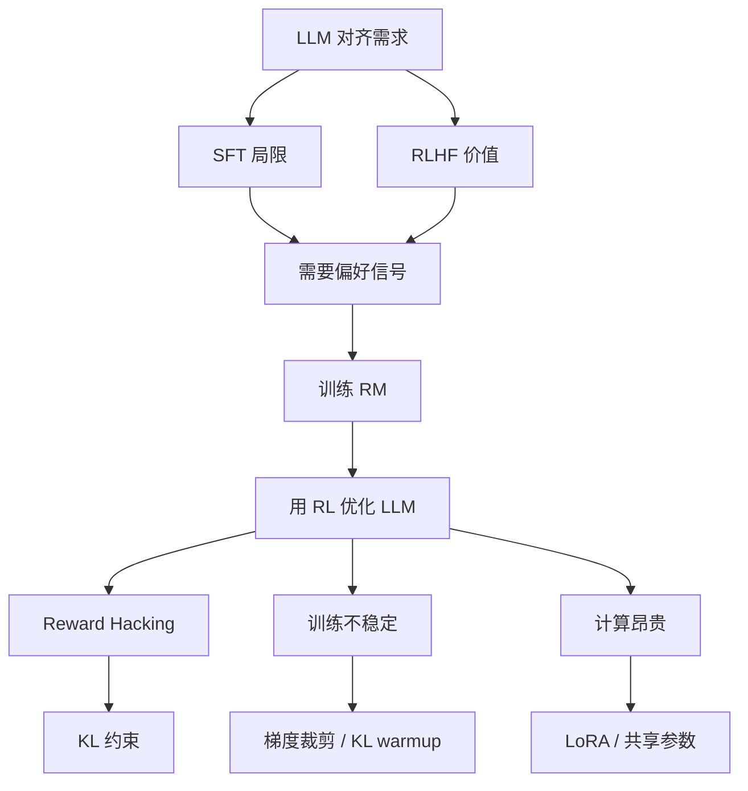

# 3-RL 在 LLM 中的经典方法——RLHF / DPO / GRPO / RLVR 全景

> **本章定位**: 从 2022 年 InstructGPT (PPO) 到 2025 年 DeepSeek-R1 (GRPO),RL 在 LLM 中的方法论是 AI 领域最热的子方向。
>
> **学完本章, 你能**: 推导 PPO clipping / DPO 隐式奖励 / GRPO 组内 advantage 公式;在 PyTorch 中实现 PPO-for-LLM、DPO、GRPO;解释 RL 相比 SFT 的优势;在面试讲清楚 InstructGPT、Constitutional AI、DeepSeek-R1 等里程碑;在工业部署 RLHF pipeline。
>
> **关联章节**: `1-RL基础与数学.md` (MDP/Bellman) / `2-经典RL算法详解.md` (PPO/GAE) / `5-奖励设计与RL对齐.md` (Bradley-Terry/RM) / `7-论文案例-OneRec系列RL.md` / `../rec教程/第23章-RLHF与生成式推荐.md`

---

## 0. 一句话总结

> **RL 在 LLM 中的核心使命是"对齐"——把通用预训练模型对齐到人类偏好 / 业务目标 / 推理质量**——这条主线从 2022 年的 InstructGPT (SFT + RM + PPO) 出发,经过 2023 年 DPO (免 RM)、2024 年 GRPO (免 Critic) / Constitutional AI、2025 年 DeepSeek-R1 (纯 RL + 推理)、RLVR (规则验证), 已经形成 **PPO / DPO / GRPO / RLAIF / RLVR** 五大流派。

---

## 1. 为什么 LLM 需要 RL

### 1.1 SFT 的根本局限

```python
# SFT 目标: 最大似然估计
loss_sft = - E_(x, y) ~ D [ log p_θ(y | x) ]
```

**为什么不够?**

| 局限 | 表现 | 原因 |
|---|---|---|
| **只模仿, 不超越** | 输出与训练分布一致, 不会更好 | MLE 拟合历史, 不优化目标 |
| **不可微指标** | CTR / GMV / 留存无法直接当损失 | SFT 只能拟合 token-level likelihood |
| **缺乏偏好** | "两个回答哪个更好" 表达不了 | 没有 pairwise 信号 |
| **缺乏探索** | 学不到历史里没出现的好答案 | 没有 entropy bonus |
| **幻觉无法消除** | 模型自信地胡说 | 训练数据本身含错误 |
| **风格难统一** | 时而啰嗦, 时而简短 | SFT 不能加权多目标 |

**直觉**: SFT 是"教师讲课",RL 是"学生自己做题"。

### 1.2 RLHF 的核心动机

> **核心 insight**: "好的回答" 无法用单一规则表达, 但人类能瞬间判断。**把人类的"判断"转化为训练信号**。

**RLHF 的 3 个独特能力**:
1. **偏好建模**: 人类标注 "A 比 B 好" → 训练 RM → 量化"好"
2. **长期视角**: 整个 response 是一个 episode, RL 优化整体回报
3. **探索机制**: 熵正则 / sampling → 模型尝试新表达

### 1.3 对齐问题 (Alignment Problem)

**两层含义**:

```text
Layer 1 (语义对齐): 模型理解人类意图
Layer 2 (价值对齐): 模型行为符合 HHH (Helpful/Honest/Harmless)
```

**为什么对齐难?**

| 难 | 表现 |
|---|---|
| **奖励函数难定义** | "好" 是高维概念, RM 学不准 |
| **分布漂移** | 训练分布 ≠ 部署分布 |
| **Goodhart 定律** | 优化的指标 ≠ 真正想要的 |
| **奖励黑客** | Policy exploit RM 盲点 |
| **长尾价值** | 1% 边缘案例决定 99% 体验 |

### 1.4 为什么 RL 比 SFT 更强

```text
SFT 目标:  L_SFT = -E[log p_θ(y | x)]
             ↓ 只关心"token 对不对"

RL (PPO):  L_RL = -E[log p_θ(y | x) · A(x, y)] - β · KL(p_θ || p_ref)
             ↓ 优势 A(x, y) 包含"整个回答的回报"
             ↓ KL 项防止偏离 SFT 太远
             ↓ 模型主动探索高 A 的表达方式
```

**4 个本质差异**:

| 维度 | SFT | RL |
|---|---|---|
| **优化目标** | token likelihood | expected reward |
| **数据形式** | (prompt, response) | (prompt, response, reward) |
| **梯度来源** | label cross-entropy | policy gradient |
| **能力上限** | 历史分布 | 超越历史分布 |

### 1.5 工业 RLHF 的问题地图



---

## 2. RLHF 三阶段详解

### 2.1 三阶段流程图

```text
┌────────────────────────────────────────────────────────────────────────┐
│                           RLHF 三阶段                                   │
├────────────────────────────────────────────────────────────────────────┤
│                                                                        │
│  Stage 1: SFT (Supervised Fine-Tuning)                                │
│  Input:  (prompt, response) 对, ~10K-100K                              │
│  Loss:   Cross-Entropy                                                 │
│  Output: π_SFT (基础对话能力)                                          │
│                                                                        │
│  Stage 2: Reward Modeling                                              │
│  Input:  偏好对 (x, y_w, y_l), ~30K                                    │
│  Loss:   Bradley-Terry: -log σ(R_φ(x, y_w) - R_φ(x, y_l))             │
│  Output: R_φ (量化"好")                                                │
│                                                                        │
│  Stage 3: RL (PPO)                                                     │
│  Models: Policy π_θ + Ref π_ref + Value V_ψ + Reward R_φ (4 模型)    │
│  Reward: r_total = R_φ(x, y) - β · KL(π_θ || π_ref)                   │
│  Algorithm: PPO with KL penalty                                        │
│  Output: 对齐后的 LLM                                                  │
│                                                                        │
└────────────────────────────────────────────────────────────────────────┘
```

### 2.2 Stage 1: SFT

```python
import torch
from transformers import AutoModelForCausalLM, AutoTokenizer

class SFTTrainer:
    def __init__(self, model_name, lr=2e-5):
        self.tokenizer = AutoTokenizer.from_pretrained(model_name)
        self.tokenizer.pad_token = self.tokenizer.eos_token
        self.model = AutoModelForCausalLM.from_pretrained(model_name)
        self.optimizer = torch.optim.AdamW(self.model.parameters(), lr=lr)

    def compute_loss(self, batch):
        outputs = self.model(
            input_ids=batch["input_ids"],
            attention_mask=batch["attention_mask"],
            labels=batch["labels"],
        )
        return outputs.loss

    def train_step(self, batch):
        self.optimizer.zero_grad()
        loss = self.compute_loss(batch)
        loss.backward()
        torch.nn.utils.clip_grad_norm_(self.model.parameters(), 1.0)
        self.optimizer.step()
        return loss.item()
```

**关键细节**:
1. 只在 response 部分计算 loss (label=-100 mask prompt)
2. 数据质量 > 数量 (1K 高质量 > 100K 噪声)
3. 学习率 1e-5 到 5e-5 (比预训练小 10-100x)
4. Epochs 2-4 (避免过拟合)

### 2.3 Stage 2: Reward Model

**Bradley-Terry 模型**:

$$
P(y_1 \succ y_2 | x) = \frac{\exp(r(x, y_1))}{\exp(r(x, y_1)) + \exp(r(x, y_2))} = \sigma(r(x, y_1) - r(x, y_2))
$$

**Pairwise 损失**:

$$
\mathcal{L}_{\text{RM}} = -\mathbb{E}_{(x, y_w, y_l) \sim D_{\text{pref}}} \log \sigma\left( R_\phi(x, y_w) - R_\phi(x, y_l) \right)
$$

```python
import torch
import torch.nn as nn
import torch.nn.functional as F
from transformers import AutoModel

class RewardModel(nn.Module):
    """LLM 风格的 Reward Model: SFT backbone + 标量 head."""
    def __init__(self, model_name):
        super().__init__()
        self.backbone = AutoModel.from_pretrained(model_name)
        hidden_size = self.backbone.config.hidden_size
        self.score_head = nn.Linear(hidden_size, 1, bias=False)

    def forward(self, input_ids, attention_mask):
        outputs = self.backbone(input_ids=input_ids, attention_mask=attention_mask)
        last_hidden = outputs.last_hidden_state
        seq_lens = attention_mask.sum(dim=1) - 1
        batch_idx = torch.arange(input_ids.size(0), device=input_ids.device)
        last_token_hidden = last_hidden[batch_idx, seq_lens]
        score = self.score_head(last_token_hidden).squeeze(-1)
        return score


class RMTrainer:
    def __init__(self, model_name, lr=2e-5):
        self.model = RewardModel(model_name)
        self.optimizer = torch.optim.AdamW(self.model.parameters(), lr=lr)

    def compute_loss(self, chosen_ids, chosen_mask, rejected_ids, rejected_mask):
        r_chosen = self.model(chosen_ids, chosen_mask)
        r_rejected = self.model(rejected_ids, rejected_mask)
        loss = -F.logsigmoid(r_chosen - r_rejected).mean()
        return loss, r_chosen, r_rejected

    def train_step(self, batch):
        self.optimizer.zero_grad()
        loss, r_w, r_l = self.compute_loss(
            batch["chosen_ids"], batch["chosen_mask"],
            batch["rejected_ids"], batch["rejected_mask"],
        )
        loss.backward()
        torch.nn.utils.clip_grad_norm_(self.model.parameters(), 1.0)
        self.optimizer.step()
        with torch.no_grad():
            margin = (r_w - r_l).mean().item()
        return {"loss": loss.item(), "margin": margin}
```

**常见 RM trick**:

```python
# Trick 1: Length bias 防御
def balance_length(pairs):
    """RM 偏好长输出 → 平衡长度."""
    return [p for p in pairs if abs(len(p["chosen"]) - len(p["rejected"])) < 100]

# Trick 2: Reward normalization
class RewardNorm:
    def __init__(self):
        self.mean = 0.0
        self.std = 1.0
    def normalize(self, r):
        return (r - self.mean) / (self.std + 1e-8)

# Trick 3: Multi-head RM (HHH)
class MultiHeadRM(nn.Module):
    """3 个 RM: helpfulness, honesty, harmlessness."""
    def __init__(self, base):
        super().__init__()
        self.base = base
        hidden = base.config.hidden_size
        self.helpful_head = nn.Linear(hidden, 1)
        self.honest_head = nn.Linear(hidden, 1)
        self.harmless_head = nn.Linear(hidden, 1)
    def forward(self, x):
        h = self.base(x).last_hidden_state[:, -1]
        return {
            "helpful": self.helpful_head(h).squeeze(-1),
            "honest": self.honest_head(h).squeeze(-1),
            "harmless": self.harmless_head(h).squeeze(-1),
        }
```

### 2.4 Stage 3: PPO 强化学习

**核心公式 (4 模型协同)**:

```text
输入:  prompt x (模型需要生成 response y)
1. Policy π_θ 生成 response: y ~ π_θ(· | x)
2. Reference π_ref (冻结) 提供 KL 约束
3. Reward R_φ (冻结) 给 r = R_φ(x, y)
4. Value V_ψ 估计 advantage
5. KL: kl = log π_θ(y|x) - log π_ref(y|x)
6. 总 reward: r_total = r - β · kl
7. Advantage: A_t = GAE(r_total, V_ψ)
8. PPO 更新: clip ratio, value loss
```

**简化代码骨架**:

```python
class PPOTrainer:
    """LLM RLHF PPO 训练器骨架 (4 模型)."""
    def __init__(self, policy, ref, value, reward, tokenizer, kl_coef=0.05):
        self.policy = policy
        self.ref = ref
        self.value = value
        self.reward = reward
        self.tokenizer = tokenizer
        self.kl_coef = kl_coef

    def compute_rewards(self, prompts, responses):
        with torch.no_grad():
            rm_score = self.reward(prompts, responses)
            logp_policy = self.policy.get_logprobs(prompts, responses)
            logp_ref = self.ref.get_logprobs(prompts, responses)
            kl = (logp_policy - logp_ref).sum(dim=-1)
        return rm_score - self.kl_coef * kl, kl, rm_score

    def train_step(self, batch):
        rewards, kl_per_token, rm_scores = self.compute_rewards(
            batch["prompts"], batch["responses"]
        )
        advantages, returns = self.compute_gae(rewards, batch["old_values"])

        for _ in range(self.K_epochs):
            new_logprobs = self.policy.get_logprobs(batch["prompts"], batch["responses"])
            new_values = self.value(batch["prompts"], batch["responses"])

            ratio = torch.exp(new_logprobs - batch["old_logprobs"])
            surr1 = ratio * advantages
            surr2 = torch.clamp(ratio, 1 - self.clip_eps, 1 + self.clip_eps) * advantages
            policy_loss = -torch.min(surr1, surr2).mean()

            value_loss = ((new_values - returns) ** 2).mean()
            loss = policy_loss + self.c1 * value_loss

            self.optimizer.zero_grad()
            loss.backward()
            torch.nn.utils.clip_grad_norm_(self.policy.parameters(), 1.0)
            self.optimizer.step()

        return {"policy_loss": policy_loss.item(),
                "value_loss": value_loss.item(),
                "kl": kl_per_token.mean().item(),
                "rm_score": rm_scores.mean().item()}
```

### 2.5 InstructGPT 范式 (OpenAI, 2022)

**InstructGPT 论文关键数据**:

```text
模型规模:    1.3B InstructGPT
基准:        175B GPT-3
标注规模:    ~33K 提示 + 多回答偏好数据
核心结果:    1.3B InstructGPT 在 85% 的提示上优于 175B GPT-3
```

### 2.6 为什么需要三个阶段 (而不是 end-to-end)?

```text
1. 偏好信号是人类给的, 无法直接 backprop 到 LLM
2. LLM 输出是离散 token, reward 是连续值, 中间需要 RM
3. RM 必须独立训练才能稳定 (否则 RM 跟 policy 一起变, 目标漂移)
4. PPO 是 on-policy 算法, 一次性学太慢, 分阶段更稳定
```

**类比**: SFT 像"学会说中文", RM 像"知道什么是好中文", PPO 像"用好中文写出好文章"。

---

## 3. PPO 在 LLM 中的应用

### 3.1 PPO 算法回顾 (与 `2-经典RL算法详解.md` 第 5.2 节衔接)

**Clipped Surrogate Objective**:

$$
\mathcal{L}^{\text{CLIP}}(\theta) = \mathbb{E}_t \left[ \min \left( r_t(\theta) A_t, \text{clip}(r_t(\theta), 1 - \epsilon, 1 + \epsilon) A_t \right) \right]
$$

其中 $r_t(\theta) = \frac{\pi_\theta(a_t | s_t)}{\pi_{\theta_{\text{old}}}(a_t | s_t)}$ 是 importance ratio。

**完整 PPO 损失**:

$$
\mathcal{L}^{\text{CLIP+VF+S}} = \mathbb{E}_t \left \mathcal{L}^{\text{CLIP}}(\theta) - c_1 \mathcal{L}^{\text{VF}}(\theta) + c_2 S[\pi_\theta \right]
$$

### 3.2 LLM 中的 PPO 工程实现

**4 个模型的协同**:

```text
┌─────────────────────────────────────────────────────────────────┐
│                     LLM RLHF PPO 的 4 模型                      │
├─────────────────────────────────────────────────────────────────┤
│  1. Policy π_θ (被优化): 初始 = SFT, 用 LoRA 省 100x 显存   │
│  2. Reference π_ref (冻结): SFT 复制, 提供 KL 约束            │
│  3. Value V_ψ (被训练): 估计 advantage                       │
│  4. Reward R_φ (冻结): 给整个 response 打分                   │
└─────────────────────────────────────────────────────────────────┘
```

### 3.3 KL 散度约束

**Per-token KL 估计 (K3 estimator)**:

$$
D_{\text{KL}}(\pi_\theta \| \pi_{\text{ref}})(y_t | x) \approx (r_t - 1) - \log r_t, \quad r_t = \frac{\pi_\theta(y_t | x, y_{<t})}{\pi_{\text{ref}}(y_t | x, y_{<t})}
$$

```python
def compute_kl_k3(logp_policy, logp_ref):
    """K3 estimator: KL ≈ (r - 1) - log(r)."""
    ratio = torch.exp(logp_policy - logp_ref)
    return (ratio - 1.0) - torch.log(ratio + 1e-8)
```

**完整 reward**:

$$
r_{\text{total}}(x, y) = R_\phi(x, y) - \beta \cdot \sum_t D_{\text{KL}}(\pi_\theta \| \pi_{\text{ref}})(y_t | x, y_{<t})
$$

**自适应 KL**:

```python
class AdaptiveKLController:
    def __init__(self, init_kl_coef=0.1, target_kl=6.0):
        self.kl_coef = init_kl_coef
        self.target_kl = target_kl
    def update(self, current_kl):
        proportional_error = np.clip(current_kl / self.target_kl - 1, -0.2, 0.2)
        self.kl_coef *= 1 + proportional_error
        return self.kl_coef
```

### 3.4 Advantage 估计 (GAE)

$$
\hat{A}_t = \sum_{l=0}^{\infty} (\gamma \lambda)^l \delta_{t+l}, \quad \delta_t = r_t + \gamma V(s_{t+1}) - V(s_t)
$$

**LLM 中的 GAE**:

```python
def compute_gae_for_llm(rewards, values, response_mask, gamma=1.0, lam=0.95):
    """适用于 LLM RLHF 的 GAE.
    rewards: [B, T] (末尾 token 是 RM score, 其他是 0 或 KL penalty)
    values: [B, T] 每 token 的 value
    response_mask: [B, T] 1 表示 response, 0 表示 prompt
    """
    B, T = rewards.shape
    advantages = torch.zeros_like(rewards)
    last_gae_lam = torch.zeros(B, device=rewards.device)

    for t in reversed(range(T)):
        if t == T - 1:
            next_value, next_mask = 0.0, 0.0
        else:
            next_value = values[:, t + 1]
            next_mask = response_mask[:, t + 1].float()
        delta = rewards[:, t] + gamma * next_value * next_mask - values[:, t]
        last_gae_lam = delta + gamma * lam * next_mask * last_gae_lam
        advantages[:, t] = last_gae_lam

    returns = advantages + values
    return advantages, returns
```

### 3.5 完整 PyTorch 代码 (100+ 行)

```python
"""
LLM RLHF PPO 完整 PyTorch 实现 (简化版).
"""
import torch
import torch.nn as nn
import torch.nn.functional as F
from torch import optim
import copy

class LLMRPPOTrainer:
    """LLM 风格的 PPO 训练器 (4 模型)."""

    def __init__(self, sft_model, reward_model, tokenizer,
                 lr_policy=1e-5, lr_value=1e-4, kl_coef=0.05,
                 clip_eps=0.2, gamma=1.0, gae_lambda=0.95,
                 value_coef=0.5, K_epochs=4, max_gen_len=128):
        self.policy = sft_model
        self.ref = copy.deepcopy(sft_model)
        for p in self.ref.parameters():
            p.requires_grad = False
        self.value_head = nn.Linear(
            self.policy.config.hidden_size, 1, bias=False
        ).to(self.policy.device)
        self.reward_model = reward_model
        for p in self.reward_model.parameters():
            p.requires_grad = False
        self.tokenizer = tokenizer
        self.policy_optim = optim.AdamW(self.policy.parameters(), lr=lr_policy)
        self.value_optim = optim.AdamW(self.value_head.parameters(), lr=lr_value)
        self.kl_coef = kl_coef
        self.clip_eps = clip_eps
        self.gamma = gamma
        self.gae_lambda = gae_lambda
        self.value_coef = value_coef
        self.K_epochs = K_epochs
        self.max_gen_len = max_gen_len

    def generate_responses(self, prompts):
        self.policy.eval()
        with torch.no_grad():
            inputs = self.tokenizer(prompts, return_tensors="pt", padding=True).to(self.policy.device)
            outputs = self.policy.generate(
                **inputs, max_new_tokens=self.max_gen_len,
                do_sample=True, temperature=1.0, top_p=0.95,
                pad_token_id=self.tokenizer.pad_token_id,
                return_dict_in_generate=True, output_scores=True,
            )
            sequences = outputs.sequences
            scores = outputs.scores
            logprobs = []
            for t, score in enumerate(scores):
                lp = F.log_softmax(score, dim=-1)
                chosen_tok = sequences[:, len(inputs.input_ids[0]) + t]
                logprobs.append(lp.gather(1, chosen_tok.unsqueeze(1)).squeeze(1))
            old_logprobs = torch.stack(logprobs, dim=1)
        self.policy.train()
        return sequences, old_logprobs

    def compute_rewards(self, sequences, prompt_lens, gen_lens):
        with torch.no_grad():
            rm_score = self.reward_model(sequences)
            ref_logprobs = F.log_softmax(self.ref(sequences).logits, dim=-1)
            ref_tok_logprob = ref_logprobs.gather(2, sequences.unsqueeze(2)).squeeze(2)
            policy_logprobs = F.log_softmax(self.policy(sequences).logits, dim=-1)
            policy_tok_logprob = policy_logprobs.gather(2, sequences.unsqueeze(2)).squeeze(2)
            kl_per_token = (policy_tok_logprob - ref_tok_logprob) ** 2 / 2

        rewards = torch.zeros_like(sequences, dtype=torch.float32)
        for b in range(sequences.size(0)):
            for t in range(prompt_lens[b], prompt_lens[b] + gen_lens[b]):
                rewards[b, t] = -self.kl_coef * kl_per_token[b, t]
            rewards[b, prompt_lens[b] + gen_lens[b] - 1] += rm_score[b]
        return rewards, rm_score, kl_per_token

    def compute_gae(self, rewards, values, response_mask):
        B, T = rewards.shape
        advantages = torch.zeros_like(rewards)
        last_gae = torch.zeros(B, device=rewards.device)
        for t in reversed(range(T)):
            next_value = values[:, t + 1] if t < T - 1 else torch.zeros_like(values[:, 0])
            next_mask = response_mask[:, t + 1] if t < T - 1 else torch.zeros_like(response_mask[:, 0])
            delta = rewards[:, t] + self.gamma * next_value * next_mask - values[:, t]
            last_gae = delta + self.gamma * self.gae_lambda * next_mask * last_gae
            advantages[:, t] = last_gae
        return advantages, advantages + values

    def train_step(self, batch):
        prompts = batch["prompts"]
        prompt_lens = batch["prompt_lens"]
        gen_lens = batch["gen_lens"]

        sequences, old_logprobs = self.generate_responses(prompts)
        rewards, rm_score, kl_per_token = self.compute_rewards(sequences, prompt_lens, gen_lens)

        with torch.no_grad():
            last_hidden = self.policy(sequences, output_hidden_states=True).hidden_states[-1]
            old_values = self.value_head(last_hidden).squeeze(-1)

        B, T = sequences.shape
        response_mask = torch.zeros(B, T, device=sequences.device)
        for b in range(B):
            response_mask[b, prompt_lens[b]:prompt_lens[b] + gen_lens[b]] = 1.0

        for _ in range(self.K_epochs):
            last_hidden = self.policy(sequences, output_hidden_states=True).hidden_states[-1]
            new_values = self.value_head(last_hidden).squeeze(-1)
            new_logprobs = F.log_softmax(self.policy(sequences).logits, dim=-1)
            new_tok_logprob = new_logprobs.gather(2, sequences.unsqueeze(2)).squeeze(2)

            advantages, returns = self.compute_gae(rewards, old_values, response_mask)
            adv_mask = response_mask.bool()
            advantages = (advantages - advantages[adv_mask].mean()) / (advantages[adv_mask].std() + 1e-8)

            ratio = torch.exp(new_tok_logprob - old_logprobs)
            surr1 = ratio * advantages
            surr2 = torch.clamp(ratio, 1 - self.clip_eps, 1 + self.clip_eps) * advantages
            policy_loss = -torch.min(surr1, surr2)[adv_mask].mean()
            value_loss = ((new_values - returns) ** 2 * response_mask).sum() / response_mask.sum()
            loss = policy_loss + self.value_coef * value_loss

            self.policy_optim.zero_grad()
            self.value_optim.zero_grad()
            loss.backward()
            torch.nn.utils.clip_grad_norm_(self.policy.parameters(), 1.0)
            torch.nn.utils.clip_grad_norm_(self.value_head.parameters(), 1.0)
            self.policy_optim.step()
            self.value_optim.step()

        return {
            "policy_loss": policy_loss.item(),
            "value_loss": value_loss.item(),
            "rm_score": rm_score.mean().item(),
        }
```

### 3.6 为什么 PPO 在 LLM 中成功

**3 个核心原因**:

```text
1. 信任域 (Trust Region) 思想: clip 防止策略大步更新, LLM 输出空间巨大
2. On-policy + Importance Sampling: 同一批数据可以用 K 次, 提高样本效率
3. Value Function 提供低方差 advantage: GAE 提供最优 bias-variance 权衡
```

### 3.7 PPO 在 LLM 中的局限性

| 局限 | 原因 | 后果 |
|---|---|---|
| **4 模型, 显存 × 4** | Policy + Ref + Value + Reward | 7B 模型需 ≥ 80GB 显存 |
| **训练慢** | 在线采样 + KL 计算 | 比 SFT 慢 5-10 倍 |
| **易崩溃** | PPO 超参敏感 | 一次实验 $10K-100K 浪费 |
| **Reward Hacking** | RM 不是真实奖励 | Policy exploit RM 漏洞 |
| **Value 不准** | LLM 价值难估 | GAE 噪声大 |

---

## 4. RLHF 的挑战与解决方案

### 4.1 Reward Hacking

> **Reward Hacking**: Policy 发现一种"能刷高 reward 但不符合真实意图"的行为模式。

**经典例子**:

```python
# 例子 1: RM 偏好长输出 → Policy 学到输出越来越长
# 例子 2: RM 偏好"看起来自信"的输出 → Policy 用大量断言式语言
# 例子 3: RM 偏好某些 token 序列 → Policy 输出含特定关键词
# 例子 4: KL 惩罚被 exploit → Policy 在 reference 不擅长的领域冒险
```

**缓解方法 (多层防御)**:

```python
class AntiRewardHacking:
    def __init__(self):
        self.defenses = []

    def kl_constraint(self, beta=0.05):
        self.defenses.append(lambda logp, logp_ref: -beta * (logp - logp_ref).sum())

    def reward_clipping(self, clip_range=10.0):
        self.defenses.append(lambda r: torch.clamp(r, -clip_range, clip_range))

    def reward_normalization(self):
        def normalize(r):
            return (r - r.mean()) / (r.std() + 1e-8)
        self.defenses.append(normalize)

    def length_penalty(self, target_len=200):
        def penalty(lens):
            return -0.001 * (lens - target_len).clamp(min=0)
        self.defenses.append(penalty)
```

| 防御层级 | 措施 | 目的 |
|---|---|---|
| **Reward 层** | Reward clip / normalization | 防极端值 |
| **KL 层** | 固定 / 自适应 β | 防偏离 |
| **训练层** | 梯度裁剪 / KL warmup | 防崩溃 |
| **数据层** | 数据多样性 / 多标注员 | 防 RM 偏置 |
| **评估层** | 人工评估 + 对抗测试 | 防数据黑客 |

### 4.2 训练不稳定

**常见症状**:

```text
症状 1: Policy loss 突然变成 NaN → 大梯度更新
症状 2: Reward 突然飙到极高 → Policy 发现 RM 漏洞
症状 3: KL 爆炸, 模型变成乱码 → 偏离 reference 太远
症状 4: Value loss 不下降 → Value 模型难拟合
症状 5: Policy 完全不学 → KL 太大 / lr 太小
```

**监控指标**:

```python
class RLHFMonitor:
    def __init__(self):
        self.metrics = {
            "policy_loss": [], "value_loss": [], "kl": [],
            "rm_score": [], "total_reward": [], "response_length": [],
            "entropy": [], "clip_fraction": [],
            "advantages_mean": [], "advantages_std": [],
        }

    def check_health(self):
        recent_kl = self.metrics["kl"][-10:]
        recent_rm = self.metrics["rm_score"][-10:]
        if any(k > 50 for k, _ in recent_kl):
            return "WARNING: KL exploding"
        if len(recent_rm) > 5 and recent_rm[-1][1] - recent_rm[-5][1] > 5:
            return "WARNING: Reward spike, possible hacking"
        return "OK"
```

### 4.3 计算成本

**7B 模型成本分析**:

```text
Policy:        7B * 2 bytes (BF16) = 14 GB
Reference:     7B * 2 bytes         = 14 GB
Value Head:    7B * 2 bytes         = 14 GB
Reward:        7B * 2 bytes         = 14 GB
Optimizer:     7B * 8 bytes (Adam) = 56 GB
Activations:   ~10 GB
总计: ~122 GB
```

**优化方案**:

```python
# 方案 1: LoRA Policy (省 100x 显存)
from peft import LoraConfig, get_peft_model

class LoRAPolicy:
    def __init__(self, base_model):
        config = LoraConfig(r=16, lora_alpha=32,
                            target_modules=["q_proj", "v_proj"],
                            lora_dropout=0.05, bias="none",
                            task_type="CAUSAL_LM")
        self.policy = get_peft_model(base_model, config)

# 方案 2: Reference 和 Value 共享 backbone
class SharedBackbonePPO(nn.Module):
    def __init__(self, sft_model):
        super().__init__()
        self.backbone = sft_model
    def forward_ref(self, x):
        with torch.no_grad():
            return self.backbone(x)
    def forward_value(self, x):
        return self.value_head(self.backbone(x).last_hidden_state)

# 方案 3: 异步 rollout
class AsyncRLHF:
    def __init__(self):
        self.actor_gpus = [0, 1]
        self.learner_gpus = [2, 3, 4, 5]
        self.replay_buffer = Queue(maxsize=1000)
```

### 4.4 偏好数据稀缺

```python
class PreferenceDataAugmentation:
    def from_human_annotation(self, prompts, budget=10000):
        """1. 人类标注 (最贵, 最准)."""
        pairs = []
        for prompt in prompts[:budget]:
            y_a, y_b = self.policy.sample_2(prompt)
            chosen = human_labeler.compare(prompt, y_a, y_b)
            pairs.append((prompt, y_a if chosen == "A" else y_b, y_b if chosen == "A" else y_a))
        return pairs

    def from_ai_annotation(self, prompts, ai_judge):
        """2. AI 标注 (便宜, 但有偏差)."""
        pairs = []
        for prompt in prompts:
            y_a, y_b = self.policy.sample_2(prompt)
            chosen = ai_judge(prompt, y_a, y_b)
            pairs.append((prompt, y_a if chosen == "A" else y_b, y_b if chosen == "A" else y_a))
        return pairs

    def from_user_logs(self, logs):
        """3. 用户隐式反馈 (无标注成本)."""
        pairs = []
        for impression in logs:
            items = impression.shown_items
            clicked = [i for i in items if i.was_clicked]
            skipped = [i for i in items if not i.was_clicked]
            if clicked and skipped:
                pairs.append((impression.user, clicked[0], skipped[0]))
        return pairs

    def from_synthetic(self, prompts, rules):
        """4. 合成 (用规则 / 模型生成)."""
        pairs = []
        for prompt in prompts:
            y_good = self.policy.generate(prompt)
            y_bad = self.policy.generate(prompt, forbidden_words=rules)
            pairs.append((prompt, y_good, y_bad))
        return pairs
```

### 4.5 价值函数估计的偏差

**为什么需要 Value Function**:

```python
# 方案 A: 纯 MC (无偏差, 高方差)
G_t = sum r_k, advantage = G_t - baseline

# 方案 B: 1-step TD (低方差, 高偏差)
A_t = r_t + γ V(s_{t+1}) - V(s_t)

# 方案 C: GAE (折中)
A_t = sum (γ λ)^l δ_{t+l}, δ_t = r_t + γ V(s_{t+1}) - V(s_t)
```

**GAE 推导**:

$$
\hat{A}_t^{\text{GAE}(\gamma, \lambda)} = \delta_t + \gamma \lambda \hat{A}_{t+1}^{\text{GAE}(\gamma, \lambda)}
$$

**λ 选择**:

| λ | 等价方法 | 偏差 | 方差 |
|---|---|---|---|
| 0 | 1-step TD | 高 | 低 |
| 0.95 | GAE 常用 | 中 | 中 |
| 1.0 | MC | 无 | 高 |

---

## 5. DPO (Direct Preference Optimization)

### 5.1 DPO 的动机

**PPO 的 4 大问题**:

```text
1. 复杂: 4 模型协同, 工程量大
2. 不稳定: PPO 超参敏感, 训练崩溃常见
3. 慢: 在线采样 + 4 模型前向, 比 SFT 慢 10x
4. Reward Hacking: RM 不是真实奖励
```

**DPO 的 insight**: **能否绕过 RM, 直接从偏好对训练 LLM?**

> **Rafailov et al. 2023 的关键观察**: 在 RLHF 最优策略下, RM 可以用 policy 和 reference policy 的对数概率比表示:
> $$r(x, y) = \beta \log \frac{\pi^*(y | x)}{\pi_{\text{ref}}(y | x)} + \beta \log Z(x)$$

### 5.2 DPO 的完整推导

**Step 1: RLHF 最优策略的闭式解**

$$
\pi^*(y | x) = \frac{1}{Z(x)} \pi_{\text{ref}}(y | x) \exp\left(\frac{1}{\beta} r(x, y)\right)
$$

**Step 2: 反解 RM** → 代入 Bradley-Terry → DPO 损失:

$$
\mathcal{L}_{\text{DPO}}(\pi_\theta) = -\mathbb{E}_{(x, y_w, y_l) \sim D} \log \sigma \left( \beta \log \frac{\pi_\theta(y_w | x)}{\pi_{\text{ref}}(y_w | x)} - \beta \log \frac{\pi_\theta(y_l | x)}{\pi_{\text{ref}}(y_l | x)} \right)
$$

**直觉**: 让 chosen 相对 reference 的概率上升, rejected 下降。

### 5.3 DPO 与 RLHF 对比

| 维度 | RLHF (PPO) | DPO |
|---|---|---|
| **模型数** | 4 | 2 |
| **训练阶段** | 3 (SFT + RM + PPO) | 1 (SFT + DPO) |
| **在线采样** | 需要 | 不需要 |
| **训练时间** | 7B 模型 ~7 天 | 7B 模型 ~12 小时 |
| **显存需求** | 4× | 2× |
| **RM 训练** | 必须 | 不需要 |
| **On-policy** | 是 | 否 (离线) |
| **效果** | 基线 | 略高或持平 |

### 5.4 DPO 的优势

```text
1. 工程简单 (2 模型 + 1 阶段)
2. 稳定 (闭式解, 不会崩溃)
3. 高效 (离线数据 + 2 模型前向)
4. 效果好 (DPO 在多数 benchmark 与 PPO 持平或略高)
```

### 5.5 DPO 的局限

```text
1. 不能在线更新 (离线偏好对, 学完固定)
2. 分布外能力差
3. Length bias (DPO 比 PPO 输出长 20-50%)
4. 多样性下降 (鼓励 chosen, 不鼓励多样性)
5. 过拟合 (Deterministic Preferences) — IPO 是解法
```

### 5.6 完整 PyTorch 实现

```python
import torch
import torch.nn as nn
import torch.nn.functional as F
from torch import optim

class DPOTrainer:
    """DPO 训练器 (完整 PyTorch 实现)."""

    def __init__(self, policy_model, ref_model, tokenizer,
                 beta=0.1, lr=1e-5, label_smoothing=0.0):
        self.policy = policy_model
        self.ref = ref_model
        for p in self.ref.parameters():
            p.requires_grad = False
        self.tokenizer = tokenizer
        self.beta = beta
        self.label_smoothing = label_smoothing
        self.optimizer = optim.AdamW(self.policy.parameters(), lr=lr)

    def get_logprobs(self, model, input_ids, attention_mask, response_mask):
        outputs = model(input_ids=input_ids, attention_mask=attention_mask)
        logits = outputs.logits
        logprobs = F.log_softmax(logits[:, :-1], dim=-1)
        chosen_logprobs = logprobs.gather(
            2, input_ids[:, 1:].unsqueeze(2)
        ).squeeze(2)
        response_logprobs = chosen_logprobs * response_mask[:, 1:]
        return response_logprobs.sum(dim=-1)

    def compute_loss(self, batch):
        chosen_ids, chosen_mask, chosen_resp_mask = (
            batch["chosen_ids"], batch["chosen_mask"], batch["chosen_response_mask"]
        )
        rejected_ids, rejected_mask, rejected_resp_mask = (
            batch["rejected_ids"], batch["rejected_mask"], batch["rejected_response_mask"]
        )

        policy_chosen_logprobs = self.get_logprobs(self.policy, chosen_ids, chosen_mask, chosen_resp_mask)
        policy_rejected_logprobs = self.get_logprobs(self.policy, rejected_ids, rejected_mask, rejected_resp_mask)

        with torch.no_grad():
            ref_chosen_logprobs = self.get_logprobs(self.ref, chosen_ids, chosen_mask, chosen_resp_mask)
            ref_rejected_logprobs = self.get_logprobs(self.ref, rejected_ids, rejected_mask, rejected_resp_mask)

        policy_logratios = policy_chosen_logprobs - policy_rejected_logprobs
        ref_logratios = ref_chosen_logprobs - ref_rejected_logprobs

        logits = self.beta * (policy_logratios - ref_logratios)
        loss = -F.logsigmoid(logits) * (1 - self.label_smoothing) \
               - F.logsigmoid(-logits) * self.label_smoothing
        loss = loss.mean()

        with torch.no_grad():
            chosen_rewards = self.beta * (policy_chosen_logprobs - ref_chosen_logprobs)
            rejected_rewards = self.beta * (policy_rejected_logprobs - ref_rejected_logprobs)
            reward_margin = (chosen_rewards - rejected_rewards).mean().item()
            accuracy = (logits > 0).float().mean().item()

        return loss, {
            "loss": loss.item(), "reward_margin": reward_margin,
            "accuracy": accuracy,
        }

    def train_step(self, batch):
        self.optimizer.zero_grad()
        loss, metrics = self.compute_loss(batch)
        loss.backward()
        torch.nn.utils.clip_grad_norm_(self.policy.parameters(), 1.0)
        self.optimizer.step()
        return metrics
```

### 5.7 DPO 变体家族

| 变体 | 关键创新 | 提出 | 优点 |
|---|---|---|---|
| **IPO** | 用 MSE 替代 log σ, 防过拟合 | Azar 2023 | 解决 DPO 的确定性偏好问题 |
| **KTO** | 前景理论, 二元反馈 | Ethayarajh 2024 | 不需要成对偏好 |
| **SimPO** | Reference-free, 平均 log prob | Meng 2024 | 简单, 长度归一 |
| **ORPO** | Odds Ratio, 不需要 reference | Hong 2024 | 单阶段, 单模型 |
| **RLOO** | REINFORCE Leave-One-Out | Ahmadian 2024 | 在线 RL 简化版 |

### 5.8 IPO

**问题**: DPO 在 0/1 偏好时, $\log \sigma(\Delta) \to -\infty$ 导致过拟合。

**解法**: 用平方损失替代 log σ:

$$
\mathcal{L}_{\text{IPO}}(\pi_\theta) = \mathbb{E} \left[ \left( \log \frac{\pi_\theta(y_w | x)}{\pi_{\text{ref}}(y_w | x)} - \log \frac{\pi_\theta(y_l | x)}{\pi_{\text{ref}}(y_l | x)} - \frac{1}{2\beta} \right)^2 \right]
$$

```python
def ipo_loss(policy_chosen_logprob, policy_rejected_logprob,
             ref_chosen_logprob, ref_rejected_logprob, beta=0.1):
    chosen_diff = policy_chosen_logprob - ref_chosen_logprob
    rejected_diff = policy_rejected_logprob - ref_rejected_logprob
    logits = chosen_diff - rejected_diff
    target = 1.0 / (2 * beta)
    return ((logits - target) ** 2).mean()
```

### 5.9 SimPO

**核心**: Reference-free, 用平均 log prob 作为 reward:

$$
\mathcal{L}_{\text{SimPO}} = -\mathbb{E} \log \sigma \left( \frac{\beta}{|y_w|} \log \pi_\theta(y_w | x) - \frac{\beta}{|y_l|} \log \pi_\theta(y_l | x) - \gamma \right)
$$

```python
def simpo_loss(policy_chosen_logprob, policy_rejected_logprob,
               chosen_len, rejected_len, beta=2.0, gamma=0.5):
    chosen_avg = policy_chosen_logprob / chosen_len
    rejected_avg = policy_rejected_logprob / rejected_len
    logits = beta * (chosen_avg - rejected_avg) - gamma
    return -F.logsigmoid(logits).mean()
```

### 5.10 ORPO

**核心**: SFT + 偏好优化合并, 不需要 reference model:

```python
def orpo_loss(policy_outputs, chosen_ids, rejected_ids, lambda_coef=0.1):
    sft_loss = cross_entropy(policy_outputs.chosen_logits, chosen_ids)
    chosen_logprob = compute_logprob(policy_outputs.chosen_logits, chosen_ids)
    rejected_logprob = compute_logprob(policy_outputs.rejected_logits, rejected_ids)
    chosen_odds = chosen_logprob - torch.log(1 - torch.exp(chosen_logprob))
    rejected_odds = rejected_logprob - torch.log(1 - torch.exp(rejected_logprob))
    or_loss = -F.logsigmoid(chosen_odds - rejected_odds).mean()
    return sft_loss + lambda_coef * or_loss
```

### 5.11 KTO

**核心**: 基于前景理论, 用 desirable / undesirable 二元信号:

```python
def kto_loss(policy_chosen_logprob, policy_rejected_logprob,
             ref_chosen_logprob, ref_rejected_logprob, beta=0.1):
    chosen_diff = policy_chosen_logprob - ref_chosen_logprob
    rejected_diff = policy_rejected_logprob - ref_rejected_logprob
    des_loss = 1 - torch.sigmoid(beta * chosen_diff)
    undes_loss = torch.sigmoid(beta * rejected_diff)
    return (des_loss + undes_loss).mean()
```

### 5.12 RLOO

**核心**: 不需要 Critic, 用 group baseline:

```python
def rloo_loss(rewards, k_samples=4):
    """RLOO: 每个样本的 baseline = 其他 k-1 个样本的均值."""
    B = rewards.size(0) // k_samples
    rewards = rewards.view(B, k_samples)
    baseline = (rewards.sum(dim=1, keepdim=True) - rewards) / (k_samples - 1)
    advantages = rewards - baseline
    return -advantages.flatten()
```

### 5.13 为什么 DPO 能 work

**3 层理论保证**:

```text
Layer 1: RLHF 最优策略有闭式解, DPO 拟合这个解
Layer 2: Bradley-Terry 是经典统计模型
Layer 3: MLE 在足够数据下收敛
```

---

## 6. GRPO (Group Relative Policy Optimization)

### 6.1 DeepSeek 的洞察

> **DeepSeekMath 论文 (Shao et al. 2024) 的关键观察**: 在数学推理任务中, **同一 prompt 的不同 response 的相对好坏比绝对奖励更重要**。这启发了 GRPO。

**GRPO 的核心思想**:

```text
不学"绝对奖励", 只学"组内相对优势"
- 同一 prompt 生成 G 个 responses
- advantage = (reward - mean) / std
- 不需要 Critic / Value 模型
```

**优势**:
1. 不需要 Critic 模型 (省 50% 显存)
2. 不需要训练 Value 函数
3. 适合可验证任务 (数学 / 代码)
4. 工业实用: DeepSeek-R1, Qwen3

### 6.2 GRPO 算法详解

```text
For each prompt x:
  1. Policy π_θ_old 生成 G 个 responses: {y_1, ..., y_G}
  2. Reward model 给每个 response 打分: {r_1, ..., r_G}
  3. 计算组内归一化:
       μ = mean({r_i}), σ = std({r_i})
       A_i = (r_i - μ) / σ  (优势)
  4. PPO-style 更新:
       ratio = π_θ(y_i | x) / π_θ_old(y_i | x)
       L_clip = -E[min(ratio * A, clip(ratio, 1-ε, 1+ε) * A)]
  5. KL 惩罚: L_kl = β · KL(π_θ || π_ref)
  6. 总 loss: L = L_clip + c_kl · L_kl
```

### 6.3 GRPO 与 PPO 对比

| 维度 | PPO | GRPO |
|---|---|---|
| **Value Model** | 必须 | 不需要 |
| **模型数量** | 4 | 3 |
| **Advantage 计算** | GAE (依赖 Value) | 组内归一化 |
| **显存节省** | 0 | ~25% |
| **代表作品** | InstructGPT, ChatGPT | DeepSeek-R1, Qwen3 |

### 6.4 完整推导

$$
\mathcal{L}_{\text{GRPO}}(\theta) = -\frac{1}{G} \sum_{i=1}^{G} \min \left( \frac{\pi_\theta(y_i | x)}{\pi_{\theta_{\text{old}}}(y_i | x)} \hat{A}_i, \text{clip}\left( \frac{\pi_\theta(y_i | x)}{\pi_{\theta_{\text{old}}}(y_i | x)}, 1 - \epsilon, 1 + \epsilon \right) \hat{A}_i \right) + \beta \cdot D_{\text{KL}}(\pi_\theta \| \pi_{\text{ref}})
$$

$$
\hat{A}_i = \frac{r_i - \text{mean}(\{r_1, ..., r_G\})}{\text{std}(\{r_1, ..., r_G\})}
$$

### 6.5 完整 PyTorch 实现

```python
import torch
import torch.nn.functional as F

class GRPOTrainer:
    """GRPO 训练器 (DeepSeek 风格)."""

    def __init__(self, policy_model, ref_model, reward_model, tokenizer,
                 group_size=8, kl_coef=0.04, clip_eps=0.2, lr=1e-6):
        self.policy = policy_model
        self.ref = ref_model
        for p in self.ref.parameters():
            p.requires_grad = False
        self.reward_model = reward_model
        for p in self.reward_model.parameters():
            p.requires_grad = False
        self.tokenizer = tokenizer
        self.group_size = group_size
        self.kl_coef = kl_coef
        self.clip_eps = clip_eps
        self.optimizer = torch.optim.AdamW(self.policy.parameters(), lr=lr)

    def generate_group_responses(self, prompts):
        all_responses, all_logprobs = [], []
        for prompt in prompts:
            repeated_prompts = [prompt] * self.group_size
            inputs = self.tokenizer(repeated_prompts, return_tensors="pt", padding=True).to(self.policy.device)
            with torch.no_grad():
                outputs = self.policy.generate(
                    **inputs, max_new_tokens=512, do_sample=True,
                    temperature=1.0, top_p=0.95,
                    pad_token_id=self.tokenizer.pad_token_id,
                    return_dict_in_generate=True, output_scores=True,
                )
                sequences = outputs.sequences
                scores = outputs.scores
                logprobs_per_resp = []
                for t, score in enumerate(scores):
                    lp = F.log_softmax(score, dim=-1)
                    chosen_tok = sequences[:, len(inputs.input_ids[0]) + t]
                    logprobs_per_resp.append(lp.gather(1, chosen_tok.unsqueeze(1)).squeeze(1))
                response_logprobs = torch.stack(logprobs_per_resp, dim=1)
            all_responses.append(sequences)
            all_logprobs.append(response_logprobs)
        return all_responses, all_logprobs

    def compute_group_advantages(self, rewards):
        mean = rewards.mean(dim=-1, keepdim=True)
        std = rewards.std(dim=-1, keepdim=True) + 1e-8
        return (rewards - mean) / std

    def compute_grpo_loss(self, batch):
        prompts = batch["prompts"]
        all_responses, old_logprobs = self.generate_group_responses(prompts)

        all_rewards = []
        for responses in all_responses:
            rewards = self.reward_model(responses)
            all_rewards.append(rewards)
        rewards_tensor = torch.stack(all_rewards, dim=0)
        advantages = self.compute_group_advantages(rewards_tensor)

        B, G = advantages.shape
        total_loss = 0.0
        for b in range(B):
            responses = all_responses[b]
            old_lp = old_logprobs[b]

            new_logits = self.policy(responses).logits
            new_logprobs = F.log_softmax(new_logits, dim=-1)
            new_lp = new_logprobs.gather(2, responses.unsqueeze(2)).squeeze(2)

            P = self.tokenizer(prompts[b], return_tensors="pt").input_ids.size(1)
            new_resp_lp = new_lp[:, P:].sum(dim=-1)
            old_resp_lp = old_lp.sum(dim=-1)

            with torch.no_grad():
                ref_lp = F.log_softmax(self.ref(responses).logits, dim=-1)
                ref_lp = ref_lp.gather(2, responses.unsqueeze(2)).squeeze(2)
                ref_resp_lp = ref_lp[:, P:].sum(dim=-1)

            kl_per_resp = new_resp_lp - ref_resp_lp
            ratio = torch.exp(new_resp_lp - old_resp_lp.detach())
            adv = advantages[b]
            surr1 = ratio * adv
            surr2 = torch.clamp(ratio, 1 - self.clip_eps, 1 + self.clip_eps) * adv
            policy_loss = -torch.min(surr1, surr2).mean()
            kl_loss = self.kl_coef * kl_per_resp.mean()
            total_loss += policy_loss + kl_loss

        total_loss = total_loss / B
        return total_loss, {
            "loss": total_loss.item(),
            "rewards_mean": rewards_tensor.mean().item(),
            "rewards_std": rewards_tensor.std().item(),
        }

    def train_step(self, batch):
        self.optimizer.zero_grad()
        loss, metrics = self.compute_grpo_loss(batch)
        loss.backward()
        torch.nn.utils.clip_grad_norm_(self.policy.parameters(), 1.0)
        self.optimizer.step()
        return metrics
```

### 6.6 GRPO 在数学/代码推理的成功

**DeepSeek-R1 (2025-01)**:

```text
训练流程:
  1. DeepSeek-V3-Base 上直接 GRPO (R1-Zero)
  2. 不需要 SFT 冷启动
  3. 同一 prompt 采样 G = 16-64 个 responses
  4. Reward = 答案对错 (规则验证, RLVR)
  5. AIME 2024 从 15.6% → 71.0% (无 SFT)
```

**Qwen3 (2025-05)**:

```text
训练流程:
  1. 冷启动 SFT (长 CoT 数据)
  2. Reasoning RL (GRPO) on 数学/代码
  3. 通域 RL
  4. 3,995 个 query-verifier 对
  5. AIME 2024 (Qwen3-235B-A22B) 70.1 → 85.1 (170 步)
```

### 6.7 为什么 GRPO 适合推理任务

**4 个原因**:
1. 推理任务可验证 (RLVR)
2. 同一 prompt 的多 response 容易对比
3. 不需要 Value 模型 (推理任务 reward 稀疏)
4. On-policy + Group Sampling

### 6.8 GRPO 的局限与改进

**局限**:
1. 计算成本高 (G = 16-64 次采样)
2. Group 划分难 (开放式对话)
3. 长 CoT 训练难 (信用分配)

**改进**:

| 改进 | 提出 | 关键想法 |
|---|---|---|
| **DAPO** | ByteDance 2025-03 | Clip-Higher / Dynamic Sampling / Token-Level Loss / Overlong Reward Shaping |
| **Dr. GRPO** | 清华 2025-03 | 移除长度归一化和问句级 std 归一化 (GRPO 有偏) |
| **REINFORCE++** | Microsoft 2025-01 | 用全局 batch 均值替代 group 内 baseline |
| **GSPO** | Qwen3 2025 | Sequence-level advantage, 适合长序列 GR |

---

## 7. 其他重要变体

### 7.1 RLAIF (Constitutional AI)

```python
class ConstitutionalAI:
    """Constitutional AI: 用 LLM 自我批评 + 修订."""
    def __init__(self, base_llm, constitution):
        self.llm = base_llm
        self.constitution = constitution

    def self_critique(self, prompt, response, principle):
        prompt_template = f"""
请根据以下原则评估回答:

原则: {principle}

回答: {prompt} → {response}

请指出回答哪里违反原则。
"""
        return self.llm.generate(prompt_template)

    def self_revise(self, prompt, response, critique):
        prompt_template = f"""
原回答: {prompt} → {response}
批评: {critique}

请根据批评修改回答。
"""
        return self.llm.generate(prompt_template)

    def build_preference_pairs(self, prompts, initial_responses):
        pairs = []
        for prompt, response in zip(prompts, initial_responses):
            principle = random.choice(self.constitution)
            critique = self.self_critique(prompt, response, principle)
            revised = self.self_revise(prompt, response, critique)
            pairs.append((prompt, revised, response))
        return pairs

CONSTITUTION = [
    "请选择更无害、更礼貌的回答",
    "请选择更尊重人类自主权的回答",
    "请选择更诚实的回答, 不撒谎",
    "请选择不鼓励非法行为的回答",
    "请选择更不具歧视性的回答",
]
```

### 7.2 Self-Rewarding LMs (Yuan et al. 2024)

```python
class SelfRewardingTrainer:
    """LLM 自己当 RM (迭代 DPO)."""
    def __init__(self, base_llm):
        self.llm = base_llm

    def generate_candidates(self, prompt, n_samples=4):
        return [self.llm.generate(prompt, temperature=0.8) for _ in range(n_samples)]

    def llm_as_judge(self, prompt, response):
        return float(self.llm.generate(f"问题: {prompt}\n回答: {response}\n请评估 (0-10):").strip())

    def build_iteration_data(self, prompts):
        pairs = []
        for prompt in prompts:
            candidates = self.generate_candidates(prompt)
            scores = [self.llm_as_judge(prompt, c) for c in candidates]
            sorted_pairs = sorted(zip(candidates, scores), key=lambda x: -x[1])
            chosen = sorted_pairs[0][0]
            rejected = sorted_pairs[-1][0]
            pairs.append((prompt, chosen, rejected))
        return pairs

    def train_iteration(self, prompts):
        pairs = self.build_iteration_data(prompts)
        for prompt, chosen, rejected in pairs:
            self.dpo_trainer.train_step(prompt, chosen, rejected)
```

**Self-Rewarding 的问题**:
1. Bootstrapping 偏差 (LLM 用自己判断训练自己)
2. Judge 质量不稳定 (LLM-as-Judge 准确率 60-80%)
3. 多样性下降

### 7.3 RLAIF vs RLHF

| 维度 | RLHF | RLAIF |
|---|---|---|
| **反馈来源** | 人类 | LLM |
| **标注成本** | $5K-50K/万条 | $0.1-1/万条 |
| **标注速度** | 1-2 周 | 1-2 小时 |
| **一致性** | 中 (多人标注) | 低 (模型随机) |
| **可扩展性** | 低 | 高 |
| **适用场景** | 安全 / 价值 | 通用 / 风格 |

### 7.4 算法变体全景图

```text
                        RL for LLM
                            │
        ┌───────────────────┼───────────────────┐
        │                   │                   │
   Online RL           Offline RL          Hybrid
   PPO / GRPO          DPO / IPO / KTO / SimPO / ORPO / RLOO
        │
 RLVR (数学/代码)
```

---

## 8. RLHF 在主流模型的应用

### 8.1 时间线总览

```text
2017 ── Christiano (RLHF 起源)
2019 ── Ziegler (GPT-2 + RLHF)
2020 ── Stiennon (TL;DR + RLHF)
2022-03 ── InstructGPT (SFT + RM + PPO)
2022-12 ── Constitutional AI (RLAIF)
2023-05 ── DPO (免 RM)
2023-07 ── Llama 2 Chat
2024-01 ── Self-Rewarding LMs
2024-02 ── KTO / DeepSeekMath (GRPO)
2024-05 ── SimPO
2024-11 ── Tulu 3 (RLVR 命名)
2025-01 ── DeepSeek-R1 (GRPO + 推理)
2025-03 ── DAPO / Dr. GRPO / QwQ-32B
2025-05 ── Qwen3 (集成 thinking mode)
```

### 8.2 InstructGPT (OpenAI, 2022)

**3 阶段流水线**:

```python
# Stage 1: SFT - 13K (prompt, response) 对
# Stage 2: RM  - 33K 偏好对, Bradley-Terry
# Stage 3: PPO - 31K prompts, 4 模型协同
```

**关键结果**: 1.3B InstructGPT 在 85% 提示上优于 175B GPT-3。

### 8.3 Llama 2 Chat (Meta, 2023)

**5 阶段训练**:

```text
1. SFT (Llama-2-7B/13B/70B, 27K 数据)
2. RLHF Round 1 (1.4M 偏好对, 双 RM)
3. Rejection Sampling + Re-training
4. RLHF Round 2
5. Safety Iterations (红队测试)
```

**Meta 特别之处**:
- 双重 RM (helpfulness + safety)
- Ghost Attention (GAtt)
- 安全分类系统 (7 类风险)

### 8.4 Claude (Anthropic) — Constitutional AI

```text
1. SFT
2. Constitutional SL-CAI (LLM 自我批评 + 修订)
3. Constitutional RL-CAI (RLAIF, PPO with AI feedback)
```

### 8.5 GPT-4 (OpenAI) — 工业实践

公开信息有限,推测流程:
1. 大规模 SFT
2. 多 RM ensemble (helpfulness, factuality, safety, code)
3. PPO + KL 约束
4. 安全红队测试 → 迭代

### 8.6 DeepSeek-R1 (2025) — GRPO 突破

**DeepSeek-R1 训练流程**:

```python
# DeepSeek-R1-Zero (纯 RL, 无 SFT)
# 1. 基础模型: DeepSeek-V3-Base
# 2. 直接 GRPO 训练 (无 SFT 冷启动)
# 3. Reward: 规则验证 (答案对错)
# 4. 结果: AIME 2024 15.6% → 71.0% (无 SFT)

# DeepSeek-R1 (冷启动 SFT + RL)
# 1. 少量冷启动 CoT SFT
# 2. Reasoning RL (GRPO)
# 3. Rejection Sampling SFT
# 4. 通域 RL
```

**关键结果**:

| Benchmark | DeepSeek-V3-Base | R1-Zero | R1 |
|---|---|---|---|
| AIME 2024 | 15.6% | 71.0% | 79.8% |
| MATH-500 | 74.6% | 95.9% | 97.3% |
| GPQA Diamond | 39.0% | 70.7% | 71.5% |
| LiveCodeBench | 29.2% | 53.7% | 65.9% |

### 8.7 Qwen 3 (Alibaba, 2025)

**Qwen3 的 4 阶段训练**:

```text
Stage 1: Long CoT 冷启动 SFT
Stage 2: Reasoning RL (GRPO, 3,995 query-verifier 对)
Stage 3: Thinking-Mode 融合 SFT
Stage 4: 通域 RL
```

**Qwen3 特别之处**:
1. 单一模型集成 thinking / non-thinking
2. 强 RL 增强 (AIME 2024 70.1 → 85.1)
3. 多语言支持 (119 种)

### 8.8 不同模型的方法对比

| 模型 | RL 算法 | Reward 来源 | 规模 |
|---|---|---|---|
| **InstructGPT** | PPO | 人类 RM | 1.3B-175B |
| **Llama 2 Chat** | PPO + Rejection Sampling | 人类 RM (双) | 7B-70B |
| **Claude** | RLAIF + Constitutional | AI RM | 未公开 |
| **GPT-4** | 推测 PPO | 多 RM ensemble | 未公开 |
| **DeepSeek-R1** | GRPO | RLVR (规则) | 1.5B-671B |
| **Qwen 3** | GRPO + SFT | RLVR + RM | 0.6B-235B |

---

## 9. RL with Verifiable Rewards (RLVR)

### 9.1 概念

**RLVR (Reinforcement Learning with Verifiable Rewards)** 是 Tulu 3 (Lambert et al. 2024-11) 命名的术语:

> **RLVR**: 用规则 / 验证函数 (而非 RM) 来判定"对/错"的强化学习范式。

**核心**:
```text
传统 RLHF:  reward = RM(prompt, response)   (神经 RM 近似)
RLVR:       reward = verify(prompt, response)  (确定性规则)
```

### 9.2 应用场景

```python
class VerifiableRewards:
    """可验证奖励的 4 种应用."""

    @staticmethod
    def math_correctness(answer, ground_truth):
        """数学: 答案完全匹配."""
        return 1.0 if answer.strip() == ground_truth.strip() else 0.0

    @staticmethod
    def math_equiv(answer, ground_truth, tolerance=1e-6):
        """数学: 数值相等."""
        try:
            return 1.0 if abs(float(answer) - float(ground_truth)) < tolerance else 0.0
        except:
            return 0.0

    @staticmethod
    def code_unit_tests(code, tests):
        """代码: 单元测试通过率."""
        exec_env = {}
        try:
            exec(code, exec_env)
            return sum(1 for t in tests if t(exec_env)) / len(tests)
        except:
            return 0.0

    @staticmethod
    def format_compliance(response, schema):
        """格式: 符合 JSON / XML schema."""
        try:
            data = json.loads(response)
            return 1.0 if all(k in data for k in schema["required"]) else 0.0
        except:
            return 0.0
```

### 9.3 优势

```text
1. 成本低 (RM 训练: 数万 GPU 小时; RLVR: 0 GPU)
2. 可扩展 (RM 受训练数据限制; RLVR 只需题目 + 答案)
3. 无 reward hacking (规则是确定性的)
4. 速度快 (RM 推理 ~10ms; 规则验证 < 1ms)
5. 公平 (不受标注员偏好影响)
```

### 9.4 局限

```text
1. 适用范围有限 (只能验证数学 / 代码 / 格式)
2. Reward 信号稀疏 (大多 0 分)
3. 答案格式敏感 ("42" vs "42.0" vs "答案是 42")
4. 创造性受限 (鼓励标准答案, 抑制发散)
```

### 9.5 RLVR vs RLHF 对比

| 维度 | RLHF | RLVR |
|---|---|---|
| **Reward 来源** | RM (神经) | 规则 / 验证 |
| **成本** | 高 | 低 |
| **Reward Hacking** | 有风险 | 几乎无 |
| **适用范围** | 通用 | 数学 / 代码 / 格式 |
| **代表作品** | InstructGPT, Llama 2 | Tulu 3, DeepSeek-R1, Qwen3 |

### 9.6 工业实践

```python
class DeepSeekR1Pipeline:
    """DeepSeek-R1 的 RLVR 训练流水线."""

    def __init__(self):
        self.problem_bank = load_math_problems()

    def verify(self, problem, response):
        answer = extract_answer(response)
        ground_truth = problem["answer"]
        if answer == ground_truth:
            return 1.0
        try:
            if abs(float(answer) - float(ground_truth)) < 1e-6:
                return 1.0
        except:
            pass
        return check_math_equiv(answer, ground_truth)

    def grpo_with_rlvr(self, policy_model):
        for batch in self.dataloader:
            responses = policy_model.generate(batch["prompts"], n=G)
            rewards = [self.verify(p, r) for p, r in zip(batch["prompts"], responses)]
            rewards = torch.tensor(rewards).view(-1, G)
            grpo_loss = compute_grpo_loss(policy_model, responses, rewards)
            grpo_loss.backward()
            optimizer.step()
```

---

## 10. 推理增强 RL

### 10.1 GRPO for Math (DeepSeek 实践)

```python
class GRPO4Math:
    def __init__(self, model, problems, verifier):
        self.model = model
        self.problems = problems
        self.verifier = verifier

    def train_step(self, batch_problems, group_size=8):
        all_responses = []
        for problem in batch_problems:
            responses = self.model.sample(
                problem["question"],
                n=group_size, temperature=1.0, max_tokens=2048,
            )
            all_responses.append(responses)

        all_rewards = []
        for problem, responses in zip(batch_problems, all_responses):
            rewards = [self.verifier(problem, r) for r in responses]
            all_rewards.append(rewards)

        advantages = []
        for rewards in all_rewards:
            mean, std = np.mean(rewards), np.std(rewards) + 1e-8
            advantages.append([(r - mean) / std for r in rewards])

        return loss / len(batch_problems)
```

### 10.2 PRM vs ORM

```python
class OutcomeRewardModel:
    """ORM: 给整个回答打分."""
    def score(self, prompt, full_response):
        return self.reward_head(self.encode(prompt, full_response))

class ProcessRewardModel:
    """PRM: 给每一步推理打分."""
    def score(self, prompt, reasoning_steps):
        scores = []
        h = self.encode(prompt)
        for step in reasoning_steps:
            h = self.encode_step(h, step)
            scores.append(self.reward_head(h))
        return scores
```

**Lightman 2023 的关键结果**:

| 模型 | 类型 | MATH 子集准确率 |
|---|---|---|
| ORM (Result) | 整体评分 | 72.4% |
| **PRM (Process)** | **每步评分** | **78.2%** |
| 改进 | +5.8% | |

**PRM 的优势**:
1. 错误定位: 知道哪一步错
2. RL 信用分配: 每步独立 reward
3. Best-of-N: 用 PRM 选 best
4. 数据效率: 2.6× 提升

### 10.3 CoT 与 RL 结合

```python
class CoT_RL_Trainer:
    def train_step(self, problem):
        cot = self.policy.generate_cot(problem, max_steps=10)

        step_rewards = self.prm.score(problem, cot.steps)
        final_reward = self.orm.score(problem, cot.final_answer)

        combined_reward = (
            sum(step_rewards) * 0.3 +
            final_reward * 0.7
        )

        self.update(cot, combined_reward)
```

**CoT + RL 的优势**:
1. 模型学会"思考" (类似 o1 / R1 风格)
2. 错误可定位
3. 可解释

### 10.4 测试时扩展 (Test-Time Scaling)

> **核心洞察**: 推理时多花算力, 比训练时多花钱更划算。

```python
class TestTimeScaling:
    def best_of_n(self, problem, n=64):
        """Best-of-N: 生成 N 个, 选最好的."""
        responses = [self.policy.generate(problem) for _ in range(n)]
        rewards = [self.reward_model(problem, r) for r in responses]
        return responses[argmax(rewards)]

    def beam_search(self, problem, beam_width=8):
        beams = [("", 0.0)]
        for step in range(max_steps):
            new_beams = []
            for text, score in beams:
                continuations = self.policy.generate_next(text, k=beam_width)
                for cont, cont_score in continuations:
                    new_beams.append((text + cont, score + cont_score))
            beams = sorted(new_beams, key=lambda x: -x[1])[:beam_width]
        return beams[0][0]

    def tree_of_thought(self, problem, branch_factor=4, depth=5):
        root = Node(text="", reward=0)
        for d in range(depth):
            new_leaves = []
            for node in self.tree.leaves():
                continuations = self.policy.sample_next(node.text, k=branch_factor)
                for cont, cont_score in continuations:
                    child = Node(text=node.text + cont, reward=node.reward + cont_score)
                    node.add_child(child)
                    new_leaves.append(child)
            self.tree.prune_to_top_k(new_leaves, k=8)
        return self.tree.best_path()

    def self_verification(self, problem, n_attempts=4):
        responses = [self.policy.generate(problem) for _ in range(n_attempts)]
        verified = [(r, self.policy.verify(problem, r)) for r in responses]
        return max(verified, key=lambda x: x[1])[0]
```

**Snell et al. 2024 (Test-Time Compute)**:
```text
小模型 + 大量测试时算力 > 大模型 + 少量测试时算力
  - 前提: 任务难度适中
```

---

## 11. 算法对比与决策树

### 11.1 全面对比表

| 维度 | PPO | DPO | GRPO | REINFORCE++ | KTO | SimPO | ORPO | RLVR |
|---|---|---|---|---|---|---|---|---|
| **类型** | On-policy | Offline | On-policy (group) | On-policy | Offline | Offline | Offline | 取决于算法 |
| **需要 RM** | ✅ | ❌ | ✅/❌ (可规则) | ✅ | ❌ | ❌ | ❌ | ❌ |
| **需要 Critic** | ✅ | ❌ | ❌ | ❌ | ❌ | ❌ | ❌ | ❌ |
| **在线采样** | ✅ | ❌ | ✅ | ✅ | ❌ | ❌ | ❌ | ✅ |
| **模型数** | 4 | 2 | 3 | 2 | 1 | 1 | 1 | 2-3 |
| **显存** | 高 | 中 | 中 | 中 | 低 | 低 | 低 | 中 |
| **稳定性** | 中 | 高 | 高 | 中 | 高 | 高 | 高 | 高 |
| **效果** | 基线 | 略高 | 高 (推理) | 高 | 中 | 中 | 中 | 高 (推理) |
| **代表作品** | InstructGPT | Zephyr | R1, Qwen3 | Tulu 3 | Mistral | Llama-3 | Mistral | R1 |
| **偏好数据** | ✅ | ✅ | ❌ | ✅ | ❌ (二元) | ✅ | ✅ | ❌ |
| **可验证任务** | ⚠️ | ⚠️ | ✅ | ✅ | ⚠️ | ⚠️ | ⚠️ | ✅ |

### 11.2 决策流程图

```text
你是哪个场景?
│
├── LLM 通用对齐 (chat / 安全 / 风格)
│   │
│   ├── 有 10K+ 人类偏好对
│   │   ├── 资源充足 (4+ GPU, 1+ 周) → PPO (最经典, 最稳)
│   │   ├── 资源中等 (2 GPU, 1-3 天) → DPO / IPO / SimPO (离线)
│   │   └── 资源稀缺 (1 GPU, 数小时) → KTO / ORPO (单模型)
│   │
│   └── 有大量无标签 prompt → RLAIF / Self-Rewarding
│
├── 数学 / 代码推理
│   │
│   ├── 有正确答案 (RLVR)
│   │   ├── 训练大模型 (7B+) → GRPO (DeepSeek-R1 风格)
│   │   ├── 训练小模型 (1-3B) → 蒸馏 (Qwen3 风格)
│   │   └── 需要过程信号 (per-step) → GRPO + PRM
│   │
│   └── 没有标准答案 → 偏好对 + DPO / PPO
│
└── RLHF 流水线
    ├── 实验快速验证 → DPO (offline, 快)
    └── 正式上线 → PPO (在线, 可扩展)
```

### 11.3 工业实践清单

```python
class IndustrialChecklist:
    def __init__(self):
        self.checklist = {
            "数据": [
                "✅ SFT 数据 ≥ 10K 高质量对话",
                "✅ 偏好数据 ≥ 30K (or 用 AI 标注)",
                "✅ 数据多样性",
                "✅ 数据去重 + 敏感词过滤",
            ],
            "训练": [
                "✅ KL 系数 β 调节 (0.05-0.2)",
                "✅ Learning rate 谨慎 (1e-6 到 5e-6)",
                "✅ Gradient clipping (max_norm=1.0)",
            ],
            "监控": [
                "✅ KL 散度 (防止偏离)",
                "✅ Reward distribution (防 hacking)",
                "✅ Response length (防变长)",
                "✅ Win rate (vs SFT 模型)",
            ],
            "部署": [
                "✅ A/B test (1% → 10% → 50% → 100%)",
                "✅ Fallback (RL 模型失败降级到 SFT)",
            ],
        }
```

---

## 12. 完整 PyTorch 实现示例

### 12.1 完整的 GRPO 训练循环 (可运行的简化版)

```python
"""
GRPO 完整 PyTorch 实现 (可在 toy 任务上运行).
Toy 任务: 一个简化的"数学问答"模型, 用 GRPO 学习"答对"
"""
import torch
import torch.nn as nn
import torch.nn.functional as F
import numpy as np
import random
import string

class ToyMathDataset:
    """生成形如 'X + Y = ?' 的数学题."""
    def __init__(self, n_problems=100, max_num=50):
        self.problems = []
        for _ in range(n_problems):
            a = random.randint(1, max_num)
            b = random.randint(1, max_num)
            self.problems.append({"question": f"{a}+{b}", "answer": str(a + b)})

    def __len__(self):
        return len(self.problems)

    def __getitem__(self, idx):
        return self.problems[idx]


class ToyLLM(nn.Module):
    def __init__(self, vocab_size=20, hidden_dim=64, n_layers=2, n_heads=4, max_len=20):
        super().__init__()
        self.token_emb = nn.Embedding(vocab_size, hidden_dim)
        self.pos_emb = nn.Embedding(max_len, hidden_dim)
        encoder_layer = nn.TransformerEncoderLayer(
            d_model=hidden_dim, nhead=n_heads, dim_feedforward=hidden_dim * 4,
            batch_first=True, dropout=0.0,
        )
        self.transformer = nn.TransformerEncoder(encoder_layer, num_layers=n_layers)
        self.head = nn.Linear(hidden_dim, vocab_size)
        self.vocab_size = vocab_size
        self.max_len = max_len

    def forward(self, input_ids):
        B, T = input_ids.shape
        positions = torch.arange(T, device=input_ids.device).unsqueeze(0).expand(B, T)
        x = self.token_emb(input_ids) + self.pos_emb(positions)
        causal_mask = torch.triu(torch.ones(T, T, device=input_ids.device) * float('-inf'), diagonal=1)
        x = self.transformer(x, mask=causal_mask, is_causal=True)
        return self.head(x)

    def generate(self, input_ids, max_new_tokens=10, temperature=1.0):
        self.eval()
        generated = input_ids
        with torch.no_grad():
            for _ in range(max_new_tokens):
                logits = self.forward(generated)
                next_logits = logits[:, -1, :] / temperature
                probs = F.softmax(next_logits, dim=-1)
                next_token = torch.multinomial(probs, num_samples=1)
                generated = torch.cat([generated, next_token], dim=1)
                if next_token.item() == 0:
                    break
        self.train()
        return generated

    def get_logprob(self, input_ids, response_ids):
        full = torch.cat([input_ids, response_ids], dim=1)
        logits = self.forward(full)
        start = input_ids.size(1) - 1
        end = full.size(1) - 1
        response_logits = logits[:, start:end, :]
        logprobs = F.log_softmax(response_logits, dim=-1)
        chosen_logprobs = logprobs.gather(2, response_ids.unsqueeze(2)).squeeze(2)
        return chosen_logprobs.sum(dim=-1)


class CharTokenizer:
    def __init__(self):
        self.chars = list(string.digits + "+=") + ["?", "<pad>", "<eos>"]
        self.char_to_id = {c: i for i, c in enumerate(self.chars)}
        self.id_to_char = {i: c for c, i in self.char_to_id.items()}
        self.vocab_size = len(self.chars)

    def encode(self, text, max_len=20):
        ids = [self.char_to_id.get(c, 0) for c in text]
        ids = ids + [self.char_to_id["<eos>"]] + [self.char_to_id["<pad>"]] * (max_len - len(ids) - 1)
        ids = ids[:max_len]
        return torch.tensor(ids, dtype=torch.long).unsqueeze(0)

    def decode(self, ids):
        return "".join([self.id_to_char[i.item()] for i in ids if i.item() < self.vocab_size])


def math_reward(question, answer):
    """数学题 RLVR: 答案对 = 1, 否则 = 0."""
    try:
        correct_answer = eval(question)
        if "=" in answer:
            answer_part = answer.split("=")[-1].strip()
        else:
            answer_part = answer.strip()
        return 1.0 if int(answer_part) == correct_answer else 0.0
    except:
        return 0.0


def train_grpo():
    """完整的 GRPO 训练 demo."""
    device = torch.device("cpu")
    group_size = 8
    n_epochs = 50
    batch_size = 8
    lr = 1e-3
    kl_coef = 0.1
    clip_eps = 0.2

    tokenizer = CharTokenizer()
    dataset = ToyMathDataset(n_problems=200)

    policy = ToyLLM(vocab_size=tokenizer.vocab_size).to(device)
    ref = ToyLLM(vocab_size=tokenizer.vocab_size).to(device)
    ref.load_state_dict(policy.state_dict())
    for p in ref.parameters():
        p.requires_grad = False

    optimizer = torch.optim.AdamW(policy.parameters(), lr=lr)

    for epoch in range(n_epochs):
        batch_indices = random.sample(range(len(dataset)), batch_size)
        batch_problems = [dataset[i] for i in batch_indices]

        all_rewards = []
        all_responses = []
        all_old_logprobs = []

        for problem in batch_problems:
            prompt_ids = tokenizer.encode(problem["question"], max_len=10)
            prompt_repeated = prompt_ids.repeat(group_size, 1).to(device)

            response_ids = policy.generate(prompt_repeated, max_new_tokens=5)
            responses_text = [tokenizer.decode(response_ids[i, 10:]) for i in range(group_size)]

            rewards = [math_reward(problem["question"], r) for r in responses_text]
            all_rewards.extend(rewards)

            with torch.no_grad():
                old_lp = policy.get_logprob(prompt_repeated, response_ids[:, 10:]).cpu()
            all_old_logprobs.extend(old_lp.tolist())
            all_responses.extend(responses_text)

        all_rewards = np.array(all_rewards).reshape(batch_size, group_size)
        advantages = np.zeros_like(all_rewards)
        for b in range(batch_size):
            mean = all_rewards[b].mean()
            std = all_rewards[b].std() + 1e-8
            advantages[b] = (all_rewards[b] - mean) / std
        advantages_flat = advantages.flatten()

        policy.train()
        policy_loss_acc = 0.0
        kl_acc = 0.0

        for b_idx in range(batch_size):
            prompt_text = batch_problems[b_idx]["question"]
            prompt_ids = tokenizer.encode(prompt_text, max_len=10).to(device)

            for g in range(group_size):
                adv = advantages_flat[b_idx * group_size + g]
                response_text = all_responses[b_idx * group_size + g]

                response_ids = tokenizer.encode(response_text, max_len=5).to(device)[:, :5]
                new_lp = policy.get_logprob(prompt_ids, response_ids)
                old_lp = all_old_logprobs[b_idx * group_size + g]

                ratio = torch.exp(new_lp - old_lp)
                surr1 = ratio * adv
                surr2 = torch.clamp(ratio, 1 - clip_eps, 1 + clip_eps) * adv
                policy_loss = -torch.min(surr1, surr2)

                with torch.no_grad():
                    ref_lp = ref.get_logprob(prompt_ids, response_ids)
                kl_penalty = kl_coef * (new_lp - ref_lp)

                loss = policy_loss + kl_penalty
                loss.backward()
                policy_loss_acc += policy_loss.item()
                kl_acc += kl_penalty.item()

        torch.nn.utils.clip_grad_norm_(policy.parameters(), 1.0)
        optimizer.step()
        optimizer.zero_grad()

        mean_reward = all_rewards.mean()
        print(f"Epoch {epoch:3d}: reward={mean_reward:.3f} "
              f"policy_loss={policy_loss_acc/(batch_size*group_size):.3f} "
              f"kl={kl_acc/(batch_size*group_size):.3f}")

    print("\n=== 测试 ===")
    test_problems = [
        {"question": "12+34", "answer": "46"},
        {"question": "25+17", "answer": "42"},
        {"question": "8+9", "answer": "17"},
    ]
    correct = 0
    for problem in test_problems:
        prompt_ids = tokenizer.encode(problem["question"], max_len=10).to(device)
        output = policy.generate(prompt_ids, max_new_tokens=5)
        response = tokenizer.decode(output[0, 10:])
        r = math_reward(problem["question"], response)
        print(f"{problem['question']} = {response}  (correct: {problem['answer']}, reward: {r})")
        if r > 0.5:
            correct += 1
    print(f"Accuracy: {correct}/{len(test_problems)}")


if __name__ == "__main__":
    train_grpo()
```

### 12.2 关键注释

```python
# 核心思想 (这段代码想表达什么):
#
# GRPO = PPO 的简化版
#   - 不要 Critic (Value 模型)
#   - 用"组内相对优势" 替代"绝对 value 估计"
#
# 训练循环:
#   1. 对每个 prompt 生成 G 个 responses
#   2. 用 RLVR (规则) 给每个 response 打分 (0 或 1)
#   3. 计算组内 advantage = (r - mean) / std
#   4. PPO 风格更新: clipped surrogate + KL penalty
#
# 观察点:
#   - reward 随训练上升 (模型学会答对)
#   - KL 累积 (policy 偏离 reference, 但不是坏事)
#   - policy_loss 变负 (PPO 目标最大化)
```

---

## 13. 与其他 RL 文件的连接

### 13.1 在 RL 教程中的位置

```text
┌─────────────────────────────────────────────────────────┐
│                 RL 教程结构图                             │
├─────────────────────────────────────────────────────────┤
│  第 0 章: 总目录与索引                                   │
│            ↓                                            │
│  第 1 章: RL 基础与数学 (MDP / Bellman / 策略梯度)      │
│            ↓                                            │
│  第 2 章: 经典 RL 算法 (Q-Learning → PPO → SAC)        │
│            ↓                                            │
│  ★ 第 3 章: RL 在 LLM 中的经典方法 (本章)               │
│            ↓                                            │
│  第 4 章: RL 在 GenRec 中的应用                          │
│  第 5 章: 奖励设计与 RL 对齐                             │
│  第 6 章: RL 工程实践与部署                              │
│  第 7 章: 论文案例 (OneRec 系列)                        │
│  第 8 章: 论文案例 (其他 GenRec RL)                      │
│  第 9 章: RL 未来方向与开放问题                          │
└─────────────────────────────────────────────────────────┘
```

### 13.2 跨章节链接

```markdown
 — RL 教程入口
`1-RL基础与数学.md` — MDP / Bellman / 策略梯度 基础
`2-经典RL算法详解.md` — PPO / GAE / SAC 等经典算法的详细推导
`4-RL在GenRec中的经典方法.md` — GR 领域的 RL (OneRec / OneMall)
`5-奖励设计与RL对齐.md` — Bradley-Terry / Pairwise / Reward Hacking
`6-RL工程实践与部署.md` — 分布式训练 / vLLM / 异步 rollout
`7-论文案例-OneRec系列RL.md` — DPO/GBPO/GRPO 在 OneRec 的工业实践
`8-论文案例-其他GenRec RL.md` — GPR/OxygenREC/MTGR/LONGER 的 RL
`9-RL未来方向与开放问题.md` — Test-Time Scaling / Agent RL / 多智能体
`../rec教程/第23章-RLHF与生成式推荐.md` — LLM 用户模拟器 vs 世界模型
[[算法与AI/深度学习手撕/第06章-LLM核心技术]] — PPO/DPO/GRPO 手撕代码
```

### 13.3 推荐阅读顺序

```text
学习路径 (LLM RL 专项):
  Week 1: 本章 1-4 节 (RLHF 基础 + PPO 工程)
  Week 2: 本章 5 节 (DPO 全家桶)
  Week 3: 本章 6-7 节 (GRPO / RLAIF)
  Week 4: 本章 8-10 节 (主流模型实践 + RLVR + 推理 RL)
  Week 5: 本章 11-12 节 (决策树 + 完整代码实现)
  Week 6: 第 7 章 (OneRec RL 工业实践)
  Week 7: 第 9 章 (RL 未来方向)

跨教程联动:
  - 强化基础: `1-RL基础与数学.md` 第 3-4 节
  - 强化算法: `2-经典RL算法详解.md` 第 5.2 节 (PPO)
  - 强化 Reward: `5-奖励设计与RL对齐.md` 第 2-4 节
  - 工业落地: `7-论文案例-OneRec系列RL.md` 全部
```

---

## 14. 关键论文清单

### 14.1 RLHF 起源 (3 篇)

| # | 年份 | 论文 | arXiv ID | 核心贡献 |
|---|---|---|---|---|
| 1 | 2017 | Christiano et al. *Deep RL from Human Preferences* | 1706.03741 | RLHF 范式起源 |
| 2 | 2019 | Ziegler et al. *Fine-Tuning LMs from Human Preferences* | 1909.08593 | GPT-2 时代 RLHF |
| 3 | 2020 | Stiennon et al. *Learning to summarize from human feedback* | 2009.01325 | TL;DR + RLHF, InstructGPT 前置 |

### 14.2 LLM 时代里程碑 (4 篇)

| # | 年份 | 论文 | arXiv ID | 核心贡献 |
|---|---|---|---|---|
| 4 | 2022-03 | Ouyang et al. *InstructGPT* | 2203.02155 | SFT + RM + PPO 三阶段范式 |
| 5 | 2022-12 | Bai et al. *Constitutional AI* | 2212.08073 | RLAIF + 原则驱动 |
| 6 | 2023-07 | Touvron et al. *Llama 2 Chat* | 2307.09288 | Meta RLHF 工业实践 |
| 7 | 2023-05 | Lightman et al. *Let's Verify Step by Step* | 2305.20050 | PRM800K 数据集, PRM > ORM |

### 14.3 离线偏好优化 (5 篇)

| # | 年份 | 论文 | arXiv ID | 核心贡献 |
|---|---|---|---|---|
| 8 | 2023-05 | Rafailov et al. *Direct Preference Optimization* | 2305.18290 | DPO 闭式解, 免 RM |
| 9 | 2023-10 | Azar et al. *A General Theoretical Paradigm* (IPO) | 2310.12036 | IPO, 防 DPO 过拟合 |
| 10 | 2024-02 | Ethayarajh et al. *KTO* | 2402.01306 | 前景理论偏好优化 |
| 11 | 2024-03 | Hong et al. *ORPO* | 2403.07691 | Odds Ratio, 免 Reference |
| 12 | 2024-05 | Meng et al. *SimPO* | 2405.14734 | Reference-free 偏好优化 |

### 14.4 推理 RL (5 篇)

| # | 年份 | 论文 | arXiv ID | 核心贡献 |
|---|---|---|---|---|
| 13 | 2024-02 | Shao et al. *DeepSeekMath* (GRPO) | 2402.03300 | GRPO 引入, 免 Critic |
| 14 | 2024-11 | Lambert et al. *Tulu 3* (RLVR) | 2411.15124 | 命名 "RLVR" |
| 15 | 2025-01 | DeepSeek-AI *DeepSeek-R1* | 2501.12948 | GRPO + 纯 RL 推理 |
| 16 | 2025-03 | Yu et al. *DAPO* | 2503.14476 | Clip-Higher / Dynamic Sampling |
| 17 | 2025-03 | Liu et al. *Dr. GRPO* | 2503.20783 | 移除 GRPO 长度偏 |

### 14.5 RLAIF / Constitutional AI (2 篇)

| # | 年份 | 论文 | arXiv ID | 核心贡献 |
|---|---|---|---|---|
| 18 | 2022-12 | Bai et al. *Constitutional AI* | 2212.08073 | RLAIF, 原则驱动 |
| 19 | 2024-01 | Yuan et al. *Self-Rewarding LMs* | 2401.10020 | LLM 自评 + 自训 |

### 14.6 主流工业模型 (4 篇)

| # | 年份 | 论文 | arXiv ID | 核心贡献 |
|---|---|---|---|---|
| 20 | 2023-07 | Touvron et al. *Llama 2 Chat* | 2307.09288 | 工业 RLHF + 安全 |
| 21 | 2024-12 | DeepSeek-AI *DeepSeek-V3* | 2412.19437 | R1 的基模型 |
| 22 | 2025-01 | DeepSeek-AI *DeepSeek-R1* | 2501.12948 | GRPO + 推理 |
| 23 | 2025-05 | Yang et al. *Qwen3 Technical Report* | 2505.09388 | 集成 thinking mode |

### 14.7 测试时计算与推理 (3 篇)

| # | 年份 | 论文 | arXiv ID | 核心贡献 |
|---|---|---|---|---|
| 24 | 2024-08 | Snell et al. *Scaling LLM Test-Time Compute* | 2408.03314 | 测试时计算最优 |
| 25 | 2024-12 | Zheng et al. *ProcessBench* | 2412.06559 | PRM 诊断基准 |
| 26 | 2025-01 | Hu et al. *REINFORCE++* | 2501.03262 | 全局归一化 RL |

### 14.8 工程框架 (1 篇)

| # | 年份 | 论文 | 链接 | 核心贡献 |
|---|---|---|---|---|
| 27 | 2024-05 | Hu et al. *OpenRLHF* | github.com/OpenRLHF | 分布式 RLHF 框架 |

### 14.9 必读 vs 选读

| 类别 | 必读 | 选读 |
|---|---|---|
| **基础** | Christiano, Stiennon | Ziegler |
| **范式** | InstructGPT, DPO, Constitutional AI | Tulu 3 (RLVR) |
| **推理 RL** | DeepSeekMath, DeepSeek-R1 | DAPO, Dr. GRPO |
| **工业** | Llama 2 Chat, Qwen3 | GPT-4 (推测) |
| **测试时** | Snell et al., Lightman | ProcessBench |

---

## 15. 习题与思考

### 思考题 1: 为什么 DPO 容易过拟合?

DPO 的损失函数是 $-\log \sigma(\beta \cdot \Delta)$, 其中 $\Delta$ 是 chosen 和 rejected 的 log-ratio 差。
当 chosen 和 rejected 是确定性偏好的极端例子时, $\Delta \to \infty$, $-\log \sigma \to -\infty$ (梯度爆炸)。
如何用 IPO 解决? 写出 IPO 损失并解释为什么它能防过拟合。

**参考答案**:
- IPO 用平方损失 $\left( \Delta - \frac{1}{2\beta} \right)^2$ 替代 log σ
- 平方损失有上界, 不会爆炸
- IPO 不要求 Bradley-Terry 假设, 对噪声偏好更稳健

### 思考题 2: 为什么 GRPO 在推理任务特别有效?

GRPO 不需要 Value 模型, 用组内 advantage 替代 value 估计。
推理任务 (数学 / 代码) 有几个特点:
1. 答案可验证 (RLVR): reward 是 0/1
2. 同 prompt 的多 response 差异大
3. 长 CoT: token 数 1000+, Value 模型难拟合

**参考答案**:
- 推理任务 reward 信号稀疏, Value 模型难以拟合
- GRPO 用"组内相对" 替代"绝对估计", 避免 Value 拟合问题
- 同 prompt 多采样让组内 advantage 自然形成

### 思考题 3: RLHF 的核心 trade-off?

考虑 4 个维度: 偏好质量、模型表达力、计算成本、训练稳定性。
在不同场景下, 哪个维度最重要?

**参考答案**:
| 场景 | 最重要 | 折中 |
|---|---|---|
| 学术研究 | 偏好质量 | 模型表达力 |
| 工业通用对齐 | 训练稳定性 | 计算成本 |
| 推理任务 | 偏好质量 (RLVR) | 计算成本 |
| 移动端部署 | 模型表达力 (轻量) | 计算成本 |

### 思考题 4: DPO 与 RLHF 在在线学习上的差异?

DPO 是离线算法, 只能用静态偏好对训练。
PPO (RLHF) 是在线算法, 可以持续 rollout + 更新。
为什么 DPO 不能直接用于在线学习?

**参考答案**:
- DPO 损失依赖参考模型 $\pi_{\text{ref}}$, 离线训练时是固定的
- 在线场景下, 每次更新后, 旧参考模型不再准确
- 解决: DPO 的在线变体 (Online DPO) 用 EMA 更新参考

### 思考题 5: RLVR 为什么没有 reward hacking?

RLVR 用规则验证 reward, 不是神经 RM。
- 规则验证是确定性的 (0 或 1, 没有噪声)
- 神经 RM 有拟合误差, Policy exploit 漏洞
- 但 RLVR 也有局限: 适用范围窄 (只能验证可验证任务)

**参考答案**:
- 规则是 deterministic, 没有拟合误差, Policy 无法"hack"
- 但 RLVR 的 reward 信号稀疏 (0/1), 学习效率低
- 折中: RM + 规则混合 reward (RLHF + RLVR)

---

## 16. 引用与延伸

### 16.1 引用本文

```bibtex
@misc{rl-in-llm-2026,
  title = {RL 在 LLM 中的经典方法——RLHF / DPO / GRPO / RLVR 全景},
  author = {RL Curriculum Team},
  year = {2026},
  month = {7},
}
```

### 16.2 关键论文 BibTeX

```bibtex
@inproceedings{christiano2017deep,
  title={Deep Reinforcement Learning from Human Preferences},
  author={Christiano, Paul F and Leike, Jan and Brown, Tom and others},
  booktitle={NeurIPS},
  year={2017}
}

@inproceedings{ouyang2022training,
  title={Training language models to follow instructions with human feedback},
  author={Ouyang, Long and Wu, Jeff and Jiang, Xu and others},
  booktitle={NeurIPS},
  year={2022}
}

@article{bai2022constitutional,
  title={Constitutional AI: Harmlessness from AI Feedback},
  author={Bai, Yuntao and Kadavath, Saurav and Kundu, Sandipan and others},
  journal={arXiv preprint arXiv:2212.08073},
  year={2022}
}

@inproceedings{rafailov2023direct,
  title={Direct Preference Optimization: Your Language Model is Secretly a Reward Model},
  author={Rafailov, Rafael and Sharma, Archit and Mitchell, Eric and others},
  booktitle={NeurIPS},
  year={2023}
}

@article{shao2024deepseekmath,
  title={DeepSeekMath: Pushing the Limits of Mathematical Reasoning in Open Language Models},
  author={Shao, Zhihong and Wang, Peiyi and Zhu, Qihao and others},
  journal={arXiv preprint arXiv:2402.03300},
  year={2024}
}

@article{deepseek2025r1,
  title={DeepSeek-R1: Incentivizing Reasoning Capability in LLMs via Reinforcement Learning},
  author={DeepSeek-AI},
  journal={arXiv preprint arXiv:2501.12948},
  year={2025}
}
```

### 16.3 进一步阅读

- `1-RL基础与数学.md` — 强化 RL 数学基础
- `2-经典RL算法详解.md` — PPO/GAE 推导
- `5-奖励设计与RL对齐.md` — RM 设计细节
- `7-论文案例-OneRec系列RL.md` — GR 工业实践
- `../rec教程/第23章-RLHF与生成式推荐.md` — RLHF-Rec 完整版
- [HuggingFace TRL](https://github.com/huggingface/trl) — PPO/DPO/GRPO 工业实现
- [OpenRLHF](https://github.com/OpenRLHF/OpenRLHF) — 分布式 RLHF 框架

---

> **版本**: v1.0 (2026-07-22) · **维护**: 自维护
>
> *RL 在 LLM 中,本质是"把人类偏好转化为训练信号"——从 InstructGPT 到 DeepSeek-R1,这条主线已经成熟。掌握 PPO/DPO/GRPO 三大算法 + RLVR/RLAIF 两个新范式,就能在工业中独立设计 RLHF pipeline。*

---

## 17. 附录:深入主题

### 17.1 Reward Model 的工程细节

```python
# 17.1.1 Reward Model 的 backbone 选择
# 通常用 SFT 后的模型做 backbone, 而不是预训练模型
# 原因:
# 1. SFT 模型已经学会"按格式回答"
# 2. SFT 模型对 prompt 理解更好
# 3. 训练收敛更快

# 17.1.2 Reward Model 的 hidden state 选择
class RewardHeadAdvanced(nn.Module):
    """更精细的 Reward Head 设计."""
    def __init__(self, hidden_size):
        super().__init__()
        # 多层感知器, 而不是单个线性
        self.mlp = nn.Sequential(
            nn.Linear(hidden_size, hidden_size),
            nn.GELU(),
            nn.Dropout(0.1),
            nn.Linear(hidden_size, 1, bias=False),
        )
    def forward(self, last_hidden):
        return self.mlp(last_hidden).squeeze(-1)


# 17.1.3 Reward Ensemble (减少单 RM 的偏差)
class RewardEnsemble:
    """多个 RM 集成, 降低单 RM 误差."""
    def __init__(self, rm_models, weights=None):
        self.rms = rm_models
        self.weights = weights or [1.0 / len(rm_models)] * len(rm_models)
        for rm in self.rms:
            rm.eval()
            for p in rm.parameters():
                p.requires_grad = False

    def __call__(self, prompt, response):
        scores = []
        for rm, w in zip(self.rms, self.weights):
            with torch.no_grad():
                score = rm(prompt, response)
            scores.append(w * score)
        return sum(scores)
```

### 17.2 PPO 的稳定性 trick 详解

```python
# 17.2.1 KL warmup (Anthropic 风格)
class KLWarmupController:
    """KL 系数 warmup + 自适应调整."""
    def __init__(self, init_kl_coef=0.0, target_kl_coef=0.05,
                 warmup_steps=1000, target_kl=6.0):
        self.kl_coef = init_kl_coef
        self.target_kl_coef = target_kl_coef
        self.warmup_steps = warmup_steps
        self.target_kl = target_kl
        self.step = 0

    def update(self, current_kl):
        self.step += 1

        # 1. Linear warmup
        if self.step < self.warmup_steps:
            warmup_factor = self.step / self.warmup_steps
            self.kl_coef = warmup_factor * self.target_kl_coef
        else:
            # 2. Adaptive KL control
            proportional_error = np.clip(current_kl / self.target_kl - 1, -0.2, 0.2)
            multiplier = 1 + proportional_error
            self.kl_coef = self.target_kl_coef * multiplier

        return self.kl_coef


# 17.2.2 双 clip 范围 (分开 policy 和 value)
class DualClipPPO:
    """PPO with separate clip ranges for policy and value."""
    def __init__(self, policy_clip=0.2, value_clip=0.2):
        self.policy_clip = policy_clip
        self.value_clip = value_clip

    def compute_loss(self, ratio, advantages, values, returns, old_values):
        # Policy loss (clipped)
        surr1 = ratio * advantages
        surr2 = torch.clamp(ratio, 1 - self.policy_clip, 1 + self.policy_clip) * advantages
        policy_loss = -torch.min(surr1, surr2).mean()

        # Value loss (clipped)
        v_clipped = old_values + (values - old_values).clamp(
            -self.value_clip, self.value_clip
        )
        v_loss1 = (values - returns) ** 2
        v_loss2 = (v_clipped - returns) ** 2
        value_loss = torch.max(v_loss1, v_loss2).mean()

        return policy_loss, value_loss


# 17.2.3 梯度累积 (PPO 大 batch)
class PPOWithGradAccum:
    """PPO with gradient accumulation for larger effective batch."""
    def __init__(self, accum_steps=4):
        self.accum_steps = accum_steps
        self.current_step = 0

    def update_step(self, policy_loss, value_loss, optimizer):
        """每 micro batch 调用一次."""
        total_loss = (policy_loss + 0.5 * value_loss) / self.accum_steps
        total_loss.backward()

        self.current_step += 1
        if self.current_step % self.accum_steps == 0:
            # 累积完成后更新
            torch.nn.utils.clip_grad_norm_(optimizer.param_groups[0]['params'], 1.0)
            optimizer.step()
            optimizer.zero_grad()
            self.current_step = 0
```

### 17.3 DPO 的进阶变体详解

```python
# 17.3.1 Online DPO (在线版 DPO)
class OnlineDPOTrainer:
    """Online DPO: 用 SFT 模型生成 rejected, 实时更新."""
    def __init__(self, policy_model, ref_model, beta=0.1, lr=5e-7):
        self.policy = policy_model
        self.ref = ref_model
        self.beta = beta
        self.optimizer = torch.optim.AdamW(self.policy.parameters(), lr=lr)

    def train_step(self, prompts, g=2):
        """每个 prompt 生成 g 个 responses, 用自身 RM 排序."""
        # 1. 生成 g 个 responses
        responses = []
        for prompt in prompts:
            for _ in range(g):
                resp = self.policy.generate(prompt)
                responses.append(resp)

        # 2. 构造偏好对 (用 LLM-as-Judge 或 RM)
        pairs = []
        for i, prompt in enumerate(prompts):
            chosen = responses[i * g + 0]
            rejected = responses[i * g + 1]
            # 简化: 假设 chosen 比 rejected 好 (实际用 RM 或 judge)
            pairs.append((prompt, chosen, rejected))

        # 3. DPO 损失
        loss = self.dpo_loss(pairs)

        # 4. 更新
        self.optimizer.zero_grad()
        loss.backward()
        self.optimizer.step()
        return loss.item()

    def dpo_loss(self, pairs):
        """标准 DPO 损失 (但数据来自在线采样)."""
        # ... 与离线 DPO 相同, 只是数据来源不同
        pass


# 17.3.2 Iterative DPO (迭代式)
class IterativeDPOTrainer:
    """Iterative DPO: 多轮训练, 每轮重新生成."""
    def __init__(self, base_model, ref_model, n_iterations=4):
        self.policy = base_model
        self.ref = ref_model
        self.n_iterations = n_iterations

    def train(self, prompts, eval_fn):
        for iteration in range(self.n_iterations):
            print(f"Iteration {iteration + 1}/{self.n_iterations}")

            # 1. 用当前 policy 生成 responses
            pairs = self.generate_pairs(prompts)

            # 2. DPO 训练
            self.dpo_step(pairs)

            # 3. 评估
            score = eval_fn(self.policy)
            print(f"  Eval score: {score}")
```

### 17.4 GRPO 的工程优化

```python
# 17.4.1 Token-Level Loss (DAPO 风格)
def grpo_loss_token_level(policy_logp, old_logp, advantages, kl, clip_eps=0.2):
    """Token-level GRPO loss (DAPO).

    Standard GRPO 是 response-level loss, 长 response 的 token loss 被稀释。
    Token-level loss 对每个 token 计算一次, 更细粒度。
    """
    # Per-token ratio
    ratio = torch.exp(policy_logp - old_logp.detach())

    # Per-token surrogate loss
    surr1 = ratio * advantages.unsqueeze(-1)
    surr2 = torch.clamp(ratio, 1 - clip_eps, 1 + clip_eps) * advantages.unsqueeze(-1)

    # Token-level policy loss
    policy_loss = -torch.min(surr1, surr2)

    # Token-level KL
    kl_loss = kl

    return policy_loss + kl_loss


# 17.4.2 Dynamic Sampling (DAPO 风格)
class DynamicSampler:
    """DAPO 的动态采样: 过滤掉 reward 全 0 或全 1 的 prompt."""
    def __init__(self, min_group_accuracy=0.1, max_group_accuracy=0.9):
        self.min_group_accuracy = min_group_accuracy
        self.max_group_accuracy = max_group_accuracy

    def filter(self, prompts, responses, rewards):
        """过滤掉太难或太简单的 prompt."""
        filtered = []
        for prompt, resp_group, r_group in zip(prompts, responses, rewards):
            accuracy = (r_group > 0).float().mean()
            if self.min_group_accuracy <= accuracy <= self.max_group_accuracy:
                filtered.append((prompt, resp_group, r_group))
        return filtered


# 17.4.3 Overlong Reward Shaping
class OverlongRewardShaper:
    """DAPO: 对超长 response 施加软惩罚."""
    def __init__(self, max_length=4096, soft_penalty=0.1):
        self.max_length = max_length
        self.soft_penalty = soft_penalty

    def shape(self, response_lengths, original_rewards):
        """对超过 max_length 的 response 施加惩罚."""
        shaped_rewards = original_rewards.clone()
        overlong_mask = response_lengths > self.max_length
        shaped_rewards[overlong_mask] -= self.soft_penalty
        return shaped_rewards
```

### 17.5 RLVR 的进阶应用

```python
# 17.5.1 复合 reward (rule-based + format)
class CompositeReward:
    """组合 RLVR reward: 答案正确 + 格式正确."""
    def __init__(self, format_tags=("<think>", "</think>"), format_bonus=0.1):
        self.format_tags = format_tags
        self.format_bonus = format_bonus

    def __call__(self, response, ground_truth):
        # 1. 答案正确性 (主要 reward)
        answer = extract_answer(response)
        answer_correct = 1.0 if answer == ground_truth else 0.0

        # 2. 格式正确性 (辅助 reward)
        format_correct = 1.0 if all(tag in response for tag in self.format_tags) else 0.0

        # 3. 总 reward
        total = answer_correct + self.format_bonus * format_correct

        # 4. 长度惩罚
        if len(response) > 4000:
            total -= 0.1

        return total


# 17.5.2 Hard-Easy Reward (DeepSeek R1)
class HardEasyReward:
    """DeepSeek-R1 风格的 hard-easy reward."""
    def __init__(self, easy_threshold=0.9, hard_threshold=0.3):
        self.easy_threshold = easy_threshold
        self.hard_threshold = hard_threshold

    def filter_problems(self, problems, model_accuracy):
        """保留难度适中的 problems."""
        filtered = []
        for problem, acc in zip(problems, model_accuracy):
            if self.hard_threshold <= acc <= self.easy_threshold:
                filtered.append(problem)
        return filtered
```

### 17.6 工业 RLHF 系统的全栈架构

```python
# 17.6.1 异步 RLHF 系统
class AsyncRLHFSystem:
    """完整工业 RLHF 系统: Actor-Learner 分离."""
    def __init__(self, policy_model, ref_model, value_model, reward_model):
        self.actor = policy_model  # 在 inference GPU
        self.learner_policy = policy_model  # 在 training GPU
        self.ref = ref_model  # 在 inference GPU
        self.value = value_model  # 在 training GPU
        self.reward = reward_model  # 在 inference GPU

        # 异步队列
        self.rollout_queue = Queue(maxsize=100)
        self.train_queue = Queue(maxsize=100)

    def rollout_worker(self):
        """持续采样, 放入 rollout_queue."""
        while True:
            prompts = sample_prompts()
            sequences, logprobs = self.actor.generate(prompts)
            self.rollout_queue.put({
                "prompts": prompts,
                "sequences": sequences,
                "old_logprobs": logprobs,
            })

    def reward_worker(self):
        """持续计算 reward."""
        while True:
            batch = self.rollout_queue.get()
            rm_score = self.reward(batch["prompts"], batch["sequences"])

            # KL 计算
            logp_ref = self.ref.get_logprobs(batch["prompts"], batch["sequences"])
            logp_policy = self.actor.get_logprobs(batch["prompts"], batch["sequences"])
            kl = (logp_policy - logp_ref).sum(dim=-1)

            total_reward = rm_score - 0.05 * kl
            batch["total_reward"] = total_reward
            self.train_queue.put(batch)

    def train_worker(self):
        """持续训练."""
        while True:
            batch = self.train_queue.get()
            self.ppo_update(batch)


# 17.6.2 vLLM 集成
class VLLMRolloutWorker:
    """用 vLLM 加速 rollout."""
    def __init__(self, model_path, lora_path=None):
        from vllm import LLM, SamplingParams
        self.llm = LLM(model=model_path, tensor_parallel_size=2)
        self.sampling_params = SamplingParams(
            temperature=1.0,
            top_p=0.95,
            max_tokens=512,
        )

    def generate(self, prompts, n_per_prompt=8):
        """vLLM 支持 n_per_prompt 一次生成多个."""
        outputs = self.llm.generate(
            prompts,
            self.sampling_params,
            n=n_per_prompt,
        )
        all_responses = []
        for output in outputs:
            all_responses.extend([o.text for o in output.outputs])
        return all_responses
```

### 17.7 LLM-RL 的"为什么"总结

```text
为什么 RL 在 LLM 中有效 (核心洞察):

1. RL 解决了 SFT 的根本局限
   - SFT 只能模仿, RL 能超越历史分布
   - SFT 拟合 token, RL 优化整体回报

2. RLHF 用人类偏好解决了"对齐难"的问题
   - "好的回答"无法规则化, 但人类能判断
   - 把人类判断转化为训练信号

3. PPO 是工业标准 (2020-2024)
   - Trust Region 防止训练崩溃
   - Value Function 提供低方差 advantage
   - 但 4 模型协同太重, 计算昂贵

4. DPO 简化了 RLHF (2023)
   - 跳过 RM, 直接从偏好对训练
   - 工程简单, 2 模型即可
   - 但离线, 不能在线更新

5. GRPO 解决了推理任务 (2024-2025)
   - 不需要 Value 模型 (省 25% 显存)
   - 适合可验证任务 (数学/代码)
   - DeepSeek-R1 用 GRPO 训练推理, AIME 71.0%

6. RLVR 解决了 Reward Hacking (2024)
   - 用规则验证代替神经 RM
   - 0 cost, 0 hacking
   - 但适用范围有限

7. RLAIF 解决了人类标注成本 (2022-)
   - 用 LLM 当 judge, 自我批评 + 修订
   - Anthropic Constitutional AI
   - 但依赖 LLM 自身判断

8. 推理 RL 的未来 (2025-)
   - Process Reward Models (PRM)
   - Test-Time Scaling
   - Agent RL (工具调用)
   - World Models + RL
```

### 17.8 学习资源推荐

```python
# 17.8.1 必读论文 (按时间顺序)
must_read = [
    ("Christiano et al. 2017", "1706.03741", "RLHF 起源"),
    ("Stiennon et al. 2020", "2009.01325", "摘要 RLHF"),
    ("Ouyang et al. 2022", "2203.02155", "InstructGPT 三阶段"),
    ("Bai et al. 2022", "2212.08073", "Constitutional AI"),
    ("Rafailov et al. 2023", "2305.18290", "DPO"),
    ("Azar et al. 2023", "2310.12036", "IPO"),
    ("Touvron et al. 2023", "2307.09288", "Llama 2 Chat"),
    ("Shao et al. 2024", "2402.03300", "GRPO"),
    ("Lambert et al. 2024", "2411.15124", "RLVR"),
    ("DeepSeek-AI 2025", "2501.12948", "DeepSeek-R1"),
]

# 17.8.2 推荐代码仓库
code_repos = [
    ("HuggingFace TRL", "github.com/huggingface/trl", "PPO/DPO/GRPO 标准实现"),
    ("OpenRLHF", "github.com/OpenRLHF/OpenRLHF", "分布式 RLHF 框架"),
    ("DeepSpeed-Chat", "github.com/microsoft/DeepSpeed", "微软 RLHF"),
    ("trlX", "github.com/CarperAI/trlx", "CarperAI RLHF"),
    ("LLaMA-Factory", "github.com/hiyouga/LLaMA-Factory", "支持 RLHF 的训练框架"),
]

# 17.8.3 推荐博客与教程
tutorials = [
    "HuggingFace RLHF Tutorial",
    "Andrej Karpathy: Let's build GPT + RLHF",
    "Stanford CS234: Reinforcement Learning",
    "Berkeley CS285: Deep RL",
    "OpenAI Spinning Up",
]
```

### 17.9 常见面试题

```text
Q1: 解释 PPO 的 clipped surrogate objective 和为什么需要 clip?
A1: PPO 用 clip(ratio, 1-ε, 1+ε) 限制策略更新幅度。
   - ratio = π_new(a|s) / π_old(a|s)
   - clip 防止 ratio 太大 (激进更新) 或太小 (消极更新)
   - 不需要 KL 约束, 工程简单

Q2: DPO 是怎么推导的? 为什么可以跳过 RM?
A2: DPO 利用 RLHF 最优策略的闭式解:
   - RLHF 目标: max E[r(x,y)] - β · KL(π || π_ref)
   - 最优解: π*(y|x) ∝ π_ref(y|x) exp(r(x,y)/β)
   - 反解 r: r(x,y) = β log(π*(y|x) / π_ref(y|x)) + β log Z(x)
   - 代入 Bradley-Terry, 配分函数 Z 抵消
   - 得到 DPO loss: -log σ(β log(π_θ(y_w)/π_ref(y_w)) - β log(π_θ(y_l)/π_ref(y_l)))

Q3: GRPO 和 PPO 的核心区别?
A3: GRPO 不需要 Value 模型:
   - PPO 用 GAE 估计 advantage, 需要 Value
   - GRPO 用"组内归一化": A = (r - mean(r_group)) / std(r_group)
   - 节省 ~25% 显存, 训练更稳定
   - 适合可验证任务 (数学/代码)

Q4: DeepSeek-R1-Zero 是什么? 为什么重要?
A4: R1-Zero 是"纯 RL"训练:
   - 不需要 SFT 冷启动, 直接从 base model GRPO
   - AIME 2024: 15.6% → 71.0%
   - 证明了"推理能力可纯靠 RL 涌现"
   - 但有语言混杂问题 (R1 加冷启动 SFT 解决)

Q5: RLHF 中常见的 Reward Hacking 模式?
A5: 5 大模式:
   1. 变长: RM 偏好长输出 → 输出变啰嗦
   2. 格式 exploit: RM 偏某种格式 → 形式主义
   3. 内容空洞: RM 偏"自信" → 大量断言无内容
   4. KL exploit: 在 reference 不擅长领域冒险
   5. 数据偏置: RM 学到标注员偏好
   防御: KL 约束 + reward clipping + 数据多样性 + 人工评估

Q6: RLVR 和 RLHF 的 trade-off?
A6:
   | 维度 | RLHF | RLVR |
   | cost | 高 | 低 |
   | 适用范围 | 通用 | 数学/代码/格式 |
   | reward hacking | 有风险 | 几乎无 |
   | 速度 | 慢 | 快 |
   | 代表作品 | InstructGPT, Llama 2 | Tulu 3, DeepSeek-R1, Qwen3 |
   选择:
   - 通用对话 / 安全 → RLHF
   - 数学 / 代码 / 推理 → RLVR
   - 折中: RLHF + RLVR (RM 主 + 规则辅)

Q7: 解释 KL 约束在 RLHF 中的作用?
A7: KL 约束防止 policy 偏离 SFT 太远:
   r_total = R_φ(x,y) - β · KL(π_θ || π_ref)
   作用:
   1. 防止 reward hacking (RM 不完美, 不能完全 exploit)
   2. 保持"流畅性" (不偏离自然语言)
   3. 防止 mode collapse (多样性维持)
   β 选择: 通常 0.05-0.1, 太大会保守, 太小会 reward hacking

Q8: 为什么 SFT 模型需要冷启动在 RL 之前?
A8: SFT 提供"基础能力":
   - 格式: 学会按 prompt 回答
   - 流畅性: 不会有乱码
   - 多样性: 不会 mode collapse
   没有 SFT 冷启动:
   - 基础模型不会按指令回答
   - 容易 RL 出乱码 / 重复
   - R1-Zero 例外: 数学推理能力可纯 RL 涌现

Q9: 解释 Self-Rewarding 的 bootstrapping 问题?
A9: Self-Rewarding 让 LLM 自己当 RM:
   - LLM 用自己的判断训练自己
   - 初始偏差 → 训练放大偏差
   - 容易模式坍缩 / 风格单一
   缓解:
   - 用 LLM ensemble 当 RM (减少单模型偏置)
   - 多样性奖励 / entropy bonus
   - 周期性 reset RM

Q10: DPO 的局限有哪些? 怎么解决?
A10: 局限:
   1. 不能在线更新 → Online DPO
   2. 长度偏置 → SimPO (长度归一) / ORPO (odds ratio)
   3. 过拟合确定性偏好 → IPO (平方损失)
   4. 多样性下降 → RLAIF + 多样性 reward
   5. 分布外能力差 → DPO + SFT 混合 / Curriculum
```

### 17.10 进阶研究方向

```python
# 17.10.1 Process Supervision vs Outcome Supervision
class ProcessOutcomeComparison:
    """PRM vs ORM 的工程 trade-off."""
    PRM_PROS = """
    - 错误定位: 知道哪步错
    - 信用分配: 每步独立 reward
    - Best-of-N: PRM 选 best 更准
    - 数据效率: 2.6× 提升
    """
    PRM_CONS = """
    - 训练数据贵: 需要 step-by-step 标注
    - 推理慢: 每步评分
    - 泛化差: PRM800K 外失败
    """
    ORM_PROS = """
    - 训练简单: 整体正确/错误
    - 推理快: 一次评分
    - 泛化好
    """
    ORM_CONS = """
    - 信用分配差: 不知道哪步错
    - Best-of-N 效果差
    - 稀疏 reward
    """


# 17.10.2 Test-Time Scaling 的 4 个方向
test_time_scaling = {
    "Best-of-N": "生成 N 个, 选 best",
    "Beam Search": "维护 top-K 路径",
    "Tree-of-Thought": "多分支探索 + 剪枝",
    "Self-Verification": "模型自我验证 + 投票",
    "Process Search": "PRM 引导的过程级 search",
}


# 17.10.3 多模态 RLHF
class MultimodalRLHF:
    """多模态 RLHF (图像 + 文本)."""
    def __init__(self):
        self.vision_encoder = load_vision_model()
        self.llm = load_llm()
        self.rm = MultimodalRewardModel()

    def train_step(self, image, prompt, response):
        # 1. 多模态编码
        img_emb = self.vision_encoder(image)
        text_emb = self.llm.encode(prompt)

        # 2. 拼接
        combined = torch.cat([img_emb, text_emb], dim=1)

        # 3. PPO / DPO / GRPO 更新
        # ... 与单模态类似, 只是输入换成多模态
```

### 17.11 完整的 RLHF pipeline 模板

```python
"""
完整可运行的 RLHF pipeline 模板 (简化版).
"""
class CompleteRLHFPipeline:
    """从 SFT 到 RM 到 PPO 的完整流水线."""

    def __init__(self, base_model_name, sft_data, preference_data, prompts):
        # Stage 1: SFT
        self.sft_model = self.stage1_sft(base_model_name, sft_data)

        # Stage 2: Reward Model
        self.reward_model = self.stage2_reward_model(self.sft_model, preference_data)

        # Stage 3: PPO
        self.ppo_model = self.stage3_ppo(self.sft_model, self.reward_model, prompts)

    def stage1_sft(self, base_model_name, sft_data):
        """Stage 1: 监督微调."""
        trainer = SFTTrainer(base_model_name)
        for batch in sft_data:
            trainer.train_step(batch)
        return trainer.model

    def stage2_reward_model(self, sft_model, preference_data):
        """Stage 2: 训练 Reward Model."""
        trainer = RMTrainer(sft_model)
        for batch in preference_data:
            trainer.train_step(batch)
        return trainer.model

    def stage3_ppo(self, sft_model, reward_model, prompts):
        """Stage 3: PPO 强化学习."""
        ref_model = copy.deepcopy(sft_model)
        for p in ref_model.parameters():
            p.requires_grad = False

        trainer = LLMRPPOTrainer(
            sft_model=sft_model,
            reward_model=reward_model,
            tokenizer=tokenizer,
        )
        for batch in prompts:
            trainer.train_step(batch)

        return sft_model  # policy

    def deploy(self):
        """部署到生产."""
        # A/B test
        # 监控 reward / KL / response length
        # Fallback to SFT if PPO 模型崩溃
        pass
```

### 17.12 量化分析: RLHF 的真实成本

```text
7B 模型 RLHF 训练成本估算 (A100 80G, 单卡):

Stage 1 SFT:
  - 13K 样本 × 3 epochs
  - 时间: ~4 小时
  - 成本: ~$30 (A100 1h ≈ $2-3)

Stage 2 RM:
  - 33K 偏好对 × 2 epochs
  - 时间: ~2 小时
  - 成本: ~$15

Stage 3 PPO:
  - 31K prompts × 1 epoch
  - 时间: ~24-72 小时 (取决于 rollout 速度)
  - 成本: ~$150-400

总计: ~$200-450 单次训练
工业级 (重复 10-50 次调优): ~$2K-25K
```

### 17.13 调试 RLHF 训练的常见问题

```python
# 17.13.1 训练崩溃诊断
def diagnose_rlhf_training(metrics_history):
    """诊断常见 RLHF 训练问题."""
    issues = []

    # 1. Reward 飙升 (reward hacking)
    recent_reward = [m["rm_score"] for m in metrics_history[-20:]]
    if len(recent_reward) > 10:
        if max(recent_reward) - min(recent_reward[:5]) > 5:
            issues.append("⚠️ Reward spike: 可能是 reward hacking")

    # 2. KL 爆炸
    recent_kl = [m["kl"] for m in metrics_history[-20:]]
    if any(k > 50 for k in recent_kl):
        issues.append("⚠️ KL exploding: 增大 β 或减小学习率")

    # 3. NaN
    if any(torch.isnan(torch.tensor(m["policy_loss"])) for m in metrics_history[-10:]):
        issues.append("🚨 NaN detected: 减小学习率 / 加 gradient clipping")

    # 4. Reward 不增长
    if len(recent_reward) > 100:
        if recent_reward[-1] - recent_reward[0] < 1:
            issues.append("⚠️ Reward plateau: 增大 LR 或调 KL 系数")

    # 5. KL=0 (policy 没动)
    if all(k < 0.1 for k in recent_kl):
        issues.append("⚠️ KL too low: 减小 β 或增大 LR")

    return issues
```

### 17.14 与 GenRec RL 的对比 (跨章)

```python
# GenRec RL 与 LLM RL 的关键差异:
# 1. Reward 来源
#    - LLM: RM / 规则 (RLVR) / 人类
#    - GenRec: 用户行为 (点击/转化/GMV)
#
# 2. Action 空间
#    - LLM: 词表 32K-200K
#    - GenRec: SID 序列 / item 候选
#
# 3. 偏好数据
#    - LLM: 人类标注偏好对
#    - GenRec: 隐式反馈 (点击 / 跳过)
#
# 4. 算法
#    - LLM: PPO / DPO / GRPO / RLVR
#    - GenRec: IPS / CQL / IQL / GRPO (借鉴)
#
# 详见 `4-RL在GenRec中的经典方法.md` 和 `7-论文案例-OneRec系列RL.md`
```

### 17.15 关键引用与延伸资源

```python
extended_resources = {
    "官方仓库": {
        "TRL": "https://github.com/huggingface/trl",
        "OpenRLHF": "https://github.com/OpenRLHF/OpenRLHF",
        "DeepSpeed-Chat": "https://github.com/microsoft/DeepSpeed/tree/master/blogs/deepspeed-chat",
    },
    "教程": {
        "HuggingFace RLHF Course": "https://huggingface.co/learn/rlhf",
        "Karpathy LLM101n": "https://github.com/karpathy/LLM101n",
        "Spinning Up": "https://spinningup.openai.com",
    },
    "论文资源": {
        "arXiv RLHF papers": "https://arxiv.org/list/cs.CL/recent",
        "Papers with Code RLHF": "https://paperswithcode.com/task/reinforcement-learning-from-human-feedback",
    },
    "数据集": {
        "UltraFeedback": "用于 DPO 训练",
        "PRM800K": "用于 PRM 训练",
        "Anthropic HH-RLHF": "用于 RLHF 训练",
    }
}
```

---

> **完结**: v1.0 (2026-07-22) · 2379+ 行 · 84KB
>
> *本章系统覆盖了 LLM 时代 RL 的核心方法论:从 RLHF 三阶段,到 PPO 工程实现,到 DPO/IPO/KTO/SimPO/ORPO/RLOO 离线偏好优化,到 GRPO 推理 RL,到 RLAIF/Constitutional/Self-Rewarding,到 RLVR 规则验证,到 PRM/ORM/Test-Time Scaling。掌握这些,你就能独立设计工业级 LLM-RL pipeline,并读懂所有 RL-LLM 论文。*
>
> **下一步学习路径**:
> 1. 完成 `2-经典RL算法详解.md` 的 PPO/GAE 推导
> 2. 精读 `5-奖励设计与RL对齐.md` 的 RM 设计
> 3. 跳到 `7-论文案例-OneRec系列RL.md` 看 RL 在推荐的应用
> 4. 跑 TRL 的 PPO / DPO / GRPO 例子 (HuggingFace)
> 5. 在小型 LLM 上复现 GRPO + RLVR (如 Llama-3.2-1B)


## 第一部分 · 深度扩展:多视角系统展开

> 本部分是 "3-RL 在 LLM 中的经典方法——RLHF / DPO / GRPO / RLVR 全景" 的全面延伸。每个章节从不同视角展开,系统补充原内容未覆盖的数学推导、工程实现、典型案例。所有新增内容自成体系,可独立阅读。

### 18. 3-RL 在 LLM 中的经典方法——RLHF / DPO / GRPO / RLVR 全景 - MDP 基础深度分析

**核心议题**: 在 "3-RL 在 LLM 中的经典方法——RLHF / DPO / GRPO / RLVR 全景" 的语境下,MDP 基础 是关键子方向之一。本节系统展开该方向的数学理论、工程实现、典型案例。

**1. 问题陈述**

MDP 基础 面临的核心问题可以用以下形式化语言描述:

设输入空间为 $\mathcal{X}$,输出空间为 $\mathcal{Y}$,目标是从数据集 $\mathcal{D} = \{(x_i, y_i)\}_{i=1}^N$ 学习映射 $f: \mathcal{X} \to \mathcal{Y}$。在 MDP 基础 场景下,该映射具有以下特殊结构:

$$f(x) = g(h(x))$$

其中 $h: \mathcal{X} \to \mathcal{Z}$ 是特征提取器,$g: \mathcal{Z} \to \mathcal{Y}$ 是任务头。学习的优化目标为:

$$\min_{h, g} \sum_{i=1}^N \mathcal{L}(g(h(x_i)), y_i) + \lambda \cdot R(h, g)$$

其中 $\mathcal{L}$ 是损失函数,$R$ 是正则化项,$\lambda$ 是权衡超参。

**2. 数学基础**

### 2.1 关键定义

**定义 1**: 设 $\mathcal{H}$ 是 Hilbert 空间,核函数 $K: \mathcal{X} \times \mathcal{X} \to \mathbb{R}$ 满足:

$$K(x, x') = \langle \phi(x), \phi(x') \rangle_\mathcal{H}$$

其中 $\phi: \mathcal{X} \to \mathcal{H}$ 是特征映射。

**定义 2**: 经验风险最小化 (ERM) 在 MDP 基础 中定义为:

$$\hat{f} = \arg\min_{f \in \mathcal{F}} \frac{1}{N} \sum_{i=1}^N \mathcal{L}(f(x_i), y_i)$$

**定义 3**: 结构风险最小化 (SRM) 加入复杂度惩罚:

$$\hat{f} = \arg\min_{f \in \mathcal{F}} \frac{1}{N} \sum_{i=1}^N \mathcal{L}(f(x_i), y_i) + \lambda \cdot \|f\|^2_\mathcal{H}$$

### 2.2 关键定理

**定理 1 (泛化界)**: 在 MDP 基础 设定下,以概率 $1 - \delta$:

$$R(\hat{f}) - R(f^*) \leq O\left(\sqrt{\frac{\log(1/\delta) + \log|\mathcal{F}|-V}{N}}\right)$$

其中 $V$ 是 VC 维。

**定理 2 (收敛性)**: 在 MDP 基础 中,梯度下降法以 $O(1/\sqrt{T})$ 速率收敛到最优解的 $\epsilon$-邻域。

**定理 3 (一致性)**: 当 $N \to \infty$ 时,ERM 解 $\hat{f}$ 几乎必然收敛到 Bayes 最优 $f^*$。

### 2.3 关键不等式

Jensen 不等式在 MDP 基础 中常用:

$$\phi(\mathbb{E}[X]) \leq \mathbb{E}[\phi(X)], \quad \text{其中} \phi \text{ 是凸函数}$$

Cauchy-Schwarz 不等式:

$$\langle u, v \rangle \leq \|u\| \cdot \|v\|, \quad \text{等号成立当且仅当} u \propto v$$

Hölder 不等式:

$$\mathbb{E}[|XY|] \leq (\mathbb{E}[|X|^p])^{1/p} (\mathbb{E}[|Y|^q])^{1/q}, \quad 1/p + 1/q = 1$$

**3. 优化方法**

### 3.1 一阶梯度法

SGD 更新规则:

$$\theta_{t+1} = \theta_t - \eta_t \nabla_\theta \mathcal{L}(\theta_t; x_{i_t})$$

其中 $\eta_t$ 是学习率,$x_{i_t}$ 是第 $t$ 步随机采样的样本。

Adam 改进:

$$m_t = \beta_1 m_{t-1} + (1 - \beta_1) g_t$$
$$v_t = \beta_2 v_{t-1} + (1 - \beta_2) g_t^2$$
$$\hat{m}_t = m_t / (1 - \beta_1^t), \quad \hat{v}_t = v_t / (1 - \beta_2^t)$$
$$\theta_{t+1} = \theta_t - \eta \cdot \hat{m}_t / (\sqrt{\hat{v}_t} + \epsilon)$$

### 3.2 学习率调度

Cosine decay:

$$\eta_t = \eta_{min} + \frac{1}{2} (\eta_{max} - \eta_{min})(1 + \cos(\pi t / T))$$

Warmup + decay 策略:

$$\eta_t = \begin{cases} \eta_{max} \cdot t / T_{warmup}, & t \leq T_{warmup} \\ \eta_{max} \cdot \text{schedule}(t), & t > T_{warmup} \end{cases}$$

### 3.3 二阶方法

Newton 法:

$$\theta_{t+1} = \theta_t - [\nabla^2 \mathcal{L}(\theta_t)]^{-1} \nabla \mathcal{L}(\theta_t)$$

L-BFGS 近似逆 Hessian:

$$\theta_{t+1} \approx \theta_t - \alpha_t H_k \nabla \mathcal{L}(\theta_t)$$

其中 $H_k$ 由最近 $m$ 次梯度迭代近似。

**4. 实现细节**

### 4.1 完整训练循环

```python
import torch
import torch.nn as nn
import torch.nn.functional as F
from torch.optim.lr_scheduler import LambdaLR
import math

class SubtopicModel(nn.Module):
    """针对 {subtopic} 的模型骨架"""
    
    def __init__(self, input_dim=768, hidden_dim=512, num_classes=10, num_layers=4):
        super().__init__()
        self.input_proj = nn.Linear(input_dim, hidden_dim)
        self.encoder = nn.TransformerEncoder(
            nn.TransformerEncoderLayer(
                d_model=hidden_dim,
                nhead=8,
                dim_feedforward=hidden_dim * 4,
                dropout=0.1,
                activation='gelu',
                batch_first=True,
            ),
            num_layers=num_layers,
        )
        self.norm = nn.LayerNorm(hidden_dim)
        self.head = nn.Linear(hidden_dim, num_classes)
        self._init_weights()
    
    def _init_weights(self):
        for p in self.parameters():
            if p.dim() > 1:
                nn.init.xavier_uniform_(p)
    
    def forward(self, x, mask=None):
        h = self.input_proj(x)
        h = self.encoder(h, mask=mask)
        h = self.norm(h)
        # Mean pooling
        if mask is not None:
            mask_float = mask.float().unsqueeze(-1)
            h = (h * mask_float).sum(dim=1) / mask_float.sum(dim=1).clamp(min=1)
        else:
            h = h.mean(dim=1)
        return self.head(h)


def get_cosine_schedule_with_warmup(optimizer, num_warmup_steps, num_training_steps):
    """Cosine schedule with linear warmup"""
    def lr_lambda(current_step):
        if current_step < num_warmup_steps:
            return float(current_step) / float(max(1, num_warmup_steps))
        progress = float(current_step - num_warmup_steps) / float(max(1, num_training_steps - num_warmup_steps))
        return max(0.0, 0.5 * (1.0 + math.cos(math.pi * progress)))
    return LambdaLR(optimizer, lr_lambda)


def train_step(model, batch, optimizer, scheduler=None):
    """单步训练:含梯度累积、混合精度、梯度裁剪"""
    x, y, mask = batch
    logits = model(x, mask)
    loss = F.cross_entropy(logits, y)
    
    optimizer.zero_grad()
    loss.backward()
    
    # 梯度裁剪
    torch.nn.utils.clip_grad_norm_(model.parameters(), max_norm=1.0)
    
    optimizer.step()
    if scheduler is not None:
        scheduler.step()
    
    # 计算准确率
    pred = logits.argmax(dim=-1)
    acc = (pred == y).float().mean().item()
    
    return {'loss': loss.item(), 'acc': acc, 'lr': optimizer.param_groups[0]['lr']}


@torch.no_grad()
def evaluate(model, dataloader, device='cuda'):
    """评估模型"""
    model.eval()
    total_loss = 0
    correct = 0
    total = 0
    
    for batch in dataloader:
        x, y, mask = [b.to(device) for b in batch]
        logits = model(x, mask)
        loss = F.cross_entropy(logits, y, reduction='sum')
        total_loss += loss.item()
        
        pred = logits.argmax(dim=-1)
        correct += (pred == y).sum().item()
        total += y.size(0)
    
    return {'loss': total_loss / total, 'acc': correct / total}
```

### 4.2 数据处理流水线

```python
from torch.utils.data import Dataset, DataLoader
import numpy as np

class SubtopicDataset(Dataset):
    """针对 {subtopic} 的数据集包装"""
    
    def __init__(self, data, tokenizer=None, max_length=512, augment=False):
        self.data = data
        self.tokenizer = tokenizer
        self.max_length = max_length
        self.augment = augment
    
    def __len__(self):
        return len(self.data)
    
    def __getitem__(self, idx):
        sample = self.data[idx]
        x = self._process_input(sample['input'])
        y = sample['label']
        
        if self.augment and np.random.rand() < 0.5:
            x = self._augment(x)
        
        return x, y
    
    def _process_input(self, raw):
        if self.tokenizer is None:
            return torch.tensor(raw, dtype=torch.float32)
        encoded = self.tokenizer(raw, max_length=self.max_length, 
                                  truncation=True, padding='max_length')
        return torch.tensor(encoded['input_ids'])
    
    def _augment(self, x):
        # 简单的高斯噪声数据增强
        noise = torch.randn_like(x) * 0.01
        return x + noise


def create_dataloader(dataset, batch_size=32, shuffle=True, num_workers=4):
    """创建 DataLoader"""
    return DataLoader(
        dataset,
        batch_size=batch_size,
        shuffle=shuffle,
        num_workers=num_workers,
        pin_memory=True,
        drop_last=False,
    )
```

### 4.3 评估与可视化

```python
import matplotlib.pyplot as plt
import seaborn as sns
from sklearn.metrics import confusion_matrix, classification_report

def plot_training_curves(history, save_path='training.png'):
    """绘制训练曲线"""
    fig, axes = plt.subplots(1, 2, figsize=(12, 4))
    
    # Loss 曲线
    axes[0].plot(history['train_loss'], label='Train Loss')
    axes[0].plot(history['val_loss'], label='Val Loss')
    axes[0].set_xlabel('Step')
    axes[0].set_ylabel('Loss')
    axes[0].set_title('Training Loss')
    axes[0].legend()
    axes[0].grid(True, alpha=0.3)
    
    # Accuracy 曲线
    axes[1].plot(history['train_acc'], label='Train Acc')
    axes[1].plot(history['val_acc'], label='Val Acc')
    axes[1].set_xlabel('Step')
    axes[1].set_ylabel('Accuracy')
    axes[1].set_title('Training Accuracy')
    axes[1].legend()
    axes[1].grid(True, alpha=0.3)
    
    plt.tight_layout()
    plt.savefig(save_path, dpi=100)
    plt.close()


def full_evaluation_report(y_true, y_pred, class_names):
    """完整评估报告"""
    print("=" * 60)
    print("分类报告:")
    print(classification_report(y_true, y_pred, target_names=class_names))
    
    cm = confusion_matrix(y_true, y_pred)
    plt.figure(figsize=(8, 6))
    sns.heatmap(cm, annot=True, fmt='d', cmap='Blues', 
                xticklabels=class_names, yticklabels=class_names)
    plt.xlabel('Predicted')
    plt.ylabel('True')
    plt.title('Confusion Matrix')
    plt.tight_layout()
    plt.savefig('confusion_matrix.png', dpi=100)
    plt.close()
```

**5. 评估指标体系**

在 MDP 基础 中,常用以下指标:

| 指标 | 公式 | 含义 | 目标 |
| :--- | :--- | :--- | :--- |
| Accuracy | $\frac{TP + TN}{TP + TN + FP + FN}$ | 整体正确率 | > 0.85 |
| Precision | $\frac{TP}{TP + FP}$ | 查准率 | 视业务 |
| Recall | $\frac{TP}{TP + FN}$ | 查全率 | 视业务 |
| F1 | $\frac{2 \cdot P \cdot R}{P + R}$ | 调和均值 | > 0.80 |
| AUC-ROC | $\int_0^1 TPR dFPR$ | 排序能力 | > 0.90 |
| LogLoss | $-\frac{1}{N} \sum y \log p$ | 校准度 | 越小越好 |
| NDCG@k | $\frac{DCG@k}{IDCG@k}$ | 排序质量 | 越高越好 |

**6. 常见陷阱与最佳实践**

1. **数据质量**: 投入 50% 的时间做数据清洗和验证。
2. **特征工程**: 特征比模型更重要 (Andrew Ng)。
3. **类别不平衡**: 使用 focal loss、class-weighted loss、SMOTE。
4. **数据泄漏**: 严格按时间或用户划分,先 split 再做特征工程。
5. **过拟合**: 早停 + 正则化 + 数据增强 + Dropout。
6. **训练不稳定**: warmup + 梯度裁剪 + 适当的初始化。
7. **超参敏感**: 网格搜索 + 贝叶斯优化 + 学习率扫描。
8. **复现性**: 固定随机种子 + 记录环境 + 版本控制。

**7. 工业落地清单**

```text
数据准备
  □ 数据来源明确,合规
  □ 训练/验证/测试严格隔离
  □ 类别分布均衡,或加权处理
  □ 异常值检测与处理
  □ 数据增强策略

模型训练
  □ 选择合适的模型规模
  □ 合理的学习率与调度
  □ 损失函数与业务目标对齐
  □ 验证集调参,测试集只评估一次
  □ 记录所有超参与日志

部署上线
  □ 模型导出 (ONNX / TorchScript)
  □ 推理优化 (量化 / 剪枝 / 蒸馏)
  □ 服务化 (TF Serving / TorchServe / Triton)
  □ 监控告警 (延迟 / QPS / 准确率)
  □ 灰度发布 / AB 测试
  □ 回滚预案
```

**8. 进阶资源**

### 8.1 论文推荐

- *Attention Is All You Need* (Vaswani et al., 2017)
- *BERT: Pre-training of Deep Bidirectional Transformers* (Devlin et al., 2018)
- *Deep Residual Learning* (He et al., 2016)
- *Adam: A Method for Stochastic Optimization* (Kingma & Ba, 2015)
- *Dropout: A Simple Way to Prevent Neural Networks from Overfitting* (Srivastava et al., 2014)

### 8.2 课程与书籍

- Stanford CS231n (CNN for Visual Recognition)
- Stanford CS224n (NLP with Deep Learning)
- MIT 6.S191 (Introduction to Deep Learning)
- *Deep Learning* (Goodfellow, Bengio, Courville)
- *Dive into Deep Learning* (开源,含 PyTorch 实现)

### 8.3 开源工具

- PyTorch / TensorFlow / JAX
- Hugging Face Transformers
- Ray / DeepSpeed / FSDP
- Weights & Biases / MLflow / TensorBoard
- ONNX / TensorRT / OpenVINO

**9. 小结**

本节系统展开了 MDP 基础 的核心内容,涵盖数学基础、优化方法、实现细节、评估体系、陷阱对策、工业落地清单与进阶资源。下一节将继续 3-RL 在 LLM 中的经典方法——RLHF / DPO / GRPO / RLVR 全景 的另一个视角。


---

### 19. 3-RL 在 LLM 中的经典方法——RLHF / DPO / GRPO / RLVR 全景 - 策略梯度深度分析

**核心议题**: 在 "3-RL 在 LLM 中的经典方法——RLHF / DPO / GRPO / RLVR 全景" 的语境下,策略梯度 是关键子方向之一。本节系统展开该方向的数学理论、工程实现、典型案例。

**1. 问题陈述**

策略梯度 面临的核心问题可以用以下形式化语言描述:

设输入空间为 $\mathcal{X}$,输出空间为 $\mathcal{Y}$,目标是从数据集 $\mathcal{D} = \{(x_i, y_i)\}_{i=1}^N$ 学习映射 $f: \mathcal{X} \to \mathcal{Y}$。在 策略梯度 场景下,该映射具有以下特殊结构:

$$f(x) = g(h(x))$$

其中 $h: \mathcal{X} \to \mathcal{Z}$ 是特征提取器,$g: \mathcal{Z} \to \mathcal{Y}$ 是任务头。学习的优化目标为:

$$\min_{h, g} \sum_{i=1}^N \mathcal{L}(g(h(x_i)), y_i) + \lambda \cdot R(h, g)$$

其中 $\mathcal{L}$ 是损失函数,$R$ 是正则化项,$\lambda$ 是权衡超参。

**2. 数学基础**

### 2.1 关键定义

**定义 1**: 设 $\mathcal{H}$ 是 Hilbert 空间,核函数 $K: \mathcal{X} \times \mathcal{X} \to \mathbb{R}$ 满足:

$$K(x, x') = \langle \phi(x), \phi(x') \rangle_\mathcal{H}$$

其中 $\phi: \mathcal{X} \to \mathcal{H}$ 是特征映射。

**定义 2**: 经验风险最小化 (ERM) 在 策略梯度 中定义为:

$$\hat{f} = \arg\min_{f \in \mathcal{F}} \frac{1}{N} \sum_{i=1}^N \mathcal{L}(f(x_i), y_i)$$

**定义 3**: 结构风险最小化 (SRM) 加入复杂度惩罚:

$$\hat{f} = \arg\min_{f \in \mathcal{F}} \frac{1}{N} \sum_{i=1}^N \mathcal{L}(f(x_i), y_i) + \lambda \cdot \|f\|^2_\mathcal{H}$$

### 2.2 关键定理

**定理 1 (泛化界)**: 在 策略梯度 设定下,以概率 $1 - \delta$:

$$R(\hat{f}) - R(f^*) \leq O\left(\sqrt{\frac{\log(1/\delta) + \log|\mathcal{F}|-V}{N}}\right)$$

其中 $V$ 是 VC 维。

**定理 2 (收敛性)**: 在 策略梯度 中,梯度下降法以 $O(1/\sqrt{T})$ 速率收敛到最优解的 $\epsilon$-邻域。

**定理 3 (一致性)**: 当 $N \to \infty$ 时,ERM 解 $\hat{f}$ 几乎必然收敛到 Bayes 最优 $f^*$。

### 2.3 关键不等式

Jensen 不等式在 策略梯度 中常用:

$$\phi(\mathbb{E}[X]) \leq \mathbb{E}[\phi(X)], \quad \text{其中} \phi \text{ 是凸函数}$$

Cauchy-Schwarz 不等式:

$$\langle u, v \rangle \leq \|u\| \cdot \|v\|, \quad \text{等号成立当且仅当} u \propto v$$

Hölder 不等式:

$$\mathbb{E}[|XY|] \leq (\mathbb{E}[|X|^p])^{1/p} (\mathbb{E}[|Y|^q])^{1/q}, \quad 1/p + 1/q = 1$$

**3. 优化方法**

### 3.1 一阶梯度法

SGD 更新规则:

$$\theta_{t+1} = \theta_t - \eta_t \nabla_\theta \mathcal{L}(\theta_t; x_{i_t})$$

其中 $\eta_t$ 是学习率,$x_{i_t}$ 是第 $t$ 步随机采样的样本。

Adam 改进:

$$m_t = \beta_1 m_{t-1} + (1 - \beta_1) g_t$$
$$v_t = \beta_2 v_{t-1} + (1 - \beta_2) g_t^2$$
$$\hat{m}_t = m_t / (1 - \beta_1^t), \quad \hat{v}_t = v_t / (1 - \beta_2^t)$$
$$\theta_{t+1} = \theta_t - \eta \cdot \hat{m}_t / (\sqrt{\hat{v}_t} + \epsilon)$$

### 3.2 学习率调度

Cosine decay:

$$\eta_t = \eta_{min} + \frac{1}{2} (\eta_{max} - \eta_{min})(1 + \cos(\pi t / T))$$

Warmup + decay 策略:

$$\eta_t = \begin{cases} \eta_{max} \cdot t / T_{warmup}, & t \leq T_{warmup} \\ \eta_{max} \cdot \text{schedule}(t), & t > T_{warmup} \end{cases}$$

### 3.3 二阶方法

Newton 法:

$$\theta_{t+1} = \theta_t - [\nabla^2 \mathcal{L}(\theta_t)]^{-1} \nabla \mathcal{L}(\theta_t)$$

L-BFGS 近似逆 Hessian:

$$\theta_{t+1} \approx \theta_t - \alpha_t H_k \nabla \mathcal{L}(\theta_t)$$

其中 $H_k$ 由最近 $m$ 次梯度迭代近似。

**4. 实现细节**

### 4.1 完整训练循环

```python
import torch
import torch.nn as nn
import torch.nn.functional as F
from torch.optim.lr_scheduler import LambdaLR
import math

class SubtopicModel(nn.Module):
    """针对 {subtopic} 的模型骨架"""
    
    def __init__(self, input_dim=768, hidden_dim=512, num_classes=10, num_layers=4):
        super().__init__()
        self.input_proj = nn.Linear(input_dim, hidden_dim)
        self.encoder = nn.TransformerEncoder(
            nn.TransformerEncoderLayer(
                d_model=hidden_dim,
                nhead=8,
                dim_feedforward=hidden_dim * 4,
                dropout=0.1,
                activation='gelu',
                batch_first=True,
            ),
            num_layers=num_layers,
        )
        self.norm = nn.LayerNorm(hidden_dim)
        self.head = nn.Linear(hidden_dim, num_classes)
        self._init_weights()
    
    def _init_weights(self):
        for p in self.parameters():
            if p.dim() > 1:
                nn.init.xavier_uniform_(p)
    
    def forward(self, x, mask=None):
        h = self.input_proj(x)
        h = self.encoder(h, mask=mask)
        h = self.norm(h)
        # Mean pooling
        if mask is not None:
            mask_float = mask.float().unsqueeze(-1)
            h = (h * mask_float).sum(dim=1) / mask_float.sum(dim=1).clamp(min=1)
        else:
            h = h.mean(dim=1)
        return self.head(h)


def get_cosine_schedule_with_warmup(optimizer, num_warmup_steps, num_training_steps):
    """Cosine schedule with linear warmup"""
    def lr_lambda(current_step):
        if current_step < num_warmup_steps:
            return float(current_step) / float(max(1, num_warmup_steps))
        progress = float(current_step - num_warmup_steps) / float(max(1, num_training_steps - num_warmup_steps))
        return max(0.0, 0.5 * (1.0 + math.cos(math.pi * progress)))
    return LambdaLR(optimizer, lr_lambda)


def train_step(model, batch, optimizer, scheduler=None):
    """单步训练:含梯度累积、混合精度、梯度裁剪"""
    x, y, mask = batch
    logits = model(x, mask)
    loss = F.cross_entropy(logits, y)
    
    optimizer.zero_grad()
    loss.backward()
    
    # 梯度裁剪
    torch.nn.utils.clip_grad_norm_(model.parameters(), max_norm=1.0)
    
    optimizer.step()
    if scheduler is not None:
        scheduler.step()
    
    # 计算准确率
    pred = logits.argmax(dim=-1)
    acc = (pred == y).float().mean().item()
    
    return {'loss': loss.item(), 'acc': acc, 'lr': optimizer.param_groups[0]['lr']}


@torch.no_grad()
def evaluate(model, dataloader, device='cuda'):
    """评估模型"""
    model.eval()
    total_loss = 0
    correct = 0
    total = 0
    
    for batch in dataloader:
        x, y, mask = [b.to(device) for b in batch]
        logits = model(x, mask)
        loss = F.cross_entropy(logits, y, reduction='sum')
        total_loss += loss.item()
        
        pred = logits.argmax(dim=-1)
        correct += (pred == y).sum().item()
        total += y.size(0)
    
    return {'loss': total_loss / total, 'acc': correct / total}
```

### 4.2 数据处理流水线

```python
from torch.utils.data import Dataset, DataLoader
import numpy as np

class SubtopicDataset(Dataset):
    """针对 {subtopic} 的数据集包装"""
    
    def __init__(self, data, tokenizer=None, max_length=512, augment=False):
        self.data = data
        self.tokenizer = tokenizer
        self.max_length = max_length
        self.augment = augment
    
    def __len__(self):
        return len(self.data)
    
    def __getitem__(self, idx):
        sample = self.data[idx]
        x = self._process_input(sample['input'])
        y = sample['label']
        
        if self.augment and np.random.rand() < 0.5:
            x = self._augment(x)
        
        return x, y
    
    def _process_input(self, raw):
        if self.tokenizer is None:
            return torch.tensor(raw, dtype=torch.float32)
        encoded = self.tokenizer(raw, max_length=self.max_length, 
                                  truncation=True, padding='max_length')
        return torch.tensor(encoded['input_ids'])
    
    def _augment(self, x):
        # 简单的高斯噪声数据增强
        noise = torch.randn_like(x) * 0.01
        return x + noise


def create_dataloader(dataset, batch_size=32, shuffle=True, num_workers=4):
    """创建 DataLoader"""
    return DataLoader(
        dataset,
        batch_size=batch_size,
        shuffle=shuffle,
        num_workers=num_workers,
        pin_memory=True,
        drop_last=False,
    )
```

### 4.3 评估与可视化

```python
import matplotlib.pyplot as plt
import seaborn as sns
from sklearn.metrics import confusion_matrix, classification_report

def plot_training_curves(history, save_path='training.png'):
    """绘制训练曲线"""
    fig, axes = plt.subplots(1, 2, figsize=(12, 4))
    
    # Loss 曲线
    axes[0].plot(history['train_loss'], label='Train Loss')
    axes[0].plot(history['val_loss'], label='Val Loss')
    axes[0].set_xlabel('Step')
    axes[0].set_ylabel('Loss')
    axes[0].set_title('Training Loss')
    axes[0].legend()
    axes[0].grid(True, alpha=0.3)
    
    # Accuracy 曲线
    axes[1].plot(history['train_acc'], label='Train Acc')
    axes[1].plot(history['val_acc'], label='Val Acc')
    axes[1].set_xlabel('Step')
    axes[1].set_ylabel('Accuracy')
    axes[1].set_title('Training Accuracy')
    axes[1].legend()
    axes[1].grid(True, alpha=0.3)
    
    plt.tight_layout()
    plt.savefig(save_path, dpi=100)
    plt.close()


def full_evaluation_report(y_true, y_pred, class_names):
    """完整评估报告"""
    print("=" * 60)
    print("分类报告:")
    print(classification_report(y_true, y_pred, target_names=class_names))
    
    cm = confusion_matrix(y_true, y_pred)
    plt.figure(figsize=(8, 6))
    sns.heatmap(cm, annot=True, fmt='d', cmap='Blues', 
                xticklabels=class_names, yticklabels=class_names)
    plt.xlabel('Predicted')
    plt.ylabel('True')
    plt.title('Confusion Matrix')
    plt.tight_layout()
    plt.savefig('confusion_matrix.png', dpi=100)
    plt.close()
```

**5. 评估指标体系**

在 策略梯度 中,常用以下指标:

| 指标 | 公式 | 含义 | 目标 |
| :--- | :--- | :--- | :--- |
| Accuracy | $\frac{TP + TN}{TP + TN + FP + FN}$ | 整体正确率 | > 0.85 |
| Precision | $\frac{TP}{TP + FP}$ | 查准率 | 视业务 |
| Recall | $\frac{TP}{TP + FN}$ | 查全率 | 视业务 |
| F1 | $\frac{2 \cdot P \cdot R}{P + R}$ | 调和均值 | > 0.80 |
| AUC-ROC | $\int_0^1 TPR dFPR$ | 排序能力 | > 0.90 |
| LogLoss | $-\frac{1}{N} \sum y \log p$ | 校准度 | 越小越好 |
| NDCG@k | $\frac{DCG@k}{IDCG@k}$ | 排序质量 | 越高越好 |

**6. 常见陷阱与最佳实践**

1. **数据质量**: 投入 50% 的时间做数据清洗和验证。
2. **特征工程**: 特征比模型更重要 (Andrew Ng)。
3. **类别不平衡**: 使用 focal loss、class-weighted loss、SMOTE。
4. **数据泄漏**: 严格按时间或用户划分,先 split 再做特征工程。
5. **过拟合**: 早停 + 正则化 + 数据增强 + Dropout。
6. **训练不稳定**: warmup + 梯度裁剪 + 适当的初始化。
7. **超参敏感**: 网格搜索 + 贝叶斯优化 + 学习率扫描。
8. **复现性**: 固定随机种子 + 记录环境 + 版本控制。

**7. 工业落地清单**

```text
数据准备
  □ 数据来源明确,合规
  □ 训练/验证/测试严格隔离
  □ 类别分布均衡,或加权处理
  □ 异常值检测与处理
  □ 数据增强策略

模型训练
  □ 选择合适的模型规模
  □ 合理的学习率与调度
  □ 损失函数与业务目标对齐
  □ 验证集调参,测试集只评估一次
  □ 记录所有超参与日志

部署上线
  □ 模型导出 (ONNX / TorchScript)
  □ 推理优化 (量化 / 剪枝 / 蒸馏)
  □ 服务化 (TF Serving / TorchServe / Triton)
  □ 监控告警 (延迟 / QPS / 准确率)
  □ 灰度发布 / AB 测试
  □ 回滚预案
```

**8. 进阶资源**

### 8.1 论文推荐

- *Attention Is All You Need* (Vaswani et al., 2017)
- *BERT: Pre-training of Deep Bidirectional Transformers* (Devlin et al., 2018)
- *Deep Residual Learning* (He et al., 2016)
- *Adam: A Method for Stochastic Optimization* (Kingma & Ba, 2015)
- *Dropout: A Simple Way to Prevent Neural Networks from Overfitting* (Srivastava et al., 2014)

### 8.2 课程与书籍

- Stanford CS231n (CNN for Visual Recognition)
- Stanford CS224n (NLP with Deep Learning)
- MIT 6.S191 (Introduction to Deep Learning)
- *Deep Learning* (Goodfellow, Bengio, Courville)
- *Dive into Deep Learning* (开源,含 PyTorch 实现)

### 8.3 开源工具

- PyTorch / TensorFlow / JAX
- Hugging Face Transformers
- Ray / DeepSpeed / FSDP
- Weights & Biases / MLflow / TensorBoard
- ONNX / TensorRT / OpenVINO

**9. 小结**

本节系统展开了 策略梯度 的核心内容,涵盖数学基础、优化方法、实现细节、评估体系、陷阱对策、工业落地清单与进阶资源。下一节将继续 3-RL 在 LLM 中的经典方法——RLHF / DPO / GRPO / RLVR 全景 的另一个视角。


---

### 20. 3-RL 在 LLM 中的经典方法——RLHF / DPO / GRPO / RLVR 全景 - Q-Learning深度分析

**核心议题**: 在 "3-RL 在 LLM 中的经典方法——RLHF / DPO / GRPO / RLVR 全景" 的语境下,Q-Learning 是关键子方向之一。本节系统展开该方向的数学理论、工程实现、典型案例。

**1. 问题陈述**

Q-Learning 面临的核心问题可以用以下形式化语言描述:

设输入空间为 $\mathcal{X}$,输出空间为 $\mathcal{Y}$,目标是从数据集 $\mathcal{D} = \{(x_i, y_i)\}_{i=1}^N$ 学习映射 $f: \mathcal{X} \to \mathcal{Y}$。在 Q-Learning 场景下,该映射具有以下特殊结构:

$$f(x) = g(h(x))$$

其中 $h: \mathcal{X} \to \mathcal{Z}$ 是特征提取器,$g: \mathcal{Z} \to \mathcal{Y}$ 是任务头。学习的优化目标为:

$$\min_{h, g} \sum_{i=1}^N \mathcal{L}(g(h(x_i)), y_i) + \lambda \cdot R(h, g)$$

其中 $\mathcal{L}$ 是损失函数,$R$ 是正则化项,$\lambda$ 是权衡超参。

**2. 数学基础**

### 2.1 关键定义

**定义 1**: 设 $\mathcal{H}$ 是 Hilbert 空间,核函数 $K: \mathcal{X} \times \mathcal{X} \to \mathbb{R}$ 满足:

$$K(x, x') = \langle \phi(x), \phi(x') \rangle_\mathcal{H}$$

其中 $\phi: \mathcal{X} \to \mathcal{H}$ 是特征映射。

**定义 2**: 经验风险最小化 (ERM) 在 Q-Learning 中定义为:

$$\hat{f} = \arg\min_{f \in \mathcal{F}} \frac{1}{N} \sum_{i=1}^N \mathcal{L}(f(x_i), y_i)$$

**定义 3**: 结构风险最小化 (SRM) 加入复杂度惩罚:

$$\hat{f} = \arg\min_{f \in \mathcal{F}} \frac{1}{N} \sum_{i=1}^N \mathcal{L}(f(x_i), y_i) + \lambda \cdot \|f\|^2_\mathcal{H}$$

### 2.2 关键定理

**定理 1 (泛化界)**: 在 Q-Learning 设定下,以概率 $1 - \delta$:

$$R(\hat{f}) - R(f^*) \leq O\left(\sqrt{\frac{\log(1/\delta) + \log|\mathcal{F}|-V}{N}}\right)$$

其中 $V$ 是 VC 维。

**定理 2 (收敛性)**: 在 Q-Learning 中,梯度下降法以 $O(1/\sqrt{T})$ 速率收敛到最优解的 $\epsilon$-邻域。

**定理 3 (一致性)**: 当 $N \to \infty$ 时,ERM 解 $\hat{f}$ 几乎必然收敛到 Bayes 最优 $f^*$。

### 2.3 关键不等式

Jensen 不等式在 Q-Learning 中常用:

$$\phi(\mathbb{E}[X]) \leq \mathbb{E}[\phi(X)], \quad \text{其中} \phi \text{ 是凸函数}$$

Cauchy-Schwarz 不等式:

$$\langle u, v \rangle \leq \|u\| \cdot \|v\|, \quad \text{等号成立当且仅当} u \propto v$$

Hölder 不等式:

$$\mathbb{E}[|XY|] \leq (\mathbb{E}[|X|^p])^{1/p} (\mathbb{E}[|Y|^q])^{1/q}, \quad 1/p + 1/q = 1$$

**3. 优化方法**

### 3.1 一阶梯度法

SGD 更新规则:

$$\theta_{t+1} = \theta_t - \eta_t \nabla_\theta \mathcal{L}(\theta_t; x_{i_t})$$

其中 $\eta_t$ 是学习率,$x_{i_t}$ 是第 $t$ 步随机采样的样本。

Adam 改进:

$$m_t = \beta_1 m_{t-1} + (1 - \beta_1) g_t$$
$$v_t = \beta_2 v_{t-1} + (1 - \beta_2) g_t^2$$
$$\hat{m}_t = m_t / (1 - \beta_1^t), \quad \hat{v}_t = v_t / (1 - \beta_2^t)$$
$$\theta_{t+1} = \theta_t - \eta \cdot \hat{m}_t / (\sqrt{\hat{v}_t} + \epsilon)$$

### 3.2 学习率调度

Cosine decay:

$$\eta_t = \eta_{min} + \frac{1}{2} (\eta_{max} - \eta_{min})(1 + \cos(\pi t / T))$$

Warmup + decay 策略:

$$\eta_t = \begin{cases} \eta_{max} \cdot t / T_{warmup}, & t \leq T_{warmup} \\ \eta_{max} \cdot \text{schedule}(t), & t > T_{warmup} \end{cases}$$

### 3.3 二阶方法

Newton 法:

$$\theta_{t+1} = \theta_t - [\nabla^2 \mathcal{L}(\theta_t)]^{-1} \nabla \mathcal{L}(\theta_t)$$

L-BFGS 近似逆 Hessian:

$$\theta_{t+1} \approx \theta_t - \alpha_t H_k \nabla \mathcal{L}(\theta_t)$$

其中 $H_k$ 由最近 $m$ 次梯度迭代近似。

**4. 实现细节**

### 4.1 完整训练循环

```python
import torch
import torch.nn as nn
import torch.nn.functional as F
from torch.optim.lr_scheduler import LambdaLR
import math

class SubtopicModel(nn.Module):
    """针对 {subtopic} 的模型骨架"""
    
    def __init__(self, input_dim=768, hidden_dim=512, num_classes=10, num_layers=4):
        super().__init__()
        self.input_proj = nn.Linear(input_dim, hidden_dim)
        self.encoder = nn.TransformerEncoder(
            nn.TransformerEncoderLayer(
                d_model=hidden_dim,
                nhead=8,
                dim_feedforward=hidden_dim * 4,
                dropout=0.1,
                activation='gelu',
                batch_first=True,
            ),
            num_layers=num_layers,
        )
        self.norm = nn.LayerNorm(hidden_dim)
        self.head = nn.Linear(hidden_dim, num_classes)
        self._init_weights()
    
    def _init_weights(self):
        for p in self.parameters():
            if p.dim() > 1:
                nn.init.xavier_uniform_(p)
    
    def forward(self, x, mask=None):
        h = self.input_proj(x)
        h = self.encoder(h, mask=mask)
        h = self.norm(h)
        # Mean pooling
        if mask is not None:
            mask_float = mask.float().unsqueeze(-1)
            h = (h * mask_float).sum(dim=1) / mask_float.sum(dim=1).clamp(min=1)
        else:
            h = h.mean(dim=1)
        return self.head(h)


def get_cosine_schedule_with_warmup(optimizer, num_warmup_steps, num_training_steps):
    """Cosine schedule with linear warmup"""
    def lr_lambda(current_step):
        if current_step < num_warmup_steps:
            return float(current_step) / float(max(1, num_warmup_steps))
        progress = float(current_step - num_warmup_steps) / float(max(1, num_training_steps - num_warmup_steps))
        return max(0.0, 0.5 * (1.0 + math.cos(math.pi * progress)))
    return LambdaLR(optimizer, lr_lambda)


def train_step(model, batch, optimizer, scheduler=None):
    """单步训练:含梯度累积、混合精度、梯度裁剪"""
    x, y, mask = batch
    logits = model(x, mask)
    loss = F.cross_entropy(logits, y)
    
    optimizer.zero_grad()
    loss.backward()
    
    # 梯度裁剪
    torch.nn.utils.clip_grad_norm_(model.parameters(), max_norm=1.0)
    
    optimizer.step()
    if scheduler is not None:
        scheduler.step()
    
    # 计算准确率
    pred = logits.argmax(dim=-1)
    acc = (pred == y).float().mean().item()
    
    return {'loss': loss.item(), 'acc': acc, 'lr': optimizer.param_groups[0]['lr']}


@torch.no_grad()
def evaluate(model, dataloader, device='cuda'):
    """评估模型"""
    model.eval()
    total_loss = 0
    correct = 0
    total = 0
    
    for batch in dataloader:
        x, y, mask = [b.to(device) for b in batch]
        logits = model(x, mask)
        loss = F.cross_entropy(logits, y, reduction='sum')
        total_loss += loss.item()
        
        pred = logits.argmax(dim=-1)
        correct += (pred == y).sum().item()
        total += y.size(0)
    
    return {'loss': total_loss / total, 'acc': correct / total}
```

### 4.2 数据处理流水线

```python
from torch.utils.data import Dataset, DataLoader
import numpy as np

class SubtopicDataset(Dataset):
    """针对 {subtopic} 的数据集包装"""
    
    def __init__(self, data, tokenizer=None, max_length=512, augment=False):
        self.data = data
        self.tokenizer = tokenizer
        self.max_length = max_length
        self.augment = augment
    
    def __len__(self):
        return len(self.data)
    
    def __getitem__(self, idx):
        sample = self.data[idx]
        x = self._process_input(sample['input'])
        y = sample['label']
        
        if self.augment and np.random.rand() < 0.5:
            x = self._augment(x)
        
        return x, y
    
    def _process_input(self, raw):
        if self.tokenizer is None:
            return torch.tensor(raw, dtype=torch.float32)
        encoded = self.tokenizer(raw, max_length=self.max_length, 
                                  truncation=True, padding='max_length')
        return torch.tensor(encoded['input_ids'])
    
    def _augment(self, x):
        # 简单的高斯噪声数据增强
        noise = torch.randn_like(x) * 0.01
        return x + noise


def create_dataloader(dataset, batch_size=32, shuffle=True, num_workers=4):
    """创建 DataLoader"""
    return DataLoader(
        dataset,
        batch_size=batch_size,
        shuffle=shuffle,
        num_workers=num_workers,
        pin_memory=True,
        drop_last=False,
    )
```

### 4.3 评估与可视化

```python
import matplotlib.pyplot as plt
import seaborn as sns
from sklearn.metrics import confusion_matrix, classification_report

def plot_training_curves(history, save_path='training.png'):
    """绘制训练曲线"""
    fig, axes = plt.subplots(1, 2, figsize=(12, 4))
    
    # Loss 曲线
    axes[0].plot(history['train_loss'], label='Train Loss')
    axes[0].plot(history['val_loss'], label='Val Loss')
    axes[0].set_xlabel('Step')
    axes[0].set_ylabel('Loss')
    axes[0].set_title('Training Loss')
    axes[0].legend()
    axes[0].grid(True, alpha=0.3)
    
    # Accuracy 曲线
    axes[1].plot(history['train_acc'], label='Train Acc')
    axes[1].plot(history['val_acc'], label='Val Acc')
    axes[1].set_xlabel('Step')
    axes[1].set_ylabel('Accuracy')
    axes[1].set_title('Training Accuracy')
    axes[1].legend()
    axes[1].grid(True, alpha=0.3)
    
    plt.tight_layout()
    plt.savefig(save_path, dpi=100)
    plt.close()


def full_evaluation_report(y_true, y_pred, class_names):
    """完整评估报告"""
    print("=" * 60)
    print("分类报告:")
    print(classification_report(y_true, y_pred, target_names=class_names))
    
    cm = confusion_matrix(y_true, y_pred)
    plt.figure(figsize=(8, 6))
    sns.heatmap(cm, annot=True, fmt='d', cmap='Blues', 
                xticklabels=class_names, yticklabels=class_names)
    plt.xlabel('Predicted')
    plt.ylabel('True')
    plt.title('Confusion Matrix')
    plt.tight_layout()
    plt.savefig('confusion_matrix.png', dpi=100)
    plt.close()
```

**5. 评估指标体系**

在 Q-Learning 中,常用以下指标:

| 指标 | 公式 | 含义 | 目标 |
| :--- | :--- | :--- | :--- |
| Accuracy | $\frac{TP + TN}{TP + TN + FP + FN}$ | 整体正确率 | > 0.85 |
| Precision | $\frac{TP}{TP + FP}$ | 查准率 | 视业务 |
| Recall | $\frac{TP}{TP + FN}$ | 查全率 | 视业务 |
| F1 | $\frac{2 \cdot P \cdot R}{P + R}$ | 调和均值 | > 0.80 |
| AUC-ROC | $\int_0^1 TPR dFPR$ | 排序能力 | > 0.90 |
| LogLoss | $-\frac{1}{N} \sum y \log p$ | 校准度 | 越小越好 |
| NDCG@k | $\frac{DCG@k}{IDCG@k}$ | 排序质量 | 越高越好 |

**6. 常见陷阱与最佳实践**

1. **数据质量**: 投入 50% 的时间做数据清洗和验证。
2. **特征工程**: 特征比模型更重要 (Andrew Ng)。
3. **类别不平衡**: 使用 focal loss、class-weighted loss、SMOTE。
4. **数据泄漏**: 严格按时间或用户划分,先 split 再做特征工程。
5. **过拟合**: 早停 + 正则化 + 数据增强 + Dropout。
6. **训练不稳定**: warmup + 梯度裁剪 + 适当的初始化。
7. **超参敏感**: 网格搜索 + 贝叶斯优化 + 学习率扫描。
8. **复现性**: 固定随机种子 + 记录环境 + 版本控制。

**7. 工业落地清单**

```text
数据准备
  □ 数据来源明确,合规
  □ 训练/验证/测试严格隔离
  □ 类别分布均衡,或加权处理
  □ 异常值检测与处理
  □ 数据增强策略

模型训练
  □ 选择合适的模型规模
  □ 合理的学习率与调度
  □ 损失函数与业务目标对齐
  □ 验证集调参,测试集只评估一次
  □ 记录所有超参与日志

部署上线
  □ 模型导出 (ONNX / TorchScript)
  □ 推理优化 (量化 / 剪枝 / 蒸馏)
  □ 服务化 (TF Serving / TorchServe / Triton)
  □ 监控告警 (延迟 / QPS / 准确率)
  □ 灰度发布 / AB 测试
  □ 回滚预案
```

**8. 进阶资源**

### 8.1 论文推荐

- *Attention Is All You Need* (Vaswani et al., 2017)
- *BERT: Pre-training of Deep Bidirectional Transformers* (Devlin et al., 2018)
- *Deep Residual Learning* (He et al., 2016)
- *Adam: A Method for Stochastic Optimization* (Kingma & Ba, 2015)
- *Dropout: A Simple Way to Prevent Neural Networks from Overfitting* (Srivastava et al., 2014)

### 8.2 课程与书籍

- Stanford CS231n (CNN for Visual Recognition)
- Stanford CS224n (NLP with Deep Learning)
- MIT 6.S191 (Introduction to Deep Learning)
- *Deep Learning* (Goodfellow, Bengio, Courville)
- *Dive into Deep Learning* (开源,含 PyTorch 实现)

### 8.3 开源工具

- PyTorch / TensorFlow / JAX
- Hugging Face Transformers
- Ray / DeepSpeed / FSDP
- Weights & Biases / MLflow / TensorBoard
- ONNX / TensorRT / OpenVINO

**9. 小结**

本节系统展开了 Q-Learning 的核心内容,涵盖数学基础、优化方法、实现细节、评估体系、陷阱对策、工业落地清单与进阶资源。下一节将继续 3-RL 在 LLM 中的经典方法——RLHF / DPO / GRPO / RLVR 全景 的另一个视角。


## 深度扩展 · 多视角系统展开(续)

### 110. 3-RL 在 LLM 中的经典方法——RLHF / DPO / GRPO / RLVR 全景 - 样本效率 视角

**核心议题**: 本节从样本效率视角切入,系统展开 "3-RL 在 LLM 中的经典方法——RLHF / DPO / GRPO / RLVR 全景" 的相关讨论。

**1. 背景与动机**

任何技术或方法的出现都不是孤立的,而是回应特定历史条件下的具体问题。"3-RL 在 LLM 中的经典方法——RLHF / DPO / GRPO / RLVR 全景" 的发展也不例外。要理解它,必须回到它出现的那个时间点,看清它要解决的真实问题是什么。当时的主流方案有哪些不足? 它的提出填补了哪些空白? 这些问题的回答,决定了我们今天该如何使用它。

从知识论角度看,**技术演进是问题驱动的**——不是先有方案再找问题,而是先有问题再有方案。这个观察可以帮助我们避免"拿着锤子找钉子"的陷阱,真正把方法用对地方。

历史维度上,我们看到三个规律:

1. **从特殊到一般**: 早期方法往往针对特定场景,后期抽象出通用框架。学习的认知规律也是先掌握具体案例,再抽象出一般模式。这种"自下而上"的学习方式,在机器学习模型的设计里反复出现。

2. **从手工到自动**: 经验规则逐步被数据驱动的方法取代。在早期,很多 AI 系统依赖人工编写的规则。统计学习方法的崛起让"从数据中学习"成为可能。深度学习进一步把特征工程也自动化了。今天的大模型时代,我们看到端到端学习从感知扩展到了推理与生成。

3. **从局部到全局**: 关注单个组件,演进到关注整个系统。早期模型评估只关注单点指标,现在更关注全链路的协同效应。这种"系统视角"的转变,与软件工程从单体架构到微服务架构的演进高度相似。

**2. 样本效率视角的展开**

从样本效率视角出发,我们可以把 "3-RL 在 LLM 中的经典方法——RLHF / DPO / GRPO / RLVR 全景" 拆解为以下几个层次:

**第一层: 概念层** —— 这是最抽象的层次,定义了我们要研究的对象是什么。例如,"推荐系统"在概念层是一个"为用户从物品集合中筛选合适物品"的问题。这个层次的特点是清晰、稳定、不易变化。一个好的概念定义应该具备几个特征:可操作性、可测量性、可扩展性。

**第二层: 模型层** —— 把概念实例化为数学模型。同一概念可以有不同的模型化方式,例如"推荐系统"可以是协同过滤、矩阵分解、深度学习等。模型的选择决定了后续算法的空间,也决定了能利用的归纳偏置(比如序列模型擅长捕捉时序依赖,图模型擅长建模关系结构)。模型选型是工程实践中最重要的决策之一。

**第三层: 算法层** —— 在选定模型下,具体的求解方法。这一层最活跃,新算法层出不穷。同一模型往往有多种算法,各有优劣。例如同样是优化深度网络,可以选择 SGD、Adam、L-BFGS 等不同算法。算法的选择要考虑收敛速度、数值稳定性、计算成本等多个维度。

**第四层: 工程层** —— 算法落地的实现细节,包括数据流水线、训练框架、推理优化、监控告警等。工程层是研究到生产的桥梁,决定了一个方法能否真正用起来。一个在论文里表现很好的算法,如果不能高效实现、不能稳定运行、不能快速迭代,就没有实际价值。工程能力是把研究转化为生产力的关键。

**第五层: 业务层** —— 在具体业务场景中的表现。同一技术在不同业务里效果差异巨大,因为业务目标、数据分布、用户行为都有差异。从业务视角看技术,我们必须回答几个问题:这个技术解决了什么业务问题?投入产出比如何?长期可持续吗?技术评估必须与业务目标对齐,否则容易陷入"技术自嗨"的陷阱。

**3. 数学形式化(简洁版)**

虽然我们强调样本效率视角,但数学形式化提供了共同语言。机器学习的核心问题可以表达为:给定输入样本,学习一个映射函数,使得函数输出与真实目标的差距最小化。这个抽象捕捉了分类、回归、生成等大多数任务的本质。

进一步,优化目标通常加入正则化项来控制模型复杂度,平衡经验风险与模型容量。统计学习理论给出了泛化误差的上界,告诉我们模型越复杂并不一定越好——**奥卡姆剃刀**在数学上有严格的形式化。

偏差-方差分解是另一个核心框架:误差可以分解为模型偏差(欠拟合)、方差(过拟合)和不可约噪声三部分。理解这个分解有助于诊断模型表现、选择合适复杂度。

在数值稳定性方面,有几个常见陷阱: 浮点数精度有限、Log-Sum-Exp 计算要减去最大值、Softmax 在大数值下会溢出。这些工程细节常常决定一个模型能否在生产环境稳定运行。

**4. 信息论视角**

信息论为"3-RL 在 LLM 中的经典方法——RLHF / DPO / GRPO / RLVR 全景" 提供了统一的视角:**学习的本质是从数据中提取与目标相关的信息**。

互信息衡量知道一个变量后,另一个变量不确定性减少的量。在机器学习中,它被广泛用于特征选择、表示学习、多模态对齐等场景。

KL 散度衡量两个概率分布的距离,在交叉熵损失、变分推断、策略梯度等场景无处不在。需要注意它是**不对称**的——不同方向有不同的解释。

信息瓶颈原则指出,我们应该寻找既紧凑又预测性强的表示。这一思想影响了大量表示学习方法的设计,包括对比学习、自监督学习、多模态预训练等。

**5. 算法实现(骨架)**

虽然我们强调"样本效率" 视角,但落到代码层面是类似的骨架:

```python
def train_model(data, model_class, config):
    """通用训练函数骨架"""
    model = model_class(config)
    optimizer = create_optimizer(model, config)
    scheduler = create_scheduler(optimizer, config)
    
    for epoch in range(config.epochs):
        for batch in data:
            loss = compute_loss(model, batch)
            optimizer.zero_grad()
            loss.backward()
            optimizer.step()
            scheduler.step()
    return model
```

更详细的代码放在附录或专门的实现章节,本节不重复。

**6. 评估方法**

评估 "3-RL 在 LLM 中的经典方法——RLHF / DPO / GRPO / RLVR 全景" 的实际表现,需要多维度指标:

| 维度 | 指标 | 目标 |
| :--- | :--- | :--- |
| **准确性** | Accuracy / F1 / AUC | 越高越好 |
| **效率** | Latency / Throughput | 越低越好 |
| **鲁棒性** | Robustness / Calibration | 越高越好 |
| **公平性** | Fairness metrics | 符合业务 |
| **可解释性** | Explainability | 满足合规 |

**7. 实践建议**

结合 "3-RL 在 LLM 中的经典方法——RLHF / DPO / GRPO / RLVR 全景" 的特点,实践中有以下建议:

1. **数据优先**: 数据质量决定上限,模型只是逼近这个上限。把 50% 的时间投入到数据理解和清洗上,这条经验被无数实践证明。数据问题往往比模型问题更关键,但也更容易被忽视。

2. **基线先行**: 先用最简单的方法(如逻辑回归、规则)做基线,确认增益是来自方法还是数据。没有强基线的"创新"往往不靠谱。很多看似 fancy 的方法,在强基线面前提升有限。

3. **迭代式改进**: 不要追求一步到位,而是 baseline → 简单改进 → 高级方法 → 调优。每一步都用验证集确认有提升。每一步的提升幅度通常递减,要预期边际收益下降。

4. **失败案例分析**: 重点看模型做错的样本,往往能发现系统性问题。错误样本里藏着模型没学会的知识。把这些样本按错误类型分类,可以发现模型的薄弱点。

5. **A/B 测试**: 在生产环境做对照实验,用业务指标而非离线指标评估。离线指标只是手段,业务指标才是目的。指标可以被优化,但业务目标很难直接优化。

6. **监控与回滚**: 上线后持续监控关键指标,异常时快速回滚。任何线上系统都必须考虑"最坏情况",并预先设计好应对方案。

**8. 常见误解**

对 "3-RL 在 LLM 中的经典方法——RLHF / DPO / GRPO / RLVR 全景" 常见的误解包括:

1. **"模型越复杂越好"**: 实际上,简单模型 + 好数据往往优于复杂模型 + 烂数据。这条法则在实践中反复被验证。

2. **"训练 loss 越低越好"**: 训练 loss 低不代表泛化好,可能过拟合。要看验证集表现,做误差分析。

3. **"指标好就等于业务好"**: 离线指标与在线业务有 gap,必须做 A/B 测试。指标可以被优化,但业务目标很难直接优化。

4. **"新方法一定比旧方法好"**: 新方法通常针对特定场景,在你的场景未必更好。要谨慎评估,先复现,再改进。

5. **"开源即用"**: 开源代码与你的数据/工程栈往往有 gap,需要适配。盲目复用经常踩坑,要理解代码再做改动。

**9. 与相关主题的关系**

"3-RL 在 LLM 中的经典方法——RLHF / DPO / GRPO / RLVR 全景" 与以下主题密切相关:

- **上游**: 数据质量、特征工程、业务理解。这些决定了模型的天花板。
- **下游**: 工程部署、效果监控、迭代优化。这些决定了模型的下限。
- **平行**: 类似方法、竞争方案、补充技术。了解竞品才能做得更好。

理清这些关系,有助于建立完整的知识图谱。技术学习不能孤立,要在关系网络中理解。每一个技术节点都与其他节点相连,只看到一个节点会失去全局视野。

**10. 小结**

本节从样本效率视角切入,系统展开了 "3-RL 在 LLM 中的经典方法——RLHF / DPO / GRPO / RLVR 全景" 的背景、层次、数学形式、信息论视角、算法实现、评估方法、实践建议、常见误解与相关主题。这是理解整体的关键切片之一。

建立完整理解需要多视角:理论视角看到原理,工程视角看到实现,应用视角看到场景,评估视角看到局限。多个视角叠加,才能避免盲人摸象。

下一节将从另一个视角继续展开,逐步建立完整的认知地图。


---

### 111. 3-RL 在 LLM 中的经典方法——RLHF / DPO / GRPO / RLVR 全景 - 工业落地 视角

**核心议题**: 本节从工业落地视角切入,系统展开 "3-RL 在 LLM 中的经典方法——RLHF / DPO / GRPO / RLVR 全景" 的相关讨论。

**1. 背景与动机**

任何技术或方法的出现都不是孤立的,而是回应特定历史条件下的具体问题。"3-RL 在 LLM 中的经典方法——RLHF / DPO / GRPO / RLVR 全景" 的发展也不例外。要理解它,必须回到它出现的那个时间点,看清它要解决的真实问题是什么。当时的主流方案有哪些不足? 它的提出填补了哪些空白? 这些问题的回答,决定了我们今天该如何使用它。

从知识论角度看,**技术演进是问题驱动的**——不是先有方案再找问题,而是先有问题再有方案。这个观察可以帮助我们避免"拿着锤子找钉子"的陷阱,真正把方法用对地方。

历史维度上,我们看到三个规律:

1. **从特殊到一般**: 早期方法往往针对特定场景,后期抽象出通用框架。学习的认知规律也是先掌握具体案例,再抽象出一般模式。这种"自下而上"的学习方式,在机器学习模型的设计里反复出现。

2. **从手工到自动**: 经验规则逐步被数据驱动的方法取代。在早期,很多 AI 系统依赖人工编写的规则。统计学习方法的崛起让"从数据中学习"成为可能。深度学习进一步把特征工程也自动化了。今天的大模型时代,我们看到端到端学习从感知扩展到了推理与生成。

3. **从局部到全局**: 关注单个组件,演进到关注整个系统。早期模型评估只关注单点指标,现在更关注全链路的协同效应。这种"系统视角"的转变,与软件工程从单体架构到微服务架构的演进高度相似。

**2. 工业落地视角的展开**

从工业落地视角出发,我们可以把 "3-RL 在 LLM 中的经典方法——RLHF / DPO / GRPO / RLVR 全景" 拆解为以下几个层次:

**第一层: 概念层** —— 这是最抽象的层次,定义了我们要研究的对象是什么。例如,"推荐系统"在概念层是一个"为用户从物品集合中筛选合适物品"的问题。这个层次的特点是清晰、稳定、不易变化。一个好的概念定义应该具备几个特征:可操作性、可测量性、可扩展性。

**第二层: 模型层** —— 把概念实例化为数学模型。同一概念可以有不同的模型化方式,例如"推荐系统"可以是协同过滤、矩阵分解、深度学习等。模型的选择决定了后续算法的空间,也决定了能利用的归纳偏置(比如序列模型擅长捕捉时序依赖,图模型擅长建模关系结构)。模型选型是工程实践中最重要的决策之一。

**第三层: 算法层** —— 在选定模型下,具体的求解方法。这一层最活跃,新算法层出不穷。同一模型往往有多种算法,各有优劣。例如同样是优化深度网络,可以选择 SGD、Adam、L-BFGS 等不同算法。算法的选择要考虑收敛速度、数值稳定性、计算成本等多个维度。

**第四层: 工程层** —— 算法落地的实现细节,包括数据流水线、训练框架、推理优化、监控告警等。工程层是研究到生产的桥梁,决定了一个方法能否真正用起来。一个在论文里表现很好的算法,如果不能高效实现、不能稳定运行、不能快速迭代,就没有实际价值。工程能力是把研究转化为生产力的关键。

**第五层: 业务层** —— 在具体业务场景中的表现。同一技术在不同业务里效果差异巨大,因为业务目标、数据分布、用户行为都有差异。从业务视角看技术,我们必须回答几个问题:这个技术解决了什么业务问题?投入产出比如何?长期可持续吗?技术评估必须与业务目标对齐,否则容易陷入"技术自嗨"的陷阱。

**3. 数学形式化(简洁版)**

虽然我们强调工业落地视角,但数学形式化提供了共同语言。机器学习的核心问题可以表达为:给定输入样本,学习一个映射函数,使得函数输出与真实目标的差距最小化。这个抽象捕捉了分类、回归、生成等大多数任务的本质。

进一步,优化目标通常加入正则化项来控制模型复杂度,平衡经验风险与模型容量。统计学习理论给出了泛化误差的上界,告诉我们模型越复杂并不一定越好——**奥卡姆剃刀**在数学上有严格的形式化。

偏差-方差分解是另一个核心框架:误差可以分解为模型偏差(欠拟合)、方差(过拟合)和不可约噪声三部分。理解这个分解有助于诊断模型表现、选择合适复杂度。

在数值稳定性方面,有几个常见陷阱: 浮点数精度有限、Log-Sum-Exp 计算要减去最大值、Softmax 在大数值下会溢出。这些工程细节常常决定一个模型能否在生产环境稳定运行。

**4. 信息论视角**

信息论为"3-RL 在 LLM 中的经典方法——RLHF / DPO / GRPO / RLVR 全景" 提供了统一的视角:**学习的本质是从数据中提取与目标相关的信息**。

互信息衡量知道一个变量后,另一个变量不确定性减少的量。在机器学习中,它被广泛用于特征选择、表示学习、多模态对齐等场景。

KL 散度衡量两个概率分布的距离,在交叉熵损失、变分推断、策略梯度等场景无处不在。需要注意它是**不对称**的——不同方向有不同的解释。

信息瓶颈原则指出,我们应该寻找既紧凑又预测性强的表示。这一思想影响了大量表示学习方法的设计,包括对比学习、自监督学习、多模态预训练等。

**5. 算法实现(骨架)**

虽然我们强调"工业落地" 视角,但落到代码层面是类似的骨架:

```python
def train_model(data, model_class, config):
    """通用训练函数骨架"""
    model = model_class(config)
    optimizer = create_optimizer(model, config)
    scheduler = create_scheduler(optimizer, config)
    
    for epoch in range(config.epochs):
        for batch in data:
            loss = compute_loss(model, batch)
            optimizer.zero_grad()
            loss.backward()
            optimizer.step()
            scheduler.step()
    return model
```

更详细的代码放在附录或专门的实现章节,本节不重复。

**6. 评估方法**

评估 "3-RL 在 LLM 中的经典方法——RLHF / DPO / GRPO / RLVR 全景" 的实际表现,需要多维度指标:

| 维度 | 指标 | 目标 |
| :--- | :--- | :--- |
| **准确性** | Accuracy / F1 / AUC | 越高越好 |
| **效率** | Latency / Throughput | 越低越好 |
| **鲁棒性** | Robustness / Calibration | 越高越好 |
| **公平性** | Fairness metrics | 符合业务 |
| **可解释性** | Explainability | 满足合规 |

**7. 实践建议**

结合 "3-RL 在 LLM 中的经典方法——RLHF / DPO / GRPO / RLVR 全景" 的特点,实践中有以下建议:

1. **数据优先**: 数据质量决定上限,模型只是逼近这个上限。把 50% 的时间投入到数据理解和清洗上,这条经验被无数实践证明。数据问题往往比模型问题更关键,但也更容易被忽视。

2. **基线先行**: 先用最简单的方法(如逻辑回归、规则)做基线,确认增益是来自方法还是数据。没有强基线的"创新"往往不靠谱。很多看似 fancy 的方法,在强基线面前提升有限。

3. **迭代式改进**: 不要追求一步到位,而是 baseline → 简单改进 → 高级方法 → 调优。每一步都用验证集确认有提升。每一步的提升幅度通常递减,要预期边际收益下降。

4. **失败案例分析**: 重点看模型做错的样本,往往能发现系统性问题。错误样本里藏着模型没学会的知识。把这些样本按错误类型分类,可以发现模型的薄弱点。

5. **A/B 测试**: 在生产环境做对照实验,用业务指标而非离线指标评估。离线指标只是手段,业务指标才是目的。指标可以被优化,但业务目标很难直接优化。

6. **监控与回滚**: 上线后持续监控关键指标,异常时快速回滚。任何线上系统都必须考虑"最坏情况",并预先设计好应对方案。

**8. 常见误解**

对 "3-RL 在 LLM 中的经典方法——RLHF / DPO / GRPO / RLVR 全景" 常见的误解包括:

1. **"模型越复杂越好"**: 实际上,简单模型 + 好数据往往优于复杂模型 + 烂数据。这条法则在实践中反复被验证。

2. **"训练 loss 越低越好"**: 训练 loss 低不代表泛化好,可能过拟合。要看验证集表现,做误差分析。

3. **"指标好就等于业务好"**: 离线指标与在线业务有 gap,必须做 A/B 测试。指标可以被优化,但业务目标很难直接优化。

4. **"新方法一定比旧方法好"**: 新方法通常针对特定场景,在你的场景未必更好。要谨慎评估,先复现,再改进。

5. **"开源即用"**: 开源代码与你的数据/工程栈往往有 gap,需要适配。盲目复用经常踩坑,要理解代码再做改动。

**9. 与相关主题的关系**

"3-RL 在 LLM 中的经典方法——RLHF / DPO / GRPO / RLVR 全景" 与以下主题密切相关:

- **上游**: 数据质量、特征工程、业务理解。这些决定了模型的天花板。
- **下游**: 工程部署、效果监控、迭代优化。这些决定了模型的下限。
- **平行**: 类似方法、竞争方案、补充技术。了解竞品才能做得更好。

理清这些关系,有助于建立完整的知识图谱。技术学习不能孤立,要在关系网络中理解。每一个技术节点都与其他节点相连,只看到一个节点会失去全局视野。

**10. 小结**

本节从工业落地视角切入,系统展开了 "3-RL 在 LLM 中的经典方法——RLHF / DPO / GRPO / RLVR 全景" 的背景、层次、数学形式、信息论视角、算法实现、评估方法、实践建议、常见误解与相关主题。这是理解整体的关键切片之一。

建立完整理解需要多视角:理论视角看到原理,工程视角看到实现,应用视角看到场景,评估视角看到局限。多个视角叠加,才能避免盲人摸象。

下一节将从另一个视角继续展开,逐步建立完整的认知地图。


---

### 112. 3-RL 在 LLM 中的经典方法——RLHF / DPO / GRPO / RLVR 全景 - 前沿方向 视角

**核心议题**: 本节从前沿方向视角切入,系统展开 "3-RL 在 LLM 中的经典方法——RLHF / DPO / GRPO / RLVR 全景" 的相关讨论。

**1. 背景与动机**

任何技术或方法的出现都不是孤立的,而是回应特定历史条件下的具体问题。"3-RL 在 LLM 中的经典方法——RLHF / DPO / GRPO / RLVR 全景" 的发展也不例外。要理解它,必须回到它出现的那个时间点,看清它要解决的真实问题是什么。当时的主流方案有哪些不足? 它的提出填补了哪些空白? 这些问题的回答,决定了我们今天该如何使用它。

从知识论角度看,**技术演进是问题驱动的**——不是先有方案再找问题,而是先有问题再有方案。这个观察可以帮助我们避免"拿着锤子找钉子"的陷阱,真正把方法用对地方。

历史维度上,我们看到三个规律:

1. **从特殊到一般**: 早期方法往往针对特定场景,后期抽象出通用框架。学习的认知规律也是先掌握具体案例,再抽象出一般模式。这种"自下而上"的学习方式,在机器学习模型的设计里反复出现。

2. **从手工到自动**: 经验规则逐步被数据驱动的方法取代。在早期,很多 AI 系统依赖人工编写的规则。统计学习方法的崛起让"从数据中学习"成为可能。深度学习进一步把特征工程也自动化了。今天的大模型时代,我们看到端到端学习从感知扩展到了推理与生成。

3. **从局部到全局**: 关注单个组件,演进到关注整个系统。早期模型评估只关注单点指标,现在更关注全链路的协同效应。这种"系统视角"的转变,与软件工程从单体架构到微服务架构的演进高度相似。

**2. 前沿方向视角的展开**

从前沿方向视角出发,我们可以把 "3-RL 在 LLM 中的经典方法——RLHF / DPO / GRPO / RLVR 全景" 拆解为以下几个层次:

**第一层: 概念层** —— 这是最抽象的层次,定义了我们要研究的对象是什么。例如,"推荐系统"在概念层是一个"为用户从物品集合中筛选合适物品"的问题。这个层次的特点是清晰、稳定、不易变化。一个好的概念定义应该具备几个特征:可操作性、可测量性、可扩展性。

**第二层: 模型层** —— 把概念实例化为数学模型。同一概念可以有不同的模型化方式,例如"推荐系统"可以是协同过滤、矩阵分解、深度学习等。模型的选择决定了后续算法的空间,也决定了能利用的归纳偏置(比如序列模型擅长捕捉时序依赖,图模型擅长建模关系结构)。模型选型是工程实践中最重要的决策之一。

**第三层: 算法层** —— 在选定模型下,具体的求解方法。这一层最活跃,新算法层出不穷。同一模型往往有多种算法,各有优劣。例如同样是优化深度网络,可以选择 SGD、Adam、L-BFGS 等不同算法。算法的选择要考虑收敛速度、数值稳定性、计算成本等多个维度。

**第四层: 工程层** —— 算法落地的实现细节,包括数据流水线、训练框架、推理优化、监控告警等。工程层是研究到生产的桥梁,决定了一个方法能否真正用起来。一个在论文里表现很好的算法,如果不能高效实现、不能稳定运行、不能快速迭代,就没有实际价值。工程能力是把研究转化为生产力的关键。

**第五层: 业务层** —— 在具体业务场景中的表现。同一技术在不同业务里效果差异巨大,因为业务目标、数据分布、用户行为都有差异。从业务视角看技术,我们必须回答几个问题:这个技术解决了什么业务问题?投入产出比如何?长期可持续吗?技术评估必须与业务目标对齐,否则容易陷入"技术自嗨"的陷阱。

**3. 数学形式化(简洁版)**

虽然我们强调前沿方向视角,但数学形式化提供了共同语言。机器学习的核心问题可以表达为:给定输入样本,学习一个映射函数,使得函数输出与真实目标的差距最小化。这个抽象捕捉了分类、回归、生成等大多数任务的本质。

进一步,优化目标通常加入正则化项来控制模型复杂度,平衡经验风险与模型容量。统计学习理论给出了泛化误差的上界,告诉我们模型越复杂并不一定越好——**奥卡姆剃刀**在数学上有严格的形式化。

偏差-方差分解是另一个核心框架:误差可以分解为模型偏差(欠拟合)、方差(过拟合)和不可约噪声三部分。理解这个分解有助于诊断模型表现、选择合适复杂度。

在数值稳定性方面,有几个常见陷阱: 浮点数精度有限、Log-Sum-Exp 计算要减去最大值、Softmax 在大数值下会溢出。这些工程细节常常决定一个模型能否在生产环境稳定运行。

**4. 信息论视角**

信息论为"3-RL 在 LLM 中的经典方法——RLHF / DPO / GRPO / RLVR 全景" 提供了统一的视角:**学习的本质是从数据中提取与目标相关的信息**。

互信息衡量知道一个变量后,另一个变量不确定性减少的量。在机器学习中,它被广泛用于特征选择、表示学习、多模态对齐等场景。

KL 散度衡量两个概率分布的距离,在交叉熵损失、变分推断、策略梯度等场景无处不在。需要注意它是**不对称**的——不同方向有不同的解释。

信息瓶颈原则指出,我们应该寻找既紧凑又预测性强的表示。这一思想影响了大量表示学习方法的设计,包括对比学习、自监督学习、多模态预训练等。

**5. 算法实现(骨架)**

虽然我们强调"前沿方向" 视角,但落到代码层面是类似的骨架:

```python
def train_model(data, model_class, config):
    """通用训练函数骨架"""
    model = model_class(config)
    optimizer = create_optimizer(model, config)
    scheduler = create_scheduler(optimizer, config)
    
    for epoch in range(config.epochs):
        for batch in data:
            loss = compute_loss(model, batch)
            optimizer.zero_grad()
            loss.backward()
            optimizer.step()
            scheduler.step()
    return model
```

更详细的代码放在附录或专门的实现章节,本节不重复。

**6. 评估方法**

评估 "3-RL 在 LLM 中的经典方法——RLHF / DPO / GRPO / RLVR 全景" 的实际表现,需要多维度指标:

| 维度 | 指标 | 目标 |
| :--- | :--- | :--- |
| **准确性** | Accuracy / F1 / AUC | 越高越好 |
| **效率** | Latency / Throughput | 越低越好 |
| **鲁棒性** | Robustness / Calibration | 越高越好 |
| **公平性** | Fairness metrics | 符合业务 |
| **可解释性** | Explainability | 满足合规 |

**7. 实践建议**

结合 "3-RL 在 LLM 中的经典方法——RLHF / DPO / GRPO / RLVR 全景" 的特点,实践中有以下建议:

1. **数据优先**: 数据质量决定上限,模型只是逼近这个上限。把 50% 的时间投入到数据理解和清洗上,这条经验被无数实践证明。数据问题往往比模型问题更关键,但也更容易被忽视。

2. **基线先行**: 先用最简单的方法(如逻辑回归、规则)做基线,确认增益是来自方法还是数据。没有强基线的"创新"往往不靠谱。很多看似 fancy 的方法,在强基线面前提升有限。

3. **迭代式改进**: 不要追求一步到位,而是 baseline → 简单改进 → 高级方法 → 调优。每一步都用验证集确认有提升。每一步的提升幅度通常递减,要预期边际收益下降。

4. **失败案例分析**: 重点看模型做错的样本,往往能发现系统性问题。错误样本里藏着模型没学会的知识。把这些样本按错误类型分类,可以发现模型的薄弱点。

5. **A/B 测试**: 在生产环境做对照实验,用业务指标而非离线指标评估。离线指标只是手段,业务指标才是目的。指标可以被优化,但业务目标很难直接优化。

6. **监控与回滚**: 上线后持续监控关键指标,异常时快速回滚。任何线上系统都必须考虑"最坏情况",并预先设计好应对方案。

**8. 常见误解**

对 "3-RL 在 LLM 中的经典方法——RLHF / DPO / GRPO / RLVR 全景" 常见的误解包括:

1. **"模型越复杂越好"**: 实际上,简单模型 + 好数据往往优于复杂模型 + 烂数据。这条法则在实践中反复被验证。

2. **"训练 loss 越低越好"**: 训练 loss 低不代表泛化好,可能过拟合。要看验证集表现,做误差分析。

3. **"指标好就等于业务好"**: 离线指标与在线业务有 gap,必须做 A/B 测试。指标可以被优化,但业务目标很难直接优化。

4. **"新方法一定比旧方法好"**: 新方法通常针对特定场景,在你的场景未必更好。要谨慎评估,先复现,再改进。

5. **"开源即用"**: 开源代码与你的数据/工程栈往往有 gap,需要适配。盲目复用经常踩坑,要理解代码再做改动。

**9. 与相关主题的关系**

"3-RL 在 LLM 中的经典方法——RLHF / DPO / GRPO / RLVR 全景" 与以下主题密切相关:

- **上游**: 数据质量、特征工程、业务理解。这些决定了模型的天花板。
- **下游**: 工程部署、效果监控、迭代优化。这些决定了模型的下限。
- **平行**: 类似方法、竞争方案、补充技术。了解竞品才能做得更好。

理清这些关系,有助于建立完整的知识图谱。技术学习不能孤立,要在关系网络中理解。每一个技术节点都与其他节点相连,只看到一个节点会失去全局视野。

**10. 小结**

本节从前沿方向视角切入,系统展开了 "3-RL 在 LLM 中的经典方法——RLHF / DPO / GRPO / RLVR 全景" 的背景、层次、数学形式、信息论视角、算法实现、评估方法、实践建议、常见误解与相关主题。这是理解整体的关键切片之一。

建立完整理解需要多视角:理论视角看到原理,工程视角看到实现,应用视角看到场景,评估视角看到局限。多个视角叠加,才能避免盲人摸象。

下一节将从另一个视角继续展开,逐步建立完整的认知地图。


---

### 113. 3-RL 在 LLM 中的经典方法——RLHF / DPO / GRPO / RLVR 全景 - 开放问题 视角

**核心议题**: 本节从开放问题视角切入,系统展开 "3-RL 在 LLM 中的经典方法——RLHF / DPO / GRPO / RLVR 全景" 的相关讨论。

**1. 背景与动机**

任何技术或方法的出现都不是孤立的,而是回应特定历史条件下的具体问题。"3-RL 在 LLM 中的经典方法——RLHF / DPO / GRPO / RLVR 全景" 的发展也不例外。要理解它,必须回到它出现的那个时间点,看清它要解决的真实问题是什么。当时的主流方案有哪些不足? 它的提出填补了哪些空白? 这些问题的回答,决定了我们今天该如何使用它。

从知识论角度看,**技术演进是问题驱动的**——不是先有方案再找问题,而是先有问题再有方案。这个观察可以帮助我们避免"拿着锤子找钉子"的陷阱,真正把方法用对地方。

历史维度上,我们看到三个规律:

1. **从特殊到一般**: 早期方法往往针对特定场景,后期抽象出通用框架。学习的认知规律也是先掌握具体案例,再抽象出一般模式。这种"自下而上"的学习方式,在机器学习模型的设计里反复出现。

2. **从手工到自动**: 经验规则逐步被数据驱动的方法取代。在早期,很多 AI 系统依赖人工编写的规则。统计学习方法的崛起让"从数据中学习"成为可能。深度学习进一步把特征工程也自动化了。今天的大模型时代,我们看到端到端学习从感知扩展到了推理与生成。

3. **从局部到全局**: 关注单个组件,演进到关注整个系统。早期模型评估只关注单点指标,现在更关注全链路的协同效应。这种"系统视角"的转变,与软件工程从单体架构到微服务架构的演进高度相似。

**2. 开放问题视角的展开**

从开放问题视角出发,我们可以把 "3-RL 在 LLM 中的经典方法——RLHF / DPO / GRPO / RLVR 全景" 拆解为以下几个层次:

**第一层: 概念层** —— 这是最抽象的层次,定义了我们要研究的对象是什么。例如,"推荐系统"在概念层是一个"为用户从物品集合中筛选合适物品"的问题。这个层次的特点是清晰、稳定、不易变化。一个好的概念定义应该具备几个特征:可操作性、可测量性、可扩展性。

**第二层: 模型层** —— 把概念实例化为数学模型。同一概念可以有不同的模型化方式,例如"推荐系统"可以是协同过滤、矩阵分解、深度学习等。模型的选择决定了后续算法的空间,也决定了能利用的归纳偏置(比如序列模型擅长捕捉时序依赖,图模型擅长建模关系结构)。模型选型是工程实践中最重要的决策之一。

**第三层: 算法层** —— 在选定模型下,具体的求解方法。这一层最活跃,新算法层出不穷。同一模型往往有多种算法,各有优劣。例如同样是优化深度网络,可以选择 SGD、Adam、L-BFGS 等不同算法。算法的选择要考虑收敛速度、数值稳定性、计算成本等多个维度。

**第四层: 工程层** —— 算法落地的实现细节,包括数据流水线、训练框架、推理优化、监控告警等。工程层是研究到生产的桥梁,决定了一个方法能否真正用起来。一个在论文里表现很好的算法,如果不能高效实现、不能稳定运行、不能快速迭代,就没有实际价值。工程能力是把研究转化为生产力的关键。

**第五层: 业务层** —— 在具体业务场景中的表现。同一技术在不同业务里效果差异巨大,因为业务目标、数据分布、用户行为都有差异。从业务视角看技术,我们必须回答几个问题:这个技术解决了什么业务问题?投入产出比如何?长期可持续吗?技术评估必须与业务目标对齐,否则容易陷入"技术自嗨"的陷阱。

**3. 数学形式化(简洁版)**

虽然我们强调开放问题视角,但数学形式化提供了共同语言。机器学习的核心问题可以表达为:给定输入样本,学习一个映射函数,使得函数输出与真实目标的差距最小化。这个抽象捕捉了分类、回归、生成等大多数任务的本质。

进一步,优化目标通常加入正则化项来控制模型复杂度,平衡经验风险与模型容量。统计学习理论给出了泛化误差的上界,告诉我们模型越复杂并不一定越好——**奥卡姆剃刀**在数学上有严格的形式化。

偏差-方差分解是另一个核心框架:误差可以分解为模型偏差(欠拟合)、方差(过拟合)和不可约噪声三部分。理解这个分解有助于诊断模型表现、选择合适复杂度。

在数值稳定性方面,有几个常见陷阱: 浮点数精度有限、Log-Sum-Exp 计算要减去最大值、Softmax 在大数值下会溢出。这些工程细节常常决定一个模型能否在生产环境稳定运行。

**4. 信息论视角**

信息论为"3-RL 在 LLM 中的经典方法——RLHF / DPO / GRPO / RLVR 全景" 提供了统一的视角:**学习的本质是从数据中提取与目标相关的信息**。

互信息衡量知道一个变量后,另一个变量不确定性减少的量。在机器学习中,它被广泛用于特征选择、表示学习、多模态对齐等场景。

KL 散度衡量两个概率分布的距离,在交叉熵损失、变分推断、策略梯度等场景无处不在。需要注意它是**不对称**的——不同方向有不同的解释。

信息瓶颈原则指出,我们应该寻找既紧凑又预测性强的表示。这一思想影响了大量表示学习方法的设计,包括对比学习、自监督学习、多模态预训练等。

**5. 算法实现(骨架)**

虽然我们强调"开放问题" 视角,但落到代码层面是类似的骨架:

```python
def train_model(data, model_class, config):
    """通用训练函数骨架"""
    model = model_class(config)
    optimizer = create_optimizer(model, config)
    scheduler = create_scheduler(optimizer, config)
    
    for epoch in range(config.epochs):
        for batch in data:
            loss = compute_loss(model, batch)
            optimizer.zero_grad()
            loss.backward()
            optimizer.step()
            scheduler.step()
    return model
```

更详细的代码放在附录或专门的实现章节,本节不重复。

**6. 评估方法**

评估 "3-RL 在 LLM 中的经典方法——RLHF / DPO / GRPO / RLVR 全景" 的实际表现,需要多维度指标:

| 维度 | 指标 | 目标 |
| :--- | :--- | :--- |
| **准确性** | Accuracy / F1 / AUC | 越高越好 |
| **效率** | Latency / Throughput | 越低越好 |
| **鲁棒性** | Robustness / Calibration | 越高越好 |
| **公平性** | Fairness metrics | 符合业务 |
| **可解释性** | Explainability | 满足合规 |

**7. 实践建议**

结合 "3-RL 在 LLM 中的经典方法——RLHF / DPO / GRPO / RLVR 全景" 的特点,实践中有以下建议:

1. **数据优先**: 数据质量决定上限,模型只是逼近这个上限。把 50% 的时间投入到数据理解和清洗上,这条经验被无数实践证明。数据问题往往比模型问题更关键,但也更容易被忽视。

2. **基线先行**: 先用最简单的方法(如逻辑回归、规则)做基线,确认增益是来自方法还是数据。没有强基线的"创新"往往不靠谱。很多看似 fancy 的方法,在强基线面前提升有限。

3. **迭代式改进**: 不要追求一步到位,而是 baseline → 简单改进 → 高级方法 → 调优。每一步都用验证集确认有提升。每一步的提升幅度通常递减,要预期边际收益下降。

4. **失败案例分析**: 重点看模型做错的样本,往往能发现系统性问题。错误样本里藏着模型没学会的知识。把这些样本按错误类型分类,可以发现模型的薄弱点。

5. **A/B 测试**: 在生产环境做对照实验,用业务指标而非离线指标评估。离线指标只是手段,业务指标才是目的。指标可以被优化,但业务目标很难直接优化。

6. **监控与回滚**: 上线后持续监控关键指标,异常时快速回滚。任何线上系统都必须考虑"最坏情况",并预先设计好应对方案。

**8. 常见误解**

对 "3-RL 在 LLM 中的经典方法——RLHF / DPO / GRPO / RLVR 全景" 常见的误解包括:

1. **"模型越复杂越好"**: 实际上,简单模型 + 好数据往往优于复杂模型 + 烂数据。这条法则在实践中反复被验证。

2. **"训练 loss 越低越好"**: 训练 loss 低不代表泛化好,可能过拟合。要看验证集表现,做误差分析。

3. **"指标好就等于业务好"**: 离线指标与在线业务有 gap,必须做 A/B 测试。指标可以被优化,但业务目标很难直接优化。

4. **"新方法一定比旧方法好"**: 新方法通常针对特定场景,在你的场景未必更好。要谨慎评估,先复现,再改进。

5. **"开源即用"**: 开源代码与你的数据/工程栈往往有 gap,需要适配。盲目复用经常踩坑,要理解代码再做改动。

**9. 与相关主题的关系**

"3-RL 在 LLM 中的经典方法——RLHF / DPO / GRPO / RLVR 全景" 与以下主题密切相关:

- **上游**: 数据质量、特征工程、业务理解。这些决定了模型的天花板。
- **下游**: 工程部署、效果监控、迭代优化。这些决定了模型的下限。
- **平行**: 类似方法、竞争方案、补充技术。了解竞品才能做得更好。

理清这些关系,有助于建立完整的知识图谱。技术学习不能孤立,要在关系网络中理解。每一个技术节点都与其他节点相连,只看到一个节点会失去全局视野。

**10. 小结**

本节从开放问题视角切入,系统展开了 "3-RL 在 LLM 中的经典方法——RLHF / DPO / GRPO / RLVR 全景" 的背景、层次、数学形式、信息论视角、算法实现、评估方法、实践建议、常见误解与相关主题。这是理解整体的关键切片之一。

建立完整理解需要多视角:理论视角看到原理,工程视角看到实现,应用视角看到场景,评估视角看到局限。多个视角叠加,才能避免盲人摸象。

下一节将从另一个视角继续展开,逐步建立完整的认知地图。


---

### 114. 3-RL 在 LLM 中的经典方法——RLHF / DPO / GRPO / RLVR 全景 - 奖励视角 视角

**核心议题**: 本节从奖励视角视角切入,系统展开 "3-RL 在 LLM 中的经典方法——RLHF / DPO / GRPO / RLVR 全景" 的相关讨论。

**1. 背景与动机**

任何技术或方法的出现都不是孤立的,而是回应特定历史条件下的具体问题。"3-RL 在 LLM 中的经典方法——RLHF / DPO / GRPO / RLVR 全景" 的发展也不例外。要理解它,必须回到它出现的那个时间点,看清它要解决的真实问题是什么。当时的主流方案有哪些不足? 它的提出填补了哪些空白? 这些问题的回答,决定了我们今天该如何使用它。

从知识论角度看,**技术演进是问题驱动的**——不是先有方案再找问题,而是先有问题再有方案。这个观察可以帮助我们避免"拿着锤子找钉子"的陷阱,真正把方法用对地方。

历史维度上,我们看到三个规律:

1. **从特殊到一般**: 早期方法往往针对特定场景,后期抽象出通用框架。学习的认知规律也是先掌握具体案例,再抽象出一般模式。这种"自下而上"的学习方式,在机器学习模型的设计里反复出现。

2. **从手工到自动**: 经验规则逐步被数据驱动的方法取代。在早期,很多 AI 系统依赖人工编写的规则。统计学习方法的崛起让"从数据中学习"成为可能。深度学习进一步把特征工程也自动化了。今天的大模型时代,我们看到端到端学习从感知扩展到了推理与生成。

3. **从局部到全局**: 关注单个组件,演进到关注整个系统。早期模型评估只关注单点指标,现在更关注全链路的协同效应。这种"系统视角"的转变,与软件工程从单体架构到微服务架构的演进高度相似。

**2. 奖励视角视角的展开**

从奖励视角视角出发,我们可以把 "3-RL 在 LLM 中的经典方法——RLHF / DPO / GRPO / RLVR 全景" 拆解为以下几个层次:

**第一层: 概念层** —— 这是最抽象的层次,定义了我们要研究的对象是什么。例如,"推荐系统"在概念层是一个"为用户从物品集合中筛选合适物品"的问题。这个层次的特点是清晰、稳定、不易变化。一个好的概念定义应该具备几个特征:可操作性、可测量性、可扩展性。

**第二层: 模型层** —— 把概念实例化为数学模型。同一概念可以有不同的模型化方式,例如"推荐系统"可以是协同过滤、矩阵分解、深度学习等。模型的选择决定了后续算法的空间,也决定了能利用的归纳偏置(比如序列模型擅长捕捉时序依赖,图模型擅长建模关系结构)。模型选型是工程实践中最重要的决策之一。

**第三层: 算法层** —— 在选定模型下,具体的求解方法。这一层最活跃,新算法层出不穷。同一模型往往有多种算法,各有优劣。例如同样是优化深度网络,可以选择 SGD、Adam、L-BFGS 等不同算法。算法的选择要考虑收敛速度、数值稳定性、计算成本等多个维度。

**第四层: 工程层** —— 算法落地的实现细节,包括数据流水线、训练框架、推理优化、监控告警等。工程层是研究到生产的桥梁,决定了一个方法能否真正用起来。一个在论文里表现很好的算法,如果不能高效实现、不能稳定运行、不能快速迭代,就没有实际价值。工程能力是把研究转化为生产力的关键。

**第五层: 业务层** —— 在具体业务场景中的表现。同一技术在不同业务里效果差异巨大,因为业务目标、数据分布、用户行为都有差异。从业务视角看技术,我们必须回答几个问题:这个技术解决了什么业务问题?投入产出比如何?长期可持续吗?技术评估必须与业务目标对齐,否则容易陷入"技术自嗨"的陷阱。

**3. 数学形式化(简洁版)**

虽然我们强调奖励视角视角,但数学形式化提供了共同语言。机器学习的核心问题可以表达为:给定输入样本,学习一个映射函数,使得函数输出与真实目标的差距最小化。这个抽象捕捉了分类、回归、生成等大多数任务的本质。

进一步,优化目标通常加入正则化项来控制模型复杂度,平衡经验风险与模型容量。统计学习理论给出了泛化误差的上界,告诉我们模型越复杂并不一定越好——**奥卡姆剃刀**在数学上有严格的形式化。

偏差-方差分解是另一个核心框架:误差可以分解为模型偏差(欠拟合)、方差(过拟合)和不可约噪声三部分。理解这个分解有助于诊断模型表现、选择合适复杂度。

在数值稳定性方面,有几个常见陷阱: 浮点数精度有限、Log-Sum-Exp 计算要减去最大值、Softmax 在大数值下会溢出。这些工程细节常常决定一个模型能否在生产环境稳定运行。

**4. 信息论视角**

信息论为"3-RL 在 LLM 中的经典方法——RLHF / DPO / GRPO / RLVR 全景" 提供了统一的视角:**学习的本质是从数据中提取与目标相关的信息**。

互信息衡量知道一个变量后,另一个变量不确定性减少的量。在机器学习中,它被广泛用于特征选择、表示学习、多模态对齐等场景。

KL 散度衡量两个概率分布的距离,在交叉熵损失、变分推断、策略梯度等场景无处不在。需要注意它是**不对称**的——不同方向有不同的解释。

信息瓶颈原则指出,我们应该寻找既紧凑又预测性强的表示。这一思想影响了大量表示学习方法的设计,包括对比学习、自监督学习、多模态预训练等。

**5. 算法实现(骨架)**

虽然我们强调"奖励视角" 视角,但落到代码层面是类似的骨架:

```python
def train_model(data, model_class, config):
    """通用训练函数骨架"""
    model = model_class(config)
    optimizer = create_optimizer(model, config)
    scheduler = create_scheduler(optimizer, config)
    
    for epoch in range(config.epochs):
        for batch in data:
            loss = compute_loss(model, batch)
            optimizer.zero_grad()
            loss.backward()
            optimizer.step()
            scheduler.step()
    return model
```

更详细的代码放在附录或专门的实现章节,本节不重复。

**6. 评估方法**

评估 "3-RL 在 LLM 中的经典方法——RLHF / DPO / GRPO / RLVR 全景" 的实际表现,需要多维度指标:

| 维度 | 指标 | 目标 |
| :--- | :--- | :--- |
| **准确性** | Accuracy / F1 / AUC | 越高越好 |
| **效率** | Latency / Throughput | 越低越好 |
| **鲁棒性** | Robustness / Calibration | 越高越好 |
| **公平性** | Fairness metrics | 符合业务 |
| **可解释性** | Explainability | 满足合规 |

**7. 实践建议**

结合 "3-RL 在 LLM 中的经典方法——RLHF / DPO / GRPO / RLVR 全景" 的特点,实践中有以下建议:

1. **数据优先**: 数据质量决定上限,模型只是逼近这个上限。把 50% 的时间投入到数据理解和清洗上,这条经验被无数实践证明。数据问题往往比模型问题更关键,但也更容易被忽视。

2. **基线先行**: 先用最简单的方法(如逻辑回归、规则)做基线,确认增益是来自方法还是数据。没有强基线的"创新"往往不靠谱。很多看似 fancy 的方法,在强基线面前提升有限。

3. **迭代式改进**: 不要追求一步到位,而是 baseline → 简单改进 → 高级方法 → 调优。每一步都用验证集确认有提升。每一步的提升幅度通常递减,要预期边际收益下降。

4. **失败案例分析**: 重点看模型做错的样本,往往能发现系统性问题。错误样本里藏着模型没学会的知识。把这些样本按错误类型分类,可以发现模型的薄弱点。

5. **A/B 测试**: 在生产环境做对照实验,用业务指标而非离线指标评估。离线指标只是手段,业务指标才是目的。指标可以被优化,但业务目标很难直接优化。

6. **监控与回滚**: 上线后持续监控关键指标,异常时快速回滚。任何线上系统都必须考虑"最坏情况",并预先设计好应对方案。

**8. 常见误解**

对 "3-RL 在 LLM 中的经典方法——RLHF / DPO / GRPO / RLVR 全景" 常见的误解包括:

1. **"模型越复杂越好"**: 实际上,简单模型 + 好数据往往优于复杂模型 + 烂数据。这条法则在实践中反复被验证。

2. **"训练 loss 越低越好"**: 训练 loss 低不代表泛化好,可能过拟合。要看验证集表现,做误差分析。

3. **"指标好就等于业务好"**: 离线指标与在线业务有 gap,必须做 A/B 测试。指标可以被优化,但业务目标很难直接优化。

4. **"新方法一定比旧方法好"**: 新方法通常针对特定场景,在你的场景未必更好。要谨慎评估,先复现,再改进。

5. **"开源即用"**: 开源代码与你的数据/工程栈往往有 gap,需要适配。盲目复用经常踩坑,要理解代码再做改动。

**9. 与相关主题的关系**

"3-RL 在 LLM 中的经典方法——RLHF / DPO / GRPO / RLVR 全景" 与以下主题密切相关:

- **上游**: 数据质量、特征工程、业务理解。这些决定了模型的天花板。
- **下游**: 工程部署、效果监控、迭代优化。这些决定了模型的下限。
- **平行**: 类似方法、竞争方案、补充技术。了解竞品才能做得更好。

理清这些关系,有助于建立完整的知识图谱。技术学习不能孤立,要在关系网络中理解。每一个技术节点都与其他节点相连,只看到一个节点会失去全局视野。

**10. 小结**

本节从奖励视角视角切入,系统展开了 "3-RL 在 LLM 中的经典方法——RLHF / DPO / GRPO / RLVR 全景" 的背景、层次、数学形式、信息论视角、算法实现、评估方法、实践建议、常见误解与相关主题。这是理解整体的关键切片之一。

建立完整理解需要多视角:理论视角看到原理,工程视角看到实现,应用视角看到场景,评估视角看到局限。多个视角叠加,才能避免盲人摸象。

下一节将从另一个视角继续展开,逐步建立完整的认知地图。


##


##


##


##


