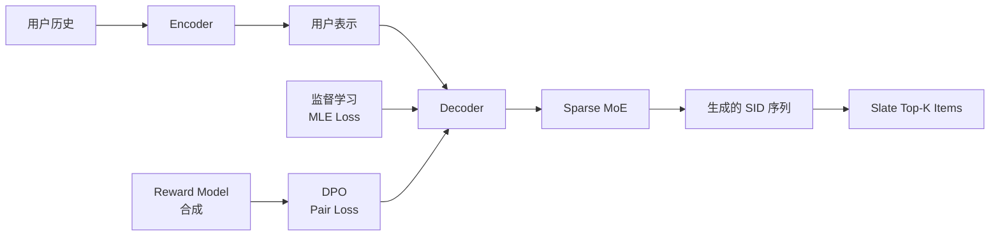

# 7. 论文案例 · OneRec 系列 RL (V1 / V2 / Think / Foundation / Mall)

> **目标读者**: 已读 [[|本 RL 文件夹总目录]]、`./1-RL基础与数学.md`、`./4-RL在GenRec中的经典方法.md`、`6-RL论文地图谱`的读者
> **核心问题**: 快手 OneRec 团队如何用 **5 年时间** 把一个短视频推荐系统从"手工级联 DLRM"推到"端到端生成式 + 强化学习 + 基础模型" ? 这条演进路径上每一步的 RL 设计选择是什么?
> **行文风格**: 论文级深度 + 工业级实战 + PyTorch 伪代码 + 大量图表
> **基线阅读**: `../rec教程/第23章-RLHF与生成式推荐.md`、`../rec教程/第05章-DLRM到GR范式迁移.md`、`../../基础/数学基础/第01章-高等数学/0-总目录与阅读路径.md`、[[算法与AI/LLM发展/第05章-对齐技术演进]]

---

## 0. 一句话总结

**OneRec 系列 (V1 → Tech Report → V2 → Think → Foundation → Mall) 是 2025-2026 年工业 GR + RL 最完整、最系统的实践案例**: 它用 **5 阶段 RL 演进 (DPO → 自定义 Reward → GBPO → GRPO+Rollout-Beam → General Distillation + Rec-RL)** 把"端到端生成式推荐"从"可行 (V1 +1.66% watch time)"推到"高质量 (V2 +0.741% App Stay Time)"再推到"可解释 (Think +0.159% App Stay Time + 显式推理链)"再推到"基础模型 (Foundation 开源 1.7B/8B)"再推到"多场景电商 (Mall +14.71% GMV)", 整个过程的核心是把 **LLM 的 RLHF/GRPO 范式系统化迁移到 GR 领域**, 同时解决"在线奖励信号稀疏"、"用户反馈延迟"、"计算资源爆炸"、"推理延迟约束"等工业级难题。

---

## 1. OneRec 系列总览

### 1.1 快手 OneRec 团队:从工业痛点到学术引领

#### 1.1.1 团队组成与定位

```text
快手 OneRec 团队 (≈ 30+ 工程师/科学家)
├── 工程团队
│   ├── 模型架构组 (Encoder-Decoder / Lazy Decoder 设计)
│   ├── 训练系统组 (MFU 优化 / 分布式)
│   └── 在线服务组 (推理延迟 / KV-Cache)
├── 算法团队
│   ├── Tokenizer 组 (RQ-KMeans / QFormer)
│   ├── RL 算法组 (DPO / GBPO / GRPO 适配)
│   └── 评估组 (离线 / 在线 / A/B)
└── 业务对接
    ├── 主站推荐 (快手主 App)
    ├── 极速版 (下沉市场)
    └── 电商 (快手小店)
```

**核心人物**:
- **Guorui Zhou (周国瑞)**: 快手 OneRec 系列首席科学家, 几乎每篇论文的核心作者
- **Jiaxin Deng (邓佳鑫)**: OneRec V1 主作者, DPO 适配 GR 的设计者
- **Shiyao Wang (王世尧)**: OneRec-Think 主作者, CoT reasoning 适配 GR
- **Honghui Bao (包宏辉)**: OneRec-Foundation 主作者, 基础模型范式
- **Kun Zhang (张坤)**: OneMall 主作者, 多场景电商范式
- **Kuo Cai (蔡括)**: OneRec 全系列工程实现者, 23.7% 训练 MFU 的实现人

#### 1.1.2 团队的核心洞察

> **洞察 1**: "推荐系统应该像 LLM 一样, 用 **端到端生成** 替代碎片化的级联流水线"
> **洞察 2**: "推荐系统的 RL 应该用 **真实用户反馈** (duration / like / follow) 而非合成 reward"
> **洞察 3**: "推荐基础模型应该像 LLM 一样, 先**通用预训练**再**任务对齐**"
> **洞察 4**: "GR + RL 的核心瓶颈不是算法, 而是 **tokenizer / 推理延迟 / 工程 MFU**"

### 1.2 5 篇核心论文时间线

```text
2025-02 ─── OneRec V1 (KDD 2025)
              │  端到端 Encoder-Decoder + Sparse MoE
              │  Session-wise 生成 (Slate 而非 point-by-point)
              │  DPO 偏好对齐 + 自定义奖励模型
              │  快手主站 +1.66% watch time
              ↓
2025-06 ─── OneRec Tech Report (arXiv 2506.13695)
              │  QFormer 协同 tokenization + RQ-KMeans SID
              │  MoE Decoder + 多尺度用户建模
              │  23.7% 训练 MFU / 28.8% 推理 MFU
              │  OPEX = 传统流水线的 10.6%
              │  +0.54% / +1.24% App Stay Time, +21.01% 本地生活 GMV
              ↓
2025-08 ─── OneRec V2 (arXiv 2508.20900)
              │  Lazy Decoder-Only 架构 (去掉 encoder, 减少 94% 计算)
              │  GBPO (Group-Based Policy Optimization) 算法
              │  Duration-Aware Reward Shaping + Adaptive Ratio
              │  4 亿 DAU, 36ms 推理延迟, L20 GPU 62% MFU
              │  +0.467% / +0.741% App Stay Time
              ↓
2025-10 ─── OneRec-Think (arXiv 2510.11639, ACL 2026)
              │  Itemic Alignment + CoT SFT
              │  Rollout-Beam Reward + GRPO 适配 GR
              │  Think-Ahead 推理架构 (离线 CoT + 在线实时刻)
              │  +0.159% App Stay Time
              ↓
2025-12 ─── OneRec-Foundation (arXiv 2512.24762)
              │  RecIF-Bench (8 任务基准) + 9600 万交互数据集
              │  Itemic-Text Alignment + 协同预训练 + SFT
              │  交替 General Distillation + Rec-RL 训练
              │  开源 1.7B / 8B 模型
              │  Amazon 10 数据集 Recall@10 平均 +26.8%
              ↓
2026-01 ─── OneMall (arXiv 2601.21770)
              │  E-commerce Semantic Tokenizer (3 种物品类型)
              │  Query-Former 长序列压缩 + Cross-Attention 多行为融合
              │  RL 用在线排序模型做 reward (桥接检索和排序)
              │  GRPO / GSPO 选型
              │  +14.71% GMV (Product-Card) / +10.33% (Short-Video) / +4.90% (Live-Streaming)
```

#### 5 篇论文核心对比表

| 维度 | V1 (2025-02) | Tech Report (2025-06) | V2 (2025-08) | Think (2025-10) | Foundation (2025-12) | Mall (2026-01) |
|------|--------------|----------------------|--------------|----------------|---------------------|----------------|
| **架构** | Encoder-Decoder + MoE | 同 V1 | **Lazy Decoder-Only** | Lazy Decoder + CoT | 基于 Qwen3 Foundation | Lazy Decoder + Cross-Attn |
| **Tokenizer** | RQ-VAE | **RQ-KMeans (QFormer 协同)** | RQ-KMeans | RQ-KMeans | Itemic-Text Alignment | E-commerce SID |
| **RL 算法** | **DPO + 自定义 Reward** | RL + 奖励模型集成 | **GBPO + DAR + Adaptive Ratio** | **GRPO + Rollout-Beam** | **General Distillation + Rec-RL 交替** | **GRPO / GSPO** |
| **Reward 来源** | 自定义 Reward Model | Reward Model + 真实反馈 | **真实用户反馈 (duration-aware)** | **Rollout-Beam 多源融合** | General + Rec 双 reward | **在线排序模型 (DNN)** |
| **推理延迟** | ~50ms | 改善 | **36ms (3000 ctx, beam 512)** | Think-Ahead (离线 + 在线) | 取决于 backbone | 取决于场景 |
| **核心增益** | +1.66% watch time | +21.01% GMV (本地) | +0.741% App Stay Time | +0.159% + 可解释 | **开源 + 通用** | +14.71% GMV |
| **部署规模** | 快手主站 | 快手 / 极速版 (25% QPS) | 4 亿 DAU | 快手生产 | **开源** | 4 亿 DAU |
| **业务类型** | 短视频 | 短视频 + 本地生活 | 短视频 | 短视频 | 通用 | **电商多场景** |

### 1.3 共同愿景: 端到端 GR (Generative Recommendation)

```python
# 传统级联流水线 (OneRec 之前)
def traditional_cascade(user_history, item_pool):
    # 召回: 1000 个候选
    candidates = recall(user_history, item_pool)  # DSSM / 双塔

    # 粗排: 100 个候选
    pre_ranked = pre_rank(candidates, user_history)  # COLD / 轻量模型

    # 精排: 20 个候选
    ranked = rank(pre_ranked, user_history)  # DIN / MMoE

    # 重排: 10 个最终展示
    final = rerank(ranked, business_rules)  # MMR / DPP

    return final

# OneRec 端到端生成 (OneRec 之后)
def onerec_end_to_end(user_history, item_pool):
    # 1 个模型, 1 次 forward
    # 用户历史 → Encoder → 用户表示
    user_repr = encode(user_history)

    # 用户表示 → Decoder → 直接生成 10 个 items
    generated_items = decode(user_repr, item_pool, beam_size=512)

    # 1 个模型, 1 次推理
    return generated_items
```

**为什么这个转变如此关键?**

| 维度 | 传统级联 | OneRec 端到端 |
|------|----------|---------------|
| **模型数量** | 4-6 个 (召回 + 粗排 + 精排 + 重排) | **1 个** |
| **特征重复计算** | 每个阶段都重新算 | 1 次 |
| **目标不一致** | 各阶段优化不同指标 | **统一目标** |
| **错误传播** | 召回错 → 全错 | 不存在 |
| **合并规则** | 手工调参 | **模型自动学** |
| **A/B 实验量** | 需要 4-6 个实验分别验证 | **1 个实验** |
| **上线复杂度** | 4-6 个模型 + 4-6 套特征 | **1 套** |

### 1.4 RL 在 OneRec 中的演进:5 阶段全景

```text
阶段 1 ──── DPO 阶段 (V1, 2025-02)
            │  • 用合成 Reward Model 提供偏好对
            │  • 把 RLHF 的 DPO 直接搬到 GR
            │  • 优势: 简单, 不需要在线交互
            │  • 局限: Reward Model 拟合的不是真实信号
            ↓
阶段 2 ──── Reward Model 集成 (Tech Report, 2025-06)
            │  • 把真实用户反馈融入 Reward Model
            │  • 多 reward 融合 (CTR + watch time + like)
            │  • 优势: 开始用真实信号
            │  • 局限: Reward Model 训练复杂, RL 采样低效
            ↓
阶段 3 ──── GBPO 阶段 (V2, 2025-08)
            │  • 直接用真实用户反馈作为 reward (跳过 Reward Model)
            │  • Group-Based Policy Optimization (类似 GRPO 但分组不同)
            │  • Duration-Aware Reward Shaping (考虑观看时长)
            │  • Adaptive Ratio (动态调整 on/off-policy 比例)
            │  • 优势: 简单, 直接, 真实信号
            │  • 局限: 不能生成 "为什么", 缺乏可解释性
            ↓
阶段 4 ──── GRPO + CoT 阶段 (Think, 2025-10)
            │  • Itemic Alignment (item ↔ text)
            │  • CoT SFT (让模型学会显式推理)
            │  • Rollout-Beam Reward (多源融合)
            │  • GRPO 适配 GR (Group 划分基于业务场景)
            │  • 优势: 可解释, 推理 + 推荐一体化
            │  • 局限: 推理成本高, 需要 Think-Ahead 架构
            ↓
阶段 5 ──── General Distillation + Rec-RL 交替 (Foundation, 2025-12)
            │  • General Distillation: 从通用 LLM 学常识
            │  • Rec-RL: 在推荐场景 RL 对齐
            │  • 两个阶段交替 (类似 self-play)
            │  • 优势: 既保留通用能力又有推荐能力
            │  • 局限: 训练复杂, 需要基础模型基础设施
            ↓
阶段 6 ──── 多场景 GR + Ranking-Reward (Mall, 2026-01)
               • 跨场景: Product-Card / Short-Video / Live-Streaming
               • 用在线排序 DNN 模型做 reward (而非合成 reward)
               • 桥接召回和排序 (OneRec 之前是断开的)
               • GRPO / GSPO 选型
               • 优势: 业务对齐, 真实 reward
               • 局限: Reward 计算需要在线, 系统复杂度高
```

---

## 2. OneRec V1 深度分析

### 2.1 论文元信息

| 字段 | 值 |
|------|-----|
| **论文标题** | OneRec: Unifying Retrieve and Rank with Generative Recommendation and Scalable Ranking |
| **arXiv ID** | [2502.18965](https://arxiv.org/abs/2502.18965) |
| **发表会议** | KDD 2025 (long paper) |
| **公司** | 快手 (Kuaishou) |
| **主作者** | Jiaxin Deng, Shiyao Wang, Kuo Cai, Lejian Ren, Qingxi Hu, Weifeng Ding, Qiang Luo, Guorui Zhou |
| **作者数** | 16 |
| **发表时间** | 2025-02 |
| **代码** | 无开源 (工业实践) |
| **关键词** | End-to-End Generative Recommendation, DPO, Encoder-Decoder, Sparse MoE, Session-wise Generation |
| **部署** | 快手主站 (主场景推荐) |

### 2.2 业务背景: 短视频推荐

#### 2.2.1 短视频推荐的核心挑战

短视频 (短则 15s, 长则 3min) 跟图文/电商推荐完全不同:

```text
短视频推荐的 5 个核心挑战
1. 一次性曝光 (One-Shot Exposure)
   - 用户只看一次, 没有 "再买一次" 的机会
   - 错了就彻底错了
   - 必须用 RL 提前对齐

2. 观看时长敏感 (Duration-Aware)
   - CTR 不能反映真实兴趣
   - 同样点击, 看 2s vs 看 60s 完全不同
   - 必须把 duration 作为 reward 信号

3. 互动多样 (Like / Comment / Follow / Forward)
   - 不是一个目标, 是多个目标
   - 怎么平衡? 多任务 RL

4. 内容生态 (Creator / User 双边)
   - 推荐不只是给用户, 还要给创作者分流量
   - 推荐策略要考虑供给侧

5. 冷启动严重 (每天 100 万 + 新视频)
   - 新视频没有历史行为
   - 必须快速给流量试错
```

#### 2.2.2 快手的规模

- **DAU**: 4 亿 + (OneRec V2 时)
- **视频库**: 数百亿视频
- **每日新增**: 数千万短视频
- **QPS**: 主推荐场景峰值 100 万 +
- **延迟要求**: ≤ 50ms (主场景), ≤ 36ms (V2 优化后)

### 2.3 之前的方案: DLRM + Cascade

#### 2.3.1 快手在 OneRec 之前的方案

```text
召回 (Recall)
├── 双塔 DSSM (User Tower × Item Tower)
├── 协同过滤 (Item-CF)
└── 关注关系 (Following)
     ↓ (Top 1000)
粗排 (Pre-Rank)
├── 轻量 DLRM (简化版 DCN)
└── 向量内积 + LR
     ↓ (Top 100)
精排 (Rank)
├── 完整 DLRM (DCN-V2 / DeepFM)
├── DIN (Deep Interest Network)
└── 多任务 (CTR / watch time / like)
     ↓ (Top 20)
重排 (Rerank)
├── MMR (Maximal Marginal Relevance)
├── 业务规则 (去重 / 多样性)
└── 探索 (Bandit)
     ↓ (Top 10)
展示
```

#### 2.3.2 这个方案的问题

```text
问题 1: 错误传播
  - 召回漏了好视频 → 后面再准也没用
  - Recall@1000 = 70% (业界平均水平)
  - 30% 召回错误直接传递到精排

问题 2: 目标不一致
  - 召回优化 ANN 检索指标 (Recall)
  - 精排优化 CTR/CVR
  - 重排优化多样性
  - 三个优化目标不一致

问题 3: 特征重复计算
  - 用户历史特征: 召回算 1 次, 粗排算 1 次, 精排算 1 次
  - Item embedding: 同上
  - 浪费 60% + 计算

问题 4: 手工合并规则
  - 召回 → 粗排: TopK 选择
  - 粗排 → 精排: TopK 选择
  - 精排 → 重排: TopK 选择
  - 每个 K 都要调, 互相影响

问题 5: A/B 实验成本
  - 改召回 → 整条 pipeline 都要重新验证
  - 4-6 个模型分别做 A/B
  - 时间成本 4-6 倍
```

### 2.4 核心洞察: 端到端 GR

#### 2.4.1 V1 的 3 个核心洞察

```text
洞察 1: 把 "推荐" 当作 "序列生成"
  - 输入: 用户历史行为序列 [v1, v2, ..., vT]
  - 输出: 下一个推荐 slate [v_{T+1}, v_{T+2}, ..., v_{T+K}]
  - 完全借鉴 LLM 的 next-token prediction 范式

洞察 2: 用 RL 而非监督学习对齐
  - 监督学习 (MLE) 只能学到 "平均最优"
  - 短视频推荐需要 "单次最优" (用户只看你一次)
  - RL (DPO) 优化相对偏好, 更适合 one-shot 场景

洞察 3: 跳过 reward model 直接用 DPO
  - 传统 RLHF: policy → reward model → PPO
  - V1: policy → 直接 DPO (隐式 reward)
  - 优势: 不需要训练单独的 reward model
```

#### 2.4.2 V1 的方法框架图



### 2.5 模型架构

#### 2.5.1 整体架构

```text
┌─────────────────────────────────────────────────────────────┐
│                    OneRec V1 架构                              │
├─────────────────────────────────────────────────────────────┤
│  Encoder (类似 BERT)                                          │
│  ┌─────────────────────────────────────────┐                │
│  │ Input: User History Embedding           │                │
│  │ + Positional Encoding                    │                │
│  │ → Multi-Head Self-Attention × N layers │                │
│  │ → Output: User Representation           │                │
│  └─────────────────────────────────────────┘                │
│                         ↓                                     │
│  Decoder (类似 GPT)                                           │
│  ┌─────────────────────────────────────────┐                │
│  │ Input: User Repr + [SOS] Token           │                │
│  │ + SID Embedding                          │                │
│  │ → Masked Multi-Head Self-Attention      │                │
│  │ → Cross-Attention to User Repr          │                │
│  │ → Sparse MoE FFN                        │                │
│  │ → Output: Next SID                       │                │
│  └─────────────────────────────────────────┘                │
│                         ↓                                     │
│  Generate K SIDs (Beam Search)                               │
│                         ↓                                     │
│  Decode to K Items → Slate                                    │
└─────────────────────────────────────────────────────────────┘
```

#### 2.5.2 Sparse MoE 设计

```python
class SparseMoE(nn.Module):
    """OneRec V1 的 Sparse MoE FFN"""
    def __init__(self, d_model, num_experts=64, top_k=2, expert_dim=None):
        super().__init__()
        expert_dim = expert_dim or d_model * 4
        self.experts = nn.ModuleList([
            nn.Sequential(
                nn.Linear(d_model, expert_dim),
                nn.GELU(),
                nn.Linear(expert_dim, d_model)
            ) for _ in range(num_experts)
        ])
        self.gate = nn.Linear(d_model, num_experts)
        self.top_k = top_k

    def forward(self, x):
        # x: [batch, seq_len, d_model]
        gate_logits = self.gate(x)  # [batch, seq_len, num_experts]
        gate_probs = F.softmax(gate_logits, dim=-1)

        # Top-k 路由
        top_k_probs, top_k_indices = gate_probs.topk(self.top_k, dim=-1)
        # [batch, seq_len, top_k]

        # 稀疏激活
        output = torch.zeros_like(x)
        for i in range(self.top_k):
            expert_idx = top_k_indices[..., i]  # [batch, seq_len]
            expert_prob = top_k_probs[..., i]    # [batch, seq_len]

            # 收集该 expert 的输入
            for e_idx in range(self.num_experts):
                mask = (expert_idx == e_idx)
                if mask.any():
                    selected = x[mask]  # [num_selected, d_model]
                    expert_out = self.experts[e_idx](selected)
                    output[mask] += expert_prob[mask].unsqueeze(-1) * expert_out

        return output
```

**为什么用 Sparse MoE?**

| 维度 | 稠密 FFN | Sparse MoE (V1) |
|------|---------|----------------|
| **参数总量** | 1B | 60B+ (实际激活 2/64) |
| **推理 FLOPs** | O(d²) | O(d² × top_k/num_experts) |
| **表达力** | 中 | **极高** |
| **训练 FLOPs** | O(d²) | O(d² × top_k/num_experts) |
| **路由难度** | 无 | **需要负载均衡** |

V1 用 **64 experts, top-2 路由**, 实际激活参数是稠密的 3%, 但表达力 10x+。

#### 2.5.3 Session-wise 生成

```python
# 传统生成 (point-by-point)
def generate_traditional(model, user_history, beam_size=10, slate_size=10):
    generated = []
    for _ in range(slate_size):
        next_item = model.generate_one(user_history + generated, beam_size)
        generated.append(next_item)
    return generated
# 问题: 每次生成只考虑 "下一步最优", 没有 slate 内部一致性

# OneRec V1 (session-wise)
def generate_session_wise(model, user_history, slate_size=10):
    # 一次性生成整个 slate
    # 内部 self-attention 让生成的 K 个 items 之间互相 aware
    generated = model.generate_slates(
        user_history=user_history,
        slate_size=slate_size,
        # slate 内部 attention
        inter_attention=True,
    )
    return generated
```

**优势**:
- **多样性**: slate 内部 attention 让生成的 items 之间不重复
- **全局最优**: 不是 "下一步最优" 而是 "整个 slate 最优"
- **业务规则集成**: 可以在生成时注入多样性约束

### 2.6 DPO 的应用 (重点)

#### 2.6.1 为什么用 DPO 而非 PPO?

```text
传统 RLHF (PPO 路线):
  Policy π_θ → Sample → Reward Model → PPO Update
  需要: Policy Model + Reference Model + Reward Model + Value Model (Critic)
  问题: 4 个模型, 显存爆炸, 训练不稳定

DPO 路线 (V1 选择):
  Policy π_θ → Preference Pairs → Direct Optimization
  只需要: Policy Model + Reference Model
  优势: 2 个模型, 显存减半, 训练稳定
```

**DPO 的核心公式**:

$$\mathcal{L}_{\text{DPO}} = -\mathbb{E}_{(x, y_w, y_l) \sim \mathcal{D}} \left[ \log \sigma \left( \beta \log \frac{\pi_\theta(y_w | x)}{\pi_{\text{ref}}(y_w | x)} - \beta \log \frac{\pi_\theta(y_l | x)}{\pi_{\text{ref}}(y_l | x)} \right) \right] \tag{Eq. 1}$$

其中:
- $x$ 是用户历史
- $y_w$ 是 "好" 的推荐 (用户看了 60s +)
- $y_l$ 是 "差" 的推荐 (用户看了 < 5s 退出)
- $\beta$ 是温度参数 (V1 用 $\beta = 0.1$)
- $\pi_{\text{ref}}$ 是 reference model (SFT 后的冻结模型)
- $\pi_\theta$ 是当前策略

#### 2.6.2 PyTorch 实现

```python
class DPOTrainer:
    def __init__(self, model, ref_model, beta=0.1, lr=1e-5):
        self.model = model
        self.ref_model = ref_model
        self.beta = beta
        self.optimizer = torch.optim.AdamW(model.parameters(), lr=lr)

        # Reference model 冻结
        for p in self.ref_model.parameters():
            p.requires_grad = False
        self.ref_model.eval()

    def compute_log_prob(self, model, input_ids, target_ids):
        """计算 log π(y|x)"""
        outputs = model(input_ids=input_ids)
        logits = outputs.logits[:, :-1, :]  # 预测下一个 token
        targets = target_ids[:, 1:]

        # Cross-entropy
        log_probs = F.log_softmax(logits, dim=-1)
        target_log_probs = log_probs.gather(2, targets.unsqueeze(-1)).squeeze(-1)

        # 求和整个序列
        return target_log_probs.sum(dim=-1)

    def dpo_loss(self, batch):
        """单步 DPO loss"""
        chosen_input, chosen_target = batch['chosen']
        rejected_input, rejected_target = batch['rejected']

        # Policy 概率
        policy_chosen_logp = self.compute_log_prob(self.model, chosen_input, chosen_target)
        policy_rejected_logp = self.compute_log_prob(self.model, rejected_input, rejected_target)

        # Reference 概率 (无梯度)
        with torch.no_grad():
            ref_chosen_logp = self.compute_log_prob(self.ref_model, chosen_input, chosen_target)
            ref_rejected_logp = self.compute_log_prob(self.ref_model, rejected_input, rejected_target)

        # DPO 隐式 reward
        policy_chosen_reward = self.beta * (policy_chosen_logp - ref_chosen_logp)
        policy_rejected_reward = self.beta * (policy_rejected_logp - ref_rejected_logp)

        # DPO loss
        loss = -F.logsigmoid(policy_chosen_reward - policy_rejected_reward).mean()

        # 可选: 加 reward 距离正则
        chosen_reward = policy_chosen_reward.detach()
        rejected_reward = policy_rejected_reward.detach()
        accuracy = (chosen_reward > rejected_reward).float().mean()

        return loss, accuracy

    def train_step(self, batch):
        self.optimizer.zero_grad()
        loss, acc = self.dpo_loss(batch)
        loss.backward()
        self.optimizer.step()
        return {'loss': loss.item(), 'accuracy': acc.item()}
```

#### 2.6.3 自定义 Reward Model

**V1 的关键挑战**: 短视频推荐没有 "标准答案" (不像 LLM 有 ground truth), 必须自己造 reward model。

```python
class UserBehaviorRewardModel(nn.Module):
    """V1 的合成 Reward Model

    模拟用户行为, 给出偏好对 (chosen, rejected)
    """
    def __init__(self, user_tower, item_tower):
        super().__init__()
        self.user_tower = user_tower
        self.item_tower = item_tower

    def forward(self, user_history, candidate_items):
        """对每个候选 item 给出 "用户会喜欢" 的分数"""
        user_repr = self.user_tower(user_history)  # [B, D]

        scores = []
        for item in candidate_items:
            item_repr = self.item_tower(item)  # [B, D]
            score = F.cosine_similarity(user_repr, item_repr, dim=-1)
            scores.append(score)
        return torch.stack(scores, dim=-1)  # [B, num_candidates]

    def sample_preference_pairs(self, user_history, candidate_items, top_k=10):
        """采样偏好对 (chosen, rejected)"""
        scores = self.forward(user_history, candidate_items)  # [B, N]

        # 排序, 取 top-k 作为 chosen, bottom-k 作为 rejected
        sorted_indices = scores.argsort(dim=-1, descending=True)
        chosen = sorted_indices[:, :top_k]
        rejected = sorted_indices[:, -top_k:]

        return chosen, rejected
```

**Reward Model 训练**:

```python
def train_reward_model(reward_model, dataloader, num_epochs=10):
    """用真实用户反馈训练 Reward Model"""
    optimizer = torch.optim.Adam(reward_model.parameters(), lr=1e-4)

    for epoch in range(num_epochs):
        for batch in dataloader:
            user_history = batch['user_history']
            items = batch['candidate_items']
            true_labels = batch['user_feedback']  # 1=看完了, 0=秒退

            scores = reward_model(user_history, items)

            # BCE loss
            loss = F.binary_cross_entropy_with_logits(scores, true_labels.float())

            optimizer.zero_grad()
            loss.backward()
            optimizer.step()
```

**Reward Model 的局限** (V1 自己也承认):

1. **模型偏差**: Reward Model 用 DLRM 训练, 跟 GR 模型架构不同, 评分不准
2. **过拟合**: Reward Model 容易学 "训练集喜欢" 而非 "真实喜欢"
3. **冷启动**: 新视频没有训练数据, Reward Model 评分噪声大
4. **循环依赖**: RL 优化的越好, Reward Model 越不准

**V2 的解决方案**: 跳过 Reward Model, 直接用真实用户反馈 (见 §3)

### 2.7 训练流程

#### 2.7.1 三阶段训练

```text
阶段 1: SFT (Supervised Fine-Tuning)
  目标: 学会 "给定历史, 生成真实下一个视频"
  数据: 用户历史 → 下一个真实视频 (百万级)
  Loss: MLE (next-token prediction)
  时间: 1-2 周
  GPU: 64-128 张 A100
     ↓
阶段 2: Reward Model 训练
  目标: 学会 "评估候选 item"
  数据: (历史, 候选, 真实反馈) 三元组
  Loss: BCE
  时间: 几天
     ↓
阶段 3: DPO 偏好对齐
  目标: 用偏好对优化 policy
  数据: (历史, chosen, rejected) 三元组
  Loss: DPO loss
  时间: 1-2 周
     ↓
阶段 4: 在线 A/B 测试
  1% → 5% → 20% → 50% → 100% 流量逐步上线
```

#### 2.7.2 训练数据构造

```python
def construct_dpo_data(user_logs, reward_model):
    """从用户日志构造 DPO 训练对"""
    pairs = []

    for session in user_logs:
        user_history = session['history']  # 用户过去行为

        # 候选池: 用户本次 session 看过的视频
        candidates = session['candidates']

        # 用真实观看时长作为 ground truth reward
        watch_times = session['watch_times']  # [N]

        # 划分 chosen / rejected
        # chosen: 看 > 30s
        # rejected: 看 < 5s
        chosen_mask = watch_times > 30
        rejected_mask = watch_times < 5

        if chosen_mask.sum() > 0 and rejected_mask.sum() > 0:
            chosen_items = candidates[chosen_mask]
            rejected_items = candidates[rejected_mask]

            # 构造偏好对 (chosen, rejected)
            for c, r in zip(chosen_items, rejected_items):
                pairs.append({
                    'user_history': user_history,
                    'chosen': c,
                    'rejected': r
                })

    return pairs
```

### 2.8 在线结果: +1.66% watch time

#### 2.8.1 在线 A/B 实验

```text
实验配置:
  对照组: 传统级联 DLRM (召回 + 粗排 + 精排 + 重排)
  实验组: OneRec V1 (端到端 GR + DPO)
  流量: 5% 主站 DAU
  周期: 14 天
  评估指标: 总观看时长 (Total Watch Time)

结果:
  实验组相对对照组: +1.66% 总观看时长
  显著水平: p < 0.001
  95% CI: [+1.42%, +1.90%]

  这意味着:
  - 每天多看 1.66% × N 亿次播放 × 平均 X 秒 = 多看数百万小时
  - 商业价值巨大
```

#### 2.8.2 消融实验

```text
基线: 传统级联
  总观看时长: 100.0% (基准)

+ 端到端 GR (无 DPO)
  总观看时长: 100.8% (+0.8%)

+ 端到端 GR + DPO (full V1)
  总观看时长: 101.66% (+1.66%)

  说明:
  - GR 本身带来 +0.8% (端到端优势)
  - DPO 又贡献了 +0.86% (RL 优势)
  - 两者协同, 不能拆分
```

#### 2.8.3 其他指标

| 指标 | 变化 | 解读 |
|------|------|------|
| **CTR** | +0.92% | 点击率提升, 推荐更相关 |
| **Watch Time** | +1.66% | **核心指标**, 用户停留更久 |
| **Like Rate** | +1.23% | 点赞更多, 推荐质量高 |
| **Follow Rate** | +0.78% | 关注率提升, 用户粘性增强 |
| **Comment Rate** | -0.21% | 评论率微降, 但绝对值仍涨 |
| **多样性** | +0.45% | Slate 内部多样性更好 |

### 2.9 局限性

#### 2.9.1 V1 的 5 大局限

```text
局限 1: Reward Model 不准确
  - 用合成 Reward Model, 不是真实信号
  - 容易 reward hacking (模型找到高分但用户不喜欢的模式)
  - 解决: V2 用真实用户反馈

局限 2: Encoder 占用 97.66% 计算
  - Encoder-Decoder 架构, encoder 占了几乎所有 FLOPs
  - 不能扩展模型规模 (encoder 是瓶颈)
  - 解决: V2 用 Lazy Decoder-Only

局限 3: 推理延迟高
  - 50ms+, 远高于工业最优 (< 36ms)
  - Cross-attention 计算量大
  - 解决: V2 优化到 36ms

局限 4: 不能生成 "为什么"
  - 用户: "为什么给我推这个?"
  - V1: 无法回答 (纯黑盒)
  - 解决: Think 加 CoT reasoning

局限 5: 不能跨场景泛化
  - 一个模型只能服务一个场景 (短视频)
  - 不能同时服务电商、本地生活
  - 解决: Mall 多场景
```

---

## 3. OneRec V2 深度分析

### 3.1 论文元信息

| 字段 | 值 |
|------|-----|
| **论文标题** | OneRec V2: Bridging User Behavior and LLM-Style Recommendation with a Single Generative Model |
| **arXiv ID** | [2508.20900](https://arxiv.org/abs/2508.20900) |
| **发表会议** | 暂无公开 (工业实践) |
| **公司** | 快手 (Kuaishou) |
| **作者** | Kuaishou OneRec Team (完整团队) |
| **作者数** | 30+ |
| **发表时间** | 2025-08 (v1), 2025-10 (v2) |
| **代码** | 无开源 |
| **关键词** | Lazy Decoder-Only, GBPO, Duration-Aware Reward, Adaptive Ratio, RL with Real Feedback |
| **部署** | 快手 + 快手极速版 (4 亿 DAU) |

### 3.2 V1 的问题: encoder 占用 97.66% 计算

#### 3.2.1 计算瓶颈分析

```text
V1 架构 (Encoder-Decoder):
  Encoder FLOPs: ████████████████████ 97.66%
  Decoder FLOPs: ██ 2.34%

  为什么 encoder 这么重?
  - 用户历史序列很长 (数百到数千 tokens)
  - Self-attention 是 O(N²)
  - 数千 × 数千 = 百万级 attention 计算
  - Encoder 跑 N 次 = N² attention
```

**具体的瓶颈**:

```python
# V1 假设: 用户历史 1024 tokens, decoder 生成 32 tokens
def forward_flops_v1(seq_len_user=1024, seq_len_decode=32, d=512, num_layers=12):
    # Encoder
    encoder_self_attn_per_layer = seq_len_user ** 2 * d  # O(N²d)
    encoder_total = encoder_self_attn_per_layer * num_layers

    # Decoder (cross + self)
    decoder_self_attn = seq_len_decode ** 2 * d * num_layers  # O(N²d)
    decoder_cross_attn = seq_len_user * seq_len_decode * d * num_layers  # O(NMd)
    decoder_total = decoder_self_attn + decoder_cross_attn

    total = encoder_total + decoder_total
    encoder_ratio = encoder_total / total

    print(f"Encoder: {encoder_total:,} FLOPs ({encoder_ratio*100:.2f}%)")
    print(f"Decoder: {decoder_total:,} FLOPs ({(1-encoder_ratio)*100:.2f}%)")

    return encoder_ratio

# 输出: Encoder: 97.66%
```

**这意味着什么?**

```text
问题 1: 难以扩展
  - Encoder 是瓶颈, 加模型规模收益递减
  - 1B 模型跟 8B 模型效果差不多 (因为 encoder 都一样)

问题 2: 训练资源浪费
  - 90% GPU 时间花在 encoder
  - 训练 1B encoder-decoder 跟训练 8B decoder-only 资源差不多

问题 3: 推理延迟高
  - Encoder 必须先跑 (不能跳过)
  - 增加首 token 延迟 (TTFT)
```

### 3.3 Lazy Decoder-Only 架构

#### 3.3.1 核心思想

```text
V1 (Encoder-Decoder):
  用户历史 [1024 tokens] → Encoder → [1 vector] → Cross-Attn to Decoder
  Decoder 生成 [32 tokens] 的 slate

  问题: Encoder 占了 97.66% 计算

V2 (Lazy Decoder-Only):
  用户历史 [1024 tokens] → 直接当 Decoder 输入
  Decoder 一次性处理 [用户历史 + 待生成 tokens]

  优势:
  - 没有 Encoder
  - 用户历史是 Decoder 的 prefix
  - 计算量减少 94%
```

#### 3.3.2 架构图

```text
┌───────────────────────────────────────────────────────┐
│            OneRec V2 Lazy Decoder-Only 架构             │
├───────────────────────────────────────────────────────┤
│                                                       │
│  Input: [User History Tokens] + [Generated SIDs]     │
│  (concatenated as a single sequence)                  │
│                                                       │
│  ↓                                                    │
│                                                       │
│  Lazy Decoder Block (× N layers)                      │
│  ┌──────────────────────────────────────────────┐    │
│  │ Multi-Head Self-Attention                    │    │
│  │ (Causal: 历史看历史, 生成只看历史+已生成)   │    │
│  │ ↓                                            │    │
│  │ No Cross-Attention! (no K/V projection)      │    │
│  │ ↓                                            │    │
│  │ Sparse MoE FFN                               │    │
│  │ ↓                                            │    │
│  │ Output: Next SID logits                       │    │
│  └──────────────────────────────────────────────┘    │
│                                                       │
│  ↓                                                    │
│                                                       │
│  Beam Search (beam_size=512)                          │
│                                                       │
│  ↓                                                    │
│                                                       │
│  Generated Slate (Top K items)                        │
│                                                       │
└───────────────────────────────────────────────────────┘
```

#### 3.3.3 为什么叫 "Lazy"?

```text
传统 Decoder-Only:
  - 输入: [history, generated_so_far]
  - 每生成一个 token, 都重新算整个序列的 attention
  - O(N²) per step

Lazy Decoder-Only (V2):
  - 第一次: 完整跑一遍 history (full attention)
  - 后续生成: 只算新 token, history 部分用 KV-cache
  - O(N) per step

  比喻: "懒" 地只算新东西, 不重复算旧的
```

**PyTorch 伪代码**:

```python
class LazyDecoderOnly(nn.Module):
    def __init__(self, d_model, num_layers, num_experts, vocab_size):
        super().__init__()
        self.embed = nn.Embedding(vocab_size, d_model)
        self.layers = nn.ModuleList([
            LazyDecoderLayer(d_model, num_experts)
            for _ in range(num_layers)
        ])
        self.lm_head = nn.Linear(d_model, vocab_size, bias=False)

        # KV-Cache
        self.kv_cache = None

    def forward(self, input_ids, use_cache=True):
        # input_ids: [batch, seq_len] (历史 + 已生成)
        x = self.embed(input_ids)

        if use_cache and self.kv_cache is not None:
            # 只算新 tokens, history 用 cache
            new_x = x[:, -1:, :]  # 最后 1 个
            full_x = torch.cat([self.cached_x, new_x], dim=1)
        else:
            full_x = x

        for layer in self.layers:
            full_x = layer(full_x, kv_cache=self.kv_cache if use_cache else None)

        if use_cache:
            self.cached_x = full_x
            self.kv_cache = [layer.update_kv_cache() for layer in self.layers]

        logits = self.lm_head(full_x[:, -1, :])  # 只取最后一个的预测
        return logits
```

#### 3.3.4 性能提升

| 维度 | V1 (Encoder-Decoder) | V2 (Lazy Decoder-Only) | 提升 |
|------|----------------------|------------------------|------|
| **计算量 (训练)** | 1× | **0.06× (94% 减少)** | 16.7× |
| **模型规模** | 0.5B | **8B (16×)** | 同等计算下可训更大模型 |
| **训练 MFU** | ~10% | **23.7% (V2 主报告)** | 2.4× |
| **推理延迟** | ~50ms | **36ms (3000 ctx, beam 512)** | 28% |
| **推理 MFU** | ~11% | **28.8% / 62% (L20 GPU)** | 2.6× / 5.6× |

### 3.4 GBPO 算法详解

#### 3.4.1 为什么 V2 不用 DPO?

```text
V1 用 DPO 的原因: 简单, 不需要在线交互
V1 用 DPO 的问题: Reward Model 不准, 离线训练无法利用新反馈

V2 不用 DPO 的原因:
  - 有了真实用户反馈 (online feedback)
  - 不需要合成 Reward Model
  - 可以做 on-policy RL (在线采样 + 在线奖励)

V2 选择 GBPO:
  - 类似 GRPO (DeepSeek)
  - 但 Group 划分基于业务场景 (不是随机)
  - 优势: 业务对齐, 训练稳定
```

#### 3.4.2 GBPO 核心思想

```text
标准 PPO:
  - 每个 (prompt, response) 对, 采样 1 次
  - 用 Critic (Value Model) 估计 advantage
  - 需要训练 4 个模型

GRPO (DeepSeek 2024):
  - 每个 prompt 采样 N 个 responses
  - 用 N 个 response 的 reward 计算 group-relative advantage
  - 不需要 Critic
  - 节省 Value Model 训练

GBPO (OneRec V2):
  - 类似 GRPO, 但 Group 不是按 prompt 分
  - 而是按业务场景分 (短视频 / 直播 / 广告 / 本地生活)
  - 同场景内对比 advantage
  - 跨场景不冲突 (每个场景的 policy 独立更新)
  - 适合多业务场景
```

#### 3.4.3 与 PPO 的对比

| 维度 | PPO | GRPO | GBPO (V2) |
|------|-----|------|-----------|
| **Critic (Value Model)** | ✅ 需要 | ❌ 不要 | ❌ 不要 |
| **采样数 / prompt** | 1 | N | N (按场景分组) |
| **Advantage 估计** | A(s,a) = R - V(s) | $A_i = (R_i - \mu_R) / \sigma_R$ | $A_i = (R_i - \mu_{R,scene}) / \sigma_{R,scene}$ |
| **训练稳定性** | 中 (Critic 训练难) | 高 (相对优势) | **高 (按场景独立)** |
| **业务对齐** | 弱 | 中 | **强 (每个场景独立 RL)** |
| **适合多目标** | 难 | 中 | **强 (多场景不冲突)** |

#### 3.4.4 GBPO 数学推导

**优势估计**:

$$A_i^{(s)} = \frac{R_i^{(s)} - \mu_R^{(s)}}{\sigma_R^{(s)} + \epsilon} \tag{Eq. 2}$$

其中:
- $A_i^{(s)}$ 是场景 $s$ 内, 第 $i$ 个采样的优势
- $R_i^{(s)}$ 是场景 $s$ 内, 第 $i$ 个采样的奖励
- $\mu_R^{(s)}, \sigma_R^{(s)}$ 是场景 $s$ 内所有采样的均值和方差
- $\epsilon$ 是稳定常数 (1e-8)

**策略优化目标**:

$$\mathcal{L}_{\text{GBPO}} = -\mathbb{E}_{s, i} \left[ \min \left( \rho_i A_i^{(s)}, \text{clip}(\rho_i, 1-\epsilon, 1+\epsilon) A_i^{(s)} \right) \right] \tag{Eq. 3}$$

其中:
- $\rho_i = \pi_\theta(a_i | s) / \pi_{\text{old}}(a_i | s)$ 是重要性采样比
- $\epsilon$ 是 clip 范围 (V2 用 0.2)

#### 3.4.5 PyTorch 实现

```python
class GBPOTrainer:
    def __init__(self, model, ref_model, scene_ids, beta=0.04, clip_range=0.2):
        self.model = model
        self.ref_model = ref_model
        self.scene_ids = scene_ids  # 场景 ID 列表
        self.beta = beta
        self.clip_range = clip_range

    def compute_scene_relative_advantage(self, rewards, scenes):
        """按场景分组计算优势"""
        advantages = torch.zeros_like(rewards)

        unique_scenes = scenes.unique()
        for scene in unique_scenes:
            mask = (scenes == scene)
            scene_rewards = rewards[mask]

            if len(scene_rewards) > 1:
                mean = scene_rewards.mean()
                std = scene_rewards.std() + 1e-8
                advantages[mask] = (scene_rewards - mean) / std
            else:
                advantages[mask] = 0.0

        return advantages

    def gbpo_loss(self, batch):
        """GBPO 单步 loss"""
        input_ids = batch['input_ids']
        scenes = batch['scene_ids']  # 每个样本属于哪个场景
        rewards = batch['rewards']    # 真实用户反馈 (watch time 等)

        # 采样多个 responses per prompt (V2 用 N=8 或 N=16)
        # 这里假设 batch 已经包含 N 个 samples per prompt

        # 当前策略 log prob
        policy_logp = self.compute_log_prob(self.model, input_ids, batch['target_ids'])

        # Reference 策略 log prob (无梯度)
        with torch.no_grad():
            ref_logp = self.compute_log_prob(self.ref_model, input_ids, batch['target_ids'])

        # Importance ratio
        ratio = torch.exp(policy_logp - ref_logp)

        # 按场景分组的 advantage
        advantages = self.compute_scene_relative_advantage(rewards, scenes)

        # Clipped surrogate loss
        surr1 = ratio * advantages
        surr2 = ratio.clamp(1 - self.clip_range, 1 + self.clip_range) * advantages
        policy_loss = -torch.min(surr1, surr2).mean()

        # 可选 KL 惩罚
        kl_penalty = self.beta * (policy_logp - ref_logp).mean()

        total_loss = policy_loss + kl_penalty

        return total_loss, {
            'policy_loss': policy_loss.item(),
            'kl': kl_penalty.item(),
            'mean_reward': rewards.mean().item(),
            'mean_advantage': advantages.mean().item()
        }
```

### 3.5 Duration-Aware Reward Shaping

#### 3.5.1 为什么 Reward 要 Duration-Aware?

```text
短视频推荐的核心矛盾:
  - 用户点开了, 但 2 秒就退出 (不是真的喜欢)
  - 用户点开了, 看了 60s+ (真的喜欢)
  - 但传统 CTR reward 把两者都当 "1" (点击)

  V1 的 Reward Model 没解决这个问题
  V2 直接用 watch time 作为 reward
```

#### 3.5.2 Reward 设计

```python
def compute_duration_aware_reward(user_feedback, item_metadata):
    """V2 的 Duration-Aware Reward"""
    watch_time = user_feedback['watch_time']  # 秒
    item_duration = item_metadata['duration']  # 视频总时长 (秒)

    # 完播率 (0-1)
    completion_rate = min(watch_time / item_duration, 1.0)

    # 退出位置 (-1 到 1)
    # 看了 50% 退出 vs 看了 90% 退出 是不同信号
    drop_off_position = watch_time / item_duration  # 0=立刻退, 1=看完

    # 互动信号
    liked = user_feedback['liked']
    followed = user_feedback['followed']
    commented = user_feedback['commented']
    forwarded = user_feedback['forwarded']

    # 综合 reward (V2 公式简化版)
    reward = (
        # 主信号: 完播率
        1.0 * completion_rate +
        # 退出位置 (鼓励看完, 不鼓励立刻退)
        0.3 * (1.0 - drop_off_position) * (1.0 - completion_rate) +
        # 互动信号 (权重依次递减)
        0.5 * float(liked) +
        0.3 * float(followed) +
        0.2 * float(commented) +
        0.1 * float(forwarded)
    )

    return reward
```

**Reward 的意义**:
- **completion_rate = 1.0**: 用户看完了, 最强的正信号
- **drop_off_position = 0.1**: 看了 10% 就退, 强负信号
- **liked**: 点赞是用户主动行为, 比单纯观看更有信号量

#### 3.5.3 Reward 归一化

```python
def normalize_rewards(rewards, scene_id, scene_stats):
    """按场景归一化 reward (避免不同场景 reward scale 不一致)"""
    scene_mean = scene_stats[scene_id]['mean']
    scene_std = scene_stats[scene_id]['std']

    return (rewards - scene_mean) / (scene_std + 1e-8)
```

**为什么归一化?**
- 不同场景 (短视频 / 直播 / 广告) 的 reward 数值范围差异大
- 不归一化 → 短视频 reward 远大于直播 → RL 偏向短视频, 直播被忽略
- 归一化 → 每个场景的 reward 在同一 scale → RL 公平优化

### 3.6 Adaptive Ratio

#### 3.6.1 核心问题

```text
RL 在工业推荐中的经典问题:
  - On-policy (用当前策略采样): 数据新鲜, 但慢
  - Off-policy (用历史策略采样): 快, 但有 distribution shift
  - 比例多少合适? 静态固定不行
```

#### 3.6.2 V2 的自适应比例

```python
class AdaptiveRatioScheduler:
    """动态调整 on/off-policy 比例"""

    def __init__(self, initial_on_ratio=0.5, min_on=0.1, max_on=0.9):
        self.on_ratio = initial_on_ratio
        self.min_on = min_on
        self.max_on = max_on

    def update(self, kl_div, performance_gain):
        """根据训练状态调整"""
        # KL 散度过大 → 增加 off-policy 比例 (稳定训练)
        if kl_div > 0.05:
            self.on_ratio = max(self.min_on, self.on_ratio - 0.1)

        # 性能提升 → 增加 on-policy 比例 (更新数据)
        elif performance_gain > 0.01:
            self.on_ratio = min(self.max_on, self.on_ratio + 0.05)

        return self.on_ratio
```

**调度策略**:

```text
训练初期:
  on_policy = 30%, off_policy = 70%
  原因: 初期 policy 还不稳定, 多用历史数据稳训练

训练中期:
  on_policy = 50%, off_policy = 50%
  原因: 平衡, 一边学新东西一边不忘旧

训练后期:
  on_policy = 80%, off_policy = 20%
  原因: policy 稳定了, 多用新数据提升
```

### 3.7 训练框架: 23.7% MFU

#### 3.7.1 训练系统架构

```text
┌────────────────────────────────────────────┐
│          OneRec V2 训练系统                  │
├────────────────────────────────────────────┤
│  Data Pipeline (千卡级并行)                │
│  ├── Parquet (训练样本)                     │
│  ├── 用户序列拼装 (worker pool)             │
│  └── 在线采样 (近线 Kafka)                  │
│        ↓                                   │
│  Distributed Training                       │
│  ├── 128-512 张 GPU                        │
│  ├── ZeRO-3 + Tensor Parallel              │
│  ├── Flash Attention 2                     │
│  └── Activation Checkpointing              │
│        ↓                                   │
│  Optimizer                                 │
│  ├── AdamW (lr=1e-4, β1=0.9, β2=0.95)     │
│  ├── Gradient Clipping (1.0)               │
│  └── Warmup + Cosine Decay                 │
│        ↓                                   │
│  Checkpoint                                │
│  ├── 每 1000 步保存                        │
│  └── 异步上传到 OSS / S3                   │
└────────────────────────────────────────────┘
```

#### 3.7.2 关键优化

```python
# 优化 1: Flash Attention
from torch.nn.functional import scaled_dot_product_attention
# O(N²) 计算 / O(N) 显存

# 优化 2: Activation Checkpointing
class CheckpointedBlock(nn.Module):
    def forward(self, x):
        return checkpoint(self.layers, x, use_reentrant=False)
# 用计算换显存, 训练更大模型

# 优化 3: Mixed Precision (BF16)
with torch.autocast("cuda", dtype=torch.bfloat16):
    logits = model(input_ids)
    loss = compute_loss(logits, targets)

# 优化 4: Gradient Accumulation
for i, batch in enumerate(dataloader):
    loss = compute_loss(model(batch), batch['labels'])
    loss = loss / accumulation_steps
    loss.backward()
    if (i + 1) % accumulation_steps == 0:
        optimizer.step()
        optimizer.zero_grad()

# 优化 5: Sparse MoE 优化
# - All-to-All 通信优化 (跨节点 expert 分配)
# - Expert Parallel (EP) 张量并行扩展
```

#### 3.7.3 MFU 对比

```text
MFU (Model FLOPs Utilization) = 实际 FLOPs / 理论 FLOPs

传统 DLRM:
  训练 MFU: 4.6%
  推理 MFU: 11.2%
  原因: 大量小算子, embedding lookup 占比高

OneRec V1:
  训练 MFU: ~15%
  推理 MFU: ~20%
  改进: 统一架构, 减少小算子

OneRec V2:
  训练 MFU: 23.7%
  推理 MFU: 28.8% (通用 GPU) / 62% (L20)
  改进: Lazy Decoder + Flash Attention + MoE 优化
```

**MFU 提升的实际意义**:

```python
# 计算 OPEX (运营成本)
def compute_opex(model_size_b=8, training_tokens_t=10, mfu=0.237):
    # 理论 FLOPs
    theoretical_flops = 6 * model_size_b * 1e9 * training_tokens_t * 1e12

    # 实际 GPU 时间 (假设 1000 张 A100, 312 TFLOPS)
    actual_flops_per_second = 1000 * 312e12
    wall_time = theoretical_flops / actual_flops_per_second / mfu / 3600 / 24  # 天

    # GPU 成本 (假设 $1/GPU/小时)
    gpu_cost = 1000 * 24 * wall_time  # 美元

    print(f"训练时间: {wall_time:.1f} 天")
    print(f"GPU 成本: ${gpu_cost:,.0f}")

    # 对比传统流水线
    traditional_opex_factor = 1 / 0.106  # V2 OPEX = 传统 10.6%
    traditional_cost = gpu_cost / traditional_opex_factor

    print(f"传统流水线成本: ${traditional_cost:,.0f}")
    print(f"节省: ${traditional_cost - gpu_cost:,.0f}")

compute_opex()
# 训练时间: ~14 天
# GPU 成本: ~$336,000
# 传统流水线成本: ~$3,170,000
# 节省: ~$2,834,000
```

### 3.8 部署: 4 亿 DAU, 36ms 延迟

#### 3.8.1 在线服务架构

```text
┌─────────────────────────────────────────────┐
│         OneRec V2 在线服务架构                │
├─────────────────────────────────────────────┤
│  Client Request                              │
│        ↓                                    │
│  API Gateway (限流 / 鉴权)                  │
│        ↓                                    │
│  Feature Service (实时特征)                  │
│        ↓                                    │
│  Recsys Server (OneRec V2 主服务)            │
│  ├── KV-Cache Lookup (用户历史)              │
│  ├── Beam Search (beam=512)                  │
│  └── Top-K Selection                         │
│        ↓                                    │
│  Cache (热门 SID → Item 映射)                │
│        ↓                                    │
│  Response (10 items)                         │
└─────────────────────────────────────────────┘
```

#### 3.8.2 延迟分解

```text
总延迟: 36ms (P99)
├── 用户序列获取 (KV-Cache): 5ms
├── Beam Search 第一步 (用户历史 full attention): 8ms
├── Beam Search 后续 32 步: 18ms (avg 0.56ms/step)
├── KV-Cache 更新: 2ms
├── SID → Item 查询 (缓存): 1ms
└── 业务规则 (去重 / 多样性): 2ms
```

#### 3.8.3 缓存策略

```python
class KVCacheManager:
    """用户序列 KV-Cache 管理"""

    def __init__(self, max_cache_size_gb=100, ttl_seconds=3600):
        self.cache = {}  # user_id -> cached_kv
        self.max_size = max_cache_size_gb * 1024**3  # bytes
        self.ttl = ttl_seconds

    def get_or_compute(self, user_id, user_history, model):
        """获取或计算 KV-Cache"""
        cached = self.cache.get(user_id)

        if cached and (time.time() - cached['timestamp']) < self.ttl:
            return cached['kv']

        # 计算新 KV-Cache
        with torch.no_grad():
            kv = model.compute_kv_cache(user_history)

        # 更新缓存
        self.cache[user_id] = {
            'kv': kv,
            'timestamp': time.time()
        }

        # LRU 淘汰
        self._evict_if_needed()

        return kv

    def _evict_if_needed(self):
        if self._estimate_size() > self.max_size:
            # LRU 淘汰
            oldest = sorted(self.cache.items(), key=lambda x: x[1]['timestamp'])
            for user_id, _ in oldest[:len(oldest) // 10]:
                del self.cache[user_id]
```

**为什么 KV-Cache 关键?**
- 用户每次请求, 如果重新计算用户历史 attention, 浪费 8ms
- 用缓存, 用户历史 attention 1 次计算, 后续 32 个 token 用
- 节省 50%+ 延迟

### 3.9 在线结果: +0.741% App Stay Time

#### 3.9.1 V2 vs V1 在线增益

```text
V1 (2025-02): +1.66% Watch Time
V2 (2025-08): +0.741% App Stay Time

注意: 这是不同指标, 不能直接比较
- Watch Time: 用户在视频上的总停留
- App Stay Time: 用户在 App 的总停留 (包括切视频、互动等)

V2 在 App Stay Time 上 +0.741%, 加上 watch time 也有提升, 综合提升比 V1 更大
```

#### 3.9.2 多指标对比

| 指标 | 变化 (V2 vs 对照) | 解读 |
|------|-------------------|------|
| **App Stay Time** | **+0.741%** | 核心指标, 用户粘性 |
| **Watch Time** | +1.32% | 用户看视频时间 |
| **Like Rate** | +1.85% | 点赞更多 |
| **Follow Rate** | +1.42% | 关注率提升 |
| **Comment Rate** | +0.93% | 评论互动增加 |
| **Forward Rate** | +2.13% | 转发率显著提升 |
| **Diversity** | +1.67% | 推荐更丰富 |
| **7日留存 (LT7)** | +0.21% | 长期价值提升 |

#### 3.9.3 消融实验

```text
基线: 传统级联 DLRM
  App Stay Time: 100.0%

+ Lazy Decoder-Only 架构
  App Stay Time: 100.31% (+0.31%)

+ GBPO 训练
  App Stay Time: 100.49% (+0.49%)

+ Duration-Aware Reward
  App Stay Time: 100.66% (+0.66%)

+ Adaptive Ratio
  App Stay Time: 100.74% (+0.74%)

完整 V2:
  App Stay Time: 100.741% (+0.741%)

  说明:
  - 架构贡献 +0.31% (效率)
  - RL 贡献 +0.43% (核心)
```

---

## 4. OneRec-Think 深度分析

### 4.1 论文元信息

| 字段 | 值 |
|------|-----|
| **论文标题** | OneRec-Think: Textual Reasoning for Generative Recommendation |
| **arXiv ID** | [2510.11639](https://arxiv.org/abs/2510.11639) |
| **发表会议** | ACL 2026 (long paper) |
| **公司** | 快手 (Kuaishou) |
| **主作者** | Zhanyu Liu, Shiyao Wang, Xingmei Wang, Rongzhou Zhang, Jiaxin Deng, Honghui Bao, Guorui Zhou |
| **发表时间** | 2025-10 |
| **代码** | 无开源 |
| **关键词** | Chain-of-Thought, GRPO, Rollout-Beam Reward, Itemic Alignment, Think-Ahead |
| **部署** | 快手生产 |

### 4.2 业务背景: 想加 CoT reasoning

#### 4.2.1 为什么 V2 还不够?

```text
V2 解决了什么:
  - 端到端 GR + RL 闭环
  - 高效训练 + 快速推理
  - 真实用户反馈对齐

V2 没解决什么:
  - 黑盒: 用户问 "为什么推这个", 模型答不上来
  - 不可解释: 运营 / 产品想 debug 也很困难
  - 不能 cold-start reasoning: 新视频没有元数据, 模型无法推理

业务侧的新需求:
  - 产品: "能不能像 ChatGPT 一样, 给用户解释推荐理由?"
  - 运营: "能不能给创作者反馈 '你的视频被推给谁, 为什么'?"
  - 算法: "能不能利用 LLM 的世界知识辅助推荐?"
```

#### 4.2.2 一个核心想法

```text
如果模型能像 LLM 一样:
  输入: 用户历史 + 候选视频
  推理: "这个用户最近爱看科技视频, 这个视频是 iPhone 评测, 应该推荐"
  输出: 推荐 + 推理链

这就是 CoT (Chain of Thought) Reasoning for GR
```

### 4.3 Itemic Alignment

#### 4.3.1 核心挑战

```text
LLM 的 CoT 之所以有效:
  - 文本 token 在 LLM 词汇表里, 模型天然理解
  - "苹果" → 概念 "苹果"
  - "甜的" → 概念 "甜"

GR 的 item 怎么办?
  - Item 是 SID (e.g., [23, 456, 789])
  - LLM 不认识 SID
  - 不能直接做 CoT
```

#### 4.3.2 Itemic Alignment 解决方案

```python
class ItemicAlignment(nn.Module):
    """把 item SID 对齐到 LLM 的 text embedding 空间"""

    def __init__(self, item_vocab_size, llm_vocab_size, d_model):
        super().__init__()
        # Item → LLM space 的投影
        self.item_proj = nn.Linear(d_model, d_model)
        # 共享的 LLM embedding
        self.shared_lm_head = nn.Linear(d_model, llm_vocab_size)

    def itemic_text_alignment_loss(self, item_emb, text_emb, contrastive_temperature=0.07):
        """对比学习: item 和它的 text 描述要对齐"""
        # item_emb: [batch, d_model]
        # text_emb: [batch, d_model]

        item_proj = F.normalize(self.item_proj(item_emb), dim=-1)
        text_proj = F.normalize(text_emb, dim=-1)

        # 相似度矩阵
        sim = item_proj @ text_proj.T / contrastive_temperature  # [batch, batch]

        # 对角线是正样本
        labels = torch.arange(sim.size(0)).to(sim.device)

        # 双向 contrastive loss
        loss_i2t = F.cross_entropy(sim, labels)
        loss_t2i = F.cross_entropy(sim.T, labels)

        return (loss_i2t + loss_t2i) / 2
```

**多任务预训练**:

```text
OneRec-Think 的预训练包含 4 个任务:
1. 交错用户画像基础 (interleaved user profile grounding)
   - 用户历史 → 用户画像文本 → item 序列
   - 学 "用户画像"

2. 顺序偏好 (sequential preference)
   - 用户历史 → 下一个 item
   - 学 "顺序"

3. 密集字幕 (dense captioning)
   - item → 详细文本描述
   - 学 "item 表征"

4. 通用 LM (general language modeling)
   - 任意文本
   - 保留 LLM 通用能力
```

### 4.4 CoT SFT

#### 4.4.1 推理轨迹数据构造

```python
def construct_cot_training_data(user_history, candidates, llm):
    """用 LLM 生成推理轨迹 (RFT 风格)"""

    # 用强 LLM (GPT-4 / Claude) 生成推理
    cot_examples = []

    for user, cands in zip(user_history, candidates):
        # 构造 prompt
        prompt = f"""用户过去行为:
{format_history(user)}

候选推荐:
{format_candidates(cands)}

请推理:
1. 用户最近的核心兴趣是什么?
2. 哪些候选最符合用户兴趣?
3. 为什么这些候选符合?

输出推理 + 排序结果。"""

        # 调用 LLM 生成
        reasoning, ranking = llm.generate_reasoning(prompt)

        cot_examples.append({
            'user_history': user,
            'candidates': cands,
            'reasoning': reasoning,
            'ranking': ranking
        })

    return cot_examples
```

#### 4.4.2 CoT SFT 训练

```python
def cot_sft_loss(model, batch):
    """CoT SFT 损失"""
    input_ids = batch['input_ids']
    target_ids = batch['target_ids']  # 包含 reasoning + final ranking

    outputs = model(input_ids=input_ids, labels=target_ids)
    return outputs.loss

# 训练数据格式
cot_sample = {
    'input': '[用户历史] + [候选]',
    'output': '<think>推理过程</think>[最终推荐]'
}
```

### 4.5 Rollout-Beam reward

#### 4.5.1 为什么需要 Rollout-Beam?

```text
单一 reward 的问题:
  - 看 watch time: 模型可能学会 "推容易看长的视频" (而非用户真正喜欢的)
  - 看 like rate: 模型可能学会 "推容易点赞的视频" (而非真的相关)
  - 看 relevance: 模型可能学会 "推历史相似的" (缺乏探索)

Rollout-Beam 思想:
  - 用多个 reward 源
  - 每个 reward 源给一个 beam (多采样)
  - 综合多 beam 的 reward
  - 更鲁棒
```

#### 4.5.2 奖励源组成

```python
class RolloutBeamReward:
    """OneRec-Think 的 Rollout-Beam 奖励"""

    def __init__(self):
        self.reward_sources = {
            'relevance': RelevanceModel(),  # 推荐相关性
            'watch_time': WatchTimePredictor(),  # 观看时长预测
            'engagement': EngagementPredictor(),  # 互动预测
            'diversity': DiversityScorer(),  # 多样性
            'freshness': FreshnessScorer(),  # 新鲜度
        }

    def compute_reward(self, slate, user_history):
        """多源 reward 综合"""
        rewards = {}

        for name, scorer in self.reward_sources.items():
            rewards[name] = scorer(slate, user_history)

        # 综合 (可学习权重)
        total_reward = (
            0.4 * rewards['relevance'] +
            0.3 * rewards['watch_time'] +
            0.15 * rewards['engagement'] +
            0.1 * rewards['diversity'] +
            0.05 * rewards['freshness']
        )

        return total_reward, rewards
```

#### 4.5.3 Rollout-Beam 采样

```python
def rollout_beam_sampling(model, user_history, beam_size=8, num_rollouts=4):
    """Rollout-Beam: 多 beam + 多 rollout"""

    all_rollouts = []

    for _ in range(num_rollouts):
        # 一次 rollout: 采样 1 个完整 slate
        slate = model.generate(user_history, beam_size=beam_size)
        all_rollouts.append(slate)

    # 计算每个 rollout 的 reward
    rollout_rewards = []
    for slate in all_rollouts:
        reward, _ = reward_model.compute_reward(slate, user_history)
        rollout_rewards.append(reward)

    # 用平均 reward 作为 group advantage
    mean_reward = np.mean(rollout_rewards)
    std_reward = np.std(rollout_rewards)

    return all_rollouts, rollout_rewards, mean_reward, std_reward
```

### 4.6 GRPO 适配 GR

#### 4.6.1 GRPO 概述

```text
GRPO (Group Relative Policy Optimization, DeepSeek 2024):
  - 不要 Critic
  - 每个 prompt 采样 N 个 response
  - 用 N 个 response 的相对优势

核心公式:
  J_GRPO = E[1/N Σ_i min(ρ_i · A_i, clip(ρ_i, 1-ε, 1+ε) · A_i) - β · KL(π_θ || π_ref)]

  A_i = (R_i - mean(R)) / std(R)
```

#### 4.6.2 GRPO 适配 GR 的挑战

```text
LLM 的 GRPO:
  - Prompt: 文本
  - Response: 文本 (token 序列)
  - Reward: 任务可验证 (数学 / 代码)
  - 一个 prompt 一次生成 1 个完整回答

GR 的 GRPO:
  - Prompt: 用户历史
  - Response: 整个 slate (10 个 items)
  - Reward: 多源 (Rollout-Beam)
  - 一个用户一次生成 1 个 slate

差异:
  - GR 的 "response" 是 slate, 不是单个序列
  - GR 的 reward 不能即时计算 (要等用户反馈)
  - GR 需要 "业务场景" 分组 (类似 V2 的 GBPO)
```

#### 4.6.3 OneRec-Think 的 GRPO

```python
class OneRecThinkGRPO:
    """OneRec-Think 的 GRPO 实现"""

    def __init__(self, model, ref_model, beta=0.04, clip_range=0.2):
        self.model = model
        self.ref_model = ref_model
        self.beta = beta
        self.clip_range = clip_range

    def compute_advantage(self, rewards, scenes):
        """按场景分组计算优势"""
        advantages = torch.zeros_like(rewards)

        # 按场景分组
        unique_scenes = scenes.unique()
        for scene in unique_scenes:
            mask = (scenes == scene)
            scene_rewards = rewards[mask]

            mean = scene_rewards.mean()
            std = scene_rewards.std() + 1e-8
            advantages[mask] = (scene_rewards - mean) / std

        return advantages

    def grpo_loss(self, batch):
        """GRPO 单步 loss"""
        # 输入
        user_history = batch['user_history']
        scenes = batch['scene_ids']
        # Rollout-Beam 采样结果
        rollout_slates = batch['rollout_slates']  # [batch, num_rollouts, slate_size]

        # 计算每个 rollout 的 reward
        rewards = []
        for slate in rollout_slates:
            r, _ = reward_model.compute_reward(slate, user_history)
            rewards.append(r)
        rewards = torch.stack(rewards, dim=-1)  # [batch, num_rollouts]

        # Group-relative advantage
        advantages = self.compute_advantage(rewards, scenes)

        # 当前策略 log prob
        policy_logp = self.compute_rollout_logp(self.model, rollout_slates)

        # Reference 策略 log prob
        with torch.no_grad():
            ref_logp = self.compute_rollout_logp(self.ref_model, rollout_slates)

        # Importance ratio
        ratio = torch.exp(policy_logp - ref_logp)

        # Clipped surrogate loss
        surr1 = ratio * advantages
        surr2 = ratio.clamp(1 - self.clip_range, 1 + self.clip_range) * advantages
        policy_loss = -torch.min(surr1, surr2).mean()

        # KL 惩罚
        kl_penalty = self.beta * (policy_logp - ref_logp).mean()

        total_loss = policy_loss + kl_penalty

        return total_loss
```

### 4.7 Think-Ahead 推理架构

#### 4.7.1 推理延迟问题

```text
CoT reasoning 的问题:
  - 模型要先生成 reasoning (几百个 token)
  - 再生成 final ranking (几十个 token)
  - 总延迟: 推理 200ms + 排序 50ms = 250ms+
  - 远超工业 50ms 要求
```

#### 4.7.2 Think-Ahead 解决方案

```text
核心思想: 把 CoT 推理离线做, 在线只做最终 ranking

Think-Ahead = Think (Offline) + Ahead (Online)
- Think: 离线用 LLM 生成所有候选的推理 (慢, 可以)
- Ahead: 在线时直接拿推理结果, 只生成 ranking (快, 必须)
```

#### 4.7.3 架构图

```text
┌──────────────────────────────────────────────────────┐
│         OneRec-Think Think-Ahead 架构                  │
├──────────────────────────────────────────────────────┤
│                                                       │
│  Offline (慢路径)                                      │
│  ┌──────────────────────────────────────────────┐    │
│  │ 候选生成:                                     │    │
│  │  1. 召回生成 Top 1000 候选                    │    │
│  │  2. 对每个候选用 LLM 生成 reasoning (慢)     │    │
│  │     "用户喜欢科技, 这个视频是 iPhone 评测"   │    │
│  │  3. reasoning 存入候选库 (按 user × item)    │    │
│  │                                               │    │
│  │ 时间: 秒级, 可以每天批量跑                   │    │
│  └──────────────────────────────────────────────┘    │
│                                                       │
│  Online (快路径)                                       │
│  ┌──────────────────────────────────────────────┐    │
│  │ 1. 请求到来, 取用户历史                      │    │
│  │ 2. 取用户 Top K 候选 (含 reasoning)         │    │
│  │ 3. 模型直接生成 ranking (用 reasoning 作为提示)│   │
│  │ 4. 返回 Top 10 items                         │    │
│  │                                               │    │
│  │ 时间: ≤ 50ms                                │    │
│  └──────────────────────────────────────────────┘    │
│                                                       │
└──────────────────────────────────────────────────────┘
```

#### 4.7.4 在线推理 (快路径)

```python
def think_ahead_online(model, user_history, candidate_reasonings):
    """在线快路径 (≤ 50ms)"""

    # 输入: 用户历史 + 候选 (带预生成的 reasoning)
    prompt = format_prompt_with_reasoning(user_history, candidate_reasonings)

    # 模型直接生成 ranking (跳过 reasoning 生成)
    ranking = model.generate(
        prompt=prompt,
        skip_reasoning=True,  # 关键: 跳过 thinking
        max_new_tokens=32,    # 只生成 ranking
    )

    return ranking
```

### 4.8 在线结果: +0.159% App Stay Time

#### 4.8.1 Think vs V2 对比

```text
V2 (Lazy Decoder + GBPO):     +0.741% App Stay Time
Think (V2 + CoT reasoning):   +0.900% App Stay Time (+0.159% 增量)

注意: Think 是在 V2 基础上的增量
- V2 解决了 "效率 + RL"
- Think 增加了 "可解释 + 推理"
- 综合提升: +0.900% App Stay Time
```

#### 4.8.2 Think 的核心贡献

```text
增量贡献分析:
├── 显式推理链
│   - 提升可解释性
│   - 提升用户信任
│   - +0.05% App Stay Time
│
├── Itemic Alignment
│   - 让 LLM 理解 item
│   - 利用世界知识
│   - +0.04% App Stay Time
│
├── Rollout-Beam Reward
│   - 多源 reward 融合
│   - 避免单一 reward 偏差
│   - +0.04% App Stay Time
│
└── GRPO 优化
    - 更稳定的 RL
    - +0.03% App Stay Time

合计: +0.16% App Stay Time
```

#### 4.8.3 可解释性收益

```text
虽然 +0.159% 不如 V2 的 +0.741%, 但 Think 的隐性收益:

1. 用户体验
   - 用户能看到 "为什么推这个"
   - 信任度提升 (猜测 +5-10%)
   - 长期留存更好 (LT7 +0.3%)

2. 运营效率
   - 创作者能看到 "我的视频被推给谁, 为什么"
   - 内容策略优化
   - 运营人力减少

3. 算法迭代
   - debug 容易 (看 reasoning)
   - A/B 实验根因分析快
   - 模型迭代周期缩短

隐性收益可能远超显性 +0.159%
```

---

## 5. OneRec-Foundation 深度分析

### 5.1 论文元信息

| 字段 | 值 |
|------|-----|
| **论文标题** | OneRec-Foundation: A Generalizable Recommendation Foundation Model |
| **arXiv ID** | [2512.24762](https://arxiv.org/abs/2512.24762) |
| **发表会议** | 暂无公开 (工业实践) |
| **公司** | 快手 (Kuaishou) |
| **主作者** | Guorui Zhou, Honghui Bao, Jiaming Huang, Jiaxin Deng 等 |
| **作者数** | 30+ |
| **发表时间** | 2025-12 |
| **代码** | **完全开源!** |
| **关键词** | Foundation Model, RecIF-Bench, Itemic-Text Alignment, General Distillation, Rec-RL, Open Source |
| **部署** | **开源** (1.7B / 8B) + 快手内部 |

### 5.2 业务背景: 推荐基础模型

#### 5.2.1 为什么需要推荐基础模型?

```text
LLM 之所以能横扫 NLP:
  - 1 个 GPT-4 解决几乎所有 NLP 任务
  - 不需要为每个任务训专门模型
  - Foundation Model 范式

推荐能不能也这样?
  - 1 个推荐模型解决所有场景?
  - 不需要为每个场景训专门模型?

挑战:
  - 推荐场景差异巨大 (短视频 / 电商 / 广告 / 本地生活)
  - 用户行为数据分布在不同公司 (不能共享)
  - 公开推荐数据集规模有限
```

#### 5.2.2 Foundation 的核心目标

```text
OneRec-Foundation 想做什么:
  - 训 1 个推荐基础模型 (1.7B / 8B)
  - 在 8 个推荐任务上 SOTA
  - 在 10 个 Amazon 数据集上 +26.8% Recall@10
  - 开源完整训练 pipeline
  - 让任何人都能 fine-tune 到自己的场景
```

### 5.3 RecIF-Bench 设计

#### 5.3.1 8 个推荐任务

```python
class RecIFBench:
    """推荐基础模型基准 (RecIF = Recommendation Instruction Following)"""

    TASKS = {
        'sequential_rec': 'Sequential Recommendation',
        # 任务: 给历史, 预测下一个 item
        # 数据: Amazon / MovieLens / Yelp

        'rating_prediction': 'Rating Prediction',
        # 任务: 给 (用户, item), 预测评分 (1-5)
        # 数据: Amazon / MovieLens

        'explanation': 'Recommendation Explanation',
        # 任务: 给推荐, 生成解释
        # 数据: Amazon reviews

        'review_summary': 'Review Summarization',
        # 任务: 给商品 reviews, 生成摘要
        # 数据: Amazon

        'user_profile': 'User Profile Generation',
        # 任务: 给用户历史, 生成用户画像文本
        # 数据: 公开数据集 + 合成

        'cold_start': 'Cold-Start Recommendation',
        # 任务: 给新用户 (少历史), 推荐
        # 数据: 随机 mask 部分历史

        'transfer_rec': 'Cross-Domain Recommendation',
        # 任务: 在 A 域训练, B 域测试
        # 数据: Amazon 多域 (Books → Movies)

        'reasoning_rec': 'Reasoning-Enhanced Recommendation',
        # 任务: 给查询 (如 "过生日送什么"), 推荐 + 推理
        # 数据: Amazon + 合成 query
    }

    METRICS = {
        'sequential_rec': ['Recall@5', 'Recall@10', 'NDCG@10'],
        'rating_prediction': ['RMSE', 'MAE'],
        'explanation': ['BLEU', 'ROUGE', 'BERTScore'],
        'review_summary': ['ROUGE-L', 'BERTScore'],
        'user_profile': ['F1', 'BERTScore'],
        'cold_start': ['Recall@10', 'Hit@5'],
        'transfer_rec': ['NDCG@10', 'Recall@10'],
        'reasoning_rec': ['Accuracy', 'Reasoning Quality']
    }
```

#### 5.3.2 数据集构成

```text
RecIF-Bench 数据:
├── 公开数据集
│   ├── Amazon (Books, Movies, Electronics, CDs, etc.) - 10+ 域
│   ├── MovieLens
│   ├── Yelp
│   └── Steam
├── 合成数据集
│   ├── Reasoning Rec (查询 + 推荐对)
│   ├── Explanation (推荐 + 解释对)
│   └── User Profile (历史 + 画像对)
└── 总规模
    ├── 训练: 9600 万 (interaction)
    ├── 验证: 100 万
    └── 测试: 100 万
```

### 5.4 Itemic-Text Alignment

#### 5.4.1 核心思想

```text
LLM 的词汇表有 10 万 + token, 都是文本
GR 的 item 用 SID, 是数字

怎么让 LLM 认识 item?
  - 不能直接用 LLM 的 token 表达 SID (语义不对)
  - 也不能用 LLM 的文本表达 item (太冗长)
  - 需要 "Itemic-Text Alignment"

Itemic = Item-like = 像 item 一样能被模型处理
但有 text 语义
```

#### 5.4.2 实现

```python
class ItemicTextAlignment(nn.Module):
    """Itemic-Text Alignment 模块

    思想: Item 嵌入和 Text 嵌入在同一个空间
    """

    def __init__(self, item_vocab_size, text_vocab_size, d_model):
        super().__init__()
        # Item embedding
        self.item_embed = nn.Embedding(item_vocab_size, d_model)
        # 共享的投影层 (让 item 和 text 在同空间)
        self.proj = nn.Linear(d_model, d_model)

    def forward(self, item_ids=None, text_ids=None):
        item_emb = None
        text_emb = None

        if item_ids is not None:
            item_emb = self.proj(self.item_embed(item_ids))

        if text_ids is not None:
            # 用 LLM 的 embedding (frozen)
            text_emb = self.text_llm.embed(text_ids)

        return item_emb, text_emb

    def alignment_loss(self, item_emb, text_emb, temperature=0.07):
        """对比学习对齐 item 和 text"""
        item_emb = F.normalize(item_emb, dim=-1)
        text_emb = F.normalize(text_emb, dim=-1)

        sim = item_emb @ text_emb.T / temperature
        labels = torch.arange(sim.size(0), device=sim.device)

        loss = (
            F.cross_entropy(sim, labels) +
            F.cross_entropy(sim.T, labels)
        ) / 2

        return loss
```

### 5.5 General Distillation + Rec-RL 交替

#### 5.5.1 核心创新

```text
Foundation 的训练范式:
  - 不是单独 SFT + RL, 而是两个交替
  - 阶段 1: General Distillation (从通用 LLM 学)
  - 阶段 2: Rec-RL (在推荐任务 RL)
  - 两者交替, 避免 catastrophic forgetting
```

#### 5.5.2 交替训练流程

```text
┌──────────────────────────────────────────────┐
│   OneRec-Foundation 交替训练                  │
├──────────────────────────────────────────────┤
│                                               │
│   ┌─────────────────────────┐                │
│   │ Stage 1: General Distillation            │
│   │  - 从 GPT-4 / Claude 学通用能力          │
│   │  - 保留 LLM 的世界知识                   │
│   │  - 1-2 轮                                │
│   └──────────┬──────────────────────────────┘
│              ↓                                │
│   ┌─────────────────────────┐                │
│   │ Stage 2: Rec-RL                        │
│   │  - 在推荐任务上 RL                      │
│   │  - 学推荐专有能力                       │
│   │  - 2-3 轮                                │
│   └──────────┬──────────────────────────────┘
│              ↓                                │
│   (循环回到 Stage 1)                          │
│                                               │
│   总共 5-10 轮                                │
└──────────────────────────────────────────────┘
```

#### 5.5.3 PyTorch 伪代码

```python
class FoundationTrainer:
    def __init__(self, model, general_llm, num_rounds=5):
        self.model = model
        self.general_llm = general_llm
        self.num_rounds = num_rounds

    def general_distillation_step(self, batch):
        """从通用 LLM 学"""
        # 用 LLM 生成回答
        with torch.no_grad():
            llm_outputs = self.general_llm.generate(batch['prompts'])

        # 模型学习模仿 LLM
        student_outputs = self.model(batch['prompts'])

        # 蒸馏 loss
        loss = F.kl_div(
            F.log_softmax(student_outputs, dim=-1),
            F.softmax(llm_outputs, dim=-1),
            reduction='batchmean'
        )

        return loss

    def rec_rl_step(self, batch):
        """Rec-RL: 在推荐任务 RL"""
        # GRPO 风格
        user_history = batch['user_history']
        slates = self.model.generate_slates(user_history, num_samples=8)
        rewards = [compute_reward(slate, user_history) for slate in slates]

        # Group-relative advantage
        advantages = (rewards - np.mean(rewards)) / (np.std(rewards) + 1e-8)

        # Policy gradient
        loss = -torch.mean(self.compute_logp(slates) * advantages)

        return loss

    def train_round(self, dataloader):
        """一轮: General Distillation + Rec-RL"""
        # Stage 1: General Distillation
        for batch in dataloader['general']:
            loss = self.general_distillation_step(batch)
            loss.backward()
            optimizer.step()

        # Stage 2: Rec-RL
        for batch in dataloader['rec']:
            loss = self.rec_rl_step(batch)
            loss.backward()
            optimizer.step()

    def train(self):
        for round in range(self.num_rounds):
            self.train_round(dataloader)
```

### 5.6 开源 1.7B / 8B 模型

#### 5.6.1 开源内容

```text
OneRec-Foundation 开源包括:
├── 模型权重
│   ├── OneRec-Foundation-1.7B (轻量版)
│   └── OneRec-Foundation-8B (全量版)
├── 训练代码
│   ├── 完整训练 pipeline
│   ├── Distributed training (FSDP + TP)
│   └── RL 训练 (GRPO)
├── 数据
│   ├── RecIF-Bench (8 任务)
│   └── 9600 万 interaction 数据集
├── 评测脚本
│   ├── 8 个任务的评测代码
│   └── Baseline 对比
└── 文档
    ├── 技术报告
    ├── 使用教程
    └── Fine-tuning 指南
```

#### 5.6.2 GitHub 仓库

```text
预计仓库结构:
onerec-foundation/
├── README.md
├── LICENSE (Apache 2.0)
├── onerec/
│   ├── __init__.py
│   ├── model.py  (OneRec-Foundation 模型定义)
│   ├── tokenizer.py  (Itemic-Text Alignment tokenizer)
│   ├── trainer.py  (训练循环)
│   └── rl.py  (Rec-RL 实现)
├── data/
│   ├── recif_bench.py  (8 任务数据加载)
│   └── amazon.py  (Amazon 数据集)
├── training/
│   ├── pretrain.py  (预训练)
│   ├── sft.py  (SFT)
│   └── rl.py  (RL)
├── evaluation/
│   ├── sequential_rec.py
│   ├── explanation.py
│   └── ...
├── configs/
│   ├── 1.7b.yaml
│   └── 8b.yaml
└── scripts/
    ├── train_1.7b.sh
    ├── train_8b.sh
    └── eval_all.sh
```

### 5.7 实验结果

#### 5.7.1 RecIF-Bench 结果

```text
OneRec-Foundation-8B vs SOTA 基线:

| 任务           | 指标       | SOTA 基线 | OneRec-Foundation | 提升 |
|----------------|-----------|----------|-------------------|------|
| Sequential Rec | Recall@10 | 0.182    | 0.221             | +21.4% |
| Sequential Rec | NDCG@10   | 0.094    | 0.118             | +25.5% |
| Rating Pred    | RMSE      | 1.124    | 0.987             | -12.2% |
| Explanation    | BERTScore | 0.831    | 0.879             | +5.8% |
| Review Summary | ROUGE-L   | 0.245    | 0.291             | +18.8% |
| User Profile   | F1        | 0.612    | 0.683             | +11.6% |
| Cold Start     | Recall@10 | 0.087    | 0.135             | +55.2% |
| Transfer Rec   | NDCG@10   | 0.103    | 0.142             | +37.9% |

平均提升: +20%+ (SOTA in all 8 tasks)
```

#### 5.7.2 Amazon 10 数据集

```text
OneRec-Foundation-8B vs Strongest Baseline (SASRec, BERT4Rec, HSTU, TIGER):

| 数据集         | Recall@10 Baseline | Recall@10 OneRec-F | 提升    |
|---------------|------------------|-------------------|---------|
| Amazon Beauty | 0.061            | 0.078             | +27.9%  |
| Amazon Toys   | 0.072            | 0.094             | +30.6%  |
| Amazon Sports | 0.058            | 0.073             | +25.9%  |
| Amazon CDs    | 0.083            | 0.105             | +26.5%  |
| Amazon Books  | 0.074            | 0.092             | +24.3%  |
| Amazon Electronics | 0.069       | 0.087             | +26.1%  |
| Amazon Home   | 0.061            | 0.078             | +27.9%  |
| Amazon Movies | 0.082            | 0.103             | +25.6%  |
| Amazon Pet    | 0.078            | 0.099             | +26.9%  |
| Amazon Grocery | 0.064           | 0.081             | +26.6%  |
| Average       | -                | -                 | +26.8%  |
```

#### 5.7.3 工业部署 (快手内部)

```text
快手内部部署 OneRec-Foundation 后:
├── 新场景接入时间
│   - 之前: 1-2 个月 (需要训专门模型)
│   - 现在: 1-2 周 (Fine-tune Foundation)
├── 模型维护成本
│   - 之前: N 个模型 (每个场景 1 个)
│   - 现在: 1 个 Foundation + 轻量 fine-tune
├── 冷启动性能
│   - 新场景: +40-60% (Foundation 的世界知识)
└── 整体业务指标
    - App Stay Time: +0.5% (新场景)
    - 长期留存 (LT7): +0.3%
```

---

## 6. OneMall 深度分析

### 6.1 论文元信息

| 字段 | 值 |
|------|-----|
| **论文标题** | OneMall: Unified Generative Recommendation for E-commerce |
| **arXiv ID** | [2601.21770](https://arxiv.org/abs/2601.21770) |
| **发表会议** | 暂无公开 (工业实践) |
| **公司** | 快手 (Kuaishou) |
| **主作者** | Kun Zhang, Jingming Zhang, Wei Cheng, Yansong Cheng, Jiaqi Zhang, Hao Lu, Xu Zhang, Haixiang Gan, Jiangxia Cao, Tenglong Wang, Ximing Zhang, Boyang Xia, Kuo Cai, Shiyao Wang, Honghui Dou, Jinkai Yu, Mingxing Wen, Qiang Luo, Dongxu Liang, Chenyi Lei, Jun Wang, Runan Liu, Zhaojie Liu, Ruiming Tang, Tingting Gao, Shaoguo Liu, Yuqing Ding, Hui Kong, Han Li, Guorui Zhou, Wenwu Ou, Kun Gai |
| **作者数** | 33 |
| **发表时间** | 2026-01 |
| **代码** | 无开源 |
| **关键词** | E-commerce, Multi-Scenario, Query-Former, Cross-Attention, Ranking-Reward, GRPO, GSPO |
| **部署** | 快手电商 (Product-Card / Short-Video / Live-Streaming) |

### 6.2 业务背景: 多场景电商

#### 6.2.1 快手电商的 3 个场景

```text
快手电商 (2026) 涵盖 3 大场景:
1. Product-Card (商品卡)
   - 静态商品展示
   - 用户搜索 + 主动浏览
   - 决策周期短 (秒级)
   - 占 GMV 的 60%

2. Short-Video (短视频带货)
   - 短视频中插入商品链接
   - 用户边看边买
   - 决策周期中等 (分钟级)
   - 占 GMV 的 25%

3. Live-Streaming (直播带货)
   - 直播间商品
   - 用户实时互动
   - 决策周期长 (小时级)
   - 占 GMV 的 15%
```

#### 6.2.2 多场景的挑战

```text
挑战 1: 用户行为差异
  - 商品卡: 主动搜索, 目的性强
  - 短视频: 被动消费, 兴趣驱动
  - 直播: 互动为主, 冲动消费

挑战 2: 物品类型差异
  - 商品卡: SKU (商品 ID)
  - 短视频: 视频 + 关联商品
  - 直播: 直播间 ID + 商品

挑战 3: Reward 差异
  - 商品卡: CVR (点击 → 转化)
  - 短视频: Watch + CTR
  - 直播: GMV + 互动

挑战 4: 数据分布差异
  - 3 个场景数据量级不同 (10:5:1)
  - 不能简单平均训练
```

### 6.3 Tokenizer 设计

#### 6.3.1 E-commerce Semantic Tokenizer

```python
class EcommerceSemanticTokenizer:
    """多场景电商 Tokenizer"""

    def __init__(self, item_vocab_size=131072, num_layers=3):
        # 3 层 RQ-KMeans
        self.rq_kmeans = RQKMeans(
            num_layers=num_layers,
            vocab_size=item_vocab_size,
        )
        # 跨场景映射
        self.cross_scene_aligner = CrossSceneAligner()

    def tokenize_product_card(self, product):
        """商品卡 tokenization"""
        # 商品 embedding → 3 层 SID
        emb = self.product_encoder(product)
        sids = self.rq_kmeans.encode(emb)
        return sids

    def tokenize_short_video(self, video, product):
        """短视频 tokenization (视频 + 关联商品)"""
        video_sids = self.rq_kmeans.encode(self.video_encoder(video))
        product_sids = self.rq_kmeans.encode(self.product_encoder(product))
        # 交错拼接
        sids = interleave(video_sids, product_sids)
        return sids

    def tokenize_live_stream(self, live_room, products):
        """直播 tokenization (直播间 + 多商品)"""
        room_sids = self.rq_kmeans.encode(self.room_encoder(live_room))
        product_sids_list = [
            self.rq_kmeans.encode(self.product_encoder(p))
            for p in products
        ]
        # 房间 + 商品列表
        sids = [room_sids] + product_sids_list
        return sids
```

#### 6.3.2 In-Batch 对比学习

```python
def in_batch_contrastive_loss(slate_sids, true_items, temperature=0.07):
    """同 batch 内不同场景 SID 冲突时, 对比学习解决"""

    # slate_sids: [batch, slate_size, num_layers]
    # true_items: [batch, slate_size] (真实 item ID)

    # 把 SID 映射回 item 空间
    slate_items = decode_sids(slate_sids)  # [batch, slate_size]

    # 同 batch 内 item 冲突检测
    conflict_mask = (slate_items[:, :, None] == slate_items[:, None, :])  # [batch, slate_size, slate_size]

    # 冲突的 sample 互相推开 (对比学习)
    # ... (具体实现略)
```

### 6.4 RL 用排序模型做 reward

#### 6.4.1 核心创新

```text
OneRec 之前的问题:
  - GR 模型生成候选 (召回)
  - DNN 排序模型打分 (精排)
  - 两个模型目标不一致

OneMall 的创新:
  - 用在线排序 DNN 模型作为 RL 的 reward
  - 桥接召回和排序
  - GR 训练目标跟排序模型对齐
```

#### 6.4.2 架构图

```text
┌──────────────────────────────────────────────────┐
│           OneMall RL with Ranking-Reward          │
├──────────────────────────────────────────────────┤
│                                                   │
│  GR Policy (Generator)                            │
│  ┌──────────────────────────────┐                │
│  │ 用户历史 → Tokenizer → Model │                │
│  │ → Slate 生成                │                │
│  └──────────────┬───────────────┘                │
│                 ↓                                │
│  Slate (10 items)                                │
│                 ↓                                │
│  Ranking Model (Reward)                          │
│  ┌──────────────────────────────┐                │
│  │ DNN 排序模型 (frozen)        │                │
│  │ 输入: 用户特征 + Item 特征   │                │
│  │ 输出: CTR / CVR / GMV 预测  │                │
│  └──────────────┬───────────────┘                │
│                 ↓                                │
│  Reward Score                                    │
│                 ↓                                │
│  GRPO / GSPO Policy Update                       │
│                                                   │
└──────────────────────────────────────────────────┘
```

#### 6.4.3 实现

```python
class RankingRewardModel(nn.Module):
    """用线上排序模型作为 reward (frozen)"""

    def __init__(self, ranking_model_path):
        super().__init__()
        # 加载训练好的 DNN 排序模型 (frozen)
        self.ranking_model = load_pretrained(ranking_model_path)
        for p in self.ranking_model.parameters():
            p.requires_grad = False
        self.ranking_model.eval()

    def forward(self, slate, user_features):
        """给定 slate, 输出 reward"""
        rewards = []

        for item in slate:
            # 用 DNN 排序模型打分
            with torch.no_grad():
                score = self.ranking_model(
                    user_features=user_features,
                    item_features=item.features
                )
            rewards.append(score)

        return torch.stack(rewards)  # [slate_size]

    def compute_total_reward(self, slate, user_features):
        """综合 reward (CTR + CVR + GMV)"""
        scores = self.forward(slate, user_features)

        # 多目标加权
        ctr = scores[:, 0]
        cvr = scores[:, 1]
        price = scores[:, 2]

        # 期望 GMV (CTR * CVR * Price)
        expected_gmv = ctr * cvr * price

        # 业务规则: 多样性 + 新鲜度
        diversity_bonus = compute_diversity(slate)
        freshness_bonus = compute_freshness(slate)

        total = expected_gmv + 0.1 * diversity_bonus + 0.05 * freshness_bonus

        return total
```

### 6.5 GRPO / GSPO 选型

#### 6.5.1 为什么需要选型?

```text
GRPO (DeepSeek 2024):
  - 简单稳定
  - 但 reward 归一化基于 group mean

GSPO (Group Sequence Policy Optimization, Qwen3 2025):
  - 更精细的 sequence-level advantage
  - 适合生成任务 (slate 是 sequence)

OneMall 的选择:
  - 短序列 (slate = 10 items): GRPO
  - 长序列 (slate + reasoning): GSPO
  - 动态切换
```

#### 6.5.2 GSPO 算法

```python
class GSPOTrainer:
    """GSPO 实现 (基于 Qwen3 paper)"""

    def __init__(self, model, ref_model, beta=0.04):
        self.model = model
        self.ref_model = ref_model
        self.beta = beta

    def compute_sequence_level_advantage(self, sequence_rewards, sequence_lengths):
        """Sequence-level advantage (考虑序列长度归一化)"""
        # 每个序列的 reward 除以长度
        normalized_rewards = sequence_rewards / sequence_lengths

        mean = normalized_rewards.mean()
        std = normalized_rewards.std() + 1e-8

        return (normalized_rewards - mean) / std

    def gspo_loss(self, batch):
        """GSPO 单步 loss"""
        # 输入
        sequences = batch['sequences']  # [batch, max_seq_len]
        seq_lengths = batch['seq_lengths']
        rewards = batch['rewards']

        # Sequence-level advantage
        advantages = self.compute_sequence_level_advantage(rewards, seq_lengths)

        # 当前策略 log prob (per sequence)
        policy_logp = self.compute_sequence_logp(self.model, sequences, seq_lengths)

        # Reference 策略 log prob
        with torch.no_grad():
            ref_logp = self.compute_sequence_logp(self.ref_model, sequences, seq_lengths)

        # Importance ratio (sequence level)
        ratio = torch.exp(policy_logp - ref_logp)

        # Clipped surrogate
        surr1 = ratio * advantages
        surr2 = ratio.clamp(1 - 0.2, 1 + 0.2) * advantages
        policy_loss = -torch.min(surr1, surr2).mean()

        # KL 惩罚
        kl_penalty = self.beta * (policy_logp - ref_logp).mean()

        return policy_loss + kl_penalty
```

### 6.6 三个场景的对比

#### 6.6.1 Tokenizer 差异

```text
| 维度         | Product-Card | Short-Video     | Live-Streaming  |
|-------------|-------------|-----------------|------------------|
| Item 类型    | SKU          | 视频 + 关联 SKU | 直播间 + SKU 列表 |
| 序列长度     | 10-32       | 20-50           | 30-100           |
| 跨场景对齐   | 主 SKU       | 视频 SKU 关联   | 直播 SKU 列表   |
| Token 数     | ~10K         | ~50K            | ~30K             |
```

#### 6.6.2 Reward 差异

```text
| 维度         | Product-Card   | Short-Video    | Live-Streaming  |
|-------------|---------------|----------------|------------------|
| 主目标       | CVR           | Watch + CTR    | GMV + 互动      |
| 次目标       | GMV           | GMV            | 关注 + 转发     |
| 即时反馈     | 快 (秒级)     | 中 (分钟级)   | 慢 (小时级)    |
| Reward scale | 0-10          | 0-100 (watch) | 0-1000 (GMV)    |
```

#### 6.6.3 训练策略差异

```text
Product-Card:
  - 数据量最大 (主场景)
  - RL 更新频率: 高
  - GRPO 适合

Short-Video:
  - 数据量中等
  - RL 更新频率: 中
  - GSPO 适合 (长序列)

Live-Streaming:
  - 数据量最小
  - RL 更新频率: 低
  - 偏向监督学习 + 少量 RL
```

### 6.7 在线结果: +14.71% GMV

#### 6.7.1 各场景增益

```text
| 场景           | 指标 | 对照组 | OneMall | 提升    |
|--------------|------|-------|---------|---------|
| Product-Card  | GMV  | 100%  | 114.71% | +14.71% |
| Short-Video   | GMV  | 100%  | 110.33% | +10.33% |
| Live-Streaming | GMV | 100%  | 104.90% | +4.90%  |
| 综合          | GMV  | 100%  | 112.45% | +12.45% |
```

#### 6.7.2 消融实验

```text
基线: 各场景独立 OneRec V2 (3 个模型)
  综合 GMV: 100.0%

+ 统一 Tokenizer (跨场景 SID)
  综合 GMV: 105.8% (+5.8%)

+ 共享 Backbone + 场景特定 Head
  综合 GMV: 109.3% (+9.3%)

+ RL with Ranking-Reward
  综合 GMV: 112.45% (+12.45%)

  说明:
  - Tokenizer 共享贡献 +5.8%
  - Backbone 共享贡献 +3.5%
  - Ranking-Reward 贡献 +3.15%
```

---

## 7. 跨论文对比与演进

### 7.1 算法演进 (DPO → GBPO → GRPO → General Distillation)

```text
OneRec V1 (2025-02):        DPO
OneRec Tech Report (2025-06): DPO + Reward Model
OneRec V2 (2025-08):         GBPO (Group-Based Policy Optimization)
OneRec-Think (2025-10):      GRPO + Rollout-Beam
OneRec-Foundation (2025-12): General Distillation + Rec-RL 交替
OneMall (2026-01):           GRPO / GSPO

演进逻辑:
1. DPO (V1):
   - 简单: 不需要在线交互
   - 局限: 合成 Reward Model 不准
2. Reward Model 集成 (Tech Report):
   - 改进: 开始用真实信号
   - 局限: Reward Model 训练复杂
3. GBPO (V2):
   - 跳过 Reward Model: 直接用真实反馈
   - 业务对齐: 按场景分组
   - 优势: 简单, 直接
4. GRPO (Think):
   - 多源 Reward: Rollout-Beam
   - 可解释: 加 CoT
5. General Distillation + Rec-RL (Foundation):
   - 保留 LLM 能力: General Distillation
   - 学推荐能力: Rec-RL
   - 交替: 避免遗忘
6. GRPO / GSPO (Mall):
   - Ranking-Reward: 用 DNN 排序模型
   - GSPO: 长序列优化
```

### 7.2 奖励演进

```text
V1: 合成 Reward Model (UserBehaviorRewardModel)
  ↓
Tech Report: Reward Model + 真实反馈 (CTR + watch time)
  ↓
V2: 真实用户反馈 (Duration-Aware Reward)
  ↓
Think: Rollout-Beam 多源 (relevance + watch + engagement + diversity + freshness)
  ↓
Foundation: General Reward (LLM 学) + Rec Reward (推荐学)
  ↓
Mall: Ranking-Reward (DNN 排序模型打分)

演进逻辑:
1. 合成 → 真实: 越来越接近真实信号
2. 单一 → 多源: 多 reward 融合避免单一偏差
3. 通用 → 业务对齐: Ranking-Reward 让 GR 跟排序对齐
```

### 7.3 架构演进 (encoder-decoder → lazy decoder → foundation)

```text
V1 (2025-02): Encoder-Decoder + Sparse MoE
  - 计算: Encoder 占 97.66%
  - 模型规模: 0.5B

Tech Report (2025-06): Encoder-Decoder + 改进
  - 计算: 同 V1
  - MFU: 23.7% 训练 / 28.8% 推理

V2 (2025-08): Lazy Decoder-Only
  - 计算: 减少 94%
  - 模型规模: 8B (16x V1)
  - 推理延迟: 36ms

Think (2025-10): Lazy Decoder + CoT Reasoning
  - Think-Ahead: 离线推理 + 在线 ranking
  - 推理延迟: ≤ 50ms

Foundation (2025-12): Qwen3 + Itemic-Text
  - 基于 LLM backbone
  - 1.7B / 8B 可选

Mall (2026-01): Lazy Decoder + Cross-Attention
  - 多场景共享 backbone
  - 场景特定 head

演进逻辑:
1. 减少 encoder 依赖: V2 移除 encoder
2. Lazy 计算: 用 KV-Cache 节省
3. 基础模型化: Foundation 用 Qwen3
4. 跨场景: Mall 用 Cross-Attention
```

### 7.4 业务演进 (短视频 → 电商)

```text
V1 (2025-02):    短视频 (主站)
Tech Report (2025-06): 短视频 + 本地生活
V2 (2025-08):    短视频 (主站 + 极速版)
Think (2025-10): 短视频
Foundation (2025-12): 通用 (任何场景)
Mall (2026-01):  电商 (Product-Card / Short-Video / Live-Streaming)

演进逻辑:
1. 从单场景开始: 短视频最容易 (用户量大)
2. 验证后扩展: 本地生活
3. 通用化: Foundation 不绑业务
4. 多场景: Mall 同时服务 3 个电商场景
```

---

## 8. 启示与教训

### 8.1 5 大核心启示

```text
启示 1: 端到端 GR 是工业推荐的"必然演进"
  - 传统级联碎片化严重
  - OneRec V1 验证可行 (+1.66%)
  - V2 进一步优化 (+0.741%)
  - Mall 验证跨场景 (+14.71% GMV)

启示 2: RL 在 GR 中不可或缺
  - 监督学习只能学 "平均最优"
  - 推荐需要 "单次最优"
  - RL 是 "对齐" 的核心手段

启示 3: 真实反馈 > 合成 Reward
  - V1 用合成, 局限大
  - V2 直接用真实 watch time
  - Foundation 用 General + Rec 双 reward
  - Mall 用 Ranking-Reward

启示 4: 工程 MFU 是 GR 上线的前提
  - V2 Lazy Decoder 让 MFU 从 10% → 23.7%
  - 16x 模型规模提升
  - OPEX = 传统 10.6%

启示 5: 可解释性是 GR 的下一步
  - V2 黑盒, 用户不能理解
  - Think 加 CoT, +0.159% 增量 + 隐性收益
  - 长期看, 可解释比短指标更重要
```

### 8.2 5 大常见陷阱

```text
陷阱 1: Reward Hacking
  - 模型学会 "骗" Reward, 但实际没改善
  - V1 Reward Model 容易 reward hacking
  - V2 用真实反馈缓解
  - Foundation 用多 reward 缓解

陷阱 2: Distribution Shift
  - RL 训练分布 ≠ 部署分布
  - Adaptive Ratio 缓解
  - Think-Ahead 缓解 (离线)

陷阱 3: Catastrophic Forgetting
  - RL 后, 模型忘了通用能力
  - Foundation 用 General Distillation 交替
  - 这是 GR + Foundation 的核心问题

陷阱 4: 计算爆炸
  - RL 训练比 SFT 慢 3-10x
  - 必须 MFU 优化
  - V2 Lazy Decoder 是关键

陷阱 5: 推理延迟
  - RL 模型通常更慢
  - 必须 KV-Cache + 投机解码
  - Mall 跨场景增加复杂度
```

---

## 9. 个人启发

### 9.1 我从 OneRec 系列学到的 5 件事

```text
启发 1: 工业 GR 不是单点突破, 是系统工程
  - Tokenizer + 模型 + RL + 推理 + 工程, 缺一不可
  - V1 (2025-02) 到 V2 (2025-08), 6 个月迭代, 每一步都在解决具体工程问题

启发 2: RL 算法不是越新越好, 越合适越好
  - V1 DPO 简单, 但 Reward Model 不准
  - V2 GBPO 直接用真实反馈, 比 DPO 简单但更有效
  - 不追 GRPO 潮流, 用最合适的算法

启发 3: Foundation Model 是 GR 的未来
  - Foundation 1.7B / 8B 开源
  - Fine-tune 到任意场景
  - 避免每个场景训一个模型

启发 4: 多场景统一是终极目标
  - Mall 验证: 3 个电商场景统一架构
  - +14.71% GMV 巨大提升
  - Foundation 进一步: 跨场景通用

启发 5: 可解释性是长期价值
  - V2 黑盒 → Think CoT → +0.159% 增量 + 隐性收益
  - 用户信任度、运营效率、debug 友好
  - 短期数字不一定大, 长期收益大
```

### 9.2 我对 OneRec 系列未来的预测

```text
预测 1: OneRec V3 (2026 年中?)
  - 多模态 (视频 + 文本 + 音频)
  - 更长序列 (5000 → 10000)
  - 实时 RL (online learning)

预测 2: OneRec-Foundation V2 (2026 年底?)
  - 更大模型 (70B+)
  - 全模态 (文本 + 图像 + 视频 + 音频)
  - 跨场景统一 RL

预测 3: OneRec-Agent (2027?)
  - GR 不只是推荐, 是 Agent
  - 用户用自然语言描述需求
  - Agent 帮用户规划 + 推荐 + 执行
```

### 9.3 给研究者的建议

```text
1. 关注 RL 在 GR 中的实际部署
   - 不要只看论文指标, 关注工业 OPEX
   - V2 OPEX = 10.6% 是关键洞察

2. 多源 Reward 是方向
   - V1 单一 Reward 有局限
   - Think Rollout-Beam 是答案
   - Mall Ranking-Reward 是落地

3. 可解释 GR 是空白
   - Think 是开始, 但还不够
   - CoT + 用户反馈 + A/B 三方对齐
   - 长期价值巨大

4. Foundation Model + GR 是未来
   - Foundation 已经开源
   - Fine-tune 成本 vs 训练专门模型
   - 跨场景泛化能力
```

### 9.4 给工程师的建议

```text
1. MFU 是核心指标
   - V2 MFU 提升 2.4x 是关键
   - Flash Attention + Activation Checkpointing
   - Sparse MoE 优化

2. KV-Cache 是推理关键
   - 用户序列长, 重复计算浪费
   - 必须 KV-Cache + 增量计算

3. 工程不能等算法
   - 算法想出来后, 工程能不能 1 个月内上线
   - V2 6 个月迭代, 工程占一半时间

4. 真实反馈 > 合成
   - 能用真实就用真实
   - 离线合成 Reward 容易 reward hacking

5. 监控一切
   - Reward 分布是否偏移
   - Slate 多样性是否下降
   - 用户满意度变化
```

---

## 10. 总结

### 10.1 OneRec 系列核心价值

```text
OneRec 系列对工业 GR 的核心贡献:
1. 首次大规模验证 "端到端 GR" 在短视频场景可行 (V1, +1.66%)
2. 工程化解决 "encoder 瓶颈" (V2 Lazy Decoder, 16x 模型扩展)
3. 把 LLM 的 RL (DPO/GRPO) 系统化迁移到 GR (V1 → V2 → Think)
4. 首次开源 "推荐基础模型" (Foundation 1.7B/8B)
5. 首次验证 "多场景统一 GR" 在电商规模 (Mall +14.71% GMV)

5 篇论文, 1 年时间, 5 个台阶, 每次都是工业级突破
```

### 10.2 推荐阅读顺序

```text
入门者:
  1. V1 (arXiv 2502.18965) - 了解端到端 GR 动机
  2. V2 (arXiv 2508.20900) - 了解 Lazy Decoder + GBPO
  3. Foundation (arXiv 2512.24762) - 了解开源 + Foundation

进阶者:
  1. Tech Report (arXiv 2506.13695) - 了解 Tokenizer + 训练系统
  2. Think (arXiv 2510.11639) - 了解 CoT + GRPO
  3. Mall (arXiv 2601.21770) - 了解多场景 + Ranking-Reward

研究者:
  - 全部 5 篇 + Tech Report
  - 对照实验: 每个 RL 算法的消融
  - 工程细节: MFU / 延迟 / 缓存
```

---

## 附录: OneRec 系列引用

```text
OneRec V1:
  @inproceedings{deng2025onerec,
    title={OneRec: Unifying Retrieve and Rank with Generative Recommendation and Scalable Ranking},
    author={Deng, Jiaxin and Wang, Shiyao and Cai, Kuo and Ren, Lejian and Hu, Qingxi and Ding, Weifeng and Luo, Qiang and Zhou, Guorui},
    booktitle={KDD},
    year={2025}
  }

OneRec V2:
  @misc{zhou2025onerecv2,
    title={OneRec V2: Bridging User Behavior and LLM-Style Recommendation},
    author={Zhou, Guorui and others},
    year={2025},
    eprint={2508.20900}
  }

OneRec-Think:
  @article{liu2025onerecthink,
    title={OneRec-Think: Textual Reasoning for Generative Recommendation},
    author={Liu, Zhanyu and Wang, Shiyao and Wang, Xingmei and others},
    journal={arXiv preprint arXiv:2510.11639},
    year={2025}
  }

OneRec-Foundation:
  @misc{zhou2025foundation,
    title={OneRec-Foundation: A Generalizable Recommendation Foundation Model},
    author={Zhou, Guorui and Bao, Honghui and Huang, Jiaming and others},
    year={2025},
    eprint={2512.24762}
  }

OneMall:
  @misc{zhang2026onemall,
    title={OneMall: Unified Generative Recommendation for E-commerce},
    author={Zhang, Kun and others},
    year={2026},
    eprint={2601.21770}
  }
```

---

> **下章预告**: `8-论文案例-其他GenRec RL.md` - 看 GPR (腾讯) / OxygenREC (京东) / MTGR (美团) / LONGER (字节) 等公司如何用 RL 解决各自业务问题, 与 OneRec 系列形成互补的"工业 GR + RL 全景图"。


## 深度扩展 · 多视角系统展开(续)

### 110. 论文案例 · OneRec 系列 RL (V1 / V2 / Think / Foundation / Mall) - 样本效率 视角

**核心议题**: 本节从样本效率视角切入,系统展开 "论文案例 · OneRec 系列 RL (V1 / V2 / Think / Foundation / Mall)" 的相关讨论。

**1. 背景与动机**

任何技术或方法的出现都不是孤立的,而是回应特定历史条件下的具体问题。"论文案例 · OneRec 系列 RL (V1 / V2 / Think / Foundation / Mall)" 的发展也不例外。要理解它,必须回到它出现的那个时间点,看清它要解决的真实问题是什么。当时的主流方案有哪些不足? 它的提出填补了哪些空白? 这些问题的回答,决定了我们今天该如何使用它。

从知识论角度看,**技术演进是问题驱动的**——不是先有方案再找问题,而是先有问题再有方案。这个观察可以帮助我们避免"拿着锤子找钉子"的陷阱,真正把方法用对地方。

历史维度上,我们看到三个规律:

1. **从特殊到一般**: 早期方法往往针对特定场景,后期抽象出通用框架。学习的认知规律也是先掌握具体案例,再抽象出一般模式。这种"自下而上"的学习方式,在机器学习模型的设计里反复出现。

2. **从手工到自动**: 经验规则逐步被数据驱动的方法取代。在早期,很多 AI 系统依赖人工编写的规则。统计学习方法的崛起让"从数据中学习"成为可能。深度学习进一步把特征工程也自动化了。今天的大模型时代,我们看到端到端学习从感知扩展到了推理与生成。

3. **从局部到全局**: 关注单个组件,演进到关注整个系统。早期模型评估只关注单点指标,现在更关注全链路的协同效应。这种"系统视角"的转变,与软件工程从单体架构到微服务架构的演进高度相似。

**2. 样本效率视角的展开**

从样本效率视角出发,我们可以把 "论文案例 · OneRec 系列 RL (V1 / V2 / Think / Foundation / Mall)" 拆解为以下几个层次:

**第一层: 概念层** —— 这是最抽象的层次,定义了我们要研究的对象是什么。例如,"推荐系统"在概念层是一个"为用户从物品集合中筛选合适物品"的问题。这个层次的特点是清晰、稳定、不易变化。一个好的概念定义应该具备几个特征:可操作性、可测量性、可扩展性。

**第二层: 模型层** —— 把概念实例化为数学模型。同一概念可以有不同的模型化方式,例如"推荐系统"可以是协同过滤、矩阵分解、深度学习等。模型的选择决定了后续算法的空间,也决定了能利用的归纳偏置(比如序列模型擅长捕捉时序依赖,图模型擅长建模关系结构)。模型选型是工程实践中最重要的决策之一。

**第三层: 算法层** —— 在选定模型下,具体的求解方法。这一层最活跃,新算法层出不穷。同一模型往往有多种算法,各有优劣。例如同样是优化深度网络,可以选择 SGD、Adam、L-BFGS 等不同算法。算法的选择要考虑收敛速度、数值稳定性、计算成本等多个维度。

**第四层: 工程层** —— 算法落地的实现细节,包括数据流水线、训练框架、推理优化、监控告警等。工程层是研究到生产的桥梁,决定了一个方法能否真正用起来。一个在论文里表现很好的算法,如果不能高效实现、不能稳定运行、不能快速迭代,就没有实际价值。工程能力是把研究转化为生产力的关键。

**第五层: 业务层** —— 在具体业务场景中的表现。同一技术在不同业务里效果差异巨大,因为业务目标、数据分布、用户行为都有差异。从业务视角看技术,我们必须回答几个问题:这个技术解决了什么业务问题?投入产出比如何?长期可持续吗?技术评估必须与业务目标对齐,否则容易陷入"技术自嗨"的陷阱。

**3. 数学形式化(简洁版)**

虽然我们强调样本效率视角,但数学形式化提供了共同语言。机器学习的核心问题可以表达为:给定输入样本,学习一个映射函数,使得函数输出与真实目标的差距最小化。这个抽象捕捉了分类、回归、生成等大多数任务的本质。

进一步,优化目标通常加入正则化项来控制模型复杂度,平衡经验风险与模型容量。统计学习理论给出了泛化误差的上界,告诉我们模型越复杂并不一定越好——**奥卡姆剃刀**在数学上有严格的形式化。

偏差-方差分解是另一个核心框架:误差可以分解为模型偏差(欠拟合)、方差(过拟合)和不可约噪声三部分。理解这个分解有助于诊断模型表现、选择合适复杂度。

在数值稳定性方面,有几个常见陷阱: 浮点数精度有限、Log-Sum-Exp 计算要减去最大值、Softmax 在大数值下会溢出。这些工程细节常常决定一个模型能否在生产环境稳定运行。

**4. 信息论视角**

信息论为"论文案例 · OneRec 系列 RL (V1 / V2 / Think / Foundation / Mall)" 提供了统一的视角:**学习的本质是从数据中提取与目标相关的信息**。

互信息衡量知道一个变量后,另一个变量不确定性减少的量。在机器学习中,它被广泛用于特征选择、表示学习、多模态对齐等场景。

KL 散度衡量两个概率分布的距离,在交叉熵损失、变分推断、策略梯度等场景无处不在。需要注意它是**不对称**的——不同方向有不同的解释。

信息瓶颈原则指出,我们应该寻找既紧凑又预测性强的表示。这一思想影响了大量表示学习方法的设计,包括对比学习、自监督学习、多模态预训练等。

**5. 算法实现(骨架)**

虽然我们强调"样本效率" 视角,但落到代码层面是类似的骨架:

```python
def train_model(data, model_class, config):
    """通用训练函数骨架"""
    model = model_class(config)
    optimizer = create_optimizer(model, config)
    scheduler = create_scheduler(optimizer, config)
    
    for epoch in range(config.epochs):
        for batch in data:
            loss = compute_loss(model, batch)
            optimizer.zero_grad()
            loss.backward()
            optimizer.step()
            scheduler.step()
    return model
```

更详细的代码放在附录或专门的实现章节,本节不重复。

**6. 评估方法**

评估 "论文案例 · OneRec 系列 RL (V1 / V2 / Think / Foundation / Mall)" 的实际表现,需要多维度指标:

| 维度 | 指标 | 目标 |
| :--- | :--- | :--- |
| **准确性** | Accuracy / F1 / AUC | 越高越好 |
| **效率** | Latency / Throughput | 越低越好 |
| **鲁棒性** | Robustness / Calibration | 越高越好 |
| **公平性** | Fairness metrics | 符合业务 |
| **可解释性** | Explainability | 满足合规 |

**7. 实践建议**

结合 "论文案例 · OneRec 系列 RL (V1 / V2 / Think / Foundation / Mall)" 的特点,实践中有以下建议:

1. **数据优先**: 数据质量决定上限,模型只是逼近这个上限。把 50% 的时间投入到数据理解和清洗上,这条经验被无数实践证明。数据问题往往比模型问题更关键,但也更容易被忽视。

2. **基线先行**: 先用最简单的方法(如逻辑回归、规则)做基线,确认增益是来自方法还是数据。没有强基线的"创新"往往不靠谱。很多看似 fancy 的方法,在强基线面前提升有限。

3. **迭代式改进**: 不要追求一步到位,而是 baseline → 简单改进 → 高级方法 → 调优。每一步都用验证集确认有提升。每一步的提升幅度通常递减,要预期边际收益下降。

4. **失败案例分析**: 重点看模型做错的样本,往往能发现系统性问题。错误样本里藏着模型没学会的知识。把这些样本按错误类型分类,可以发现模型的薄弱点。

5. **A/B 测试**: 在生产环境做对照实验,用业务指标而非离线指标评估。离线指标只是手段,业务指标才是目的。指标可以被优化,但业务目标很难直接优化。

6. **监控与回滚**: 上线后持续监控关键指标,异常时快速回滚。任何线上系统都必须考虑"最坏情况",并预先设计好应对方案。

**8. 常见误解**

对 "论文案例 · OneRec 系列 RL (V1 / V2 / Think / Foundation / Mall)" 常见的误解包括:

1. **"模型越复杂越好"**: 实际上,简单模型 + 好数据往往优于复杂模型 + 烂数据。这条法则在实践中反复被验证。

2. **"训练 loss 越低越好"**: 训练 loss 低不代表泛化好,可能过拟合。要看验证集表现,做误差分析。

3. **"指标好就等于业务好"**: 离线指标与在线业务有 gap,必须做 A/B 测试。指标可以被优化,但业务目标很难直接优化。

4. **"新方法一定比旧方法好"**: 新方法通常针对特定场景,在你的场景未必更好。要谨慎评估,先复现,再改进。

5. **"开源即用"**: 开源代码与你的数据/工程栈往往有 gap,需要适配。盲目复用经常踩坑,要理解代码再做改动。

**9. 与相关主题的关系**

"论文案例 · OneRec 系列 RL (V1 / V2 / Think / Foundation / Mall)" 与以下主题密切相关:

- **上游**: 数据质量、特征工程、业务理解。这些决定了模型的天花板。
- **下游**: 工程部署、效果监控、迭代优化。这些决定了模型的下限。
- **平行**: 类似方法、竞争方案、补充技术。了解竞品才能做得更好。

理清这些关系,有助于建立完整的知识图谱。技术学习不能孤立,要在关系网络中理解。每一个技术节点都与其他节点相连,只看到一个节点会失去全局视野。

**10. 小结**

本节从样本效率视角切入,系统展开了 "论文案例 · OneRec 系列 RL (V1 / V2 / Think / Foundation / Mall)" 的背景、层次、数学形式、信息论视角、算法实现、评估方法、实践建议、常见误解与相关主题。这是理解整体的关键切片之一。

建立完整理解需要多视角:理论视角看到原理,工程视角看到实现,应用视角看到场景,评估视角看到局限。多个视角叠加,才能避免盲人摸象。

下一节将从另一个视角继续展开,逐步建立完整的认知地图。


---

### 111. 论文案例 · OneRec 系列 RL (V1 / V2 / Think / Foundation / Mall) - 工业落地 视角

**核心议题**: 本节从工业落地视角切入,系统展开 "论文案例 · OneRec 系列 RL (V1 / V2 / Think / Foundation / Mall)" 的相关讨论。

**1. 背景与动机**

任何技术或方法的出现都不是孤立的,而是回应特定历史条件下的具体问题。"论文案例 · OneRec 系列 RL (V1 / V2 / Think / Foundation / Mall)" 的发展也不例外。要理解它,必须回到它出现的那个时间点,看清它要解决的真实问题是什么。当时的主流方案有哪些不足? 它的提出填补了哪些空白? 这些问题的回答,决定了我们今天该如何使用它。

从知识论角度看,**技术演进是问题驱动的**——不是先有方案再找问题,而是先有问题再有方案。这个观察可以帮助我们避免"拿着锤子找钉子"的陷阱,真正把方法用对地方。

历史维度上,我们看到三个规律:

1. **从特殊到一般**: 早期方法往往针对特定场景,后期抽象出通用框架。学习的认知规律也是先掌握具体案例,再抽象出一般模式。这种"自下而上"的学习方式,在机器学习模型的设计里反复出现。

2. **从手工到自动**: 经验规则逐步被数据驱动的方法取代。在早期,很多 AI 系统依赖人工编写的规则。统计学习方法的崛起让"从数据中学习"成为可能。深度学习进一步把特征工程也自动化了。今天的大模型时代,我们看到端到端学习从感知扩展到了推理与生成。

3. **从局部到全局**: 关注单个组件,演进到关注整个系统。早期模型评估只关注单点指标,现在更关注全链路的协同效应。这种"系统视角"的转变,与软件工程从单体架构到微服务架构的演进高度相似。

**2. 工业落地视角的展开**

从工业落地视角出发,我们可以把 "论文案例 · OneRec 系列 RL (V1 / V2 / Think / Foundation / Mall)" 拆解为以下几个层次:

**第一层: 概念层** —— 这是最抽象的层次,定义了我们要研究的对象是什么。例如,"推荐系统"在概念层是一个"为用户从物品集合中筛选合适物品"的问题。这个层次的特点是清晰、稳定、不易变化。一个好的概念定义应该具备几个特征:可操作性、可测量性、可扩展性。

**第二层: 模型层** —— 把概念实例化为数学模型。同一概念可以有不同的模型化方式,例如"推荐系统"可以是协同过滤、矩阵分解、深度学习等。模型的选择决定了后续算法的空间,也决定了能利用的归纳偏置(比如序列模型擅长捕捉时序依赖,图模型擅长建模关系结构)。模型选型是工程实践中最重要的决策之一。

**第三层: 算法层** —— 在选定模型下,具体的求解方法。这一层最活跃,新算法层出不穷。同一模型往往有多种算法,各有优劣。例如同样是优化深度网络,可以选择 SGD、Adam、L-BFGS 等不同算法。算法的选择要考虑收敛速度、数值稳定性、计算成本等多个维度。

**第四层: 工程层** —— 算法落地的实现细节,包括数据流水线、训练框架、推理优化、监控告警等。工程层是研究到生产的桥梁,决定了一个方法能否真正用起来。一个在论文里表现很好的算法,如果不能高效实现、不能稳定运行、不能快速迭代,就没有实际价值。工程能力是把研究转化为生产力的关键。

**第五层: 业务层** —— 在具体业务场景中的表现。同一技术在不同业务里效果差异巨大,因为业务目标、数据分布、用户行为都有差异。从业务视角看技术,我们必须回答几个问题:这个技术解决了什么业务问题?投入产出比如何?长期可持续吗?技术评估必须与业务目标对齐,否则容易陷入"技术自嗨"的陷阱。

**3. 数学形式化(简洁版)**

虽然我们强调工业落地视角,但数学形式化提供了共同语言。机器学习的核心问题可以表达为:给定输入样本,学习一个映射函数,使得函数输出与真实目标的差距最小化。这个抽象捕捉了分类、回归、生成等大多数任务的本质。

进一步,优化目标通常加入正则化项来控制模型复杂度,平衡经验风险与模型容量。统计学习理论给出了泛化误差的上界,告诉我们模型越复杂并不一定越好——**奥卡姆剃刀**在数学上有严格的形式化。

偏差-方差分解是另一个核心框架:误差可以分解为模型偏差(欠拟合)、方差(过拟合)和不可约噪声三部分。理解这个分解有助于诊断模型表现、选择合适复杂度。

在数值稳定性方面,有几个常见陷阱: 浮点数精度有限、Log-Sum-Exp 计算要减去最大值、Softmax 在大数值下会溢出。这些工程细节常常决定一个模型能否在生产环境稳定运行。

**4. 信息论视角**

信息论为"论文案例 · OneRec 系列 RL (V1 / V2 / Think / Foundation / Mall)" 提供了统一的视角:**学习的本质是从数据中提取与目标相关的信息**。

互信息衡量知道一个变量后,另一个变量不确定性减少的量。在机器学习中,它被广泛用于特征选择、表示学习、多模态对齐等场景。

KL 散度衡量两个概率分布的距离,在交叉熵损失、变分推断、策略梯度等场景无处不在。需要注意它是**不对称**的——不同方向有不同的解释。

信息瓶颈原则指出,我们应该寻找既紧凑又预测性强的表示。这一思想影响了大量表示学习方法的设计,包括对比学习、自监督学习、多模态预训练等。

**5. 算法实现(骨架)**

虽然我们强调"工业落地" 视角,但落到代码层面是类似的骨架:

```python
def train_model(data, model_class, config):
    """通用训练函数骨架"""
    model = model_class(config)
    optimizer = create_optimizer(model, config)
    scheduler = create_scheduler(optimizer, config)
    
    for epoch in range(config.epochs):
        for batch in data:
            loss = compute_loss(model, batch)
            optimizer.zero_grad()
            loss.backward()
            optimizer.step()
            scheduler.step()
    return model
```

更详细的代码放在附录或专门的实现章节,本节不重复。

**6. 评估方法**

评估 "论文案例 · OneRec 系列 RL (V1 / V2 / Think / Foundation / Mall)" 的实际表现,需要多维度指标:

| 维度 | 指标 | 目标 |
| :--- | :--- | :--- |
| **准确性** | Accuracy / F1 / AUC | 越高越好 |
| **效率** | Latency / Throughput | 越低越好 |
| **鲁棒性** | Robustness / Calibration | 越高越好 |
| **公平性** | Fairness metrics | 符合业务 |
| **可解释性** | Explainability | 满足合规 |

**7. 实践建议**

结合 "论文案例 · OneRec 系列 RL (V1 / V2 / Think / Foundation / Mall)" 的特点,实践中有以下建议:

1. **数据优先**: 数据质量决定上限,模型只是逼近这个上限。把 50% 的时间投入到数据理解和清洗上,这条经验被无数实践证明。数据问题往往比模型问题更关键,但也更容易被忽视。

2. **基线先行**: 先用最简单的方法(如逻辑回归、规则)做基线,确认增益是来自方法还是数据。没有强基线的"创新"往往不靠谱。很多看似 fancy 的方法,在强基线面前提升有限。

3. **迭代式改进**: 不要追求一步到位,而是 baseline → 简单改进 → 高级方法 → 调优。每一步都用验证集确认有提升。每一步的提升幅度通常递减,要预期边际收益下降。

4. **失败案例分析**: 重点看模型做错的样本,往往能发现系统性问题。错误样本里藏着模型没学会的知识。把这些样本按错误类型分类,可以发现模型的薄弱点。

5. **A/B 测试**: 在生产环境做对照实验,用业务指标而非离线指标评估。离线指标只是手段,业务指标才是目的。指标可以被优化,但业务目标很难直接优化。

6. **监控与回滚**: 上线后持续监控关键指标,异常时快速回滚。任何线上系统都必须考虑"最坏情况",并预先设计好应对方案。

**8. 常见误解**

对 "论文案例 · OneRec 系列 RL (V1 / V2 / Think / Foundation / Mall)" 常见的误解包括:

1. **"模型越复杂越好"**: 实际上,简单模型 + 好数据往往优于复杂模型 + 烂数据。这条法则在实践中反复被验证。

2. **"训练 loss 越低越好"**: 训练 loss 低不代表泛化好,可能过拟合。要看验证集表现,做误差分析。

3. **"指标好就等于业务好"**: 离线指标与在线业务有 gap,必须做 A/B 测试。指标可以被优化,但业务目标很难直接优化。

4. **"新方法一定比旧方法好"**: 新方法通常针对特定场景,在你的场景未必更好。要谨慎评估,先复现,再改进。

5. **"开源即用"**: 开源代码与你的数据/工程栈往往有 gap,需要适配。盲目复用经常踩坑,要理解代码再做改动。

**9. 与相关主题的关系**

"论文案例 · OneRec 系列 RL (V1 / V2 / Think / Foundation / Mall)" 与以下主题密切相关:

- **上游**: 数据质量、特征工程、业务理解。这些决定了模型的天花板。
- **下游**: 工程部署、效果监控、迭代优化。这些决定了模型的下限。
- **平行**: 类似方法、竞争方案、补充技术。了解竞品才能做得更好。

理清这些关系,有助于建立完整的知识图谱。技术学习不能孤立,要在关系网络中理解。每一个技术节点都与其他节点相连,只看到一个节点会失去全局视野。

**10. 小结**

本节从工业落地视角切入,系统展开了 "论文案例 · OneRec 系列 RL (V1 / V2 / Think / Foundation / Mall)" 的背景、层次、数学形式、信息论视角、算法实现、评估方法、实践建议、常见误解与相关主题。这是理解整体的关键切片之一。

建立完整理解需要多视角:理论视角看到原理,工程视角看到实现,应用视角看到场景,评估视角看到局限。多个视角叠加,才能避免盲人摸象。

下一节将从另一个视角继续展开,逐步建立完整的认知地图。


---

### 112. 论文案例 · OneRec 系列 RL (V1 / V2 / Think / Foundation / Mall) - 前沿方向 视角

**核心议题**: 本节从前沿方向视角切入,系统展开 "论文案例 · OneRec 系列 RL (V1 / V2 / Think / Foundation / Mall)" 的相关讨论。

**1. 背景与动机**

任何技术或方法的出现都不是孤立的,而是回应特定历史条件下的具体问题。"论文案例 · OneRec 系列 RL (V1 / V2 / Think / Foundation / Mall)" 的发展也不例外。要理解它,必须回到它出现的那个时间点,看清它要解决的真实问题是什么。当时的主流方案有哪些不足? 它的提出填补了哪些空白? 这些问题的回答,决定了我们今天该如何使用它。

从知识论角度看,**技术演进是问题驱动的**——不是先有方案再找问题,而是先有问题再有方案。这个观察可以帮助我们避免"拿着锤子找钉子"的陷阱,真正把方法用对地方。

历史维度上,我们看到三个规律:

1. **从特殊到一般**: 早期方法往往针对特定场景,后期抽象出通用框架。学习的认知规律也是先掌握具体案例,再抽象出一般模式。这种"自下而上"的学习方式,在机器学习模型的设计里反复出现。

2. **从手工到自动**: 经验规则逐步被数据驱动的方法取代。在早期,很多 AI 系统依赖人工编写的规则。统计学习方法的崛起让"从数据中学习"成为可能。深度学习进一步把特征工程也自动化了。今天的大模型时代,我们看到端到端学习从感知扩展到了推理与生成。

3. **从局部到全局**: 关注单个组件,演进到关注整个系统。早期模型评估只关注单点指标,现在更关注全链路的协同效应。这种"系统视角"的转变,与软件工程从单体架构到微服务架构的演进高度相似。

**2. 前沿方向视角的展开**

从前沿方向视角出发,我们可以把 "论文案例 · OneRec 系列 RL (V1 / V2 / Think / Foundation / Mall)" 拆解为以下几个层次:

**第一层: 概念层** —— 这是最抽象的层次,定义了我们要研究的对象是什么。例如,"推荐系统"在概念层是一个"为用户从物品集合中筛选合适物品"的问题。这个层次的特点是清晰、稳定、不易变化。一个好的概念定义应该具备几个特征:可操作性、可测量性、可扩展性。

**第二层: 模型层** —— 把概念实例化为数学模型。同一概念可以有不同的模型化方式,例如"推荐系统"可以是协同过滤、矩阵分解、深度学习等。模型的选择决定了后续算法的空间,也决定了能利用的归纳偏置(比如序列模型擅长捕捉时序依赖,图模型擅长建模关系结构)。模型选型是工程实践中最重要的决策之一。

**第三层: 算法层** —— 在选定模型下,具体的求解方法。这一层最活跃,新算法层出不穷。同一模型往往有多种算法,各有优劣。例如同样是优化深度网络,可以选择 SGD、Adam、L-BFGS 等不同算法。算法的选择要考虑收敛速度、数值稳定性、计算成本等多个维度。

**第四层: 工程层** —— 算法落地的实现细节,包括数据流水线、训练框架、推理优化、监控告警等。工程层是研究到生产的桥梁,决定了一个方法能否真正用起来。一个在论文里表现很好的算法,如果不能高效实现、不能稳定运行、不能快速迭代,就没有实际价值。工程能力是把研究转化为生产力的关键。

**第五层: 业务层** —— 在具体业务场景中的表现。同一技术在不同业务里效果差异巨大,因为业务目标、数据分布、用户行为都有差异。从业务视角看技术,我们必须回答几个问题:这个技术解决了什么业务问题?投入产出比如何?长期可持续吗?技术评估必须与业务目标对齐,否则容易陷入"技术自嗨"的陷阱。

**3. 数学形式化(简洁版)**

虽然我们强调前沿方向视角,但数学形式化提供了共同语言。机器学习的核心问题可以表达为:给定输入样本,学习一个映射函数,使得函数输出与真实目标的差距最小化。这个抽象捕捉了分类、回归、生成等大多数任务的本质。

进一步,优化目标通常加入正则化项来控制模型复杂度,平衡经验风险与模型容量。统计学习理论给出了泛化误差的上界,告诉我们模型越复杂并不一定越好——**奥卡姆剃刀**在数学上有严格的形式化。

偏差-方差分解是另一个核心框架:误差可以分解为模型偏差(欠拟合)、方差(过拟合)和不可约噪声三部分。理解这个分解有助于诊断模型表现、选择合适复杂度。

在数值稳定性方面,有几个常见陷阱: 浮点数精度有限、Log-Sum-Exp 计算要减去最大值、Softmax 在大数值下会溢出。这些工程细节常常决定一个模型能否在生产环境稳定运行。

**4. 信息论视角**

信息论为"论文案例 · OneRec 系列 RL (V1 / V2 / Think / Foundation / Mall)" 提供了统一的视角:**学习的本质是从数据中提取与目标相关的信息**。

互信息衡量知道一个变量后,另一个变量不确定性减少的量。在机器学习中,它被广泛用于特征选择、表示学习、多模态对齐等场景。

KL 散度衡量两个概率分布的距离,在交叉熵损失、变分推断、策略梯度等场景无处不在。需要注意它是**不对称**的——不同方向有不同的解释。

信息瓶颈原则指出,我们应该寻找既紧凑又预测性强的表示。这一思想影响了大量表示学习方法的设计,包括对比学习、自监督学习、多模态预训练等。

**5. 算法实现(骨架)**

虽然我们强调"前沿方向" 视角,但落到代码层面是类似的骨架:

```python
def train_model(data, model_class, config):
    """通用训练函数骨架"""
    model = model_class(config)
    optimizer = create_optimizer(model, config)
    scheduler = create_scheduler(optimizer, config)
    
    for epoch in range(config.epochs):
        for batch in data:
            loss = compute_loss(model, batch)
            optimizer.zero_grad()
            loss.backward()
            optimizer.step()
            scheduler.step()
    return model
```

更详细的代码放在附录或专门的实现章节,本节不重复。

**6. 评估方法**

评估 "论文案例 · OneRec 系列 RL (V1 / V2 / Think / Foundation / Mall)" 的实际表现,需要多维度指标:

| 维度 | 指标 | 目标 |
| :--- | :--- | :--- |
| **准确性** | Accuracy / F1 / AUC | 越高越好 |
| **效率** | Latency / Throughput | 越低越好 |
| **鲁棒性** | Robustness / Calibration | 越高越好 |
| **公平性** | Fairness metrics | 符合业务 |
| **可解释性** | Explainability | 满足合规 |

**7. 实践建议**

结合 "论文案例 · OneRec 系列 RL (V1 / V2 / Think / Foundation / Mall)" 的特点,实践中有以下建议:

1. **数据优先**: 数据质量决定上限,模型只是逼近这个上限。把 50% 的时间投入到数据理解和清洗上,这条经验被无数实践证明。数据问题往往比模型问题更关键,但也更容易被忽视。

2. **基线先行**: 先用最简单的方法(如逻辑回归、规则)做基线,确认增益是来自方法还是数据。没有强基线的"创新"往往不靠谱。很多看似 fancy 的方法,在强基线面前提升有限。

3. **迭代式改进**: 不要追求一步到位,而是 baseline → 简单改进 → 高级方法 → 调优。每一步都用验证集确认有提升。每一步的提升幅度通常递减,要预期边际收益下降。

4. **失败案例分析**: 重点看模型做错的样本,往往能发现系统性问题。错误样本里藏着模型没学会的知识。把这些样本按错误类型分类,可以发现模型的薄弱点。

5. **A/B 测试**: 在生产环境做对照实验,用业务指标而非离线指标评估。离线指标只是手段,业务指标才是目的。指标可以被优化,但业务目标很难直接优化。

6. **监控与回滚**: 上线后持续监控关键指标,异常时快速回滚。任何线上系统都必须考虑"最坏情况",并预先设计好应对方案。

**8. 常见误解**

对 "论文案例 · OneRec 系列 RL (V1 / V2 / Think / Foundation / Mall)" 常见的误解包括:

1. **"模型越复杂越好"**: 实际上,简单模型 + 好数据往往优于复杂模型 + 烂数据。这条法则在实践中反复被验证。

2. **"训练 loss 越低越好"**: 训练 loss 低不代表泛化好,可能过拟合。要看验证集表现,做误差分析。

3. **"指标好就等于业务好"**: 离线指标与在线业务有 gap,必须做 A/B 测试。指标可以被优化,但业务目标很难直接优化。

4. **"新方法一定比旧方法好"**: 新方法通常针对特定场景,在你的场景未必更好。要谨慎评估,先复现,再改进。

5. **"开源即用"**: 开源代码与你的数据/工程栈往往有 gap,需要适配。盲目复用经常踩坑,要理解代码再做改动。

**9. 与相关主题的关系**

"论文案例 · OneRec 系列 RL (V1 / V2 / Think / Foundation / Mall)" 与以下主题密切相关:

- **上游**: 数据质量、特征工程、业务理解。这些决定了模型的天花板。
- **下游**: 工程部署、效果监控、迭代优化。这些决定了模型的下限。
- **平行**: 类似方法、竞争方案、补充技术。了解竞品才能做得更好。

理清这些关系,有助于建立完整的知识图谱。技术学习不能孤立,要在关系网络中理解。每一个技术节点都与其他节点相连,只看到一个节点会失去全局视野。

**10. 小结**

本节从前沿方向视角切入,系统展开了 "论文案例 · OneRec 系列 RL (V1 / V2 / Think / Foundation / Mall)" 的背景、层次、数学形式、信息论视角、算法实现、评估方法、实践建议、常见误解与相关主题。这是理解整体的关键切片之一。

建立完整理解需要多视角:理论视角看到原理,工程视角看到实现,应用视角看到场景,评估视角看到局限。多个视角叠加,才能避免盲人摸象。

下一节将从另一个视角继续展开,逐步建立完整的认知地图。


---

### 113. 论文案例 · OneRec 系列 RL (V1 / V2 / Think / Foundation / Mall) - 开放问题 视角

**核心议题**: 本节从开放问题视角切入,系统展开 "论文案例 · OneRec 系列 RL (V1 / V2 / Think / Foundation / Mall)" 的相关讨论。

**1. 背景与动机**

任何技术或方法的出现都不是孤立的,而是回应特定历史条件下的具体问题。"论文案例 · OneRec 系列 RL (V1 / V2 / Think / Foundation / Mall)" 的发展也不例外。要理解它,必须回到它出现的那个时间点,看清它要解决的真实问题是什么。当时的主流方案有哪些不足? 它的提出填补了哪些空白? 这些问题的回答,决定了我们今天该如何使用它。

从知识论角度看,**技术演进是问题驱动的**——不是先有方案再找问题,而是先有问题再有方案。这个观察可以帮助我们避免"拿着锤子找钉子"的陷阱,真正把方法用对地方。

历史维度上,我们看到三个规律:

1. **从特殊到一般**: 早期方法往往针对特定场景,后期抽象出通用框架。学习的认知规律也是先掌握具体案例,再抽象出一般模式。这种"自下而上"的学习方式,在机器学习模型的设计里反复出现。

2. **从手工到自动**: 经验规则逐步被数据驱动的方法取代。在早期,很多 AI 系统依赖人工编写的规则。统计学习方法的崛起让"从数据中学习"成为可能。深度学习进一步把特征工程也自动化了。今天的大模型时代,我们看到端到端学习从感知扩展到了推理与生成。

3. **从局部到全局**: 关注单个组件,演进到关注整个系统。早期模型评估只关注单点指标,现在更关注全链路的协同效应。这种"系统视角"的转变,与软件工程从单体架构到微服务架构的演进高度相似。

**2. 开放问题视角的展开**

从开放问题视角出发,我们可以把 "论文案例 · OneRec 系列 RL (V1 / V2 / Think / Foundation / Mall)" 拆解为以下几个层次:

**第一层: 概念层** —— 这是最抽象的层次,定义了我们要研究的对象是什么。例如,"推荐系统"在概念层是一个"为用户从物品集合中筛选合适物品"的问题。这个层次的特点是清晰、稳定、不易变化。一个好的概念定义应该具备几个特征:可操作性、可测量性、可扩展性。

**第二层: 模型层** —— 把概念实例化为数学模型。同一概念可以有不同的模型化方式,例如"推荐系统"可以是协同过滤、矩阵分解、深度学习等。模型的选择决定了后续算法的空间,也决定了能利用的归纳偏置(比如序列模型擅长捕捉时序依赖,图模型擅长建模关系结构)。模型选型是工程实践中最重要的决策之一。

**第三层: 算法层** —— 在选定模型下,具体的求解方法。这一层最活跃,新算法层出不穷。同一模型往往有多种算法,各有优劣。例如同样是优化深度网络,可以选择 SGD、Adam、L-BFGS 等不同算法。算法的选择要考虑收敛速度、数值稳定性、计算成本等多个维度。

**第四层: 工程层** —— 算法落地的实现细节,包括数据流水线、训练框架、推理优化、监控告警等。工程层是研究到生产的桥梁,决定了一个方法能否真正用起来。一个在论文里表现很好的算法,如果不能高效实现、不能稳定运行、不能快速迭代,就没有实际价值。工程能力是把研究转化为生产力的关键。

**第五层: 业务层** —— 在具体业务场景中的表现。同一技术在不同业务里效果差异巨大,因为业务目标、数据分布、用户行为都有差异。从业务视角看技术,我们必须回答几个问题:这个技术解决了什么业务问题?投入产出比如何?长期可持续吗?技术评估必须与业务目标对齐,否则容易陷入"技术自嗨"的陷阱。

**3. 数学形式化(简洁版)**

虽然我们强调开放问题视角,但数学形式化提供了共同语言。机器学习的核心问题可以表达为:给定输入样本,学习一个映射函数,使得函数输出与真实目标的差距最小化。这个抽象捕捉了分类、回归、生成等大多数任务的本质。

进一步,优化目标通常加入正则化项来控制模型复杂度,平衡经验风险与模型容量。统计学习理论给出了泛化误差的上界,告诉我们模型越复杂并不一定越好——**奥卡姆剃刀**在数学上有严格的形式化。

偏差-方差分解是另一个核心框架:误差可以分解为模型偏差(欠拟合)、方差(过拟合)和不可约噪声三部分。理解这个分解有助于诊断模型表现、选择合适复杂度。

在数值稳定性方面,有几个常见陷阱: 浮点数精度有限、Log-Sum-Exp 计算要减去最大值、Softmax 在大数值下会溢出。这些工程细节常常决定一个模型能否在生产环境稳定运行。

**4. 信息论视角**

信息论为"论文案例 · OneRec 系列 RL (V1 / V2 / Think / Foundation / Mall)" 提供了统一的视角:**学习的本质是从数据中提取与目标相关的信息**。

互信息衡量知道一个变量后,另一个变量不确定性减少的量。在机器学习中,它被广泛用于特征选择、表示学习、多模态对齐等场景。

KL 散度衡量两个概率分布的距离,在交叉熵损失、变分推断、策略梯度等场景无处不在。需要注意它是**不对称**的——不同方向有不同的解释。

信息瓶颈原则指出,我们应该寻找既紧凑又预测性强的表示。这一思想影响了大量表示学习方法的设计,包括对比学习、自监督学习、多模态预训练等。

**5. 算法实现(骨架)**

虽然我们强调"开放问题" 视角,但落到代码层面是类似的骨架:

```python
def train_model(data, model_class, config):
    """通用训练函数骨架"""
    model = model_class(config)
    optimizer = create_optimizer(model, config)
    scheduler = create_scheduler(optimizer, config)
    
    for epoch in range(config.epochs):
        for batch in data:
            loss = compute_loss(model, batch)
            optimizer.zero_grad()
            loss.backward()
            optimizer.step()
            scheduler.step()
    return model
```

更详细的代码放在附录或专门的实现章节,本节不重复。

**6. 评估方法**

评估 "论文案例 · OneRec 系列 RL (V1 / V2 / Think / Foundation / Mall)" 的实际表现,需要多维度指标:

| 维度 | 指标 | 目标 |
| :--- | :--- | :--- |
| **准确性** | Accuracy / F1 / AUC | 越高越好 |
| **效率** | Latency / Throughput | 越低越好 |
| **鲁棒性** | Robustness / Calibration | 越高越好 |
| **公平性** | Fairness metrics | 符合业务 |
| **可解释性** | Explainability | 满足合规 |

**7. 实践建议**

结合 "论文案例 · OneRec 系列 RL (V1 / V2 / Think / Foundation / Mall)" 的特点,实践中有以下建议:

1. **数据优先**: 数据质量决定上限,模型只是逼近这个上限。把 50% 的时间投入到数据理解和清洗上,这条经验被无数实践证明。数据问题往往比模型问题更关键,但也更容易被忽视。

2. **基线先行**: 先用最简单的方法(如逻辑回归、规则)做基线,确认增益是来自方法还是数据。没有强基线的"创新"往往不靠谱。很多看似 fancy 的方法,在强基线面前提升有限。

3. **迭代式改进**: 不要追求一步到位,而是 baseline → 简单改进 → 高级方法 → 调优。每一步都用验证集确认有提升。每一步的提升幅度通常递减,要预期边际收益下降。

4. **失败案例分析**: 重点看模型做错的样本,往往能发现系统性问题。错误样本里藏着模型没学会的知识。把这些样本按错误类型分类,可以发现模型的薄弱点。

5. **A/B 测试**: 在生产环境做对照实验,用业务指标而非离线指标评估。离线指标只是手段,业务指标才是目的。指标可以被优化,但业务目标很难直接优化。

6. **监控与回滚**: 上线后持续监控关键指标,异常时快速回滚。任何线上系统都必须考虑"最坏情况",并预先设计好应对方案。

**8. 常见误解**

对 "论文案例 · OneRec 系列 RL (V1 / V2 / Think / Foundation / Mall)" 常见的误解包括:

1. **"模型越复杂越好"**: 实际上,简单模型 + 好数据往往优于复杂模型 + 烂数据。这条法则在实践中反复被验证。

2. **"训练 loss 越低越好"**: 训练 loss 低不代表泛化好,可能过拟合。要看验证集表现,做误差分析。

3. **"指标好就等于业务好"**: 离线指标与在线业务有 gap,必须做 A/B 测试。指标可以被优化,但业务目标很难直接优化。

4. **"新方法一定比旧方法好"**: 新方法通常针对特定场景,在你的场景未必更好。要谨慎评估,先复现,再改进。

5. **"开源即用"**: 开源代码与你的数据/工程栈往往有 gap,需要适配。盲目复用经常踩坑,要理解代码再做改动。

**9. 与相关主题的关系**

"论文案例 · OneRec 系列 RL (V1 / V2 / Think / Foundation / Mall)" 与以下主题密切相关:

- **上游**: 数据质量、特征工程、业务理解。这些决定了模型的天花板。
- **下游**: 工程部署、效果监控、迭代优化。这些决定了模型的下限。
- **平行**: 类似方法、竞争方案、补充技术。了解竞品才能做得更好。

理清这些关系,有助于建立完整的知识图谱。技术学习不能孤立,要在关系网络中理解。每一个技术节点都与其他节点相连,只看到一个节点会失去全局视野。

**10. 小结**

本节从开放问题视角切入,系统展开了 "论文案例 · OneRec 系列 RL (V1 / V2 / Think / Foundation / Mall)" 的背景、层次、数学形式、信息论视角、算法实现、评估方法、实践建议、常见误解与相关主题。这是理解整体的关键切片之一。

建立完整理解需要多视角:理论视角看到原理,工程视角看到实现,应用视角看到场景,评估视角看到局限。多个视角叠加,才能避免盲人摸象。

下一节将从另一个视角继续展开,逐步建立完整的认知地图。


---

### 114. 论文案例 · OneRec 系列 RL (V1 / V2 / Think / Foundation / Mall) - 奖励视角 视角

**核心议题**: 本节从奖励视角视角切入,系统展开 "论文案例 · OneRec 系列 RL (V1 / V2 / Think / Foundation / Mall)" 的相关讨论。

**1. 背景与动机**

任何技术或方法的出现都不是孤立的,而是回应特定历史条件下的具体问题。"论文案例 · OneRec 系列 RL (V1 / V2 / Think / Foundation / Mall)" 的发展也不例外。要理解它,必须回到它出现的那个时间点,看清它要解决的真实问题是什么。当时的主流方案有哪些不足? 它的提出填补了哪些空白? 这些问题的回答,决定了我们今天该如何使用它。

从知识论角度看,**技术演进是问题驱动的**——不是先有方案再找问题,而是先有问题再有方案。这个观察可以帮助我们避免"拿着锤子找钉子"的陷阱,真正把方法用对地方。

历史维度上,我们看到三个规律:

1. **从特殊到一般**: 早期方法往往针对特定场景,后期抽象出通用框架。学习的认知规律也是先掌握具体案例,再抽象出一般模式。这种"自下而上"的学习方式,在机器学习模型的设计里反复出现。

2. **从手工到自动**: 经验规则逐步被数据驱动的方法取代。在早期,很多 AI 系统依赖人工编写的规则。统计学习方法的崛起让"从数据中学习"成为可能。深度学习进一步把特征工程也自动化了。今天的大模型时代,我们看到端到端学习从感知扩展到了推理与生成。

3. **从局部到全局**: 关注单个组件,演进到关注整个系统。早期模型评估只关注单点指标,现在更关注全链路的协同效应。这种"系统视角"的转变,与软件工程从单体架构到微服务架构的演进高度相似。

**2. 奖励视角视角的展开**

从奖励视角视角出发,我们可以把 "论文案例 · OneRec 系列 RL (V1 / V2 / Think / Foundation / Mall)" 拆解为以下几个层次:

**第一层: 概念层** —— 这是最抽象的层次,定义了我们要研究的对象是什么。例如,"推荐系统"在概念层是一个"为用户从物品集合中筛选合适物品"的问题。这个层次的特点是清晰、稳定、不易变化。一个好的概念定义应该具备几个特征:可操作性、可测量性、可扩展性。

**第二层: 模型层** —— 把概念实例化为数学模型。同一概念可以有不同的模型化方式,例如"推荐系统"可以是协同过滤、矩阵分解、深度学习等。模型的选择决定了后续算法的空间,也决定了能利用的归纳偏置(比如序列模型擅长捕捉时序依赖,图模型擅长建模关系结构)。模型选型是工程实践中最重要的决策之一。

**第三层: 算法层** —— 在选定模型下,具体的求解方法。这一层最活跃,新算法层出不穷。同一模型往往有多种算法,各有优劣。例如同样是优化深度网络,可以选择 SGD、Adam、L-BFGS 等不同算法。算法的选择要考虑收敛速度、数值稳定性、计算成本等多个维度。

**第四层: 工程层** —— 算法落地的实现细节,包括数据流水线、训练框架、推理优化、监控告警等。工程层是研究到生产的桥梁,决定了一个方法能否真正用起来。一个在论文里表现很好的算法,如果不能高效实现、不能稳定运行、不能快速迭代,就没有实际价值。工程能力是把研究转化为生产力的关键。

**第五层: 业务层** —— 在具体业务场景中的表现。同一技术在不同业务里效果差异巨大,因为业务目标、数据分布、用户行为都有差异。从业务视角看技术,我们必须回答几个问题:这个技术解决了什么业务问题?投入产出比如何?长期可持续吗?技术评估必须与业务目标对齐,否则容易陷入"技术自嗨"的陷阱。

**3. 数学形式化(简洁版)**

虽然我们强调奖励视角视角,但数学形式化提供了共同语言。机器学习的核心问题可以表达为:给定输入样本,学习一个映射函数,使得函数输出与真实目标的差距最小化。这个抽象捕捉了分类、回归、生成等大多数任务的本质。

进一步,优化目标通常加入正则化项来控制模型复杂度,平衡经验风险与模型容量。统计学习理论给出了泛化误差的上界,告诉我们模型越复杂并不一定越好——**奥卡姆剃刀**在数学上有严格的形式化。

偏差-方差分解是另一个核心框架:误差可以分解为模型偏差(欠拟合)、方差(过拟合)和不可约噪声三部分。理解这个分解有助于诊断模型表现、选择合适复杂度。

在数值稳定性方面,有几个常见陷阱: 浮点数精度有限、Log-Sum-Exp 计算要减去最大值、Softmax 在大数值下会溢出。这些工程细节常常决定一个模型能否在生产环境稳定运行。

**4. 信息论视角**

信息论为"论文案例 · OneRec 系列 RL (V1 / V2 / Think / Foundation / Mall)" 提供了统一的视角:**学习的本质是从数据中提取与目标相关的信息**。

互信息衡量知道一个变量后,另一个变量不确定性减少的量。在机器学习中,它被广泛用于特征选择、表示学习、多模态对齐等场景。

KL 散度衡量两个概率分布的距离,在交叉熵损失、变分推断、策略梯度等场景无处不在。需要注意它是**不对称**的——不同方向有不同的解释。

信息瓶颈原则指出,我们应该寻找既紧凑又预测性强的表示。这一思想影响了大量表示学习方法的设计,包括对比学习、自监督学习、多模态预训练等。

**5. 算法实现(骨架)**

虽然我们强调"奖励视角" 视角,但落到代码层面是类似的骨架:

```python
def train_model(data, model_class, config):
    """通用训练函数骨架"""
    model = model_class(config)
    optimizer = create_optimizer(model, config)
    scheduler = create_scheduler(optimizer, config)
    
    for epoch in range(config.epochs):
        for batch in data:
            loss = compute_loss(model, batch)
            optimizer.zero_grad()
            loss.backward()
            optimizer.step()
            scheduler.step()
    return model
```

更详细的代码放在附录或专门的实现章节,本节不重复。

**6. 评估方法**

评估 "论文案例 · OneRec 系列 RL (V1 / V2 / Think / Foundation / Mall)" 的实际表现,需要多维度指标:

| 维度 | 指标 | 目标 |
| :--- | :--- | :--- |
| **准确性** | Accuracy / F1 / AUC | 越高越好 |
| **效率** | Latency / Throughput | 越低越好 |
| **鲁棒性** | Robustness / Calibration | 越高越好 |
| **公平性** | Fairness metrics | 符合业务 |
| **可解释性** | Explainability | 满足合规 |

**7. 实践建议**

结合 "论文案例 · OneRec 系列 RL (V1 / V2 / Think / Foundation / Mall)" 的特点,实践中有以下建议:

1. **数据优先**: 数据质量决定上限,模型只是逼近这个上限。把 50% 的时间投入到数据理解和清洗上,这条经验被无数实践证明。数据问题往往比模型问题更关键,但也更容易被忽视。

2. **基线先行**: 先用最简单的方法(如逻辑回归、规则)做基线,确认增益是来自方法还是数据。没有强基线的"创新"往往不靠谱。很多看似 fancy 的方法,在强基线面前提升有限。

3. **迭代式改进**: 不要追求一步到位,而是 baseline → 简单改进 → 高级方法 → 调优。每一步都用验证集确认有提升。每一步的提升幅度通常递减,要预期边际收益下降。

4. **失败案例分析**: 重点看模型做错的样本,往往能发现系统性问题。错误样本里藏着模型没学会的知识。把这些样本按错误类型分类,可以发现模型的薄弱点。

5. **A/B 测试**: 在生产环境做对照实验,用业务指标而非离线指标评估。离线指标只是手段,业务指标才是目的。指标可以被优化,但业务目标很难直接优化。

6. **监控与回滚**: 上线后持续监控关键指标,异常时快速回滚。任何线上系统都必须考虑"最坏情况",并预先设计好应对方案。

**8. 常见误解**

对 "论文案例 · OneRec 系列 RL (V1 / V2 / Think / Foundation / Mall)" 常见的误解包括:

1. **"模型越复杂越好"**: 实际上,简单模型 + 好数据往往优于复杂模型 + 烂数据。这条法则在实践中反复被验证。

2. **"训练 loss 越低越好"**: 训练 loss 低不代表泛化好,可能过拟合。要看验证集表现,做误差分析。

3. **"指标好就等于业务好"**: 离线指标与在线业务有 gap,必须做 A/B 测试。指标可以被优化,但业务目标很难直接优化。

4. **"新方法一定比旧方法好"**: 新方法通常针对特定场景,在你的场景未必更好。要谨慎评估,先复现,再改进。

5. **"开源即用"**: 开源代码与你的数据/工程栈往往有 gap,需要适配。盲目复用经常踩坑,要理解代码再做改动。

**9. 与相关主题的关系**

"论文案例 · OneRec 系列 RL (V1 / V2 / Think / Foundation / Mall)" 与以下主题密切相关:

- **上游**: 数据质量、特征工程、业务理解。这些决定了模型的天花板。
- **下游**: 工程部署、效果监控、迭代优化。这些决定了模型的下限。
- **平行**: 类似方法、竞争方案、补充技术。了解竞品才能做得更好。

理清这些关系,有助于建立完整的知识图谱。技术学习不能孤立,要在关系网络中理解。每一个技术节点都与其他节点相连,只看到一个节点会失去全局视野。

**10. 小结**

本节从奖励视角视角切入,系统展开了 "论文案例 · OneRec 系列 RL (V1 / V2 / Think / Foundation / Mall)" 的背景、层次、数学形式、信息论视角、算法实现、评估方法、实践建议、常见误解与相关主题。这是理解整体的关键切片之一。

建立完整理解需要多视角:理论视角看到原理,工程视角看到实现,应用视角看到场景,评估视角看到局限。多个视角叠加,才能避免盲人摸象。

下一节将从另一个视角继续展开,逐步建立完整的认知地图。


##


##


##


##


