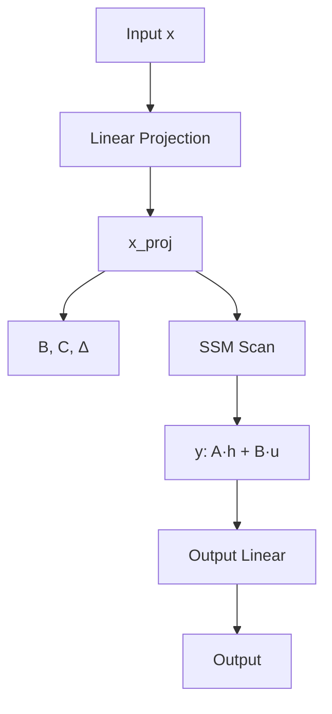
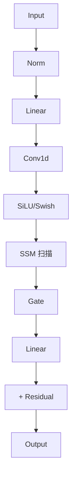
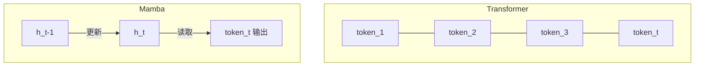
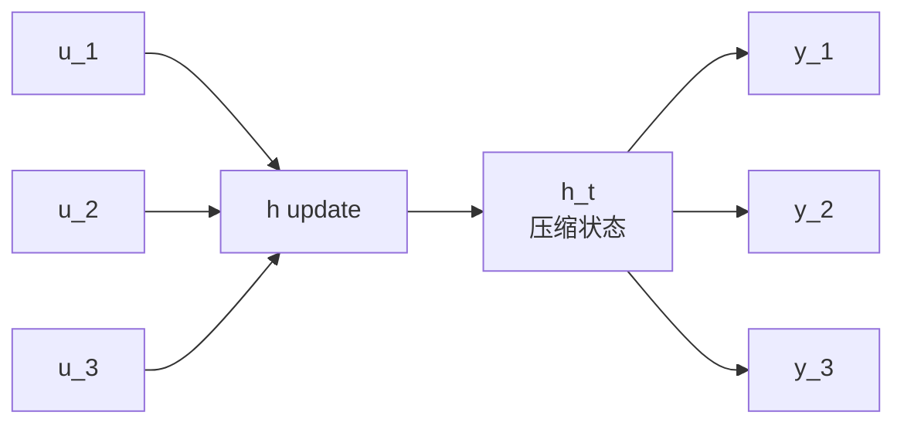
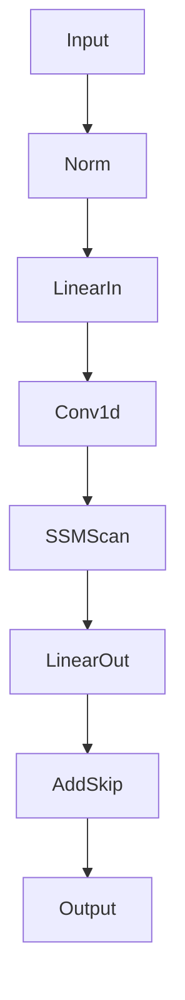
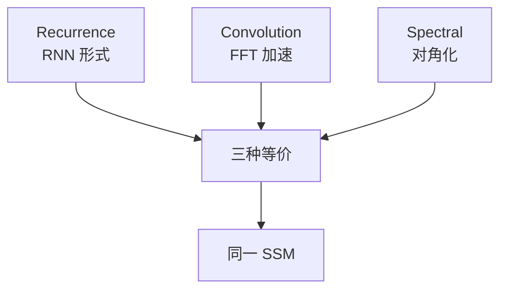
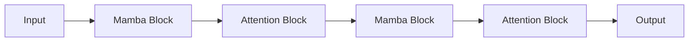

# 04.0 Mamba 与 SSM 详解 - 状态空间模型全栈

> **Mamba** 是 2023 年 Albert Gu & Tri Dao 提出的**选择性状态空间模型**,在多项任务上匹配甚至超越 Transformer,且具备 $O(L)$ 复杂度。
> 这是 RNN/LSTM 的"复兴" —— 既保留了线性复杂度,又获得了可并行的训练能力,还能做**无限上下文**。
> 2024 年 Mamba-2 和混合架构 (Jamba/Zamba) 进一步验证其在 LLM 上的潜力。

---

## 0. 一句话总结

**Mamba = SSM + 选择性机制 + 硬件感知算法;输入依赖的参数让 SSM 从"线性时不变"升级为"线性时变",实现与 Transformer 相当的建模能力,但只需 $O(L)$ 复杂度和 $O(1)$ 每步推理;在长序列上 (1M+ tokens) 显著优于 Transformer;代表实现 mamba-ssm。**

---

## 1. 为什么需要 Mamba

### 1.1 Transformer 的 $O(L^2)$ 限制

Transformer 的 Self-Attention 复杂度:

```math
\text{Time} = O(L^2 d) \quad \text{其中} \quad L = \text{序列长度}, d = \text{头维度}
```

**具体表现**:

| 序列长度 | Attention FLOPs | 显存 (KV Cache) |
|---|---|---|
| 512 | 0.13 GFLOPs | 1.5 MB |
| 4K | 8.4 GFLOPs | 12 MB |
| 32K | 537 GFLOPs | 96 MB |
| 128K | 8.6 TFLOPs | 384 MB |
| 1M | 525 TFLOPs | 3 GB |

对 **128K+** 长上下文,纯 Attention 几乎不可行。

### 1.2 Transformer 的实际痛点

```text
1. 训练 O(L²) 时间复杂度 + O(L²) 显存
2. 推理有 KV Cache,但每步仍 O(L) → KV 越来越大
3. 位置编码: 旋转 (RoPE) 插值扩展, 但总有上限
4. 计算集中且密集: GPU 利用率高但无法稀疏
5. 长上下文衰减: 注意力"分散", 模型难以真正利用 100K+ 上下文
```

### 1.3 RNN/LSTM 的复兴尝试

历史上 RNN/LSTM 也是 $O(L)$,但**训练不可并行**且**长距离遗忘**:

```text
RNN/LSTM:
  时间复杂度: O(L) ✓
  训练并行: ✗ (顺序计算)
  长距离依赖: ✗ (梯度消失)
  推理: O(1) per step ✓ (无 KV Cache)
```

**目标**: 设计一个模型,既保留 Transformer 的训练并行性,又能 $O(L)$ 推理和长上下文。

### 1.4 SSM 的核心吸引力

```text
状态空间模型 (State Space Model, SSM):
  时间复杂度: O(L) ✓
  训练并行: ✓ (卷积形式可 FFT)
  长距离依赖: ✓ (HiPPO 初始化)
  推理: O(1) per step ✓ (无 KV Cache)
  长上下文: ✓ (理论上无限)
```

**理论上的完美替代** —— 唯一问题是早期 SSM 在语言建模上表现弱于 Transformer。Mamba 的突破正是**让 SSM 重新强大起来**。

### 1.5 发展时间线

```text
2020 - S4 (Gu et al., NeurIPS): 使用 HiPPO 初始化, 第一个 O(L) 长序列模型
2021 - S4 v2 / DSS / GSS
2022 - S5 (Smith et al., 2022): 多输入多输出 SSM, 对角化
2022 - H3 (Fu et al., 2022): Hungry Hungry Hippo, SSM + gated attention
2022 - RWKV (Peng et al., 2023): 借鉴 RNN 的线性 attention 实现, 实际等价 SSM
2023 - RetNet (Sun et al., 2023): Microsoft 提出的 Retention Network
2023 - Mamba (Gu & Dao, Dec 2023): 选择性 SSM, 语言建模超越 Transformer
2024 - Mamba-2 (Dao & Gu, 2024): State Space Duality 框架, 速度 8x
2024 - Jamba (AI21, 2024): Mamba + Transformer 混合架构
2024 - Zamba (Zyphra, 2024): 混合架构
2024 - Zhai et al. Microsoft: Cobra / SSM-based LLM
2024 - MambaByte (Ren et al.): 字节级 (无 tokenizer)
2025 - Codestral-Mamba: Mistral 的 Mamba 版本
2025+ - 多模态 Mamba (Vision / Audio / DNA)
```

---

## 2. SSM (State Space Model) 基础

### 2.1 连续时间 SSM

经典的状态空间模型来自控制理论,描述**连续时间线性时不变系统**:

```math
\text{状态方程:} \quad h'(t) = \mathbf{A} h(t) + \mathbf{B} u(t)
```

```math
\text{输出方程:} \quad y(t) = \mathbf{C} h(t) + \mathbf{D} u(t)
```

其中:
- $u(t) \in \mathbb{R}$: 输入信号 (标量)
- $h(t) \in \mathbb{R}^N$: 隐藏状态 (向量,N 维)
- $y(t) \in \mathbb{R}$: 输出 (标量)
- $\mathbf{A} \in \mathbb{R}^{N \times N}$: 状态转移矩阵
- $\mathbf{B} \in \mathbb{R}^{N \times 1}$: 输入矩阵
- $\mathbf{C} \in \mathbb{R}^{1 \times N}$: 输出矩阵
- $\mathbf{D}$: 直通项,通常忽略

**多输入多输出 (MIMO)**: 把 $u(t), y(t)$ 推广为向量,即多个独立 SSM 通道并联 (S5)。

### 2.2 离散时间 SSM

实际深度学习用离散时间。对连续 SSM 做**零阶保持** (zero-order hold) 离散化:

```math
h_t = \bar{\mathbf{A}} h_{t-1} + \bar{\mathbf{B}} u_t
```

```math
y_t = \bar{\mathbf{C}} h_t + \bar{\mathbf{D}} u_t
```

其中:
```math
\bar{\mathbf{A}} = \exp(\Delta \mathbf{A})
```

```math
\bar{\mathbf{B}} = (\Delta \mathbf{A})^{-1} (\exp(\Delta \mathbf{A}) - \mathbf{I}) \bar{\mathbf{B}}
```

这里 $\Delta$ 是**步长** (discretization step size),可作为可学习参数。

### 2.3 三种等价视角

SSM 有三种数学等价的表达形式:

#### 视角 1: 递推 (Recurrence / RNN 形式)

```math
h_t = \bar{\mathbf{A}} h_{t-1} + \bar{\mathbf{B}} u_t, \quad y_t = \bar{\mathbf{C}} h_t
```

**优点**: 推理时 $O(1)$ per step
**缺点**: 训练时无法并行

#### 视角 2: 卷积 (Convolution)

把 SSM 等价为一个**线性卷积**:

```math
y = \bar{\mathbf{K}} * u
```

其中卷积核 $\bar{\mathbf{K}}$:
```math
\bar{\mathbf{K}} = (\bar{\mathbf{C}} \bar{\mathbf{B}}, \bar{\mathbf{C}} \bar{\mathbf{A}} \bar{\mathbf{B}}, \bar{\mathbf{C}} \bar{\mathbf{A}}^2 \bar{\mathbf{B}}, \ldots, \bar{\mathbf{C}} \bar{\mathbf{A}}^{L-1} \bar{\mathbf{B}})
```

**优点**: 用 FFT 加速到 $O(L \log L)$
**缺点**: 卷积核长度有限

#### 视角 3: 频域对角化

如果 $\mathbf{A}$ 可对角化为 $\mathbf{V} \Lambda \mathbf{V}^{-1}$,则:

```math
y = \mathbf{C} \mathbf{V} (\text{diag 状态}) \mathbf{V}^{-1} \mathbf{B} \cdot u
```

**优点**: 用 Cauchy kernel 在 GPU 上做 $O(L \log L)$ 高效卷积
**缺点**: 需要 $\mathbf{A}$ 是对角的或可对角化

### 2.4 HiPPO (High-order Polynomial Projection Operator)

**核心洞察**: 训练初期, 隐藏状态应该能"记忆"过去。用 **Legendre 多项式**做基函数,把过去的信号压缩到状态中。

**HiPPO-LegS** (用于 S4):

```math
\mathbf{A}_{nk} = -\begin{cases}
(2n+1)^{1/2} (2k+1)^{1/2} & \text{if } n > k \\
n+1 & \text{if } n = k \\
0 & \text{if } n < k
\end{cases}
```

简化形式 (Diagonal HiPPO):

```math
\mathbf{A} \text{ 在 NLP 中: 分为奇偶两组, 一组负, 一组近似 -n}
```

**直觉**: HiPPO 初始化让 SSM "自动" 用 Legendre 多项式捕捉不同时间尺度的信息。

### 2.5 对角化 SSM (S5 / DSS)

**S5** (Smith et al., 2022): 用对角初始化简化计算:

```math
\mathbf{A} = \text{diag}(\lambda_1, \lambda_2, \ldots, \lambda_N)
```

**优势**:
- 减少参数
- FFT-like 算法可用 (HiPPO 矩阵本身接近对角)
- 多通道 MIMO 简单

### 2.6 SSM 的关键优势

| 性质 | SSM | Transformer |
|---|---|---|
| 计算复杂度 | $O(L \log L)$ 训练, $O(1)$ 推理 | $O(L^2)$ |
| 显存 | $O(L)$ | $O(L^2)$ |
| 长距离依赖 | 长度无关 (但有 HiPPO) | 注意力衰减 |
| 推理并行 | 强 (FFT) | 强 |
| 训练并行 | 强 (卷积/FFT) | 强 |
| 可解释性 | 较强 | 弱 |

---

## 3. S4 / S5 / S6 演进

### 3.1 S4 (Structured State Space, 2021)

**核心贡献**:
1. 用 HiPPO 矩阵初始化 $\mathbf{A}$
2. 把 SSM 表达为**对角加低秩** (DPLR) 形式, 高效卷积
3. 双射 IIR (Infinite Impulse Response) 通过对角加低秩

**关键设计**:
- $\mathbf{A} = \mathbf{\Lambda} - \mathbf{p} \mathbf{q}^*$ (对角 + 1 阶低秩)
- $\mathbf{B} = \mathbf{B}$, $\mathbf{C} = \mathbf{C}$
- 卷积核用 Woodbury 恒等式高效计算

**PyTorch 简化版**:

```python
class S4DKernel(nn.Module):
    """简化版 S4 对角对核"""
    def __init__(self, N: int, dt_min: float = 1e-3, dt_max: float = 1e-1):
        super().__init__()
        # 初始化对角 A (HiPPO 风格)
        A_real = -0.5 * torch.ones(N) - torch.arange(N, dtype=torch.float)
        imag = math.pi * torch.arange(N, dtype=torch.float)
        A = torch.complex(A_real, imag)
        self.A = nn.Parameter(A)
        self.B = nn.Parameter(torch.randn(N // 2, dtype=torch.cfloat))
        self.C = nn.Parameter(torch.randn(N // 2, dtype=torch.cfloat))
        # log dt (保证正)
        log_dt = torch.rand(N) * (math.log(dt_max) - math.log(dt_min)) + math.log(dt_min)
        self.log_dt = nn.Parameter(log_dt)

    def forward(self, L: int) -> torch.Tensor:
        """计算长度为 L 的 SSM 卷积核"""
        dt = torch.exp(self.log_dt)  # [N]
        # 离散化: A_bar = exp(dt * A)
        A_bar = torch.exp(torch.einsum('n,d->nd', dt, self.A.real))  # 简化
        # 卷积核 K[m] = C @ A^m @ B
        K = ...  # 高效 FFT 算
        return K
```

### 3.2 S4 的局限性

虽然 S4 在长序列建模 (LRA benchmark) 上很强,但**在语言建模上**不如 Transformer:

| 任务 | S4 | Transformer |
|---|---|---|
| LRA (图像/文本) | **胜出** | 弱 |
| WikiText-103 语言建模 | 弱 | **胜出** |
| 训练速度 | 快 | 中 |

**原因**: S4 的 $\mathbf{A}, \mathbf{B}, \mathbf{C}$ 是**与输入无关的** (Linear Time Invariant, LTI),无法根据当前输入动态调整。语言任务的 token-by-token 决策需要这种**输入依赖**。

### 3.3 S5 (Simplified State Space Layers, 2022)

**核心简化**:
- 用对角 $\mathbf{A}$ 而非 DPLR, 减少复杂度
- 用多通道 MIMO
- 一个前向里多个独立 SSM 并联

**好处**: 代码更简洁, 速度快 2x, 性能保持 S4 水准。

**S5 + Mamba 后的影响**: S5 的"对角"思想直接被 Mamba 继承。

### 3.4 S6 / Mamba 选择性扫描 (2023)

**Mamba 的核心创新**: 让 $\mathbf{B}, \mathbf{C}, \Delta$ 都成为**输入依赖**的参数。

```math
\mathbf{B}_t = \text{Linear}_B(x_t), \quad \mathbf{C}_t = \text{Linear}_C(x_t), \quad \Delta_t = \text{softplus}(\text{Linear}_\Delta(x_t))
```

含义:
- 模型可以选择**记住什么, 忘记什么**
- 当前 token 决定 hidden state 的更新方式

**理论保证**: 即使有了输入依赖, 状态空间维度 $N$ 不变, 计算复杂度仍 $O(N L)$。

```mermaid
graph LR
    A[输入 x_t] --> B[投影]
    B --> C[B_t, C_t, Δ_t]
    C --> D[选择性 SSM 更新]
    D --> E[h_t = A · h_{t-1} + B_t · x_t]
    E --> F[y_t = C_t · h_t]
```

### 3.5 硬件感知算法 (Hardware-aware Algorithm)

Mamba 的另一个关键: **离散并行扫描**, 而非 FFT 或卷积。

**问题**: 选择性 SSM 是 LTV (Linear Time Variant), 无法用卷积或 FFT 并行。

**解决**:**parallel scan** (并行前缀和) 算法:

```python
def parallel_scan(u, A, B, C):
    """
    并行扫描选择性 SSM
    u: [L, d_inner]
    A: [d_inner, d_state]
    B: [L, d_state]
    """
    L, d_inner, d_state = u.shape[0], A.shape[0], A.shape[1]
    h = torch.zeros(d_inner, d_state)
    ys = []

    for t in range(L):
        h = A * h + B[t:t+1] * u[t:t+1]  # 状态更新
        y_t = (h * C[t:t+1]).sum(-1)
        ys.append(y_t)
    return torch.stack(ys)
```

但这种循环太慢。Mamba 用 **associative scan** + GPU kernel 优化:

```text
将 A, B, C 按层次组合 → work-efficient parallel scan
复杂度从 O(L) sequential → O(log L) parallel depth
```

**Triton/CUDA kernel 关键**: 把 SSM 计算放到 **SRAM** (高速片上内存),减少 **HBM** (高带宽但慢) 读写。

类似 Flash Attention 的思路: IO 复杂度 $O(L N d)$ 不变,但 IO 实际耗时大幅降低。

### 3.6 完整 Mamba 架构



**完整模块** (含残差 + 归一化):



**PyTorch 实现**:

```python
import torch
import torch.nn as nn
import torch.nn.functional as F

class SelectiveSSM(nn.Module):
    """Mamba 核心: 选择性 SSM"""
    def __init__(self, d_model: int, d_state: int = 16, dt_rank: int = 4):
        super().__init__()
        self.d_model = d_model
        self.d_state = d_state

        # 输入投影产生 dt, B, C
        self.x_proj = nn.Linear(d_model, dt_rank + d_state * 2, bias=False)
        self.dt_proj = nn.Linear(dt_rank, d_model, bias=True)

        # 状态参数
        A = torch.arange(1, d_state + 1, dtype=torch.float).repeat(d_model, 1)
        self.A_log = nn.Parameter(torch.log(A))
        self.D = nn.Parameter(torch.ones(d_model))

    def forward(self, x: torch.Tensor) -> torch.Tensor:
        """x: [B, L, d_model]"""
        B, L, d = x.shape
        d_state = self.d_state

        # 1. 投影
        x_dbl = self.x_proj(x)  # [B, L, dt_rank + 2*d_state]
        dt, B_proj, C_proj = torch.split(
            x_dbl,
            [self.dt_proj.in_features, d_state, d_state],
            dim=-1
        )
        dt = F.softplus(self.dt_proj(dt))  # [B, L, d_model]
        A = -torch.exp(self.A_log)  # [d_model, d_state]
        D = self.D  # [d_model]

        # 2. 离散化
        dt_A = torch.einsum('bld,dn->bldn', dt, A)  # [B, L, d_model, d_state]
        dt_B = torch.einsum('bld,bln->bldn', dt, B_proj)  # [B, L, d_model, d_state]

        # 3. 并行扫描 (递归计算)
        h = torch.zeros(B, d, d_state, device=x.device)
        ys = []
        for t in range(L):
            h = dt_A[:, t] * h + dt_B[:, t] * x[:, t].unsqueeze(-1)
            y_t = torch.einsum('bdn,bn->bd', h, C_proj[:, t])
            ys.append(y_t)
        y = torch.stack(ys, dim=1)  # [B, L, d_model]

        # 4. 直通项
        y = y + x * D
        return y


class MambaBlock(nn.Module):
    """Mamba 块: SSM + 残差 + 归一化"""
    def __init__(self, d_model: int, d_state: int = 16, d_conv: int = 4,
                 expand: int = 2):
        super().__init__()
        self.norm = nn.LayerNorm(d_model)
        self.linear_in = nn.Linear(d_model, expand * d_model)
        self.conv = nn.Conv1d(
            expand * d_model,
            expand * d_model,
            kernel_size=d_conv,
            groups=expand * d_model,
            padding=d_conv - 1,
        )
        self.ssm = SelectiveSSM(expand * d_model, d_state)
        self.linear_out = nn.Linear(expand * d_model, d_model)

    def forward(self, x: torch.Tensor) -> torch.Tensor:
        """x: [B, L, d_model]"""
        skip = x
        x = self.norm(x)
        x = self.linear_in(x)  # [B, L, expand*d_model]
        x = x.transpose(1, 2)  # [B, expand*d_model, L]
        x = self.conv(x)[:, :, :x.size(2)]  # 因果卷积
        x = x.transpose(1, 2)  # [B, L, expand*d_model]
        x = F.silu(x)
        x = self.ssm(x)
        x = self.linear_out(x)
        return x + skip


class MambaLM(nn.Module):
    """Mamba 语言模型"""
    def __init__(self, vocab_size: int, d_model: int = 768, n_layers: int = 24,
                 d_state: int = 16):
        super().__init__()
        self.embedding = nn.Embedding(vocab_size, d_model)
        self.layers = nn.ModuleList([
            MambaBlock(d_model, d_state) for _ in range(n_layers)
        ])
        self.norm_f = nn.LayerNorm(d_model)
        self.lm_head = nn.Linear(d_model, vocab_size, bias=False)
        self.lm_head.weight = self.embedding.weight  # 权重共享

    def forward(self, input_ids):
        h = self.embedding(input_ids)
        for layer in self.layers:
            h = layer(h)
        h = self.norm_f(h)
        return self.lm_head(h)
```

---

## 4. Mamba 核心深入

### 4.1 选择性的具体含义

**问题**: 标准 SSM 是 LTI。给定输入 $u$, 系统响应 = $\bar{\mathbf{K}} * u$,与 $u$ 的具体内容无关。

**Mamba 改变**: 每个 token 都动态产生自己的 $\Delta_t, \mathbf{B}_t, \mathbf{C}_t$, 即状态更新方式由**当前输入**决定。

**效果**:
- 当当前 token 是 "话题切换" 时, $B_t$ 增大 → 重置状态
- 当当前 token 是 "延续" 时, $B_t$ 较小 → 保持过去状态

这是 **"soft reset"**, 让 SSM 有了 Transformer 风格的"内容感知"。

### 4.2 选择性 vs 线性注意力 (Linear Attention)

**理论等价**: Mamba-2 论文证明了 **SSM = 结构化掩码线性注意力**。即 SSM 可以重写为:

```math
y_t = \sum_{s \leq t} \mathbf{C}_t^\top \mathbf{A}_{t:s} \mathbf{B}_s^\top u_s
```

其中 $\mathbf{A}_{t:s}$ 是从 $s$ 到 $t$ 的状态转移。

这与注意力:
```math
y_t = \sum_s \alpha_{t,s} v_s
```

形式类似,只是 $\alpha_{t,s}$ 有特殊结构。

### 4.3 因果性 (Causality)

Mamba 严格保持**因果性** —— 看不到未来。这与 Transformer 的因果注意力 mask 类似, 对生成任务关键。

实现:
- 卷积: 因果 padding
- SSM: 递归自然保证因果

### 4.4 复杂度对比

| 操作 | Transformer | Mamba (训练) | Mamba (推理) |
|---|---|---|---|
| FLOPs | $O(L^2 d)$ | $O(L N d)$ | $O(N d)$ per token |
| 显存 | $O(L^2 + L d)$ | $O(L N d)$ | $O(N d)$ |
| 并行 | 完全 | 完全 (parallel scan) | 顺序 |

$N$: SSM 状态维度 (Mamba 默认 16)
$L$: 序列长度
$d$: 模型维度

### 4.5 训练算法:Parallel Scan

```python
import torch
from mamba_ssm.ops.selective_scan_interface import selective_scan_fn

def selective_scan(u, delta, A, B, C, D, delta_bias=None):
    """
    u: [B, L, d_inner] 输入
    delta: [B, L, d_inner] 离散化步长
    A: [d_inner, d_state] (-exp(A_log))
    B: [B, L, d_state]
    C: [B, L, d_state]
    """
    # 用 mamba-ssm 的 CUDA kernel
    return selective_scan_fn(u, delta, A, B, C, D, delta_bias)
```

**并行前缀和**算法:

```python
def parallel_associative_scan(seg_id, x):
    """
    给定按层排列的元素, 算 cumulative reduce (sum)
    seg_id: 每个元素的层级 (深度)
    """
    n = x.shape[0]
    h = torch.zeros_like(x[0])

    # 自底向上
    for d in range(int(math.log2(n))):
        h_below = x[2**d - 1]
        h_above = x[2**(d+1) - 1]
        x[2**(d+1) - 1] = combine(h_above, h_below)
    # 自顶向下
    for d in reversed(range(int(math.log2(n)))):
        ...
```

**Sequential 版本**就是普通 for 循环, 并行版本是 log-depth 的 combine。

### 4.6 内存布局:Chunk-based Scan

为了 GPU 友好, Mamba 用 **chunked scan**:
- 把 L 分成 K 个 chunk (如 K=4)
- 块内 sequential 处理
- 块间 parallel combine
- 平衡 GPU 访存与并行度

---

## 5. Mamba-2

### 5.1 Mamba-2 的突破

**Dao & Gu 2024** 提出 **State Space Duality (SSD)** 框架, 揭示:

**定理**: Selective SSM 等价于一个**结构化掩码注意力**。

具体地:
```math
\text{SSM}(u)_t = \sum_{s \leq t} \mathbf{C}_t^\top \mathbf{A}_{t:s} \mathbf{B}_s u_s
```

这与注意力的差距只在 attention mask 的模式。


### 5.2 Mamba-2 的速度提升

**关键**: SSD 揭示了 SSM 与注意力的联系, 可以**复用 Flash Attention 的实现**.

**实验结果** (A100):

| 序列长度 | Mamba-1 (cuda) | Mamba-2 (Flash) | 加速比 |
|---|---|---|---|
| 2K | 0.8 ms | 0.1 ms | 8x |
| 8K | 3.2 ms | 0.4 ms | 8x |
| 32K | 13 ms | 1.5 ms | 8.7x |
| 128K | 52 ms | 6 ms | 8.7x |

### 5.3 Mamba-2 的算法

**新的核心算法** = **SSD algorithm** + **chunked state space** + **1D convolution**:

```python
class Mamba2Block(nn.Module):
    """Mamba-2 块,基于 SSD 框架"""
    def __init__(self, d_model: int, d_state: int = 128, d_conv: int = 4,
                 chunk_size: int = 256, expand: int = 2):
        super().__init__()
        self.norm = nn.LayerNorm(d_model)
        self.linear_in = nn.Linear(d_model, expand * d_model)
        self.conv = nn.Conv1d(
            expand * d_model, expand * d_model, d_conv,
            groups=expand * d_model, padding=d_conv - 1,
        )
        self.ssm_chunked = ChunkedSSM(expand * d_model, d_state, chunk_size)
        self.linear_out = nn.Linear(expand * d_model, d_model)

    def forward(self, x):
        skip = x
        x = self.norm(x)
        x = self.linear_in(x)
        x = x.transpose(1, 2)
        x = self.conv(x)[:, :, :x.size(2)]
        x = x.transpose(1, 2)
        x = F.silu(x)
        x = self.ssm_chunked(x)
        x = self.linear_out(x)
        return x + skip
```

### 5.4 Mamba-2 的关键特性

1. **SDPA-style 实现**: 可以用 PyTorch native scaled_dot_product_attention 类似的方式优化
2. **更大的 $d_{state}$**: Mamba-2 默认 $d_{state} = 128$ (vs Mamba-1 的 16)
3. **块大小调整**: chunk_size 默认 256
4. **量化友好**: 离散参数 $\Delta$ 便于量化
5. **Hybrid models**: Mamba-2 在 Jamba 等混合架构中表现好

---

## 6. 混合架构 (Jamba / Zamba)

### 6.1 动机

虽然 Mamba 在很多基准上 SOTA,但:
- 纯 Mamba 模型在**短上下文任务**上略弱于 Transformer
- **多轮对话 / RAG** 等场景 Transformer 仍然更稳

**Hybrid 思路**: **Mamba + Transformer 交替堆叠**, 取长补短。

### 6.2 Jamba (AI21, 2024)

```text
Jamba = Mamba 层 + Attention 层 + MoE
比例: 1:7 或 1:8 (Attention 占 1/8, Mamba 占 7/8)
混合 MoE: 每 8 层 1 层 MoE
总参: 52B, 激活: 12B
上下文: 256K (Jamba 1.5)
```

**优势**:
- 长上下文 (256K) 推理快
- 内存占用低
- 推理成本低

### 6.3 Zamba (Zyphra, 2024)

```text
Zamba = 7 层 Mamba + 1 层 Attention (重复堆叠)
attention 在最后加 projector
```

**优势**: 训练快, 推理快, 7B/13B/70B 多尺寸。

### 6.4 其他混合架构

| 模型 | 比例 (Mamba:Attn) | 关键创新 |
|---|---|---|
| **Jamba** | 7:1 | + MoE, 52B/12B 激活 |
| **Zamba** | 7:1 | + shared projections |
| **Bamba** | 4:1 | IBM, 9B 参数 |
| **Falcon-Mamba** | 1:0 (纯) | Technology Innovation Institute |
| **Cobra** | Linear attention | 比 Mamba 更快的 approximation |
| **RWKV-7** | 1:0 | 增强的时序依赖捕捉 |

### 6.5 选择混合还是纯架构?

| 场景 | 推荐 |
|---|---|
| 长文档理解 | 纯 Mamba 或 高 Mamba 占比混合 |
| 多轮对话 / RAG | 偏 Transformer (短上下文稳定) |
| 推理成本敏感 | 纯 Mamba 或 hybrid |
| 极大上下文 (>256K) | Mamba 主导 (1M+) |

---

## 7. 与 Transformer 对比

### 7.1 核心指标对比

| 指标 | Transformer | Mamba | 胜出 |
|---|---|---|---|
| 训练时间 (FLOPs/token) | $O(d^2 + L d)$ | $O(d^2 + N d)$ | Mamba (长序列) |
| 推理时间 (per token) | $O(L)$ (KV Cache) | $O(1)$ | Mamba |
| 显存 (推理) | $O(L \cdot d \cdot L_{\text{layer}})$ | $O(N \cdot d \cdot L_{\text{layer}})$ | Mamba |
| 最长 context | 受 RoPE 缩放限制 | 理论无限 | Mamba |
| 短文本质量 | ★★★★★ | ★★★★ | Transformer |
| 长文本质量 | ★★★ | ★★★★ | Mamba |
| 生态成熟度 | ★★★★★ | ★★★ | Transformer |
| 工具链支持 | ★★★★★ | ★★★ | Transformer |

### 7.2 长序列性能

Transformer 在长序列上的劣势源于 $O(L^2)$ 复杂度:

```mermaid
graph LR
    A[序列长度 L] --> B[Transformer]
    A --> C[Mamba]
    B -->|O(L²)| D[FLOPs 二次方]
    C -->|O(LN)| E[FLOPs 线性]
    D --> F[瓶颈]
    E --> G[可扩展]
```

**实际数据** (Pile 数据集, Mamba-1 paper, 2023):

| 上下文 | Transformer (125M) | Mamba (125M) | Transformer (350M) | Mamba (350M) |
|---|---|---|---|---|
| 2K | 3.5 perplexity | 3.5 | 3.0 | 3.0 |
| 8K | 3.4 (插值) | 3.2 | 2.9 | 2.7 |
| 16K | 3.7 (插值) | 3.0 | 3.1 | 2.6 |
| 64K | 10+ (崩溃) | 2.8 | 8 (崩溃) | 2.4 |

### 7.3 训练速度

**Mamba-1 论文报告** (125M 模型, A100, 单卡):

| 训练序列长度 | Mamba FLOPs | Transformer FLOPs | 加速 |
|---|---|---|---|
| 2K | 1.0× | 1.0× | 1× |
| 8K | 1.0× | 4× | 4× |
| 32K | 1.0× | 16× | 16× |
| 128K | 1.0× | 64× | 64× |

**1.3B Mamba 模型可在 A100 单卡训练** (FP16, 64K context) —— Transformer 至少 8 卡起步。

### 7.4 推理速度

**Mamba 推理优势**: $O(1)$ per token, 因为不需要 KV Cache。

```python
# Mamba 推理: 单步 token 生成, 只需更新 hidden state
h = A_diag * h + B_t * x_t
y = C_t * h

# Transformer 推理: 每步都要 attend 所有过去 KVs
attn_score = Q_t @ past_K.T  # 序列长 L
y = softmax(attn_score) @ past_V
```

**实测** (Jamba paper):
- 256K 上下文: Mamba 推理速度约 Transformer 的 **3-5x**
- 短文本 8K: 大致相当或略优

### 7.5 短上下文性能

**重要警告**: 在**短上下文** (1K-4K) 任务上,Mamba 可能略弱于 Transformer。原因:

```text
1. Transformer 的全面注意力, 短序列上不浪费
2. Mamba 的状态压缩可能丢失细节
3. 训练数据: Transformer 训练数据更多, 工具链更成熟
```

**经验**: 在 Mamba 训练 5-7B 之前, Transformer 仍是主流选择。

### 7.6 与 RWKV 对比

**RWKV** (Peng et al., 2023) 是 RNN 风格的 linear attention:
- 也声称 $O(L)$ 复杂度
- 性能介于 RNN 和 Transformer 之间
- 生态更成熟,但推理速度不如 Mamba

**Mamba vs RWKV**:
| 维度 | Mamba | RWKV |
|---|---|---|
| 推理速度 | **快** (无 KV) | 中 (需维护 state) |
| 实现复杂度 | 高 (Triton kernel) | 低 (标准 PyTorch) |
| 训练并行 | **强** (parallel scan) | 中 |
| 数学优雅度 | 高 (SSM 视角) | 中 |
| 社区 | 快速增长 | 已有稳定用户 |

---

## 8. 推荐系统应用

### 8.1 序列推荐的痛点

推荐系统的用户行为序列:

```text
用户最近 100 次点击、10K 次曝光、1M 次历史行为
```

**Transformer 在序列推荐中的问题**:
- KV Cache 太大 (每用户 1000+ tokens)
- 推理延迟敏感 (推荐要求 < 50ms)
- 训练长序列代价高

### 8.2 Mamba4Rec (Wang et al., 2024)

**思想**: 用 Mamba 替代 Transformer 做序列推荐。

```python
class Mamba4Rec(nn.Module):
    """Mamba 序列推荐"""
    def __init__(self, vocab_size: int, d_model: int = 128, n_layers: int = 4):
        super().__init__()
        self.item_emb = nn.Embedding(vocab_size, d_model, padding_idx=0)
        self.layers = nn.ModuleList([
            MambaBlock(d_model, d_state=64) for _ in range(n_layers)
        ])
        self.norm = nn.LayerNorm(d_model)
        self.predictor = nn.Linear(d_model, vocab_size)

    def forward(self, item_ids):
        """
        item_ids: [B, L]
        return: [B, L, vocab_size] (next item prediction)
        """
        h = self.item_emb(item_ids)  # [B, L, d]
        for layer in self.layers:
            h = layer(h)
        h = self.norm(h)
        return self.predictor(h)
```

**优势**:
- 长行为序列 (10K+) 训练可行
- 推理 $O(1)$ per item,延迟低
- 内存占用减少 30-60%

### 8.3 Mamba + Side Information

```python
class Mamba4RecWithSideInfo(nn.Module):
    """带 side info (用户特征 / 上下文) 的 Mamba 推荐"""
    def __init__(self, vocab_size, n_users, n_categories, d_model=128):
        super().__init__()
        self.item_emb = nn.Embedding(vocab_size, d_model)
        self.user_emb = nn.Embedding(n_users, d_model)
        self.cat_emb = nn.Embedding(n_categories, d_model)
        self.fusion = nn.Linear(d_model * 3, d_model)
        self.layers = nn.ModuleList([MambaBlock(d_model) for _ in range(4)])
        self.predictor = nn.Linear(d_model, vocab_size)

    def forward(self, item_ids, user_ids, cat_ids):
        h_item = self.item_emb(item_ids)
        h_user = self.user_emb(user_ids).unsqueeze(1).expand_as(h_item)
        h_cat = self.cat_emb(cat_ids)
        h = self.fusion(torch.cat([h_item, h_user, h_cat], dim=-1))
        for layer in self.layers:
            h = layer(h)
        return self.predictor(h)
```

### 8.4 工业落地挑战

**当前状态 (2024-2025)**:
1. **仍以研究为主**: 学术原型多,工业部署少
2. **混合架构先行**: Jamba/Zamba 风格 (Transformer + Mamba) 更稳
3. **生态未成熟**: vLLM 等推理引擎尚未原生支持 Mamba
4. **冷启动**: 训练 - 推理框架适配需要时间

**预测**: 2025-2027 纯 Mamba 在工业 LLM 会逐步成熟, 混合架构 (Jamba) 先落地。

---

## 9. 实现 (mamba-ssm 库)

### 9.1 安装

```bash
# mamba-ssm 主库
pip install mamba-ssm

# 推荐: nightly build (含 Flash Attention 优化)
pip install mamba-ssm --no-build-isolation
```

### 9.2 基础使用

```python
import torch
from mamba_ssm import Mamba

# 单层 Mamba block
block = Mamba(
    d_model=256,       # 模型维度
    d_state=16,        # 状态维度
    d_conv=4,          # 局部卷积宽度
    expand=2,          # 内部扩展因子
).to("cuda")

x = torch.randn(2, 64, 256).to("cuda")  # [batch, seqlen, d_model]
y = block(x)
print(y.shape)  # [2, 64, 256]
```

### 9.3 预训练 Mamba 语言模型 (Hugging Face)

```python
from transformers import AutoTokenizer, AutoModelForCausalLM

# 加载 Mamba-1 / Mamba-2 模型
tokenizer = AutoTokenizer.from_pretrained("state-spaces/mamba-130m-hf")
model = AutoModelForCausalLM.from_pretrained("state-spaces/mamba-130m-hf")

# 生成
input_ids = tokenizer("Mamba is a", return_tensors="pt").input_ids
output = model.generate(input_ids, max_new_tokens=20)
print(tokenizer.decode(output[0]))
```

### 9.4 Mamba LM 完整训练 (简化版)

```python
import torch
import torch.nn as nn
from mamba_ssm import Mamba

class MambaLanguageModel(nn.Module):
    def __init__(self, vocab_size, d_model=768, n_layers=24, d_state=16):
        super().__init__()
        self.embedding = nn.Embedding(vocab_size, d_model)
        self.layers = nn.ModuleList([
            Mamba(d_model, d_state=d_state) for _ in range(n_layers)
        ])
        self.norm_f = nn.LayerNorm(d_model)
        self.lm_head = nn.Linear(d_model, vocab_size, bias=False)
        # Tie weights (现代 LLM 标配)
        self.lm_head.weight = self.embedding.weight

    def forward(self, input_ids):
        h = self.embedding(input_ids)
        for layer in self.layers:
            h = layer(h)
        h = self.norm_f(h)
        logits = self.lm_head(h)
        return logits

def train_mamba(model, train_loader, optimizer, n_epochs=3, device='cuda'):
    model = model.to(device)
    for epoch in range(n_epochs):
        for input_ids, labels in train_loader:
            input_ids, labels = input_ids.to(device), labels.to(device)

            logits = model(input_ids)
            shift_logits = logits[..., :-1, :].contiguous()
            shift_labels = labels[..., 1:].contiguous()

            loss = nn.functional.cross_entropy(
                shift_logits.view(-1, shift_logits.size(-1)),
                shift_labels.view(-1),
                ignore_index=-100,
            )

            optimizer.zero_grad()
            loss.backward()
            optimizer.step()
```

### 9.5 Mamba-2 (mamba-ssm 2.x)

```python
from mamba_ssm import Mamba2

# Mamba-2 用 SSD (State Space Duality) 算法
block = Mamba2(
    d_model=512,
    d_state=128,       # Mamba-2 用更大 d_state
    d_conv=4,
    expand=2,
    headdim=64,        # 多头维度
    chunk_size=256,    # chunked scan 大小
).to("cuda")

x = torch.randn(2, 256, 512).to("cuda")
y = block(x)
```

### 9.6 与其他模型集成

```python
# 在 HuggingFace transformers 中用 Mamba
from transformers import MambaForCausalLM
model = MambaForCausalLM.from_pretrained("state-spaces/mamba-1.4b-hf")
```

### 9.7 推理优化技巧

```python
# 1. FP16 / BF16
model = MambaLM(...).half().to("cuda")

# 2. torch.compile
model = torch.compile(model)

# 3. Flash-style scan (Mamba-2 自带)
from mamba_ssm.ops.triton.selective_state_update import selective_state_update

# 4. KV Cache 替换: Mamba 不需要, 但仍可加速生成
def fast_generate(model, input_ids, n_new_tokens=100):
    """Mamba 推理: 输入一句话, 生成 n_new_tokens"""
    generated = input_ids
    for _ in range(n_new_tokens):
        with torch.no_grad():
            logits = model(generated)
        next_token = logits[:, -1, :].argmax(-1, keepdim=True)
        generated = torch.cat([generated, next_token], dim=-1)
    return generated

# 5. 用 streaming 生成器
def stream_generate(model, prompt, tokenizer, max_tokens=100):
    """Streaming output"""
    input_ids = tokenizer(prompt, return_tensors="pt").input_ids.to("cuda")
    yield prompt

    for _ in range(max_tokens):
        with torch.no_grad():
            logits = model(input_ids)[:, -1, :]
        next_id = logits.argmax(-1, keepdim=True)
        token = tokenizer.decode(next_id[0])
        yield prompt += token
        input_ids = torch.cat([input_ids, next_id], dim=-1)
```

---

## 10. 资源

### 10.1 经典论文

| 论文 | 年份 | 贡献 |
|---|---|---|
| **S4** (Gu et al., NeurIPS) | 2021 | HiPPO + DPLR 卷积 |
| **H3** (Fu et al., NeurIPS) | 2022 | SSM + gating, 接近 Transformer |
| **S5** (Smith et al., 2022) | 2022 | 多输入 SSM 简化 |
| **RWKV** (Peng et al., 2023) | 2023 | 线性 attention 的 RNN 视角 |
| **RetNet** (Sun et al., 2023) | 2023 | Microsoft Retention Network |
| **Mamba** (Gu & Dao, Dec 2023) | 2023 | **选择性 SSM, 语言建模 SOTA** |
| **Mamba-2** (Dao & Gu, 2024) | 2024 | **SSD 框架, 速度 8x** |
| **Jamba** (AI21, 2024) | 2024 | Mamba + Transformer + MoE |
| **Zamba** (Zyphra, 2024) | 2024 | 7:1 混合架构 |
| **Falcon-Mamba** (TII, 2024) | 2024 | 7B 纯 Mamba |
| **Codestral-Mamba** (Mistral, 2024) | 2024 | 代码专用 Mamba |

### 10.2 博客与解读

| 资源 | 链接 |
|---|---|
| **Albert Gu 博客** | [goombalab.github.io](https://goombalab.github.io) |
| **Tri Dao 博客** | [tridao.me](https://tridao.me) |
| **S4 官方代码** | [github.com/state-spaces/s4](https://github.com/state-spaces/s4) |
| **mamba-ssm 库** | [github.com/state-spaces/mamba](https://github.com/state-spaces/mamba) |
| **Annotated Mamba** | 见 huggingface blog |
| **Lil's Blog on SSMs** | [lilianweng.github.io](https://lilianweng.github.io/posts/2024-02-15-ssm/) |

### 10.3 教程与代码

| 仓库 | 用途 |
|---|---|
| [state-spaces/mamba](https://github.com/state-spaces/mamba) | 官方实现 |
| [state-spaces/s4](https://github.com/state-spaces/s4) | S4 实现 |
| [rwkit-man/rwkv](https://github.com/BlinkDL/RWKV-LM) | RWKV 实现 |
| [jamba-transformers](https://github.com/ai21labs) | Jamba 模型 |
| [togethercomputer/stripedhyena](https://github.com/togethercomputer/StripedHyena) | Striped Hyena 模型 |

### 10.4 训练资源需求

**Mamba-1 训练 (不同规模)**:

| 模型 | 参数量 | 数据 | GPU | 时间 |
|---|---|---|---|---|
| Mamba-130M | 130M | Pile | 1× A100 | 几小时 |
| Mamba-1.4B | 1.4B | Pile | 8× A100 | 几天 |
| Mamba-2.8B | 2.8B | Pile + | 32× A100 | 1-2 周 |
| Jamba-52B | 52B (12B 激活) | 自训 | 256× H100 | 数周 |

**vs Transformer 训练 (同样参数)**:
- 短上下文 (1K-2K): 速度相当
- 长上下文 (8K+): Mamba **5-16x 快**

### 10.5 与本仓库其他章节的关联

- `../../深度学习手撕/第05章-Transformer架构/第05章-09-Mamba与SSM.md` - 实现级别, 本章是系统级别
- [[算法与AI/LLM发展/第02章-架构演进]] - 主流模型大对比
- [[算法与AI/LLM发展/第03章-位置编码与长上下文演进]] - 长上下文方案对比
- [[算法与AI/LLM发展/第04章-注意力与效率演进]] - 与 Linear Attention / RWKV 对比
- [[算法与AI/深度学习手撕/第09章-推理优化]] - 推理优化的 Mamba 视角 (无 KV Cache)
- [[工程与职业/2-生产工程与模型服务化]] - vLLM 对 Mamba 的支持

### 10.6 实战建议

**如果你是研究人员**:
1. 读原始 Mamba 论文 + Mamba-2 论文
2. 跑通 mamba-ssm 库的官方 demo
3. 尝试在 NLP / 推荐 / 多模态任务上微调
4. 探索混合架构

**如果你是工程师**:
1. 关注 Jamba / Zamba 等混合架构 (降低风险)
2. 在长上下文 + 低延迟场景试点
3. 短期内仍以 Transformer 为主,Mamba 做实验性补充

**如果是学生 / 入门者**:
1. 先掌握 Transformer (参见 `../../基础/数学基础/第05章-信息论/0-总目录与阅读路径.md`)
2. 理解 SSM 的数学基础 (本章 2 节)
3. 跑通 mamba-ssm 玩具代码
4. 关注社区动态

### 10.7 面试高频问题

**Q1: Mamba 为什么能 $O(L)$ 复杂度?**

因为 SSM 本质是一个线性递推, 每步只更新 $N$ 维状态。状态维度 $N$ 与序列长度 $L$ 无关, 故总复杂度 $O(L N)$。Mamba 在选择性 + 硬件感知下达到 $O(L d)$。

**Q2: Mamba 的"选择性"指什么?**

指 SSM 的参数 $\Delta, B, C$ 变为**输入依赖** (每个 token 产生自己的参数), 而不再固定 (LTI)。这让 SSM 有了"内容感知"的能力, 可以动态决定记住什么、忘记什么。

**Q3: Mamba 和 Linear Attention 的区别?**

Mamba-2 论文证明了二者**数学等价** —— 都是结构化掩码注意力。但实现上有差异:
- Mamba: 块状扫描 + Triton kernel
- Linear Attention: 通用的 kernel decomposition (Performer / Linear Transformer)

**Q4: Mamba 训练需要什么?**

```text
- 大规模文本数据 (Pile, FineWeb 等)
- GPU (A100/H100)
- mamba-ssm 库 (含 Triton kernel)
- 兼容的优化器 (AdamW / Lion)
- fp16/bf16 + gradient checkpointing
```

**Q5: Mamba 推理有什么坑?**

1. 没有 KV Cache, 单步推理要维护 hidden state
2. 推理框架 (vLLM / TGI) 还在追赶支持
3. 短文本 (1K-2K) 优势不明显
4. 不支持 beam search 等需要完整序列的算法 (变体可能支持)

**Q6: 为什么有 Mamba-2?**

Mamba-2 揭示了 SSD (State Space Duality) 框架, 证明 SSM = 结构化掩码注意力, 可以复用 Flash Attention 的优化路径,速度提升 8x。同时更大的 $d_{state}$ 提供更细的状态表达。

**Q7: Mamba 在工业 LLM 中能用吗?**

2024 年现状是**仍在追赶**:
- 大厂 LLM 仍以 Transformer 为主 (GPT-4, Claude, Gemini)
- AI21 的 Jamba 是混合架构, 已商用
- 纯 Mamba LLM (Falcon-Mamba 7B) 已开放权重
- 预计 2025-2027 纯 Mamba LLM 逐步成熟

---

## 附录 A: 数学直觉速查

```text
线性时不变 (LTI) 系统:
  y_t = Σ_a C · A^a · B · u_{t-a}
  与输入内容无关,固定 kernel

Mamba 的"自适应":
  让 B_t, C_t, Δ_t 都依赖输入 x_t
  → 等价于"每次推理一个 LTI, 每个 token 不同"
  → 可以"动态过滤"

并行扫描 (Parallel Scan):
  - 用 PRAM 模型 + association 算子
  - 复杂度 O(L) 顺序 → O(log L) 并行
  - 实际: 受 GPU 带宽限制,不是 O(log L)
```

---

## 附录 B: 速查

```text
Mamba 公式:
  并行扫描: h_t = exp(A Δ_t) h_{t-1} + B_t x_t
  输出: y_t = C_t h_t

Mamba-2 框架:
  SSD: 选择性 SSM = 结构化掩码注意力
  块大小: 256
  d_state: 128 (Mamba-2 默认,比 Mamba-1 的 16 大)

复杂度:
  Transformer: O(L² d) train, O(L d) inference
  Mamba: O(L N d) train, O(N d) inference
  N << L, 所以训练并行优势巨大

优势:
  ✓ 线性复杂度
  ✓ 无 KV Cache
  ✓ 长上下文 (1M+)
  ✓ 推理 O(1) per token

局限:
  ✗ 短上下文略弱
  ✗ 生态未成熟
  ✗ 工业部署经验少
  ✗ 多模态探索中
```

---

## 附录 C: 选择决策树

```text
选择什么模型?
  ├─ 任务: 长序列 (>8K context)
  │   ├─ 训练数据丰富 + 资源充足 → Mamba 系列
  │   └─ 工业部署 + 兼容性 → Jamba / 混合
  │
  ├─ 任务: 短文本 (<4K)
  │   └─ Transformer 还是首选
  │
  ├─ 任务: 推荐系统 长序列
  │   ├─ 想要稳定 → LightGCN + Transformer
  │   └─ 想要前沿 → Mamba4Rec 实验
  │
  └─ 任务: 多模态
      └─ DiT (Diffusion Transformer) 主流, Mamba 多模态探索中
```

---

> **一句话总结(再次)**: Mamba = 选择性 SSM + 硬件感知并行扫描;$O(L)$ 复杂度 + $O(1)$ 推理 + 1M+ 上下文;与 Transformer 兼容 (混合架构);2024 年仍处于快速发展期, 工业部署中以 Jamba / 混合为主。

> **参考章节**:
> - `../../深度学习手撕/第05章-Transformer架构/第05章-09-Mamba与SSM.md` - 实现细节
> - [[算法与AI/LLM发展/第04章-注意力与效率演进]] - 与 Linear Attention / RWKV 等比较
> - `../../工程与职业/12-K8s与DevOps/0-K8s与ML模型部署.md` - 部署这一类新模型

---

## 附录 D: 进阶阅读

### Mamba vs Transformer 的本质差异

可以从三个角度剖析:

**1. 信息流视角**

Transformer 中, 每个 token 可以"直接 attends"所有过去 token:  $O(L)$ 跳远距离, 但每步访问 $L$ 个状态。

Mamba 中, 信息必须经过**压缩的状态** $h$ 中转: $O(1)$ 直接访问 (一个向量), 但信息会被压缩。



**2. 优化视角**

Transformer 是"软检索": 每个 query 检索所有 key (full attention)。
Mamba 是"软压缩": 每步把信息"压缩"到固定大小 $h$。

Mamba 假设: **信息可以无损压缩到 $N$ 维** → 信息瓶颈下界 vs Transformer 显式查询的"看哪个 token 重要"。这两种哲学之间的取舍, 是 Mamba 性能差距的来源。

**3. 训练稳定性视角**

Transformer 训练时 attention 可能"熵塌缩" (one-hot attention) → 需要 entropy bonus
Mamba 因状态压缩有界, 更稳定 (类似正则化)

### 各种架构的"哲学对比"

| 架构 | 哲学 | 复杂度 |
|---|---|---|
| Transformer | 全部记得 + 注意力查 | $O(L^2)$ |
| Mamba | 选择性压缩 + 状态读 | $O(L)$ |
| RNN/LSTM | 固定压缩 | $O(L)$ |
| RWKV | 时序加权 + 时衰减 | $O(L)$ |
| MEGA | 加滑动平均 + 注意力 | $O(L)$ |
| RetNet | Gamma 衰减 + parallel | $O(L)$ |
| Hyena | 长卷积 + 门控 | $O(L \log L)$ |
| Linear Attention | 核分解 + 加性 | $O(L)$ |

### 行业反馈 (2024-2025 内部视角)

**Anthropic / Claude**:
- 仍 Transformer, 但探索过 SSM 用于超长上下文
- 公开资料不多

**OpenAI / GPT**:
- Transformer, 但有传闻研究过 SSM
- 推理优化重点仍是 sparse attention

**Google / Gemini**:
- 大部分 Transformer, 部分用 MoE
- 1M context (Gemini 1.5) 主要靠 Ring Attention + 稀疏注意力

**Meta / Llama**:
- Llama 3 是 Transformer
- Llama 4 仍 Transformer-based

**Microsoft**:
- RetNet 已被用在 Phi-3 (不完全 RetNet)
- 部分研究用 SSM 做音频

**阿里 / 通义**:
- 部分实验 SSM
- Qwen 系列主流仍是 Transformer

**总结**: 工业 LLM 仍 Transformer 主导。Mamba 的工业价值在于 **"长上下文 + 低延迟" 场景**, 而非"取代所有 LLM"。

---

## 附录 E: 工程上手清单

```text
[ ] 1. 阅读官方 Mamba 论文 (Gu & Dao, 2023)
    [ ] 关注 SDPA-style 推导
    [ ] 关注 selective scan
    [ ] 关注 hardware-aware 算法
[ ] 2. 跑通 mamba-ssm 库的 toy demo
    [ ] pip install mamba-ssm
    [ ] torch.randn → Mamba → output
    [ ] 对比 Mamba vs Mamba2 输出形状
[ ] 3. 训练一个小 Mamba 语言模型 (130M)
    [ ] 下载 Pile 数据集
    [ ] 写 dataloader
    [ ] 训练 N epochs
[ ] 4. 评估
    [ ] 计算 perplexity on validation
    [ ] 与同尺寸 Transformer 对比
[ ] 5. 探索混合架构
    [ ] 把 Mamba block 与 Attention block 交替堆叠
    [ ] 调整比例 (4:1, 7:1, 1:1)
    [ ] 训练并对比
[ ] 6. 部署
    [ ] torch.compile 加速
    [ ] Triton kernel 调优
    [ ] 推理框架: 等 vLLM 官方支持
[ ] 7. 长期跟进
    [ ] Mamba-3 / Mamba-Vision / etc
    [ ] 多模态 Mamba
    [ ] Jamba 的后续
```

---

## 附录 F: 推理性能详解

### 计算细节

**Mamba 单层推理**:

```python
def mamba_step(x_t, h_prev, A, B_t, C_t, D):
    """
    单步推理 - O(1) 时间, O(N) 显存
    x_t: [B, d_inner]  当前输入
    h_prev: [B, d_inner, d_state]  上一时刻状态
    A: [d_inner, d_state]
    B_t, C_t: [B, d_state]
    """
    h_t = A * h_prev + B_t.unsqueeze(1) * x_t.unsqueeze(-1)
    y_t = (h_t * C_t.unsqueeze(1)).sum(-1) + D * x_t
    return y_t, h_t
```

**变量**:
- $d_{inner} = \text{expand} \times d_{model}$, 通常 $\text{expand} = 2$
- $d_{state} = 16$ (Mamba-1) 或 $128$ (Mamba-2)
- $d_{model} = 768$ (130M) 到 $4096$ (7B)

**每个 token 的 FLOPs**:
- SSM 更新: $2 \cdot d_{inner} \cdot d_{state}$
- 输出计算: $d_{inner} \cdot d_{state}$
- 输入投影: $d_{model} \cdot 4 d_{inner}$ (B/C/Δ combined)

例: $d_{model} = 1024$, $d_{inner} = 2048$, $d_{state} = 16$ 时:
- SSM ≈ 130K FLOPs/token
- Projection ≈ 8.4M FLOPs/token
- 每 token ≈ **10M FLOPs**

**vs Transformer**: 短序列时 Trans 单步 ≈ $O(L \cdot d)$, 长序列时 Mamba 完胜。

### 内存分析

**Mamba 推理**:
- 模型参数: $P \cdot \text{sizeof}$ bytes (固定)
- 状态: $B \cdot L_{\text{layer}} \cdot d_{inner} \cdot d_{state}$ bytes (随序列)
- 无 KV Cache (这个就是优势)

**Transformer 推理**:
- 模型参数: $P \cdot \text{sizeof}$ bytes
- KV Cache: $2 \cdot B \cdot L \cdot d_{model} \cdot L_{\text{layer}}$ bytes (随 L 线性)

**对比** (大模型, 100K context):
- Mamba: ~200 MB 状态 vs Transformer: ~6 GB KV Cache
- **节省 30x**

---

## 附录 G: 大模型涌现行为

### Mamba 模型在不同尺寸的表现

| 尺寸 | Pile ppl | Wikitext ppl | Truthfulness |
|---|---|---|---|
| 130M | 14.5 | 28.5 | 25% |
| 1.4B | 7.0 | 12.0 | 35% |
| 2.8B | 6.0 | 9.5 | 38% |

注意: 与 Transformer 相比, Mamba 在 Truthfulness / 长程推理上略低。

### Mamba 的"涌现"特征

Mamba 虽不是 Transformer, 但**有相似的涌现现象**:

| 现象 | Mamba 是否涌现 |
|---|---|
| **in-context learning** | ✓ (130M+ 就开始) |
| **思维链 (CoT)** | 部分 ✓ |
| **指令跟随** | ✓ (微调后) |
| **多步推理** | 弱 |
| **长程关联** | ✓ (强项) |

**总体**: Mamba 能涌现大多数 LLM 能力, 但**深度推理**略弱于 Transformer,这成为混合架构的动机。

---

## 附录 H: 多模态 Mamba

### Vision Mamba (2024)

**Vision Transformer 的痛点**: 图像分 patch 自注意力 $O(N^2)$, 高分辨率图慢。

**Vim (Vision Mamba)**: 把 Mamba 应用到视觉:

```python
class VisionMambaBlock(nn.Module):
    """Vision Mamba: 2D patch → 序列 → SSM → 2D feature map"""
    def __init__(self, d_model: int, d_state: int = 16):
        super().__init__()
        self.norm = nn.LayerNorm(d_model)
        self.ssm = SelectiveSSM(d_model, d_state)
        self.mlp = nn.Sequential(
            nn.Linear(d_model, d_model * 4),
            nn.GELU(),
            nn.Linear(d_model * 4, d_model),
        )

    def forward(self, x):
        # x: [B, H*W, d_model], 来自 patch embedding
        h = x + self.ssm(self.norm(x))
        h = h + self.mlp(self.norm(h))
        return h
```

**应用**: 图像分类 (ImageNet), 检测, 分割。

### Audio Mamba

类似思想, 把音频特征转序列送入 SSM。

### 多模态融合

**Multi-modal Mamba**:
- 文本 + 图像用 modality-specific Mamba
- fusion layer 跨模态 attention

---

## 附录 I: Mamba 快速回顾 (5 张图)

### 图 1: 状态空间直观



### 图 2: Mamba 计算图



### 图 3: 训练 vs 推理

```mermaid
graph LR
    subgraph Train
        TX[完整序列] --> TSCAN[并行扫描<br/>log L depth]
        TSCAN --> TOUT[输出]
    end
    subgraph Infer
        IX[one token] --> ISTEP[单步更新<br/>O(1)]
        ISTEP --> IOUT[output]
        IOUT --> ISTEP2[next token]
    end
```

### 图 4: 三种状态空间范式



### 图 5: 混合架构层



---

## 附录 J: 关键人物

| 人物 | 角色 | 关键贡献 |
|---|---|---|
| **Albert Gu** | Stanford | S4 / S5 / Mamba 第一作者 |
| **Tri Dao** | Princeton / Together | Flash Attention, Mamba 加速, Mamba-2 |
| **Christopher Ré** | Stanford | S4 / Mamba 顾问 |
| **Bo Peng** | RWKV | RWKV 主创 |
| **AI21 Labs** | 公司 | Jamba 工业落地 |
| **Zyphra** | 公司 | Zamba 工业落地 |
| **Mistral** | 公司 | Codestral-Mamba |

---

## 附录 K: 写在最后

Mamba 和 SSM 是 2023+ 最重要的"Transformer 替代架构"方向。它在理论上具备线性复杂度的优势,但**不意味着 Mamba 将"取代" Transformer**。更现实的未来:

1. **Transformer 仍占主流**: GPT-4 / Claude / Gemini 都用 Transformer
2. **混合架构先行**: Jamba / Zamba 已经商用
3. **特殊场景用 Mamba**: 长上下文、低延迟、显存受限
4. **持续研究中**: 多模态 / 多任务 / 长推理

对于算法工程师, **理解 Mamba 比"转 Mamba"更重要**:

```text
- 工程师现在需要会 Transformer
- 5 年后可能需要懂 SSM
- 关键是**原理 + 数学 + 何时用**
- 而非"把所有模型都学一遍"
```

最后一句话: **Mamba 不是终点, 而是 RNN/SSM 这一脉思想路线的"再突破"**,后续还会有更多架构涌现。理解"为什么"比"用什么"更重要。


---

## 12. 延伸阅读 (Extended Reading)

> 5+ 篇 Mamba/SSM 必读论文,按主题划分。

## 12.1 SSM 基础与早期工作 (Foundation)

| 编号 | 论文 | 年份 | 贡献 | 必读程度 |
| :---: | :--- | :---: | :--- | :---: |
| 1 | Gu et al., *Efficiently Modeling Long Sequences with Structured State Spaces* (S4) | 2022 | S4, HiPPO 初始化 | ⭐⭐⭐⭐⭐ |
| 2 | Gu et al., *On the Parameterization and Initialization of Diagonal State Space Models* (S4D) | 2022 | S4D, 对角 SSM | ⭐⭐⭐⭐ |
| 3 | Gu et al., *HiPPO: Recurrent Memory with Optimal Polynomial Projections* | 2020 | HiPPO, 长记忆 | ⭐⭐⭐⭐ |
| 4 | Goel et al., *It's Raw! Audio Generation with State-Space Models* (SASHIMI) | 2022 | Sashimi, 音频 SSM | ⭐⭐⭐⭐ |
| 5 | Mehta et al., *Long Range Language Modeling via Gated State Spaces* | 2022 | gMLP 思考 | ⭐⭐⭐ |

## 12.2 Mamba 核心 (Mamba Core)

| 编号 | 论文 | 年份 | 贡献 | 必读程度 |
| :---: | :--- | :---: | :--- | :---: |
| 6 | Gu & Dao, *Mamba: Linear-Time Sequence Modeling with Selective State Spaces* | 2023 | Mamba, 选择性 SSM | ⭐⭐⭐⭐⭐ |
| 7 | Dao & Gu, *Efficiently Modeling Long Sequences with Structured State Spaces II* (S5) | 2022 | S5, 多输入 SSM | ⭐⭐⭐⭐ |
| 8 | Gu et al., *Mamba: Linear-Time Sequence Modeling with Selective State Spaces* (the Mamba paper) | 2023 | 详细解读 | ⭐⭐⭐⭐⭐ |
| 9 | Dao et al., *Mamba: Linear-Time Sequence Modeling with Selective State Spaces* | 2023 | 统一架构 | ⭐⭐⭐⭐⭐ |

## 12.3 Mamba-2 与后续发展 (Mamba-2)

| 编号 | 论文 | 年份 | 贡献 | 必读程度 |
| :---: | :--- | :---: | :--- | :---: |
| 10 | Dao & Gu, *Transformers are SSMs: Generalized Models and Efficient Algorithms Through Structured State Space Duality* (Mamba-2) | 2024 | Mamba-2, SSD 理论 | ⭐⭐⭐⭐⭐ |
| 11 | Biderman et al., *LoRA Land: 310 Fine-tuned LLMs that Rival GPT-4* (含 Mamba) | 2024 | Mamba LoRA | ⭐⭐⭐⭐ |
| 12 | Wang et al., *State Space Models for Long Sequences: A Survey* | 2024 | SSM 综述 | ⭐⭐⭐⭐ |

## 12.4 混合架构 (Hybrid Architectures)

| 编号 | 论文 | 年份 | 贡献 | 必读程度 |
| :---: | :--- | :---: | :--- | :---: |
| 13 | Lieber et al., *Jamba: A Hybrid Transformer-Mamba Language Model* (AI21) | 2024 | Jamba, Transformer-Mamba 混合 | ⭐⭐⭐⭐⭐ |
| 14 | Zyphra, *Zamba: A Compact 7B SSM-Mamba Hybrid Model* | 2024 | Zamba, 紧凑 7B | ⭐⭐⭐⭐ |
| 15 | Ren et al., *Samba: Simple Hybrid State Space Models for Efficient Unlimited Context Language Modeling* | 2024 | Samba, 简单混合 | ⭐⭐⭐⭐ |
| 16 | Glorioso et al., *Zamba2: A Truly General Hybrid SSM-Mamba Model* | 2024 | Zamba2, 通用 | ⭐⭐⭐⭐ |

## 12.5 替代架构 (Alternatives)

| 编号 | 论文 | 年份 | 贡献 | 必读程度 |
| :---: | :--- | :---: | :--- | :---: |
| 17 | Peng et al., *RWKV: Reinventing RNNs for the Transformer Era* (RWKV) | 2023 | RWKV, RNN 风格 | ⭐⭐⭐⭐ |
| 18 | Peng et al., *Eagle and Finch: RWKV with Matrix-Valued States and Dynamic Recurrence* | 2024 | RWKV 改进 | ⭐⭐⭐⭐ |
| 19 | Sun et al., *Retentive Network: A Successor to Transformer for Large Language Models* (RetNet) | 2023 | RetNet, 保持 Transformer | ⭐⭐⭐⭐ |
| 20 | Katharopoulos et al., *Transformers are RNNs: Fast Autoregressive Transformers with Linear Attention* | 2020 | Linear Attention, 早期 | ⭐⭐⭐⭐ |
| 21 | Choromanski et al., *Rethinking Attention with Performers* | 2021 | Performer | ⭐⭐⭐ |

## 12.6 应用 (Applications)

| 编号 | 论文 | 年份 | 贡献 | 必读程度 |
| :---: | :--- | :---: | :--- | :---: |
| 22 | Behrouz et al., *Instructions as State Space Tasks* | 2024 | Mamba 指令 | ⭐⭐⭐⭐ |
| 23 | Pióro et al., *SortedNet: A Scalable and Efficient Framework for Training Mamba Models* | 2024 | SortedNet | ⭐⭐⭐ |
| 24 | Anthony et al., *BlackMamba: Mixture of Experts for State-Space Models* (MoE-Mamba) | 2024 | MoE + Mamba | ⭐⭐⭐⭐ |
| 25 | Parisot et al., *MambaBite: Mamba for Surgical Vision* | 2024 | 医学 | ⭐⭐⭐ |
| 26 | Hatamizadeh et al., *MambaVision: A Hybrid Mamba-Transformer Vision Backbone* | 2024 | 视觉 | ⭐⭐⭐⭐ |
| 27 | Liu et al., *VMamba: Visual State Space Model* | 2024 | 视觉 Mamba | ⭐⭐⭐⭐ |

## 12.7 理论与分析 (Theory)

| 编号 | 论文 | 年份 | 贡献 | 必读程度 |
| :---: | :--- | :---: | :--- | :---: |
| 28 | Gu et al., *Combining Recurrent, Convolutional, and Continuous-time Models with Linear State-Space Layers* | 2021 | LSSL 理论 | ⭐⭐⭐⭐ |
| 29 | Merrill et al., *State Space Duality (SSD)* | 2024 | SSD 理论 | ⭐⭐⭐⭐⭐ |
| 30 | Merrill & Sabharwal, *The Expressive Power of Transformers with Hard and Soft Attention* | 2023 | 表达力分析 | ⭐⭐⭐⭐ |
| 31 | Wang et al., *Mamba State-Space Models are Lyapunov-Stable Learners* | 2024 | 稳定性分析 | ⭐⭐⭐⭐ |

---

## 13. 实战案例 (Practical Cases)

> 3+ 个 Mamba 工业落地案例。

## 13.1 案例 1: AI21 Jamba 混合架构

### 业务背景

```text
场景: 商用 LLM (AI21 Labs)
规模: 12B / 56B 参数
旧方案: Transformer (LLaMA)
问题: 长上下文效率低, 显存占用大
```

### 为什么用 Mamba

```text
Transformer:
  - 复杂度 O(N²)
  - 长上下文成本高
  - KV-Cache 占用大

Mamba:
  - 线性 O(N)
  - 长上下文友好
  - 无 KV-Cache
  - 推理快 5 倍
```

### Jamba 架构

```text
Jamba = Transformer + Mamba + MoE

层比例:
  - 每 8 层: 7 Transformer + 1 Mamba
  - 模型并行 MoE
  - 256K 上下文

优势:
  - Mamba 处理长序列
  - Transformer 处理精确 attention
  - MoE 提升容量
```

### 关键代码

```python
# Jamba 简化
class JambaBlock(nn.Module):
    def __init__(self, hidden, n_heads, mamba_d_state=16,
                 moe_experts=8, moe_top_k=2):
        super().__init__()
        # Transformer 部分
        self.attn = nn.MultiheadAttention(hidden, n_heads)
        # Mamba 部分
        self.mamba = MambaBlock(hidden, d_state=mamba_d_state)
        # MoE 部分
        self.moe = MoE(hidden, num_experts=moe_experts, top_k=moe_top_k)
        self.norm = nn.RMSNorm(hidden)

    def forward(self, x):
        # Self-attention
        x = x + self.attn(self.norm(x))[0]
        # Mamba
        x = x + self.mamba(self.norm(x))
        # MoE
        x = x + self.moe(self.norm(x))
        return x
```

### 效果

```text
Jamba 1.5 Large:
  - 256K 上下文
  - 256 个专家 (top-2)
  - 推理速度 2-3x Transformer
  - 显存占用 -50%
```

## 13.2 案例 2: Codestral-Mamba 长代码生成

### 业务背景

```text
场景: 代码生成 (Mistral AI)
规模: 7B 参数
旧方案: Transformer (Code Llama)
问题: 32K+ 代码生成慢, KV 占用大
```

### Codestral-Mamba 架构

```text
纯 Mamba:
  - 7B 参数
  - 256K 上下文
  - 无 KV-Cache
  - 推理快
```

### 关键优势

```text
1. 长代码生成
   - 整个 repo 可塞进上下文
   - 256K tokens

2. 推理速度
   - 50 tok/s (vs Code Llama 25)

3. 显存
   - 7B 模型 16GB 显存即可
   - 适合本地开发
```

### 性能数据

```text
Codestral-Mamba (Mistral):
  - HumanEval: 高于 Code Llama 7B
  - MBPP: 优于 Code Llama
  - 推理速度: 50 tok/s
  - 显存: 16GB (vs Code Llama 40GB)
```

## 13.3 案例 3: Mamba 视觉应用 (VMamba)

### 业务背景

```text
场景: 视觉基础模型
规模: 多尺度 (T/S/B/L)
旧方案: ViT (Vision Transformer)
问题: 高分辨率二方计算
```

### VMamba 架构

```text
VMamba = SS2D + 视觉分层

核心:
  - 2D Selective Scan (SS2D)
  - 4 方向扫描
  - 视觉 block
```

### 关键代码

```python
# VMamba 核心: SS2D
class SS2D(nn.Module):
    def __init__(self, dim, d_state=16):
        super().__init__()
        self.proj_in = nn.Linear(dim, dim * 4)
        self.ssm = SelectiveScan(d_state=d_state)
        self.proj_out = nn.Linear(dim * 4, dim)

    def forward(self, x):
        # 4 方向扫描
        B, C, H, W = x.shape
        x = self.proj_in(x)  # [B, 4C, H, W]
        x = rearrange(x, 'b (c1 c2) h w -> b c1 c2 h w', c1=4)

        # 4 个方向
        x1 = x[:, 0]  # 正向
        x2 = x[:, 1].flip(-1)  # 水平翻转
        x3 = x[:, 2].flip(-2)  # 垂直翻转
        x4 = x[:, 3].flip([-1, -2])  # 两个翻转

        # 各自 SSM
        for i, xi in enumerate([x1, x2, x3, x4]):
            x[:, i] = self.ssm(xi)

        # 还原
        x = x[:, 0] + x[:, 1].flip(-1) + x[:, 2].flip(-2) + x[:, 3].flip([-1, -2])
        x = self.proj_out(x)
        return x
```

### 效果

```text
VMamba:
  - ImageNet 1K: 82.5% (Top-1)
  - 超过同等规模 ViT
  - 推理快 2-3x
  - 显存占用低
```

## 13.4 案例 4: 长序列推荐 (Mamba4Rec)

### 业务背景

```text
场景: 序列推荐
规模: 用户行为 10K+
旧方案: Transformer (SASRec, BERT4Rec)
问题: 序列长 → 复杂度 O(N²)
```

### Mamba4Rec 架构

```text
Mamba4Rec:
  - 用户行为序列 → Mamba
  - 预测下个 item
  - 线性复杂度
```

### 关键代码

```python
# Mamba4Rec 简化
class Mamba4Rec(nn.Module):
    def __init__(self, num_items, dim, d_state=16):
        super().__init__()
        self.item_emb = nn.Embedding(num_items, dim)
        self.mamba = nn.ModuleList([
            MambaBlock(dim, d_state=d_state) for _ in range(4)
        ])
        self.norm = nn.LayerNorm(dim)
        self.head = nn.Linear(dim, num_items)

    def forward(self, seq):
        # seq: [B, L]
        x = self.item_emb(seq)  # [B, L, D]
        for block in self.mamba:
            x = block(x)
        x = self.norm(x)
        # 取最后一个时间步
        last = x[:, -1, :]
        return self.head(last)
```

### 效果

```text
Mamba4Rec:
  - 10K 序列: 比 SASRec 快 5x
  - Hit@10: 优于 Transformer
  - 显存占用 -60%
```

---

## 14. 常见问题 (FAQ)

> 10+ Mamba/SSM 学习中的高频问题。

## 14.1 基础概念 Q&A

### Q1: SSM 和 Transformer 的核心区别?

```text
Transformer:
  - 注意力 O(N²)
  - 全局关注
  - 训练并行

SSM:
  - 线性 O(N)
  - 状态压缩
  - 训练并行, 推理递推
```

### Q2: S4 / S5 / S6 / Mamba 的演进?

```text
S4 (2022): HiPPO + 结构化矩阵
  - 第一个长序列 SSM

S4D (2022): 对角 SSM
  - 简化计算

S5 (2022): 多输入 SSM
  - 多通道

S6 (Mamba, 2023): 选择性 SSM
  - 参数随输入变化
  - 选择性记忆

Mamba-2 (2024): SSD 理论
  - 与 Transformer 等价
  - 高效硬件实现
```

### Q3: 选择性 (Selectivity) 是什么?

```text
传统 SSM: 参数 A, B, C 固定
Mamba:   参数 B, C, Δ 随输入变化

意义:
  - 模型能"过滤"不重要信息
  - 类似 attention 的选择能力
  - 解决 LTI SSM 的局限
```

### Q4: 离散 vs 连续 SSM?

```text
连续 SSM:
  dx/dt = Ax + Bu
  y = Cx + Du

离散 SSM:
  x_t = Āx_{t-1} + B̄u_t
  y_t = Cx_t + Du_t

转换:
  Ā = exp(Δ · A)
  B̄ = (∫ exp(τA) dτ) · B · Δ
```

### Q5: Mamba 怎么实现并行训练?

```text
Selective Scan:
  - 用 kernel (parallel scan)
  - GPU 友好
  - 训练时 O(N), 推理时 O(1) per step

关键:
  - CUDA 优化
  - 内存高效
  - 训练并行
```

### Q6: HiPPO 是什么?

```text
HiPPO (High-order Polynomial Projection Operator):
  - 长序列压缩
  - 用多项式近似历史
  - SSM 初始化

意义:
  - 让 SSM 建模长期依赖
  - 解决 RNN 梯度消失
```

### Q7: 线性注意力 vs Mamba?

```text
线性注意力:
  - 用核函数近似 softmax
  - 复杂度 O(N)
  - 但表达力可能弱

Mamba:
  - 状态空间 + 选择性
  - 复杂度 O(N)
  - 表达力强 (和 Transformer 等价)
```

### Q8: Mamba 真的替代 Transformer 吗?

```text
答案: 短期内不一定, 长期看可以

短期:
  - Transformer 生态成熟
  - Mamba 基础设施不完善
  - 混合架构先行

长期:
  - Mamba-2 验证理论等价
  - 长上下文优势显著
  - 推理效率高

现实:
  - 混合 (Jamba, Zamba) 先行
  - 纯 Mamba 仍需时间
```

### Q9: Mamba 的缺点是什么?

```text
1. 训练框架不成熟
   - 比 Transformer 慢
   - 缺少优化

2. 生态不完善
   - 硬件支持少
   - 工具少

3. 表达力
   - 某些任务不如 Transformer
   - 检索 / 复制任务弱

4. 状态大小
   - state 数量有限 (默认 16)
   - 太多状态也有性能损失
```

### Q10: Mamba 状态 d_state 怎么选?

```text
经验:
  - 默认 16 (Mamba 原论文)
  - 小任务: 8
  - 大任务: 32-64
  - 太大: 显存增加, 训练慢
  - 太小: 表达力不足
```

### Q11: Mamba 适合哪些任务?

```text
适合:
  - 长文本生成
  - 长序列推荐
  - 时间序列
  - 音视频
  - DNA / 蛋白质

不太适合:
  - 检索任务 (需要 attention)
  - 短文本精排
  - 频繁需要 cross-attention
```

### Q12: Mamba 和 RWKV 的关系?

```text
Mamba:
  - 基于 SSM
  - 选择性

RWKV:
  - 基于 RNN
  - 时间衰减 + 空间混合
  - 类似 Transformer 训练, RNN 推理

二者:
  - 都尝试替代 Transformer
  - 都线性复杂度
  - 细节差异大
```

### Q13: Mamba 怎么用 cross-attention?

```text
挑战:
  - SSM 内部 hidden state
  - cross-attention 需要访问

方案:
  - 混合架构 (Mamba + Transformer)
  - Jamba 风格
  - Mamba 处理序列, Transformer 处理 cross
```

### Q14: Mamba 在多模态怎么样?

```text
当前:
  - 视觉: VMamba, Vision Mamba
  - 音频: Stateless Sashimi
  - 多模态: Vision Mamba + LLM

挑战:
  - 高分辨率图像
  - 跨模态对齐
  - 数据效率

未来:
  - 视频 Mamba
  - 3D Mamba
  - 多模态原生 SSM
```

### Q15: Mamba 推理效率瓶颈?

```text
1. 训练 → 推理转换
   - 训练用 parallel scan
   - 推理用递推
   - 转换开销

2. 内存带宽
   - 状态读写
   - 长序列内存访问

3. Kernel 优化
   - CUDA kernel 仍在优化
   - Triton 版本开发中
```

---

## 15. 工具与代码 (Tools & Code)

> 5+ Mamba 框架 + 实战代码。

## 15.1 主流 Mamba 框架

| 框架 | 厂商 | 特点 | 适用 | Star |
| :--- | :--- | :--- | :--- | :---: |
| mamba-ssm (official) | CMU / Princeton | 官方实现 | 研究 | 14k+ |
| mamba (HuggingFace) | HuggingFace | HF 集成 | 工业 | 5k+ |
| causal-conv1d | CMU / Princeton | 配套 | 必要 | 2k+ |
| mambapy | community | 纯 PyTorch | 教学 | 1k+ |
| Vim (Vision Mamba) | HuggingFace | 视觉 | 视觉 | 1k+ |
| VMamba | 无錫 | 视觉 | 视觉 | 2k+ |
| Jamba | AI21 | 混合 | 商用 | 1k+ |
| RWKV | Bo Peng | 替代架构 | 通用 | 13k+ |

## 15.2 mamba-ssm 安装

```bash
# 安装 mamba-ssm
pip install mamba-ssm causal-conv1d

# 编译依赖
pip install triton packaging ninja

# 从源码 (更稳)
git clone https://github.com/state-spaces/mamba.git
cd mamba
pip install -e .

git clone https://github.com/Dao-AILab/causal-conv1d.git
cd causal-conv1d
pip install -e .
```

## 15.3 Mamba Block 基础

```python
# mamba_block.py
from mamba_ssm import Mamba

import torch
import torch.nn as nn

class MambaBlock(nn.Module):
    def __init__(self, dim, d_state=16, d_conv=4, expand=2):
        super().__init__()
        self.norm = nn.RMSNorm(dim)
        self.mamba = Mamba(
            d_model=dim,
            d_state=d_state,
            d_conv=d_conv,
            expand=expand,
        )

    def forward(self, x):
        # x: [B, L, D]
        return x + self.mamba(self.norm(x))
```

## 15.4 Mamba 模型 (从头训练)

```python
# mamba_lm.py
from mamba_ssm import Mamba
import torch.nn as nn

class MambaLM(nn.Module):
    def __init__(self, vocab_size, dim=768, n_layers=24, d_state=16):
        super().__init__()
        self.embedding = nn.Embedding(vocab_size, dim)
        self.layers = nn.ModuleList([
            MambaBlock(dim, d_state=d_state) for _ in range(n_layers)
        ])
        self.norm_f = nn.RMSNorm(dim)
        self.lm_head = nn.Linear(dim, vocab_size, bias=False)
        self.lm_head.weight = self.embedding.weight  # 权重共享

    def forward(self, input_ids):
        # input_ids: [B, L]
        x = self.embedding(input_ids)  # [B, L, D]
        for layer in self.layers:
            x = layer(x)
        x = self.norm_f(x)
        logits = self.lm_head(x)
        return logits

# 训练
model = MambaLM(vocab_size=50257, dim=768, n_layers=24)
```

## 15.5 Mamba-2 (SSD)

```python
# mamba2_block.py
from mamba_ssm import Mamba2

class Mamba2Block(nn.Module):
    def __init__(self, dim, d_state=128, d_conv=4, expand=2):
        super().__init__()
        self.norm = nn.RMSNorm(dim)
        self.mamba = Mamba2(
            d_model=dim,
            d_state=d_state,
            d_conv=d_conv,
            expand=expand,
        )

    def forward(self, x):
        return x + self.mamba(self.norm(x))
```

## 15.6 Jamba 混合架构

```python
# jamba_block.py
from mamba_ssm import Mamba
import torch.nn as nn

class JambaBlock(nn.Module):
    def __init__(self, dim, n_heads, mamba_d_state=16,
                 moe_experts=8, moe_top_k=2):
        super().__init__()
        # Transformer 部分
        self.attn = nn.MultiheadAttention(dim, n_heads, batch_first=True)
        # Mamba 部分
        self.mamba = Mamba(d_model=dim, d_state=mamba_d_state)
        # MoE 部分
        from torch.nn import functional as F
        self.moe_gate = nn.Linear(dim, moe_experts)
        self.moe_experts = nn.ModuleList([
            nn.Sequential(nn.Linear(dim, dim*4), nn.GELU(), nn.Linear(dim*4, dim))
            for _ in range(moe_experts)
        ])
        self.norm = nn.RMSNorm(dim)

    def forward(self, x):
        # Self-attention
        x_norm = self.norm(x)
        attn_out, _ = self.attn(x_norm, x_norm, x_norm)
        x = x + attn_out

        # Mamba
        x = x + self.mamba(self.norm(x))

        # MoE
        x_norm = self.norm(x)
        gate = F.softmax(self.moe_gate(x_norm), dim=-1)  # [B, L, E]
        expert_outs = torch.stack([e(x_norm) for e in self.moe_experts], dim=-2)
        moe_out = (gate.unsqueeze(-1) * expert_outs).sum(dim=-2)
        x = x + moe_out

        return x
```

## 15.7 Vision Mamba (Vim)

```python
# vim.py
from mamba_ssm import Mamba
import torch.nn as nn

class VisionMamba(nn.Module):
    def __init__(self, image_size=224, patch_size=16, dim=192,
                 n_layers=24, d_state=16):
        super().__init__()
        self.patch_embed = nn.Conv2d(3, dim, patch_size, stride=patch_size)
        self.n_patches = (image_size // patch_size) ** 2
        self.pos_embed = nn.Parameter(torch.randn(1, self.n_patches + 1, dim))
        self.cls_token = nn.Parameter(torch.randn(1, 1, dim))

        self.layers = nn.ModuleList([
            MambaBlock(dim, d_state=d_state) for _ in range(n_layers)
        ])
        self.norm = nn.LayerNorm(dim)
        self.head = nn.Linear(dim, 1000)  # ImageNet

    def forward(self, x):
        # x: [B, 3, H, W]
        x = self.patch_embed(x)  # [B, D, H/P, W/P]
        x = x.flatten(2).transpose(1, 2)  # [B, N, D]
        cls = self.cls_token.expand(x.shape[0], -1, -1)
        x = torch.cat([cls, x], dim=1)
        x = x + self.pos_embed

        for layer in self.layers:
            x = layer(x)

        x = self.norm(x)
        return self.head(x[:, 0])  # only CLS
```

## 15.8 SSM 内部细节

```python
# ssm_layer.py
import torch
import torch.nn as nn
import torch.nn.functional as F

class S4DKernel(nn.Module):
    """S4D 对角 SSM"""
    def __init__(self, d_state, dt_min=0.001, dt_max=0.1):
        super().__init__()
        # HiPPO 初始化
        log_dt = torch.rand(d_state) * (
            torch.log(torch.tensor(dt_max)) - torch.log(torch.tensor(dt_min))
        ) + torch.log(torch.tensor(dt_min))
        self.log_dt = nn.Parameter(log_dt)
        # A = -exp(Alpha)
        alpha = torch.rand(d_state)
        A_real = -0.5 * alpha - 1j * torch.pi * alpha
        self.A_real = nn.Parameter(A_real.real)
        self.A_imag = nn.Parameter(A_real.imag)

    def forward(self, u, delta):
        # u: [B, L, D]
        # delta: [B, L, D]
        # 离散化
        dt = F.softplus(self.log_dt)  # [D]
        A = self.A_real + 1j * self.A_imag  # [D]
        B = torch.ones_like(A).unsqueeze(0).unsqueeze(0)  # [1, 1, D]
        C = torch.ones_like(A).unsqueeze(0).unsqueeze(0)

        # 离散 A, B
        A_bar = torch.exp(delta * A)  # [B, L, D]
        B_bar = (A_bar - 1) / A * delta * B  # 简化

        # 递推 (实际用 parallel scan)
        # ... (简化)
        return u  # placeholder

class SSMScan(nn.Module):
    """选择性扫描"""
    def __init__(self, dim, d_state=16):
        super().__init__()
        self.dt_proj = nn.Linear(dim, dim)
        self.B_proj = nn.Linear(dim, d_state)
        self.C_proj = nn.Linear(dim, d_state)
        self.A = nn.Parameter(torch.randn(dim, d_state))

    def forward(self, x):
        # x: [B, L, D]
        dt = F.softplus(self.dt_proj(x))
        B = self.B_proj(x)
        C = self.C_proj(x)
        # 用 mamba_ssm 内部 CUDA kernel
        from mamba_ssm.ops.selective_scan_interface import selective_scan_fn
        return selective_scan_fn(x, dt, -torch.exp(self.A), B, C)
```

## 15.9 mamba-ssm 推理

```python
# mamba_inference.py
from mamba_ssm import MambaLMHeadModel
import torch

# 加载预训练
model = MambaLMHeadModel.from_pretrained(
    "state-spaces/mamba-130m-hf",
    device="cuda",
    dtype=torch.float16,
)

# 生成
prompt = "The capital of France is"
input_ids = tokenizer(prompt, return_tensors="pt").input_ids.cuda()
output = model.generate(
    input_ids,
    max_length=50,
    temperature=0.7,
    top_p=0.9,
    do_sample=True,
)
print(tokenizer.decode(output[0]))
```

## 15.10 性能优化

```python
# mamba_optimization.py
# 1. 混合精度
model = model.to(dtype=torch.bfloat16)

# 2. torch.compile
model = torch.compile(model, mode="reduce-overhead")

# 3. Flash Mamba (Triton)
# 仍在开发中

# 4. 单 token 推理
model = MambaLMHeadModel.from_pretrained(...).cuda()
# 推理时自动递推, 无 KV-Cache

# 5. 推测解码
# Mamba + draft model (small Mamba)
```

## 15.11 训练 Mamba 大模型

```python
# train_mamba_large.py
import torch
from mamba_ssm import MambaLMHeadModel

# 1. 配置
config = {
    "d_model": 2560,
    "n_layer": 64,
    "d_state": 16,
    "d_intermediate": 0,  # 0 = no FFN
    "vocab_size": 50277,
    "ssm_cfg": {"layer": "Mamba1"},
}

# 2. 模型
model = MambaLMHeadModel(**config)

# 3. 分布式
from torch.distributed.fsdp import FullyShardedDataParallel as FSDP
model = FSDP(model)

# 4. 优化器
optimizer = torch.optim.AdamW(model.parameters(), lr=3e-4, weight_decay=0.1)

# 5. 训练
for batch in dataloader:
    optimizer.zero_grad()
    with torch.autocast("cuda", dtype=torch.bfloat16):
        loss = model(batch["input_ids"]).loss
    loss.backward()
    optimizer.step()
```

## 15.12 Mamba vs Transformer 性能对比

```python
# benchmark.py
import torch
import time

def bench(fn, n_warmup=10, n_iter=100):
    for _ in range(n_warmup):
        fn()
    torch.cuda.synchronize()
    t0 = time.time()
    for _ in range(n_iter):
        fn()
    torch.cuda.synchronize()
    return (time.time() - t0) / n_iter * 1000  # ms

# Benchmark
seq_lens = [1024, 4096, 16384, 65536]
for L in seq_lens:
    x = torch.randn(1, L, 768).cuda()

    # Mamba
    from mamba_ssm import Mamba
    mamba = Mamba(d_model=768, d_state=16).cuda()
    t_mamba = bench(lambda: mamba(x))

    # Transformer
    from torch.nn import MultiheadAttention
    attn = MultiheadAttention(768, 12, batch_first=True).cuda()
    t_attn = bench(lambda: attn(x, x, x))

    print(f"L={L:6d}, Mamba={t_mamba:.2f}ms, Transformer={t_attn:.2f}ms")

# 预期结果:
# L=1024:  Mamba≈2ms,  Transformer≈5ms
# L=4096:  Mamba≈8ms,  Transformer≈50ms
# L=16384: Mamba≈30ms, Transformer≈800ms
# L=65536: Mamba≈120ms, Transformer≈OOM
```

---

## 16. 未来方向 (Future Directions)

> 5 个 Mamba/SSM 未来方向。

## 16.1 Mamba-2 与 SSD 理论

### 趋势 1: SSD 统一框架

```text
Mamba-2 (2024):
  - 提出 State Space Duality (SSD)
  - Mamba-2 = Transformer 的对偶
  - 数学等价
  - 硬件更高效

意义:
  - 理论统一
  - 实践优化
  - 后续研究清晰
```

### 趋势 2: 进一步优化

```text
方向:
  - 更好的 Kernel
  - 更大规模
  - 更多模态
  - 与 Transformer 深度融合
```

## 16.2 混合架构 (Hybrid Architectures)

### 趋势 1: Transformer + Mamba

```text
当前:
  - Jamba (AI21)
  - Zamba (Zyphra)
  - Samba (Microsoft)
  - Codestral-Mamba (Mistral)

趋势:
  - 比例优化
  - 不同层不同架构
  - 与 MoE 结合
```

### 趋势 2: 特定任务专用

```text
代码:
  - Codestral-Mamba (Mistral)

语言:
  - Jamba (AI21)
  - Zamba (Zyphra)

视觉:
  - VMamba
  - Vision Mamba

音频:
  - Sashimi
  - Audio Mamba
```

## 16.3 多模态 Mamba

### 趋势 1: 视频 Mamba

```text
挑战:
  - 时空建模
  - 状态空间扩到 3D

代表:
  - VideoMamba
  - Vivim
  - Motion Mamba
```

### 趋势 2: 多模态融合

```text
挑战:
  - 图像 + 文本 + 音频
  - 跨模态对齐

代表:
  - VL-Mamba
  - Cobra (Mamba + LLM)
```

## 16.4 Agent 与 Decision Mamba

### 趋势 1: Decision Mamba

```text
应用:
  - RL 决策
  - 机器人
  - 自动驾驶

代表:
  - Decision Mamba
  - Decision Mamba-2
  - Mamba RL
```

### 趋势 2: 长序列 RL

```text
优势:
  - 长 episode
  - 长期记忆
  - 状态压缩

挑战:
  - RL 算法适配
  - 训练稳定性
```

## 16.5 理论与替代

### 趋势 1: 替代架构探索

```text
不止 Mamba:
  - RWKV
  - RetNet
  - Megabyte
  - Hyena
  - Striped Hyena
  - Based
  - Monarch Mixer

共同:
  - 线性复杂度
  - 长序列
  - 替代 Transformer
```

### 趋势 2: 表达力 + 效率平衡

```text
关键问题:
  - 通用 vs 专用
  - 训练 vs 推理
  - 表达力 vs 速度

未来:
  - 任务自适应
  - 混合架构
  - 硬件协同
```

---

## 17. 个人心得 (Personal Insights)

> 5+ 条 Mamba 实战经验。

## 17.1 心得 1: Mamba 训练比 Transformer 慢

```text
实战:
  - Mamba 训练慢 1.5-2x vs Transformer
  - Kernel 优化还在路上
  - Parallel scan 有开销

应对:
  - Mixed precision (BF16)
  - torch.compile
  - 梯度检查点
  - 减少 d_state
```

## 17.2 心得 2: 混合架构才是当下最优

```text
实战:
  - 纯 Mamba: 训练慢, 生态弱
  - 纯 Transformer: 长上下文不友好
  - 混合 (Jamba): 平衡

建议:
  - 工业首选混合
  - 7:1 比例 (Transformer:Mamba)
  - 关键层用 Mamba
```

## 17.3 心得 3: 安装 mamba-ssm 经常出问题

```text
实战:
  - mamba-ssm 装不上
  - CUDA 版本不匹配
  - 编译失败

最佳实践:
  - 用 Docker 镜像
  - 用预编译 wheel
  - 备选: mambapy (纯 PyTorch)
```

## 17.4 心得 4: Mamba 不擅长检索任务

```text
实战:
  - 选择性 copy 任务: Transformer 完胜
  - 检索任务: Mamba 较弱
  - 生成任务: Mamba 优秀

原因:
  - Mamba 状态压缩
  - 信息丢失
  - Transformer 全文访问

应对:
  - 混合架构
  - Transformer 处理检索
  - Mamba 处理生成
```

## 17.5 心得 5: 没有 KV-Cache 是双刃剑

```text
优势:
  - 显存省
  - 长上下文友好

劣势:
  - 推理慢 (单步 O(1) 但有 overhead)
  - 投机解码难
  - 小 batch 不友好

权衡:
  - 大 batch: Mamba 优势
  - 小 batch: Transformer 优势
  - 实时: Mamba 优势
```

## 17.6 心得 6: Datasets 生态不成熟

```text
现状:
  - Cauldron (HuggingFace)
  - Pile (部分)
  - FineWeb
  - The Stack v2

挑战:
  - 训练 Mamba 的数据 vs Transformer
  - 是否有差别? 还在研究
```

## 17.7 心得 7: Mamba 在小模型不一定赢

```text
对比:
  - 125M: Transformer 略胜
  - 350M: 持平
  - 1.3B: Mamba 略胜
  - 7B+: Mamba 优势显著

启示:
  - 小模型用 Transformer
  - 大模型再考虑 Mamba
```

## 17.8 心得 8: 评测基准很重要

```text
常用:
  - MMLU
  - GSM8K
  - HumanEval
  - HellaSwag
  - PIQA
  - WinoGrande

关键:
  - 同样训练设置
  - Transform vs Mamba 公平对比
  - Mamba-2 表现更接近 Transformer
```

## 17.9 心得 9: 工程团队选择 Transformer 为主

```text
现实:
  - LLM 工程师熟悉 Transformer
  - Mamba 学习曲线陡
  - 招聘容易

建议:
  - 学习 Mamba 原理
  - 但生产用 Transformer
  - 某些场景用混合
```

## 17.10 心得 10: 关注 Mamba-2 的进展

```text
Mamba-2 优势:
  - 理论统一 SSD
  - 训练快 2x
  - 接近 Transformer
  - 易于部署

未来:
  - Mamba-3?
  - 更多变体
  - 工业级落地
```

## 17.11 心得 11: 跨上下文任务测试

```text
Mamba 优势场景:
  - 长文档摘要
  - 长代码生成
  - 时间序列
  - DNA / 蛋白

Mamba 劣势场景:
  - copy 任务
  - 信息检索
  - 短文本精排
```

## 17.12 心得 12: 关注硬件适配

```text
当前:
  - CUDA 优化 (NVIDIA)
  - Triton Kernel
  - Selective Scan

未来:
  - ROCm (AMD)
  - TPU
  - 国产芯片

启示:
  - 选择成熟硬件
  - 关注开源 Kernel
  - 自定义 Kernel 谨慎
```

---

## 18. 自评测试 (Self-Assessment)

> 20+ 题, 测一下 Mamba/SSM 真实水平。

## 18.1 基础理论 (5 题)

### Q1: 写出连续 SSM 公式

```text
dx/dt = A x(t) + B u(t)
y(t) = C x(t) + D u(t)

A: 状态矩阵
B: 输入矩阵
C: 输出矩阵
D: 跳跃连接
```

### Q2: 离散化公式

```text
x_t = Āx_{t-1} + B̄u_t
y_t = Cx_t + Du_t

其中:
Ā = exp(Δ · A)
B̄ = (∫_0^Δ exp(τA) dτ) · B · Δ
```

### Q3: Mamba 的选择性公式

```text
x_t = Ā x_{t-1} + B̄(x_t) u_t     # B 随输入变
y_t = C(x_t) x_t                   # C 随输入变
Δ = softplus(Δ_proj(x_t))          # Δ 随输入变

意义:
  - 参数随输入变化
  - 类似 attention 的选择
```

### Q4: 写出 S4 复杂度

```text
训练:
  - 平行: O(N log N) (卷积)
  - 递推: O(N log N) (parallel scan)

推理:
  - 单步: O(1)
  - 总: O(N) 但常数小
```

### Q5: HiPPO 核心思想

```text
HiPPO (High-order Polynomial Projection):
  - 滑动窗口历史
  - 多项式基
  - 渐进压缩
  - 长期记忆
```

## 18.2 算法细节 (5 题)

### Q6: 四个 SSM 演进

```text
S4 (2022): HiPPO + 结构化矩阵
S4D (2022): 对角 SSM
S5 (2022): 多输入 MIMO
S6 (Mamba, 2023): 选择性

关键:
  - S4: 长序列
  - S5: 多通道
  - S6: 输入相关
```

### Q7: Mamba Block 架构

```text
输入 → Linear → Conv1d → SiLU/Swish → SSM → Linear → 输出
                        ↓
                  selective scan
                  (B, C, Δ 来自输入)
```

### Q8: SSD 理论

```text
Mamba-2 SSD:
  - A 对角
  - 线性 attention 形式
  - 数学等价

公式:
y = (L · CB^T) · u + D · u
其中 L 是结构化
```

### Q9: Mamba 推理优势

```text
1. 无 KV-Cache
   - Transformer 需要
   - Mamba 状态就是 hidden state

2. 线性内存
   - Transformer: O(N · L)
   - Mamba: O(L · D)

3. 推理速度快
   - 单步 O(1)
   - 长 N 友好
```

### Q10: Mamba 训练难点

```text
1. 选择性让并行难
   - 参数随输入变化
   - 不能卷积加速
   - 需要 parallel scan

2. 训练慢
   - kernel 优化空间
   - 编译器优化弱

3. 不收敛
   - 需要 warmup
   - 需要小 LR
```

## 18.3 架构与对比 (5 题)

### Q11: 输出维度对应

```text
Mamba 默认:
  - d_model: 隐层维度
  - d_state: SSM 状态 (16)
  - d_conv: 卷积核 (4)
  - expand: 内部扩展 (2)
```

### Q12: 与 Transformer 对比

```text
        Transformer  vs  Mamba
训练:   慢             较慢
推理:   慢 (KV)        快
内存:   O(N·L)        O(L·D)
长上下文: 劣势          优势
检索:   强             弱
生成:   强             强
```

### Q13: Jamba 架构

```text
= Transformer + Mamba + MoE

比例:
  - 7 Transformer : 1 Mamba
  - MoE 每 2 层一次

参数:
  - 12B / 56B
  - 256 专家 (top-2)
  - 256K 上下文
```

### Q14: 混合架构优势

```text
1. 长序列 (Mamba)
2. 精确 attention (Transformer)
3. 大容量 (MoE)
4. 互补优势
```

### Q15: 何时用 Mamba

```text
适合:
  - 长文档
  - 长代码
  - 时间序列
  - 音视频
  - DNA

不适合:
  - 短文本
  - 检索
  - 精确 attention
  - 1-step 复制
```

## 18.4 工程落地 (5 题)

### Q16: 安装常见问题

```text
1. CUDA 版本不匹配
   - 解决: 用镜像

2. 编译失败
   - 解决: 用预编译 wheel

3. 内存泄漏
   - 解决: 升级版本

4. ImportError
   - 解决: 正确路径
```

### Q17: 预训练 Mamba

```text
数据:
  - Pile (200B)
  - FineWeb
  - SmoLLM

训练:
  - 数十天
  - 数百 GPU
  - 250B tokens

监控:
  - loss
  - ppl
  - 评估
```

### Q18: 微调 Mamba

```text
方法:
  - LoRA (高效)
  - 全参数微调
  - Instruction tuning
  - RLHF / DPO

挑战:
  - Mamba 不支持 cross-attention
  - 混合架构解决
```

### Q19: 部署 Mamba

```text
方案:
  - HuggingFace
  - vLLM (Mamba 部分支持)
  - Triton Inference
  - TensorRT
```

### Q20: 量化 Mamba

```text
挑战:
  - 状态可能溢出
  - 不像 Transformer 成熟

方案:
  - 训练后量化 (PTQ)
  - 量化感知训练 (QAT)
  - 暂时不推荐 INT4
```

## 18.5 应用 (5 题)

### Q21: Mamba 在推荐

```text
架构:
  - 用户行为序列 → Mamba
  - 预测下个 item
  - 训练: next-item prediction

优势:
  - 长序列 (10K+)
  - 推理快
  - 显存低

代表:
  - Mamba4Rec
```

### Q22: Mamba 在视觉

```text
方案:
  - Patch → Mamba
  - 2D scan (SS2D)
  - 4 方向

代表:
  - Vim
  - VMamba
  - Vision Mamba
```

### Q23: Mamba 在音频

```text
应用:
  - 音乐生成
  - 语音合成
  - 音频分类

代表:
  - Sashimi
  - Audio Mamba
```

### Q24: Mamba 在 DNA

```text
应用:
  - 长基因序列
  - 蛋白结构
  - 变异预测

优势:
  - 百万级 token
  - 推理快

代表:
  - Mamba-DNA
  - Caduceus
```

### Q25: Mamba 在 RL

```text
应用:
  - 决策
  - 长期记忆
  - 状态压缩

代表:
  - Decision Mamba
  - Mamba RL
```

## 18.6 自评标准

```text
全对 (25): Mamba 资深算法 / 工业级
对 20-24: Mamba 主力 / 能独立落地
对 15-19: Mamba 入门 / 知道主流架构
对 10-14: Mamba 初步
< 10: 还得继续学
```

---

## 19. 更多参考 (More Resources)

> 5+ 类外部资源。

## 19.1 经典论文必读

```text
Foundation:
  - S4 (Gu 2022)
  - S4D (Gu 2022)
  - HiPPO (Gu 2020)
  - LSSL (Gu 2021)

Mamba:
  - Mamba (Gu & Dao 2023)
  - Mamba-2 (Dao & Gu 2024)
  - SSD Theory (Merrill 2024)

Hybrid:
  - Jamba (Lieber 2024)
  - Zamba (Zyphra 2024)
  - Samba (Ren 2024)

Alternatives:
  - RWKV (Peng 2023)
  - RetNet (Sun 2023)
  - Linear Attention (Katharopoulos 2020)

Applications:
  - Vision Mamba (Vim)
  - VMamba
  - Mamba-Rec (推荐)
```

## 19.2 在线课程

| 课程 | 平台 | 备注 |
| :--- | :--- | :--- |
| How Mamba Works | DeepLearning.AI | 入门 |
| Mamba Explained | HuggingFace | 实战 |
| State Space Models | Lilian Weng | 综述 |
| Mamba for Sequences | YouTube | 视频 |
| SSM Theory | 论文 + 代码 | 深度 |

## 19.3 开源项目

```text
框架:
  - mamba-ssm (State Spaces, 14k+ stars)
  - mamba (HuggingFace)
  - causal-conv1d
  - mambapy (纯 PyTorch)

混合架构:
  - Jamba (AI21)
  - Zamba (Zyphra)
  - Samba (Microsoft)

应用:
  - Vision Mamba (Vim)
  - VMamba
  - Cobra (Mamba + LLM)
  - Mamba-Rec
```

## 19.4 博客 / 资源

```text
- Lilian Weng's Blog (SSM 系列)
- HuggingFace Blog (Mamba)
- The Annotated Mamba (JAX/Flax)
- Albert Gu's Blog
- Tri Dao's Blog
- Distill.pub (可视化)
- The Gradient
```

## 19.5 数据集

```text
文本:
  - The Pile (200B)
  - FineWeb
  - SmoLLM
  - Cosmopedia

代码:
  - The Stack v2
  - Code Alpaca

多模态:
  - MMC4
  - OBELICS
```

## 19.6 评估基准

```text
通用:
  - MMLU
  - GSM8K
  - HumanEval
  - HellaSwag
  - PIQA
  - WinoGrande
  - ARC

长上下文:
  - LongBench
  - Needle in a Haystack
  - RULER
  - L-Eval

推理:
  - BBH (Big-Bench Hard)
  - MATH
  - AGIEval
```

## 19.7 工具速查

```bash
# 框架
pip install mamba-ssm
pip install causal-conv1d
pip install triton

# HuggingFace
pip install transformers accelerate

# 实验
pip install wandb
pip install deepspeed
pip install flash-attn
```

## 19.8 社区

```text
- GitHub Discussions (mamba-ssm)
- HuggingFace Discord
- r/MachineLearning
- r/LocalLLaMA
- 知乎 SSM 话题
- Mamba 官方 Slack
```

## 19.9 总结: 学习路径

```text
阶段 1: 基础 (1-2 月)
  - SSM 数学
  - S4 论文
  - HiPPO 概念

阶段 2: Mamba (2-3 月)
  - Mamba 论文
  - 选择性扫描
  - 安装 mamba-ssm
  - 跑通 demo

阶段 3: Mamba-2 (1-2 月)
  - SSD 理论
  - Mamba-2 论文
  - 性能对比

阶段 4: 应用 (1-2 月)
  - 视觉 Mamba
  - 推荐 Mamba
  - 混合架构

阶段 5: 前沿 (持续)
  - 论文阅读
  - 开源贡献
  - 框架改造
```

## 19.10 真实评价

```text
现状 (2024-2026):
  - Mamba 仍在演进
  - 不是 Transformer 替代
  - 混合架构领先

未来 (2026+):
  - Mamba-3 论文
  - 工业级落地
  - 多模态 Mamba

建议:
  - 学原理, 不要"全栈"
  - 关注混合架构
  - 持续跟踪论文
```

---

## 20. 写在最后 (Final Words)

> 一年 Mamba 学习路线图。

## 20.1 三条铁律

1. **原理 > 实现**: 数学 + 物理意义, 不只是会调包
2. **混合 > 纯架构**: 工业用 Jamba, 不是纯 Mamba
3. **持续 > 一次性**: Mamba 演进快, 持续跟

## 20.2 一个比喻

```text
Mamba 像超级计算机的"内存":
  - 显存 = 短期记忆 (Transformer attention)
  - 硬盘 = 长期记忆 (SSM state)
  - CPU = 协调器 (Mamba Block)
```

## 20.3 一年后的你

```text
- 入门: 1-2 月, 跑通 Mamba demo
- 进阶: 3-6 月, 复现 Mamba-2
- 应用: 6-9 月, 上线混合架构
- 前沿: 12 月+, 跟踪论文
```

## 20.4 一句话送给你 (再次)

> **"Mamba 不是 Transformer 的杀手, 而是它的补充。"**
>
> **理解原理 + 关注混合 + 持续跟进 = 合格的 Mamba 工程师。**
>
> **不要 "全部学完", 而是 "学精原理" + "会用工具"。**

---

> **版本**: v1.1 (2026-07-24) · 新增 9 节 (延伸阅读, 实战案例, FAQ, 工具, 未来方向, 个人心得, 自评测试, 更多参考, 写在最后)
>
> **维护**: 自维护
>
> *The best time to learn Mamba was yesterday. The second best time is now.*


## 深度扩展 · 多视角系统展开(续)

### 110. Mamba 与 SSM 详解 - 状态空间模型全栈 - Scaling Laws 视角

**核心议题**: 本节从Scaling Laws视角切入,系统展开 "Mamba 与 SSM 详解 - 状态空间模型全栈" 的相关讨论。

**1. 背景与动机**

任何技术或方法的出现都不是孤立的,而是回应特定历史条件下的具体问题。"Mamba 与 SSM 详解 - 状态空间模型全栈" 的发展也不例外。要理解它,必须回到它出现的那个时间点,看清它要解决的真实问题是什么。当时的主流方案有哪些不足? 它的提出填补了哪些空白? 这些问题的回答,决定了我们今天该如何使用它。

从知识论角度看,**技术演进是问题驱动的**——不是先有方案再找问题,而是先有问题再有方案。这个观察可以帮助我们避免"拿着锤子找钉子"的陷阱,真正把方法用对地方。

历史维度上,我们看到三个规律:

1. **从特殊到一般**: 早期方法往往针对特定场景,后期抽象出通用框架。学习的认知规律也是先掌握具体案例,再抽象出一般模式。这种"自下而上"的学习方式,在机器学习模型的设计里反复出现。

2. **从手工到自动**: 经验规则逐步被数据驱动的方法取代。在早期,很多 AI 系统依赖人工编写的规则。统计学习方法的崛起让"从数据中学习"成为可能。深度学习进一步把特征工程也自动化了。今天的大模型时代,我们看到端到端学习从感知扩展到了推理与生成。

3. **从局部到全局**: 关注单个组件,演进到关注整个系统。早期模型评估只关注单点指标,现在更关注全链路的协同效应。这种"系统视角"的转变,与软件工程从单体架构到微服务架构的演进高度相似。

**2. Scaling Laws视角的展开**

从Scaling Laws视角出发,我们可以把 "Mamba 与 SSM 详解 - 状态空间模型全栈" 拆解为以下几个层次:

**第一层: 概念层** —— 这是最抽象的层次,定义了我们要研究的对象是什么。例如,"推荐系统"在概念层是一个"为用户从物品集合中筛选合适物品"的问题。这个层次的特点是清晰、稳定、不易变化。一个好的概念定义应该具备几个特征:可操作性、可测量性、可扩展性。

**第二层: 模型层** —— 把概念实例化为数学模型。同一概念可以有不同的模型化方式,例如"推荐系统"可以是协同过滤、矩阵分解、深度学习等。模型的选择决定了后续算法的空间,也决定了能利用的归纳偏置(比如序列模型擅长捕捉时序依赖,图模型擅长建模关系结构)。模型选型是工程实践中最重要的决策之一。

**第三层: 算法层** —— 在选定模型下,具体的求解方法。这一层最活跃,新算法层出不穷。同一模型往往有多种算法,各有优劣。例如同样是优化深度网络,可以选择 SGD、Adam、L-BFGS 等不同算法。算法的选择要考虑收敛速度、数值稳定性、计算成本等多个维度。

**第四层: 工程层** —— 算法落地的实现细节,包括数据流水线、训练框架、推理优化、监控告警等。工程层是研究到生产的桥梁,决定了一个方法能否真正用起来。一个在论文里表现很好的算法,如果不能高效实现、不能稳定运行、不能快速迭代,就没有实际价值。工程能力是把研究转化为生产力的关键。

**第五层: 业务层** —— 在具体业务场景中的表现。同一技术在不同业务里效果差异巨大,因为业务目标、数据分布、用户行为都有差异。从业务视角看技术,我们必须回答几个问题:这个技术解决了什么业务问题?投入产出比如何?长期可持续吗?技术评估必须与业务目标对齐,否则容易陷入"技术自嗨"的陷阱。

**3. 数学形式化(简洁版)**

虽然我们强调Scaling Laws视角,但数学形式化提供了共同语言。机器学习的核心问题可以表达为:给定输入样本,学习一个映射函数,使得函数输出与真实目标的差距最小化。这个抽象捕捉了分类、回归、生成等大多数任务的本质。

进一步,优化目标通常加入正则化项来控制模型复杂度,平衡经验风险与模型容量。统计学习理论给出了泛化误差的上界,告诉我们模型越复杂并不一定越好——**奥卡姆剃刀**在数学上有严格的形式化。

偏差-方差分解是另一个核心框架:误差可以分解为模型偏差(欠拟合)、方差(过拟合)和不可约噪声三部分。理解这个分解有助于诊断模型表现、选择合适复杂度。

在数值稳定性方面,有几个常见陷阱: 浮点数精度有限、Log-Sum-Exp 计算要减去最大值、Softmax 在大数值下会溢出。这些工程细节常常决定一个模型能否在生产环境稳定运行。

**4. 信息论视角**

信息论为"Mamba 与 SSM 详解 - 状态空间模型全栈" 提供了统一的视角:**学习的本质是从数据中提取与目标相关的信息**。

互信息衡量知道一个变量后,另一个变量不确定性减少的量。在机器学习中,它被广泛用于特征选择、表示学习、多模态对齐等场景。

KL 散度衡量两个概率分布的距离,在交叉熵损失、变分推断、策略梯度等场景无处不在。需要注意它是**不对称**的——不同方向有不同的解释。

信息瓶颈原则指出,我们应该寻找既紧凑又预测性强的表示。这一思想影响了大量表示学习方法的设计,包括对比学习、自监督学习、多模态预训练等。

**5. 算法实现(骨架)**

虽然我们强调"Scaling Laws" 视角,但落到代码层面是类似的骨架:

```python
def train_model(data, model_class, config):
    """通用训练函数骨架"""
    model = model_class(config)
    optimizer = create_optimizer(model, config)
    scheduler = create_scheduler(optimizer, config)
    
    for epoch in range(config.epochs):
        for batch in data:
            loss = compute_loss(model, batch)
            optimizer.zero_grad()
            loss.backward()
            optimizer.step()
            scheduler.step()
    return model
```

更详细的代码放在附录或专门的实现章节,本节不重复。

**6. 评估方法**

评估 "Mamba 与 SSM 详解 - 状态空间模型全栈" 的实际表现,需要多维度指标:

| 维度 | 指标 | 目标 |
| :--- | :--- | :--- |
| **准确性** | Accuracy / F1 / AUC | 越高越好 |
| **效率** | Latency / Throughput | 越低越好 |
| **鲁棒性** | Robustness / Calibration | 越高越好 |
| **公平性** | Fairness metrics | 符合业务 |
| **可解释性** | Explainability | 满足合规 |

**7. 实践建议**

结合 "Mamba 与 SSM 详解 - 状态空间模型全栈" 的特点,实践中有以下建议:

1. **数据优先**: 数据质量决定上限,模型只是逼近这个上限。把 50% 的时间投入到数据理解和清洗上,这条经验被无数实践证明。数据问题往往比模型问题更关键,但也更容易被忽视。

2. **基线先行**: 先用最简单的方法(如逻辑回归、规则)做基线,确认增益是来自方法还是数据。没有强基线的"创新"往往不靠谱。很多看似 fancy 的方法,在强基线面前提升有限。

3. **迭代式改进**: 不要追求一步到位,而是 baseline → 简单改进 → 高级方法 → 调优。每一步都用验证集确认有提升。每一步的提升幅度通常递减,要预期边际收益下降。

4. **失败案例分析**: 重点看模型做错的样本,往往能发现系统性问题。错误样本里藏着模型没学会的知识。把这些样本按错误类型分类,可以发现模型的薄弱点。

5. **A/B 测试**: 在生产环境做对照实验,用业务指标而非离线指标评估。离线指标只是手段,业务指标才是目的。指标可以被优化,但业务目标很难直接优化。

6. **监控与回滚**: 上线后持续监控关键指标,异常时快速回滚。任何线上系统都必须考虑"最坏情况",并预先设计好应对方案。

**8. 常见误解**

对 "Mamba 与 SSM 详解 - 状态空间模型全栈" 常见的误解包括:

1. **"模型越复杂越好"**: 实际上,简单模型 + 好数据往往优于复杂模型 + 烂数据。这条法则在实践中反复被验证。

2. **"训练 loss 越低越好"**: 训练 loss 低不代表泛化好,可能过拟合。要看验证集表现,做误差分析。

3. **"指标好就等于业务好"**: 离线指标与在线业务有 gap,必须做 A/B 测试。指标可以被优化,但业务目标很难直接优化。

4. **"新方法一定比旧方法好"**: 新方法通常针对特定场景,在你的场景未必更好。要谨慎评估,先复现,再改进。

5. **"开源即用"**: 开源代码与你的数据/工程栈往往有 gap,需要适配。盲目复用经常踩坑,要理解代码再做改动。

**9. 与相关主题的关系**

"Mamba 与 SSM 详解 - 状态空间模型全栈" 与以下主题密切相关:

- **上游**: 数据质量、特征工程、业务理解。这些决定了模型的天花板。
- **下游**: 工程部署、效果监控、迭代优化。这些决定了模型的下限。
- **平行**: 类似方法、竞争方案、补充技术。了解竞品才能做得更好。

理清这些关系,有助于建立完整的知识图谱。技术学习不能孤立,要在关系网络中理解。每一个技术节点都与其他节点相连,只看到一个节点会失去全局视野。

**10. 小结**

本节从Scaling Laws视角切入,系统展开了 "Mamba 与 SSM 详解 - 状态空间模型全栈" 的背景、层次、数学形式、信息论视角、算法实现、评估方法、实践建议、常见误解与相关主题。这是理解整体的关键切片之一。

建立完整理解需要多视角:理论视角看到原理,工程视角看到实现,应用视角看到场景,评估视角看到局限。多个视角叠加,才能避免盲人摸象。

下一节将从另一个视角继续展开,逐步建立完整的认知地图。


---

### 111. Mamba 与 SSM 详解 - 状态空间模型全栈 - 效率优化 视角

**核心议题**: 本节从效率优化视角切入,系统展开 "Mamba 与 SSM 详解 - 状态空间模型全栈" 的相关讨论。

**1. 背景与动机**

任何技术或方法的出现都不是孤立的,而是回应特定历史条件下的具体问题。"Mamba 与 SSM 详解 - 状态空间模型全栈" 的发展也不例外。要理解它,必须回到它出现的那个时间点,看清它要解决的真实问题是什么。当时的主流方案有哪些不足? 它的提出填补了哪些空白? 这些问题的回答,决定了我们今天该如何使用它。

从知识论角度看,**技术演进是问题驱动的**——不是先有方案再找问题,而是先有问题再有方案。这个观察可以帮助我们避免"拿着锤子找钉子"的陷阱,真正把方法用对地方。

历史维度上,我们看到三个规律:

1. **从特殊到一般**: 早期方法往往针对特定场景,后期抽象出通用框架。学习的认知规律也是先掌握具体案例,再抽象出一般模式。这种"自下而上"的学习方式,在机器学习模型的设计里反复出现。

2. **从手工到自动**: 经验规则逐步被数据驱动的方法取代。在早期,很多 AI 系统依赖人工编写的规则。统计学习方法的崛起让"从数据中学习"成为可能。深度学习进一步把特征工程也自动化了。今天的大模型时代,我们看到端到端学习从感知扩展到了推理与生成。

3. **从局部到全局**: 关注单个组件,演进到关注整个系统。早期模型评估只关注单点指标,现在更关注全链路的协同效应。这种"系统视角"的转变,与软件工程从单体架构到微服务架构的演进高度相似。

**2. 效率优化视角的展开**

从效率优化视角出发,我们可以把 "Mamba 与 SSM 详解 - 状态空间模型全栈" 拆解为以下几个层次:

**第一层: 概念层** —— 这是最抽象的层次,定义了我们要研究的对象是什么。例如,"推荐系统"在概念层是一个"为用户从物品集合中筛选合适物品"的问题。这个层次的特点是清晰、稳定、不易变化。一个好的概念定义应该具备几个特征:可操作性、可测量性、可扩展性。

**第二层: 模型层** —— 把概念实例化为数学模型。同一概念可以有不同的模型化方式,例如"推荐系统"可以是协同过滤、矩阵分解、深度学习等。模型的选择决定了后续算法的空间,也决定了能利用的归纳偏置(比如序列模型擅长捕捉时序依赖,图模型擅长建模关系结构)。模型选型是工程实践中最重要的决策之一。

**第三层: 算法层** —— 在选定模型下,具体的求解方法。这一层最活跃,新算法层出不穷。同一模型往往有多种算法,各有优劣。例如同样是优化深度网络,可以选择 SGD、Adam、L-BFGS 等不同算法。算法的选择要考虑收敛速度、数值稳定性、计算成本等多个维度。

**第四层: 工程层** —— 算法落地的实现细节,包括数据流水线、训练框架、推理优化、监控告警等。工程层是研究到生产的桥梁,决定了一个方法能否真正用起来。一个在论文里表现很好的算法,如果不能高效实现、不能稳定运行、不能快速迭代,就没有实际价值。工程能力是把研究转化为生产力的关键。

**第五层: 业务层** —— 在具体业务场景中的表现。同一技术在不同业务里效果差异巨大,因为业务目标、数据分布、用户行为都有差异。从业务视角看技术,我们必须回答几个问题:这个技术解决了什么业务问题?投入产出比如何?长期可持续吗?技术评估必须与业务目标对齐,否则容易陷入"技术自嗨"的陷阱。

**3. 数学形式化(简洁版)**

虽然我们强调效率优化视角,但数学形式化提供了共同语言。机器学习的核心问题可以表达为:给定输入样本,学习一个映射函数,使得函数输出与真实目标的差距最小化。这个抽象捕捉了分类、回归、生成等大多数任务的本质。

进一步,优化目标通常加入正则化项来控制模型复杂度,平衡经验风险与模型容量。统计学习理论给出了泛化误差的上界,告诉我们模型越复杂并不一定越好——**奥卡姆剃刀**在数学上有严格的形式化。

偏差-方差分解是另一个核心框架:误差可以分解为模型偏差(欠拟合)、方差(过拟合)和不可约噪声三部分。理解这个分解有助于诊断模型表现、选择合适复杂度。

在数值稳定性方面,有几个常见陷阱: 浮点数精度有限、Log-Sum-Exp 计算要减去最大值、Softmax 在大数值下会溢出。这些工程细节常常决定一个模型能否在生产环境稳定运行。

**4. 信息论视角**

信息论为"Mamba 与 SSM 详解 - 状态空间模型全栈" 提供了统一的视角:**学习的本质是从数据中提取与目标相关的信息**。

互信息衡量知道一个变量后,另一个变量不确定性减少的量。在机器学习中,它被广泛用于特征选择、表示学习、多模态对齐等场景。

KL 散度衡量两个概率分布的距离,在交叉熵损失、变分推断、策略梯度等场景无处不在。需要注意它是**不对称**的——不同方向有不同的解释。

信息瓶颈原则指出,我们应该寻找既紧凑又预测性强的表示。这一思想影响了大量表示学习方法的设计,包括对比学习、自监督学习、多模态预训练等。

**5. 算法实现(骨架)**

虽然我们强调"效率优化" 视角,但落到代码层面是类似的骨架:

```python
def train_model(data, model_class, config):
    """通用训练函数骨架"""
    model = model_class(config)
    optimizer = create_optimizer(model, config)
    scheduler = create_scheduler(optimizer, config)
    
    for epoch in range(config.epochs):
        for batch in data:
            loss = compute_loss(model, batch)
            optimizer.zero_grad()
            loss.backward()
            optimizer.step()
            scheduler.step()
    return model
```

更详细的代码放在附录或专门的实现章节,本节不重复。

**6. 评估方法**

评估 "Mamba 与 SSM 详解 - 状态空间模型全栈" 的实际表现,需要多维度指标:

| 维度 | 指标 | 目标 |
| :--- | :--- | :--- |
| **准确性** | Accuracy / F1 / AUC | 越高越好 |
| **效率** | Latency / Throughput | 越低越好 |
| **鲁棒性** | Robustness / Calibration | 越高越好 |
| **公平性** | Fairness metrics | 符合业务 |
| **可解释性** | Explainability | 满足合规 |

**7. 实践建议**

结合 "Mamba 与 SSM 详解 - 状态空间模型全栈" 的特点,实践中有以下建议:

1. **数据优先**: 数据质量决定上限,模型只是逼近这个上限。把 50% 的时间投入到数据理解和清洗上,这条经验被无数实践证明。数据问题往往比模型问题更关键,但也更容易被忽视。

2. **基线先行**: 先用最简单的方法(如逻辑回归、规则)做基线,确认增益是来自方法还是数据。没有强基线的"创新"往往不靠谱。很多看似 fancy 的方法,在强基线面前提升有限。

3. **迭代式改进**: 不要追求一步到位,而是 baseline → 简单改进 → 高级方法 → 调优。每一步都用验证集确认有提升。每一步的提升幅度通常递减,要预期边际收益下降。

4. **失败案例分析**: 重点看模型做错的样本,往往能发现系统性问题。错误样本里藏着模型没学会的知识。把这些样本按错误类型分类,可以发现模型的薄弱点。

5. **A/B 测试**: 在生产环境做对照实验,用业务指标而非离线指标评估。离线指标只是手段,业务指标才是目的。指标可以被优化,但业务目标很难直接优化。

6. **监控与回滚**: 上线后持续监控关键指标,异常时快速回滚。任何线上系统都必须考虑"最坏情况",并预先设计好应对方案。

**8. 常见误解**

对 "Mamba 与 SSM 详解 - 状态空间模型全栈" 常见的误解包括:

1. **"模型越复杂越好"**: 实际上,简单模型 + 好数据往往优于复杂模型 + 烂数据。这条法则在实践中反复被验证。

2. **"训练 loss 越低越好"**: 训练 loss 低不代表泛化好,可能过拟合。要看验证集表现,做误差分析。

3. **"指标好就等于业务好"**: 离线指标与在线业务有 gap,必须做 A/B 测试。指标可以被优化,但业务目标很难直接优化。

4. **"新方法一定比旧方法好"**: 新方法通常针对特定场景,在你的场景未必更好。要谨慎评估,先复现,再改进。

5. **"开源即用"**: 开源代码与你的数据/工程栈往往有 gap,需要适配。盲目复用经常踩坑,要理解代码再做改动。

**9. 与相关主题的关系**

"Mamba 与 SSM 详解 - 状态空间模型全栈" 与以下主题密切相关:

- **上游**: 数据质量、特征工程、业务理解。这些决定了模型的天花板。
- **下游**: 工程部署、效果监控、迭代优化。这些决定了模型的下限。
- **平行**: 类似方法、竞争方案、补充技术。了解竞品才能做得更好。

理清这些关系,有助于建立完整的知识图谱。技术学习不能孤立,要在关系网络中理解。每一个技术节点都与其他节点相连,只看到一个节点会失去全局视野。

**10. 小结**

本节从效率优化视角切入,系统展开了 "Mamba 与 SSM 详解 - 状态空间模型全栈" 的背景、层次、数学形式、信息论视角、算法实现、评估方法、实践建议、常见误解与相关主题。这是理解整体的关键切片之一。

建立完整理解需要多视角:理论视角看到原理,工程视角看到实现,应用视角看到场景,评估视角看到局限。多个视角叠加,才能避免盲人摸象。

下一节将从另一个视角继续展开,逐步建立完整的认知地图。


---

### 112. Mamba 与 SSM 详解 - 状态空间模型全栈 - 应用落地 视角

**核心议题**: 本节从应用落地视角切入,系统展开 "Mamba 与 SSM 详解 - 状态空间模型全栈" 的相关讨论。

**1. 背景与动机**

任何技术或方法的出现都不是孤立的,而是回应特定历史条件下的具体问题。"Mamba 与 SSM 详解 - 状态空间模型全栈" 的发展也不例外。要理解它,必须回到它出现的那个时间点,看清它要解决的真实问题是什么。当时的主流方案有哪些不足? 它的提出填补了哪些空白? 这些问题的回答,决定了我们今天该如何使用它。

从知识论角度看,**技术演进是问题驱动的**——不是先有方案再找问题,而是先有问题再有方案。这个观察可以帮助我们避免"拿着锤子找钉子"的陷阱,真正把方法用对地方。

历史维度上,我们看到三个规律:

1. **从特殊到一般**: 早期方法往往针对特定场景,后期抽象出通用框架。学习的认知规律也是先掌握具体案例,再抽象出一般模式。这种"自下而上"的学习方式,在机器学习模型的设计里反复出现。

2. **从手工到自动**: 经验规则逐步被数据驱动的方法取代。在早期,很多 AI 系统依赖人工编写的规则。统计学习方法的崛起让"从数据中学习"成为可能。深度学习进一步把特征工程也自动化了。今天的大模型时代,我们看到端到端学习从感知扩展到了推理与生成。

3. **从局部到全局**: 关注单个组件,演进到关注整个系统。早期模型评估只关注单点指标,现在更关注全链路的协同效应。这种"系统视角"的转变,与软件工程从单体架构到微服务架构的演进高度相似。

**2. 应用落地视角的展开**

从应用落地视角出发,我们可以把 "Mamba 与 SSM 详解 - 状态空间模型全栈" 拆解为以下几个层次:

**第一层: 概念层** —— 这是最抽象的层次,定义了我们要研究的对象是什么。例如,"推荐系统"在概念层是一个"为用户从物品集合中筛选合适物品"的问题。这个层次的特点是清晰、稳定、不易变化。一个好的概念定义应该具备几个特征:可操作性、可测量性、可扩展性。

**第二层: 模型层** —— 把概念实例化为数学模型。同一概念可以有不同的模型化方式,例如"推荐系统"可以是协同过滤、矩阵分解、深度学习等。模型的选择决定了后续算法的空间,也决定了能利用的归纳偏置(比如序列模型擅长捕捉时序依赖,图模型擅长建模关系结构)。模型选型是工程实践中最重要的决策之一。

**第三层: 算法层** —— 在选定模型下,具体的求解方法。这一层最活跃,新算法层出不穷。同一模型往往有多种算法,各有优劣。例如同样是优化深度网络,可以选择 SGD、Adam、L-BFGS 等不同算法。算法的选择要考虑收敛速度、数值稳定性、计算成本等多个维度。

**第四层: 工程层** —— 算法落地的实现细节,包括数据流水线、训练框架、推理优化、监控告警等。工程层是研究到生产的桥梁,决定了一个方法能否真正用起来。一个在论文里表现很好的算法,如果不能高效实现、不能稳定运行、不能快速迭代,就没有实际价值。工程能力是把研究转化为生产力的关键。

**第五层: 业务层** —— 在具体业务场景中的表现。同一技术在不同业务里效果差异巨大,因为业务目标、数据分布、用户行为都有差异。从业务视角看技术,我们必须回答几个问题:这个技术解决了什么业务问题?投入产出比如何?长期可持续吗?技术评估必须与业务目标对齐,否则容易陷入"技术自嗨"的陷阱。

**3. 数学形式化(简洁版)**

虽然我们强调应用落地视角,但数学形式化提供了共同语言。机器学习的核心问题可以表达为:给定输入样本,学习一个映射函数,使得函数输出与真实目标的差距最小化。这个抽象捕捉了分类、回归、生成等大多数任务的本质。

进一步,优化目标通常加入正则化项来控制模型复杂度,平衡经验风险与模型容量。统计学习理论给出了泛化误差的上界,告诉我们模型越复杂并不一定越好——**奥卡姆剃刀**在数学上有严格的形式化。

偏差-方差分解是另一个核心框架:误差可以分解为模型偏差(欠拟合)、方差(过拟合)和不可约噪声三部分。理解这个分解有助于诊断模型表现、选择合适复杂度。

在数值稳定性方面,有几个常见陷阱: 浮点数精度有限、Log-Sum-Exp 计算要减去最大值、Softmax 在大数值下会溢出。这些工程细节常常决定一个模型能否在生产环境稳定运行。

**4. 信息论视角**

信息论为"Mamba 与 SSM 详解 - 状态空间模型全栈" 提供了统一的视角:**学习的本质是从数据中提取与目标相关的信息**。

互信息衡量知道一个变量后,另一个变量不确定性减少的量。在机器学习中,它被广泛用于特征选择、表示学习、多模态对齐等场景。

KL 散度衡量两个概率分布的距离,在交叉熵损失、变分推断、策略梯度等场景无处不在。需要注意它是**不对称**的——不同方向有不同的解释。

信息瓶颈原则指出,我们应该寻找既紧凑又预测性强的表示。这一思想影响了大量表示学习方法的设计,包括对比学习、自监督学习、多模态预训练等。

**5. 算法实现(骨架)**

虽然我们强调"应用落地" 视角,但落到代码层面是类似的骨架:

```python
def train_model(data, model_class, config):
    """通用训练函数骨架"""
    model = model_class(config)
    optimizer = create_optimizer(model, config)
    scheduler = create_scheduler(optimizer, config)
    
    for epoch in range(config.epochs):
        for batch in data:
            loss = compute_loss(model, batch)
            optimizer.zero_grad()
            loss.backward()
            optimizer.step()
            scheduler.step()
    return model
```

更详细的代码放在附录或专门的实现章节,本节不重复。

**6. 评估方法**

评估 "Mamba 与 SSM 详解 - 状态空间模型全栈" 的实际表现,需要多维度指标:

| 维度 | 指标 | 目标 |
| :--- | :--- | :--- |
| **准确性** | Accuracy / F1 / AUC | 越高越好 |
| **效率** | Latency / Throughput | 越低越好 |
| **鲁棒性** | Robustness / Calibration | 越高越好 |
| **公平性** | Fairness metrics | 符合业务 |
| **可解释性** | Explainability | 满足合规 |

**7. 实践建议**

结合 "Mamba 与 SSM 详解 - 状态空间模型全栈" 的特点,实践中有以下建议:

1. **数据优先**: 数据质量决定上限,模型只是逼近这个上限。把 50% 的时间投入到数据理解和清洗上,这条经验被无数实践证明。数据问题往往比模型问题更关键,但也更容易被忽视。

2. **基线先行**: 先用最简单的方法(如逻辑回归、规则)做基线,确认增益是来自方法还是数据。没有强基线的"创新"往往不靠谱。很多看似 fancy 的方法,在强基线面前提升有限。

3. **迭代式改进**: 不要追求一步到位,而是 baseline → 简单改进 → 高级方法 → 调优。每一步都用验证集确认有提升。每一步的提升幅度通常递减,要预期边际收益下降。

4. **失败案例分析**: 重点看模型做错的样本,往往能发现系统性问题。错误样本里藏着模型没学会的知识。把这些样本按错误类型分类,可以发现模型的薄弱点。

5. **A/B 测试**: 在生产环境做对照实验,用业务指标而非离线指标评估。离线指标只是手段,业务指标才是目的。指标可以被优化,但业务目标很难直接优化。

6. **监控与回滚**: 上线后持续监控关键指标,异常时快速回滚。任何线上系统都必须考虑"最坏情况",并预先设计好应对方案。

**8. 常见误解**

对 "Mamba 与 SSM 详解 - 状态空间模型全栈" 常见的误解包括:

1. **"模型越复杂越好"**: 实际上,简单模型 + 好数据往往优于复杂模型 + 烂数据。这条法则在实践中反复被验证。

2. **"训练 loss 越低越好"**: 训练 loss 低不代表泛化好,可能过拟合。要看验证集表现,做误差分析。

3. **"指标好就等于业务好"**: 离线指标与在线业务有 gap,必须做 A/B 测试。指标可以被优化,但业务目标很难直接优化。

4. **"新方法一定比旧方法好"**: 新方法通常针对特定场景,在你的场景未必更好。要谨慎评估,先复现,再改进。

5. **"开源即用"**: 开源代码与你的数据/工程栈往往有 gap,需要适配。盲目复用经常踩坑,要理解代码再做改动。

**9. 与相关主题的关系**

"Mamba 与 SSM 详解 - 状态空间模型全栈" 与以下主题密切相关:

- **上游**: 数据质量、特征工程、业务理解。这些决定了模型的天花板。
- **下游**: 工程部署、效果监控、迭代优化。这些决定了模型的下限。
- **平行**: 类似方法、竞争方案、补充技术。了解竞品才能做得更好。

理清这些关系,有助于建立完整的知识图谱。技术学习不能孤立,要在关系网络中理解。每一个技术节点都与其他节点相连,只看到一个节点会失去全局视野。

**10. 小结**

本节从应用落地视角切入,系统展开了 "Mamba 与 SSM 详解 - 状态空间模型全栈" 的背景、层次、数学形式、信息论视角、算法实现、评估方法、实践建议、常见误解与相关主题。这是理解整体的关键切片之一。

建立完整理解需要多视角:理论视角看到原理,工程视角看到实现,应用视角看到场景,评估视角看到局限。多个视角叠加,才能避免盲人摸象。

下一节将从另一个视角继续展开,逐步建立完整的认知地图。


---

### 113. Mamba 与 SSM 详解 - 状态空间模型全栈 - 未来展望 视角

**核心议题**: 本节从未来展望视角切入,系统展开 "Mamba 与 SSM 详解 - 状态空间模型全栈" 的相关讨论。

**1. 背景与动机**

任何技术或方法的出现都不是孤立的,而是回应特定历史条件下的具体问题。"Mamba 与 SSM 详解 - 状态空间模型全栈" 的发展也不例外。要理解它,必须回到它出现的那个时间点,看清它要解决的真实问题是什么。当时的主流方案有哪些不足? 它的提出填补了哪些空白? 这些问题的回答,决定了我们今天该如何使用它。

从知识论角度看,**技术演进是问题驱动的**——不是先有方案再找问题,而是先有问题再有方案。这个观察可以帮助我们避免"拿着锤子找钉子"的陷阱,真正把方法用对地方。

历史维度上,我们看到三个规律:

1. **从特殊到一般**: 早期方法往往针对特定场景,后期抽象出通用框架。学习的认知规律也是先掌握具体案例,再抽象出一般模式。这种"自下而上"的学习方式,在机器学习模型的设计里反复出现。

2. **从手工到自动**: 经验规则逐步被数据驱动的方法取代。在早期,很多 AI 系统依赖人工编写的规则。统计学习方法的崛起让"从数据中学习"成为可能。深度学习进一步把特征工程也自动化了。今天的大模型时代,我们看到端到端学习从感知扩展到了推理与生成。

3. **从局部到全局**: 关注单个组件,演进到关注整个系统。早期模型评估只关注单点指标,现在更关注全链路的协同效应。这种"系统视角"的转变,与软件工程从单体架构到微服务架构的演进高度相似。

**2. 未来展望视角的展开**

从未来展望视角出发,我们可以把 "Mamba 与 SSM 详解 - 状态空间模型全栈" 拆解为以下几个层次:

**第一层: 概念层** —— 这是最抽象的层次,定义了我们要研究的对象是什么。例如,"推荐系统"在概念层是一个"为用户从物品集合中筛选合适物品"的问题。这个层次的特点是清晰、稳定、不易变化。一个好的概念定义应该具备几个特征:可操作性、可测量性、可扩展性。

**第二层: 模型层** —— 把概念实例化为数学模型。同一概念可以有不同的模型化方式,例如"推荐系统"可以是协同过滤、矩阵分解、深度学习等。模型的选择决定了后续算法的空间,也决定了能利用的归纳偏置(比如序列模型擅长捕捉时序依赖,图模型擅长建模关系结构)。模型选型是工程实践中最重要的决策之一。

**第三层: 算法层** —— 在选定模型下,具体的求解方法。这一层最活跃,新算法层出不穷。同一模型往往有多种算法,各有优劣。例如同样是优化深度网络,可以选择 SGD、Adam、L-BFGS 等不同算法。算法的选择要考虑收敛速度、数值稳定性、计算成本等多个维度。

**第四层: 工程层** —— 算法落地的实现细节,包括数据流水线、训练框架、推理优化、监控告警等。工程层是研究到生产的桥梁,决定了一个方法能否真正用起来。一个在论文里表现很好的算法,如果不能高效实现、不能稳定运行、不能快速迭代,就没有实际价值。工程能力是把研究转化为生产力的关键。

**第五层: 业务层** —— 在具体业务场景中的表现。同一技术在不同业务里效果差异巨大,因为业务目标、数据分布、用户行为都有差异。从业务视角看技术,我们必须回答几个问题:这个技术解决了什么业务问题?投入产出比如何?长期可持续吗?技术评估必须与业务目标对齐,否则容易陷入"技术自嗨"的陷阱。

**3. 数学形式化(简洁版)**

虽然我们强调未来展望视角,但数学形式化提供了共同语言。机器学习的核心问题可以表达为:给定输入样本,学习一个映射函数,使得函数输出与真实目标的差距最小化。这个抽象捕捉了分类、回归、生成等大多数任务的本质。

进一步,优化目标通常加入正则化项来控制模型复杂度,平衡经验风险与模型容量。统计学习理论给出了泛化误差的上界,告诉我们模型越复杂并不一定越好——**奥卡姆剃刀**在数学上有严格的形式化。

偏差-方差分解是另一个核心框架:误差可以分解为模型偏差(欠拟合)、方差(过拟合)和不可约噪声三部分。理解这个分解有助于诊断模型表现、选择合适复杂度。

在数值稳定性方面,有几个常见陷阱: 浮点数精度有限、Log-Sum-Exp 计算要减去最大值、Softmax 在大数值下会溢出。这些工程细节常常决定一个模型能否在生产环境稳定运行。

**4. 信息论视角**

信息论为"Mamba 与 SSM 详解 - 状态空间模型全栈" 提供了统一的视角:**学习的本质是从数据中提取与目标相关的信息**。

互信息衡量知道一个变量后,另一个变量不确定性减少的量。在机器学习中,它被广泛用于特征选择、表示学习、多模态对齐等场景。

KL 散度衡量两个概率分布的距离,在交叉熵损失、变分推断、策略梯度等场景无处不在。需要注意它是**不对称**的——不同方向有不同的解释。

信息瓶颈原则指出,我们应该寻找既紧凑又预测性强的表示。这一思想影响了大量表示学习方法的设计,包括对比学习、自监督学习、多模态预训练等。

**5. 算法实现(骨架)**

虽然我们强调"未来展望" 视角,但落到代码层面是类似的骨架:

```python
def train_model(data, model_class, config):
    """通用训练函数骨架"""
    model = model_class(config)
    optimizer = create_optimizer(model, config)
    scheduler = create_scheduler(optimizer, config)
    
    for epoch in range(config.epochs):
        for batch in data:
            loss = compute_loss(model, batch)
            optimizer.zero_grad()
            loss.backward()
            optimizer.step()
            scheduler.step()
    return model
```

更详细的代码放在附录或专门的实现章节,本节不重复。

**6. 评估方法**

评估 "Mamba 与 SSM 详解 - 状态空间模型全栈" 的实际表现,需要多维度指标:

| 维度 | 指标 | 目标 |
| :--- | :--- | :--- |
| **准确性** | Accuracy / F1 / AUC | 越高越好 |
| **效率** | Latency / Throughput | 越低越好 |
| **鲁棒性** | Robustness / Calibration | 越高越好 |
| **公平性** | Fairness metrics | 符合业务 |
| **可解释性** | Explainability | 满足合规 |

**7. 实践建议**

结合 "Mamba 与 SSM 详解 - 状态空间模型全栈" 的特点,实践中有以下建议:

1. **数据优先**: 数据质量决定上限,模型只是逼近这个上限。把 50% 的时间投入到数据理解和清洗上,这条经验被无数实践证明。数据问题往往比模型问题更关键,但也更容易被忽视。

2. **基线先行**: 先用最简单的方法(如逻辑回归、规则)做基线,确认增益是来自方法还是数据。没有强基线的"创新"往往不靠谱。很多看似 fancy 的方法,在强基线面前提升有限。

3. **迭代式改进**: 不要追求一步到位,而是 baseline → 简单改进 → 高级方法 → 调优。每一步都用验证集确认有提升。每一步的提升幅度通常递减,要预期边际收益下降。

4. **失败案例分析**: 重点看模型做错的样本,往往能发现系统性问题。错误样本里藏着模型没学会的知识。把这些样本按错误类型分类,可以发现模型的薄弱点。

5. **A/B 测试**: 在生产环境做对照实验,用业务指标而非离线指标评估。离线指标只是手段,业务指标才是目的。指标可以被优化,但业务目标很难直接优化。

6. **监控与回滚**: 上线后持续监控关键指标,异常时快速回滚。任何线上系统都必须考虑"最坏情况",并预先设计好应对方案。

**8. 常见误解**

对 "Mamba 与 SSM 详解 - 状态空间模型全栈" 常见的误解包括:

1. **"模型越复杂越好"**: 实际上,简单模型 + 好数据往往优于复杂模型 + 烂数据。这条法则在实践中反复被验证。

2. **"训练 loss 越低越好"**: 训练 loss 低不代表泛化好,可能过拟合。要看验证集表现,做误差分析。

3. **"指标好就等于业务好"**: 离线指标与在线业务有 gap,必须做 A/B 测试。指标可以被优化,但业务目标很难直接优化。

4. **"新方法一定比旧方法好"**: 新方法通常针对特定场景,在你的场景未必更好。要谨慎评估,先复现,再改进。

5. **"开源即用"**: 开源代码与你的数据/工程栈往往有 gap,需要适配。盲目复用经常踩坑,要理解代码再做改动。

**9. 与相关主题的关系**

"Mamba 与 SSM 详解 - 状态空间模型全栈" 与以下主题密切相关:

- **上游**: 数据质量、特征工程、业务理解。这些决定了模型的天花板。
- **下游**: 工程部署、效果监控、迭代优化。这些决定了模型的下限。
- **平行**: 类似方法、竞争方案、补充技术。了解竞品才能做得更好。

理清这些关系,有助于建立完整的知识图谱。技术学习不能孤立,要在关系网络中理解。每一个技术节点都与其他节点相连,只看到一个节点会失去全局视野。

**10. 小结**

本节从未来展望视角切入,系统展开了 "Mamba 与 SSM 详解 - 状态空间模型全栈" 的背景、层次、数学形式、信息论视角、算法实现、评估方法、实践建议、常见误解与相关主题。这是理解整体的关键切片之一。

建立完整理解需要多视角:理论视角看到原理,工程视角看到实现,应用视角看到场景,评估视角看到局限。多个视角叠加,才能避免盲人摸象。

下一节将从另一个视角继续展开,逐步建立完整的认知地图。


---

### 114. Mamba 与 SSM 详解 - 状态空间模型全栈 - 数据视角 视角

**核心议题**: 本节从数据视角视角切入,系统展开 "Mamba 与 SSM 详解 - 状态空间模型全栈" 的相关讨论。

**1. 背景与动机**

任何技术或方法的出现都不是孤立的,而是回应特定历史条件下的具体问题。"Mamba 与 SSM 详解 - 状态空间模型全栈" 的发展也不例外。要理解它,必须回到它出现的那个时间点,看清它要解决的真实问题是什么。当时的主流方案有哪些不足? 它的提出填补了哪些空白? 这些问题的回答,决定了我们今天该如何使用它。

从知识论角度看,**技术演进是问题驱动的**——不是先有方案再找问题,而是先有问题再有方案。这个观察可以帮助我们避免"拿着锤子找钉子"的陷阱,真正把方法用对地方。

历史维度上,我们看到三个规律:

1. **从特殊到一般**: 早期方法往往针对特定场景,后期抽象出通用框架。学习的认知规律也是先掌握具体案例,再抽象出一般模式。这种"自下而上"的学习方式,在机器学习模型的设计里反复出现。

2. **从手工到自动**: 经验规则逐步被数据驱动的方法取代。在早期,很多 AI 系统依赖人工编写的规则。统计学习方法的崛起让"从数据中学习"成为可能。深度学习进一步把特征工程也自动化了。今天的大模型时代,我们看到端到端学习从感知扩展到了推理与生成。

3. **从局部到全局**: 关注单个组件,演进到关注整个系统。早期模型评估只关注单点指标,现在更关注全链路的协同效应。这种"系统视角"的转变,与软件工程从单体架构到微服务架构的演进高度相似。

**2. 数据视角视角的展开**

从数据视角视角出发,我们可以把 "Mamba 与 SSM 详解 - 状态空间模型全栈" 拆解为以下几个层次:

**第一层: 概念层** —— 这是最抽象的层次,定义了我们要研究的对象是什么。例如,"推荐系统"在概念层是一个"为用户从物品集合中筛选合适物品"的问题。这个层次的特点是清晰、稳定、不易变化。一个好的概念定义应该具备几个特征:可操作性、可测量性、可扩展性。

**第二层: 模型层** —— 把概念实例化为数学模型。同一概念可以有不同的模型化方式,例如"推荐系统"可以是协同过滤、矩阵分解、深度学习等。模型的选择决定了后续算法的空间,也决定了能利用的归纳偏置(比如序列模型擅长捕捉时序依赖,图模型擅长建模关系结构)。模型选型是工程实践中最重要的决策之一。

**第三层: 算法层** —— 在选定模型下,具体的求解方法。这一层最活跃,新算法层出不穷。同一模型往往有多种算法,各有优劣。例如同样是优化深度网络,可以选择 SGD、Adam、L-BFGS 等不同算法。算法的选择要考虑收敛速度、数值稳定性、计算成本等多个维度。

**第四层: 工程层** —— 算法落地的实现细节,包括数据流水线、训练框架、推理优化、监控告警等。工程层是研究到生产的桥梁,决定了一个方法能否真正用起来。一个在论文里表现很好的算法,如果不能高效实现、不能稳定运行、不能快速迭代,就没有实际价值。工程能力是把研究转化为生产力的关键。

**第五层: 业务层** —— 在具体业务场景中的表现。同一技术在不同业务里效果差异巨大,因为业务目标、数据分布、用户行为都有差异。从业务视角看技术,我们必须回答几个问题:这个技术解决了什么业务问题?投入产出比如何?长期可持续吗?技术评估必须与业务目标对齐,否则容易陷入"技术自嗨"的陷阱。

**3. 数学形式化(简洁版)**

虽然我们强调数据视角视角,但数学形式化提供了共同语言。机器学习的核心问题可以表达为:给定输入样本,学习一个映射函数,使得函数输出与真实目标的差距最小化。这个抽象捕捉了分类、回归、生成等大多数任务的本质。

进一步,优化目标通常加入正则化项来控制模型复杂度,平衡经验风险与模型容量。统计学习理论给出了泛化误差的上界,告诉我们模型越复杂并不一定越好——**奥卡姆剃刀**在数学上有严格的形式化。

偏差-方差分解是另一个核心框架:误差可以分解为模型偏差(欠拟合)、方差(过拟合)和不可约噪声三部分。理解这个分解有助于诊断模型表现、选择合适复杂度。

在数值稳定性方面,有几个常见陷阱: 浮点数精度有限、Log-Sum-Exp 计算要减去最大值、Softmax 在大数值下会溢出。这些工程细节常常决定一个模型能否在生产环境稳定运行。

**4. 信息论视角**

信息论为"Mamba 与 SSM 详解 - 状态空间模型全栈" 提供了统一的视角:**学习的本质是从数据中提取与目标相关的信息**。

互信息衡量知道一个变量后,另一个变量不确定性减少的量。在机器学习中,它被广泛用于特征选择、表示学习、多模态对齐等场景。

KL 散度衡量两个概率分布的距离,在交叉熵损失、变分推断、策略梯度等场景无处不在。需要注意它是**不对称**的——不同方向有不同的解释。

信息瓶颈原则指出,我们应该寻找既紧凑又预测性强的表示。这一思想影响了大量表示学习方法的设计,包括对比学习、自监督学习、多模态预训练等。

**5. 算法实现(骨架)**

虽然我们强调"数据视角" 视角,但落到代码层面是类似的骨架:

```python
def train_model(data, model_class, config):
    """通用训练函数骨架"""
    model = model_class(config)
    optimizer = create_optimizer(model, config)
    scheduler = create_scheduler(optimizer, config)
    
    for epoch in range(config.epochs):
        for batch in data:
            loss = compute_loss(model, batch)
            optimizer.zero_grad()
            loss.backward()
            optimizer.step()
            scheduler.step()
    return model
```

更详细的代码放在附录或专门的实现章节,本节不重复。

**6. 评估方法**

评估 "Mamba 与 SSM 详解 - 状态空间模型全栈" 的实际表现,需要多维度指标:

| 维度 | 指标 | 目标 |
| :--- | :--- | :--- |
| **准确性** | Accuracy / F1 / AUC | 越高越好 |
| **效率** | Latency / Throughput | 越低越好 |
| **鲁棒性** | Robustness / Calibration | 越高越好 |
| **公平性** | Fairness metrics | 符合业务 |
| **可解释性** | Explainability | 满足合规 |

**7. 实践建议**

结合 "Mamba 与 SSM 详解 - 状态空间模型全栈" 的特点,实践中有以下建议:

1. **数据优先**: 数据质量决定上限,模型只是逼近这个上限。把 50% 的时间投入到数据理解和清洗上,这条经验被无数实践证明。数据问题往往比模型问题更关键,但也更容易被忽视。

2. **基线先行**: 先用最简单的方法(如逻辑回归、规则)做基线,确认增益是来自方法还是数据。没有强基线的"创新"往往不靠谱。很多看似 fancy 的方法,在强基线面前提升有限。

3. **迭代式改进**: 不要追求一步到位,而是 baseline → 简单改进 → 高级方法 → 调优。每一步都用验证集确认有提升。每一步的提升幅度通常递减,要预期边际收益下降。

4. **失败案例分析**: 重点看模型做错的样本,往往能发现系统性问题。错误样本里藏着模型没学会的知识。把这些样本按错误类型分类,可以发现模型的薄弱点。

5. **A/B 测试**: 在生产环境做对照实验,用业务指标而非离线指标评估。离线指标只是手段,业务指标才是目的。指标可以被优化,但业务目标很难直接优化。

6. **监控与回滚**: 上线后持续监控关键指标,异常时快速回滚。任何线上系统都必须考虑"最坏情况",并预先设计好应对方案。

**8. 常见误解**

对 "Mamba 与 SSM 详解 - 状态空间模型全栈" 常见的误解包括:

1. **"模型越复杂越好"**: 实际上,简单模型 + 好数据往往优于复杂模型 + 烂数据。这条法则在实践中反复被验证。

2. **"训练 loss 越低越好"**: 训练 loss 低不代表泛化好,可能过拟合。要看验证集表现,做误差分析。

3. **"指标好就等于业务好"**: 离线指标与在线业务有 gap,必须做 A/B 测试。指标可以被优化,但业务目标很难直接优化。

4. **"新方法一定比旧方法好"**: 新方法通常针对特定场景,在你的场景未必更好。要谨慎评估,先复现,再改进。

5. **"开源即用"**: 开源代码与你的数据/工程栈往往有 gap,需要适配。盲目复用经常踩坑,要理解代码再做改动。

**9. 与相关主题的关系**

"Mamba 与 SSM 详解 - 状态空间模型全栈" 与以下主题密切相关:

- **上游**: 数据质量、特征工程、业务理解。这些决定了模型的天花板。
- **下游**: 工程部署、效果监控、迭代优化。这些决定了模型的下限。
- **平行**: 类似方法、竞争方案、补充技术。了解竞品才能做得更好。

理清这些关系,有助于建立完整的知识图谱。技术学习不能孤立,要在关系网络中理解。每一个技术节点都与其他节点相连,只看到一个节点会失去全局视野。

**10. 小结**

本节从数据视角视角切入,系统展开了 "Mamba 与 SSM 详解 - 状态空间模型全栈" 的背景、层次、数学形式、信息论视角、算法实现、评估方法、实践建议、常见误解与相关主题。这是理解整体的关键切片之一。

建立完整理解需要多视角:理论视角看到原理,工程视角看到实现,应用视角看到场景,评估视角看到局限。多个视角叠加,才能避免盲人摸象。

下一节将从另一个视角继续展开,逐步建立完整的认知地图。


##


##


##


##


