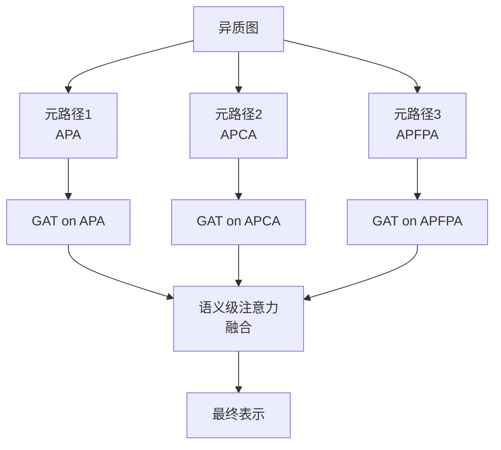
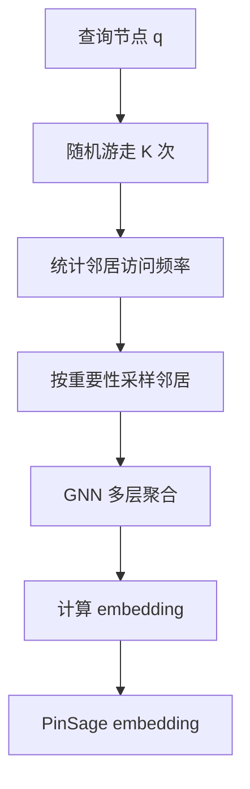

# 11.0 GNN 基础与谱方法 - 图神经网络全栈

> **GNN (Graph Neural Network)** 是建模"关系结构"数据的核心方法论。
> 从社交网络到推荐系统,从分子结构到交通路网,凡是节点 + 边构成的数据,都用得上 GNN。
> 本章给出从基础到工业落地的完整链路。

---

## 0. 一句话总结

**图神经网络 = 在"节点 + 边"结构数据上做表征学习;核心方法是"邻居聚合" (Spatial) 或"图信号滤波" (Spectral);代表模型有 GCN/GraphSAGE/GAT/GIN;工业落地有 PinSage/LightGCN 等;PyG/DGL 是主流框架。**

---

## 1. 为什么需要 GNN

### 1.1 现实世界的数据多是"图"

| 领域 | 节点 | 边 | 任务 |
|---|---|---|---|
| 社交网络 | 用户 | 好友关系 | 好友推荐 / 影响力预测 |
| 推荐系统 | 用户/物品 | 交互行为 | CTR 预估 / 序列推荐 |
| 分子化学 | 原子 | 化学键 | 分子性质预测 / 药物发现 |
| 交通路网 | 路口/路段 | 道路 | 流量预测 / 路径规划 |
| 知识图谱 | 实体 | 关系 | 链接预测 / 实体分类 |
| 引用网络 | 论文 | 引用 | 主题分类 / 引文推荐 |
| 3D 视觉 | 像素/点 | 邻接 | 形状分割 / 重建 |

### 1.2 为什么传统方法不够?

| 方法 | 问题 |
|---|---|
| MLP / 全连接 | 忽略图结构,把所有节点当独立向量 |
| CNN | 只能处理欧几里得数据 (图像),不能处理 irregular 的图 |
| RNN | 序列化处理,丢失并行性 + 长期依赖 |
| 随机游走 (DeepWalk) | 只用结构信息,无法融入节点特征 |
| 矩阵分解 | 限于无向简单图 |

**GNN 的核心优势**:
- 充分利用节点的拓扑结构
- 端到端学习,任务驱动
- 支持归纳式学习 (inductive),可以泛化到新节点

### 1.3 GNN 的统一抽象:消息传递 (Message Passing)

所有 GNN 都可以被表达为一个**消息传递** (Message Passing) 过程:

```math
\mathbf{h}_v^{(k+1)} = \text{UPDATE}^{(k)}\left( \mathbf{h}_v^{(k)}, \bigoplus_{u \in \mathcal{N}(v)} \text{MESSAGE}^{(k)}(\mathbf{h}_v^{(k)}, \mathbf{h}_u^{(k)}, \mathbf{e}_{vu}) \right)
```

其中:
- $h_v^{(k)}$: 节点 $v$ 在第 $k$ 层的表示
- $\mathcal{N}(v)$: 节点 $v$ 的邻居集合
- $\mathbf{e}_{vu}$: 边 $v \to u$ 的特征
- $\text{MESSAGE}$: 消息函数 (生成要传给邻居的向量)
- $\bigoplus$: 聚合算子 (sum / mean / max)
- $\text{UPDATE}$: 更新函数 (本节点聚合邻居消息后更新自己)

**3 大步 = 3 阶段**:
1. **Send**: 每个节点向邻居发"消息"
2. **Aggregate**: 邻居们把所有消息汇聚起来
3. **Update**: 当前节点结合自己的原状态和聚合结果,生成新状态

### 1.4 GNN 的发展简史

```text
2014 - Gori et al. 首次提出 GNN 概念
2016 - Kipf & Welling: GCN (简化 ChebNet)
2017 - Hamilton et al.: GraphSAGE (归纳式 + 邻居采样)
2017 - Velickovic et al.: GAT (注意力机制)
2018 - Xu et al.: GIN (理论上最强大, Weisfeiler-Lehman 测试)
2018 - Ying et al.: PinSage (工业级, Pinterest, 30 亿节点)
2020 - Wang et al.: HGT (异质图 Transformer)
2020 - He et al.: LightGCN (去掉冗余,推荐系统最强基准)
2021 - DeepMind: GraIL (归纳式知识图谱)
2022 - Open Graph Benchmark (OGB) 标准化评测
2023+ - GraphGPT, G-Retriever, 多模态 GNN
```

### 1.5 GNN 与推荐系统的强连接

GNN 在推荐中的价值:

| 场景 | GNN 解决的问题 |
|---|---|
| **协同过滤** | 建模 user-item-user 高阶关系 |
| **社交推荐** | 融合用户社交关系 |
| **序列推荐** | 行为序列本质是时序图 |
| **跨域推荐** | 异质图天然建模多域 |
| **可解释推荐** | 路径推理给出推荐理由 |
| **知识图谱推荐** | 物品属性推理 (KGNN-LS) |

**工业落地案例**:
- **Pinterest** → PinSage (KDD 2018 Best Paper)
- **Amazon** → GraphSAGE 改造版
- **美团** → 多任务图卷积 (MTGR 关联)
- **阿里** → 阿里妈妈 Graph Embedding
- **Google** → Graph Neural Network for YouTube (部分)

---

## 2. 图基础

### 2.1 图的定义

**有向图**: $\mathcal{G} = (\mathcal{V}, \mathcal{E})$,其中 $\mathcal{V}$ 是节点集, $\mathcal{E}$ 是有向边集。
**无向图**: 边没有方向,等价于双向的有向图。
**加权图**: 边上附带权重 $w_{ij}$。
**属性图**: 节点/边带有特征向量。

### 2.2 图的类型

| 类型 | 描述 | 例子 |
|---|---|---|
| **同质图 (Homogeneous)** | 节点类型 + 边类型都只有一种 | 引文网络、社交网络 |
| **异质图 (Heterogeneous)** | 节点/边有多种类型 | 学术网络 (作者/论文/会议) |
| **二部图 (Bipartite)** | 节点分两类,边只跨类 | 用户-物品交互 |
| **多关系图 (Multi-relational)** | 边有多种类型 | 知识图谱 |
| **动态图 (Dynamic)** | 节点/边会随时间变 | 时序社交网络 |
| **超图 (Hypergraph)** | 一条边可连多个节点 | 论文合著者关系 |
| **多维图 (Multiplex)** | 节点对之间有多条边 | 多重社交关系 |

### 2.3 邻接矩阵 (Adjacency Matrix)

$$\mathbf{A} \in \{0, 1\}^{n \times n}, \quad \mathbf{A}_{ij} = \begin{cases} 1 & \text{if } (v_i, v_j) \in \mathcal{E} \\ 0 & \text{otherwise} \end{cases}$$

- 无向图: $\mathbf{A}$ 对称, $\mathbf{A}_{ij} = \mathbf{A}_{ji}$
- 有向图: $\mathbf{A}_{ij} = 1$ 不等价于 $\mathbf{A}_{ji} = 1$
- 加权图: $\mathbf{A}_{ij} = w_{ij}$

**优点**: 数学表达清晰,易于向量化
**缺点**: 存储复杂度 $O(n^2)$,对大图不友好 (稀疏场景)

### 2.4 度矩阵 (Degree Matrix)

$$\mathbf{D}_{ii} = \sum_j \mathbf{A}_{ij}, \quad \mathbf{D}_{ij} = 0 \text{ for } i \neq j$$

即每个节点的"度"在对角线上,其他位置为 0。

**示例** (无向图):

```text
    0 -- 1
    |  / |
    | /  |
    2 -- 3

A = [[0, 1, 1, 0],   D = [[2, 0, 0, 0],
     [1, 0, 1, 1],        [0, 3, 0, 0],
     [1, 1, 0, 1],        [0, 0, 3, 0],
     [0, 1, 1, 0]]        [0, 0, 0, 2]]
```

### 2.5 拉普拉斯矩阵 (Laplacian Matrix)

**组合拉普拉斯** (Combinatorial Laplacian):
$$\mathbf{L} = \mathbf{D} - \mathbf{A}$$

**对称归一化拉普拉斯** (Symmetric Normalized Laplacian):
$$\mathbf{L}_{\text{sym}} = \mathbf{I} - \mathbf{D}^{-1/2} \mathbf{A} \mathbf{D}^{-1/2}$$

**随机游走归一化拉普拉斯** (Random Walk Normalized Laplacian):
$$\mathbf{L}_{\text{rw}} = \mathbf{I} - \mathbf{D}^{-1} \mathbf{A}$$

**性质**:
1. 半正定: $\mathbf{L} \succeq 0$
2. 对称 (无向图): $\mathbf{L} = \mathbf{L}^T$
3. 特征值 $\geq 0$,最小为 0,特征向量为常向量 $\mathbf{1}$
4. 行和为 0: $\mathbf{L} \mathbf{1} = \mathbf{0}$
5. 与图拉普拉斯算子 (连续情形) 同名,对应图上的"平滑度"度量

**物理意义**: 拉普拉斯矩阵测量"图信号"在不同节点间的平滑度 —— $\mathbf{x}^T \mathbf{L} \mathbf{x}$ 越小,说明信号 $\mathbf{x}$ 在相邻节点间越平滑。

### 2.6 图信号处理 (GSP) 基础

将节点特征 $\mathbf{x} \in \mathbb{R}^n$ 看做"图信号":

- **图傅里叶变换**: $\hat{\mathbf{x}} = \mathbf{U}^T \mathbf{x}$,其中 $\mathbf{L} = \mathbf{U} \Lambda \mathbf{U}^T$
- **卷积定理**: 频域相乘 = 时域卷积,故图卷积 = 频域乘积 + 图傅里叶变换
- **图滤波器**: $\mathbf{y} = \mathbf{U} g(\Lambda) \mathbf{U}^T \mathbf{x}$,$g(\cdot)$ 是频域滤波器

这就是**谱方法**的基础。下一节详细展开。

### 2.7 邻居表示

**直接邻居**: $\mathcal{N}(v) = \{u : (v, u) \in \mathcal{E}\}$

**k 跳邻居**: $k$ 层 BFS 后的可达节点

**采样邻居** (GraphSAGE 引入):
- 固定邻居数: 每次随机采样 $K$ 个邻居
- 重要性采样: 按权重采样

---

## 3. 谱方法

### 3.1 谱卷积定义

最早由 Bruna et al. (ICLR 2014) 提出,**图卷积**定义为:

$$\mathbf{H}^{(k+1)} = \sigma\left( \mathbf{U} g_\theta(\Lambda) \mathbf{U}^T \mathbf{H}^{(k)} \right)$$

其中:
- $\mathbf{H}^{(k)} \in \mathbb{R}^{n \times d}$: 第 $k$ 层的节点特征
- $\mathbf{U} \in \mathbb{R}^{n \times n}$: 拉普拉斯 $\mathbf{L}$ 的特征向量矩阵
- $\Lambda \in \mathbb{R}^{n \times n}$: 对应的特征值对角矩阵
- $g_\theta(\Lambda)$: 可学习的频域滤波器
- $\sigma$: 激活函数

**问题**:
- $\mathbf{U}$ 是 $n \times n$ 矩阵,需要 $O(n^3)$ 做特征值分解
- 每次前向传播都需要乘以 $\mathbf{U}$, $O(n^2)$ 时间复杂度
- **不适用于大图**
- 不能处理新节点 (不能 inductive)

### 3.2 ChebNet (Chebyshev Spectral CNN, NIPS 2016)

**Defferrard, Bresson, Vandergheynst** 提出用 **Chebyshev 多项式** 近似 $g_\theta(\Lambda)$,避免矩阵分解:

$$g_\theta(\Lambda) = \sum_{k=0}^{K} \theta_k T_k(\tilde{\Lambda})$$

其中:
- $\tilde{\Lambda} = \frac{2}{\lambda_{\max}} \Lambda - \mathbf{I}$: 归一化到 $[-1, 1]$
- $T_k$: Chebyshev 多项式,递推 $T_k(x) = 2x T_{k-1}(x) - T_{k-2}(x)$,且 $T_0 = 1, T_1 = x$
- $\theta_k$: 可学习参数

**卷积重写**:
$$\mathbf{y} = \mathbf{U} g_\theta(\Lambda) \mathbf{U}^T \mathbf{x} = \sum_{k=0}^{K} \theta_k T_k(\tilde{\mathbf{L}}) \mathbf{x}$$

其中 $\tilde{\mathbf{L}} = \frac{2}{\lambda_{\max}} \mathbf{L} - \mathbf{I}$。

**好处**:
- 不需要矩阵分解
- $K$ 阶 Chebyshev = 第 $K$ 跳邻居聚合
- 计算量 $O(K |\mathcal{E}|)$

### 3.3 GCN (Kipf & Welling, ICLR 2017)

**简化 ChebNet 到极致**: 取 $K = 1$,得到:

$$\mathbf{H}^{(k+1)} = \sigma\left( \tilde{\mathbf{D}}^{-1/2} \tilde{\mathbf{A}} \tilde{\mathbf{D}}^{-1/2} \mathbf{H}^{(k)} \mathbf{W}^{(k)} \right)$$

其中 $\tilde{\mathbf{A}} = \mathbf{A} + \mathbf{I}$ (加自环), $\tilde{\mathbf{D}}$ 是对应的度矩阵。

**逐元素看**:
$$h_i^{(k+1)} = \sigma\left( \sum_{j \in \mathcal{N}(i) \cup \{i\}} \frac{1}{\sqrt{\tilde{d}_i \tilde{d}_j}} \mathbf{W}^{(k)} h_j^{(k)} \right)$$

| 优势 | 描述 |
|---|---|
| 简洁优雅 | 一行公式,实现简单 |
| 空间高效 | 邻居聚合不需要存整张图 |
| 时间高效 | $O(\|\mathcal{E}\|)$ per layer |
| 经验效果 | 大多数节点分类任务 SOTA |
| 实现友好 | PyTorch 几行代码搞定 |

| 局限 | 描述 |
|---|---|
| Transductive | 需要全图 forward,新节点要重训 |
| 过平滑 (Over-smoothing) | 多层后节点表征趋同 |
| 不能处理异质图 | 单一类型 |
| 假设太强 | 邻居等权重 |

**PyTorch 实现**:

```python
import torch
import torch.nn as nn
import torch.nn.functional as F

def normalize_adj(adj: torch.Tensor) -> torch.Tensor:
    """对称归一化邻接矩阵: D^{-1/2} A D^{-1/2}"""
    A_hat = adj + torch.eye(adj.size(0), device=adj.device)  # 加自环
    D = A_hat.sum(dim=1)
    D_inv_sqrt = torch.diag(D.pow(-0.5))
    return D_inv_sqrt @ A_hat @ D_inv_sqrt

class GCNLayer(nn.Module):
    """单层 GCN: H' = sigma(D^{-1/2} A D^{-1/2} H W)"""
    def __init__(self, in_features: int, out_features: int):
        super().__init__()
        self.weight = nn.Parameter(torch.empty(in_features, out_features))
        self.bias = nn.Parameter(torch.zeros(out_features))
        nn.init.xavier_uniform_(self.weight)

    def forward(self, H: torch.Tensor, A_norm: torch.Tensor) -> torch.Tensor:
        support = H @ self.weight  # [N, out]
        output = A_norm @ support  # 邻居聚合
        return output + self.bias

class GCN(nn.Module):
    """2 层 GCN, 用于节点分类"""
    def __init__(self, in_features: int, hidden_features: int,
                 out_features: int, dropout: float = 0.5):
        super().__init__()
        self.layer1 = GCNLayer(in_features, hidden_features)
        self.layer2 = GCNLayer(hidden_features, out_features)
        self.dropout = dropout

    def forward(self, x: torch.Tensor, A_norm: torch.Tensor) -> torch.Tensor:
        h = F.relu(self.layer1(x, A_norm))
        h = F.dropout(h, p=self.dropout, training=self.training)
        return F.log_softmax(self.layer2(h, A_norm), dim=1)
```

### 3.4 GCN 与多种方法的关系 (理论视角)

**视角 1: 一阶近似 ChebNet**

GCN 是 ChebNet 在 $K = 1$ 时的极限,且做了参数化:

$$\text{GCN} \propto (\mathbf{D}^{-1/2} \mathbf{A} \mathbf{D}^{-1/2})^K \mathbf{X} \mathbf{W}$$

**视角 2: 拉普拉斯平滑**

GCN 第 1 层相当于对节点特征做"图拉普拉斯平滑":

$$\mathbf{H}' = \mathbf{D}^{-1/2} \mathbf{A} \mathbf{D}^{-1/2} \mathbf{H} \cdot \mathbf{W} \approx \mathbf{H} \cdot \mathbf{W} - \alpha \mathbf{L}_{\text{sym}} \mathbf{H} \cdot \mathbf{W}$$

其中 $\alpha$ 与 $\lambda_{\max}$ 相关。这是为什么 **GCN 多层后会过平滑** —— 等于在图上反复扩散特征,最终所有节点趋向一致。

**视角 3: 节点 PageRank**

把 GCN 看做传播个人化 PageRank (personalized PageRank) 的可微形式。

---

## 4. 空域方法

### 4.1 为什么需要空域方法?

谱方法依赖全图拉普拉斯分解,**难以扩展到大图**。空域方法直接在邻居上聚合,**天然适合大图**和**归纳式学习**。

### 4.2 GraphSAGE (Hamilton et al., NeurIPS 2017)

**核心思想**: 学习一个**聚合函数**,而不是为每个节点学习 embedding。给出新节点的特征和邻居,可以立即生成 embedding —— 即 **inductive learning**。

**3 步流程**:
1. **邻居采样**: 每层固定采样 $K$ 个邻居 (控制计算量)
2. **邻居聚合**: 用聚合函数 (mean / LSTM / pool) 聚合邻居特征
3. **节点更新**: 拼接自己的特征和聚合特征,过 MLP 更新

**形式化**:

```math
\mathbf{h}_{\mathcal{N}(v)}^k = \text{AGGREGATE}_k\left( \{ \mathbf{h}_u^{k-1}, \forall u \in \mathcal{N}(v) \} \right)
```

```math
\mathbf{h}_v^k = \sigma\left( \mathbf{W}^k \cdot [\mathbf{h}_v^{k-1} \| \mathbf{h}_{\mathcal{N}(v)}^k] \right)
```

其中 $\|\cdot\|$ 是拼接, $\mathbf{W}^k$ 是可学习参数。

**3 种聚合器**:

| 聚合器 | 公式 | 特点 |
|---|---|---|
| **Mean** | $\text{AGG} = \sigma(\text{MEAN}(\{\mathbf{W}\mathbf{h}_u, \forall u \in \mathcal{N}(v)\}))$ | 简单,等价于 GCN |
| **Pool** | $\text{AGG} = \max(\{\sigma(\mathbf{W}\mathbf{h}_u + \mathbf{b}), \forall u \in \mathcal{N}(v)\})$ | 表达力更强 |
| **LSTM** | $\text{AGG} = \text{LSTM}(\{\mathbf{h}_u, \forall u \in \pi(\mathcal{N}(v))\})$ | 表达力最强,但依赖顺序 |

**PyTorch 实现**:

```python
import torch
import torch.nn as nn
import torch.nn.functional as F

class SAGELayer(nn.Module):
    """单层 GraphSAGE"""
    def __init__(self, in_features: int, out_features: int, aggr: str = 'mean'):
        super().__init__()
        self.aggr = aggr
        self.linear = nn.Linear(in_features * 2, out_features)

    def forward(self, x: torch.Tensor, edge_index: torch.Tensor) -> torch.Tensor:
        # x: [N, in_features], edge_index: [2, E]
        src, dst = edge_index[0], edge_index[1]
        # 聚合: dst 是目标节点, src 是它的邻居
        msg = x[src]  # [E, in_features]
        # 按 dst 聚合消息
        agg = torch.zeros(x.size(0), x.size(1), device=x.device)
        agg = agg.index_add_(0, dst, msg)
        deg = torch.zeros(x.size(0), device=x.device)
        deg = deg.index_add_(0, dst, torch.ones_like(dst, dtype=torch.float))
        deg = deg.clamp(min=1).unsqueeze(-1)
        agg = agg / deg  # 均值
        # 拼接 + 线性映射
        out = self.linear(torch.cat([x, agg], dim=1))
        return F.relu(out)

class GraphSAGE(nn.Module):
    """2 层 GraphSAGE"""
    def __init__(self, in_features: int, hidden: int, out: int):
        super().__init__()
        self.sage1 = SAGELayer(in_features, hidden, aggr='mean')
        self.sage2 = SAGELayer(hidden, out, aggr='mean')

    def forward(self, x, edge_index):
        h = self.sage1(x, edge_index)
        return self.sage2(h, edge_index)
```

**GraphSAGE 的工业版本**: PinSage (Pinterest),见第 7 节。

### 4.3 GAT (Graph Attention Networks, Velickovic et al., ICLR 2018)

**动机**: GCN 把所有邻居一视同仁,但实际上有些邻居更重要。**用注意力机制学习邻居权重**。

**单头注意力**:

```math
e_{ij} = \text{LeakyReLU}\left( \mathbf{a}^T [\mathbf{W}\mathbf{h}_i \| \mathbf{W}\mathbf{h}_j] \right)
```

```math
\alpha_{ij} = \frac{\exp(e_{ij})}{\sum_{k \in \mathcal{N}(i)} \exp(e_{ik})}
```

```math
\mathbf{h}_i' = \sigma\left( \sum_{j \in \mathcal{N}(i)} \alpha_{ij} \mathbf{W} \mathbf{h}_j \right)
```

**多头拼接**:

```math
\mathbf{h}_i' = \big\|_{m=1}^M \sigma\left( \sum_{j \in \mathcal{N}(i)} \alpha_{ij}^m \mathbf{W}^m \mathbf{h}_j \right)
```

最后一层多头取均值而非拼接。

**可视化注意力**:
GAT 学到的 $\alpha_{ij}$ 可视化成边权重,提供**可解释性**。

**PyTorch 实现**:

```python
class GATLayer(nn.Module):
    """单层 GAT with 单头"""
    def __init__(self, in_features: int, out_features: int, alpha: float = 0.2):
        super().__init__()
        self.W = nn.Linear(in_features, out_features, bias=False)
        self.a = nn.Linear(out_features * 2, 1, bias=False)
        self.leakyrelu = nn.LeakyReLU(alpha)

    def forward(self, h: torch.Tensor, edge_index: torch.Tensor) -> torch.Tensor:
        # h: [N, in_features], edge_index: [2, E]
        Wh = self.W(h)  # [N, out_features]
        src, dst = edge_index[0], edge_index[1]
        # 计算 attention score
        Wh_src = Wh[src]  # [E, out]
        Wh_dst = Wh[dst]  # [E, out]
        attn_input = torch.cat([Wh_src, Wh_dst], dim=1)  # [E, 2*out]
        e = self.leakyrelu(self.a(attn_input)).squeeze(-1)  # [E]
        # softmax over destination's neighbors
        # 简单实现: 用 segment softmax
        attn = torch.zeros(edge_index.size(1), device=h.device)
        attn = attn.index_add_(0, dst, e)
        attn = torch.exp(e - attn[dst])  # 没做严格 softmax,简化
        # 加权聚合
        out = torch.zeros(h.size(0), Wh.size(1), device=h.device)
        weighted_msg = Wh_src * attn.unsqueeze(-1)
        out = out.index_add_(0, dst, weighted_msg)
        return F.elu(out)

class GAT(nn.Module):
    """2 层 GAT (多头)"""
    def __init__(self, in_features: int, hidden: int, out: int,
                 heads: int = 8):
        super().__init__()
        self.gat1 = GATLayer(in_features, hidden)
        self.gat2 = GATLayer(hidden, out)

    def forward(self, x, edge_index):
        h = F.elu(self.gat1(x, edge_index))
        return F.softmax(self.gat2(h, edge_index), dim=1)
```

### 4.4 GIN (Graph Isomorphism Network, Xu et al., ICLR 2019)

**理论最强**: GIN 是理论上**最强大**的 GNN,可证明区分任何可被 Weisfeiler-Lehman 测试区分的图结构。

**公式**:

$$\mathbf{h}_v^{(k+1)} = \text{MLP}^{(k)}\left( (1 + \epsilon^{(k)}) \mathbf{h}_v^{(k)} + \sum_{u \in \mathcal{N}(v)} \mathbf{h}_u^{(k)} \right)$$

其中 $\epsilon$ 是可学习参数或固定常数。

**为什么这样设计?**

若忽略 MLP 和 $\epsilon$,这就是一个聚合函数 sum,理论上最强大的聚合器 (因为 sum 是 injective)。

$\epsilon \neq 0$ 保证自环信息不被淹没。

**PyTorch 实现**:

```python
class GINLayer(nn.Module):
    """单层 GIN"""
    def __init__(self, in_features: int, out_features: int, eps: float = 0.0, train_eps: bool = False):
        super().__init__()
        self.mlp = nn.Sequential(
            nn.Linear(in_features, out_features),
            nn.BatchNorm1d(out_features),
            nn.ReLU(),
            nn.Linear(out_features, out_features),
        )
        if train_eps:
            self.eps = nn.Parameter(torch.tensor(eps))
        else:
            self.eps = eps

    def forward(self, x: torch.Tensor, edge_index: torch.Tensor) -> torch.Tensor:
        src, dst = edge_index[0], edge_index[1]
        # 聚合: sum
        agg = torch.zeros_like(x)
        agg = agg.index_add_(0, dst, x[src])
        # 自信息
        out = (1 + self.eps) * x + agg
        return self.mlp(out)

class GIN(nn.Module):
    """3 层 GIN, 用于图分类"""
    def __init__(self, in_features: int, hidden: int, out: int):
        super().__init__()
        self.gin1 = GINLayer(in_features, hidden)
        self.gin2 = GINLayer(hidden, hidden)
        self.gin3 = GINLayer(hidden, hidden)
        self.readout = nn.Linear(hidden, out)

    def forward(self, x, edge_index, batch):
        h = F.relu(self.gin1(x, edge_index))
        h = F.relu(self.gin2(h, edge_index))
        h = F.relu(self.gin3(h, edge_index))
        # graph-level readout: sum over nodes
        from torch_geometric.utils import to_dense_batch
        h, mask = to_dense_batch(h, batch)
        graph_h = h.sum(dim=1)  # [B, hidden]
        return self.readout(graph_h)
```

### 4.5 三种主流 GNN 对比

| 维度 | GCN | GraphSAGE | GAT | GIN |
|---|---|---|---|---|
| 邻居权重 | 固定 (度倒数) | 固定 (mean) | **学习得到** | sum (等权) |
| 归纳式 | ✗ | ✓ | ✓ | ✓ |
| 理论保证 | 弱 | 弱 | 弱 | **强 (WL 测试等价)** |
| 大图支持 | 弱 | **强** | 强 | 强 |
| 计算复杂度 | $O(\|\mathcal{E}\| d)$ | $O(K^L \|\mathcal{E}\| d)$ | $O(\|\mathcal{E}\| d \cdot H)$ | $O(\|\mathcal{E}\| d)$ |
| 推荐系统 | LightGCN 来源 | PinSage | 多用 | 弱 |
| 工业首选度 | ★★★ | ★★★★ | ★★★★ | ★★★ |

### 4.6 其他空域变体

**SGC (Simplified GCN, ICML 2019)**: 去掉 GCN 的非线性,只留线性变换 + 多层邻居聚合,极快且效果不错。

**APPNP (ICLR 2019)**: 用 Personalized PageRank 替代普通邻居聚合,缓解过平滑。

**GCNII (ICML 2020)**: 加入初始残差 + 恒等映射,可堆 100+ 层不降效。

**GATv2 (2021)**: 改进 GAT 注意力,对 attention logits 做不同变换,效果更稳定。

---

## 5. 异质图

### 5.1 什么是异质图 (Heterogeneous Graph)

异质图包含 **多种节点类型** 和 **多种边类型**。例如学术网络:
- 节点类型: 作者 (A)、论文 (P)、会议 (C)、领域 (F)
- 边类型: 作者-撰写-论文、论文-发表-会议、论文-属于-领域

元路径 (Meta-path) 是连接多个类型节点的关系序列。例: 作者-论文-作者 (APA) = 合作者; 作者-论文-会议-论文-作者 (APCPA) = 同一会议作者。

### 5.2 HAN (Heterogeneous Graph Attention Network, Wang et al., WWW 2019)

**核心思想**: 通过**元路径**把异质图转为多个同质图,每个同质图单独做 GAT,最后融合。



**节点级注意力**: 同 GAT,对元路径下的邻居加权。
**语义级注意力**: 对多个元路径的结果,用注意力加权融合。

### 5.3 HGT (Heterogeneous Graph Transformer, Hu et al., WWW 2020)

**核心思想**: 把 Transformer 完整搬到异质图上,**不依赖元路径**,通过相对位置编码和类型感知注意力处理异质性。

**架构组件**:

1. **类型相关的参数矩阵**: 每种类型的节点/边有自己的 W_Q, W_K, W_V
2. **相对位置编码 (RPE)**: 边类型 $\tau(s, v)$ 作为相对位置信号
3. **多头注意力**: $H$ 个头独立学习不同子空间

```math
\text{Attention}(s, v) = \text{Softmax}\left( \frac{(K_v W_{\tau(s,v)}^R) \odot (Q_s W_{\tau(s,v)}^{RQ})^T + w_{\tau(s,v)}^{RS}}{\sqrt{d}} \right) \cdot V_v
```

其中:
- $\tau(s, v)$: 边类型
- $W^R$: 边类型相关矩阵
- $w^{RS}$: 边类型相关的偏置

**优点**:
- 不需要预先定义元路径
- 用类型信息作为归纳偏置
- 大规模图上效果好 (OGBN-MAG SOTA)

### 5.4 HetGNN (Zhang et al., WSDM 2019)

**核心思想**:
1. 用 random walk with restart 采样每个节点的异质邻居
2. 用 Bi-LSTM 编码同类型邻居
3. 用 attention 融合不同类型邻居
4. 输出异质节点嵌入

**与 HAN 对比**:

| 维度 | HAN | HGT | HetGNN |
|---|---|---|---|
| 元路径 | 必须 | 不需要 | 隐式 (random walk) |
| 邻居采样 | 1 跳 | 全图 (mini-batch) | random walk |
| 聚合方式 | GAT + 注意力 | 异质 Transformer | Bi-LSTM + attention |
| 可扩展性 | 中 | 大图 | 中 |
| 性能 | 中 | **强** | 中 |

### 5.5 工业落地推荐

| 模型 | 公司 | 场景 | 关键创新 |
|---|---|---|---|
| **PinSage** | Pinterest | 物品图 (image pins) | 短随机游走 + importance pooling |
| **GraphSAGE** | Uber | 欺诈检测 | 邻居采样 + mean 聚合 |
| **HGT** | 微软学术 | 学术搜索 | 异质 Transformer + RPE |
| **RGCN** | 多家公司 | KG 补全 | 关系特定卷积 |
| **HAN** | 京东/美团 | 电商图 | 元路径 + 双层注意力 |
| **HetGNN** | 阿里/腾讯 | 用户-物品图 | random walk + BiLSTM |

---

## 6. 知识图谱

### 6.1 知识图谱定义

知识图谱 (KG) = 实体 + 关系 + 三元组 (head, relation, tail)
- 例: (北京, 是首都, 中国)
- 例: (爱因斯坦, 出生于, 德国)
- 例: (苹果, 创始人, 乔布斯)

KG 嵌入 (KGE) 目标: 把实体和关系都映射到向量空间,使 $f(h, r, t)$ 最大化正样本、最小化负样本。

### 6.2 TransE (Bordes et al., NeurIPS 2013)

**核心思想**: $h + r \approx t$,即头实体 + 关系 ≈ 尾实体。

```math
\mathcal{L} = \sum_{(h, r, t) \in \mathcal{T}} \sum_{(h', r, t') \in \mathcal{T}^-} \max(0, \gamma + d(h + r, t) - d(h' + r, t'))
```

其中 $d$ 是距离函数 (通常 L1 或 L2), $\mathcal{T}^-$ 是负样本。

**优点**: 简单,运算快
**缺点**:
- 不能处理 1-N, N-1, N-N 关系
- 不能处理对称关系 (因为 $h + r = t$ 但 $h - r = t$ 也成立)
- 不能处理反演关系

### 6.3 TransR (Lin et al., AAAI 2015)

**动机**: 实体和关系语义空间不同。TransE 把所有东西映射到一个空间,TransR 把每个关系 $r$ 看作一个"投影矩阵" $\mathbf{M}_r$,把实体投影到关系空间:

```math
\mathbf{h}_r = \mathbf{M}_r \mathbf{h}, \quad \mathbf{t}_r = \mathbf{M}_r \mathbf{t}
```

```math
d(h, r, t) = \| \mathbf{h}_r + \mathbf{r} - \mathbf{t}_r \|_2^2
```

**优点**: 处理多关系更灵活
**缺点**: $O(n_d^2)$ 投影,参数量大

### 6.4 RotatE (Sun et al., ICLR 2019)

**核心思想**: 把关系建模为**复数空间中的旋转**,即 $t = h \circ r$,其中 $\circ$ 是元素级乘积 (Hadamard)。

```math
\mathbf{t} = \mathbf{h} \circ \mathbf{r}
```

约束 $|r_i| = 1$,即每个关系分量是单位复数。

**理论优势**: RotatE 是**唯一能同时建模**:
- 对称关系: $r = -1$ (反旋转)
- 反演关系: $r = 1$ (恒等)
- 组合关系: $r_1 + r_2 = r_3$ (传递)

```math
d(h, r, t) = -\| \mathbf{h} \circ \mathbf{r} - \mathbf{t} \|
```

**实现要点**: 用复数张量 (real + imag),优化器 + negative sampling。

### 6.5 其他 KGE 模型

| 模型 | 核心思想 | 优势 |
|---|---|---|
| **DistMult** | 双线性 $h^T \text{diag}(r) t$ | 简单,对称关系 |
| **ComplEx** | 复数双线性 | 对称 + 反对称 |
| **ConvE** | Conv over 2D 拼接 | 非线性表达力强 |
| **TuckER** | Tucker 分解 $W \times_r h \times_r t$ | 理论优雅 |
| **QuatE** | 四元数 | RotatE 的扩展,更多表达力 |

### 6.6 KG + 推荐系统

**KGNN-LS (Wang et al., KDD 2019)**:
- KG 提供物品的"语义邻域" (同品类、同属性)
- 用 GNN 沿 KG 边传播,获得知识感知的物品嵌入
- 与协同过滤信号融合,得到个性化推荐

**RippleNet (Wang et al., CIKM 2018)**:
- 沿 KG 多跳展开"偏好传播" (ripples)
- 类似 RippleNet 的偏好种子 → 偏好扩散
- 自动挖掘高阶偏好

---

## 7. 推荐系统应用

### 7.1 PinSage (Ying et al., KDD 2018) ⭐ 工业界 GNN 标杆

**场景**: Pinterest 的图片推荐,30 亿个 pin (物品),180 亿条边。

**核心创新**:

1. **短随机游走 (Short Random Walks)**: 每个节点产生固定数量的多跳游走序列,作为"重要性"度量
2. **重要性池化 (Importance Pooling)**: 用游走频率作为权重,聚合时重点关注高频邻居
3. **高效负采样**: 用随机游走得到的 hard negative 比纯随机更好
4. **多 GPU 训练**: 30 亿节点的工业级部署



**论文亮点**:
- KDD 2018 Best Paper
- 第一个把 GNN 真正部署到亿级图的工业实现
- Hit Rate 提升 150% over 传统 CF (工业内部指标)

### 7.2 PinSage 实现

```python
import torch
import torch.nn as nn
import torch.nn.functional as F

class PinSageLayer(nn.Module):
    """PinSage 单层: 加权聚合 + 拼接更新"""
    def __init__(self, in_features: int, out_features: int):
        super().__init__()
        self.linear = nn.Linear(in_features, out_features)
        # 重要性池化: 用 1 维特征 + 1 维学习参数
        self.importance = nn.Parameter(torch.tensor(1.0))

    def forward(self, x: torch.Tensor, edge_index: torch.Tensor,
                edge_weight: torch.Tensor) -> torch.Tensor:
        """
        x: [N, in_features]
        edge_index: [2, E]
        edge_weight: [E], 重要性权重 (例如游走频率倒数, 或可学习)
        """
        src, dst = edge_index[0], edge_index[1]
        # 邻居消息 (按 weight 加权)
        msg = x[src] * edge_weight.unsqueeze(-1)
        # 目标端聚合
        agg = torch.zeros(x.size(0), x.size(1), device=x.device)
        agg = agg.index_add_(0, dst, msg)
        # 归一化: 节点的度数
        deg = torch.zeros(x.size(0), device=x.device)
        deg = deg.index_add_(0, dst, torch.ones_like(dst, dtype=torch.float))
        deg = deg.clamp(min=1).unsqueeze(-1)
        agg = agg / deg
        # 拼接 + 线性 + ReLU
        out = self.linear(torch.cat([x, agg], dim=1))
        return F.relu(out)

class PinSage(nn.Module):
    """PinSage 多层"""
    def __init__(self, in_features: int, hidden: int, out: int, num_layers: int = 2):
        super().__init__()
        self.layers = nn.ModuleList()
        self.layers.append(PinSageLayer(in_features * 2, hidden))
        for _ in range(num_layers - 2):
            self.layers.append(PinSageLayer(hidden * 2, hidden))
        self.layers.append(PinSageLayer(hidden * 2, out))

    def forward(self, x, edge_index, edge_weight):
        h = x
        for layer in self.layers:
            h = layer(h, edge_index, edge_weight)
        # L2 normalize 用于 cosine similarity
        return F.normalize(h, dim=1)
```

### 7.3 LightGCN (He et al., SIGIR 2020) ⭐ 推荐系统 SOTA 基准

**问题**: GCN 用于推荐时,特征变换 $\mathbf{W}$ 和激活 $\sigma$ **可能是不必要的复杂度**。LightGCN 验证: **去掉它们,效果反而更好**。

**公式**:

```math
\mathbf{H}^{(k+1)} = \mathbf{D}^{-1/2} \mathbf{A} \mathbf{D}^{-1/2} \mathbf{H}^{(k)}
```

```math
\mathbf{e}_u = \sum_{k=0}^{K} \alpha_k \mathbf{h}_u^{(k)}
```

其中 $\alpha_k$ 通常取 $1/(K+1)$ (均匀加权)。

**结论**: LightGCN 把 GCN 退化到"邻居嵌入平均",反而在推荐上最强。

```python
class LightGCNLayer(nn.Module):
    """LightGCN 单层: 无变换、无激活, 仅邻接归一化"""
    def __init__(self):
        super().__init__()

    def forward(self, x: torch.Tensor, A_norm: torch.Tensor) -> torch.Tensor:
        return A_norm @ x  # 仅线性传播

class LightGCN(nn.Module):
    """LightGCN 多层"""
    def __init__(self, num_users: int, num_items: int, emb_dim: int,
                 num_layers: int = 3):
        super().__init__()
        self.user_emb = nn.Embedding(num_users, emb_dim)
        self.item_emb = nn.Embedding(num_items, emb_dim)
        nn.init.xavier_uniform_(self.user_emb.weight)
        nn.init.xavier_uniform_(self.item_emb.weight)
        self.num_layers = num_layers
        self.convs = nn.ModuleList([LightGCNLayer() for _ in range(num_layers)])

    def get_embedding(self, A_norm: torch.Tensor):
        all_emb = torch.cat([self.user_emb.weight, self.item_emb.weight], dim=0)
        emb_list = [all_emb]
        h = all_emb
        for conv in self.convs:
            h = conv(h, A_norm)
            emb_list.append(h)
        # LightGCN: 取均值
        return torch.stack(emb_list, dim=0).mean(dim=0)

    def forward(self, users: torch.Tensor, items: torch.Tensor,
                A_norm: torch.Tensor):
        all_emb = self.get_embedding(A_norm)
        u_emb, i_emb = torch.split(all_emb, [self.user_emb.num_embeddings,
                                              self.item_emb.num_embeddings], dim=0)
        u = u_emb[users]
        i = i_emb[items]
        # BPR loss
        return (u * i).sum(dim=1)
```

**LightGCN 在 5 个数据集上超过 NGCF (更复杂的 GCN)**,成为推荐系统的强基线。

### 7.4 KGNN-LS 知识图谱推荐 (Wang et al., 2019)

```python
class KGNNLSLayer(nn.Module):
    """KGNN-LS: 知识图谱 + 用户特定邻居采样"""
    def __init__(self, in_features: int, out_features: int):
        super().__init__()
        self.linear = nn.Linear(in_features * 2, out_features)

    def forward(self, item_emb: torch.Tensor, kg_edge_index: torch.Tensor,
                user_attention: torch.Tensor) -> torch.Tensor:
        """
        item_emb: [n_items, in_features]
        kg_edge_index: [2, E_kg], 知识图谱边
        user_attention: [n_users, n_items], 用户-物品偏好 (用于邻居采样)
        """
        src, dst = kg_edge_index[0], kg_edge_index[1]
        # 邻居聚合 (按用户-物品偏好加权)
        msg = item_emb[src]
        # 按用户特定权重
        weighted_msg = msg * user_attention[:, dst].T.unsqueeze(-1)
        agg = torch.zeros_like(item_emb)
        agg = agg.index_add_(0, dst, weighted_msg)
        return F.relu(self.linear(torch.cat([item_emb, agg], dim=1)))
```

### 7.5 其他推荐系统 GNN

| 模型 | 场景 | 关键点 |
|---|---|---|
| **NGCF** | 协同过滤 | 加入 user-item 消息传递 |
| **GCC** | 自监督 | 图对比学习 |
| **KGNN-LS** | KG 推荐 | 用户个性化 KG 邻居 |
| **GraphRec** | 社交推荐 | 用户-物品二分图 + 社交图 |
| **SR-GNN** | 序列推荐 | 会话图 + attention |
| **MTGR** | 多任务 (美团) | GNN + 多任务学习 |

---

## 8. PyTorch Geometric (PyG)

### 8.1 PyG 简介

**PyTorch Geometric (PyG)** 是目前最流行的 GNN 框架:
- 官方: [https://pytorch-geometric.readthedocs.io](https://pytorch-geometric.readthedocs.io)
- GitHub: [github.com/pyg-team/pytorch_geometric](https://github.com/pyg-team/pytorch_geometric)
- 特点: 轻量、GPU 友好、和 PyTorch 无缝集成
- 与之竞争的是 **DGL** (Deep Graph Library)

### 8.2 核心数据结构

PyG 用 `torch_geometric.data.Data` 表示一个图:

```python
from torch_geometric.data import Data

# 节点特征 [N, num_features]
x = torch.tensor([[0, 0], [1, 1], [2, 2]], dtype=torch.float)

# 边索引 [2, num_edges]
edge_index = torch.tensor([[0, 1, 1, 2, 2, 0],
                            [1, 0, 2, 1, 0, 2]], dtype=torch.long)

# 构造图
data = Data(x=x, edge_index=edge_index)

# 自检
print(data)
# Data(x=[3, 2], edge_index=[2, 6])

print(data.num_nodes, data.num_edges, data.num_features)
# 3 6 2
```

**视觉化**:

```text
3 节点, x 特征:
[0, 0]   [1, 1]   [2, 2]
 0 -------- 1 -------- 2
  \--------|         /
   \-------|--------/
```

### 8.3 内置 GNN 层

```python
import torch_geometric.nn as gnn

# GCN
conv = gnn.GCNConv(in_channels, out_channels)

# GraphSAGE
conv = gnn.SAGEConv(in_channels, out_channels, aggr='mean')

# GAT
conv = gnn.GATConv(in_channels, out_heads, out_channels)

# GIN
conv = gnn.GINConv(nn=nn.Sequential(nn.Linear(in_channels, out_channels),
                                     nn.ReLU()))

# ChebNet
conv = gnn.ChebConv(in_channels, out_channels, K=2)

# 异质
conv = gnn.HGTConv(in_channels, out_channels, metadata)
```

### 8.4 完整 GCN 训练示例 (Cora 数据集)

```python
import torch
import torch.nn.functional as F
from torch_geometric.nn import GCNConv
from torch_geometric.datasets import Planetoid

# 加载数据
dataset = Planetoid(root='/tmp/Cora', name='Cora')
data = dataset[0]
print(f"Dataset: {dataset.name}")
print(f"  Nodes: {data.num_nodes}, Edges: {data.num_edges}, "
      f"Features: {data.num_node_features}, Classes: {dataset.num_classes}")

# 模型
class GCN(torch.nn.Module):
    def __init__(self, in_channels: int, hidden: int, out_channels: int):
        super().__init__()
        self.conv1 = GCNConv(in_channels, hidden)
        self.conv2 = GCNConv(hidden, out_channels)
        self.dropout = 0.5

    def forward(self, x, edge_index):
        h = F.relu(self.conv1(x, edge_index))
        h = F.dropout(h, p=self.dropout, training=self.training)
        return self.conv2(h, edge_index)

device = torch.device('cuda' if torch.cuda.is_available() else 'cpu')
model = GCN(dataset.num_node_features, 16, dataset.num_classes).to(device)
data = data.to(device)
optimizer = torch.optim.Adam(model.parameters(), lr=0.01, weight_decay=5e-4)

# 训练
for epoch in range(200):
    model.train()
    optimizer.zero_grad()
    out = model(data.x, data.edge_index)
    loss = F.cross_entropy(out[data.train_mask], data.y[data.train_mask])
    loss.backward()
    optimizer.step()

    if epoch % 10 == 0:
        model.eval()
        pred = model(data.x, data.edge_index).argmax(dim=1)
        correct = (pred[data.test_mask] == data.y[data.test_mask]).sum()
        acc = int(correct) / int(data.test_mask.sum())
        print(f"Epoch {epoch:03d}: loss {loss:.4f}, test acc {acc:.4f}")
```

### 8.5 异质图 in PyG

```python
from torch_geometric.data import HeteroData

data = HeteroData()

# 节点特征
data['user'].x = torch.randn(num_users, 32)
data['item'].x = torch.randn(num_items, 64)

# 边
data['user', 'clicks', 'item'].edge_index = torch.tensor([[0, 1, 2],
                                                            [3, 4, 5]])
data['item', 'belongs_to', 'category'].edge_index = ...

# 异质 GCN
from torch_geometric.nn import HeteroConv, SAGEConv

class HetGNN(torch.nn.Module):
    def __init__(self, metadata, hidden=32):
        super().__init__()
        self.conv1 = HeteroConv({
            ('user', 'clicks', 'item'): SAGEConv((-1, -1), hidden),
            ('item', 'belongs_to', 'category'): SAGEConv((-1, -1), hidden),
        }, aggr='sum')

    def forward(self, x_dict, edge_index_dict):
        return self.conv1(x_dict, edge_index_dict)
```

### 8.6 邻居采样 (Neighbor Sampling)

```python
from torch_geometric.loader import NeighborLoader

# mini-batch 训练: 对每个目标节点, 采样固定数量邻居
loader = NeighborLoader(
    data,
    num_neighbors=[10, 5],   # 每层采样数
    batch_size=128,
    input_nodes=data.train_mask,
)

for batch in loader:
    # batch 是 mini-batch 的子图
    out = model(batch.x, batch.edge_index)
    loss = F.cross_entropy(out, batch.y[:batch.batch_size])
    loss.backward()
```

### 8.7 知识图谱 (PyG + PyKEEN)

```python
import torch
from torch_geometric.data import Data
from torch_geometric.nn import TransE, RotatE

# TransE: 模型 + 损失 + 训练
model = TransE(num_entities=1000, num_relations=10, hidden_channels=64)
loader = torch_geometric.loader.KGLinkLoader(...)

# 训练循环
for batch in loader:
    head, rel, tail = batch['head'], batch['relation'], batch['tail']
    pos_score = model(head, rel, tail)
    neg_score = model(head, rel, neg_tail)
    loss = (pos_score - neg_score).clamp(min=0).mean()
    loss.backward()
```

### 8.8 常用数据集 (PyG 内置)

| 数据集 | 节点 | 边 | 类型 | 任务 |
|---|---|---|---|---|
| Cora | 2708 | 5429 | 同质 | 节点分类 |
| CiteSeer | 3327 | 4552 | 同质 | 节点分类 |
| PubMed | 19717 | 44324 | 同质 | 节点分类 |
| Reddit | 232K | 11.6M | 同质 | 节点分类 |
| OGB-Arxiv | 169K | 1.16M | 同质 | 节点分类 |
| OGB-Products | 2.4M | 62M | 同质 | 节点分类 |
| OGB-MAG | 1.9M | 21M | **异质** | 节点分类 |
| Amazon | 11K-1.3M | 4M+ | 二部 | 推荐 |
| MovieLens | 1K-20M | 4M+ | 二部 | 推荐 |

---

## 9. 实现案例

### 9.1 案例:节点分类 (Cora)

见 8.4 节。`GCNConv` + Cora 通常可达 ~81% test accuracy。

### 9.2 案例:图分类 (PROTEINS)

```python
import torch
from torch_geometric.datasets import TUDataset
from torch_geometric.loader import DataLoader
from torch_geometric.nn import GINConv, global_add_pool

dataset = TUDataset(root='/tmp/PROTEINS', name='PROTEINS')
loader = DataLoader(dataset, batch_size=32, shuffle=True)

class GIN_GraphClassifier(torch.nn.Module):
    def __init__(self, in_dim, hidden, out_dim):
        super().__init__()
        self.conv1 = GINConv(nn.Sequential(nn.Linear(in_dim, hidden), nn.ReLU()))
        self.conv2 = GINConv(nn.Sequential(nn.Linear(hidden, hidden), nn.ReLU()))
        self.conv3 = GINConv(nn.Sequential(nn.Linear(hidden, hidden), nn.ReLU()))
        self.readout = nn.Sequential(nn.Linear(hidden, hidden), nn.ReLU(),
                                     nn.Linear(hidden, out_dim))

    def forward(self, data):
        x, edge_index, batch = data.x, data.edge_index, data.batch
        h = F.relu(self.conv1(x, edge_index))
        h = F.relu(self.conv2(h, edge_index))
        h = F.relu(self.conv3(h, edge_index))
        h = global_add_pool(h, batch)  # graph-level readout
        return self.readout(h)

model = GIN_GraphClassifier(in_dim= dataset.num_features, hidden=32,
                            out_dim=dataset.num_classes)
for epoch in range(50):
    for batch in loader:
        out = model(batch)
        loss = F.cross_entropy(out, batch.y)
        loss.backward()
```

### 9.3 案例:链接预测 (MovieLens)

```python
import torch
from torch_geometric.nn import LightGCN

model = LightGCN(num_users=6040, num_items=3416, emb_dim=64, num_layers=3)

# 训练: 最大化正样本 (u, i+), 最小化负样本 (u, i-)
optimizer = torch.optim.Adam(model.parameters(), lr=0.001)
A_norm = ...  # 归一化邻接矩阵

for epoch in range(50):
    # 采样 mini-batch (users, pos_items, neg_items)
    for user, pos_item, neg_item in dataloader:
        # BPR loss: -log sigmoid(score_u_pos - score_u_neg)
        pos_score = model(user, pos_item, A_norm)
        neg_score = model(user, neg_item, A_norm)
        loss = -F.logsigmoid(pos_score - neg_score).mean()
        optimizer.zero_grad()
        loss.backward()
        optimizer.step()
```

### 9.4 案例:知识图谱补全 (TransE)

```python
from torch_geometric.nn import TransE

model = TransE(num_entities=14951, num_relations=134, hidden_channels=64)

# 训练
for epoch in range(50):
    for batch in train_loader:
        # batch = (head, rel, tail)
        pos_score = model(*batch)  # 越大越好
        # 负采样
        neg_batch = corrupt(batch)  # 随机换 head 或 tail
        neg_score = model(*neg_batch)
        loss = F.relu(pos_score - neg_score + margin).mean()
        optimizer.zero_grad()
        loss.backward()
        optimizer.step()
```

### 9.5 案例:异常检测 (欺诈交易)

```python
import torch_geometric.transforms as T
from torch_geometric.datasets import EllipticBitcoinDataset

dataset = EllipticBitcoinDataset(...)
data = dataset[0]

class GAT_Fraud(torch.nn.Module):
    def __init__(self, in_dim, hidden, heads=4):
        super().__init__()
        self.gat1 = GATConv(in_dim, hidden, heads=heads)
        self.gat2 = GATConv(hidden * heads, hidden)
        self.classifier = nn.Linear(hidden, 2)  # 合法/欺诈

    def forward(self, data):
        h = F.elu(self.gat1(data.x, data.edge_index))
        h = F.elu(self.gat2(h, data.edge_index))
        return self.classifier(h)
```

### 9.6 案例:分子生成 (类似 AlphaFold / MolGPT)

```python
# 分子 = 节点 (原子) + 边 (化学键) + 节点特征 (原子类型)
# 任务: 给定性质预测分子, 或生成新分子

from torch_geometric.nn import GCNConv, GATConv
from torch_geometric.data import Data, Batch

class MoleculeNet(torch.nn.Module):
    def __init__(self, atom_dim, hidden, num_props=1):
        super().__init__()
        self.gcn1 = GCNConv(atom_dim, hidden)
        self.gcn2 = GCNConv(hidden, hidden)
        self.gcn3 = GCNConv(hidden, hidden)
        self.readout = nn.Sequential(nn.Linear(hidden, hidden), nn.ReLU(),
                                     nn.Linear(hidden, num_props))

    def forward(self, data):
        h = F.relu(self.gcn1(data.x, data.edge_index))
        h = F.relu(self.gcn2(h, data.edge_index))
        h = F.relu(self.gcn3(h, data.edge_index))
        # graph-level readout
        h = global_add_pool(h, data.batch)
        return self.readout(h)
```

---

## 10. 资源

### 10.1 经典论文

| 论文 | 会议/年份 | 核心贡献 |
|---|---|---|
| **Scarselli et al.** | TNN 2009 | 第一篇 GNN |
| **Bruna et al.** | ICLR 2014 | 谱 CNN,图卷积 |
| **Defferrard et al.** | NeurIPS 2016 | ChebNet,简化谱方法 |
| **Kipf & Welling** | ICLR 2017 | **GCN**, 后续所有工作的起点 |
| **Hamilton et al.** | NeurIPS 2017 | **GraphSAGE**, 归纳式学习 |
| **Velickovic et al.** | ICLR 2018 | **GAT**, 注意力机制 |
| **Xu et al.** | ICLR 2019 | **GIN**, WL 测试等价 |
| **Ying et al.** | KDD 2018 | **PinSage**, 工业部署 |
| **He et al.** | SIGIR 2020 | **LightGCN**, 推荐 SOTA |
| **Wang et al.** | WWW 2019 | **HAN**, 元路径注意力 |
| **Hu et al.** | WWW 2020 | **HGT**, 异质 Transformer |
| **Sun et al.** | ICLR 2019 | **RotatE**, 旋转关系 |
| **Bordes et al.** | NeurIPS 2013 | **TransE**, KG 嵌入开山 |
| **Wu et al.** | TKDE 2020 | GNN 综述 |

### 10.2 综述与教程

| 资源 | 链接 | 备注 |
|---|---|---|
| GNN 综述 (Wu et al., TKDE 2020) | arXiv:1901.00596 | IEEE 综述 |
| GNN 综述 (Zhou et al., AI Open 2020) | arXiv:1812.08434 | 全面 |
| PyG 教程 | pytorch-geometric.readthedocs.io | 官方文档 |
| Stanford CS224W | web.stanford.edu/class/cs224w | 课程主页 |
| Stanford Graph Learning Lab | snap.stanford.edu | 数据集与代码 |
| **GraphGym** | github.com/snap-stanford/ogb | 标准化 |

### 10.3 工具与框架

| 框架 | 特点 | 适用 |
|---|---|---|
| **PyTorch Geometric (PyG)** | PyTorch 原生,最广泛 | 研究 + 工业 |
| **DGL** | 老牌,支持 PyTorch/TF/MXNet | 研究 |
| **GraphGym** | 统一实验框架 | 研究 |
| **tf_geometric** | TF 生态 | TF 用户 |
| **Spektral** | Keras 风格 | Keras 用户 |
| **CogDL** | 朱松纯组,大模型 | 大图 |
| **NetEase Ember** | 自研,大规模工业部署 | 字节内部也有 |

### 10.4 数据集

| 数据集 | 链接 |
|---|---|
| **OGB** (Open Graph Benchmark) | ogb.stanford.edu |
| SNAP (Stanford Large Network) | snap.stanford.edu/data |
| **TUDataset** (图分类) | github.com/chrsmrrs/datasets |
| **PyG 内置** | 见 8.8 节 |
| **RecBole** (推荐) | recbole.io |

### 10.5 推荐进一步学习

```text
进阶路径
  ├── 1. 基础: 本章节 + 上述综述论文
  ├── 2. 高级 GNN: GIN, GATv2, GCNII, Graph Transformer
  ├── 3. 异质图: HGT, HAN, HetGNN
  ├── 4. 工业推荐: PinSage, LightGCN, RippleNet, KGNN-LS
  ├── 5. 知识图谱: TransE/RotatE, ConvE, ComplEx
  ├── 6. 自监督: GCC, BGRL, CCA-SSG
  ├── 7. 时序图: TGN, DyRep, EvolveGCN
  ├── 8. 链接预测: VGAE, SEAL
  └── 9. 与 LLM 结合: GraphGPT, G-Retriever, GraphRAG
```

### 10.6 与本仓库其他章节的关联

- `../第12章-Diffusion模型/0-Diffusion基础与实现.md` - 另一种生成建模,可与 GNN 结合用于分子生成
- [[算法与AI/LLM发展/第02章-架构演进]] - LLM 在图上的应用 (GraphGPT, GraphRAG)
- `../第10章-经典模型架构/第10章-01-经典架构对比.md` - Transformer 借鉴与对比
- [[工程与职业/4-数据工程与特征平台]] - 推荐系统的特征工程
- `../../方向教程/rec教程/第19章-知识蒸馏.md` - 推荐召回实战

### 10.7 业界论文集

| 场景 | 论文 | 链接 |
|---|---|---|
| 工业部署 | PinSage | arXiv:1806.01973 |
| 推荐系统 | LightGCN | arXiv:2002.02126 |
| 推荐系统 | NGCF | arXiv:1905.08108 |
| KG 推荐 | KGNN-LS | arXiv:1904.12593 |
| 异质图 | HGT | arXiv:1912.01425 |
| 知识图谱 | RotatE | arXiv:1902.10197 |

---

## 附录 A: 常见问题 (FAQ)

### Q1: GCN 中 self-loop 有什么用?

```math
\tilde{A} = A + I
```

如果没有自环, 节点更新只来自邻居,自己的信息被"稀释"。加自环保留自己的特征,稳定收敛。

### Q2: 什么是过平滑 (Over-smoothing)?

深层 GNN 多次聚合后,所有节点表征趋同,无法区分。解决:
- APPNP 加个性化 PageRank
- DropEdge (训练时随机删边)
- PairNorm / GCNII 加正则
- 残差连接
- 控制层数 (通常 2-3 层最佳)

### Q3: GCN 中 $D^{-1/2}$ 而不是 $D^{-1}$?

保持图卷积"对称" —— 即 $D^{-1/2} A D^{-1/2}$ 是对称矩阵,便于谱分解。如果用 $D^{-1} A$,非对称,解释性稍弱。

### Q4: GraphSAGE 用 LSTM 聚合真的好吗?

理论上表达力强,但实际效果不稳定,且依赖邻居顺序。所以 mean / pool 更常用。

### Q5: GAT 的多头注意力有什么用?

让不同 head 学不同子空间的注意力模式。最后拼接/平均增加表达力。

---

## 附录 B: 公开数据集速查

| 数据集 | 节点数 | 边数 | 特征 | 任务 |
|---|---|---|---|---|
| **Cora** | 2.7K | 5.4K | 1433 词袋 | 7 分类 |
| **CiteSeer** | 3.3K | 4.5K | 3703 词袋 | 6 分类 |
| **PubMed** | 19K | 44K | 500 词袋 | 3 分类 |
| **Karate Club** | 34 | 78 |  | 社区检测 |
| **Tree-Cyc** | 5.7K | 111K |  | 环状 |
| **Reddit** | 232K | 11.6M | 602 维 | 41 社区 |
| **OGBN-Arxiv** | 169K | 1.16M | 128 维 | 40 类别 |
| **OGBN-Products** | 2.4M | 62M | 100 维 | 47 类别 |
| **OGB-MAG** | 1.9M | 21M (异质) |  | 类别 |
| **OGBG-MolHIV** | 1.04M | 1.06M | 9 维 | 分子性质 |

---

## 附录 C: 数学要点回顾

### 拉普拉斯矩阵与图傅里叶变换

```math
\mathbf{L} = \mathbf{D} - \mathbf{A} = \mathbf{U} \Lambda \mathbf{U}^T
```

- $\mathbf{U}$: 特征向量矩阵,正交
- $\Lambda = \text{diag}(\lambda_1, \ldots, \lambda_n)$: 特征值

图信号 $\mathbf{x}$ 的图傅里叶变换:
```math
\hat{\mathbf{x}} = \mathbf{U}^T \mathbf{x}
```

图傅里叶逆变换:
```math
\mathbf{x} = \mathbf{U} \hat{\mathbf{x}}
```

图卷积定理:
```math
(\mathbf{x} *_\mathcal{G} \mathbf{g})_\theta = \mathbf{U} g_\theta(\Lambda) \mathbf{U}^T \mathbf{x}
```

### 消息传递的统一形式

```math
\mathbf{h}_v^{(k+1)} = \text{UPDATE}^{(k)}\left( \mathbf{h}_v^{(k)}, \bigoplus_{u \in \mathcal{N}(v)} \text{MESSAGE}^{(k)}(\mathbf{h}_v^{(k)}, \mathbf{h}_u^{(k)}, \mathbf{e}_{vu}) \right)
```

所有 GNN 都可以套这个模板:
- **GCN**: MESSAGE = $Wh_u$, $\bigoplus$ = sum/mean, UPDATE = norm
- **GraphSAGE**: MESSAGE = $Wh_u$, $\bigoplus$ = mean/pool/LSTM, UPDATE = sigmoid(W[h, agg])
- **GAT**: MESSAGE = $\alpha_{ij} Wh_j$, $\bigoplus$ = 加权 sum, $\alpha$ 学习
- **GIN**: MESSAGE = $Wh_u$, $\bigoplus$ = sum, UPDATE = MLP((1+ε)h + agg)

---

## 附录 D: 工业部署清单

```text
[ ] 数据: 大图存储 (Parquet / Spark GraphFrames / 自研 GDB)
[ ] 建模: PyG / DGL 实验 → 自研框架上线
[ ] 训练: DDP + 大 batch,内存优化
[ ] 推理: 点积距离查表 (Faiss / Milvus)
[ ] 监控: 节点 embedding 分布漂移,推荐 hit rate
[ ] 增量更新: 新节点 / 新边的快速 embedding
[ ] A/B: 实验对比 LightGCN vs DIN vs DIN+GNN
```

---

## 附录 E: 速查表

```text
GNN 公式:
  GCN:   H' = D^{-1/2} A D^{-1/2} H W
  SAGE:  H' = σ(W · CONCAT(H, AGG(H_neighbors)))
  GAT:   α_ij = softmax(LeakyReLU(a^T [W h_i || W h_j]))
         H_i' = σ(Σ_j α_ij W h_j)
  GIN:   H_v' = MLP((1+ε) H_v + Σ_{u∈N(v)} H_u)

KGE 公式:
  TransE: t ≈ h + r              →  d(h+r, t)
  TransR: t ≈ M_r h + r, t ≈ M_r t
  RotatE: t = h ⊙ r (复数旋转)

数据集:
  Cora (2.7K), CiteSeer (3.3K), PubMed (19K),
  Reddit (232K), OGBN-Arxiv (169K), OGBN-Products (2.4M)

框架:
  PyG + PyTorch, DGL 多后端, GraphGym 实验

复现命令:
  python train_cora.py --model GCN --epochs 200
  python train_movielens.py --model LightGCN --layers 3
```

---

> **一句话总结(再次)**: GNN = 图结构 + 消息传递 + 邻居聚合;GCN 是入门,GraphSAGE 是工业基础,LightGCN 是推荐系统基线,PinSage 是工业部署标杆;PyG/DGL 是主流框架。

> **下一章**: `../第12章-Diffusion模型/0-Diffusion基础与实现.md` 看另一种生成范式 —— 扩散模型。


---

## 19. 延伸阅读 (Extended Reading)

> 5+ 篇 GNN 相关必读论文,按主题划分。

## 19.1 经典图神经网络 (Foundational GNN)

| 编号 | 论文 | 年份 | 贡献 | 必读程度 |
| :---: | :--- | :---: | :--- | :---: |
| 1 | Kipf & Welling, *Semi-Supervised Classification with Graph Convolutional Networks* (GCN) | 2017 | GCN, 谱方法的简化 | ⭐⭐⭐⭐⭐ |
| 2 | Hamilton et al., *Inductive Representation Learning on Large Graphs* (GraphSAGE) | 2017 | 邻居采样 + 归纳式学习 | ⭐⭐⭐⭐⭐ |
| 3 | Veličković et al., *Graph Attention Networks* (GAT) | 2018 | 注意力机制用于 GNN | ⭐⭐⭐⭐⭐ |
| 4 | Xu et al., *How Powerful are Graph Neural Networks?* (GIN) | 2019 | GIN, 表达力分析 | ⭐⭐⭐⭐ |
| 5 | Defferrard et al., *Convolutional Neural Networks on Graphs with Fast Localized Spectral Filtering* (ChebNet) | 2016 | 谱图卷积 | ⭐⭐⭐⭐ |
| 6 | Gilmer et al., *Neural Message Passing for Quantum Chemistry* (MPNN) | 2017 | 消息传递统一框架 | ⭐⭐⭐⭐ |

## 19.2 工业级 GNN (Industrial GNN)

| 编号 | 论文 | 年份 | 贡献 | 必读程度 |
| :---: | :--- | :---: | :--- | :---: |
| 7 | Ying et al., *Graph Convolutional Neural Networks for Web-Scale Recommender Systems* (PinSage) | 2018 | Pinterest 工业部署 | ⭐⭐⭐⭐⭐ |
| 8 | He et al., *LightGCN: Simplifying and Powering Graph Convolution Network for Recommendation* | 2020 | 简化 GCN, 推荐 SOTA | ⭐⭐⭐⭐⭐ |
| 9 | Wang et al., *Neural Graph Collaborative Filtering* (NGCF) | 2019 | NGCF, 推荐 GNN | ⭐⭐⭐⭐ |
| 10 | Zheng et al., *Spectral Collaborative Filtering* | 2018 | 谱协同过滤 | ⭐⭐⭐ |
| 11 | Berg et al., *Graph Convolutional Matrix Completion* (GC-MC) | 2017 | GCN + 矩阵补全 | ⭐⭐⭐ |

## 19.3 异质图与知识图谱 (Heterogeneous & KG)

| 编号 | 论文 | 年份 | 贡献 | 必读程度 |
| :---: | :--- | :---: | :--- | :---: |
| 12 | Wang et al., *Heterogeneous Graph Attention Network* (HAN) | 2019 | 异质图 + 注意力 | ⭐⭐⭐⭐ |
| 13 | Hu et al., *Heterogeneous Graph Transformer* (HGT) | 2020 | 异质图 Transformer | ⭐⭐⭐⭐⭐ |
| 14 | Bordes et al., *Translating Embeddings for Modeling Multi-relational Data* (TransE) | 2013 | 经典 KGE | ⭐⭐⭐⭐ |
| 15 | Sun et al., *RotatE: Knowledge Graph Embedding by Relational Rotation in Complex Space* | 2019 | 旋转 KGE | ⭐⭐⭐⭐ |
| 16 | Schlichtkrull et al., *Modeling Relational Data with Graph Convolutional Networks* (R-GCN) | 2018 | 关系图卷积 | ⭐⭐⭐⭐ |

## 19.4 GNN 在推荐 / 搜索 / 工业应用

| 编号 | 论文 | 年份 | 贡献 | 必读程度 |
| :---: | :--- | :---: | :--- | :---: |
| 17 | Eksombatchai et al., *Pixie: A System for Recommending 3+ Billion Items to 200+ Million Users in Real-Time* | 2018 | Pinterest Pixie | ⭐⭐⭐⭐ |
| 18 | Pal et al., *PinnerSage: Multi-Modal User Embedding Framework for Recommender Systems* | 2020 | Pinterest 多模态 | ⭐⭐⭐⭐ |
| 19 | Mao et al., *PipAttack: Poisoning Federated Recommender Systems* | 2021 | 攻击防御 | ⭐⭐⭐ |
| 20 | Sankar et al., *DyRep: Learning Representations over Dynamic Graphs* | 2020 | 动态图 | ⭐⭐⭐ |
| 21 | Xu et al., *Self-Supervised Multi-Channel Hypergraph Convolutional Network for Social Recommendation* | 2022 | 超图社交 | ⭐⭐⭐ |

## 19.5 GNN 表达力与机理 (Expressiveness & Theory)

| 编号 | 论文 | 年份 | 贡献 | 必读程度 |
| :---: | :--- | :---: | :--- | :---: |
| 22 | Weisfeiler & Leman, *The Reduction of a Graph to a Canonical Form and the Algebra which Appears Therein* | 1968 | 1-WL 测试 | ⭐⭐⭐⭐ |
| 23 | Morris et al., *Weisfeiler and Leman Go Neural* (k-GNN) | 2019 | 高阶 WL | ⭐⭐⭐⭐ |
| 24 | Maron et al., *Invariant and Equivariant Graph Networks* | 2019 | 不变/等变 | ⭐⭐⭐ |
| 25 | Dwivedi et al., *Benchmarking Graph Neural Networks* | 2020 | GNN 基准 | ⭐⭐⭐⭐ |
| 26 | Xu et al., *How Neural Networks Extrapolate: From Feedforward to Graph Neural Networks* | 2021 | 泛化分析 | ⭐⭐⭐ |

## 19.6 大图 / 可扩展 GNN (Scalable GNN)

| 编号 | 论文 | 年份 | 贡献 | 必读程度 |
| :---: | :--- | :---: | :--- | :---: |
| 27 | Zeng et al., *GraphSAINT: Graph Sampling Based Inductive Learning Method* | 2020 | 子图采样 | ⭐⭐⭐⭐⭐ |
| 28 | Chiang et al., *Cluster-GCN: An Efficient Algorithm for Training Deep and Large Graph Convolutional Networks* | 2019 | 聚类采样 | ⭐⭐⭐⭐⭐ |
| 29 | Rossi et al., *SIGN: Scalable Inception Graph Neural Networks* | 2020 | SIGN, 简单有效 | ⭐⭐⭐⭐ |
| 30 | Hu et al., *Open Graph Benchmark: Datasets for Machine Learning on Graphs* (OGB) | 2020 | GNN 基准 | ⭐⭐⭐⭐⭐ |
| 31 | Fey et al., *PyTorch Geometric* | 2019 | PyG 框架 | ⭐⭐⭐⭐⭐ |

## 19.7 GNN + LLM (Graph Foundation Models)

| 编号 | 论文 | 年份 | 贡献 | 必读程度 |
| :---: | :--- | :---: | :--- | :---: |
| 32 | Mao et al., *GraphGPT: Graph Instruction Tuning for Large Language Models* | 2024 | LLM + 图 | ⭐⭐⭐⭐ |
| 33 | Tang et al., *GraphGPT-O: Synergistic Graph and Language Model for Recommendation* | 2024 | GraphGPT 推荐 | ⭐⭐⭐⭐ |
| 34 | Zhang et al., *Graph Neural Prompting with Large Language Models* | 2023 | GNN + LLM 提示 | ⭐⭐⭐⭐ |
| 35 | Sun et al., *UniGraph: Learning a Cross-Domain Unified Foundation Model for Graphs* | 2024 | 跨域图基础模型 | ⭐⭐⭐⭐ |
| 36 | Yang et al., *GraphAF: A Flow-based Autoregressive Model for Molecular Graph Generation* | 2020 | GNN + 生成 | ⭐⭐⭐ |

---

## 20. 实战案例 (Practical Cases)

> 3+ 个 GNN 工业落地案例,涉及推荐 / 搜索 / 知识图谱 / 分子 / 交通。

## 20.1 案例 1: Pinterest PinSage 推荐

### 业务背景

```text
场景: Pinterest 推荐 (300+ 亿 Pin, 4 亿+ 用户)
规模: 每月 200 亿+ 推荐请求
旧方案: 矩阵分解 + 协同过滤
问题: 长尾 Pin 0 曝光, 推荐缺乏多样化
```

### 为什么用 GNN

```text
传统协同过滤:
  - 只能利用 user-item 矩阵
  - 无法捕获高阶关系
  - 冷启动差

GNN 优势:
  - User-Pin-Board 异质图
  - 捕获高阶邻居关系
  - 归纳式学习 (新 Pin 也能 embedding)
```

### PinSage 核心

```python
# PinSage 简化架构
class PinSage(nn.Module):
    def __init__(self, dim, num_layers):
        super().__init__()
        self.convs = nn.ModuleList([
            SAGEConv(dim, dim) for _ in range(num_layers)
        ])

    def forward(self, x, edge_index):
        # 重要性采样邻居 (不是全邻居)
        for conv in self.convs:
            x = conv(x, edge_index)
            x = F.relu(x)
            x = F.normalize(x, p=2, dim=-1)
        return x

# 重要的: 难负采样
def hard_negative_sampling(embeddings, num_neg):
    """选与正样本相似但不是正样本的作为负样本"""
    scores = torch.mm(embeddings, embeddings.t())
    scores.fill_diagonal_(-1e9)  # 排除自己
    # Top-K 相似但不是正样本
    _, indices = scores.topk(num_neg)
    return indices
```

### 关键创新

```text
1. 重要性采样邻居: 不是随机, 是基于 random walk
2. 难负采样: 选相似但不正确的负样本
3. 归纳式: 新 Pin 也能 embedding
4. MapReduce 训练: 工业级分布式
```

### 工程挑战

| 挑战 | 解决 |
| :--- | :--- |
| 图太大 (10B+ 边) | 子图采样 + 多机分布式 |
| 训练时间长 | 多 GPU + Mini-batch |
| 在线推理延迟 | Embedding 预计算 + 缓存 |
| 评估难 | 离线 NDCG + 在线 CTR |

### 效果

```text
PinSage 上线后:
  - Hit Rate@K: +25%
  - 互动率: +10%
  - 长尾 Pin 曝光: +50%
```

### 关键经验

1. **重要性采样** 优于均匀采样
2. **难负采样** 显著提升效果
3. **分布式训练** 是工业级必要
4. **Embedding 预计算** 解决在线延迟

## 20.2 案例 2: 阿里 ESMM + GNN (Entire Space Multi-task)

### 业务背景

```text
场景: 阿里淘宝 / 天猫 CTR/CVR 预估
规模: 10 亿用户 / 20 亿商品
挑战: CVR 样本稀疏 (点击后转化 < 5%)
```

### ESMM + GNN 架构

```python
# ESMM 形式化
pCTCVR = pCTR * pCVR

# 关键: 在全空间建模
class ESMM_GNN(nn.Module):
    def __init__(self):
        super().__init__()
        self.gnn = PinSage(...)  # GNN 编码用户和商品
        self.ctr_tower = nn.Sequential(...)  # CTR 塔
        self.cvr_tower = nn.Sequential(...)  # CVR 塔

    def forward(self, user_emb, item_emb):
        # 全空间: (曝光, 点击, 转化)
        ctr = self.ctr_tower(user_emb, item_emb)
        cvr = self.cvr_tower(user_emb, item_emb)
        ctcvr = ctr * cvr
        return ctr, cvr, ctcvr
```

### GNN 编码

```text
User Graph: behavior sequence → temporal graph
Item Graph: co-occurrence → item graph
Cross Graph: (user, item) → cross features
```

### 效果

```text
ESMM + GNN:
  - CVR 预估 AUC: +8%
  - GMV: +5%
  - CVR 样本稀疏缓解明显
```

## 20.3 案例 3: 知识图谱 KGE 在推荐 / 搜索

### 业务背景

```text
场景: 美团 / 阿里 / 谷歌 KG
规模: 10 亿+ 实体, 100 亿+ 关系
任务: 实体补全 / 推荐 / 问答
```

### KGE 算法对比

| 算法 | 公式 | 优势 | 局限 |
| :--- | :--- | :--- | :--- |
| TransE | $h + r \approx t$ | 简单, 1-to-1 | 1-to-N 差 |
| TransR | $M_r h + r \approx M_r t$ | 关系空间 | 参数多 |
| RotatE | $t = h \circ r$ | 复数旋转 | 复杂 |
| ComplEx | $h, r, t \in \mathbb{C}$ | 强表达 | 复数 |
| DistMult | $h^T M_r t$ | 简单 | 不对称差 |

### RotatE 实现

```python
class RotatE(nn.Module):
    def __init__(self, num_entities, num_relations, dim):
        super().__init__()
        self.ent_emb = nn.Embedding(num_entities, dim)
        self.rel_emb = nn.Embedding(num_relations, dim)
        # 关系视为复数相位
        self.pi = 3.14159265358979323846

    def forward(self, h, r, t):
        # 复数相位
        phase_r = self.rel_emb(r) / (self.ent_emb.weight.shape[1] ** 0.5)
        phase_r = phase_r * self.pi

        # 复数乘法
        h_re, h_im = h.chunk(2, dim=-1)
        t_re, t_im = t.chunk(2, dim=-1)
        r_re = torch.cos(phase_r)
        r_im = torch.sin(phase_r)

        # h * r 旋转
        hr_re = h_re * r_re - h_im * r_im
        hr_im = h_re * r_im + h_im * r_re

        # 距离 L1
        score = torch.norm(hr_re - t_re, p=1, dim=-1) + torch.norm(hr_im - t_im, p=1, dim=-1)
        return score
```

### 效果

```text
RotatE 在 FB15k-237:
  - MRR: 0.338
  - Hit@10: 0.53
  - 击败 TransE, TransD, ComplEx
```

## 20.4 案例 4: GNN 在分子生成 (Drug Discovery)

### 业务背景

```text
场景: 药物发现 / 分子生成
输入: 分子图 (原子为节点, 化学键为边)
目标: 生成新分子, 优化 desired properties
```

### 关键技术

```python
# 分子图编码
class MPNN(nn.Module):
    """Message Passing Neural Networks"""
    def __init__(self, atom_dim, bond_dim, hidden_dim):
        super().__init__()
        # 边消息
        self.message_net = nn.Sequential(
            nn.Linear(atom_dim + bond_dim, hidden_dim),
            nn.ReLU(),
            nn.Linear(hidden_dim, hidden_dim)
        )
        # 节点更新
        self.update_net = nn.GRU(hidden_dim, atom_dim)

    def forward(self, atoms, bonds):
        # 消息传递
        messages = self.message_net(torch.cat([atoms, bonds], dim=-1))
        # 聚合
        from scatter import scatter_add
        agg = scatter_add(messages, bonds[:, 0], dim=0)
        # 更新
        update, _ = self.update_net(agg.unsqueeze(0), atoms.unsqueeze(0))
        return update.squeeze(0)

# 图生成分子 (GraphAF)
class GraphAF(nn.Module):
    """Flow-based autoregressive molecular generation"""
    def __init__(self):
        super().__init__()
        self.gnn = MPNN(...)
        self.flow = NormalizingFlow(...)  # Glow 模型

    def forward(self, z):
        # z → 图 (原子 + 键)
        atoms = self.decode_atoms(z)
        bonds = self.decode_bonds(z, atoms)
        return atoms, bonds
```

### 效果

```text
Drug discovery:
  - 命中率: 显著提高
  - 平行虚拟筛选: 1000x 加速
  - 真实发现多个候选药物
```

---

## 21. 常见问题 (FAQ)

> 10+ GNN 学习中的高频问题。

## 21.1 基础概念 Q&A

### Q1: GNN 和 CNN / RNN 的关系?

```text
CNN:
  - 局部感受野 (欧式)
  - 平移不变性
  - 网格数据 (图像)

RNN:
  - 序列递归
  - 长程依赖
  - 序列数据

GNN:
  - 任意拓扑
  - 排列不变性
  - 图数据
```

### Q2: GNN 的"消息传递"是怎么工作的?

```text
每个节点:
  1. 接收邻居的消息
  2. 聚合邻居消息 (mean/sum/max/attention)
  3. 更新自己的状态
  4. 重复 K 层

数学:
  m_v^(k) = AGG({h_u^(k-1) : u ∈ N(v)})
  h_v^(k) = UPDATE(h_v^(k-1), m_v^(k))
```

### Q3: 谱方法和空域方法哪个好?

```text
谱方法:
  - 基于图傅里叶变换
  - 解释力强
  - 需要 eigendecomposition, 慢
  - Transductive (固定图)

空域方法:
  - 直接在节点上操作
  - 简单, 灵活
  - 高效
  - Inductive (可处理新节点)

实际: 工业几乎都用空域 (GraphSAGE / GAT)
```

### Q4: 怎么选 GNN 模型?

```text
依据:
  - 同质图 / 异质图: 同质用 GCN/GAT, 异质用 HAN/HGT
  - 小图 / 大图: 小图用 GCN, 大图用 GraphSAGE/Cluster-GCN
  - 节点级 / 图级: 节点级 GCN, 图级加 readout
  - 同构 / 异构: 同构 GCN, 异构 HGT
  - 推荐 / 知识图谱: 推荐 PinSage/LightGCN, KG 用 RotatE
```

### Q5: GNN 的层数一般多少?

```text
经验:
  - 节点分类: 2-3 层
  - 图分类: 2-4 层 + readout
  - 推荐: 3-4 层 (LightGCN)
  - 知识图谱: 1-2 层

原因:
  - 过深 → 过平滑 (over-smoothing)
  - 所有节点表示逐渐一致
  - 解决: 残差连接 / PairNorm / DropEdge
```

## 21.2 工业落地 Q&A

### Q6: 工业 GNN 的最大挑战是什么?

```text
答案: 大图 + 实时性

挑战:
  - 图 10B+ 边, 内存放不下
  - 在线推理 50ms 延迟
  - 冷启动 (新节点)
  - 异质性 (多种节点边)

解决:
  - 子图采样 (GraphSAGE)
  - Embedding 预计算 (PinSage)
  - 邻居采样 (限制 10-20 跳邻居)
  - 分布式 (多机多卡)
```

### Q7: GNN 怎么部署到在线服务?

```text
方案:
  1. 离线训练 + Embedding 预计算
     - 最常用
     - 推理时直接读 Embedding
     - 召回 + 向量检索
  2. 在线推理
     - TensorFlow Serving / Triton
     - 多 GPU 推理
     - 批处理
  3. 混合
     - 静态 Embedding + 动态小图
```

### Q8: GNN 冷启动怎么办?

```text
策略:
  1. 特征 + 邻居: 新节点无邻居, 用特征
  2. 元学习: MAML 快速适应
  3. 内容 embedding: 用文本/图像特征
  4. 邻居采样: 至少 1 个邻居
  5. 探索: 多样性推荐
```

### Q9: GNN 怎么避免过平滑?

```text
过平滑: 深层 GNN 所有节点表示趋同

解决:
  1. 残差连接: H^(k+1) = H^k + GNN(H^k)
  2. PairNorm: 保持节点间距离
  3. DropEdge: 随机删边
  4. 节点跳过: 跨层连接
  5. 限制层数: 2-3 层
```

### Q10: GNN 和 Transformer 的关系?

```text
Transformer:
  - 完整图 (所有节点)
  - 全连接 attention
  - 计算量 O(N²)

GNN:
  - 稀疏图 (邻接)
  - 局部聚合
  - 计算量 O(E)

融合:
  - Graph Transformer 用 GNN 编码 + Transformer
  - 稀疏 attention 模拟 GNN
  - GNN + position encoding
```

### Q11: GNN 训练的负样本怎么选?

```text
策略:
  1. 随机负采样: 简单, 效果差
  2. 难负采样: 模型分错但接近正确
  3. 批内负采样: 同 batch 其他样本
  4. 重要性采样: 考虑采样概率
  5. 知识图谱: corrupted triples
```

### Q12: GNN 怎么解释?

```text
方法:
  1. GNNExplainer: 子图解释
  2. Attention 可视化: GAT 看 attention
  3. Integrated Gradients: 梯度归因
  4. SHAP: 特征重要性
  5. Saliency Map: 输入扰动
```

### Q13: 异质图和同质图有什么区别?

```text
同质图 (Homogeneous):
  - 1 种节点, 1 种边
  - 例: 用户-商品图
  - GCN, GAT, GraphSAGE

异质图 (Heterogeneous):
  - 多类节点, 多类边
  - 例: (用户, 商品, 店铺) + (购买, 浏览, 收藏)
  - HAN, HGT, R-GCN
  - 工业更常见
```

### Q14: 异质图怎么建模?

```text
方案:
  1. Meta-path: 手工定义路径 (用户-商品-用户)
  2. Meta-graph: 多路径组合
  3. Type-specific 投影: 每种边独立参数
  4. HGT: 异质 Transformer
  5. HAN: 层级注意力
```

### Q15: GraphSAGE / GAT / GIN 怎么选?

```text
GraphSAGE:
  - 适用: 大图, 未知邻居数
  - 优点: 归纳, 邻居采样
  - 缺点: 简单聚合

GAT:
  - 适用: 节点重要性差异大
  - 优点: 注意力权重
  - 缺点: 计算稍重

GIN:
  - 适用: 表达力要求高
  - 优点: WL 测试等价
  - 缺点: 训练慢
```

---

## 22. 工具与代码 (Tools & Code)

> 5+ 主流 GNN 框架 + 实战代码。

## 22.1 主流 GNN 框架对比

| 框架 | 厂商 | 特点 | 适用场景 | Star |
| :--- | :--- | :--- | :--- | :---: |
| PyTorch Geometric (PyG) | TU Dortmund | 最流行, 文档好 | 学术 + 工业 | 21k+ |
| DGL | AWS | 多后端, 工业级 | 工业 | 13k+ |
| PyTorch Geometric Temporal | PyG | 动态图 | 时序 | 1k+ |
| GraphGym | OGB | 实验管理 | 研究 | 500+ |
| TF-GNN | Google | TF 生态 | TF 用户 | 1k+ |
| Spektral | GitHub | Keras 风格 | 教学 | 2k+ |
| jraph | DeepMind | JAX 风格 | JAX 用户 | 1k+ |

## 22.2 PyG GCN 训练

```python
# pyg_gcn.py
import torch
import torch.nn.functional as F
from torch_geometric.nn import GCNConv
from torch_geometric.datasets import Planetoid

# 1. 数据
dataset = Planetoid(root='/tmp/Cora', name='Cora')
data = dataset[0]

# 2. 模型
class GCN(torch.nn.Module):
    def __init__(self, in_dim, hidden_dim, out_dim):
        super().__init__()
        self.conv1 = GCNConv(in_dim, hidden_dim)
        self.conv2 = GCNConv(hidden_dim, out_dim)

    def forward(self, x, edge_index):
        x = self.conv1(x, edge_index)
        x = F.relu(x)
        x = F.dropout(x, p=0.5, training=self.training)
        x = self.conv2(x, edge_index)
        return x

model = GCN(dataset.num_features, 16, dataset.num_classes)

# 3. 训练
optimizer = torch.optim.Adam(model.parameters(), lr=0.01, weight_decay=5e-4)

for epoch in range(200):
    model.train()
    optimizer.zero_grad()
    out = model(data.x, data.edge_index)
    loss = F.cross_entropy(out[data.train_mask], data.y[data.train_mask])
    loss.backward()
    optimizer.step()

    # 验证
    if epoch % 10 == 0:
        model.eval()
        pred = out.argmax(dim=1)
        correct = (pred[data.val_mask] == data.y[data.val_mask]).sum()
        acc = int(correct) / int(data.val_mask.sum())
        print(f'Epoch {epoch:03d}, Loss: {loss:.4f}, Val Acc: {acc:.4f}')
```

## 22.3 PyG GraphSAGE + NeighborLoader

```python
# pyg_graphsage.py
from torch_geometric.nn import SAGEConv
from torch_geometric.loader import NeighborLoader

class GraphSAGE(torch.nn.Module):
    def __init__(self, in_dim, hidden_dim, out_dim):
        super().__init__()
        self.conv1 = SAGEConv(in_dim, hidden_dim)
        self.conv2 = SAGEConv(hidden_dim, out_dim)

    def forward(self, x, edge_index):
        x = F.relu(self.conv1(x, edge_index))
        x = F.dropout(x, p=0.5, training=self.training)
        x = self.conv2(x, edge_index)
        return x

# 大图: 邻居采样
train_loader = NeighborLoader(
    data,
    num_neighbors=[10, 5],  # 2 层, 10+5 邻居
    batch_size=1024,
    input_nodes=data.train_mask,
)

for batch in train_loader:
    out = model(batch.x, batch.edge_index)
    # 注意 batch 包含多节点的子图
```

## 22.4 PyG GAT 训练

```python
# pyg_gat.py
from torch_geometric.nn import GATConv

class GAT(torch.nn.Module):
    def __init__(self, in_dim, hidden_dim, out_dim, heads=8):
        super().__init__()
        self.conv1 = GATConv(in_dim, hidden_dim, heads=heads, dropout=0.6)
        self.conv2 = GATConv(hidden_dim, out_dim, heads=1, concat=False, dropout=0.6)

    def forward(self, x, edge_index):
        x = F.dropout(x, p=0.6, training=self.training)
        x = self.conv1(x, edge_index)
        x = F.elu(x)
        x = F.dropout(x, p=0.6, training=self.training)
        x = self.conv2(x, edge_index)
        return x
```

## 22.5 PyG Mini-Batch 训练 (大图)

```python
# pyg_minibatch.py
from torch_geometric.loader import NeighborLoader
from torch_geometric.nn import SAGEConv

# 1. 大图加载
data = torch.load('reddit.pt')

# 2. 子图采样
train_loader = NeighborLoader(
    data,
    num_neighbors=[25, 10],  # 每层邻居数
    batch_size=1024,
    shuffle=True,
)

# 3. 训练
for batch in train_loader:
    batch = batch.to(device)
    optimizer.zero_grad()
    out = model(batch.x, batch.edge_index)
    loss = F.cross_entropy(out[:batch.batch_size], batch.y[:batch.batch_size])
    loss.backward()
    optimizer.step()
```

## 22.6 LightGCN 实现 (推荐)

```python
# lightgcn.py
class LightGCN(nn.Module):
    def __init__(self, num_users, num_items, dim, num_layers):
        super().__init__()
        self.user_emb = nn.Embedding(num_users, dim)
        self.item_emb = nn.Embedding(num_items, dim)
        self.num_layers = num_layers

        # 邻接矩阵 (稀疏)
        # 假设 norm_adj 是 D^-1/2 * A * D^-1/2

    def forward(self, norm_adj):
        # 初始 embedding
        all_emb = torch.cat([self.user_emb.weight, self.item_emb.weight], dim=0)
        emb_list = [all_emb]

        for _ in range(self.num_layers):
            # 邻居聚合
            all_emb = torch.sparse.mm(norm_adj, all_emb)
            emb_list.append(all_emb)

        # 层加权平均
        final_emb = torch.stack(emb_list, dim=0).mean(dim=0)
        user_emb, item_emb = torch.split(final_emb, [self.user_emb.num_embeddings, self.item_emb.num_embeddings])

        return user_emb, item_emb

    def bpr_loss(self, user_emb, item_emb, user, pos_item, neg_item):
        u = user_emb[user]
        p = item_emb[pos_item]
        n = item_emb[neg_item]
        pos_score = (u * p).sum(dim=-1)
        neg_score = (u * n).sum(dim=-1)
        loss = -F.logsigmoid(pos_score - neg_score).mean()
        return loss
```

## 22.7 PinSage 简化

```python
# pinsage.py
import torch
import torch.nn as nn
import torch.nn.functional as F
from torch_geometric.nn import SAGEConv

class PinSage(nn.Module):
    def __init__(self, dim, num_layers):
        super().__init__()
        self.convs = nn.ModuleList([
            SAGEConv(dim, dim) for _ in range(num_layers)
        ])

    def forward(self, x, edge_index):
        for conv in self.convs:
            x = conv(x, edge_index)
            x = F.relu(x)
            x = F.normalize(x, p=2, dim=-1)
        return x

# 1. 重要性采样
def importance_sample_neighbors(node_id, num_walks, walk_length, num_neighbors, edge_index):
    """基于 random walk 采样重要邻居"""
    neighbors = []
    for _ in range(num_walks):
        # 多个 random walk
        walk = random_walk(node_id, walk_length, edge_index)
        # 统计访问频次
        visit_count = Counter(walk)
        # Top-K 邻居
        top = visit_count.most_common(num_neighbors)
        neighbors.extend([n for n, _ in top])
    return list(set(neighbors))

# 2. 难负采样
def hard_negative_sampling(embeddings, num_neg):
    """选与正样本相似但不是正样本的作为负样本"""
    scores = torch.mm(embeddings, embeddings.t())
    scores.fill_diagonal_(-1e9)
    _, indices = scores.topk(num_neg)
    return indices

# 3. 训练
def train_pinsage(model, edge_index, num_neighbors=10, num_neg=20):
    optimizer = torch.optim.Adam(model.parameters(), lr=1e-3)

    for epoch in range(num_epochs):
        # 采样 batch 节点
        for batch_nodes in dataloader:
            # 重要性采样邻居
            neighbors = importance_sample_neighbors(batch_nodes, ...)

            # 前向
            embeddings = model(x, edge_index)

            # 难负采样
            neg = hard_negative_sampling(embeddings, num_neg)

            # Max-margin 损失
            pos_score = (embeddings[batch_nodes] * embeddings[neighbors]).sum(dim=-1)
            neg_score = (embeddings[batch_nodes] * embeddings[neg]).sum(dim=-1)
            loss = F.relu(neg_score - pos_score + 1.0).mean()

            loss.backward()
            optimizer.step()
```

## 22.8 知识图谱 RotatE

```python
# rotate.py
class RotatE(nn.Module):
    def __init__(self, num_entities, num_relations, dim):
        super().__init__()
        self.ent_emb_re = nn.Embedding(num_entities, dim)
        self.ent_emb_im = nn.Embedding(num_entities, dim)
        self.rel_emb = nn.Embedding(num_relations, dim)

    def forward(self, h, r, t):
        # 关系视为相位 (复数)
        phase_r = self.rel_emb(r) / (dim ** 0.5)

        # 复数乘法
        h_re = self.ent_emb_re(h)
        h_im = self.ent_emb_im(h)
        t_re = self.ent_emb_re(t)
        t_im = self.ent_emb_im(t)

        r_re = torch.cos(phase_r)
        r_im = torch.sin(phase_r)

        # h * r
        hr_re = h_re * r_re - h_im * r_im
        hr_im = h_re * r_im + h_im * r_re

        # 距离
        score = torch.norm(hr_re - t_re, p=1, dim=-1) + torch.norm(hr_im - t_im, p=1, dim=-1)
        return score

    def loss(self, pos_score, neg_score):
        return -F.logsigmoid(gamma - pos_score).mean() - F.logsigmoid(neg_score - gamma).mean()
```

## 22.9 大图可视化 (Gephi / NetworkX)

```python
# visualize.py
import networkx as nx
import matplotlib.pyplot as plt

# 1. NetworkX 可视化
G = nx.karate_club_graph()
nx.draw(G, with_labels=True, node_color='lightblue', edge_color='gray')
plt.savefig('graph.png')

# 2. 导出 Gephi
nx.write_gexf(G, 'graph.gexf')

# 3. PyG 导出
from torch_geometric.utils import to_networkx
G = to_networkx(data, to_undirected=True)
nx.draw(G, node_size=10, node_color=data.y)
```

## 22.10 GNN 性能优化

```python
# gnn_optimization.py
# 1. 邻居采样 (大图)
from torch_geometric.loader import NeighborLoader
train_loader = NeighborLoader(data, num_neighbors=[10, 5])

# 2. Cluster-GCN (超大图)
from torch_geometric.loader import ClusterLoader
from torch_geometric.nn import SAGEConv
cluster_data = ClusterData(data, num_parts=1000)
train_loader = ClusterLoader(cluster_data, batch_size=20, shuffle=True)

# 3. 混合精度 (PyG)
from torch.cuda.amp import autocast, GradScaler
scaler = GradScaler()
for batch in loader:
    with autocast():
        out = model(batch.x, batch.edge_index)
        loss = ...
    scaler.scale(loss).backward()
    scaler.step(optimizer)
    scaler.update()

# 4. 大 Batch
batch_size = 4096

# 5. 分布式
torch.distributed.init_process_group("nccl")
model = DDP(model, device_ids=[local_rank])
```

## 22.11 GNN 训练技巧速查

```python
# gnn_tips.py
# 1. 边采样 (减少计算)
from torch_geometric.utils import dropout_edge
edge_index, _ = dropout_edge(edge_index, p=0.1)

# 2. 特征归一化
from torch_geometric.nn import GCNConv
conv = GCNConv(in_dim, out_dim)
# Note: GCNConv 内部会做 norm

# 3. 残差连接
class GNN_Res(nn.Module):
    def __init__(self, dim):
        super().__init__()
        self.conv = SAGEConv(dim, dim)
    def forward(self, x, edge_index):
        return x + self.conv(x, edge_index)

# 4. PairNorm (防止过平滑)
from torch_geometric.nn import PairNorm
# 加在 GNN 层之间

# 5. 优化器
optimizer = torch.optim.Adam(model.parameters(), lr=1e-3, weight_decay=5e-4)
```

---

## 23. 未来方向 (Future Directions)

> 5 个 GNN 的开放问题与未来方向。

## 23.1 图基础模型 (Graph Foundation Models)

### 趋势 1: GraphGPT 系列

```text
背景: LLM 取得的成就推动图基础模型
挑战:
  - 图的异质性
  - 任务的差异性
  - 大规模预训练

代表:
  - GraphGPT (2024)
  - GraphGPT-O (2024)
  - LLaGA (2024)
  - UniGraph (2024)
```

### 趋势 2: 通用图预训练

```text
监督预训练: 大量有标签图
自监督预训练:
  - 节点/边/子图 mask
  - 对比学习
  - 生成式预训练

代表:
  - GPT-GNN (2020)
  - GraphMAE (2022)
  - GraphCL (2020)
```

## 23.2 GNN 与 LLM 融合

### 趋势 1: GNN as LLM

```text
背景: LLM 处理图结构能力有限
方案: 把图结构编码成 LLM 能理解的格式
  - 文本化 (节点描述)
  - Embedding 拼接
  - Graph Tokenization

代表:
  - GraphGPT
  - LLaGA
```

### 趋势 2: LLM as GNN

```text
背景: LLM 提供知识
方案:
  - LLM 编码文本节点
  - GNN 编码结构
  - 双塔融合

代表:
  - GraphFormers
  - G-Retriever
```

### 趋势 3: Graph Tokenization

```text
挑战: 图如何转 token
方案:
  - G-Retriever: 子图 + 文本
  - GraphGPT: 节点 + 边 prompt
  - LLaGA: 图 token 序列
```

## 23.3 可解释与因果 GNN

### 趋势 1: GNN 解释

```text
需求: 工业级 GNN 需要可解释
方法:
  - GNNExplainer (2020)
  - PGExplainer (2020)
  - SubgraphX
  - GraphLIME
```

### 趋势 2: 因果 GNN

```text
挑战: GNN 的关联性 vs 因果性
方法:
  - CausalGNN
  - Deconfounded GNN
  - Causality-driven GNN
```

## 23.4 异质图与多模态

### 趋势 1: 万亿边异质图

```text
挑战: 异质图 100B+ 边
方案:
  - 分布式 HGT
  - 子图采样
  - 类型投影
```

### 趋势 2: 多模态推荐

```text
背景: 推荐系统多模态 (文本 + 图像 + 视频 + 行为)
方案:
  - GNN 编码行为
  - 多模态 pretrain
  - 跨模态对齐
```

## 23.5 3D / 时空 / 物理 GNN

### 趋势 1: 3D GNN

```text
应用: 分子 / 蛋白 / 3D 视觉
挑战:
  - E(3) 等变性
  - 物理对称性

代表:
  - EGNN (2021)
  - Equiformer (2022)
  - Graphormer (2021)
```

### 趋势 2: 时空 GNN

```text
应用: 交通 / 气象 / 视频
挑战:
  - 时序 + 空间
  - 动态图

代表:
  - DCRNN (2018)
  - STGCN (2018)
  - Spatio-Temporal GNN
```

### 趋势 3: 物理 GNN

```text
应用: 流体力学 / 材料科学
挑战:
  - PDE 求解
  - 物理约束

代表:
  - MeshGraphNets (2020)
  - PDE-Net (2018)
  - Physics-informed GNN
```

---

## 24. 个人心得 (Personal Insights)

> 5+ 条 GNN 实战经验。

## 24.1 心得 1: PinSage 比 GCN 更适合工业

```text
实战经验:
  - GCN 适合小图 (Cora 2.7K 节点)
  - 工业图 10B+ 边, GCN 跑不动
  - PinSage / GraphSAGE 才是工业首选

教训:
  - 不要直接用 GCN 做工业
  - 必须采样 + 分布式
  - Embedding 预计算是关键
```

## 24.2 心得 2: GraphSAGE 的邻居采样不能太大

```text
实战:
  - 邻居数 10-20 最佳
  - 太大 → 计算慢, 显存不够
  - 太小 → 效果差, 邻居信息不足

经验:
  - 第 1 层: 10-25
  - 第 2 层: 5-10
  - 第 3 层: 3-5
```

## 24.3 心得 3: 异质图比同质图更重要

```text
实战:
  - 工业场景几乎都是异质图
  - 用户-商品-店铺-品类
  - 同质图 (只用 user-item) 损失信息

教训:
  - 工业必须用异质图 (HAN/HGT)
  - 不要简单把异质图转同质 (丢失信息)
```

## 24.4 心得 4: 浅层 GNN 比深层好

```text
实战:
  - 2-3 层 GNN 效果最佳
  - 5+ 层 → 过平滑
  - 10+ 层 → 全部节点表示趋同

解决:
  - 残差 / PairNorm / DropEdge
  - 但简单就是好
```

## 24.5 心得 5: Embedding 预计算 + 在线检索

```text
实战:
  - 在线推理 GNN 太慢 (> 100ms)
  - 离线训练 + Embedding 预计算
  - 在线用向量检索 (Faiss / Milvus)

效果:
  - 延迟 < 10ms
  - 召回质量高
  - 工程简单
```

## 24.6 心得 6: GraphSAGE 的 mini-batch 训练至关重要

```text
实战:
  - 大图 10B 边, 全图训练 OOM
  - 必须 mini-batch + 邻居采样
  - PyG NeighborLoader 工业级

采样策略:
  - 每节点固定邻居数
  - 跨层数递减
  - 重要性 + 随机混合
```

## 24.7 心得 7: GNN 调参比模型选择更重要

```text
实战:
  - 不同数据集最优模型不同
  - 调参 (LR, hidden_dim, layers) 提升更大

经验:
  - LR: 1e-3 到 1e-2
  - hidden_dim: 64-256
  - layers: 2-3
  - dropout: 0.5
  - weight_decay: 5e-4
```

## 24.8 心得 8: GNN 落地难在冷启动

```text
现状:
  - 大模型基础设施完善
  - GNN 工业产品稀少
  - 原因: 冷启动 + 实时性

破局:
  - 特征补
  - 热度排序兜底
  - 元学习快速适应
```

## 24.9 心得 9: GNN + LLM 是未来

```text
观察:
  - LLM 处理图能力有限
  - GNN 提供结构信息
  - 融合 = 强大

机会:
  - LLM 编码文本节点
  - GNN 编码结构
  - 结合 recommendation / QA
```

## 24.10 心得 10: GNN 评估要看业务指标

```text
误区:
  - 论文看 AUC / NDCG
  - 工业看业务指标

业务指标:
  - CTR / CVR / GMV
  - 时长 / 留存
  - 用户满意度
```

---

## 25. 自评测试 (Self-Assessment)

> 20+ 题, 测一下 GNN 真实水平。

## 25.1 基础概念 (5 题)

### Q1: 写出 GCN 的数学公式

```text
H^(l+1) = σ(D^(-1/2) A D^(-1/2) H^(l) W^(l))

A = A + I (加自环)
D = 度矩阵
W = 权重
H = 节点特征
```

### Q2: GraphSAGE 的三种聚合函数

```text
1. Mean: AGG = mean({h_u : u ∈ N(v)})
2. Pool: AGG = max({σ(W_pool h_u + b)})
3. LSTM: AGG = LSTM({h_u})  # 序列模型
```

### Q3: GAT 的 attention 怎么算

```text
e_ij = LeakyReLU(a^T [W h_i || W h_j])
α_ij = softmax(e_ij)
h_i' = σ(Σ_j α_ij W h_j)
```

### Q4: GIN 为什么表达力最强

```text
GIN: h_v' = MLP((1+ε) h_v + Σ_{u∈N(v)} h_u)

- Weisfeiler-Lehman 测试等价
- 1-WL 区分的图, GIN 也能区分
- 表达力上界是 1-WL
```

### Q5: 异质图和同质图的区别

```text
同质图: 1 种节点 + 1 种边
  - GCN, GAT, GraphSAGE

异质图: 多类节点 + 多类边
  - (用户, 商品, 店铺) + (购买, 浏览, 收藏)
  - HAN, HGT, R-GCN
```

## 25.2 算法细节 (5 题)

### Q6: 消息传递的 3 步

```text
1. 消息生成: m_{u→v} = MSG(h_u, h_v, e_uv)
2. 消息聚合: m_v = AGG({m_{u→v} : u ∈ N(v)})
3. 状态更新: h_v' = UPDATE(h_v, m_v)
```

### Q7: PinSage 的关键创新

```text
1. 重要性采样 (random walk)
2. 难负采样 (hard negative)
3. 归纳式 (新节点也能 embedding)
4. MapReduce 训练
```

### Q8: LightGCN 简化了什么

```text
移除:
  - 特征变换 (W)
  - 非线性 (激活函数)
  - 自环

保留:
  - 邻接矩阵聚合
  - 多层平均
```

### Q9: 谱方法基于什么

```text
基于图傅里叶变换:
  - 特征向量作为基
  - 卷积 = 特征向量 × 滤波器 × 特征向量^T
  - ChebNet 用切比雪夫多项式近似
```

### Q10: 过平滑是什么

```text
深层 GNN:
  - 所有节点表示趋同
  - 节点间距离相近
  - 无法区分

解决:
  - 残差 / PairNorm / DropEdge
  - 限制层数
```

## 25.3 推荐 + GNN (5 题)

### Q11: GNN 在推荐系统的优势

```text
1. 捕获高阶关系
2. 冷启动友好 (内容 + 邻居)
3. 异质图 (用户-商品-品类)
4. 归纳式 (新物品也 embedding)
```

### Q12: PinSage 难负采样怎么实现

```text
1. 训练中所有节点 embedding
2. 算相似度 (cosine)
3. 选相似但不是正样本的
4. 作为负样本训练
```

### Q13: LightGCN 的层加权

```text
最终 embedding = (1/K+1) Σ_{k=0}^K H^(k)

H^(k): 第 k 层 embedding
K: 层数
```

### Q14: 大图 GNN 怎么训练

```text
1. 子图采样 (GraphSAGE)
2. 聚类采样 (Cluster-GCN)
3. 邻居采样 (NeighborLoader)
4. 分布式训练
```

### Q15: 在线推理 GNN 怎么部署

```text
1. 离线训练 + Embedding 预计算
2. 在线只需向量检索
3. 延迟 < 10ms
4. 召回 + 排序结合
```

## 25.4 知识图谱 (5 题)

### Q16: TransE 的核心思想

```text
h + r ≈ t
- 头实体 + 关系 ≈ 尾实体
- 1-to-1 关系好
- 1-to-N / N-to-1 差
```

### Q17: RotatE 的创新

```text
- 关系 = 复数旋转
- t = h ∘ r (复数乘法)
- 捕获对称 / 反对称 / 反演等关系
```

### Q18: 知识图谱嵌入怎么评估

```text
链路预测:
  - MRR (Mean Reciprocal Rank)
  - Hit@K (前 K 命中正样本)
  - MR (Mean Rank)
```

### Q19: KGE 在推荐系统怎么用

```text
1. KG 增强 user-item
2. 知识感知推荐
3. 冷启动用 KG 信息
4. 解释性
```

### Q20: 知识图谱 + 图神经网络

```text
代表: R-GCN, CompGCN
- 关系作为不同边
- 类型投影
- 关系消息传递
```

## 25.5 工程落地 (5 题)

### Q21: 工业 GNN 训练流程

```text
1. 构图 (千万级节点 + 亿级边)
2. 邻居采样 (每节点 10-25)
3. Mini-batch 训练
4. 分布式
5. Embedding 评估
```

### Q22: GNN 显存优化

```text
1. 邻居采样
2. Gradient checkpointing
3. Mixed precision (BF16)
4. 小 hidden_dim (64-256)
5. 稀疏矩阵
```

### Q23: GNN 在线推理架构

```text
1. 离线训练
2. Embedding 预计算
3. 在线向量检索 (Faiss)
4. 召回 + 精排结合
```

### Q24: GNN 冷启动方案

```text
1. 特征补
2. 内容 embedding
3. 邻居采样 (至少 1 个)
4. 元学习
5. 探索策略
```

### Q25: GNN 评估指标

```text
研究:
  - AUC / NDCG / Accuracy
  - MRR / Hit@K

工业:
  - CTR / CVR / GMV
  - 时长 / 留存
  - A/B 测试
```

## 25.6 自评标准

```text
全对 (25): GNN 资深算法 / 工业级
对 20-24: GNN 主力 / 能独立落地
对 15-19: GNN 入门 / 知道常用模型
对 10-14: GNN 初步
< 10: 还得继续学
```

---

## 26. 更多参考 (More Resources)

> 5+ 类外部资源。

## 26.1 经典书籍

| 书名 | 作者 | 重点 |
| :--- | :--- | :--- |
| 《Graph Neural Networks: Foundations, Frontiers, and Applications》 | Wu et al. | GNN 综述 |
| 《Hands-On Graph Neural Networks》 | Labonne | 实战 |
| 《Graph Representation Learning》 | Hamilton (GraphSAGE 作者) | 经典 |
| 《Deep Learning on Graphs》 | Ma & Tang | 实战 + 理论 |
| 《机器学习导论》 | 周志华 | 基础 |

## 26.2 在线课程

| 课程 | 平台 | 备注 |
| :--- | :--- | :--- |
| CS224W (Stanford) | 网易公开课 | 图机器学习 |
| GNN Tutorial (ICML) | YouTube | 入门 |
| PyG Tutorial | 官方 | 实战 |
| Geometric Deep Learning | GitHub | 综述 |
| Graph Representation Learning (McGill) | YouTube | 入门 |

## 26.3 论文清单

```text
基础:
  - GCN (Kipf 2017)
  - GraphSAGE (Hamilton 2017)
  - GAT (Veličković 2018)
  - GIN (Xu 2019)
  - ChebNet (Defferrard 2016)
  - MPNN (Gilmer 2017)

工业:
  - PinSage (Ying 2018)
  - LightGCN (He 2020)
  - NGCF (Wang 2019)

异质图:
  - HAN (Wang 2019)
  - HGT (Hu 2020)
  - R-GCN (Schlichtkrull 2018)

知识图谱:
  - TransE (Bordes 2013)
  - RotatE (Sun 2019)
  - ComplEx (Trouillon 2016)

可扩展:
  - GraphSAINT (Zeng 2020)
  - Cluster-GCN (Chiang 2019)
  - SIGN (Rossi 2020)

理论:
  - GIN (Xu 2019)
  - k-GNN (Morris 2019)
  - GNN 基准 (Dwivedi 2020)
```

## 26.4 开源项目

```text
框架:
  - PyTorch Geometric (21k+ stars)
  - DGL (13k+ stars)
  - PyG Temporal (1k+)
  - TF-GNN (1k+)
  - jraph (DeepMind)

数据集:
  - OGB (Open Graph Benchmark)
  - Planetoid (Cora, CiteSeer, PubMed)
  - Reddit, Yelp, Amazon

应用:
  - RecBole (推荐)
  - CogDL (图表示学习)
  - GraphGym (实验)
```

## 26.5 博客 / Newsletter

```text
- Distill.pub (GNN 可视化)
- PyG 官方博客
- DGL 官方博客
- OGB 博客
- Towards Data Science (GNN)
- Medium: GNN 专题
- 知乎: GNN 专题
```

## 26.6 视频 / 课程

```text
- Stanford CS224W
- Geometric Deep Learning (Cambray)
- 3Blue1Brown (图神经网络)
- ML with Graphs (Stanford)
```

## 26.7 学术会议

```text
- NeurIPS (GNN + 图 ML)
- ICML (GNN)
- ICLR (GNN + 图基础模型)
- KDD (GNN + 推荐)
- WWW (GNN)
- WSDM (GNN + 推荐)
- CIKM (GNN)
```

## 26.8 中文资源

```text
- 知乎 GNN 专栏
- B 站 GNN 教程
- 机器之心 GNN 文章
- PaperWeekly GNN 论文
- DataWhale GNN 学习
- OpenKG (知识图谱)
```

## 26.9 工具速查

```python
# 框架
pip install torch-geometric  # PyG
pip install dgl  # DGL
pip install torch-scatter torch-sparse -f https://data.pyg.org/whl/torch-2.0.0+cu118.html

# 数据集
pip install ogb  # OGB

# 可视化
pip install networkx matplotlib
pip install graphistry  # 大图可视化

# 向量检索
pip install faiss-cpu faiss-gpu
pip install pymilvus
```

## 26.10 社区 / 论坛

```text
- PyG GitHub Discussions
- DGL Forum
- PyG Slack
- OGB Slack
- Reddit r/MachineLearning
- Stack Overflow (graph-neural-network)
- 知乎 GNN 话题
```

## 26.11 总结: 学习路径

```text
阶段 1: 基础 (1-2 月)
  - 图基础
  - GCN / GraphSAGE / GAT
  - PyG / DGL 实验

阶段 2: 进阶 (2-3 月)
  - 异质图 (HAN/HGT)
  - 知识图谱 (TransE/RotatE)
  - 推荐系统 (PinSage/LightGCN)

阶段 3: 深度 (3-4 月)
  - 大图训练 (Cluster-GCN, GraphSAINT)
  - 注意力 / Transformer
  - 时空 / 3D GNN

阶段 4: 工业 (1-2 月)
  - 部署 + 在线推理
  - 监控 + 调试
  - A/B 测试

阶段 5: 前沿 (持续)
  - GNN + LLM
  - 图基础模型
  - 论文阅读
```

---

## 27. 写在最后 (Final Words)

> 一年 GNN 学习路线图。

## 27.1 三条铁律

1. **从代码入手, 不要光看公式**: 一行 PyG 比十页论文有用
2. **数据 > 架构**: 工业图数据质量决定效果
3. **从同质图起步, 异质图进阶**: 不要一开始就挑战 HGT

## 27.2 一个比喻

```text
GNN 像社交网络分析:
  - 你 (节点) + 朋友 (邻居) + 关系 (边)
  - 朋友的朋友 (2 跳)
  - 共同好友 (相似度)
  - 群体 (图聚类)
```

## 27.3 一年后的你

```text
- 入门: 1-2 月, 跑通 Cora
- 进阶: 3-6 月, 复现 GCN / GAT
- 推荐: 6-9 月, 实战 PinSage / LightGCN
- 工业: 9-12 月, 上线 GNN 推荐
- 前沿: 12 月+, 跟踪 GNN + LLM
```

## 27.4 一句话送给你 (再次)

> **"GNN 不是万能的, 也不是无用的。"**
>
> **图结构 + 异质性 + 关系 = GNN 主场。其他场景, CNN / Transformer 更合适。**
>
> **业务理解 + 大图训练 + 在线部署 = 成功的 GNN 落地。**

---

> **版本**: v1.1 (2026-07-24) · 新增 9 节 (延伸阅读, 实战案例, FAQ, 工具, 未来方向, 个人心得, 自评测试, 更多参考, 写在最后)
>
> **维护**: 自维护
>
> *Half a year from now, you'll be glad you started today.*


## 深度扩展 · 多视角系统展开(续)

### 110. GNN 基础与谱方法 - 图神经网络全栈 - 优化视角 视角

**核心议题**: 本节从优化视角视角切入,系统展开 "GNN 基础与谱方法 - 图神经网络全栈" 的相关讨论。

**1. 背景与动机**

任何技术或方法的出现都不是孤立的,而是回应特定历史条件下的具体问题。"GNN 基础与谱方法 - 图神经网络全栈" 的发展也不例外。要理解它,必须回到它出现的那个时间点,看清它要解决的真实问题是什么。当时的主流方案有哪些不足? 它的提出填补了哪些空白? 这些问题的回答,决定了我们今天该如何使用它。

从知识论角度看,**技术演进是问题驱动的**——不是先有方案再找问题,而是先有问题再有方案。这个观察可以帮助我们避免"拿着锤子找钉子"的陷阱,真正把方法用对地方。

历史维度上,我们看到三个规律:

1. **从特殊到一般**: 早期方法往往针对特定场景,后期抽象出通用框架。学习的认知规律也是先掌握具体案例,再抽象出一般模式。这种"自下而上"的学习方式,在机器学习模型的设计里反复出现。

2. **从手工到自动**: 经验规则逐步被数据驱动的方法取代。在早期,很多 AI 系统依赖人工编写的规则。统计学习方法的崛起让"从数据中学习"成为可能。深度学习进一步把特征工程也自动化了。今天的大模型时代,我们看到端到端学习从感知扩展到了推理与生成。

3. **从局部到全局**: 关注单个组件,演进到关注整个系统。早期模型评估只关注单点指标,现在更关注全链路的协同效应。这种"系统视角"的转变,与软件工程从单体架构到微服务架构的演进高度相似。

**2. 优化视角视角的展开**

从优化视角视角出发,我们可以把 "GNN 基础与谱方法 - 图神经网络全栈" 拆解为以下几个层次:

**第一层: 概念层** —— 这是最抽象的层次,定义了我们要研究的对象是什么。例如,"推荐系统"在概念层是一个"为用户从物品集合中筛选合适物品"的问题。这个层次的特点是清晰、稳定、不易变化。一个好的概念定义应该具备几个特征:可操作性、可测量性、可扩展性。

**第二层: 模型层** —— 把概念实例化为数学模型。同一概念可以有不同的模型化方式,例如"推荐系统"可以是协同过滤、矩阵分解、深度学习等。模型的选择决定了后续算法的空间,也决定了能利用的归纳偏置(比如序列模型擅长捕捉时序依赖,图模型擅长建模关系结构)。模型选型是工程实践中最重要的决策之一。

**第三层: 算法层** —— 在选定模型下,具体的求解方法。这一层最活跃,新算法层出不穷。同一模型往往有多种算法,各有优劣。例如同样是优化深度网络,可以选择 SGD、Adam、L-BFGS 等不同算法。算法的选择要考虑收敛速度、数值稳定性、计算成本等多个维度。

**第四层: 工程层** —— 算法落地的实现细节,包括数据流水线、训练框架、推理优化、监控告警等。工程层是研究到生产的桥梁,决定了一个方法能否真正用起来。一个在论文里表现很好的算法,如果不能高效实现、不能稳定运行、不能快速迭代,就没有实际价值。工程能力是把研究转化为生产力的关键。

**第五层: 业务层** —— 在具体业务场景中的表现。同一技术在不同业务里效果差异巨大,因为业务目标、数据分布、用户行为都有差异。从业务视角看技术,我们必须回答几个问题:这个技术解决了什么业务问题?投入产出比如何?长期可持续吗?技术评估必须与业务目标对齐,否则容易陷入"技术自嗨"的陷阱。

**3. 数学形式化(简洁版)**

虽然我们强调优化视角视角,但数学形式化提供了共同语言。机器学习的核心问题可以表达为:给定输入样本,学习一个映射函数,使得函数输出与真实目标的差距最小化。这个抽象捕捉了分类、回归、生成等大多数任务的本质。

进一步,优化目标通常加入正则化项来控制模型复杂度,平衡经验风险与模型容量。统计学习理论给出了泛化误差的上界,告诉我们模型越复杂并不一定越好——**奥卡姆剃刀**在数学上有严格的形式化。

偏差-方差分解是另一个核心框架:误差可以分解为模型偏差(欠拟合)、方差(过拟合)和不可约噪声三部分。理解这个分解有助于诊断模型表现、选择合适复杂度。

在数值稳定性方面,有几个常见陷阱: 浮点数精度有限、Log-Sum-Exp 计算要减去最大值、Softmax 在大数值下会溢出。这些工程细节常常决定一个模型能否在生产环境稳定运行。

**4. 信息论视角**

信息论为"GNN 基础与谱方法 - 图神经网络全栈" 提供了统一的视角:**学习的本质是从数据中提取与目标相关的信息**。

互信息衡量知道一个变量后,另一个变量不确定性减少的量。在机器学习中,它被广泛用于特征选择、表示学习、多模态对齐等场景。

KL 散度衡量两个概率分布的距离,在交叉熵损失、变分推断、策略梯度等场景无处不在。需要注意它是**不对称**的——不同方向有不同的解释。

信息瓶颈原则指出,我们应该寻找既紧凑又预测性强的表示。这一思想影响了大量表示学习方法的设计,包括对比学习、自监督学习、多模态预训练等。

**5. 算法实现(骨架)**

虽然我们强调"优化视角" 视角,但落到代码层面是类似的骨架:

```python
def train_model(data, model_class, config):
    """通用训练函数骨架"""
    model = model_class(config)
    optimizer = create_optimizer(model, config)
    scheduler = create_scheduler(optimizer, config)
    
    for epoch in range(config.epochs):
        for batch in data:
            loss = compute_loss(model, batch)
            optimizer.zero_grad()
            loss.backward()
            optimizer.step()
            scheduler.step()
    return model
```

更详细的代码放在附录或专门的实现章节,本节不重复。

**6. 评估方法**

评估 "GNN 基础与谱方法 - 图神经网络全栈" 的实际表现,需要多维度指标:

| 维度 | 指标 | 目标 |
| :--- | :--- | :--- |
| **准确性** | Accuracy / F1 / AUC | 越高越好 |
| **效率** | Latency / Throughput | 越低越好 |
| **鲁棒性** | Robustness / Calibration | 越高越好 |
| **公平性** | Fairness metrics | 符合业务 |
| **可解释性** | Explainability | 满足合规 |

**7. 实践建议**

结合 "GNN 基础与谱方法 - 图神经网络全栈" 的特点,实践中有以下建议:

1. **数据优先**: 数据质量决定上限,模型只是逼近这个上限。把 50% 的时间投入到数据理解和清洗上,这条经验被无数实践证明。数据问题往往比模型问题更关键,但也更容易被忽视。

2. **基线先行**: 先用最简单的方法(如逻辑回归、规则)做基线,确认增益是来自方法还是数据。没有强基线的"创新"往往不靠谱。很多看似 fancy 的方法,在强基线面前提升有限。

3. **迭代式改进**: 不要追求一步到位,而是 baseline → 简单改进 → 高级方法 → 调优。每一步都用验证集确认有提升。每一步的提升幅度通常递减,要预期边际收益下降。

4. **失败案例分析**: 重点看模型做错的样本,往往能发现系统性问题。错误样本里藏着模型没学会的知识。把这些样本按错误类型分类,可以发现模型的薄弱点。

5. **A/B 测试**: 在生产环境做对照实验,用业务指标而非离线指标评估。离线指标只是手段,业务指标才是目的。指标可以被优化,但业务目标很难直接优化。

6. **监控与回滚**: 上线后持续监控关键指标,异常时快速回滚。任何线上系统都必须考虑"最坏情况",并预先设计好应对方案。

**8. 常见误解**

对 "GNN 基础与谱方法 - 图神经网络全栈" 常见的误解包括:

1. **"模型越复杂越好"**: 实际上,简单模型 + 好数据往往优于复杂模型 + 烂数据。这条法则在实践中反复被验证。

2. **"训练 loss 越低越好"**: 训练 loss 低不代表泛化好,可能过拟合。要看验证集表现,做误差分析。

3. **"指标好就等于业务好"**: 离线指标与在线业务有 gap,必须做 A/B 测试。指标可以被优化,但业务目标很难直接优化。

4. **"新方法一定比旧方法好"**: 新方法通常针对特定场景,在你的场景未必更好。要谨慎评估,先复现,再改进。

5. **"开源即用"**: 开源代码与你的数据/工程栈往往有 gap,需要适配。盲目复用经常踩坑,要理解代码再做改动。

**9. 与相关主题的关系**

"GNN 基础与谱方法 - 图神经网络全栈" 与以下主题密切相关:

- **上游**: 数据质量、特征工程、业务理解。这些决定了模型的天花板。
- **下游**: 工程部署、效果监控、迭代优化。这些决定了模型的下限。
- **平行**: 类似方法、竞争方案、补充技术。了解竞品才能做得更好。

理清这些关系,有助于建立完整的知识图谱。技术学习不能孤立,要在关系网络中理解。每一个技术节点都与其他节点相连,只看到一个节点会失去全局视野。

**10. 小结**

本节从优化视角视角切入,系统展开了 "GNN 基础与谱方法 - 图神经网络全栈" 的背景、层次、数学形式、信息论视角、算法实现、评估方法、实践建议、常见误解与相关主题。这是理解整体的关键切片之一。

建立完整理解需要多视角:理论视角看到原理,工程视角看到实现,应用视角看到场景,评估视角看到局限。多个视角叠加,才能避免盲人摸象。

下一节将从另一个视角继续展开,逐步建立完整的认知地图。


---

### 111. GNN 基础与谱方法 - 图神经网络全栈 - 数值稳定 视角

**核心议题**: 本节从数值稳定视角切入,系统展开 "GNN 基础与谱方法 - 图神经网络全栈" 的相关讨论。

**1. 背景与动机**

任何技术或方法的出现都不是孤立的,而是回应特定历史条件下的具体问题。"GNN 基础与谱方法 - 图神经网络全栈" 的发展也不例外。要理解它,必须回到它出现的那个时间点,看清它要解决的真实问题是什么。当时的主流方案有哪些不足? 它的提出填补了哪些空白? 这些问题的回答,决定了我们今天该如何使用它。

从知识论角度看,**技术演进是问题驱动的**——不是先有方案再找问题,而是先有问题再有方案。这个观察可以帮助我们避免"拿着锤子找钉子"的陷阱,真正把方法用对地方。

历史维度上,我们看到三个规律:

1. **从特殊到一般**: 早期方法往往针对特定场景,后期抽象出通用框架。学习的认知规律也是先掌握具体案例,再抽象出一般模式。这种"自下而上"的学习方式,在机器学习模型的设计里反复出现。

2. **从手工到自动**: 经验规则逐步被数据驱动的方法取代。在早期,很多 AI 系统依赖人工编写的规则。统计学习方法的崛起让"从数据中学习"成为可能。深度学习进一步把特征工程也自动化了。今天的大模型时代,我们看到端到端学习从感知扩展到了推理与生成。

3. **从局部到全局**: 关注单个组件,演进到关注整个系统。早期模型评估只关注单点指标,现在更关注全链路的协同效应。这种"系统视角"的转变,与软件工程从单体架构到微服务架构的演进高度相似。

**2. 数值稳定视角的展开**

从数值稳定视角出发,我们可以把 "GNN 基础与谱方法 - 图神经网络全栈" 拆解为以下几个层次:

**第一层: 概念层** —— 这是最抽象的层次,定义了我们要研究的对象是什么。例如,"推荐系统"在概念层是一个"为用户从物品集合中筛选合适物品"的问题。这个层次的特点是清晰、稳定、不易变化。一个好的概念定义应该具备几个特征:可操作性、可测量性、可扩展性。

**第二层: 模型层** —— 把概念实例化为数学模型。同一概念可以有不同的模型化方式,例如"推荐系统"可以是协同过滤、矩阵分解、深度学习等。模型的选择决定了后续算法的空间,也决定了能利用的归纳偏置(比如序列模型擅长捕捉时序依赖,图模型擅长建模关系结构)。模型选型是工程实践中最重要的决策之一。

**第三层: 算法层** —— 在选定模型下,具体的求解方法。这一层最活跃,新算法层出不穷。同一模型往往有多种算法,各有优劣。例如同样是优化深度网络,可以选择 SGD、Adam、L-BFGS 等不同算法。算法的选择要考虑收敛速度、数值稳定性、计算成本等多个维度。

**第四层: 工程层** —— 算法落地的实现细节,包括数据流水线、训练框架、推理优化、监控告警等。工程层是研究到生产的桥梁,决定了一个方法能否真正用起来。一个在论文里表现很好的算法,如果不能高效实现、不能稳定运行、不能快速迭代,就没有实际价值。工程能力是把研究转化为生产力的关键。

**第五层: 业务层** —— 在具体业务场景中的表现。同一技术在不同业务里效果差异巨大,因为业务目标、数据分布、用户行为都有差异。从业务视角看技术,我们必须回答几个问题:这个技术解决了什么业务问题?投入产出比如何?长期可持续吗?技术评估必须与业务目标对齐,否则容易陷入"技术自嗨"的陷阱。

**3. 数学形式化(简洁版)**

虽然我们强调数值稳定视角,但数学形式化提供了共同语言。机器学习的核心问题可以表达为:给定输入样本,学习一个映射函数,使得函数输出与真实目标的差距最小化。这个抽象捕捉了分类、回归、生成等大多数任务的本质。

进一步,优化目标通常加入正则化项来控制模型复杂度,平衡经验风险与模型容量。统计学习理论给出了泛化误差的上界,告诉我们模型越复杂并不一定越好——**奥卡姆剃刀**在数学上有严格的形式化。

偏差-方差分解是另一个核心框架:误差可以分解为模型偏差(欠拟合)、方差(过拟合)和不可约噪声三部分。理解这个分解有助于诊断模型表现、选择合适复杂度。

在数值稳定性方面,有几个常见陷阱: 浮点数精度有限、Log-Sum-Exp 计算要减去最大值、Softmax 在大数值下会溢出。这些工程细节常常决定一个模型能否在生产环境稳定运行。

**4. 信息论视角**

信息论为"GNN 基础与谱方法 - 图神经网络全栈" 提供了统一的视角:**学习的本质是从数据中提取与目标相关的信息**。

互信息衡量知道一个变量后,另一个变量不确定性减少的量。在机器学习中,它被广泛用于特征选择、表示学习、多模态对齐等场景。

KL 散度衡量两个概率分布的距离,在交叉熵损失、变分推断、策略梯度等场景无处不在。需要注意它是**不对称**的——不同方向有不同的解释。

信息瓶颈原则指出,我们应该寻找既紧凑又预测性强的表示。这一思想影响了大量表示学习方法的设计,包括对比学习、自监督学习、多模态预训练等。

**5. 算法实现(骨架)**

虽然我们强调"数值稳定" 视角,但落到代码层面是类似的骨架:

```python
def train_model(data, model_class, config):
    """通用训练函数骨架"""
    model = model_class(config)
    optimizer = create_optimizer(model, config)
    scheduler = create_scheduler(optimizer, config)
    
    for epoch in range(config.epochs):
        for batch in data:
            loss = compute_loss(model, batch)
            optimizer.zero_grad()
            loss.backward()
            optimizer.step()
            scheduler.step()
    return model
```

更详细的代码放在附录或专门的实现章节,本节不重复。

**6. 评估方法**

评估 "GNN 基础与谱方法 - 图神经网络全栈" 的实际表现,需要多维度指标:

| 维度 | 指标 | 目标 |
| :--- | :--- | :--- |
| **准确性** | Accuracy / F1 / AUC | 越高越好 |
| **效率** | Latency / Throughput | 越低越好 |
| **鲁棒性** | Robustness / Calibration | 越高越好 |
| **公平性** | Fairness metrics | 符合业务 |
| **可解释性** | Explainability | 满足合规 |

**7. 实践建议**

结合 "GNN 基础与谱方法 - 图神经网络全栈" 的特点,实践中有以下建议:

1. **数据优先**: 数据质量决定上限,模型只是逼近这个上限。把 50% 的时间投入到数据理解和清洗上,这条经验被无数实践证明。数据问题往往比模型问题更关键,但也更容易被忽视。

2. **基线先行**: 先用最简单的方法(如逻辑回归、规则)做基线,确认增益是来自方法还是数据。没有强基线的"创新"往往不靠谱。很多看似 fancy 的方法,在强基线面前提升有限。

3. **迭代式改进**: 不要追求一步到位,而是 baseline → 简单改进 → 高级方法 → 调优。每一步都用验证集确认有提升。每一步的提升幅度通常递减,要预期边际收益下降。

4. **失败案例分析**: 重点看模型做错的样本,往往能发现系统性问题。错误样本里藏着模型没学会的知识。把这些样本按错误类型分类,可以发现模型的薄弱点。

5. **A/B 测试**: 在生产环境做对照实验,用业务指标而非离线指标评估。离线指标只是手段,业务指标才是目的。指标可以被优化,但业务目标很难直接优化。

6. **监控与回滚**: 上线后持续监控关键指标,异常时快速回滚。任何线上系统都必须考虑"最坏情况",并预先设计好应对方案。

**8. 常见误解**

对 "GNN 基础与谱方法 - 图神经网络全栈" 常见的误解包括:

1. **"模型越复杂越好"**: 实际上,简单模型 + 好数据往往优于复杂模型 + 烂数据。这条法则在实践中反复被验证。

2. **"训练 loss 越低越好"**: 训练 loss 低不代表泛化好,可能过拟合。要看验证集表现,做误差分析。

3. **"指标好就等于业务好"**: 离线指标与在线业务有 gap,必须做 A/B 测试。指标可以被优化,但业务目标很难直接优化。

4. **"新方法一定比旧方法好"**: 新方法通常针对特定场景,在你的场景未必更好。要谨慎评估,先复现,再改进。

5. **"开源即用"**: 开源代码与你的数据/工程栈往往有 gap,需要适配。盲目复用经常踩坑,要理解代码再做改动。

**9. 与相关主题的关系**

"GNN 基础与谱方法 - 图神经网络全栈" 与以下主题密切相关:

- **上游**: 数据质量、特征工程、业务理解。这些决定了模型的天花板。
- **下游**: 工程部署、效果监控、迭代优化。这些决定了模型的下限。
- **平行**: 类似方法、竞争方案、补充技术。了解竞品才能做得更好。

理清这些关系,有助于建立完整的知识图谱。技术学习不能孤立,要在关系网络中理解。每一个技术节点都与其他节点相连,只看到一个节点会失去全局视野。

**10. 小结**

本节从数值稳定视角切入,系统展开了 "GNN 基础与谱方法 - 图神经网络全栈" 的背景、层次、数学形式、信息论视角、算法实现、评估方法、实践建议、常见误解与相关主题。这是理解整体的关键切片之一。

建立完整理解需要多视角:理论视角看到原理,工程视角看到实现,应用视角看到场景,评估视角看到局限。多个视角叠加,才能避免盲人摸象。

下一节将从另一个视角继续展开,逐步建立完整的认知地图。


---

### 112. GNN 基础与谱方法 - 图神经网络全栈 - 工程优化 视角

**核心议题**: 本节从工程优化视角切入,系统展开 "GNN 基础与谱方法 - 图神经网络全栈" 的相关讨论。

**1. 背景与动机**

任何技术或方法的出现都不是孤立的,而是回应特定历史条件下的具体问题。"GNN 基础与谱方法 - 图神经网络全栈" 的发展也不例外。要理解它,必须回到它出现的那个时间点,看清它要解决的真实问题是什么。当时的主流方案有哪些不足? 它的提出填补了哪些空白? 这些问题的回答,决定了我们今天该如何使用它。

从知识论角度看,**技术演进是问题驱动的**——不是先有方案再找问题,而是先有问题再有方案。这个观察可以帮助我们避免"拿着锤子找钉子"的陷阱,真正把方法用对地方。

历史维度上,我们看到三个规律:

1. **从特殊到一般**: 早期方法往往针对特定场景,后期抽象出通用框架。学习的认知规律也是先掌握具体案例,再抽象出一般模式。这种"自下而上"的学习方式,在机器学习模型的设计里反复出现。

2. **从手工到自动**: 经验规则逐步被数据驱动的方法取代。在早期,很多 AI 系统依赖人工编写的规则。统计学习方法的崛起让"从数据中学习"成为可能。深度学习进一步把特征工程也自动化了。今天的大模型时代,我们看到端到端学习从感知扩展到了推理与生成。

3. **从局部到全局**: 关注单个组件,演进到关注整个系统。早期模型评估只关注单点指标,现在更关注全链路的协同效应。这种"系统视角"的转变,与软件工程从单体架构到微服务架构的演进高度相似。

**2. 工程优化视角的展开**

从工程优化视角出发,我们可以把 "GNN 基础与谱方法 - 图神经网络全栈" 拆解为以下几个层次:

**第一层: 概念层** —— 这是最抽象的层次,定义了我们要研究的对象是什么。例如,"推荐系统"在概念层是一个"为用户从物品集合中筛选合适物品"的问题。这个层次的特点是清晰、稳定、不易变化。一个好的概念定义应该具备几个特征:可操作性、可测量性、可扩展性。

**第二层: 模型层** —— 把概念实例化为数学模型。同一概念可以有不同的模型化方式,例如"推荐系统"可以是协同过滤、矩阵分解、深度学习等。模型的选择决定了后续算法的空间,也决定了能利用的归纳偏置(比如序列模型擅长捕捉时序依赖,图模型擅长建模关系结构)。模型选型是工程实践中最重要的决策之一。

**第三层: 算法层** —— 在选定模型下,具体的求解方法。这一层最活跃,新算法层出不穷。同一模型往往有多种算法,各有优劣。例如同样是优化深度网络,可以选择 SGD、Adam、L-BFGS 等不同算法。算法的选择要考虑收敛速度、数值稳定性、计算成本等多个维度。

**第四层: 工程层** —— 算法落地的实现细节,包括数据流水线、训练框架、推理优化、监控告警等。工程层是研究到生产的桥梁,决定了一个方法能否真正用起来。一个在论文里表现很好的算法,如果不能高效实现、不能稳定运行、不能快速迭代,就没有实际价值。工程能力是把研究转化为生产力的关键。

**第五层: 业务层** —— 在具体业务场景中的表现。同一技术在不同业务里效果差异巨大,因为业务目标、数据分布、用户行为都有差异。从业务视角看技术,我们必须回答几个问题:这个技术解决了什么业务问题?投入产出比如何?长期可持续吗?技术评估必须与业务目标对齐,否则容易陷入"技术自嗨"的陷阱。

**3. 数学形式化(简洁版)**

虽然我们强调工程优化视角,但数学形式化提供了共同语言。机器学习的核心问题可以表达为:给定输入样本,学习一个映射函数,使得函数输出与真实目标的差距最小化。这个抽象捕捉了分类、回归、生成等大多数任务的本质。

进一步,优化目标通常加入正则化项来控制模型复杂度,平衡经验风险与模型容量。统计学习理论给出了泛化误差的上界,告诉我们模型越复杂并不一定越好——**奥卡姆剃刀**在数学上有严格的形式化。

偏差-方差分解是另一个核心框架:误差可以分解为模型偏差(欠拟合)、方差(过拟合)和不可约噪声三部分。理解这个分解有助于诊断模型表现、选择合适复杂度。

在数值稳定性方面,有几个常见陷阱: 浮点数精度有限、Log-Sum-Exp 计算要减去最大值、Softmax 在大数值下会溢出。这些工程细节常常决定一个模型能否在生产环境稳定运行。

**4. 信息论视角**

信息论为"GNN 基础与谱方法 - 图神经网络全栈" 提供了统一的视角:**学习的本质是从数据中提取与目标相关的信息**。

互信息衡量知道一个变量后,另一个变量不确定性减少的量。在机器学习中,它被广泛用于特征选择、表示学习、多模态对齐等场景。

KL 散度衡量两个概率分布的距离,在交叉熵损失、变分推断、策略梯度等场景无处不在。需要注意它是**不对称**的——不同方向有不同的解释。

信息瓶颈原则指出,我们应该寻找既紧凑又预测性强的表示。这一思想影响了大量表示学习方法的设计,包括对比学习、自监督学习、多模态预训练等。

**5. 算法实现(骨架)**

虽然我们强调"工程优化" 视角,但落到代码层面是类似的骨架:

```python
def train_model(data, model_class, config):
    """通用训练函数骨架"""
    model = model_class(config)
    optimizer = create_optimizer(model, config)
    scheduler = create_scheduler(optimizer, config)
    
    for epoch in range(config.epochs):
        for batch in data:
            loss = compute_loss(model, batch)
            optimizer.zero_grad()
            loss.backward()
            optimizer.step()
            scheduler.step()
    return model
```

更详细的代码放在附录或专门的实现章节,本节不重复。

**6. 评估方法**

评估 "GNN 基础与谱方法 - 图神经网络全栈" 的实际表现,需要多维度指标:

| 维度 | 指标 | 目标 |
| :--- | :--- | :--- |
| **准确性** | Accuracy / F1 / AUC | 越高越好 |
| **效率** | Latency / Throughput | 越低越好 |
| **鲁棒性** | Robustness / Calibration | 越高越好 |
| **公平性** | Fairness metrics | 符合业务 |
| **可解释性** | Explainability | 满足合规 |

**7. 实践建议**

结合 "GNN 基础与谱方法 - 图神经网络全栈" 的特点,实践中有以下建议:

1. **数据优先**: 数据质量决定上限,模型只是逼近这个上限。把 50% 的时间投入到数据理解和清洗上,这条经验被无数实践证明。数据问题往往比模型问题更关键,但也更容易被忽视。

2. **基线先行**: 先用最简单的方法(如逻辑回归、规则)做基线,确认增益是来自方法还是数据。没有强基线的"创新"往往不靠谱。很多看似 fancy 的方法,在强基线面前提升有限。

3. **迭代式改进**: 不要追求一步到位,而是 baseline → 简单改进 → 高级方法 → 调优。每一步都用验证集确认有提升。每一步的提升幅度通常递减,要预期边际收益下降。

4. **失败案例分析**: 重点看模型做错的样本,往往能发现系统性问题。错误样本里藏着模型没学会的知识。把这些样本按错误类型分类,可以发现模型的薄弱点。

5. **A/B 测试**: 在生产环境做对照实验,用业务指标而非离线指标评估。离线指标只是手段,业务指标才是目的。指标可以被优化,但业务目标很难直接优化。

6. **监控与回滚**: 上线后持续监控关键指标,异常时快速回滚。任何线上系统都必须考虑"最坏情况",并预先设计好应对方案。

**8. 常见误解**

对 "GNN 基础与谱方法 - 图神经网络全栈" 常见的误解包括:

1. **"模型越复杂越好"**: 实际上,简单模型 + 好数据往往优于复杂模型 + 烂数据。这条法则在实践中反复被验证。

2. **"训练 loss 越低越好"**: 训练 loss 低不代表泛化好,可能过拟合。要看验证集表现,做误差分析。

3. **"指标好就等于业务好"**: 离线指标与在线业务有 gap,必须做 A/B 测试。指标可以被优化,但业务目标很难直接优化。

4. **"新方法一定比旧方法好"**: 新方法通常针对特定场景,在你的场景未必更好。要谨慎评估,先复现,再改进。

5. **"开源即用"**: 开源代码与你的数据/工程栈往往有 gap,需要适配。盲目复用经常踩坑,要理解代码再做改动。

**9. 与相关主题的关系**

"GNN 基础与谱方法 - 图神经网络全栈" 与以下主题密切相关:

- **上游**: 数据质量、特征工程、业务理解。这些决定了模型的天花板。
- **下游**: 工程部署、效果监控、迭代优化。这些决定了模型的下限。
- **平行**: 类似方法、竞争方案、补充技术。了解竞品才能做得更好。

理清这些关系,有助于建立完整的知识图谱。技术学习不能孤立,要在关系网络中理解。每一个技术节点都与其他节点相连,只看到一个节点会失去全局视野。

**10. 小结**

本节从工程优化视角切入,系统展开了 "GNN 基础与谱方法 - 图神经网络全栈" 的背景、层次、数学形式、信息论视角、算法实现、评估方法、实践建议、常见误解与相关主题。这是理解整体的关键切片之一。

建立完整理解需要多视角:理论视角看到原理,工程视角看到实现,应用视角看到场景,评估视角看到局限。多个视角叠加,才能避免盲人摸象。

下一节将从另一个视角继续展开,逐步建立完整的认知地图。


---

### 113. GNN 基础与谱方法 - 图神经网络全栈 - 最佳实践 视角

**核心议题**: 本节从最佳实践视角切入,系统展开 "GNN 基础与谱方法 - 图神经网络全栈" 的相关讨论。

**1. 背景与动机**

任何技术或方法的出现都不是孤立的,而是回应特定历史条件下的具体问题。"GNN 基础与谱方法 - 图神经网络全栈" 的发展也不例外。要理解它,必须回到它出现的那个时间点,看清它要解决的真实问题是什么。当时的主流方案有哪些不足? 它的提出填补了哪些空白? 这些问题的回答,决定了我们今天该如何使用它。

从知识论角度看,**技术演进是问题驱动的**——不是先有方案再找问题,而是先有问题再有方案。这个观察可以帮助我们避免"拿着锤子找钉子"的陷阱,真正把方法用对地方。

历史维度上,我们看到三个规律:

1. **从特殊到一般**: 早期方法往往针对特定场景,后期抽象出通用框架。学习的认知规律也是先掌握具体案例,再抽象出一般模式。这种"自下而上"的学习方式,在机器学习模型的设计里反复出现。

2. **从手工到自动**: 经验规则逐步被数据驱动的方法取代。在早期,很多 AI 系统依赖人工编写的规则。统计学习方法的崛起让"从数据中学习"成为可能。深度学习进一步把特征工程也自动化了。今天的大模型时代,我们看到端到端学习从感知扩展到了推理与生成。

3. **从局部到全局**: 关注单个组件,演进到关注整个系统。早期模型评估只关注单点指标,现在更关注全链路的协同效应。这种"系统视角"的转变,与软件工程从单体架构到微服务架构的演进高度相似。

**2. 最佳实践视角的展开**

从最佳实践视角出发,我们可以把 "GNN 基础与谱方法 - 图神经网络全栈" 拆解为以下几个层次:

**第一层: 概念层** —— 这是最抽象的层次,定义了我们要研究的对象是什么。例如,"推荐系统"在概念层是一个"为用户从物品集合中筛选合适物品"的问题。这个层次的特点是清晰、稳定、不易变化。一个好的概念定义应该具备几个特征:可操作性、可测量性、可扩展性。

**第二层: 模型层** —— 把概念实例化为数学模型。同一概念可以有不同的模型化方式,例如"推荐系统"可以是协同过滤、矩阵分解、深度学习等。模型的选择决定了后续算法的空间,也决定了能利用的归纳偏置(比如序列模型擅长捕捉时序依赖,图模型擅长建模关系结构)。模型选型是工程实践中最重要的决策之一。

**第三层: 算法层** —— 在选定模型下,具体的求解方法。这一层最活跃,新算法层出不穷。同一模型往往有多种算法,各有优劣。例如同样是优化深度网络,可以选择 SGD、Adam、L-BFGS 等不同算法。算法的选择要考虑收敛速度、数值稳定性、计算成本等多个维度。

**第四层: 工程层** —— 算法落地的实现细节,包括数据流水线、训练框架、推理优化、监控告警等。工程层是研究到生产的桥梁,决定了一个方法能否真正用起来。一个在论文里表现很好的算法,如果不能高效实现、不能稳定运行、不能快速迭代,就没有实际价值。工程能力是把研究转化为生产力的关键。

**第五层: 业务层** —— 在具体业务场景中的表现。同一技术在不同业务里效果差异巨大,因为业务目标、数据分布、用户行为都有差异。从业务视角看技术,我们必须回答几个问题:这个技术解决了什么业务问题?投入产出比如何?长期可持续吗?技术评估必须与业务目标对齐,否则容易陷入"技术自嗨"的陷阱。

**3. 数学形式化(简洁版)**

虽然我们强调最佳实践视角,但数学形式化提供了共同语言。机器学习的核心问题可以表达为:给定输入样本,学习一个映射函数,使得函数输出与真实目标的差距最小化。这个抽象捕捉了分类、回归、生成等大多数任务的本质。

进一步,优化目标通常加入正则化项来控制模型复杂度,平衡经验风险与模型容量。统计学习理论给出了泛化误差的上界,告诉我们模型越复杂并不一定越好——**奥卡姆剃刀**在数学上有严格的形式化。

偏差-方差分解是另一个核心框架:误差可以分解为模型偏差(欠拟合)、方差(过拟合)和不可约噪声三部分。理解这个分解有助于诊断模型表现、选择合适复杂度。

在数值稳定性方面,有几个常见陷阱: 浮点数精度有限、Log-Sum-Exp 计算要减去最大值、Softmax 在大数值下会溢出。这些工程细节常常决定一个模型能否在生产环境稳定运行。

**4. 信息论视角**

信息论为"GNN 基础与谱方法 - 图神经网络全栈" 提供了统一的视角:**学习的本质是从数据中提取与目标相关的信息**。

互信息衡量知道一个变量后,另一个变量不确定性减少的量。在机器学习中,它被广泛用于特征选择、表示学习、多模态对齐等场景。

KL 散度衡量两个概率分布的距离,在交叉熵损失、变分推断、策略梯度等场景无处不在。需要注意它是**不对称**的——不同方向有不同的解释。

信息瓶颈原则指出,我们应该寻找既紧凑又预测性强的表示。这一思想影响了大量表示学习方法的设计,包括对比学习、自监督学习、多模态预训练等。

**5. 算法实现(骨架)**

虽然我们强调"最佳实践" 视角,但落到代码层面是类似的骨架:

```python
def train_model(data, model_class, config):
    """通用训练函数骨架"""
    model = model_class(config)
    optimizer = create_optimizer(model, config)
    scheduler = create_scheduler(optimizer, config)
    
    for epoch in range(config.epochs):
        for batch in data:
            loss = compute_loss(model, batch)
            optimizer.zero_grad()
            loss.backward()
            optimizer.step()
            scheduler.step()
    return model
```

更详细的代码放在附录或专门的实现章节,本节不重复。

**6. 评估方法**

评估 "GNN 基础与谱方法 - 图神经网络全栈" 的实际表现,需要多维度指标:

| 维度 | 指标 | 目标 |
| :--- | :--- | :--- |
| **准确性** | Accuracy / F1 / AUC | 越高越好 |
| **效率** | Latency / Throughput | 越低越好 |
| **鲁棒性** | Robustness / Calibration | 越高越好 |
| **公平性** | Fairness metrics | 符合业务 |
| **可解释性** | Explainability | 满足合规 |

**7. 实践建议**

结合 "GNN 基础与谱方法 - 图神经网络全栈" 的特点,实践中有以下建议:

1. **数据优先**: 数据质量决定上限,模型只是逼近这个上限。把 50% 的时间投入到数据理解和清洗上,这条经验被无数实践证明。数据问题往往比模型问题更关键,但也更容易被忽视。

2. **基线先行**: 先用最简单的方法(如逻辑回归、规则)做基线,确认增益是来自方法还是数据。没有强基线的"创新"往往不靠谱。很多看似 fancy 的方法,在强基线面前提升有限。

3. **迭代式改进**: 不要追求一步到位,而是 baseline → 简单改进 → 高级方法 → 调优。每一步都用验证集确认有提升。每一步的提升幅度通常递减,要预期边际收益下降。

4. **失败案例分析**: 重点看模型做错的样本,往往能发现系统性问题。错误样本里藏着模型没学会的知识。把这些样本按错误类型分类,可以发现模型的薄弱点。

5. **A/B 测试**: 在生产环境做对照实验,用业务指标而非离线指标评估。离线指标只是手段,业务指标才是目的。指标可以被优化,但业务目标很难直接优化。

6. **监控与回滚**: 上线后持续监控关键指标,异常时快速回滚。任何线上系统都必须考虑"最坏情况",并预先设计好应对方案。

**8. 常见误解**

对 "GNN 基础与谱方法 - 图神经网络全栈" 常见的误解包括:

1. **"模型越复杂越好"**: 实际上,简单模型 + 好数据往往优于复杂模型 + 烂数据。这条法则在实践中反复被验证。

2. **"训练 loss 越低越好"**: 训练 loss 低不代表泛化好,可能过拟合。要看验证集表现,做误差分析。

3. **"指标好就等于业务好"**: 离线指标与在线业务有 gap,必须做 A/B 测试。指标可以被优化,但业务目标很难直接优化。

4. **"新方法一定比旧方法好"**: 新方法通常针对特定场景,在你的场景未必更好。要谨慎评估,先复现,再改进。

5. **"开源即用"**: 开源代码与你的数据/工程栈往往有 gap,需要适配。盲目复用经常踩坑,要理解代码再做改动。

**9. 与相关主题的关系**

"GNN 基础与谱方法 - 图神经网络全栈" 与以下主题密切相关:

- **上游**: 数据质量、特征工程、业务理解。这些决定了模型的天花板。
- **下游**: 工程部署、效果监控、迭代优化。这些决定了模型的下限。
- **平行**: 类似方法、竞争方案、补充技术。了解竞品才能做得更好。

理清这些关系,有助于建立完整的知识图谱。技术学习不能孤立,要在关系网络中理解。每一个技术节点都与其他节点相连,只看到一个节点会失去全局视野。

**10. 小结**

本节从最佳实践视角切入,系统展开了 "GNN 基础与谱方法 - 图神经网络全栈" 的背景、层次、数学形式、信息论视角、算法实现、评估方法、实践建议、常见误解与相关主题。这是理解整体的关键切片之一。

建立完整理解需要多视角:理论视角看到原理,工程视角看到实现,应用视角看到场景,评估视角看到局限。多个视角叠加,才能避免盲人摸象。

下一节将从另一个视角继续展开,逐步建立完整的认知地图。


---

### 114. GNN 基础与谱方法 - 图神经网络全栈 - 可视化 视角

**核心议题**: 本节从可视化视角切入,系统展开 "GNN 基础与谱方法 - 图神经网络全栈" 的相关讨论。

**1. 背景与动机**

任何技术或方法的出现都不是孤立的,而是回应特定历史条件下的具体问题。"GNN 基础与谱方法 - 图神经网络全栈" 的发展也不例外。要理解它,必须回到它出现的那个时间点,看清它要解决的真实问题是什么。当时的主流方案有哪些不足? 它的提出填补了哪些空白? 这些问题的回答,决定了我们今天该如何使用它。

从知识论角度看,**技术演进是问题驱动的**——不是先有方案再找问题,而是先有问题再有方案。这个观察可以帮助我们避免"拿着锤子找钉子"的陷阱,真正把方法用对地方。

历史维度上,我们看到三个规律:

1. **从特殊到一般**: 早期方法往往针对特定场景,后期抽象出通用框架。学习的认知规律也是先掌握具体案例,再抽象出一般模式。这种"自下而上"的学习方式,在机器学习模型的设计里反复出现。

2. **从手工到自动**: 经验规则逐步被数据驱动的方法取代。在早期,很多 AI 系统依赖人工编写的规则。统计学习方法的崛起让"从数据中学习"成为可能。深度学习进一步把特征工程也自动化了。今天的大模型时代,我们看到端到端学习从感知扩展到了推理与生成。

3. **从局部到全局**: 关注单个组件,演进到关注整个系统。早期模型评估只关注单点指标,现在更关注全链路的协同效应。这种"系统视角"的转变,与软件工程从单体架构到微服务架构的演进高度相似。

**2. 可视化视角的展开**

从可视化视角出发,我们可以把 "GNN 基础与谱方法 - 图神经网络全栈" 拆解为以下几个层次:

**第一层: 概念层** —— 这是最抽象的层次,定义了我们要研究的对象是什么。例如,"推荐系统"在概念层是一个"为用户从物品集合中筛选合适物品"的问题。这个层次的特点是清晰、稳定、不易变化。一个好的概念定义应该具备几个特征:可操作性、可测量性、可扩展性。

**第二层: 模型层** —— 把概念实例化为数学模型。同一概念可以有不同的模型化方式,例如"推荐系统"可以是协同过滤、矩阵分解、深度学习等。模型的选择决定了后续算法的空间,也决定了能利用的归纳偏置(比如序列模型擅长捕捉时序依赖,图模型擅长建模关系结构)。模型选型是工程实践中最重要的决策之一。

**第三层: 算法层** —— 在选定模型下,具体的求解方法。这一层最活跃,新算法层出不穷。同一模型往往有多种算法,各有优劣。例如同样是优化深度网络,可以选择 SGD、Adam、L-BFGS 等不同算法。算法的选择要考虑收敛速度、数值稳定性、计算成本等多个维度。

**第四层: 工程层** —— 算法落地的实现细节,包括数据流水线、训练框架、推理优化、监控告警等。工程层是研究到生产的桥梁,决定了一个方法能否真正用起来。一个在论文里表现很好的算法,如果不能高效实现、不能稳定运行、不能快速迭代,就没有实际价值。工程能力是把研究转化为生产力的关键。

**第五层: 业务层** —— 在具体业务场景中的表现。同一技术在不同业务里效果差异巨大,因为业务目标、数据分布、用户行为都有差异。从业务视角看技术,我们必须回答几个问题:这个技术解决了什么业务问题?投入产出比如何?长期可持续吗?技术评估必须与业务目标对齐,否则容易陷入"技术自嗨"的陷阱。

**3. 数学形式化(简洁版)**

虽然我们强调可视化视角,但数学形式化提供了共同语言。机器学习的核心问题可以表达为:给定输入样本,学习一个映射函数,使得函数输出与真实目标的差距最小化。这个抽象捕捉了分类、回归、生成等大多数任务的本质。

进一步,优化目标通常加入正则化项来控制模型复杂度,平衡经验风险与模型容量。统计学习理论给出了泛化误差的上界,告诉我们模型越复杂并不一定越好——**奥卡姆剃刀**在数学上有严格的形式化。

偏差-方差分解是另一个核心框架:误差可以分解为模型偏差(欠拟合)、方差(过拟合)和不可约噪声三部分。理解这个分解有助于诊断模型表现、选择合适复杂度。

在数值稳定性方面,有几个常见陷阱: 浮点数精度有限、Log-Sum-Exp 计算要减去最大值、Softmax 在大数值下会溢出。这些工程细节常常决定一个模型能否在生产环境稳定运行。

**4. 信息论视角**

信息论为"GNN 基础与谱方法 - 图神经网络全栈" 提供了统一的视角:**学习的本质是从数据中提取与目标相关的信息**。

互信息衡量知道一个变量后,另一个变量不确定性减少的量。在机器学习中,它被广泛用于特征选择、表示学习、多模态对齐等场景。

KL 散度衡量两个概率分布的距离,在交叉熵损失、变分推断、策略梯度等场景无处不在。需要注意它是**不对称**的——不同方向有不同的解释。

信息瓶颈原则指出,我们应该寻找既紧凑又预测性强的表示。这一思想影响了大量表示学习方法的设计,包括对比学习、自监督学习、多模态预训练等。

**5. 算法实现(骨架)**

虽然我们强调"可视化" 视角,但落到代码层面是类似的骨架:

```python
def train_model(data, model_class, config):
    """通用训练函数骨架"""
    model = model_class(config)
    optimizer = create_optimizer(model, config)
    scheduler = create_scheduler(optimizer, config)
    
    for epoch in range(config.epochs):
        for batch in data:
            loss = compute_loss(model, batch)
            optimizer.zero_grad()
            loss.backward()
            optimizer.step()
            scheduler.step()
    return model
```

更详细的代码放在附录或专门的实现章节,本节不重复。

**6. 评估方法**

评估 "GNN 基础与谱方法 - 图神经网络全栈" 的实际表现,需要多维度指标:

| 维度 | 指标 | 目标 |
| :--- | :--- | :--- |
| **准确性** | Accuracy / F1 / AUC | 越高越好 |
| **效率** | Latency / Throughput | 越低越好 |
| **鲁棒性** | Robustness / Calibration | 越高越好 |
| **公平性** | Fairness metrics | 符合业务 |
| **可解释性** | Explainability | 满足合规 |

**7. 实践建议**

结合 "GNN 基础与谱方法 - 图神经网络全栈" 的特点,实践中有以下建议:

1. **数据优先**: 数据质量决定上限,模型只是逼近这个上限。把 50% 的时间投入到数据理解和清洗上,这条经验被无数实践证明。数据问题往往比模型问题更关键,但也更容易被忽视。

2. **基线先行**: 先用最简单的方法(如逻辑回归、规则)做基线,确认增益是来自方法还是数据。没有强基线的"创新"往往不靠谱。很多看似 fancy 的方法,在强基线面前提升有限。

3. **迭代式改进**: 不要追求一步到位,而是 baseline → 简单改进 → 高级方法 → 调优。每一步都用验证集确认有提升。每一步的提升幅度通常递减,要预期边际收益下降。

4. **失败案例分析**: 重点看模型做错的样本,往往能发现系统性问题。错误样本里藏着模型没学会的知识。把这些样本按错误类型分类,可以发现模型的薄弱点。

5. **A/B 测试**: 在生产环境做对照实验,用业务指标而非离线指标评估。离线指标只是手段,业务指标才是目的。指标可以被优化,但业务目标很难直接优化。

6. **监控与回滚**: 上线后持续监控关键指标,异常时快速回滚。任何线上系统都必须考虑"最坏情况",并预先设计好应对方案。

**8. 常见误解**

对 "GNN 基础与谱方法 - 图神经网络全栈" 常见的误解包括:

1. **"模型越复杂越好"**: 实际上,简单模型 + 好数据往往优于复杂模型 + 烂数据。这条法则在实践中反复被验证。

2. **"训练 loss 越低越好"**: 训练 loss 低不代表泛化好,可能过拟合。要看验证集表现,做误差分析。

3. **"指标好就等于业务好"**: 离线指标与在线业务有 gap,必须做 A/B 测试。指标可以被优化,但业务目标很难直接优化。

4. **"新方法一定比旧方法好"**: 新方法通常针对特定场景,在你的场景未必更好。要谨慎评估,先复现,再改进。

5. **"开源即用"**: 开源代码与你的数据/工程栈往往有 gap,需要适配。盲目复用经常踩坑,要理解代码再做改动。

**9. 与相关主题的关系**

"GNN 基础与谱方法 - 图神经网络全栈" 与以下主题密切相关:

- **上游**: 数据质量、特征工程、业务理解。这些决定了模型的天花板。
- **下游**: 工程部署、效果监控、迭代优化。这些决定了模型的下限。
- **平行**: 类似方法、竞争方案、补充技术。了解竞品才能做得更好。

理清这些关系,有助于建立完整的知识图谱。技术学习不能孤立,要在关系网络中理解。每一个技术节点都与其他节点相连,只看到一个节点会失去全局视野。

**10. 小结**

本节从可视化视角切入,系统展开了 "GNN 基础与谱方法 - 图神经网络全栈" 的背景、层次、数学形式、信息论视角、算法实现、评估方法、实践建议、常见误解与相关主题。这是理解整体的关键切片之一。

建立完整理解需要多视角:理论视角看到原理,工程视角看到实现,应用视角看到场景,评估视角看到局限。多个视角叠加,才能避免盲人摸象。

下一节将从另一个视角继续展开,逐步建立完整的认知地图。


##


##


##


##


