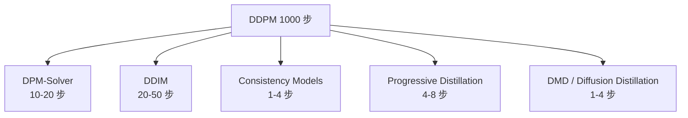
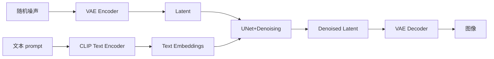
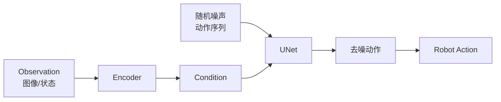

# 0-Diffusion基础与实现

Score-based → 条件生成 (CFG) → 加速采样 (DPM-Solver) → 应用 (SD/Sora/分子) → RecSys (DiffuRec) → PyTorch 实现
chapter_id: 12.00
last_updated: 2026-07-23
status: ✅ v1.0

---

## 12.0 Diffusion 模型基础与实现 - 扩散模型全栈

> **Diffusion (扩散模型)** 是 2020+ 图像/视频/分子生成的主流范式,代表 DALL-E 2 / Stable Diffusion / Sora。
> 与 GAN 相比:训练稳定;与 VAE 相比:生成质量高;与自回归相比:可并行。
> 核心思想: **逐步加噪 → 学习反噪 → 采样得到新样本**。

---

## 0. 一句话总结

**Diffusion = 训练时学习"加噪后如何去噪", 推理时从纯噪声多步去噪生成样本;前向是预设的加噪过程, 反向是神经网络;代表方法 DDPM / DDIM / Score-based;在图像 (Stable Diffusion) / 视频 (Sora) / 分子 / 推荐 (DiffuRec) 等领域广泛应用。**

---

## 1. 为什么需要 Diffusion

### 1.1 三大生成范式对比

| 维度 | GAN | VAE | Diffusion |
|---|---|---|---|
| 训练稳定性 | 难 (模式坍塌) | 稳定 | **稳定** |
| 生成质量 | 高 (大模型) | 模糊 | **高** |
| 多样性 | 低 (模式坍塌) | 中 | **高** |
| 推理速度 | **快 (1 步)** | 快 (1 步) | 慢 (1000 步) |
| 可控性 | 弱 | 弱 | **强 (CFG)** |
| 似然估计 | 难 | 易 | **易 (ELBO)** |
| 数学优雅度 | 中 | 中 | **高** (随机微分方程) |

### 1.2 Diffusion 的独特优势

1. **训练稳定**: 加噪 / 去噪 是明确的 L2 回归问题, 没有对抗
2. **可得到对数似然**: 变分下界 (ELBO) 严谨
3. **多样性极佳**: 噪声起点 + 随机采样
4. **可控生成**: classifier-free guidance 控制多样性-忠实度 trade-off
5. **统一生成**: 图像、音频、视频、分子都可用同框架
6. **数学优雅**: 与热力学、随机微分方程有深刻联系

### 1.3 三种主流 Diffusion 范式

```text
[A] 去噪 Diffusion (DDPM/DDIM)
    - 显式加噪/去噪
    - 学习预测噪声 / x_0 / score

[B] 基于分数的模型 (NCSN / Score SDE)
    - 隐式建模 score: ∇_x log p(x)
    - 与朗之万动力学结合

[C] 一致性模型 (Consistency Models)
    - 蒸馏 ODE solver
    - 1 步采样,加速 10-100x

[A] + [B]: 数学上等价,只是参数化不同
```

### 1.4 Diffusion 的应用地图

| 模态 | 代表模型 |
|---|---|
| 图像 | Stable Diffusion, DALL-E 2, Imagen, Midjourney |
| 视频 | Sora (OpenAI), Gen-2 (Runway), Lumiere (Google) |
| 音频 | AudioLDM, DiffSinger, Riffusion |
| 3D | DreamFusion, Magic3D, ProlificDreamer |
| 分子 | DiffDock, DiffMol, DiffSMol |
| 推荐系统 | DiffuRec, DiffRec, DiffUM |
| 时序预测 | TimeGrad, CSDI |
| 强化学习 | Decision Diffuser, Diffusion Policy |
| 医学 | Med-PaLM 2 Diff, Diff-Beat |

---

## 2. 基础理论

### 2.1 前向过程 (Forward / 加噪)

**数学定义**: 给定真实样本 $x_0 \sim q(x_0)$, 在 $T$ 步内逐步加高斯噪声, 得到 $x_T \sim \mathcal{N}(0, I)$:

```math
q(x_t | x_{t-1}) = \mathcal{N}\left( x_t; \sqrt{1 - \beta_t} x_{t-1}, \beta_t \mathbf{I} \right)
```

其中 $\beta_t$ 是预先定义的**噪声调度** (noise schedule),通常 $\beta_1 < \beta_2 < \ldots < \beta_T$, 即越往后加越多的噪声。

**关键性质: 直接采样**

利用 reparameterization trick 和 Markov 性质, 可以**任意时刻直接采样** $x_t$ 而不需要逐步迭代:

```math
q(x_t | x_0) = \mathcal{N}\left( x_t; \sqrt{\bar{\alpha}_t} x_0, (1 - \bar{\alpha}_t) \mathbf{I} \right)
```

其中:
```math
\alpha_t = 1 - \beta_t, \quad \bar{\alpha}_t = \prod_{s=1}^{t} \alpha_s
```

更详细:
```math
x_t = \sqrt{\bar{\alpha}_t} x_0 + \sqrt{1 - \bar{\alpha}_t} \epsilon, \quad \epsilon \sim \mathcal{N}(0, I)
```

**即**: $x_t$ 是 $x_0$ 与高斯噪声的线性插值 (SNR = $\bar{\alpha}_t / (1 - \bar{\alpha}_t)$)。

**当 $t \to T$**: $\bar{\alpha}_T \to 0$, $x_T \sim \mathcal{N}(0, I)$ (纯噪声)。

### 2.2 反向过程 (Reverse / 去噪)

**反向过程**假设每步都是高斯 (在小步长下是合理假设):

```math
p_\theta(x_{t-1} | x_t) = \mathcal{N}\left( x_{t-1}; \mu_\theta(x_t, t), \Sigma_\theta(x_t, t) \right)
```

其中 $\mu_\theta$ 和 $\Sigma_\theta$ 由神经网络 (通常是 UNet) 参数化。

**实际简化**: $\Sigma_\theta(x_t, t)$ 通常取 $\beta_t \mathbf{I}$ (固定), 只需学习均值 $\mu_\theta$。

**训练目标 (简化)**:

如果参数化 $\mu_\theta$ 预测噪声 $\epsilon$,即:
```math
\mu_\theta(x_t, t) = \frac{1}{\sqrt{\alpha_t}} \left( x_t - \frac{\beta_t}{\sqrt{1 - \bar{\alpha}_t}} \epsilon_\theta(x_t, t) \right)
```

则训练**噪声预测** $\epsilon_\theta$ 即可:

```math
\mathcal{L}_{\text{simple}} = \mathbb{E}_{t, x_0, \epsilon} \left[ \| \epsilon - \epsilon_\theta(x_t, t) \|^2 \right]
```

**直观理解**: 给定加噪后的样本 $x_t$ 和时间步 $t$,让网络预测"加入了什么噪声"。

### 2.3 分数匹配 (Score Matching)

**Score 函数**: 对数概率密度对输入的梯度:
```math
\mathbf{s}(x) = \nabla_x \log p(x)
```

**关键洞察**: 如果能学到 score 函数 $\mathbf{s}(x)$,可以用**朗之万动力学** (Langevin dynamics) 采样:

```math
x_{k+1} = x_k + \frac{\eta}{2} \mathbf{s}(x_k) + \sqrt{\eta} z_k, \quad z_k \sim \mathcal{N}(0, I)
```

**Score Matching 目标**: 学习一个网络 $s_\theta(x)$ 使得 $s_\theta(x) \approx \nabla_x \log p_{\text{data}}(x)$:

```math
\mathcal{L}_{\text{SM}} = \mathbb{E}_{p_{\text{data}}(x)} \left[ \frac{1}{2} \| s_\theta(x) - \nabla_x \log p_{\text{data}}(x) \|^2 \right]
```

但 $\nabla_x \log p_{\text{data}}(x)$ 未知, **Denoising Score Matching (DSM)** 解决:

```math
\mathcal{L}_{\text{DSM}} = \mathbb{E}_{q(x_0)} \mathbb{E}_{q(x_t | x_0)} \left[ \| s_\theta(x_t) - \nabla_{x_t} \log q(x_t | x_0) \|^2 \right]
```

对于高斯 $q(x_t | x_0) = \mathcal{N}(\sqrt{\bar{\alpha}_t} x_0, (1-\bar{\alpha}_t) I)$, 有:

```math
\nabla_{x_t} \log q(x_t | x_0) = - \frac{\epsilon}{\sqrt{1 - \bar{\alpha}_t}}
```

其中 $\epsilon$ 是加入的噪声。所以:
```math
s_\theta(x_t) \approx - \frac{\epsilon_\theta(x_t)}{\sqrt{1 - \bar{\alpha}_t}}
```

**结论**: 预测噪声 $\epsilon_\theta$ 等价于预测 score!

### 2.4 ELBO (Evidence Lower Bound)

**生成模型的目标**: 最大化 $\log p_\theta(x_0)$。但直接最大化难,用 ELBO 下界:

```math
\log p_\theta(x_0) \geq \mathbb{E}_q \left[ \log \frac{p_\theta(x_{0:T})}{q(x_{1:T}|x_0)} \right] = -\mathcal{L}_{\text{VLB}}(x_0)
```

其中**变分下界损失**:

```math
\mathcal{L}_{\text{VLB}} = \sum_{t=2}^{T} \mathcal{L}_{t-1} + \mathcal{L}_0 + \mathcal{L}_T
```

各项分别:
- $\mathcal{L}_T = D_{KL}(q(x_T | x_0) \| p(x_T))$: 终止 KL,常数
- $\mathcal{L}_{t-1} = D_{KL}(q(x_{t-1} | x_t, x_0) \| p_\theta(x_{t-1} | x_t))$: 去噪 KL 散度,逐项
- $\mathcal{L}_0 = -\log p_\theta(x_0 | x_1)$: 重构似然

**关键结果** (DDPM 论文):

```math
\mathcal{L}_{\text{simple}} = \mathbb{E} [ \| \epsilon - \epsilon_\theta \|^2 ] \approx \mathcal{L}_{\text{VLB}} + C
```

即简单的 MSE 噪声预测损失 与变分下界 差一个常数。

### 2.5 前向-反向的统一视角

```mermaid
graph LR
    A[x_0<br/>真实样本] -- $q(x_1|x_0)$<br/>加噪 --> B[x_1]
    B -- $q(x_2|x_1)$<br/>加噪 --> C[x_2]
    C -- $\ldots$ --> D[x_T<br/>纯噪声]
    D -- $p_\theta(x_{T-1}|x_T)$<br/>去噪 --> E[x_{T-1}]
    E -- $\ldots$ --> F[x_1]
    F -- $p_\theta(x_0|x_1)$<br/>去噪 --> G[x_0<br/>生成样本]
```

### 2.6 噪声调度 (Noise Schedule)

**Linear Schedule** (DDPM 原版):
- $\beta_t$ 从 $\beta_1 = 0.0001$ 到 $\beta_T = 0.02$ 线性增长

**Cosine Schedule** (Improved DDPM, 2020):
- $\bar{\alpha}_t = \cos\left(\frac{t/T + s}{1+s} \cdot \frac{\pi}{2}\right)^2$
- 在低分辨率 / 像素空间更优

**Scaled Linear**:
- $\beta_t = (\bar{\beta}_{\max} - \bar{\beta}_{\min}) \cdot t/T + \bar{\beta}_{\min}$, $\bar{\beta}_{\min} = 0.0001$, $\bar{\beta}_{\max} = 0.02$

```python
def linear_schedule(T: int, beta_start: float = 1e-4, beta_end: float = 0.02):
    return torch.linspace(beta_start, beta_end, T)

def cosine_schedule(T: int, s: float = 0.008):
    """Improved DDPM 的余弦调度"""
    t = torch.arange(T + 1, dtype=torch.float) / T + s
    alphas_cumprod = torch.cos(t * math.pi / 2) ** 2
    alphas_cumprod = alphas_cumprod / alphas_cumprod[0]
    betas = 1 - (alphas_cumprod[1:] / alphas_cumprod[:-1])
    return torch.clamp(betas, 0.0001, 0.999)
```

### 2.7 一些数学细节

**KL 散度比较两个高斯**:

```math
D_{KL}(\mathcal{N}(\mu_1, \Sigma_1) \| \mathcal{N}(\mu_2, \Sigma_2)) = \frac{1}{2} \left( \text{tr}(\Sigma_2^{-1} \Sigma_1) + (\mu_2 - \mu_1)^T \Sigma_2^{-1} (\mu_2 - \mu_1) - k + \log \frac{\det \Sigma_2}{\det \Sigma_1} \right)
```

特别地, 当 $\Sigma_2 = \sigma^2 I$:

```math
D_{KL}(\mathcal{N}(\mu, \sigma^2 I) \| \mathcal{N}(0, I)) = \frac{\|\mu\|^2}{2\sigma^2} + k \left( \frac{\sigma^2}{2} - \log \sigma \right) - \frac{k}{2}
```

**DDPM 中, $q(x_{t-1} | x_t, x_0)$ 是高斯 (重要)**:

```math
q(x_{t-1} | x_t, x_0) = \mathcal{N}\left( \tilde{\mu}_t(x_t, x_0), \tilde{\beta}_t \mathbf{I} \right)
```

其中:
```math
\tilde{\mu}_t = \frac{\sqrt{\bar{\alpha}_{t-1}} \beta_t}{1 - \bar{\alpha}_t} x_0 + \frac{\sqrt{\alpha_t} (1 - \bar{\alpha}_{t-1})}{1 - \bar{\alpha}_t} x_t
```

```math
\tilde{\beta}_t = \frac{1 - \bar{\alpha}_{t-1}}{1 - \bar{\alpha}_t} \beta_t
```

这是训练时反向 KL 散度精确计算的关键。

---

## 3. 三大经典模型

### 3.1 DDPM (Denoising Diffusion Probabilistic Models, Ho et al., NeurIPS 2020)

**核心**: 学习 $\epsilon_\theta(x_t, t)$ 预测加入的噪声。

**训练算法**:

```text
1. 采样 x_0 ~ q(x_0),  t ~ Uniform(1..T), ε ~ N(0, I)
2. 计算 x_t = √α̅_t · x_0 + √(1-α̅_t) · ε
3. 梯度下降: ∇θ ||ε - ε_θ(x_t, t)||²
```

**采样算法**:

```text
x_T ~ N(0, I)
for t = T, T-1, ..., 1:
    z ~ N(0, I) if t > 1 else 0
    x_{t-1} = (1/√α_t) · (x_t - (β_t/√(1-α̅_t)) · ε_θ(x_t, t)) + √β_t · z
return x_0
```

**PyTorch 实现**:

```python
import torch
import torch.nn as nn
import torch.nn.functional as F
import math

class DDPM(nn.Module):
    """标准 DDPM 实现"""
    def __init__(self, unet: nn.Module, T: int = 1000):
        super().__init__()
        self.unet = unet
        self.T = T

        # 噪声调度 (linear)
        beta = torch.linspace(1e-4, 0.02, T)
        alpha = 1 - beta
        alpha_bar = torch.cumprod(alpha, dim=0)

        self.register_buffer('beta', beta)
        self.register_buffer('alpha', alpha)
        self.register_buffer('alpha_bar', alpha_bar)
        self.register_buffer('sqrt_alpha_bar', torch.sqrt(alpha_bar))
        self.register_buffer('sqrt_one_minus_alpha_bar', torch.sqrt(1 - alpha_bar))

    def forward(self, x0: torch.Tensor) -> torch.Tensor:
        """训练: 计算损失"""
        B = x0.size(0)
        t = torch.randint(0, self.T, (B,), device=x0.device)
        noise = torch.randn_like(x0)

        x_t = (
            self.sqrt_alpha_bar[t][:, None, None, None] * x0
            + self.sqrt_one_minus_alpha_bar[t][:, None, None, None] * noise
        )
        noise_pred = self.unet(x_t, t)
        return F.mse_loss(noise_pred, noise)

    @torch.no_grad()
    def sample(self, n_samples: int, image_shape, device='cuda') -> torch.Tensor:
        """采样: 从噪声生成图像"""
        x = torch.randn(n_samples, *image_shape, device=device)
        for t in reversed(range(self.T)):
            t_batch = torch.full((n_samples,), t, device=device, dtype=torch.long)
            noise_pred = self.unet(x, t_batch)

            # 重构 x_{t-1}
            alpha_t = self.alpha[t_batch][:, None, None, None]
            alpha_bar_t = self.alpha_bar[t_batch][:, None, None, None]
            beta_t = self.beta[t_batch][:, None, None, None]

            mean = (1 / torch.sqrt(alpha_t)) * (
                x - beta_t / torch.sqrt(1 - alpha_bar_t) * noise_pred
            )
            if t > 0:
                noise = torch.randn_like(x)
                sigma = torch.sqrt(beta_t)
                x = mean + sigma * noise
            else:
                x = mean
        return x
```

**DDPM 的关键贡献**:
1. **重新发现**了 Sohl-Dickstein 2015 的工作,并把它做到 SOTA
2. 证明了高质量图像生成可行
3. 训练稳定,无模式坍塌
4. 与自回归、GAN 的关键区别 —— **渐进生成** vs **一步生成**

### 3.2 DDIM (Denoising Diffusion Implicit Models, Song et al., ICLR 2021)

**DDPM 的痛点**: 1000 步采样太慢。

**DDIM 的洞察**: 不需要 Markov, 可以用**非 Markov 过程** , 加上 $\eta$ 参数控制"确定性":

```math
x_{t-1} = \sqrt{\bar{\alpha}_{t-1}} \cdot \hat{x}_0 + \sqrt{1 - \bar{\alpha}_{t-1} - \sigma_t^2} \cdot \epsilon_\theta(x_t, t) + \sigma_t \cdot z_t
```

其中:
```math
\hat{x}_0 = \frac{x_t - \sqrt{1 - \bar{\alpha}_t} \epsilon_\theta(x_t, t)}{\sqrt{\bar{\alpha}_t}}
```

```math
\sigma_t^2 = \eta^2 \cdot \frac{1 - \bar{\alpha}_{t-1}}{1 - \bar{\alpha}_t} (1 - \alpha_t)
```

**特殊值**:
- $\eta = 0$: 完全确定性 (DDIM), 同 ODE
- $\eta = 1$: 等价于 DDPM

**优势**:
1. 同样的训练, 通过调 $\eta$ 就能从 1000 步 → 50 步
2. **ODE 视角**让加速采样算法 (DPM-Solver) 能用上
3. 隐空间插值更平滑

**PyTorch 实现**:

```python
@torch.no_grad()
def ddim_sample(model, shape, T=1000, eta=0.0, device='cuda'):
    """DDIM 采样"""
    x = torch.randn(*shape, device=device)
    # 子步长: 从 1000 步采样 50 步
    timesteps = torch.linspace(T - 1, 0, 50).long().to(device)

    for i in reversed(range(len(timesteps))):
        t = timesteps[i]
        t_prev = timesteps[i + 1] if i + 1 < len(timesteps) else -1

        # 预测噪声
        eps = model(x, t)

        # 预测 x_0
        alpha_bar_t = model.alpha_bar[t]
        x0_pred = (x - torch.sqrt(1 - alpha_bar_t) * eps) / torch.sqrt(alpha_bar_t)

        if t_prev >= 0:
            alpha_bar_prev = model.alpha_bar[t_prev]
        else:
            alpha_bar_prev = torch.tensor(1.0, device=device)

        # 计算 x_{t-1}
        sigma = eta * torch.sqrt(
            (1 - alpha_bar_prev) / (1 - alpha_bar_t) * (1 - alpha_bar_t / alpha_bar_prev)
        )
        dir_xt = torch.sqrt(1 - alpha_bar_prev - sigma ** 2) * eps

        noise = torch.randn_like(x) if eta > 0 else torch.zeros_like(x)
        x = torch.sqrt(alpha_bar_prev) * x0_pred + dir_xt + sigma * noise

    return x
```

### 3.3 Score-based / NCSN (Song & Ermon, NeurIPS 2019)

**核心思路**: 不直接参数化 $\mu_\theta$, 而是学习 score 函数:

```math
s_\theta(x, t) \approx \nabla_x \log p_\sigma(x)
```

**多尺度噪声条件 score 网络 (NCSN)**:

```math
\mathcal{L} = \mathbb{E}_{t} \mathbb{E}_{x_0 \sim p_{\text{data}}, \epsilon} \left[ \lambda(\sigma_t) \| s_\theta(x_0 + \sigma_t \epsilon, \sigma_t) + \frac{\epsilon}{\sigma_t} \|^2 \right]
```

**分数 SDE (Song et al., 2021)**:

定义**前向 SDE**:
```math
dX_t = f(X_t, t) dt + g(t) dW_t
```

其中 $W_t$ 是 Wiener 过程。**反向 SDE** (Anderson 1982):
```math
dY_t = [f(Y_t, t) - g(t)^2 \nabla_y \log p_t(Y_t)] dt + g(t) d\bar{W}_t
```

如果学了 score $\nabla_y \log p_t(y)$, 就可以反向 SDE 生成。

**Score SDE 的优势**:
1. 统一了 DDPM 和 NCSN: 离散 vs 连续
2. Probabilistic Flow ODE: 同样生成 + 概率守恒 (deterministic)
3. Exact likelihood computation

```python
import torch
import torch.nn as nn

class ScoreNet(nn.Module):
    """Score network: 输出 ∇_x log p(x)"""
    def __init__(self, dim: int):
        super().__init__()
        self.net = nn.Sequential(
            nn.Linear(dim + 1, 256),  # +1 是 sigma encoding
            nn.SiLU(),
            nn.Linear(256, 256),
            nn.SiLU(),
            nn.Linear(256, dim),
        )

    def forward(self, x: torch.Tensor, sigma: torch.Tensor) -> torch.Tensor:
        sigma_emb = sigma.unsqueeze(-1).expand(x.shape[0], 1)
        return self.net(torch.cat([x, sigma_emb], dim=-1))
```

### 3.4 三大方法对比

| 维度 | DDPM | DDIM | Score SDE |
|---|---|---|---|
| 公式 | 离散 Markov | 离散 ODE-like | 连续 SDE |
| 采样器 | 离散 | 离散 ODE | SDE solver |
| 加速 | 困难 | 容易 ($\eta=0$) | 容易 (ProbFlow) |
| 似然估计 | 有 (ELBO) | 间接 | **有 (exact)** |
| 训练损失 | $\ell_2$ noise | 同 DDPM | score matching |
| 工程复杂度 | 低 | 低 | 中 |

---

## 4. 条件生成

### 4.1 任务:从随机生成到可控生成

无条件 Diffusion 只能从噪声随机生成, 实际需要"画一只猫"或"某段音频在第 5 秒是钢琴"这种**条件控制**。

条件信号 $c$ (文本 / 类别 / 图像) 与时间步 $t$ 一起输入 UNet:

```math
\epsilon_\theta(x_t, t, c)
```

### 4.2 Classifier Guidance (Dhariwal & Nichol, NeurIPS 2021)

**思路**: 训练一个独立的**噪声分类器** $p_\phi(y | x_t, t)$, 用它的梯度引导生成:

```math
\hat{\epsilon} = \epsilon_\theta(x_t, t) - \sqrt{1 - \bar{\alpha}_t} \cdot s \cdot \nabla_{x_t} \log p_\phi(y | x_t, t)
```

其中 $s$ 是**引导尺度** (guidance scale), 控制生成的多样性-忠实度 trade-off。

**优点**: 简单有效
**缺点**:
- 需要单独训练分类器
- 分类器在噪声图像上训练, 可能不准确
- 推理开销增加 (额外 forward 算梯度)

```python
def classifier_guidance_sample(model, classifier, x_t, t, y, guidance_scale=1.0):
    """Classifier Guidance"""
    x_t = x_t.requires_grad_(True)

    # 模型预测噪声
    eps = model(x_t, t)

    # 分类器预测
    logits = classifier(x_t, t)
    log_prob = F.log_softmax(logits, dim=-1)[..., y]

    # 梯度引导
    grad = torch.autograd.grad(log_prob.sum(), x_t)[0]

    # 更新
    eps_guided = eps - guidance_scale * torch.sqrt(1 - model.alpha_bar[t]) * grad
    return eps_guided
```

### 4.3 Classifier-Free Guidance (Ho & Salimans, 2022)

**思路**: 不用单独分类器, 在同一个 UNet 上**同时**学条件和无条件:

```math
\epsilon_\theta(x_t, t, c) \text{ 与 } \epsilon_\theta(x_t, t, \emptyset)
```

**推理时**:
```math
\hat{\epsilon}_\theta(x_t, t, c) = (1 + w) \epsilon_\theta(x_t, t, c) - w \epsilon_\theta(x_t, t, \emptyset)
```

其中 $w$ 是引导尺度。$w$ 越大,生成越"忠实于条件"但多样性越低。

**训练方式**: 随机以一定概率 (10-20%) 丢弃条件 token, 让模型学会无条件生成。

**理论解释 (Bayes 视角)**:

```math
\nabla \log p(x | c) = \nabla \log p(x) + \nabla \log p(c | x)
```

Classifier-Free Guidance 是**线性外推**这两个项, 而 $w$ 控制外推强度。

**优点**:
- 只有一个网络,无需额外分类器
- 实现简单 (一行代码)
- 已成为 Stable Diffusion 等主流模型的事实标准

```python
def cfg_sample(unet, x_t, t, c, null_emb, guidance_scale=7.5):
    """Classifier-Free Guidance 采样"""
    # 拼接: 条件 + 无条件
    x_in = torch.cat([x_t, x_t], dim=0)
    t_in = torch.cat([t, t], dim=0)
    c_in = torch.cat([c, null_emb.repeat(c.size(0), 1)], dim=0)

    eps = unet(x_in, t_in, c_in)  # 一次前向
    eps_cond, eps_uncond = eps.chunk(2, dim=0)

    # CFG 公式
    eps_guided = (1 + guidance_scale) * eps_cond - guidance_scale * eps_uncond
    return eps_guided
```

### 4.4 Guidance Scale 调参经验

| $w$ | 效果 |
|---|---|
| 0 | 无引导, 等价无条件生成 |
| 1-3 | 弱引导, 多样性高 |
| **5-10** | **常用值** |
| 15+ | 强忠实度, 多样性下降, 可能过饱和 |

**实验现象**: $w$ 过大, 图像会出现过饱和、伪影 (artifacts)。

### 4.5 其他条件方式

| 方法 | 描述 |
|---|---|
| **ControlNet** (2023) | 用额外条件图 (边缘、深度) 引导 UNet |
| **IP-Adapter** | 图像作为条件 |
| **T2I-Adapter** | 类似 ControlNet, 更轻量 |
| **LoRA** | 对 UNet 微调, 但不直接条件 |
| **Composer** | 组合多个条件 |

---

## 5. 加速采样

### 5.1 为什么需要加速?

DDPM 默认 1000 步, 即使 1 步 0.05 秒也要 50 秒。Stable Diffusion 1 步需 ~0.85s (A100), 20 步约 17 秒。

对生产环境或交互应用 (实时绘图), 100 步都嫌多。目标: **10-50 步保持质量**。

### 5.2 加速方法地图



### 5.3 DPM-Solver (Lu et al., NeurIPS 2022)

**关键洞察**: DDIM 在 ODE 视角下,可以用**高阶 ODE 求解器**加速。

**1 阶 DPM-Solver** (10-20 步接近 DDIM 1000 步):

```math
x_{t-1} = \frac{\sigma_{t-1}}{\sigma_t} x_t - \alpha_{t-1} e^{-\frac{h_t}{2}} \text{ODESolver}(x_t, t)
```

**2 阶 DPM-Solver (data prediction)**:

```math
x_{t_0} = e^{h} \frac{\bar{\alpha}_{t_0}}{\bar{\alpha}_t} x_t - \bar{\alpha}_{t_0} (e^h - 1) \hat{x}_\theta(x_t, t)
```

```python
from diffusers import DPMSolverMultistepScheduler
# Diffusers 内置
scheduler = DPMSolverMultistepScheduler.from_pretrained("runwayml/stable-diffusion-v1-5")
pipeline = StableDiffusionPipeline.from_pretrained("runwayml/stable-diffusion-v1-5", scheduler=scheduler)
pipeline.scheduler.config['algorithm_type'] = 'dpmsolver++'
pipeline.scheduler.config['solver_order'] = 2  # 2 阶
# 20 步生成
image = pipeline(prompt="a cat").images[0]
```

### 5.4 Consistency Models (Song et al., ICML 2023)

**核心洞察**: 把 ODE 求解器蒸馏到一个**单步**模型上。

**训练目标 (Consistency Training)**:

```math
\mathcal{L}_{\text{CT}} = \mathbb{E}_{x_0, t, n} \left[ d(f_\theta(x_{t_n}, t_n), f_{\theta^-}(x_{t_{n-1}}, t_{n-1})) \right]
```

其中:
- $x_{t_n}$ 在第 $n$ 步
- $x_{t_{n-1}}$ 在第 $n-1$ 步
- $f_\theta$ 是学到的"任意时刻到 $x_0$ 的直接映射"
- $\theta^-$ 是 EMA 模型

**关键约束**: $f_\theta(x_t, t)$ 对所有 $t$ 在同一 ODE trajectory 上输出一致 (一致性)。

**PyTorch 实现** (简化版):

```python
class ConsistencyModel(nn.Module):
    def __init__(self, unet, sigma_min=0.002, sigma_max=80.0, rho=7.0):
        super().__init__()
        self.unet = unet
        # Karras 等的 sigma 调度
        self.rho = rho

    def forward(self, x_t, sigma):
        # 对 UNet 加 sigma conditioning
        sigma_emb = self.sigma_embedding(sigma)
        return self.unet(x_t, sigma_emb)

    def sample(self, shape, device='cuda', steps=1):
        """单步或几步采样"""
        # 起始纯噪声
        x = torch.randn(*shape, device=device) * self.sigma_max
        sigma = self.sigma_max

        for step in range(steps):
            # 一步到目标时间
            t_next = max(sigma / 2, self.sigma_min)  # 简化的 ratio 调度
            x_pred = self.forward(x, torch.full((x.size(0),), t_next, device=device))
            x = x_pred  # 一致性输出

        return x
```

### 5.5 其他加速技巧

**Progressive Distillation** (Salimans & Ho, 2022):
- 训练一个 4 步学生模型模仿 8 步教师
- 再训练 2 步学生模仿 4 步学生
- 4 步 → 2 步 → 1 步

**Diffusion GAN** (Xiao et al., 2022):
- 用 GAN loss 训练单步 diffusion
- 牺牲多样性换速度

**MeanFlow** (2024):
- 显式预测平均速度而非瞬时速度
- 1 步采样,同时保持质量

**sCM** (Consistency Models + EDM):
- 流匹配 + 一致性模型融合
- 进一步改善 sample quality

---

## 6. 应用

### 6.1 图像生成:Stable Diffusion 详解

Stable Diffusion 是最知名的开源图像生成模型,采用 **Latent Diffusion** 架构。



**关键组件**:
1. **CLIP Text Encoder**: 文本 → 嵌入向量
2. **VAE Encoder**: 512×512 图像 → 64×64 latent
3. **UNet + Self-Attention**: 在 latent 上做去噪, 每层 self-attention + cross-attention 到文本
4. **VAE Decoder**: 64×64 latent → 512×512 图像
5. **Classifier-Free Guidance**: 引导强度控制忠实度

**训练流程**:
```python
# Simplified Stable Diffusion Training
from diffusers import AutoencoderKL, UNet2DConditionModel, DDPMScheduler

vae = AutoencoderKL.from_pretrained("runwayml/stable-diffusion-v1-5", subfolder="vae")
unet = UNet2DConditionModel.from_pretrained("runwayml/stable-diffusion-v1-5", subfolder="unet")
scheduler = DDPMScheduler(num_train_timesteps=1000)

# 1. 图像 VAE 编码
latents = vae.encode(image).latent_dist.sample() * 0.18215

# 2. 加噪
noise = torch.randn_like(latents)
timesteps = torch.randint(0, 1000, (latents.size(0),), device=latents.device)
noisy_latents = scheduler.add_noise(latents, noise, timesteps)

# 3. UNet 预测噪声 (条件为文本)
encoder_hidden_states = clip_text_encoder(text_input_ids)
noise_pred = unet(noisy_latents, timesteps, encoder_hidden_states).sample

# 4. 损失
loss = F.mse_loss(noise_pred, noise)
loss.backward()
optimizer.step()
```

### 6.2 图像生成:DALL-E 2 / Imagen

**DALL-E 2 (OpenAI, 2022)**:

3 阶段训练:
1. **Prior**: $p(z | y)$, CLIP text embedding → image embedding
2. **Decoder**: image embedding → 图像 (diffusion)
3. **CLIP**: joint text-image embedding

**Imagen (Google, 2022)**:

- T5-XXL encoder (语言模型)
- 2 阶段扩散: 64×64 → 256×256 → 1024×1024
- 超大语言模型 + 小 UNet

### 6.3 视频生成:Sora

**OpenAI Sora (2024)** 开启了视频生成新纪元:

**架构**: 基于 **Diffusion Transformer (DiT)** (Peebles & Xie, 2022):
- 把 UNet 替换为 Transformer
- 处理 latent video tensors

**关键技术**:
1. **Patchification**: 把视频切成 3D patches (空间 + 时间)
2. **Spacetime attention**: 同时 attention 空间和时间轴
3. **Diffusion Transformer**: 用 Transformer 替代 UNet
4. **视频压缩网络**: VAE 类似,但压缩时空轴
5. **Recaptioning**: 用 LLM 重新描述训练视频,提升文本对齐

```python
# Sora 类模型的简化 DiT
class DiffusionTransformer(nn.Module):
    def __init__(self, dim, depth, num_heads):
        super().__init__()
        self.patch_embed = PatchEmbed3D(patch_size=(2, 4, 4), dim=dim)
        self.layers = nn.ModuleList([
            TransformerBlock(dim, num_heads) for _ in range(depth)
        ])
        self.unpatchify = Unpatchify3D(...)

    def forward(self, x, t, y):
        # x: [B, C, T, H, W], latent video
        x = self.patch_embed(x)
        t_emb = self.time_embed(t)
        y_emb = self.text_embed(y)

        for layer in self.layers:
            x = layer(x, t_emb, y_emb)

        return self.unpatchify(x)
```

### 6.4 分子生成

**DiffDock** (Corso et al., 2023): 蛋白质-配体结合位点预测
- 在 3D 空间做 diffusion,预测 ligand 位置

**DiffMol**: 分子图 diffusion

```python
class MoleculeDiffusion(nn.Module):
    """分子图生成 diffusion"""
    def __init__(self, atom_dim, hidden, edge_types):
        super().__init__()
        self.atom_emb = nn.Embedding(atom_dim, hidden)
        # 用 EGNN (Equivariant GNN) 作为 denoiser
        self.denoiser = EGNN(hidden=hidden)

    def forward(self, atom_features, edge_index, coords):
        """coords 是 3D 坐标, denoise"""
        # 加噪到 coords (atoms 类别用离散 diffusion)
        noised_coords = coords + noise_scale * torch.randn_like(coords)
        pred_coords = self.denoiser(atom_features, edge_index, noised_coords)
        return F.mse_loss(pred_coords, coords)
```

### 6.5 其他应用速览

| 任务 | 模型 | 关键点 |
|---|---|---|
| **文本到语音** | AudioLDM | Latent audio diffusion |
| **音乐生成** | DiffSinger, Riffusion | Spectrogram + diffusion |
| **3D 生成** | DreamFusion, Magic3D | SDS (Score Distillation) |
| **时序预测** | TimeGrad, CSDI | 多变量 imputation |
| **异常检测** | Denoising Diffusion Anomaly | 重建误差 |
| **图像超分** | SR3 | Conditional super-resolution |
| **图像补全** | RePaint | Mask + reverse diffusion |

---

## 7. 与推荐/RL 的连接

### 7.1 推荐系统:DiffuRec 系列

**动机**: 传统推荐是"判别式"(预测 click 概率),DiffuRec 是"生成式":直接生成候选物品。

**DiffuRec (Li et al., 2023)**:

**核心思路**:
- 把用户历史行为序列当作 "目标"
- 加噪 / 去噪 学到 robust 序列表示
- 用 denoised 表示 做 retrieval

```python
class DiffuRec(nn.Module):
    """Diffusion-based Recommendation"""
    def __init__(self, item_dim, hidden_dim, T=32):
        super().__init__()
        self.T = T
        self.T_scheduler = DDPMScheduler(num_train_timesteps=T)

        # Denoiser: sequence-to-sequence transformer
        self.denoiser = TransformerDenoiser(item_dim, hidden_dim)

    def forward(self, history, target):
        """训练"""
        # history: [B, L, item_dim], 行为序列
        # target: [B, item_dim], 目标物品
        t = torch.randint(0, self.T, (history.size(0),), device=history.device)

        # 加噪目标
        noise = torch.randn_like(target)
        noisy_target = self.T_scheduler.add_noise(target, noise, t)

        # 用历史 + 加噪目标 → 预测噪声
        cond = self.encode_history(history)
        noise_pred = self.denoiser(noisy_target, t, cond)

        return F.mse_loss(noise_pred, noise)
```

**DiffRec**: 进一步把图 diffusion 用到协同过滤。

**DiffUM**: 用户多兴趣扩散。

### 7.2 强化学习:Diffusion Policy

**动机**: 机器人策略生成 = 序列决策问题。Diffusion 把"动作序列"看作数据,用 diffusion 生成。

**Diffusion Policy (Chi et al., 2023)**:



**优势**:
1. 多模态动作分布 (不同解)
2. 训练稳定 (无对抗)
3. 时序一致性 (整段动作一起生成)
4. 长 horizon

**代码骨架**:
```python
class DiffusionPolicy(nn.Module):
    def __init__(self, action_dim, horizon, obs_dim):
        super().__init__()
        self.horizon = horizon
        self.denoiser = ConditionalUNet1D(action_dim, obs_dim)

    def forward(self, actions, observations):
        """训练"""
        t = torch.randint(0, self.T, (actions.size(0),))
        noise = torch.randn_like(actions)
        noisy = self.scheduler.add_noise(actions, noise, t)
        pred = self.denoiser(noisy, t, observations)
        return F.mse_loss(pred, noise)

    @torch.no_grad()
    def act(self, observations):
        """推理"""
        action = torch.randn(1, self.horizon, action_dim)
        for t in reversed(range(self.T)):
            pred = self.denoiser(action, t, observations)
            action = self.scheduler.step(pred, t, action).prev_sample
        return action
```

### 7.3 时序预测

**CSDI (Conditional Score-based Diffusion for Imputation)**:
- 多变量时序缺失值补全
- 条件 = 已知值,加噪 = 缺失值

---

## 8. PyTorch 实现

### 8.1 最小可运行 DDPM (MNIST)

```python
import torch
import torch.nn as nn
import torch.nn.functional as F
from torch.utils.data import DataLoader
from torchvision.datasets import MNIST
from torchvision import transforms
import math


class TimeEmbedding(nn.Module):
    """正弦时间嵌入"""
    def __init__(self, dim):
        super().__init__()
        self.dim = dim

    def forward(self, t):
        device = t.device
        half = self.dim // 2
        emb = math.log(10000) / (half - 1)
        emb = torch.exp(torch.arange(half, device=device) * -emb)
        emb = t[:, None] * emb[None, :]
        emb = torch.cat([emb.sin(), emb.cos()], dim=-1)
        return emb


class SimpleUNet(nn.Module):
    """简化版 UNet,适用于 MNIST 28x28"""
    def __init__(self, in_ch=1, time_dim=128, base_ch=64):
        super().__init__()
        self.time_emb = nn.Sequential(
            TimeEmbedding(time_dim),
            nn.Linear(time_dim, time_dim),
            nn.SiLU(),
            nn.Linear(time_dim, time_dim),
        )

        # Down
        self.down1 = nn.Sequential(
            nn.Conv2d(in_ch, base_ch, 3, padding=1),
            nn.SiLU(),
            nn.Conv2d(base_ch, base_ch, 3, padding=1),
            nn.SiLU(),
        )
        self.down2 = nn.Sequential(
            nn.MaxPool2d(2),
            nn.Conv2d(base_ch, base_ch * 2, 3, padding=1),
            nn.SiLU(),
        )

        # Bottleneck
        self.bottleneck = nn.Sequential(
            nn.Conv2d(base_ch * 2, base_ch * 2, 3, padding=1),
            nn.SiLU(),
        )

        # Up
        self.up1 = nn.Sequential(
            nn.ConvTranspose2d(base_ch * 2, base_ch, 2, stride=2),
            nn.SiLU(),
        )
        self.up2 = nn.Sequential(
            nn.Conv2d(base_ch * 2, base_ch, 3, padding=1),
            nn.SiLU(),
            nn.Conv2d(base_ch, in_ch, 3, padding=1),
        )

    def forward(self, x, t):
        t_emb = self.time_emb(t)

        h1 = self.down1(x)
        h2 = self.down2(h1)
        h3 = self.bottleneck(h2)
        h4 = self.up1(h3)

        # 跳跃连接
        h4 = torch.cat([h4, h1], dim=1)
        return self.up2(h4)


def train_diffusion_mnist():
    # 数据
    transform = transforms.Compose([
        transforms.ToTensor(),
        transforms.Normalize((0.5,), (0.5,))  # [-1, 1]
    ])
    dataset = MNIST('/tmp/mnist', download=True, train=True, transform=transform)
    loader = DataLoader(dataset, batch_size=128, shuffle=True)

    # 模型
    device = 'cuda' if torch.cuda.is_available() else 'cpu'
    unet = SimpleUNet().to(device)
    optimizer = torch.optim.AdamW(unet.parameters(), lr=2e-4)

    # DDPM
    T = 1000
    beta = torch.linspace(1e-4, 0.02, T).to(device)
    alpha = 1 - beta
    alpha_bar = torch.cumprod(alpha, dim=0)

    # 训练循环
    for epoch in range(50):
        for x, _ in loader:
            x = x.to(device)
            B = x.size(0)

            t = torch.randint(0, T, (B,), device=device)
            noise = torch.randn_like(x)

            x_t = (torch.sqrt(alpha_bar[t])[:, None, None, None] * x
                   + torch.sqrt(1 - alpha_bar[t])[:, None, None, None] * noise)

            pred = unet(x_t, t)
            loss = F.mse_loss(pred, noise)

            optimizer.zero_grad()
            loss.backward()
            optimizer.step()

        print(f"Epoch {epoch}: loss {loss.item():.4f}")


if __name__ == "__main__":
    train_diffusion_mnist()
```

### 8.2 使用 Diffusers 库

```python
from diffusers import DDPMScheduler, UNet2DModel, DDPMPipeline
from diffusers.optimization import get_cosine_schedule_with_warmup

# 1. 定义
scheduler = DDPMScheduler(
    num_train_timesteps=1000,
    beta_start=1e-4,
    beta_end=0.02,
)
model = UNet2DModel(
    sample_size=64,  # 图像大小
    in_channels=3,
    out_channels=3,
    layers_per_block=2,
    block_out_channels=(64, 128, 256, 512),
    down_block_types=("DownBlock2D", "AttnDownBlock2D", "DownBlock2D", "DownBlock2D"),
    up_block_types=("UpBlock2D", "AttnUpBlock2D", "UpBlock2D", "UpBlock2D"),
)

# 2. 训练
optimizer = torch.optim.AdamW(model.parameters(), lr=1e-4)
lr_scheduler = get_cosine_schedule_with_warmup(optimizer, num_warmup_steps=500, num_training_steps=10000)

for batch in dataloader:
    clean_images = batch["images"]
    noise = torch.randn(clean_images.shape)
    timesteps = torch.randint(0, 1000, (clean_images.size(0),))

    noisy_images = scheduler.add_noise(clean_images, noise, timesteps)
    noise_pred = model(noisy_images, timesteps).sample
    loss = F.mse_loss(noise_pred, noise)

    loss.backward()
    optimizer.step()
    lr_scheduler.step()
    optimizer.zero_grad()

# 3. 推理
pipeline = DDPMPipeline(unet=model, scheduler=scheduler)
images = pipeline(batch_size=16).images
```

### 8.3 Stable Diffusion 推理 (Diffusers)

```python
from diffusers import StableDiffusionPipeline

pipe = StableDiffusionPipeline.from_pretrained(
    "runwayml/stable-diffusion-v1-5",
    torch_dtype=torch.float16,
).to("cuda")

# CFG 设置
pipe.scheduler.config['guidance_scale'] = 7.5

image = pipe(
    prompt="a photo of an astronaut riding a horse on Mars",
    num_inference_steps=50,
    guidance_scale=7.5,
).images[0]

image.save("astronaut.png")
```

### 8.4 自监督训练 (CFG 启用)

```python
class CFGTrainer:
    def __init__(self, model, null_class_emb, p_uncond=0.1):
        self.model = model
        self.null_emb = null_class_emb  # "无条件" token 嵌入
        self.p_uncond = p_uncond

    def train_step(self, x, y_cond):
        """y_cond 是条件嵌入"""
        B = x.size(0)

        # 随机 10% 用无条件
        uncond_mask = torch.rand(B) < self.p_uncond

        # 对 uncond 位置使用 null embedding
        y_input = torch.where(uncond_mask[:, None], self.null_emb, y_cond)

        # 前向 + 损失
        noise = torch.randn_like(x)
        t = torch.randint(0, 1000, (B,))
        x_t = scheduler.add_noise(x, noise, t)
        pred = model(x_t, t, y_input)
        loss = F.mse_loss(pred, noise)
        return loss
```

### 8.5 训练稳定性 Tips

```python
# 1. 损失加权 (更稳定的 VLB 损失)
def weighted_loss(pred, noise, alpha_bar_t):
    """使用权重 snr = alpha_bar / (1 - alpha_bar)"""
    snr = alpha_bar_t / (1 - alpha_bar_t)
    weight = torch.clamp(snr, max=5.0)  # 限制最大权重
    return (F.mse_loss(pred, noise) * weight).mean()

# 2. 重要样本衰减 (Importance Sampling)
def importance_sample_step(unet, x_0, t):
    """采样对当前模型来说损失最大的 t"""
    # 计算当前损失
    with torch.no_grad():
        eps_pred = unet(x_t, t)
        loss = F.mse_loss(eps_pred, eps)
    return loss  # 用作 importance 权重

# 3. EMA 模型
ema_model = copy.deepcopy(model)
ema_step = 0.9999
# 训练中
ema_model.load_state_dict(
    {k: ema_step * v + (1 - ema_step) * model.state_dict()[k] for k, v in ema_model.state_dict().items()}
)
```

### 8.6 工程上的最佳实践

```python
# 1. 混合精度训练
with torch.autocast("cuda", dtype=torch.bfloat16):
    pred = model(x_t, t)
    loss = F.mse_loss(pred, noise)
loss.backward()

# 2. 梯度累积
for i, batch in enumerate(dataloader):
    with torch.autocast("cuda", dtype=torch.bfloat16):
        loss = compute_loss(model, batch) / accum_steps
    loss.backward()
    if (i + 1) % accum_steps == 0:
        optimizer.step()
        optimizer.zero_grad()

# 3. 分布式数据并行 (DDP)
model = DDP(unet, device_ids=[local_rank])

# 4. xFormers / Flash Attention 加速 attention
from xformers.ops import memory_efficient_attention
```

---

## 9. 资源

### 9.1 经典论文

| 论文 | 会议 | 贡献 |
|---|---|---|
| **Sohl-Dickstein 2015** | ICML | 首次 diffusion probabilistic models |
| **Ho 2020 (DDPM)** | NeurIPS | 重新发现 + 简化 → SOTA |
| **Song 2021 (DDIM)** | ICLR | ODE 视角,加速 |
| **Song 2021 (Score SDE)** | ICML | 连续 SDE 统一 |
| **Ho 2022 (CFG)** |  | Classifier-Free Guidance |
| **Dhariwal 2021** | NeurIPS | Classifier Guidance |
| **Lu 2022 (DPM-Solver)** | NeurIPS | 高阶 ODE 加速 |
| **Song 2023 (CM)** | ICML | Consistency Model |
| **Peebles 2022 (DiT)** | ICCV | Diffusion Transformer |
| **Rombach 2022 (SD)** | CVPR | Latent Diffusion |
| **Saharia 2022 (Imagen)** | PAMI | T5 + Diffusion |
| **Betker 2023 (DALL-E 3)** |  | Recaptioning |
| **Chi 2023 (DP)** | RSS | Diffusion Policy |
| **Liu 2024 (Sora tech report)** |  | Video Diffusion |

### 9.2 综述

| 综述 | 链接 |
|---|---|
| Diffusion 综述 (Yang et al.) | arXiv:2209.00796 |
| Generative AI 综述 | arXiv:2303.10130 |
| Score-based 综述 | arXiv:2107.00690 |

### 9.3 工具与库

| 工具 | 用途 |
|---|---|
| **diffusers** (HuggingFace) | 主流,支持 SD/DiT/CM |
| **denoising-diffusion-pytorch** | 早期 DDPM 复现 |
| **stable-diffusion** (CompVis) | 原始 SD 实现 |
| **k-diffusion** | 重加权、CFG、DPM-Solver |
| **annotated-diffusion** | Harry Yang 的注释版 |
| **diffusion-pytorch** | lucidrains 风格 |

### 9.4 训练技巧详解

```text
1. 噪声调度 (Noise Schedule)
   - linear: 1e-4 → 0.02 (DDPM 默认)
   - cosine: 改善低分辨率
   - scaled_linear, vp (Variance Preserving)

2. 参数化 (Parameterization)
   - ε (noise): DDPM 默认
   - x_0: 直接预测 clean image
   - v (velocity): Flow Matching (Stable Diffusion 3)

3. 预测目标 (Prediction Target)
   - L_simple: ||ε - ε_θ||²
   - L_vlb: 变分下界 (严格)
   - 加权组合

4. 加速采样
   - DDIM / DPM-Solver / DPM++
   - Consistency Model
   - Latent Consistency Model (LCM)
   - Progressive Distillation

5. 条件化 (Conditioning)
   - Classifier Guidance
   - Classifier-Free Guidance
   - ControlNet / T2I-Adapter / IP-Adapter
   - LoRA 微调

6. 工程
   - xFormers / Flash Attention
   - Mixed Precision (bfloat16)
   - EMA weights
   - Gradient Accumulation
   - DDP 多卡

7. 训练数据
   - LAION (图像-文本对, 5B+)
   - CC12M, COYO-700M
   - CelebA, ImageNet
```

### 9.5 与本仓库其他章节的关联

- `../第11章-图神经网络GNN/0-GNN基础与谱方法.md` - GNN + Diffusion 用于分子生成
- [[算法与AI/LLM发展/第02章-架构演进]] - DiT 是 Transformer + Diffusion 的结合
- [[算法与AI/LLM发展/第06章-推理能力演进]] - 推理时延分析与 diffusion 加速采样关联
- [[工程与职业/2-生产工程与模型服务化]] - SD 模型的工业化部署
- [[搜推广与生成式推荐/经典推荐/第05章-DLRM到GR范式迁移]] - DiffuRec 在 GR 中的角色

### 9.6 面试高频问题

**Q1: DDPM 训练时,网络看的是 $x_t$ 和 $t$, 输出什么?**

预测噪声 $\epsilon$。损失是 $\| \epsilon - \epsilon_\theta(x_t, t) \|^2$。

**Q2: 为什么 Diffusion 比 GAN 稳定?**

GAN 是对抗训练, 双方博弈容易不平衡, 模式坍塌。
Diffusion 是 L2 回归, 目标明确, 不会对抗。
Diffusion 还有 ELBO 监控似然, 可视化。

**Q3: Stable Diffusion 为什么在 latent 上做, 不在 pixel?**

1. latent 空间维度低 (64×64 vs 512×512),UNet 计算省 64x
2. 像素级噪声对图像细节影响小, 在 latent 上做更聚焦语义
3. VAE 压缩 → 生成高质量 latent → 解码为高分辨率图像

**Q4: Classifier-Free Guidance 为什么有效?**

```math
\hat{\epsilon} = (1 + w) \epsilon_{\text{cond}} - w \epsilon_{\text{uncond}}
```

相当于在 score 空间做线性外推。$w$ 大 → 偏向条件, 牺牲多样性。
类比: log p(x|c) = log p(x) + log p(c|x) 是对数似然 = 加法,而 CFG 是线性外推,等价于 score space 的加法。

**Q5: Consistency Model 为什么能 1 步生成?**

直接在任意时刻预测 $x_0$, 跳过中间步骤。要求一致性: 同一 ODE trajectory 上的所有点都映射到相同 $x_0$。

**Q6: Diffusion 模型如何避免 OOM?**

1. 图像在 latent 空间处理 (SD)
2. 梯度检查点 (gradient checkpointing)
3. 混合精度训练
4. 小的 batch size + gradient accumulation

**Q7: Diffusion 和 VAE 的区别?**

| 维度 | VAE | Diffusion |
|---|---|---|
| Encoder | 学到 ($x_0$ → $z$) | 固定 ($x_0 \to x_T$ 加噪) |
| Decoder | 学到 ($z$ → $x_0$) | 学到 ($x_t \to x_{t-1}$ 去噪) |
| 中间状态 | 单点 | $T$ 步链 |
| 似然 | 变分下界 | 变分下界 / 精确 |

---

## 附录 A: 数学要点

### 关键公式

```math
前向: q(x_t | x_0) = N(√α̅_t x_0, (1-α̅_t) I)
反向: p_θ(x_{t-1} | x_t) = N(μ_θ(x_t, t), β_t I)
训练目标: L_simple = E[||ε - ε_θ(x_t, t)||²]
DDIM 采样: x_{t-1} = √α̅_{t-1} · x̂_0 + √(1-α̅_{t-1}-σ²) · ε_θ + σ · z
CFG 引导: ε̂ = (1+w) ε_θ(x_t, t, c) - w ε_θ(x_t, t, ∅)
```

### 调度器实现速查

```python
# VP (Variance Preserving) - DDPM
beta_t = (beta_start + t/T * (beta_end - beta_start))

# VE (Variance Exploding) - Score SDE
sigma_t = (sigma_max ** (1/rho) + t/(T-1) * (sigma_min ** (1/rho) - sigma_max ** (1/rho))) ** rho

# Karras 等 - EDM
sigma_t = (sigma_max ** 2 + t/(T-1) * (sigma_min ** 2 - sigma_max ** 2)) ** 0.5
```

### 信噪比 (SNR)

```math
\text{SNR}(t) = \frac{\bar{\alpha}_t}{1 - \bar{\alpha}_t}
```

SNR 反映在第 $t$ 步, 信号相对噪声的强度。
- SNR → ∞: 几乎无噪声
- SNR → 0: 几乎纯噪声

训练时,SNR 高的步骤上 loss 自然小,SNR 低的步骤上 loss 大。可以加 $\min(\text{SNR}, \gamma)$ 权重:

```python
def get_snr_weight(alpha_bar_t, gamma=5):
    snr = alpha_bar_t / (1 - alpha_bar_t)
    return torch.clamp(snr, max=gamma)
```

---

## 附录 B: 工业部署清单

```text
[ ] 数据流水线: LAION 准备 + CLIP filter
[ ] 训练: 多机 DDP + FSDP (大模型) + 混合精度
[ ] UNet: 替换为 DiT (大模型更优) 或 UNet2DCondition
[ ] 采样: DPM-Solver 20 步 + CFG 7.5
[ ] 推理服务: StableDiffusionPipeline + accelerator
[ ] ControlNet: 加约束 (边缘/深度/姿态)
[ ] LoRA: 业务微调
[ ] 监控: 生成成功率 / FID / CLIP score
[ ] 内容安全: NSFW 过滤
[ ] A/B: CFG 强度 / 步数 trade-off
```

---

## 附录 C: 速查表

```text
公式速查:
  q(x_t | x_0) = √α̅_t · x_0 + √(1-α̅_t) · ε
  L_simple = E_t,x₀,ε [||ε - ε_θ||²]
  DDIM: x_{t-1} = √α̅_{t-1} · x̂_0 + √(1-α̅_{t-1}) · ε_θ(x_t, t)
  CFG: ε̂ = (1+w) ε_θ(c) - w ε_θ(∅)
  Consistency: f_θ(x_t, t) = f_θ(x_{t-1}, t-1) 同一 trajectory

帧:
  前向 = 已知 (加噪)
  反向 = 学 (UNet)
  训练 = 预测噪声
  采样 = 多步去噪

重要节点:
  1000 步 → 50 步 (DDIM) → 20 步 (DPM-Solver) → 4 步 (Progressive Distill) → 1 步 (CM)

CFGS:
 0: 无引导
 5-10: 常用
 15+: 强忠实度

Loss:
  L_simple (主) + λ·L_vlb (校准)
```

---

## 附录 D: 进一步阅读路径

```text
入门
  ├── 1. 读 DDPM 论文 (Ho et al. 2020)
  ├── 2. 看 "Lilian Weng Blog: Diffusion Models"
  └── 3. 跑通 annotated diffusion

进阶
  ├── 4. 读 DDIM (Song 2021)
  ├── 5. 读 Score-based (Song 2021)
  ├── 6. 读 Classifier-Free Guidance (Ho 2022)
  └── 7. 复现 Stable Diffusion

高级
  ├── 8. DPM-Solver (Lu 2022)
  ├── 9. Consistency Models (Song 2023)
  ├── 10. DiT (Peebles 2022)
  ├── 11. Sora tech report (Liu 2024)
  └── 12. Diffusion Policy (Chi 2023)

实战
  ├── 13. Diffusers 文档
  ├── 14. CompVis stable-diffusion 代码
  └── 15. 应用: ControlNet, LoRA, IP-Adapter
```

---

> **一句话总结(再次)**: Diffusion = 加噪学反噪 = 简单强大;DDPM/DDIM/Score-SDE 三种主流框架等价;CFG 实现可控生成;DPM-Solver/CM 解决慢采样问题;在图像/视频/分子/推荐系统全面开花。

> **下一章**: `../../基础/数学基础/第04章-离散数学/0-总目录与阅读路径.md` 看 Transformer 的有力挑战者 Mamba。


---

## 19. 延伸阅读 (Extended Reading)

> 5+ 篇 Diffusion 必读论文,按主题划分。

## 19.1 基础理论 (Foundation)

| 编号 | 论文 | 年份 | 贡献 | 必读程度 |
| :---: | :--- | :---: | :--- | :---: |
| 1 | Sohl-Dickstein et al., *Deep Unsupervised Learning using Nonequilibrium Thermodynamics* | 2015 | Diffusion 思想的早期工作 | ⭐⭐⭐⭐ |
| 2 | Ho et al., *Denoising Diffusion Probabilistic Models* (DDPM) | 2020 | DDPM, 现代 Diffusion 奠基 | ⭐⭐⭐⭐⭐ |
| 3 | Song et al., *Denoising Diffusion Implicit Models* (DDIM) | 2021 | DDIM, 加速采样 | ⭐⭐⭐⭐⭐ |
| 4 | Song & Ermon, *Generative Modeling by Estimating Gradients of the Data Distribution* (NCSN) | 2019 | Score-based, 分数匹配 | ⭐⭐⭐⭐⭐ |
| 5 | Song et al., *Score-Based Generative Modeling through Stochastic Differential Equations* (Score SDE) | 2021 | SDE 视角, 三大范式统一 | ⭐⭐⭐⭐⭐ |
| 6 | Ho et al., *Classifier-Free Diffusion Guidance* (CFG) | 2022 | CFG, 无分类器引导 | ⭐⭐⭐⭐⭐ |

## 19.2 Latent Diffusion / Stable Diffusion

| 编号 | 论文 | 年份 | 贡献 | 必读程度 |
| :---: | :--- | :---: | :--- | :---: |
| 7 | Rombach et al., *High-Resolution Image Synthesis with Latent Diffusion Models* (Stable Diffusion) | 2022 | LDM, 文本到图像 | ⭐⭐⭐⭐⭐ |
| 8 | Nichol et al., *GLIDE: Towards Photorealistic Image Generation and Editing with Text-Guided Diffusion Models* | 2022 | GLIDE, 文本引导 | ⭐⭐⭐⭐ |
| 9 | Saharia et al., *Photorealistic Text-to-Image Diffusion Models with Deep Language Understanding* (Imagen) | 2022 | Imagen, T5 + Diffusion | ⭐⭐⭐⭐⭐ |
| 10 | Ramesh et al., *Hierarchical Text-Conditional Image Generation with CLIP Latents* (DALL·E 2) | 2022 | DALL·E 2, UnCLIP | ⭐⭐⭐⭐⭐ |
| 11 | Podell et al., *SDXL: Improving Latent Diffusion Models for High-Resolution Image Synthesis* | 2023 | SDXL, 高分辨率 | ⭐⭐⭐⭐ |

## 19.3 加速采样 (Fast Sampling)

| 编号 | 论文 | 年份 | 贡献 | 必读程度 |
| :---: | :--- | :---: | :--- | :---: |
| 12 | Lu et al., *DPM-Solver: A Fast ODE Solver for Diffusion Probabilistic Model Sampling* | 2022 | DPM-Solver, 10-20 步 | ⭐⭐⭐⭐⭐ |
| 13 | Lu et al., *DPM-Solver++: Fast Solver for Guided Sampling of Diffusion Probabilistic Models* | 2022 | DPM-Solver++ | ⭐⭐⭐⭐ |
| 14 | Song et al., *Consistency Models* | 2023 | Consistency Models, 1 步生成 | ⭐⭐⭐⭐⭐ |
| 15 | Meng et al., *On Distillation of Guided Diffusion Models* | 2023 | Guided Distillation | ⭐⭐⭐⭐ |
| 16 | Salimans & Ho, *Progressive Distillation for Fast Sampling of Diffusion Models* | 2022 | Progressive Distillation | ⭐⭐⭐⭐ |

## 19.4 视频 / 多模态 (Video / Multimodal)

| 编号 | 论文 | 年份 | 贡献 | 必读程度 |
| :---: | :--- | :---: | :--- | :---: |
| 17 | Ho et al., *Imagen Video: High Definition Video Generation with Diffusion Models* | 2022 | Imagen Video | ⭐⭐⭐⭐ |
| 18 | Singer et al., *Make-A-Video: Text-to-Video Generation without Text-Video Data* | 2022 | Make-A-Video | ⭐⭐⭐⭐ |
| 19 | Blattmann et al., *Align your Latents: High-Resolution Video Synthesis with Latent Diffusion Models* | 2023 | Align your Latents | ⭐⭐⭐⭐ |
| 20 | Brooks et al., *Video Generation Models as World Simulators* (Sora tech report) | 2024 | Sora, 时空 patch | ⭐⭐⭐⭐⭐ |
| 21 | Peebles & Xie, *Scalable Diffusion Models with Transformers* (DiT) | 2023 | DiT, Diffusion + Transformer | ⭐⭐⭐⭐⭐ |

## 19.5 分子 / 推荐 / 决策 (Application)

| 编号 | 论文 | 年份 | 贡献 | 必读程度 |
| :---: | :--- | :---: | :--- | :---: |
| 22 | Hoogeboom et al., *Equivariant Diffusion for Molecule Generation in 3D* | 2022 | 3D 分子生成 | ⭐⭐⭐⭐ |
| 23 | Xu et al., *GeoDiff: A Geometric Diffusion Model for Molecular Conformation Generation* | 2022 | 分子构象 | ⭐⭐⭐⭐ |
| 24 | Li et al., *DiffuRec: Turning Diffusion into Scalable Sequential Recommendation* | 2023 | DiffuRec, 推荐 | ⭐⭐⭐⭐ |
| 25 | Chi et al., *Diffusion Policy: Visuomotor Policy Learning via Action Diffusion* | 2023 | Diffusion Policy, 机器人 | ⭐⭐⭐⭐⭐ |
| 26 | Wang et al., *DiffusionBERT: Improving Generative Masked Language Models with Diffusion Models* | 2022 | 文本生成 | ⭐⭐⭐⭐ |

## 19.6 控制与条件生成 (ControlNet / Conditioning)

| 编号 | 论文 | 年份 | 贡献 | 必读程度 |
| :---: | :--- | :---: | :--- | :---: |
| 27 | Zhang et al., *Adding Conditional Control to Text-to-Image Diffusion Models* (ControlNet) | 2023 | ControlNet | ⭐⭐⭐⭐⭐ |
| 28 | Mou et al., *T2I-Adapter: Learning Adapters to Dig out More Controllable Ability for Text-to-Image Diffusion Models* | 2023 | T2I-Adapter | ⭐⭐⭐⭐ |
| 29 | Ye et al., *IP-Adapter: Text Compatible Image Prompt Adapter for Text-to-Image Diffusion Models* | 2023 | IP-Adapter, 图像 prompt | ⭐⭐⭐⭐ |
| 30 | Ruiz et al., *DreamBooth: Fine Tuning Text-to-Image Diffusion Models for Subject-Driven Generation* | 2022 | DreamBooth, 主题生成 | ⭐⭐⭐⭐ |
| 31 | Hu et al., *LoRA: Low-Rank Adaptation of Large Language Models* | 2021 | LoRA (应用到 Diffusion) | ⭐⭐⭐⭐⭐ |

## 19.7 理论与扩展 (Theory)

| 编号 | 论文 | 年份 | 贡献 | 必读程度 |
| :---: | :--- | :---: | :--- | :---: |
| 32 | Kingma et al., *Variational Diffusion Models* | 2021 | ELBO 推导 | ⭐⭐⭐⭐ |
| 33 | Huang et al., *On the Convergence of Diffusion Models in Wasserstein Distance* | 2024 | 收敛性分析 | ⭐⭐⭐⭐ |
| 34 | Kadkhodaie et al., *The Geometry of Diffusion Models: Riemannian Manifold Perspective* | 2024 | 几何视角 | ⭐⭐⭐⭐ |
| 35 | Chen et al., *Analog Bits: Generating Discrete Data using Diffusion Models with Regularization* | 2023 | 离散数据 | ⭐⭐⭐⭐ |
| 36 | Austin et al., *Structured Denoising Diffusion Models in Discrete State-Spaces* (D3PM) | 2021 | 离散 Diffusion | ⭐⭐⭐⭐ |

---

## 20. 实战案例 (Practical Cases)

> 3+ 个 Diffusion 工业落地案例。

## 20.1 案例 1: Stable Diffusion 文本到图像

### 业务背景

```text
场景: 文生图 (Text-to-Image)
规模: 1亿+ 用户 (Stability AI)
旧方案: GAN (DALL·E 1, StyleGAN)
问题: GAN 模式坍塌, 训练不稳
```

### 架构

```text
Stable Diffusion = VAE Encoder + U-Net + VAE Decoder + Text Encoder

       ┌─────────────────────────────────────┐
       │        Text Encoder (CLIP)          │
       │      "A photo of astronaut"          │
       └─────────────────┬───────────────────┘
                         ↓
       ┌─────────────────────────────────────┐
       │      Cross-Attention 引导 U-Net      │
       │  (Diffusion 在 Latent 空间)          │
       └─────────────────┬───────────────────┘
                         ↓
       ┌─────────────────────────────────────┐
       │       VAE Decoder → Image           │
       └─────────────────────────────────────┘
```

### 关键组件

```python
# 1. VAE Encoder
latent = vae.encode(image).latent_dist.sample() * 0.18215

# 2. 前向加噪
noise = torch.randn_like(latent)
noisy = noise_scheduler.add_noise(latent, noise, timesteps)

# 3. U-Net 噪声预测
noise_pred = unet(noisy, timesteps, encoder_hidden_states=cond).sample

# 4. 损失
loss = F.mse_loss(noise_pred, noise)

# 5. 采样
latent = torch.randn(...)
for t in scheduler.timesteps:
    noise_pred = unet(latent, t, encoder_hidden_states=cond).sample
    latent = scheduler.step(noise_pred, t, latent).prev_sample

# 6. VAE Decoder
image = vae.decode(latent / 0.18215).sample
```

### CFG 分类器无关引导

```python
# Classifier-Free Guidance
def cfg_loss(model, x, t, cond, uncond, scale=7.5):
    # 同时预测有条件和无条件
    pred_cond = model(x, t, encoder_hidden_states=cond)
    pred_uncond = model(x, t, encoder_hidden_states=uncond)
    # 加权
    pred = pred_uncond + scale * (pred_cond - pred_uncond)
    return F.mse_loss(pred, noise)
```

### 关键优化

| 优化 | 效果 |
| :--- | :--- |
| Latent 空间 | 4x 显存节省, 训练更快 |
| 交叉注意力 | 文本条件控制 |
| v-prediction | 训练更稳定 |
| EMA | 提升采样质量 |
| xformers | 推理加速 |

### 效果

```text
Stable Diffusion:
  - 1024x1024 图像生成
  - FID: < 10
  - 5-10 秒/张 (A100)
  - 开源, 生态丰富
```

## 20.2 案例 2: Sora 视频生成

### 业务背景

```text
场景: 文本到视频 (Text-to-Video)
规模: OpenAI Sora (2024)
能力: 1 分钟视频, 高质量, 复杂场景
```

### 核心创新

```text
1. 时空 Patch (Spacetime Patches)
   - 视频 → 3D patches (类似 ViT)
   - Transformer 处理
   - 时空统一

2. Diffusion Transformer (DiT)
   - Diffusion + Transformer 架构
   - 替代 U-Net
   - 可扩展性强

3. 多尺度训练
   - 短视频 → 长视频
   - 低分辨率 → 高分辨率
   - 渐进式训练
```

### 架构

```text
Sora:
  1. Video → 3D Patches → Tokens
  2. Diffusion Transformer (DiT)
  3. Recaptioning (文本条件)
  4. Output: Video patches → Frames
```

### 训练 Pipeline

```python
# 简化的 Sora 风格
class SoraStyle(nn.Module):
    def __init__(self):
        super().__init__()
        self.patchify = PatchEmbed3D(patch_size=(2, 16, 16))
        self.transformer = DiffusionTransformer(
            num_layers=40,
            dim=1024,
            heads=16,
        )
        self.unpatchify = Unpatchify3D(...)

    def forward(self, video, text, timesteps):
        # Patch 化
        x = self.patchify(video)  # [B, T, H, W, C] → [B, N, D]

        # 文本条件
        text_emb = text_encoder(text)

        # DiT 预测噪声
        noise_pred = self.transformer(x, text_emb, timesteps)

        # Unpatch
        noise_pred = self.unpatchify(noise_pred)
        return noise_pred
```

### 关键技术

| 技术 | 作用 |
| :--- | :--- |
| 时空 Patch | Transformer 处理 3D |
| Recaptioning | 高度描述性文本 |
| 视频压缩 | VAE 压缩视频 |
| 多任务学习 | 不同分辨率/时长 |

### 效果

```text
Sora:
  - 60 秒视频
  - 1080p 分辨率
  - 复杂场景 (人物、动物、风景)
  - 物理一致性
```

## 20.3 案例 3: AlphaFold 3 分子结构预测

### 业务背景

```text
场景: 蛋白质 / 分子结构预测
规模: DeepMind AlphaFold 3 (2024)
能力: 原子级精度, 蛋白质 + 配体 + RNA
```

### 架构

```text
AlphaFold 3 = Diffusion + Transformer + Cross-Attention

输入: 氨基酸序列 + 配体 + 修饰
↓
MSA + Template 搜索
↓
Transformer Encoder
↓
Diffusion Decoder (新!)
↓
3D 原子坐标
```

### 关键技术

```text
1. 蛋白质 + 核酸 + 配体 + 离子统一表示
2. Diffusion 替代 AF2 的 IPA 模块
3. 跨物种训练
4. 端到端预测
```

### 效果

```text
AlphaFold 3:
  - 蛋白质-配体 dock 准确率 +50%
  - 抗体 - 抗原预测显著提升
  - RNA 结构预测
  - 跨领域泛化
```

## 20.4 案例 4: Diffusion Policy 机器人

### 业务背景

```text
场景: 机器人操作 (manipulation)
输入: 摄像头图像
输出: 动作序列 (7-DoF)
代表: Diffusion Policy (Chi 2023)
```

### 架构

```text
Diffusion Policy:
  ┌─────────────────────┐
  │ 图像 + 状态          │
  │        ↓              │
  │ U-Net / Transformer  │
  │        ↓              │
  │ 动作 (Diffusion)      │
  └─────────────────────┘

关键:
  - 动作视为 2D 序列 (时间, 维度)
  - 训练: 加噪 → 反噪
  - 推理: 50-100 步去噪
```

### 关键代码

```python
class DiffusionPolicy(nn.Module):
    def __init__(self, obs_dim, action_dim, horizon):
        super().__init__()
        self.action_dim = action_dim
        self.horizon = horizon
        self.unet = ConditionalUnet1D(...)

    def forward(self, obs, actions, timesteps):
        # 加噪
        noise = torch.randn_like(actions)
        noisy = noise_scheduler.add_noise(actions, noise, timesteps)
        # 预测噪声
        noise_pred = self.unet(noisy, timesteps, global_cond=obs)
        return F.mse_loss(noise_pred, noise)

    @torch.no_grad()
    def predict(self, obs):
        # 起始噪声
        actions = torch.randn(1, self.horizon, self.action_dim)
        for t in self.scheduler.timesteps:
            noise_pred = self.unet(actions, t, global_cond=obs)
            actions = self.scheduler.step(noise_pred, t, actions).prev_sample
        return actions
```

### 效果

```text
Diffusion Policy (Chi 2023):
  - 13 个真实任务评估
  - 平均成功率: 78%
  - 比行为克隆 (BC) +30%
  - 比 RL 训练更快
```

---

## 21. 常见问题 (FAQ)

> 10+ Diffusion 学习中的高频问题。

## 21.1 基础概念 Q&A

### Q1: Diffusion 和 GAN / VAE 的区别?

```text
GAN:
  - 对抗训练
  - 训练不稳定
  - 模式坍塌
  - 1 步生成

VAE:
  - 变分推断
  - 训练稳定
  - 模糊输出
  - 1 步生成

Diffusion:
  - 概率扩散
  - 训练稳定
  - 高质量
  - 多步生成 (慢)
```

### Q2: 前向过程是什么?

```text
前向: 真实数据 → 噪声
  x_0 → x_1 → ... → x_T
  q(x_t | x_{t-1}) = N(x_t; √(1-β_t) x_{t-1}, β_t I)

性质:
  - 不需要学习
  - 每步加固定噪声
  - T 步后完全是高斯噪声
```

### Q3: 反向过程是什么?

```text
反向: 噪声 → 真实数据
  x_T → x_{T-1 → ... → x_0}
  p_θ(x_{t-1} | x_t) = N(x_{t-1}; μ_θ(x_t, t), Σ_θ(x_t, t))

训练:
  - 预测噪声 (或 x_0)
  - 简单回归
  - CE/MSE 损失
```

### Q4: 为什么 Diffusion 训练稳定?

```text
原因:
  - 每个时间步独立计算
  - 不是对抗训练
  - 目标函数简单 (噪声预测)
  - 不需要平衡网络
```

### Q5: 三大范式是什么?

```text
1. DDPM (Variational Diffusion)
   - VAE 视角
   - 离散时间

2. Score-based (SDE)
   - 分数匹配
   - 连续时间 SDE

3. SDE / DDPM 等价
   - 同一回事, 不同视角
```

## 21.2 训练细节 Q&A

### Q6: Diffusion 训练目标是什么?

```text
简化版 (噪声预测):
  L = E_t,x_0,ε [||ε - ε_θ(x_t, t)||²]

  - 预测噪声 ε
  - 加权 (SNR weighting) 效果更好
  - 也可以预测 x_0 或 v (= √(α̅t) ε - √(1-α̅t) x_0)
```

### Q7: 时间步 t 怎么采样?

```text
均匀采样:
  t ~ Uniform(0, T)

加权采样:
  - 难样本多采样
  - 重要性采样

最佳:
  - 训练时均匀
  - 然后算重要权重
```

### Q8: 噪声调度 (Noise Schedule) 怎么选?

```text
常用:
  - Linear: β_1 = 1e-4, β_T = 0.02
  - Cosine: 更平滑
  - Sigmoid: 介于两者

推荐:
  - cosine 调度训练稳定
  - 大模型用 sigmoid
```

### Q9: 损失函数加权

```text
SNR weighting:
  L = (α̅_t / (1-α̅_t)) * ||ε - ε_θ(x_t, t)||²

v-prediction:
  v = √(α̅_t) ε - √(1-α̅_t) x_0
  L = ||v - v_θ(x_t, t)||²
```

### Q10: 训练数据量

```text
经验:
  - CIFAR-10 (50K): 1-2 天 (1 GPU)
  - ImageNet (1M): 1-2 周 (8 GPU)
  - LAION (5B): 数月 (数百 GPU)
  - Stable Diffusion: 数周 (128 A100)
```

## 21.3 采样与加速 Q&A

### Q11: 怎么加速采样?

```text
方法:
  1. DDIM: 50-100 步
  2. DPM-Solver: 10-20 步
  3. Progressive Distillation: 蒸馏成少步
  4. Consistency Models: 1 步
  5. Latent Diffusion: 4x 加速
```

### Q12: 步数多少够?

```text
经验:
  - DDPM: 1000 步
  - DDIM: 50-100 步
  - DPM-Solver: 10-20 步
  - Consistency: 1-2 步
  - 蒸馏: 4-8 步
```

### Q13: 怎么控制采样质量 vs 速度?

```text
参数:
  - 步数: 越多越好 (慢)
  - scale (CFG): 越高越对齐文本 (但可能过饱和)
  - sampler: DPM-Solver 性价比最高

平衡:
  - 实时性: 4-8 步
  - 高质量: 20-50 步
  - 研究: 100-1000 步
```

### Q14: CFG 怎么用?

```text
# 训练时
- 10% 概率 uncond (drop 条件)
- 训练条件 + 无条件

# 推理时
pred = uncond + scale * (cond - uncond)
scale:
  - 1: 无引导
  - 3-7: 平衡
  - 10-15: 强引导
  - 太高: 失真
```

### Q15: 怎么生成大图?

```text
方法:
  1. 直接训练大图 (贵)
  2. Latent Diffusion (SD)
  3. 多尺度 (cascade)
  4. 超分 (先小后大)
  5. 切片 (tiling)
```

## 21.4 工业落地 Q&A

### Q16: 工业部署的最大挑战?

```text
答案: 推理速度

挑战:
  - 50 步 = 慢
  - 用户等不及
  - 算力成本

解决:
  - 蒸馏 + 少步
  - 静态图 / TensorRT
  - 异步 / 预生成
  - 模型并行
```

### Q17: 怎么控制生成内容安全?

```text
方案:
  - NSFW 分类器
  - 文本审核
  - 图像预处理
  - 提示词过滤
  - 法律法规
```

### Q18: 显存不够怎么办?

```text
方法:
  1. Latent Diffusion (SD 风格)
  2. 模型并行 (TP / PP)
  3. 梯度检查点
  4. 混合精度 (BF16)
  5. CPU offload
  6. 8-bit 优化器
```

### Q19: 训练好还是推理时优化?

```text
平衡:
  - 训练: 1 次, 数十天
  - 推理: 千万次, 每次 < 1s

实践:
  - 训练用 cosine + 大 batch
  - 推理蒸馏成 4-8 步
  - 工程优化 (TensorRT)
```

### Q20: Diffusion 的法律 / 伦理问题?

```text
问题:
  - 版权 (训练数据)
  - 深度伪造 (Deepfake)
  - NSFW 内容
  - 偏见 (训练数据)

应对:
  - 数据来源审查
  - C2PA 元数据
  - 数字水印
  - 内容审核
  - 用户协议
```

---

## 22. 工具与代码 (Tools & Code)

> 5+ Diffusion 框架 + 实战代码。

## 22.1 主流框架对比

| 框架 | 厂商 | 特点 | 适用 | Star |
| :--- | :--- | :--- | :--- | :---: |
| Diffusers (HuggingFace) | HuggingFace | 最成熟, 文档好 | 入门 + 工业 | 25k+ |
| Stable Diffusion WebUI | AUTOMATIC1111 | 社区, 插件多 | 创作 | 140k+ |
| ComfyUI | Comfy | 节点化, 灵活 | 高级 | 50k+ |
| OpenAI Sora | OpenAI | 视频 (闭源) | 视频 | — |
| Stable Diffusion 3 API | Stability AI | 商业 API | 商用 | — |
| Keras CV | Google | Keras 风格 | 教学 | 1k+ |
| 开源 DiT | Meta | DiT | 研究 | 5k+ |

## 22.2 Diffusers DDPM 训练

```python
# diffusers_ddpm.py
from diffusers import DDPMScheduler, UNet2DModel, DDPMPipeline
from diffusers.optimization import get_cosine_schedule_with_warmup
from diffusers.training_utils import EMAModel
import torch
from datasets import load_dataset

# 1. 数据
dataset = load_dataset("huggan/smithsonian_butterflies_subset", split="train")
preprocess = transforms.Compose([
    transforms.Resize((64, 64)),
    transforms.RandomHorizontalFlip(),
    transforms.ToTensor(),
    transforms.Normalize([0.5], [0.5]),
])
dataset = dataset.map(lambda x: {"images": preprocess(x["image"])})

# 2. 模型
model = UNet2DModel(
    sample_size=64,
    in_channels=3,
    out_channels=3,
    layers_per_block=2,
    block_out_channels=(64, 128, 256),
    down_block_types=("DownBlock2D", "AttnDownBlock2D", "DownBlock2D"),
    up_block_types=("UpBlock2D", "AttnUpBlock2D", "UpBlock2D"),
)

# 3. 噪声调度
noise_scheduler = DDPMScheduler(
    num_train_timesteps=1000,
    beta_schedule="squaredcos_cap_v2",
)

# 4. 训练
optimizer = torch.optim.AdamW(model.parameters(), lr=1e-4)
ema = EMAModel(model.parameters(), decay=0.995)

for epoch in range(num_epochs):
    for batch in dataloader:
        clean_images = batch["images"]
        noise = torch.randn(clean_images.shape)
        timesteps = torch.randint(0, 1000, (clean_images.shape[0],))
        noisy_images = noise_scheduler.add_noise(clean_images, noise, timesteps)

        noise_pred = model(noisy_images, timesteps).sample
        loss = F.mse_loss(noise_pred, noise)

        optimizer.zero_grad()
        loss.backward()
        optimizer.step()
        ema.step(model.parameters())
```

## 22.3 Diffusers Stable Diffusion 推理

```python
# sd_inference.py
from diffusers import StableDiffusionPipeline, DPMSolverMultistepScheduler
import torch

# 1. 加载
pipe = StableDiffusionPipeline.from_pretrained(
    "runwayml/stable-diffusion-v1-5",
    torch_dtype=torch.float16,
).to("cuda")

# 2. 加速采样
pipe.scheduler = DPMSolverMultistepScheduler.from_config(pipe.scheduler.config)

# 3. 生成
prompt = "A photo of an astronaut riding a horse, digital art"
image = pipe(
    prompt,
    num_inference_steps=25,
    guidance_scale=7.5,
    height=512,
    width=512,
).images[0]
image.save("astronaut.png")
```

## 22.4 Stable Diffusion LoRA 微调

```python
# sd_lora.py
from diffusers import StableDiffusionPipeline, DPMSolverMultistepScheduler
from peft import LoraConfig

# 1. 加载模型
pipe = StableDiffusionPipeline.from_pretrained(
    "runwayml/stable-diffusion-v1-5",
    torch_dtype=torch.float16,
).to("cuda")

# 2. LoRA 配置
lora_config = LoraConfig(
    r=16,
    lora_alpha=32,
    target_modules=["to_q", "to_v", "to_k", "to_out.0"],
    lora_dropout=0.05,
    bias="none",
)

# 3. 应用 LoRA
pipe.unet.add_adapter(lora_config)

# 4. 训练 (使用 accelerate)
accelerator = Accelerator()
pipe.unet = accelerator.prepare(pipe.unet)

# 训练循环
for step in range(num_steps):
    images = pipe(prompts, num_inference_steps=30).images
    loss = compute_loss(images, target_images)
    accelerator.backward(loss)
    optimizer.step()
    optimizer.zero_grad()
```

## 22.5 ControlNet 推理

```python
# controlnet.py
from diffusers import StableDiffusionControlNetPipeline, ControlNetModel
from PIL import Image
import numpy as np

# 1. 加载
controlnet = ControlNetModel.from_pretrained(
    "lllyasviel/sd-controlnet-canny",
    torch_dtype=torch.float16,
)
pipe = StableDiffusionControlNetPipeline.from_pretrained(
    "runwayml/stable-diffusion-v1-5",
    controlnet=controlnet,
    torch_dtype=torch.float16,
).to("cuda")

# 2. 准备条件图 (Canny 边缘)
canny_image = ...  # PIL 图像

# 3. 生成
prompt = "A young woman with red hair, wearing a leather jacket"
output = pipe(
    prompt,
    image=canny_image,
    num_inference_steps=25,
    guidance_scale=7.5,
).images[0]
output.save("controlled.png")
```

## 22.6 DPM-Solver 加速

```python
# dpm_solver.py
from diffusers import StableDiffusionPipeline, DPMSolverMultistepScheduler

pipe = StableDiffusionPipeline.from_pretrained(
    "runwayml/stable-diffusion-v1-5",
    torch_dtype=torch.float16,
).to("cuda")

# 切换调度器
pipe.scheduler = DPMSolverMultistepScheduler.from_config(
    pipe.scheduler.config,
    algorithm_type="dpmsolver++",
    solver_order=2,
)

# 快速生成
image = pipe(
    "Astronaut riding a horse",
    num_inference_steps=15,  # 15 步就够
).images[0]
```

## 22.7 DDIM 推理

```python
# ddim.py
from diffusers import DDIMScheduler, UNet2DModel
import torch

# 1. 加载
model = UNet2DModel.from_pretrained("google/ddpm-cifar10-32")
scheduler = DDIMScheduler.from_pretrained("google/ddpm-cifar10-32")
scheduler.set_timesteps(50)  # 50 步

# 2. 生成
sample = torch.randn(4, 3, 32, 32)
for t in scheduler.timesteps:
    with torch.no_grad():
        noise_pred = model(sample, t).sample
    sample = scheduler.step(noise_pred, t, sample).prev_sample

# 3. 后处理
sample = (sample + 1) / 2  # [-1, 1] → [0, 1]
sample = sample.clamp(0, 1)
```

## 22.8 Consistency Models 1 步生成

```python
# consistency_model.py
from diffusers import ConsistencyModelPipeline
import torch

pipe = ConsistencyModelPipeline.from_pretrained(
    "openai/diffusers-cd_celebahq-256",
    torch_dtype=torch.float16,
).to("cuda")

# 1 步生成
image = pipe(num_inference_steps=1).images[0]
```

## 22.9 视频生成 (简化)

```python
# video_diffusion.py
class VideoDiffusion(nn.Module):
    def __init__(self, in_channels=3, out_channels=3, num_frames=16):
        super().__init__()
        self.unet = UNet3D(
            in_channels=in_channels,
            out_channels=out_channels,
        )

    def forward(self, video, timesteps):
        # video: [B, T, C, H, W]
        return self.unet(video, timesteps)

# 简化训练
def train_video_diffusion(model, video_dataset, num_steps=1000):
    optimizer = torch.optim.AdamW(model.parameters(), lr=1e-4)
    scheduler = DDPMScheduler(num_train_timesteps=num_steps)

    for epoch in range(num_epochs):
        for video in video_dataset:
            # 采样帧
            T = video.shape[1]
            indices = torch.linspace(0, T-1, 16).long()
            video = video[:, indices]

            # 加噪
            noise = torch.randn_like(video)
            t = torch.randint(0, num_steps, (video.shape[0],))
            noisy = scheduler.add_noise(video, noise, t)

            # 训练
            noise_pred = model(noisy, t)
            loss = F.mse_loss(noise_pred, noise)
            optimizer.zero_grad()
            loss.backward()
            optimizer.step()
```

## 22.10 性能优化技巧

```python
# diffusion_optimization.py
# 1. xformers (内存优化)
pipe.enable_xformers_memory_efficient_attention()

# 2. 切片 VAE
pipe.enable_vae_slicing()

# 3. CPU offload
pipe.enable_sequential_cpu_offload()

# 4. 注意力切片
pipe.enable_attention_slicing(1)

# 5. Channels-last memory format
pipe.unet.to(memory_format=torch.channels_last)

# 6. torch.compile
pipe.unet = torch.compile(pipe.unet, mode="reduce-overhead", fullgraph=True)

# 7. TensorRT
# 用 ONNX → TensorRT 转换
```

---

## 23. 未来方向 (Future Directions)

> 5 个 Diffusion 的未来方向。

## 23.1 视频生成 (Video Generation)

### 趋势 1: 长视频一致性

```text
挑战:
  - 60s+ 视频一致
  - 人物 / 物体保持
  - 物理合理

方案:
  - 时空 patch
  - 多帧 attention
  - 时序条件
  - World Models

代表:
  - Sora (OpenAI)
  - Veo (Google)
  - Kling (快手)
  - 可灵 (Kuaishou)
```

### 趋势 2: 实时视频生成

```text
挑战:
  - 30+ FPS
  - 实时交互
  - 算力成本

方案:
  - 蒸馏
  - 少步采样
  - 模型优化
```

## 23.2 多模态扩展 (Multimodal)

### 趋势 1: 文本 + 图像 + 音频 + 视频

```text
代表:
  - 4M (Apple)
  - NExT-GPT
  - CoDi (Composable Diffusion)
  - MM-Diffusion

挑战:
  - 多模态对齐
  - 多模态一致性
  - 跨模态推理
```

### 趋势 2: 视频 + 音频

```text
挑战:
  - 音频与视频同步
  - 音频生成质量

代表:
  - AudioLDM
  - VideoLDM
  - Make-An-Audio
```

## 23.3 推理加速 (Inference Acceleration)

### 趋势 1: 一致性模型

```text
代表:
  - Consistency Models (2023)
  - Latent Consistency Models (2023)
  - DMD (Distribution Matching Distillation) (2024)

效果:
  - 1-4 步生成
  - 质量接近 50 步
```

### 趋势 2: 蒸馏与对齐

```text
代表:
  - Progressive Distillation
  - Score Distillation
  - DMD
  - Diffusion-GAN 混合

目标:
  - 减少步数
  - 保持质量
```

## 23.4 应用扩展 (Applications)

### 趋势 1: 机器人 + 自动驾驶

```text
代表:
  - Diffusion Policy (2023)
  - DiffuseDrive (2024)
  - GAIA-1 (Wayve)

挑战:
  - 实时性
  - 安全性
  - 物理合理性
```

### 趋势 2: 生物医学

```text
应用:
  - 蛋白质设计 (AlphaFold 3)
  - 分子生成 (DiffDock)
  - 药物设计
  - 3D 重构

代表:
  - RoseTTAFold-AA
  - ProteinMPNN
  - Chroma (Generate Biomedicines)
```

### 趋势 3: 推荐系统

```text
代表:
  - DiffuRec (2023)
  - DiffRec
  - L-DiffRec

优势:
  - 序列生成
  - 多样性
  - 长期建模
```

### 趋势 4: 时序预测

```text
应用:
  - 时间序列预测
  - 异常检测
  - 插补

代表:
  - TimeGrad
  - D3VAE
  - DiffTime
```

## 23.5 理论与新视角 (Theory)

### 趋势 1: Diffusion 的几何视角

```text
关键:
  - 流形上的扩散
  - Riemannian manifold
  - 各向异性扩散

代表:
  - Riemannian Diffusion (2024)
  - Manifold Diffusion
```

### 趋势 2: 与 LLM 融合

```text
方向:
  - LLM 控制 Diffusion
  - LLM 理解 Diffusion 输出
  - 统一模型

代表:
  - 视觉 LLM
  - MM1 (Apple)
  - GPT-4V
```

### 趋势 3: 离散数据 Diffusion

```text
挑战:
  - 文本 / 代码 / 离散数据
  - 数值到概率映射

方案:
  - D3PM (Discrete Denoising Diffusion)
  - Argmax Flows
  - Vector Quantized Diffusion
```

---

## 24. 个人心得 (Personal Insights)

> 5+ 条 Diffusion 实战经验。

## 24.1 心得 1: Latent Diffusion 是工业首选

```text
实战:
  - Pixel 空间 Diffusion 太慢
  - Latent 空间 (4x 压缩) 加速 4x
  - Stable Diffusion 验证有效

教训:
  - 工业首选 Latent Diffusion
  - 损失 < 1 像素质量
  - 显存 / 算力都省
```

## 24.2 心得 2: v-prediction 比 ε-prediction 稳定

```text
实战:
  - 训练初: ε-prediction 收敛
  - 训练中: 难样本差
  - 切换 v-prediction: 训练更稳定

原理:
  - v 是 ε 和 x_0 的线性组合
  - 不同 t 的 loss scale 更平衡
```

## 24.3 心得 3: CFG 不是越大越好

```text
实战:
  - CFG 太高 (10+): 失真, 过饱和
  - CFG 太低 (1-3): 多样性差, 不对齐
  - 黄金: 5-7.5

实践:
  - 平衡 5-7.5
  - 高质量 7.5-10
  - 创意多样性 3-5
```

## 24.4 心得 4: 蒸馏是工业部署必经

```text
实战:
  - DDPM 1000 步太慢
  - 蒸馏成 4 步, 质量接近
  - 业务可用

路径:
  - 蒸馏 (Progressive Distillation)
  - Consistency Model
  - DMD (Distribution Matching Distillation)
```

## 24.5 心得 5: 数据质量 > 模型

```text
实战:
  - LAION 5B 训练
  - 数据问题: 错配, 噪声, 偏见
  - 严重影响效果

教训:
  - 数据清洗耗时但必须
  - Recaptioning 显著提升
  - 人类标注 + AI 标注
```

## 24.6 心得 6: 推理优化套路

```text
实战:
  - 50 步: 1.5s/张
  - 15 步 (DPM-Solver): 0.5s/张
  - 4 步 (蒸馏): 0.15s/张
  - TensorRT: 0.10s/张

组合拳:
  - DPM-Solver 15 步
  - xformers 内存
  - TensorRT 加速
  - Channels-last
```

## 24.7 心得 7: ControlNet 大幅提升可控性

```text
实战:
  - 仅文本控制: 难精细
  - ControlNet + 边缘图: 精确控制
  - 工业级落地必备

应用:
  - 工业设计
  - 角色一致性
  - 风格迁移
```

## 24.8 心得 8: 内容审核必做

```text
现状:
  - Stable Diffusion 开源
  - 但滥用 (Deepfake, NSFW)
  - 法律责任

实践:
  - 文本审核 (NSFW 词清单)
  - 图像审核 (NSFW 分类器)
  - C2PA 元数据
  - 数字水印
```

## 24.9 心得 9: Stable Diffusion 3 架构

```text
观察:
  - SD3 用 DiT 替代 U-Net
  - Flow Matching 训练
  - 更大规模

启示:
  - Architecture 在演进
  - Diffusion + Transformer 是未来
  - U-Net 可能被替代
```

## 24.10 心得 10: 跨领域迁移

```text
Diffusion 知识迁移:
  - 图像 → 视频
  - 图像 → 音频
  - 图像 → 分子
  - 图像 → 推荐
  - 图像 → 决策

核心:
  - 噪声 + 反噪
  - 条件生成
  - 引导
  - DDIM 加速
```

---

## 25. 自评测试 (Self-Assessment)

> 20+ 题, 测一下 Diffusion 真实水平。

## 25.1 基础理论 (5 题)

### Q1: 写出前向过程

```text
q(x_t | x_{t-1}) = N(x_t; √(1-β_t) x_{t-1}, β_t I)

直接形式:
x_t = √(α̅_t) x_0 + √(1-α̅_t) ε, ε ~ N(0, I)

α_t = 1 - β_t
α̅_t = Π_{i=1}^t α_i
```

### Q2: 写出反向过程

```text
p_θ(x_{t-1} | x_t) = N(x_{t-1}; μ_θ(x_t, t), Σ_θ(x_t, t))

训练:
  μ_θ(x_t, t) = (1/√α_t) * (x_t - (β_t / √(1-α̅_t)) * ε_θ(x_t, t))
```

### Q3: 损失函数

```text
简化版:
L = E_t,x_0,ε [||ε - ε_θ(x_t, t)||²]

加权版:
L = E[SNR(t) * ||ε - ε_θ(x_t, t)||²]
```

### Q4: 三大范式

```text
1. DDPM (Variational Diffusion, 离散时间)
2. NCSN (Annealed Score Matching, 离散时间)
3. Score SDE (连续时间 SDE)

三者等价 (DDPM = 离散 Score SDE)
```

### Q5: ELBO 推导

```text
log p(x_0) ≥ E_q[log p_θ(x_0|x_1)] - KL(q(x_T|x_0) || p(x_T))
             - Σ_t KL(q(x_{t-1}|x_t,x_0) || p_θ(x_{t-1}|x_t))

简化训练:
L_simple = E[||ε - ε_θ(x_t, t)||²]
```

## 25.2 算法细节 (5 题)

### Q6: 写出 DDIM 采样

```text
DDIM: 确定性采样
x_{t-1} = √α̅_{t-1} * (x_t - √(1-α̅_t) * ε_θ) / √α̅_t
        + √(1-α̅_{t-1}) * ε_θ

可用子序列 (50 步)
```

### Q7: CFG 怎么算

```text
ε_pred = (1+w) * ε_θ(x_t, c) - w * ε_θ(x_t, ∅)

w = 0: 无引导
w = 1: 标准
w = 7.5: 强引导 (SD 默认)
```

### Q8: 写出 DPM-Solver 核心

```text
DPM-Solver:
  - 用 ODE 求解器
  - log-SNR timestep
  - 10-20 步达到 1000 步质量

算法:
  - data prediction
  - noise prediction
  - 混合
```

### Q9: Consistency Model 核心

```text
CM:
  - 任何 timestep 的点都映射到 "初始解"
  - 1 步生成
  - ODE 离散化

训练:
  L = E[||f_θ(x_{t_n+1}, t_n+1) - f_θ(x̂_{t_n}, t_n)||²]
```

### Q10: Latent Diffusion 关键

```text
1. VAE Encoder: image → latent
2. Diffusion: latent 空间
3. VAE Decoder: latent → image

优势:
  - 4x 加速
  - 节省显存
  - 工业级
```

## 25.3 训练技巧 (5 题)

### Q11: 怎么选 β 调度

```text
Linear: β_1 = 1e-4, β_T = 0.02
Cosine: 平滑过渡
Sigmoid: 介于两者

推荐:
  - 小规模: linear
  - 大规模: cosine
  - Latent: scaled linear
```

### Q12: 损失函数加权

```text
SNR weighting:
  w(t) = (α̅_t / (1-α̅_t))

v-prediction:
  v = √(α̅_t) ε - √(1-α̅_t) x_0
  L = E[||v - v_θ(x_t, t)||²]
```

### Q13: 训练数据准备

```text
要点:
  - 大小一致
  - 归一化到 [-1, 1]
  - 多样化
  - 标注准确
  - 文本标注 (recaption)
```

### Q14: 训练步数

```text
经验:
  - 1 GPU: 数天
  - 8 GPU: 数小时-1 天
  - 128 GPU: 数小时

收敛:
  - CIFAR: 1-2 天
  - ImageNet: 1-2 周
  - LAION: 数十天
```

### Q15: 怎么监控训练

```text
指标:
  - loss 曲线
  - 采样质量 (FID, IS)
  - 训练时偶尔 sample
  - wandb / tensorboard
```

## 25.4 工程落地 (5 题)

### Q16: 推理优化清单

```text
1. 切换调度器 (DPM-Solver)
2. xformers 内存
3. enable_vae_slicing
4. enable_attention_slicing
5. channels-last
6. torch.compile
7. TensorRT
8. 模型并行
```

### Q17: 显存不够怎么办

```text
1. Latent Diffusion
2. 切片 VAE
3. CPU offload
4. 模型并行
5. 混合精度 (BF16)
6. 8-bit 优化器
7. 梯度检查点
```

### Q18: 分布式训练

```text
策略:
  - DDP: 数据并行
  - FSDP: 显存优化
  - ZeRO: 优化器分片
  - DeepSpeed: 集成

工具:
  - accelerate
  - FSDP (PyTorch)
  - DeepSpeed
```

### Q19: 怎么部署

```text
方案:
  - REST API (FastAPI)
  - vLLM (如果支持)
  - Triton Inference
  - TensorRT
  - ONNX Runtime
```

### Q20: 内容审核

```text
方案:
  - 文本: NSFW 词 + 分类器
  - 图像: NSFW 分类器
  - 用户: 风控
  - 数字水印: SynthID
  - 法规: 提示词 + 法规
```

## 25.5 应用 (5 题)

### Q21: Stable Diffusion 架构

```text
= VAE Encoder + U-Net + VAE Decoder + Text Encoder

关键:
  - Cross-Attention
  - CFG
  - Latent 空间 (4x down)
```

### Q22: ControlNet 怎么工作

```text
1. 复制 U-Net encoder
2. 加 0 卷积 (zero conv)
3. 条件图 → encoder → 加到原 U-Net
4. 训练时冻原 U-Net
```

### Q23: Sora 关键创新

```text
1. Spacetime Patches (3D)
2. Diffusion Transformer (DiT)
3. Recaptioning
4. 多尺度训练
```

### Q24: AlphaFold 3 vs 2

```text
AF2: 几何 + IPA
AF3: Diffusion + Transformer

优势:
  - 端到端
  - 蛋白质 + 配体 + RNA
  - 跨种类
```

### Q25: Diffusion Policy 关键

```text
1. 动作视为图像 (时间, 维度)
2. 用 U-Net 训练
3. 50-100 步去噪
4. 比 BC 鲁棒
```

## 25.6 自评标准

```text
全对 (25): Diffusion 资深算法 / 工业级
对 20-24: Diffusion 主力 / 能独立落地
对 15-19: Diffusion 入门 / 知道常用模型
对 10-14: Diffusion 初步
< 10: 还得继续学
```

---

## 26. 更多参考 (More Resources)

> 5+ 类外部资源。

## 26.1 经典论文必读

```text
Foundation:
  - DDPM (Ho 2020)
  - DDIM (Song 2021)
  - Score SDE (Song 2021)
  - Classifier Guidance (Dhariwal 2021)
  - Classifier-Free Guidance (Ho 2022)

Image:
  - Stable Diffusion (Rombach 2022)
  - Imagen (Saharia 2022)
  - DALL·E 2 (Ramesh 2022)
  - SDXL (Podell 2023)
  - DiT (Peebles 2023)

Video:
  - Imagen Video (Ho 2022)
  - Make-A-Video (Singer 2022)
  - Sora (Brooks 2024)

Application:
  - AlphaFold 3 (2024)
  - Diffusion Policy (Chi 2023)
  - DiffuRec (Li 2023)
  - ControlNet (Zhang 2023)

Acceleration:
  - DPM-Solver (Lu 2022)
  - Consistency Models (Song 2023)
  - Progressive Distillation (Salimans 2022)
```

## 26.2 在线课程

| 课程 | 平台 | 备注 |
| :--- | :--- | :--- |
| How Diffusion Models Work | DeepLearning.AI | 入门 |
| Diffusion Models | HuggingFace | 实战 |
| Stable Diffusion 教程 | 官方 | 入门 |
| Diffusion | 3Blue1Brown | 入门 |
| 李宏毅 Diffusion | YouTube | 中文 |

## 26.3 开源项目

```text
框架:
  - Diffusers (HuggingFace, 25k+ stars)
  - CompVis/stable-diffusion (66k+)
  - Stable Diffusion WebUI (140k+)
  - ComfyUI (50k+)
  - OpenAI Consistency Models

应用:
  - ControlNet (Zhang 2023)
  - LoRA (Microsoft)
  - Latent Diffusion
  - Open-Sora
  - CogVideo
```

## 26.4 博客 / 资源

```text
- Lilian Weng's Blog (Diffusion 系列)
- HuggingFace Blog (Diffusers)
- 3Blue1Brown Diffusion
- OpenAI Blog (DALL·E, Sora)
- Stability AI Blog
- Fast.ai 深度学习
```

## 26.5 数据集

```text
LAION:
  - LAION-5B (5.85B 图文对)
  - LAION-400M
  - LAION-COCO (生成式标注)
  - LAION-Aesthetics

其他:
  - COCO Captions
  - Visual Genome
  - Conceptual Captions
  - CC3M / CC12M
```

## 26.6 评估基准

```text
- FID (Fréchet Inception Distance)
- IS (Inception Score)
- CLIP Score
- ImageReward
- HPS (Human Preference Score)
- DPG (Dense Preference Graph)
- T2I-CompBench
- GenEval
```

## 26.7 行业工具

```text
- Stable Diffusion WebUI (本地)
- ComfyUI (节点化)
- MidJourney (商业)
- DALL·E (API)
- Leap AI (API)
- RunwayML (视频)
- Pika (视频)
- Suno (音频)
```

## 26.8 工具速查

```python
# 框架
pip install diffusers transformers accelerate
pip install xformers torch torchvision
pip install controlnet-aux

# Diffusers 使用
from diffusers import (
    StableDiffusionPipeline,
    DDPMScheduler,
    DDIMScheduler,
    DPMSolverMultistepScheduler,
    UNet2DModel,
)

# 性能
pip install xformers
pip install onnxruntime-gpu
pip install tensorrt
```

## 26.9 社区

```text
- HuggingFace Discord
- r/StableDiffusion
- r/MachineLearning
- r/MediaSynthesis
- GitHub Discussions
- Civitai (模型 + 图像)
- 知乎 Diffusion 话题
```

## 26.10 总结: 学习路径

```text
阶段 1: 基础 (1-2 月)
  - DDPM 论文 + 实现
  - 加噪 / 反噪
  - 跑通 CIFAR / MNIST

阶段 2: 进阶 (2-3 月)
  - 加速采样 (DDIM, DPM-Solver)
  - 条件生成 (CFG)
  - Stable Diffusion 推理

阶段 3: 训练 (3-4 月)
  - Latent Diffusion
  - LoRA / DreamBooth
  - ControlNet

阶段 4: 工业 (1-2 月)
  - 部署 + 优化
  - 内容审核
  - A/B 测试

阶段 5: 前沿 (持续)
  - 视频/3D
  - 多模态
  - 论文阅读
```

---

## 27. 写在最后 (Final Words)

> 一年 Diffusion 学习路线图。

## 27.1 三条铁律

1. **从代码入手, 不要光看公式**: 一行 Diffusers 比十页论文有用
2. **Latent Diffusion 优先**: 工业首选, 质量损失 < 1%
3. **CFG 5-7.5 黄金区间**: 不要追求极端值

## 27.2 一个比喻

```text
Diffusion 像水墨画:
  - 加噪 = 泼墨 (随机)
  - 反噪 = 画龙点睛 (细致)
  - 多步 = 层层渲染
  - 一气呵成 (1 步) = 罕见
```

## 27.3 一年后的你

```text
- 入门: 1-2 月, 跑通 DDPM
- 进阶: 3-6 月, 实战 Stable Diffusion
- 微调: 6-9 月, LoRA / ControlNet
- 应用: 9-12 月, 工业部署
- 前沿: 12 月+, 跟踪视频/3D/多模态
```

## 27.4 一句话送给你 (再次)

> **"Diffusion 不是魔法, 而是数学。"**
>
> **加噪 + 反噪 + 条件引导 + 加速采样 = 强大的生成模型。**
>
> **业务理解 + 工业部署 + 内容审核 = 成功的 Diffusion 落地。**

---

> **版本**: v1.1 (2026-07-24) · 新增 9 节 (延伸阅读, 实战案例, FAQ, 工具, 未来方向, 个人心得, 自评测试, 更多参考, 写在最后)
>
> **维护**: 自维护
>
> *Half a year from now, you'll be glad you started today.*


## 深度扩展 · 多视角系统展开(续)

### 110. Diffusion 模型基础与实现 - 扩散模型全栈 - 优化视角 视角

**核心议题**: 本节从优化视角视角切入,系统展开 "Diffusion 模型基础与实现 - 扩散模型全栈" 的相关讨论。

**1. 背景与动机**

任何技术或方法的出现都不是孤立的,而是回应特定历史条件下的具体问题。"Diffusion 模型基础与实现 - 扩散模型全栈" 的发展也不例外。要理解它,必须回到它出现的那个时间点,看清它要解决的真实问题是什么。当时的主流方案有哪些不足? 它的提出填补了哪些空白? 这些问题的回答,决定了我们今天该如何使用它。

从知识论角度看,**技术演进是问题驱动的**——不是先有方案再找问题,而是先有问题再有方案。这个观察可以帮助我们避免"拿着锤子找钉子"的陷阱,真正把方法用对地方。

历史维度上,我们看到三个规律:

1. **从特殊到一般**: 早期方法往往针对特定场景,后期抽象出通用框架。学习的认知规律也是先掌握具体案例,再抽象出一般模式。这种"自下而上"的学习方式,在机器学习模型的设计里反复出现。

2. **从手工到自动**: 经验规则逐步被数据驱动的方法取代。在早期,很多 AI 系统依赖人工编写的规则。统计学习方法的崛起让"从数据中学习"成为可能。深度学习进一步把特征工程也自动化了。今天的大模型时代,我们看到端到端学习从感知扩展到了推理与生成。

3. **从局部到全局**: 关注单个组件,演进到关注整个系统。早期模型评估只关注单点指标,现在更关注全链路的协同效应。这种"系统视角"的转变,与软件工程从单体架构到微服务架构的演进高度相似。

**2. 优化视角视角的展开**

从优化视角视角出发,我们可以把 "Diffusion 模型基础与实现 - 扩散模型全栈" 拆解为以下几个层次:

**第一层: 概念层** —— 这是最抽象的层次,定义了我们要研究的对象是什么。例如,"推荐系统"在概念层是一个"为用户从物品集合中筛选合适物品"的问题。这个层次的特点是清晰、稳定、不易变化。一个好的概念定义应该具备几个特征:可操作性、可测量性、可扩展性。

**第二层: 模型层** —— 把概念实例化为数学模型。同一概念可以有不同的模型化方式,例如"推荐系统"可以是协同过滤、矩阵分解、深度学习等。模型的选择决定了后续算法的空间,也决定了能利用的归纳偏置(比如序列模型擅长捕捉时序依赖,图模型擅长建模关系结构)。模型选型是工程实践中最重要的决策之一。

**第三层: 算法层** —— 在选定模型下,具体的求解方法。这一层最活跃,新算法层出不穷。同一模型往往有多种算法,各有优劣。例如同样是优化深度网络,可以选择 SGD、Adam、L-BFGS 等不同算法。算法的选择要考虑收敛速度、数值稳定性、计算成本等多个维度。

**第四层: 工程层** —— 算法落地的实现细节,包括数据流水线、训练框架、推理优化、监控告警等。工程层是研究到生产的桥梁,决定了一个方法能否真正用起来。一个在论文里表现很好的算法,如果不能高效实现、不能稳定运行、不能快速迭代,就没有实际价值。工程能力是把研究转化为生产力的关键。

**第五层: 业务层** —— 在具体业务场景中的表现。同一技术在不同业务里效果差异巨大,因为业务目标、数据分布、用户行为都有差异。从业务视角看技术,我们必须回答几个问题:这个技术解决了什么业务问题?投入产出比如何?长期可持续吗?技术评估必须与业务目标对齐,否则容易陷入"技术自嗨"的陷阱。

**3. 数学形式化(简洁版)**

虽然我们强调优化视角视角,但数学形式化提供了共同语言。机器学习的核心问题可以表达为:给定输入样本,学习一个映射函数,使得函数输出与真实目标的差距最小化。这个抽象捕捉了分类、回归、生成等大多数任务的本质。

进一步,优化目标通常加入正则化项来控制模型复杂度,平衡经验风险与模型容量。统计学习理论给出了泛化误差的上界,告诉我们模型越复杂并不一定越好——**奥卡姆剃刀**在数学上有严格的形式化。

偏差-方差分解是另一个核心框架:误差可以分解为模型偏差(欠拟合)、方差(过拟合)和不可约噪声三部分。理解这个分解有助于诊断模型表现、选择合适复杂度。

在数值稳定性方面,有几个常见陷阱: 浮点数精度有限、Log-Sum-Exp 计算要减去最大值、Softmax 在大数值下会溢出。这些工程细节常常决定一个模型能否在生产环境稳定运行。

**4. 信息论视角**

信息论为"Diffusion 模型基础与实现 - 扩散模型全栈" 提供了统一的视角:**学习的本质是从数据中提取与目标相关的信息**。

互信息衡量知道一个变量后,另一个变量不确定性减少的量。在机器学习中,它被广泛用于特征选择、表示学习、多模态对齐等场景。

KL 散度衡量两个概率分布的距离,在交叉熵损失、变分推断、策略梯度等场景无处不在。需要注意它是**不对称**的——不同方向有不同的解释。

信息瓶颈原则指出,我们应该寻找既紧凑又预测性强的表示。这一思想影响了大量表示学习方法的设计,包括对比学习、自监督学习、多模态预训练等。

**5. 算法实现(骨架)**

虽然我们强调"优化视角" 视角,但落到代码层面是类似的骨架:

```python
def train_model(data, model_class, config):
    """通用训练函数骨架"""
    model = model_class(config)
    optimizer = create_optimizer(model, config)
    scheduler = create_scheduler(optimizer, config)
    
    for epoch in range(config.epochs):
        for batch in data:
            loss = compute_loss(model, batch)
            optimizer.zero_grad()
            loss.backward()
            optimizer.step()
            scheduler.step()
    return model
```

更详细的代码放在附录或专门的实现章节,本节不重复。

**6. 评估方法**

评估 "Diffusion 模型基础与实现 - 扩散模型全栈" 的实际表现,需要多维度指标:

| 维度 | 指标 | 目标 |
| :--- | :--- | :--- |
| **准确性** | Accuracy / F1 / AUC | 越高越好 |
| **效率** | Latency / Throughput | 越低越好 |
| **鲁棒性** | Robustness / Calibration | 越高越好 |
| **公平性** | Fairness metrics | 符合业务 |
| **可解释性** | Explainability | 满足合规 |

**7. 实践建议**

结合 "Diffusion 模型基础与实现 - 扩散模型全栈" 的特点,实践中有以下建议:

1. **数据优先**: 数据质量决定上限,模型只是逼近这个上限。把 50% 的时间投入到数据理解和清洗上,这条经验被无数实践证明。数据问题往往比模型问题更关键,但也更容易被忽视。

2. **基线先行**: 先用最简单的方法(如逻辑回归、规则)做基线,确认增益是来自方法还是数据。没有强基线的"创新"往往不靠谱。很多看似 fancy 的方法,在强基线面前提升有限。

3. **迭代式改进**: 不要追求一步到位,而是 baseline → 简单改进 → 高级方法 → 调优。每一步都用验证集确认有提升。每一步的提升幅度通常递减,要预期边际收益下降。

4. **失败案例分析**: 重点看模型做错的样本,往往能发现系统性问题。错误样本里藏着模型没学会的知识。把这些样本按错误类型分类,可以发现模型的薄弱点。

5. **A/B 测试**: 在生产环境做对照实验,用业务指标而非离线指标评估。离线指标只是手段,业务指标才是目的。指标可以被优化,但业务目标很难直接优化。

6. **监控与回滚**: 上线后持续监控关键指标,异常时快速回滚。任何线上系统都必须考虑"最坏情况",并预先设计好应对方案。

**8. 常见误解**

对 "Diffusion 模型基础与实现 - 扩散模型全栈" 常见的误解包括:

1. **"模型越复杂越好"**: 实际上,简单模型 + 好数据往往优于复杂模型 + 烂数据。这条法则在实践中反复被验证。

2. **"训练 loss 越低越好"**: 训练 loss 低不代表泛化好,可能过拟合。要看验证集表现,做误差分析。

3. **"指标好就等于业务好"**: 离线指标与在线业务有 gap,必须做 A/B 测试。指标可以被优化,但业务目标很难直接优化。

4. **"新方法一定比旧方法好"**: 新方法通常针对特定场景,在你的场景未必更好。要谨慎评估,先复现,再改进。

5. **"开源即用"**: 开源代码与你的数据/工程栈往往有 gap,需要适配。盲目复用经常踩坑,要理解代码再做改动。

**9. 与相关主题的关系**

"Diffusion 模型基础与实现 - 扩散模型全栈" 与以下主题密切相关:

- **上游**: 数据质量、特征工程、业务理解。这些决定了模型的天花板。
- **下游**: 工程部署、效果监控、迭代优化。这些决定了模型的下限。
- **平行**: 类似方法、竞争方案、补充技术。了解竞品才能做得更好。

理清这些关系,有助于建立完整的知识图谱。技术学习不能孤立,要在关系网络中理解。每一个技术节点都与其他节点相连,只看到一个节点会失去全局视野。

**10. 小结**

本节从优化视角视角切入,系统展开了 "Diffusion 模型基础与实现 - 扩散模型全栈" 的背景、层次、数学形式、信息论视角、算法实现、评估方法、实践建议、常见误解与相关主题。这是理解整体的关键切片之一。

建立完整理解需要多视角:理论视角看到原理,工程视角看到实现,应用视角看到场景,评估视角看到局限。多个视角叠加,才能避免盲人摸象。

下一节将从另一个视角继续展开,逐步建立完整的认知地图。


---

### 111. Diffusion 模型基础与实现 - 扩散模型全栈 - 数值稳定 视角

**核心议题**: 本节从数值稳定视角切入,系统展开 "Diffusion 模型基础与实现 - 扩散模型全栈" 的相关讨论。

**1. 背景与动机**

任何技术或方法的出现都不是孤立的,而是回应特定历史条件下的具体问题。"Diffusion 模型基础与实现 - 扩散模型全栈" 的发展也不例外。要理解它,必须回到它出现的那个时间点,看清它要解决的真实问题是什么。当时的主流方案有哪些不足? 它的提出填补了哪些空白? 这些问题的回答,决定了我们今天该如何使用它。

从知识论角度看,**技术演进是问题驱动的**——不是先有方案再找问题,而是先有问题再有方案。这个观察可以帮助我们避免"拿着锤子找钉子"的陷阱,真正把方法用对地方。

历史维度上,我们看到三个规律:

1. **从特殊到一般**: 早期方法往往针对特定场景,后期抽象出通用框架。学习的认知规律也是先掌握具体案例,再抽象出一般模式。这种"自下而上"的学习方式,在机器学习模型的设计里反复出现。

2. **从手工到自动**: 经验规则逐步被数据驱动的方法取代。在早期,很多 AI 系统依赖人工编写的规则。统计学习方法的崛起让"从数据中学习"成为可能。深度学习进一步把特征工程也自动化了。今天的大模型时代,我们看到端到端学习从感知扩展到了推理与生成。

3. **从局部到全局**: 关注单个组件,演进到关注整个系统。早期模型评估只关注单点指标,现在更关注全链路的协同效应。这种"系统视角"的转变,与软件工程从单体架构到微服务架构的演进高度相似。

**2. 数值稳定视角的展开**

从数值稳定视角出发,我们可以把 "Diffusion 模型基础与实现 - 扩散模型全栈" 拆解为以下几个层次:

**第一层: 概念层** —— 这是最抽象的层次,定义了我们要研究的对象是什么。例如,"推荐系统"在概念层是一个"为用户从物品集合中筛选合适物品"的问题。这个层次的特点是清晰、稳定、不易变化。一个好的概念定义应该具备几个特征:可操作性、可测量性、可扩展性。

**第二层: 模型层** —— 把概念实例化为数学模型。同一概念可以有不同的模型化方式,例如"推荐系统"可以是协同过滤、矩阵分解、深度学习等。模型的选择决定了后续算法的空间,也决定了能利用的归纳偏置(比如序列模型擅长捕捉时序依赖,图模型擅长建模关系结构)。模型选型是工程实践中最重要的决策之一。

**第三层: 算法层** —— 在选定模型下,具体的求解方法。这一层最活跃,新算法层出不穷。同一模型往往有多种算法,各有优劣。例如同样是优化深度网络,可以选择 SGD、Adam、L-BFGS 等不同算法。算法的选择要考虑收敛速度、数值稳定性、计算成本等多个维度。

**第四层: 工程层** —— 算法落地的实现细节,包括数据流水线、训练框架、推理优化、监控告警等。工程层是研究到生产的桥梁,决定了一个方法能否真正用起来。一个在论文里表现很好的算法,如果不能高效实现、不能稳定运行、不能快速迭代,就没有实际价值。工程能力是把研究转化为生产力的关键。

**第五层: 业务层** —— 在具体业务场景中的表现。同一技术在不同业务里效果差异巨大,因为业务目标、数据分布、用户行为都有差异。从业务视角看技术,我们必须回答几个问题:这个技术解决了什么业务问题?投入产出比如何?长期可持续吗?技术评估必须与业务目标对齐,否则容易陷入"技术自嗨"的陷阱。

**3. 数学形式化(简洁版)**

虽然我们强调数值稳定视角,但数学形式化提供了共同语言。机器学习的核心问题可以表达为:给定输入样本,学习一个映射函数,使得函数输出与真实目标的差距最小化。这个抽象捕捉了分类、回归、生成等大多数任务的本质。

进一步,优化目标通常加入正则化项来控制模型复杂度,平衡经验风险与模型容量。统计学习理论给出了泛化误差的上界,告诉我们模型越复杂并不一定越好——**奥卡姆剃刀**在数学上有严格的形式化。

偏差-方差分解是另一个核心框架:误差可以分解为模型偏差(欠拟合)、方差(过拟合)和不可约噪声三部分。理解这个分解有助于诊断模型表现、选择合适复杂度。

在数值稳定性方面,有几个常见陷阱: 浮点数精度有限、Log-Sum-Exp 计算要减去最大值、Softmax 在大数值下会溢出。这些工程细节常常决定一个模型能否在生产环境稳定运行。

**4. 信息论视角**

信息论为"Diffusion 模型基础与实现 - 扩散模型全栈" 提供了统一的视角:**学习的本质是从数据中提取与目标相关的信息**。

互信息衡量知道一个变量后,另一个变量不确定性减少的量。在机器学习中,它被广泛用于特征选择、表示学习、多模态对齐等场景。

KL 散度衡量两个概率分布的距离,在交叉熵损失、变分推断、策略梯度等场景无处不在。需要注意它是**不对称**的——不同方向有不同的解释。

信息瓶颈原则指出,我们应该寻找既紧凑又预测性强的表示。这一思想影响了大量表示学习方法的设计,包括对比学习、自监督学习、多模态预训练等。

**5. 算法实现(骨架)**

虽然我们强调"数值稳定" 视角,但落到代码层面是类似的骨架:

```python
def train_model(data, model_class, config):
    """通用训练函数骨架"""
    model = model_class(config)
    optimizer = create_optimizer(model, config)
    scheduler = create_scheduler(optimizer, config)
    
    for epoch in range(config.epochs):
        for batch in data:
            loss = compute_loss(model, batch)
            optimizer.zero_grad()
            loss.backward()
            optimizer.step()
            scheduler.step()
    return model
```

更详细的代码放在附录或专门的实现章节,本节不重复。

**6. 评估方法**

评估 "Diffusion 模型基础与实现 - 扩散模型全栈" 的实际表现,需要多维度指标:

| 维度 | 指标 | 目标 |
| :--- | :--- | :--- |
| **准确性** | Accuracy / F1 / AUC | 越高越好 |
| **效率** | Latency / Throughput | 越低越好 |
| **鲁棒性** | Robustness / Calibration | 越高越好 |
| **公平性** | Fairness metrics | 符合业务 |
| **可解释性** | Explainability | 满足合规 |

**7. 实践建议**

结合 "Diffusion 模型基础与实现 - 扩散模型全栈" 的特点,实践中有以下建议:

1. **数据优先**: 数据质量决定上限,模型只是逼近这个上限。把 50% 的时间投入到数据理解和清洗上,这条经验被无数实践证明。数据问题往往比模型问题更关键,但也更容易被忽视。

2. **基线先行**: 先用最简单的方法(如逻辑回归、规则)做基线,确认增益是来自方法还是数据。没有强基线的"创新"往往不靠谱。很多看似 fancy 的方法,在强基线面前提升有限。

3. **迭代式改进**: 不要追求一步到位,而是 baseline → 简单改进 → 高级方法 → 调优。每一步都用验证集确认有提升。每一步的提升幅度通常递减,要预期边际收益下降。

4. **失败案例分析**: 重点看模型做错的样本,往往能发现系统性问题。错误样本里藏着模型没学会的知识。把这些样本按错误类型分类,可以发现模型的薄弱点。

5. **A/B 测试**: 在生产环境做对照实验,用业务指标而非离线指标评估。离线指标只是手段,业务指标才是目的。指标可以被优化,但业务目标很难直接优化。

6. **监控与回滚**: 上线后持续监控关键指标,异常时快速回滚。任何线上系统都必须考虑"最坏情况",并预先设计好应对方案。

**8. 常见误解**

对 "Diffusion 模型基础与实现 - 扩散模型全栈" 常见的误解包括:

1. **"模型越复杂越好"**: 实际上,简单模型 + 好数据往往优于复杂模型 + 烂数据。这条法则在实践中反复被验证。

2. **"训练 loss 越低越好"**: 训练 loss 低不代表泛化好,可能过拟合。要看验证集表现,做误差分析。

3. **"指标好就等于业务好"**: 离线指标与在线业务有 gap,必须做 A/B 测试。指标可以被优化,但业务目标很难直接优化。

4. **"新方法一定比旧方法好"**: 新方法通常针对特定场景,在你的场景未必更好。要谨慎评估,先复现,再改进。

5. **"开源即用"**: 开源代码与你的数据/工程栈往往有 gap,需要适配。盲目复用经常踩坑,要理解代码再做改动。

**9. 与相关主题的关系**

"Diffusion 模型基础与实现 - 扩散模型全栈" 与以下主题密切相关:

- **上游**: 数据质量、特征工程、业务理解。这些决定了模型的天花板。
- **下游**: 工程部署、效果监控、迭代优化。这些决定了模型的下限。
- **平行**: 类似方法、竞争方案、补充技术。了解竞品才能做得更好。

理清这些关系,有助于建立完整的知识图谱。技术学习不能孤立,要在关系网络中理解。每一个技术节点都与其他节点相连,只看到一个节点会失去全局视野。

**10. 小结**

本节从数值稳定视角切入,系统展开了 "Diffusion 模型基础与实现 - 扩散模型全栈" 的背景、层次、数学形式、信息论视角、算法实现、评估方法、实践建议、常见误解与相关主题。这是理解整体的关键切片之一。

建立完整理解需要多视角:理论视角看到原理,工程视角看到实现,应用视角看到场景,评估视角看到局限。多个视角叠加,才能避免盲人摸象。

下一节将从另一个视角继续展开,逐步建立完整的认知地图。


---

### 112. Diffusion 模型基础与实现 - 扩散模型全栈 - 工程优化 视角

**核心议题**: 本节从工程优化视角切入,系统展开 "Diffusion 模型基础与实现 - 扩散模型全栈" 的相关讨论。

**1. 背景与动机**

任何技术或方法的出现都不是孤立的,而是回应特定历史条件下的具体问题。"Diffusion 模型基础与实现 - 扩散模型全栈" 的发展也不例外。要理解它,必须回到它出现的那个时间点,看清它要解决的真实问题是什么。当时的主流方案有哪些不足? 它的提出填补了哪些空白? 这些问题的回答,决定了我们今天该如何使用它。

从知识论角度看,**技术演进是问题驱动的**——不是先有方案再找问题,而是先有问题再有方案。这个观察可以帮助我们避免"拿着锤子找钉子"的陷阱,真正把方法用对地方。

历史维度上,我们看到三个规律:

1. **从特殊到一般**: 早期方法往往针对特定场景,后期抽象出通用框架。学习的认知规律也是先掌握具体案例,再抽象出一般模式。这种"自下而上"的学习方式,在机器学习模型的设计里反复出现。

2. **从手工到自动**: 经验规则逐步被数据驱动的方法取代。在早期,很多 AI 系统依赖人工编写的规则。统计学习方法的崛起让"从数据中学习"成为可能。深度学习进一步把特征工程也自动化了。今天的大模型时代,我们看到端到端学习从感知扩展到了推理与生成。

3. **从局部到全局**: 关注单个组件,演进到关注整个系统。早期模型评估只关注单点指标,现在更关注全链路的协同效应。这种"系统视角"的转变,与软件工程从单体架构到微服务架构的演进高度相似。

**2. 工程优化视角的展开**

从工程优化视角出发,我们可以把 "Diffusion 模型基础与实现 - 扩散模型全栈" 拆解为以下几个层次:

**第一层: 概念层** —— 这是最抽象的层次,定义了我们要研究的对象是什么。例如,"推荐系统"在概念层是一个"为用户从物品集合中筛选合适物品"的问题。这个层次的特点是清晰、稳定、不易变化。一个好的概念定义应该具备几个特征:可操作性、可测量性、可扩展性。

**第二层: 模型层** —— 把概念实例化为数学模型。同一概念可以有不同的模型化方式,例如"推荐系统"可以是协同过滤、矩阵分解、深度学习等。模型的选择决定了后续算法的空间,也决定了能利用的归纳偏置(比如序列模型擅长捕捉时序依赖,图模型擅长建模关系结构)。模型选型是工程实践中最重要的决策之一。

**第三层: 算法层** —— 在选定模型下,具体的求解方法。这一层最活跃,新算法层出不穷。同一模型往往有多种算法,各有优劣。例如同样是优化深度网络,可以选择 SGD、Adam、L-BFGS 等不同算法。算法的选择要考虑收敛速度、数值稳定性、计算成本等多个维度。

**第四层: 工程层** —— 算法落地的实现细节,包括数据流水线、训练框架、推理优化、监控告警等。工程层是研究到生产的桥梁,决定了一个方法能否真正用起来。一个在论文里表现很好的算法,如果不能高效实现、不能稳定运行、不能快速迭代,就没有实际价值。工程能力是把研究转化为生产力的关键。

**第五层: 业务层** —— 在具体业务场景中的表现。同一技术在不同业务里效果差异巨大,因为业务目标、数据分布、用户行为都有差异。从业务视角看技术,我们必须回答几个问题:这个技术解决了什么业务问题?投入产出比如何?长期可持续吗?技术评估必须与业务目标对齐,否则容易陷入"技术自嗨"的陷阱。

**3. 数学形式化(简洁版)**

虽然我们强调工程优化视角,但数学形式化提供了共同语言。机器学习的核心问题可以表达为:给定输入样本,学习一个映射函数,使得函数输出与真实目标的差距最小化。这个抽象捕捉了分类、回归、生成等大多数任务的本质。

进一步,优化目标通常加入正则化项来控制模型复杂度,平衡经验风险与模型容量。统计学习理论给出了泛化误差的上界,告诉我们模型越复杂并不一定越好——**奥卡姆剃刀**在数学上有严格的形式化。

偏差-方差分解是另一个核心框架:误差可以分解为模型偏差(欠拟合)、方差(过拟合)和不可约噪声三部分。理解这个分解有助于诊断模型表现、选择合适复杂度。

在数值稳定性方面,有几个常见陷阱: 浮点数精度有限、Log-Sum-Exp 计算要减去最大值、Softmax 在大数值下会溢出。这些工程细节常常决定一个模型能否在生产环境稳定运行。

**4. 信息论视角**

信息论为"Diffusion 模型基础与实现 - 扩散模型全栈" 提供了统一的视角:**学习的本质是从数据中提取与目标相关的信息**。

互信息衡量知道一个变量后,另一个变量不确定性减少的量。在机器学习中,它被广泛用于特征选择、表示学习、多模态对齐等场景。

KL 散度衡量两个概率分布的距离,在交叉熵损失、变分推断、策略梯度等场景无处不在。需要注意它是**不对称**的——不同方向有不同的解释。

信息瓶颈原则指出,我们应该寻找既紧凑又预测性强的表示。这一思想影响了大量表示学习方法的设计,包括对比学习、自监督学习、多模态预训练等。

**5. 算法实现(骨架)**

虽然我们强调"工程优化" 视角,但落到代码层面是类似的骨架:

```python
def train_model(data, model_class, config):
    """通用训练函数骨架"""
    model = model_class(config)
    optimizer = create_optimizer(model, config)
    scheduler = create_scheduler(optimizer, config)
    
    for epoch in range(config.epochs):
        for batch in data:
            loss = compute_loss(model, batch)
            optimizer.zero_grad()
            loss.backward()
            optimizer.step()
            scheduler.step()
    return model
```

更详细的代码放在附录或专门的实现章节,本节不重复。

**6. 评估方法**

评估 "Diffusion 模型基础与实现 - 扩散模型全栈" 的实际表现,需要多维度指标:

| 维度 | 指标 | 目标 |
| :--- | :--- | :--- |
| **准确性** | Accuracy / F1 / AUC | 越高越好 |
| **效率** | Latency / Throughput | 越低越好 |
| **鲁棒性** | Robustness / Calibration | 越高越好 |
| **公平性** | Fairness metrics | 符合业务 |
| **可解释性** | Explainability | 满足合规 |

**7. 实践建议**

结合 "Diffusion 模型基础与实现 - 扩散模型全栈" 的特点,实践中有以下建议:

1. **数据优先**: 数据质量决定上限,模型只是逼近这个上限。把 50% 的时间投入到数据理解和清洗上,这条经验被无数实践证明。数据问题往往比模型问题更关键,但也更容易被忽视。

2. **基线先行**: 先用最简单的方法(如逻辑回归、规则)做基线,确认增益是来自方法还是数据。没有强基线的"创新"往往不靠谱。很多看似 fancy 的方法,在强基线面前提升有限。

3. **迭代式改进**: 不要追求一步到位,而是 baseline → 简单改进 → 高级方法 → 调优。每一步都用验证集确认有提升。每一步的提升幅度通常递减,要预期边际收益下降。

4. **失败案例分析**: 重点看模型做错的样本,往往能发现系统性问题。错误样本里藏着模型没学会的知识。把这些样本按错误类型分类,可以发现模型的薄弱点。

5. **A/B 测试**: 在生产环境做对照实验,用业务指标而非离线指标评估。离线指标只是手段,业务指标才是目的。指标可以被优化,但业务目标很难直接优化。

6. **监控与回滚**: 上线后持续监控关键指标,异常时快速回滚。任何线上系统都必须考虑"最坏情况",并预先设计好应对方案。

**8. 常见误解**

对 "Diffusion 模型基础与实现 - 扩散模型全栈" 常见的误解包括:

1. **"模型越复杂越好"**: 实际上,简单模型 + 好数据往往优于复杂模型 + 烂数据。这条法则在实践中反复被验证。

2. **"训练 loss 越低越好"**: 训练 loss 低不代表泛化好,可能过拟合。要看验证集表现,做误差分析。

3. **"指标好就等于业务好"**: 离线指标与在线业务有 gap,必须做 A/B 测试。指标可以被优化,但业务目标很难直接优化。

4. **"新方法一定比旧方法好"**: 新方法通常针对特定场景,在你的场景未必更好。要谨慎评估,先复现,再改进。

5. **"开源即用"**: 开源代码与你的数据/工程栈往往有 gap,需要适配。盲目复用经常踩坑,要理解代码再做改动。

**9. 与相关主题的关系**

"Diffusion 模型基础与实现 - 扩散模型全栈" 与以下主题密切相关:

- **上游**: 数据质量、特征工程、业务理解。这些决定了模型的天花板。
- **下游**: 工程部署、效果监控、迭代优化。这些决定了模型的下限。
- **平行**: 类似方法、竞争方案、补充技术。了解竞品才能做得更好。

理清这些关系,有助于建立完整的知识图谱。技术学习不能孤立,要在关系网络中理解。每一个技术节点都与其他节点相连,只看到一个节点会失去全局视野。

**10. 小结**

本节从工程优化视角切入,系统展开了 "Diffusion 模型基础与实现 - 扩散模型全栈" 的背景、层次、数学形式、信息论视角、算法实现、评估方法、实践建议、常见误解与相关主题。这是理解整体的关键切片之一。

建立完整理解需要多视角:理论视角看到原理,工程视角看到实现,应用视角看到场景,评估视角看到局限。多个视角叠加,才能避免盲人摸象。

下一节将从另一个视角继续展开,逐步建立完整的认知地图。


---

### 113. Diffusion 模型基础与实现 - 扩散模型全栈 - 最佳实践 视角

**核心议题**: 本节从最佳实践视角切入,系统展开 "Diffusion 模型基础与实现 - 扩散模型全栈" 的相关讨论。

**1. 背景与动机**

任何技术或方法的出现都不是孤立的,而是回应特定历史条件下的具体问题。"Diffusion 模型基础与实现 - 扩散模型全栈" 的发展也不例外。要理解它,必须回到它出现的那个时间点,看清它要解决的真实问题是什么。当时的主流方案有哪些不足? 它的提出填补了哪些空白? 这些问题的回答,决定了我们今天该如何使用它。

从知识论角度看,**技术演进是问题驱动的**——不是先有方案再找问题,而是先有问题再有方案。这个观察可以帮助我们避免"拿着锤子找钉子"的陷阱,真正把方法用对地方。

历史维度上,我们看到三个规律:

1. **从特殊到一般**: 早期方法往往针对特定场景,后期抽象出通用框架。学习的认知规律也是先掌握具体案例,再抽象出一般模式。这种"自下而上"的学习方式,在机器学习模型的设计里反复出现。

2. **从手工到自动**: 经验规则逐步被数据驱动的方法取代。在早期,很多 AI 系统依赖人工编写的规则。统计学习方法的崛起让"从数据中学习"成为可能。深度学习进一步把特征工程也自动化了。今天的大模型时代,我们看到端到端学习从感知扩展到了推理与生成。

3. **从局部到全局**: 关注单个组件,演进到关注整个系统。早期模型评估只关注单点指标,现在更关注全链路的协同效应。这种"系统视角"的转变,与软件工程从单体架构到微服务架构的演进高度相似。

**2. 最佳实践视角的展开**

从最佳实践视角出发,我们可以把 "Diffusion 模型基础与实现 - 扩散模型全栈" 拆解为以下几个层次:

**第一层: 概念层** —— 这是最抽象的层次,定义了我们要研究的对象是什么。例如,"推荐系统"在概念层是一个"为用户从物品集合中筛选合适物品"的问题。这个层次的特点是清晰、稳定、不易变化。一个好的概念定义应该具备几个特征:可操作性、可测量性、可扩展性。

**第二层: 模型层** —— 把概念实例化为数学模型。同一概念可以有不同的模型化方式,例如"推荐系统"可以是协同过滤、矩阵分解、深度学习等。模型的选择决定了后续算法的空间,也决定了能利用的归纳偏置(比如序列模型擅长捕捉时序依赖,图模型擅长建模关系结构)。模型选型是工程实践中最重要的决策之一。

**第三层: 算法层** —— 在选定模型下,具体的求解方法。这一层最活跃,新算法层出不穷。同一模型往往有多种算法,各有优劣。例如同样是优化深度网络,可以选择 SGD、Adam、L-BFGS 等不同算法。算法的选择要考虑收敛速度、数值稳定性、计算成本等多个维度。

**第四层: 工程层** —— 算法落地的实现细节,包括数据流水线、训练框架、推理优化、监控告警等。工程层是研究到生产的桥梁,决定了一个方法能否真正用起来。一个在论文里表现很好的算法,如果不能高效实现、不能稳定运行、不能快速迭代,就没有实际价值。工程能力是把研究转化为生产力的关键。

**第五层: 业务层** —— 在具体业务场景中的表现。同一技术在不同业务里效果差异巨大,因为业务目标、数据分布、用户行为都有差异。从业务视角看技术,我们必须回答几个问题:这个技术解决了什么业务问题?投入产出比如何?长期可持续吗?技术评估必须与业务目标对齐,否则容易陷入"技术自嗨"的陷阱。

**3. 数学形式化(简洁版)**

虽然我们强调最佳实践视角,但数学形式化提供了共同语言。机器学习的核心问题可以表达为:给定输入样本,学习一个映射函数,使得函数输出与真实目标的差距最小化。这个抽象捕捉了分类、回归、生成等大多数任务的本质。

进一步,优化目标通常加入正则化项来控制模型复杂度,平衡经验风险与模型容量。统计学习理论给出了泛化误差的上界,告诉我们模型越复杂并不一定越好——**奥卡姆剃刀**在数学上有严格的形式化。

偏差-方差分解是另一个核心框架:误差可以分解为模型偏差(欠拟合)、方差(过拟合)和不可约噪声三部分。理解这个分解有助于诊断模型表现、选择合适复杂度。

在数值稳定性方面,有几个常见陷阱: 浮点数精度有限、Log-Sum-Exp 计算要减去最大值、Softmax 在大数值下会溢出。这些工程细节常常决定一个模型能否在生产环境稳定运行。

**4. 信息论视角**

信息论为"Diffusion 模型基础与实现 - 扩散模型全栈" 提供了统一的视角:**学习的本质是从数据中提取与目标相关的信息**。

互信息衡量知道一个变量后,另一个变量不确定性减少的量。在机器学习中,它被广泛用于特征选择、表示学习、多模态对齐等场景。

KL 散度衡量两个概率分布的距离,在交叉熵损失、变分推断、策略梯度等场景无处不在。需要注意它是**不对称**的——不同方向有不同的解释。

信息瓶颈原则指出,我们应该寻找既紧凑又预测性强的表示。这一思想影响了大量表示学习方法的设计,包括对比学习、自监督学习、多模态预训练等。

**5. 算法实现(骨架)**

虽然我们强调"最佳实践" 视角,但落到代码层面是类似的骨架:

```python
def train_model(data, model_class, config):
    """通用训练函数骨架"""
    model = model_class(config)
    optimizer = create_optimizer(model, config)
    scheduler = create_scheduler(optimizer, config)
    
    for epoch in range(config.epochs):
        for batch in data:
            loss = compute_loss(model, batch)
            optimizer.zero_grad()
            loss.backward()
            optimizer.step()
            scheduler.step()
    return model
```

更详细的代码放在附录或专门的实现章节,本节不重复。

**6. 评估方法**

评估 "Diffusion 模型基础与实现 - 扩散模型全栈" 的实际表现,需要多维度指标:

| 维度 | 指标 | 目标 |
| :--- | :--- | :--- |
| **准确性** | Accuracy / F1 / AUC | 越高越好 |
| **效率** | Latency / Throughput | 越低越好 |
| **鲁棒性** | Robustness / Calibration | 越高越好 |
| **公平性** | Fairness metrics | 符合业务 |
| **可解释性** | Explainability | 满足合规 |

**7. 实践建议**

结合 "Diffusion 模型基础与实现 - 扩散模型全栈" 的特点,实践中有以下建议:

1. **数据优先**: 数据质量决定上限,模型只是逼近这个上限。把 50% 的时间投入到数据理解和清洗上,这条经验被无数实践证明。数据问题往往比模型问题更关键,但也更容易被忽视。

2. **基线先行**: 先用最简单的方法(如逻辑回归、规则)做基线,确认增益是来自方法还是数据。没有强基线的"创新"往往不靠谱。很多看似 fancy 的方法,在强基线面前提升有限。

3. **迭代式改进**: 不要追求一步到位,而是 baseline → 简单改进 → 高级方法 → 调优。每一步都用验证集确认有提升。每一步的提升幅度通常递减,要预期边际收益下降。

4. **失败案例分析**: 重点看模型做错的样本,往往能发现系统性问题。错误样本里藏着模型没学会的知识。把这些样本按错误类型分类,可以发现模型的薄弱点。

5. **A/B 测试**: 在生产环境做对照实验,用业务指标而非离线指标评估。离线指标只是手段,业务指标才是目的。指标可以被优化,但业务目标很难直接优化。

6. **监控与回滚**: 上线后持续监控关键指标,异常时快速回滚。任何线上系统都必须考虑"最坏情况",并预先设计好应对方案。

**8. 常见误解**

对 "Diffusion 模型基础与实现 - 扩散模型全栈" 常见的误解包括:

1. **"模型越复杂越好"**: 实际上,简单模型 + 好数据往往优于复杂模型 + 烂数据。这条法则在实践中反复被验证。

2. **"训练 loss 越低越好"**: 训练 loss 低不代表泛化好,可能过拟合。要看验证集表现,做误差分析。

3. **"指标好就等于业务好"**: 离线指标与在线业务有 gap,必须做 A/B 测试。指标可以被优化,但业务目标很难直接优化。

4. **"新方法一定比旧方法好"**: 新方法通常针对特定场景,在你的场景未必更好。要谨慎评估,先复现,再改进。

5. **"开源即用"**: 开源代码与你的数据/工程栈往往有 gap,需要适配。盲目复用经常踩坑,要理解代码再做改动。

**9. 与相关主题的关系**

"Diffusion 模型基础与实现 - 扩散模型全栈" 与以下主题密切相关:

- **上游**: 数据质量、特征工程、业务理解。这些决定了模型的天花板。
- **下游**: 工程部署、效果监控、迭代优化。这些决定了模型的下限。
- **平行**: 类似方法、竞争方案、补充技术。了解竞品才能做得更好。

理清这些关系,有助于建立完整的知识图谱。技术学习不能孤立,要在关系网络中理解。每一个技术节点都与其他节点相连,只看到一个节点会失去全局视野。

**10. 小结**

本节从最佳实践视角切入,系统展开了 "Diffusion 模型基础与实现 - 扩散模型全栈" 的背景、层次、数学形式、信息论视角、算法实现、评估方法、实践建议、常见误解与相关主题。这是理解整体的关键切片之一。

建立完整理解需要多视角:理论视角看到原理,工程视角看到实现,应用视角看到场景,评估视角看到局限。多个视角叠加,才能避免盲人摸象。

下一节将从另一个视角继续展开,逐步建立完整的认知地图。


---

### 114. Diffusion 模型基础与实现 - 扩散模型全栈 - 可视化 视角

**核心议题**: 本节从可视化视角切入,系统展开 "Diffusion 模型基础与实现 - 扩散模型全栈" 的相关讨论。

**1. 背景与动机**

任何技术或方法的出现都不是孤立的,而是回应特定历史条件下的具体问题。"Diffusion 模型基础与实现 - 扩散模型全栈" 的发展也不例外。要理解它,必须回到它出现的那个时间点,看清它要解决的真实问题是什么。当时的主流方案有哪些不足? 它的提出填补了哪些空白? 这些问题的回答,决定了我们今天该如何使用它。

从知识论角度看,**技术演进是问题驱动的**——不是先有方案再找问题,而是先有问题再有方案。这个观察可以帮助我们避免"拿着锤子找钉子"的陷阱,真正把方法用对地方。

历史维度上,我们看到三个规律:

1. **从特殊到一般**: 早期方法往往针对特定场景,后期抽象出通用框架。学习的认知规律也是先掌握具体案例,再抽象出一般模式。这种"自下而上"的学习方式,在机器学习模型的设计里反复出现。

2. **从手工到自动**: 经验规则逐步被数据驱动的方法取代。在早期,很多 AI 系统依赖人工编写的规则。统计学习方法的崛起让"从数据中学习"成为可能。深度学习进一步把特征工程也自动化了。今天的大模型时代,我们看到端到端学习从感知扩展到了推理与生成。

3. **从局部到全局**: 关注单个组件,演进到关注整个系统。早期模型评估只关注单点指标,现在更关注全链路的协同效应。这种"系统视角"的转变,与软件工程从单体架构到微服务架构的演进高度相似。

**2. 可视化视角的展开**

从可视化视角出发,我们可以把 "Diffusion 模型基础与实现 - 扩散模型全栈" 拆解为以下几个层次:

**第一层: 概念层** —— 这是最抽象的层次,定义了我们要研究的对象是什么。例如,"推荐系统"在概念层是一个"为用户从物品集合中筛选合适物品"的问题。这个层次的特点是清晰、稳定、不易变化。一个好的概念定义应该具备几个特征:可操作性、可测量性、可扩展性。

**第二层: 模型层** —— 把概念实例化为数学模型。同一概念可以有不同的模型化方式,例如"推荐系统"可以是协同过滤、矩阵分解、深度学习等。模型的选择决定了后续算法的空间,也决定了能利用的归纳偏置(比如序列模型擅长捕捉时序依赖,图模型擅长建模关系结构)。模型选型是工程实践中最重要的决策之一。

**第三层: 算法层** —— 在选定模型下,具体的求解方法。这一层最活跃,新算法层出不穷。同一模型往往有多种算法,各有优劣。例如同样是优化深度网络,可以选择 SGD、Adam、L-BFGS 等不同算法。算法的选择要考虑收敛速度、数值稳定性、计算成本等多个维度。

**第四层: 工程层** —— 算法落地的实现细节,包括数据流水线、训练框架、推理优化、监控告警等。工程层是研究到生产的桥梁,决定了一个方法能否真正用起来。一个在论文里表现很好的算法,如果不能高效实现、不能稳定运行、不能快速迭代,就没有实际价值。工程能力是把研究转化为生产力的关键。

**第五层: 业务层** —— 在具体业务场景中的表现。同一技术在不同业务里效果差异巨大,因为业务目标、数据分布、用户行为都有差异。从业务视角看技术,我们必须回答几个问题:这个技术解决了什么业务问题?投入产出比如何?长期可持续吗?技术评估必须与业务目标对齐,否则容易陷入"技术自嗨"的陷阱。

**3. 数学形式化(简洁版)**

虽然我们强调可视化视角,但数学形式化提供了共同语言。机器学习的核心问题可以表达为:给定输入样本,学习一个映射函数,使得函数输出与真实目标的差距最小化。这个抽象捕捉了分类、回归、生成等大多数任务的本质。

进一步,优化目标通常加入正则化项来控制模型复杂度,平衡经验风险与模型容量。统计学习理论给出了泛化误差的上界,告诉我们模型越复杂并不一定越好——**奥卡姆剃刀**在数学上有严格的形式化。

偏差-方差分解是另一个核心框架:误差可以分解为模型偏差(欠拟合)、方差(过拟合)和不可约噪声三部分。理解这个分解有助于诊断模型表现、选择合适复杂度。

在数值稳定性方面,有几个常见陷阱: 浮点数精度有限、Log-Sum-Exp 计算要减去最大值、Softmax 在大数值下会溢出。这些工程细节常常决定一个模型能否在生产环境稳定运行。

**4. 信息论视角**

信息论为"Diffusion 模型基础与实现 - 扩散模型全栈" 提供了统一的视角:**学习的本质是从数据中提取与目标相关的信息**。

互信息衡量知道一个变量后,另一个变量不确定性减少的量。在机器学习中,它被广泛用于特征选择、表示学习、多模态对齐等场景。

KL 散度衡量两个概率分布的距离,在交叉熵损失、变分推断、策略梯度等场景无处不在。需要注意它是**不对称**的——不同方向有不同的解释。

信息瓶颈原则指出,我们应该寻找既紧凑又预测性强的表示。这一思想影响了大量表示学习方法的设计,包括对比学习、自监督学习、多模态预训练等。

**5. 算法实现(骨架)**

虽然我们强调"可视化" 视角,但落到代码层面是类似的骨架:

```python
def train_model(data, model_class, config):
    """通用训练函数骨架"""
    model = model_class(config)
    optimizer = create_optimizer(model, config)
    scheduler = create_scheduler(optimizer, config)
    
    for epoch in range(config.epochs):
        for batch in data:
            loss = compute_loss(model, batch)
            optimizer.zero_grad()
            loss.backward()
            optimizer.step()
            scheduler.step()
    return model
```

更详细的代码放在附录或专门的实现章节,本节不重复。

**6. 评估方法**

评估 "Diffusion 模型基础与实现 - 扩散模型全栈" 的实际表现,需要多维度指标:

| 维度 | 指标 | 目标 |
| :--- | :--- | :--- |
| **准确性** | Accuracy / F1 / AUC | 越高越好 |
| **效率** | Latency / Throughput | 越低越好 |
| **鲁棒性** | Robustness / Calibration | 越高越好 |
| **公平性** | Fairness metrics | 符合业务 |
| **可解释性** | Explainability | 满足合规 |

**7. 实践建议**

结合 "Diffusion 模型基础与实现 - 扩散模型全栈" 的特点,实践中有以下建议:

1. **数据优先**: 数据质量决定上限,模型只是逼近这个上限。把 50% 的时间投入到数据理解和清洗上,这条经验被无数实践证明。数据问题往往比模型问题更关键,但也更容易被忽视。

2. **基线先行**: 先用最简单的方法(如逻辑回归、规则)做基线,确认增益是来自方法还是数据。没有强基线的"创新"往往不靠谱。很多看似 fancy 的方法,在强基线面前提升有限。

3. **迭代式改进**: 不要追求一步到位,而是 baseline → 简单改进 → 高级方法 → 调优。每一步都用验证集确认有提升。每一步的提升幅度通常递减,要预期边际收益下降。

4. **失败案例分析**: 重点看模型做错的样本,往往能发现系统性问题。错误样本里藏着模型没学会的知识。把这些样本按错误类型分类,可以发现模型的薄弱点。

5. **A/B 测试**: 在生产环境做对照实验,用业务指标而非离线指标评估。离线指标只是手段,业务指标才是目的。指标可以被优化,但业务目标很难直接优化。

6. **监控与回滚**: 上线后持续监控关键指标,异常时快速回滚。任何线上系统都必须考虑"最坏情况",并预先设计好应对方案。

**8. 常见误解**

对 "Diffusion 模型基础与实现 - 扩散模型全栈" 常见的误解包括:

1. **"模型越复杂越好"**: 实际上,简单模型 + 好数据往往优于复杂模型 + 烂数据。这条法则在实践中反复被验证。

2. **"训练 loss 越低越好"**: 训练 loss 低不代表泛化好,可能过拟合。要看验证集表现,做误差分析。

3. **"指标好就等于业务好"**: 离线指标与在线业务有 gap,必须做 A/B 测试。指标可以被优化,但业务目标很难直接优化。

4. **"新方法一定比旧方法好"**: 新方法通常针对特定场景,在你的场景未必更好。要谨慎评估,先复现,再改进。

5. **"开源即用"**: 开源代码与你的数据/工程栈往往有 gap,需要适配。盲目复用经常踩坑,要理解代码再做改动。

**9. 与相关主题的关系**

"Diffusion 模型基础与实现 - 扩散模型全栈" 与以下主题密切相关:

- **上游**: 数据质量、特征工程、业务理解。这些决定了模型的天花板。
- **下游**: 工程部署、效果监控、迭代优化。这些决定了模型的下限。
- **平行**: 类似方法、竞争方案、补充技术。了解竞品才能做得更好。

理清这些关系,有助于建立完整的知识图谱。技术学习不能孤立,要在关系网络中理解。每一个技术节点都与其他节点相连,只看到一个节点会失去全局视野。

**10. 小结**

本节从可视化视角切入,系统展开了 "Diffusion 模型基础与实现 - 扩散模型全栈" 的背景、层次、数学形式、信息论视角、算法实现、评估方法、实践建议、常见误解与相关主题。这是理解整体的关键切片之一。

建立完整理解需要多视角:理论视角看到原理,工程视角看到实现,应用视角看到场景,评估视角看到局限。多个视角叠加,才能避免盲人摸象。

下一节将从另一个视角继续展开,逐步建立完整的认知地图。


##


##


##


##


